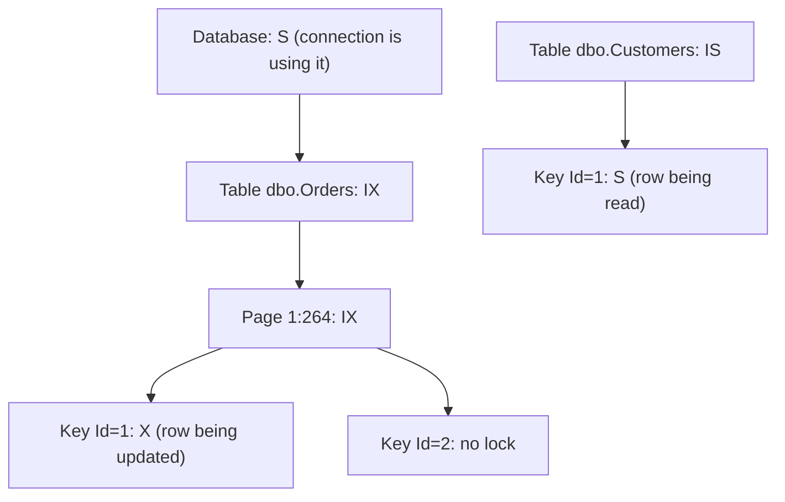
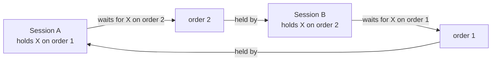
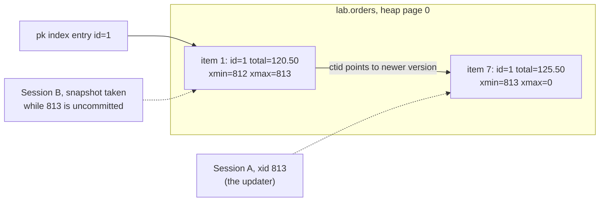
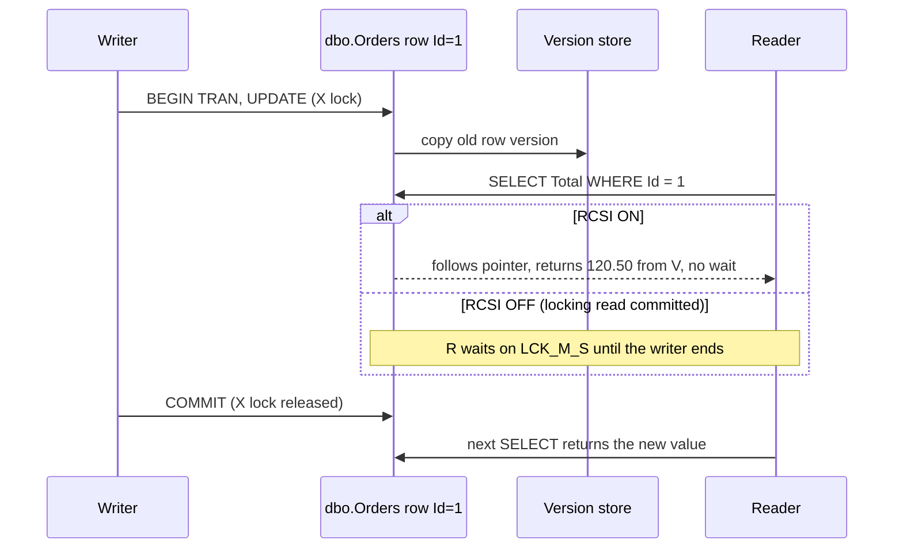

<div dir="rtl" markdown="1">

# 10. هم‌روندی: قفل، latch و MVCC

> **سطح:** L3 ارشد (بخش‌های 1 و 2 در سطح L2) | **بخش:** I | **ارجاع‌های Rowlit خوانده‌شده در:** `1d57848` (Rowlit 1.6.3)
> **در یک جمله:** موتورها تراکنش‌های هم‌زمان را با قفل (صبر کن تا دیگری تمام کند) و با سطرهای چندنسخه‌ای (به‌جای صبر، نسخهٔ قدیمی‌تر را بخوان) از هم جدا نگه می‌دارند و هر موتور این دو را به شیوهٔ خودش می‌آمیزد.
> **چه می‌آموزید:**
> - حالت‌های قفل (اشتراکی، انحصاری، به‌روزرسانی، نیت)، دانه‌بندی و ارتقای قفل، و خواندن ماتریس سازگاری؛
> - انتظار قفل، مهلت، بن‌بست و زنجیرهٔ انسداد چگونه پدید می‌آیند و گزارش بن‌بست را در چهار موتور چطور بخوانیم؛
> - MVCC در PostgreSQL، SQL Server، Oracle، InnoDB و SQLite چگونه کار می‌کند و چه هزینه‌ای دارد (VACUUM، انبارهٔ نسخه‌ها، undo)؛
> - تفاوت latch و قفل؛
> - هم‌روندی خوش‌بینانه در برابر بدبینانه، `FOR UPDATE`، `NOWAIT` و `SKIP LOCKED`.
>
> **پیش‌نیازها:** [9. تراکنش‌ها، ACID و جداسازی](09-transactions-and-isolation.md)، [6. سازوکار درونی ذخیره‌سازی](06-storage-internals.md)، [7. نمایه‌ها](07-indexes.md).
>
> [English](../../en/part1/10-concurrency-locking-mvcc.md) · قبلی: [9. تراکنش‌ها، ACID و جداسازی](09-transactions-and-isolation.md) · بعدی: [11. WAL، redo/undo، checkpoint و بازیابی](11-logging-and-recovery.md)
>
> برچسب‌های نمودارها به انگلیسی نگه داشته شده‌اند تا در GitHub درست نمایش داده شوند.

---

<a id="1-the-idea-beginner"></a>
## 1. ایده (مبتدی)

کتابخانه‌ای را در نظر بگیرید که از هر کتاب فقط یک نسخه دارد. اگر بخواهید صفحه‌ای را اصلاح کنید، کتاب را تا پایان کار با خود می‌برید و
هر کس بخواهد بخواندش باید صبر کند. این **قفل‌گذاری** است. حالا فرض کنید کتابخانه پیش از آن‌که شروع به نوشتن کنید از صفحه کپی می‌گیرد.
خواننده‌ها کپی را می‌گیرند و صبر نمی‌کنند؛ فقط کسی که او هم بخواهد روی همان صفحه *بنویسد* باید صبر کند. این
**کنترل هم‌روندی چندنسخه‌ای** است: نویسنده نسخهٔ تازه‌ای از سطر می‌سازد و خواننده‌ها تا commit نویسنده نسخهٔ قدیمی را می‌خوانند.

همهٔ موتورهای رابطه‌ای برای نوشتن قفل به کار می‌برند، چون دو نفر هرگز نباید هم‌زمان یک سطر را بنویسند. تفاوت بزرگ موتورها در رفتار
*خواننده‌ها*ست: در موتور تماماً قفلی (SQL Server با تنظیم پیش‌فرض، `SERIALIZABLE` در MySQL) خواننده ممکن است منتظر نویسنده بماند؛ در موتور
MVCC (PostgreSQL، Oracle، InnoDB برای `SELECT` ساده، SQL Server با گزینه‌های snapshot) خواننده هرگز منتظر نویسنده نمی‌ماند. این فصل هر دو
سازوکار را نشان می‌دهد، مشکلاتی را که می‌سازند (بن‌بست، انسداد، نسخه‌های قدیمی که باید پاک شوند) و روش تشخیص آن‌ها را.

<a id="2-how-it-works-practitioner"></a>
## 2. چگونه کار می‌کند (کاربردی)

<a id="21-locks-and-lock-modes"></a>
### 2.1 قفل‌ها و حالت‌های قفل

**[قفل (lock)](../glossary.md#lock)** تعهدی است که نزد مدیر قفل موتور ثبت می‌شود: «تراکنش T منبع R را در حالت M به کار می‌برد؛ هر کس
حالت ناسازگاری بخواهد باید صبر کند». قفل‌ها تا پایان تراکنش باقی می‌مانند (برای نوشتن همیشه، برای خواندن بسته به سطح جداسازی،
[9](09-transactions-and-isolation.md#26-the-isolation-levels) را ببینید).

حالت‌های پایه:

- **[قفل اشتراکی (shared lock)](../glossary.md#shared-lock)** (S): برای خواندن. چند تراکنش می‌توانند هم‌زمان S روی یک سطر داشته باشند.
- **[قفل انحصاری (exclusive lock)](../glossary.md#exclusive-lock)** (X): برای نوشتن. تنها یک دارنده؛ با هر حالت دیگری ناسازگار.
- **[قفل به‌روزرسانی (update lock)](../glossary.md#update-lock)** (U، در SQL Server): وقتی `UPDATE` در حال *جست‌وجوی* سطرهای هدف است گرفته
  می‌شود. با S سازگار است اما با U دیگر نه. جلوی بن‌بست کلاسیک تبدیل را می‌گیرد که در آن دو تراکنش S روی یک سطر دارند و هر دو می‌خواهند
  به X ارتقا دهند.
- **[قفل‌های نیت (intent lock)](../glossary.md#intent-lock)** (IS، IX، SIX): روی *ظرف‌های* یک قفل سطری (جدول، صفحه) گذاشته می‌شوند تا موتور
  بتواند بی‌آن‌که همهٔ قفل‌های سطری را بگردد بپرسد «کسی سطرهای این جدول را قفل کرده؟». تراکنشی که قفل X روی کل جدول می‌خواهد فقط باید
  دنبال قفل‌های IS/IX روی جدول بگردد.

**شکل 10.1 — سلسله‌مراتب قفل: قفل سطری یعنی قفل نیت روی صفحه و جدولش.**

</div>



<div dir="rtl" markdown="1">

**[ماتریس سازگاری](../glossary.md#lock-compatibility)** می‌گوید چه کسی منتظر می‌ماند. این ماتریس SQL Server است («بله» یعنی هر دو
هم‌زمان پذیرفته می‌شوند):

| درخواستی ↓ / موجود ← | IS | IX | S | SIX | U | X |
|---|---|---|---|---|---|---|
| **IS** | بله | بله | بله | بله | بله | نه |
| **IX** | بله | بله | نه | نه | نه | نه |
| **S** | بله | نه | بله | نه | بله | نه |
| **SIX** | بله | نه | نه | نه | نه | نه |
| **U** | بله | نه | بله | نه | نه | نه |
| **X** | نه | نه | نه | نه | نه | نه |

PostgreSQL واژگان خودش را دارد. در **سطح جدول** هشت حالت هست؛ آن‌هایی که بیشتر می‌بینید:

| حالت | چه کسی می‌گیرد | با چه چیزی ناسازگار است (خلاصه) |
|---|---|---|
| `ACCESS SHARE` | `SELECT` | فقط `ACCESS EXCLUSIVE` |
| `ROW SHARE` | `SELECT … FOR UPDATE/SHARE` | `EXCLUSIVE`، `ACCESS EXCLUSIVE` |
| `ROW EXCLUSIVE` | `INSERT`، `UPDATE`، `DELETE`، `MERGE` | `SHARE` و قوی‌تر |
| `SHARE UPDATE EXCLUSIVE` | `VACUUM`، `ANALYZE`، `CREATE INDEX CONCURRENTLY` | خودش و قوی‌تر |
| `SHARE` | `CREATE INDEX` (غیرهم‌روند) | `ROW EXCLUSIVE` و نویسنده‌ها |
| `ACCESS EXCLUSIVE` | `DROP`، `TRUNCATE`، بیشتر `ALTER TABLE`، `VACUUM FULL` | همه چیز، حتی `SELECT` |

در **سطح سطر** PostgreSQL این‌ها را دارد: `FOR UPDATE`، `FOR NO KEY UPDATE` (آنچه `UPDATE` معمولی وقتی ستون کلید را تغییر نمی‌دهد
می‌گیرد)، `FOR SHARE` و `FOR KEY SHARE` (آنچه بررسی کلید خارجی روی سطر والد می‌گیرد). قفل‌های سطری در حافظهٔ مدیر قفل نگه داشته نمی‌شوند:
در خود سطر نوشته می‌شوند (فیلد `xmax`، [3.2](#32-postgresql-mvcc-in-detail) را ببینید). به همین دلیل PostgreSQL می‌تواند میلیون‌ها سطر
را بدون تمام‌شدن حافظهٔ قفل، قفل کند و هرگز قفل را ارتقا نمی‌دهد.

<a id="22-granularity-and-lock-escalation"></a>
### 2.2 دانه‌بندی و ارتقای قفل

قفل می‌تواند یک سطر (`RID` یا `KEY` در SQL Server)، یک صفحه، یک پارتیشن، یک جدول یا کل پایگاه داده را بپوشاند. قفل‌های ریز هم‌روندی
بیشتری می‌دهند اما برای هر قفل حافظه و CPU مصرف می‌کنند؛ قفل‌های درشت ارزان‌اند ولی بیشتر مسدود می‌کنند.

**[ارتقای قفل (lock escalation)](../glossary.md#lock-escalation)** یعنی موتور قفل‌های ریز فراوان را با یک قفل درشت جایگزین کند. SQL Server
وقتی یک دستور حدود **5,000 قفل روی یک جدول یا نمایه** گرفته باشد (یا حافظهٔ قفل زیر فشار باشد) سعی می‌کند ارتقا دهد، به جدول یا، اگر
گزینهٔ جدول `LOCK_ESCALATION = AUTO` باشد، به پارتیشن. یک `DELETE` بزرگ که به قفل X جدول ارتقا یابد ناگهان همهٔ خواننده‌های جدول را مسدود
می‌کند. پاسخ‌های معمول: حذف در دسته‌هایی کمتر از آستانه، افزودن نمایه تا سطرهای کمتری لمس شوند، یا با احتیاط
`ALTER TABLE … SET (LOCK_ESCALATION = DISABLE)`.

PostgreSQL، Oracle و InnoDB قفل سطری را ارتقا نمی‌دهند: PostgreSQL و Oracle آن را در بلوک داده نگه می‌دارند و InnoDB در یک bitmap فشرده برای
هر صفحه در سامانهٔ قفلش.

<a id="23-lock-waits-and-timeouts"></a>
### 2.3 انتظار قفل و مهلت

وقتی درخواستی با قفل موجود ناسازگار باشد، درخواست‌کننده **منتظر می‌ماند**. بیشتر موتورها به‌طور پیش‌فرض تا ابد (یا خیلی طولانی) صبر
می‌کنند و همین یک تراکنش فراموش‌شده را به قطعی سرویس تبدیل می‌کند. هرجا مهم است یک **[مهلت قفل (lock timeout)](../glossary.md#lock-timeout)**
بگذارید:

| موتور | تنظیم | پیش‌فرض | خطا پس از مهلت |
|---|---|---|---|
| PostgreSQL | `SET lock_timeout = '5s'` | `0` (بی‌پایان) | `55P03 lock_not_available` |
| SQL Server | `SET LOCK_TIMEOUT 5000` (میلی‌ثانیه) | `-1` (بی‌پایان) | خطای 1222 |
| MySQL InnoDB | `innodb_lock_wait_timeout` (ثانیه) | 50 | خطای 1205 (به‌طور پیش‌فرض فقط دستور برگردانده می‌شود) |
| Oracle | `SELECT … FOR UPDATE WAIT 5` / `NOWAIT` | بی‌پایان | `ORA-30006` / `ORA-00054` |
| SQLite | busy timeout (`PRAGMA busy_timeout`) | در کتابخانهٔ C صفر؛ درایورها اغلب مقداری می‌گذارند | `SQLITE_BUSY` |

> **در Rowlit:** اتصال‌های SQLite مهلت busy را از پروفایل می‌گیرند، اگر تنظیم نشده باشد 30 ثانیه
> (`engine/src/DbStudio.Providers.Sqlite/SqliteConnections.cs:20`).

یک قطعی کلاسیک در PostgreSQL نشان می‌دهد چرا `lock_timeout` برای DDL مهم است. گزارشی طولانی `ACCESS SHARE` روی `orders` نگه داشته. کسی
`ALTER TABLE orders ADD COLUMN note text;` را اجرا می‌کند که `ACCESS EXCLUSIVE` می‌خواهد و منتظر می‌ماند. حالا هر `SELECT` تازه روی `orders`
*پشت ALTER منتظر* صف می‌کشد (درخواست‌های قفل به ترتیب پذیرفته می‌شوند)، پس برنامه از کار می‌افتد هرچند خود ALTER چند میلی‌ثانیه طول
می‌کشید. اجرای DDL با `SET lock_timeout = '2s'` و تکرار آن، این مشکل را برطرف می‌کند.

<a id="24-deadlocks"></a>
### 2.4 بن‌بست‌ها

**[بن‌بست (deadlock)](../glossary.md#deadlock)** چرخه‌ای از انتظارهاست: A منتظر قفلی است که B دارد، و B منتظر قفلی است که A دارد. هیچ‌کدام
هرگز جلو نمی‌روند. موتورها چرخه را کشف می‌کنند و با برگرداندن یکی از شرکت‌کننده‌ها، یعنی **[قربانی بن‌بست (deadlock victim)](../glossary.md#deadlock-victim)**،
آن را می‌شکنند.

**شکل 10.2 — بن‌بست: دو نشست سفارش‌های 1 و 2 را به ترتیب معکوس به‌روز می‌کنند.**

</div>



<div dir="rtl" markdown="1">

آن را روی کپی آزمایشی فصل 9 (`lab.orders`) بازسازی کنید:

| گام | نشست A | نشست B |
|---|---|---|
| 1 | `BEGIN; UPDATE lab.orders SET total = total + 1 WHERE id = 1;` | |
| 2 | | `BEGIN; UPDATE lab.orders SET total = total + 1 WHERE id = 2;` |
| 3 | `UPDATE lab.orders SET total = total + 1 WHERE id = 2;` (منتظر) | |
| 4 | | `UPDATE lab.orders SET total = total + 1 WHERE id = 1;` ← چرخه |

PostgreSQL پس از آن‌که نشستی به اندازهٔ `deadlock_timeout` (پیش‌فرض 1 ثانیه) منتظر ماند، چرخه را بررسی می‌کند و نشستی را که بررسی کرده لغو
می‌کند (خروجی نمونه):

</div>

```text
ERROR:  deadlock detected
DETAIL:  Process 4242 waits for ShareLock on transaction 816; blocked by process 4240.
Process 4240 waits for ShareLock on transaction 815; blocked by process 4242.
HINT:  See server log for query details.
CONTEXT:  while updating tuple (0,1) in relation "orders"
```

<div dir="rtl" markdown="1">

چگونه بخوانیم: «waits for ShareLock on transaction 816» یعنی «منتظر پایان تراکنش 816 است»؛ PostgreSQL این‌گونه منتظر قفل سطر می‌ماند
(`xmax` سطر، تراکنش دارنده را نام می‌برد). `(0,1)` نشانی فیزیکی سطر است (صفحهٔ 0، قلم 1). دستورهای هر دو فرایند در لاگ سرور است، نه در
کلاینت. SQLSTATE برابر `40P01` است.

**SQL Server** یک رشتهٔ ناظر بن‌بست دارد که هر 5 ثانیه اجرا می‌شود (و تا وقتی بن‌بست پیدا می‌کند، زودتر). قربانی را ابتدا بر پایهٔ
`SET DEADLOCK_PRIORITY` و سپس بر پایهٔ ارزان‌ترین تراکنش برای برگرداندن انتخاب می‌کند و قربانی خطای 1205 می‌گیرد:
*Transaction (Process ID 53) was deadlocked on lock resources with another process and has been chosen as the deadlock victim. Rerun the
transaction.* **[گراف بن‌بست (deadlock graph)](../glossary.md#deadlock-graph)** کامل را نشست توکار Extended Events به نام `system_health` ثبت
می‌کند:

</div>

```sql
-- SQL Server: the most recent deadlock graphs from system_health (ring buffer target)
SELECT x.ev.value('@timestamp', 'datetime2') AS at_utc, x.ev.query('(data/value/deadlock)[1]') AS graph
FROM (SELECT CAST(st.target_data AS xml) AS t
      FROM sys.dm_xe_session_targets st
      JOIN sys.dm_xe_sessions s ON s.address = st.event_session_address
      WHERE s.name = N'system_health' AND st.target_name = N'ring_buffer') d
CROSS APPLY d.t.nodes('RingBufferTarget/event[@name="xml_deadlock_report"]') x(ev);
```

<div dir="rtl" markdown="1">

یک گراف کوتاه‌شده (خروجی نمونه) و روش خواندن آن:

</div>

```xml
<deadlock>
  <victim-list><victimProcess id="process2" /></victim-list>
  <process-list>
    <process id="process1" spid="53" waitresource="KEY: 5:72057594043236352 (8194443284a0)" lockMode="U">
      <inputbuf>UPDATE dbo.Orders SET Total = Total + 1 WHERE Id = 2</inputbuf></process>
    <process id="process2" spid="54" waitresource="KEY: 5:72057594043236352 (61a06abd401c)" lockMode="U">
      <inputbuf>UPDATE dbo.Orders SET Total = Total + 1 WHERE Id = 1</inputbuf></process>
  </process-list>
  <resource-list>
    <keylock objectname="shop.dbo.Orders" indexname="PK_Orders" mode="X">
      <owner-list><owner id="process2" mode="X" /></owner-list>
      <waiter-list><waiter id="process1" mode="U" requestType="wait" /></waiter-list></keylock>
    <!-- … the second keylock, owned by process1, awaited by process2 … -->
  </resource-list>
</deadlock>
```

<div dir="rtl" markdown="1">

آن را مانند یک گراف بخوانید: هر `keylock` یک یال است، «owner دارد، waiter می‌خواهد». `KEY: 5:72057594043236352 (8194443284a0)` یعنی شناسهٔ
پایگاه داده، شناسهٔ پارتیشن نمایه (hobt) و هش کلید. `inputbuf` آخرین دستهٔ هر نشست را نشان می‌دهد.

**MySQL InnoDB** بن‌بست را فوراً کشف می‌کند (`innodb_deadlock_detect = ON`) و تراکنشی را که کمترین سطر را تغییر داده برمی‌گرداند؛ کلاینت
خطای 1213 می‌گیرد: *Deadlock found when trying to get lock; try restarting transaction*. آخرین بن‌بست در `SHOW ENGINE INNODB STATUS` زیر
`LATEST DETECTED DEADLOCK` است، با بخش‌های `*** (1) TRANSACTION`، `*** (1) HOLDS THE LOCK(S)` و `*** (1) WAITING FOR THIS LOCK TO BE GRANTED`
برای هر طرف و `*** WE ROLL BACK TRANSACTION (2)`. برای ثبت همهٔ بن‌بست‌ها `innodb_print_all_deadlocks = ON` بگذارید.

**Oracle** در یک نشست خطای `ORA-00060: deadlock detected while waiting for resource` می‌دهد و **فقط دستور جاری همان نشست** را برمی‌گرداند؛
تراکنش باز می‌ماند و برنامه باید rollback یا تکرار کند. alert log به یک فایل trace اشاره می‌کند که «Deadlock graph» را با منابع `TX-…`
و SQL نشان می‌دهد.

پیشگیری از کشف مهم‌تر است:

1. **سطرها را همه‌جا به یک ترتیب لمس کنید** (مثلاً همیشه به ترتیب صعودی کلید اصلی). اگر هر دو نشست ابتدا سفارش 1 را به‌روز کنند، شکل 10.2
   رخ نمی‌دهد.
2. **تراکنش‌ها را کوتاه نگه دارید** و درون آن‌ها منتظر کاربر یا شبکه نمانید.
3. **کلیدهای خارجی و ستون‌های جست‌وجو را نمایه کنید** تا دستورها به‌جای پویش (و قفل) سطرهای زیاد، سطرهای کمی را قفل کنند.
4. **قوی‌ترین قفل را اول بگیرید** (`SELECT … FOR UPDATE` پیش از خواندن‌ـ‌سپس‌ـ‌نوشتن) به‌جای ارتقای S به X.
5. **قربانی را خودکار تکرار کنید**؛ بن‌بست در یک سامانهٔ OLTP شلوغ رویدادی عادی است، نه باگ موتور.

<a id="25-blocking-chains-and-kill"></a>
### 2.5 زنجیره‌های انسداد و kill

**[زنجیرهٔ انسداد (blocking chain)](../glossary.md#blocking-chain)** صفی از انتظارهاست: C منتظر B است، B منتظر A، و A منتظر هیچ چیز نیست؛ فقط
کند است یا در یک تراکنش باز بیکار مانده. A **[مسدودکنندهٔ سرِ زنجیره (head blocker)](../glossary.md#head-blocker)** است. kill کردن B یا C
کاری نمی‌کند؛ باید A را پیدا کنید. هر موتور «چه کسی چه کسی را مسدود کرده» را نشان می‌دهد:

</div>

```sql
-- PostgreSQL: each waiting backend and the pids that block it
SELECT pid, pg_blocking_pids(pid) AS blocked_by, state, wait_event_type, wait_event,
       now() - xact_start AS xact_age, left(query, 60) AS query
FROM pg_stat_activity
WHERE datname = current_database() AND (cardinality(pg_blocking_pids(pid)) > 0 OR state = 'idle in transaction');

-- SQL Server
SELECT r.session_id, r.blocking_session_id, r.wait_type, r.wait_time, t.text
FROM sys.dm_exec_requests r CROSS APPLY sys.dm_exec_sql_text(r.sql_handle) t
WHERE r.blocking_session_id <> 0;

-- Oracle
SELECT sid, serial#, blocking_session, event, seconds_in_wait, sql_id FROM v$session WHERE blocking_session IS NOT NULL;

-- MySQL 8
SELECT * FROM sys.innodb_lock_waits;
```

<div dir="rtl" markdown="1">

در PostgreSQL نشست منتظر `wait_event_type = 'Lock'` و `wait_event = 'transactionid'` (قفل سطر) یا `'relation'` (قفل جدول) دارد. در SQL Server
نوع انتظار با `LCK_M_` و سپس حالت قفل شروع می‌شود: `LCK_M_U` برای `UPDATE`ی که منتظر یافتن سطرهایش است، `LCK_M_S` برای خواننده‌ای که پشت
نویسنده مانده.

برای پایان‌دادن به مسدودکنندهٔ سرِ زنجیره:

| موتور | لغو دستور در حال اجرا | پایان نشست (تراکنشش برگردانده می‌شود) |
|---|---|---|
| PostgreSQL | `SELECT pg_cancel_backend(pid)` | `SELECT pg_terminate_backend(pid)` |
| SQL Server | (attention از سوی کلاینت) | `KILL spid` |
| Oracle | `ALTER SYSTEM CANCEL SQL 'sid, serial#'` | `ALTER SYSTEM KILL SESSION 'sid,serial#' IMMEDIATE` |
| MySQL | `KILL QUERY id` | `KILL id` |

kill کردن نشستی که دادهٔ زیادی تغییر داده یک rollback آغاز می‌کند که ممکن است به اندازهٔ خود کار طول بکشد؛ قفل‌ها تا پایان rollback
می‌مانند.

> **در Rowlit:** نمای Activity همین منابع را می‌خواند (`pg_blocking_pids` در
> `engine/src/DbStudio.Logs/Providers/PostgreSql/PgLogSource.cs:63`، `blocking_session_id` در
> `engine/src/DbStudio.Logs/Providers/SqlServer/SqlServerLogSql.cs:85`، `BLOCKING_SESSION` در
> `engine/src/DbStudio.Logs/Providers/Oracle/OracleLogSource.cs:61`، `performance_schema.data_lock_waits` در
> `engine/src/DbStudio.Logs/Providers/MySql/MySqlLogSource.cs:47-53`) و کنش Kill آن دستورهای جدول بالا را صادر می‌کند (`PgLogSource.cs:84`،
> `SqlServerLogSql.cs:107`، `OracleLogSource.cs:70`، `MySqlLogSource.cs:64`). [فصل 21 بخش دوم](../part2/21-logs-activity-resources.md) را ببینید.

<a id="26-mvcc-readers-do-not-wait-for-writers"></a>
### 2.6 MVCC: خواننده منتظر نویسنده نمی‌ماند

**[MVCC](../glossary.md#mvcc)** (کنترل هم‌روندی چندنسخه‌ای) چند نسخه از یک سطر نگه می‌دارد. نویسنده نسخهٔ تازه می‌سازد؛ خواننده نسخه‌ای را
برمی‌دارد که تا لحظهٔ **[تصویر لحظه‌ای (snapshot)](../glossary.md#snapshot-mvcc)** خودش commit شده بوده (لحظهٔ آغاز دستور یا تراکنش، بسته به
سطح جداسازی). پس خواننده هرگز منتظر نویسنده نمی‌ماند و نویسنده هرگز منتظر خواننده. نویسنده‌ها هنوز منتظر نویسنده‌های دیگرِ همان سطر می‌مانند.

جای نگه‌داری نسخه‌های قدیمی انتخاب اصلی طراحی است و کارهای نگه‌داری هر موتور را توضیح می‌دهد:

| موتور | نسخهٔ قدیمی کجاست | چه کسی پاکش می‌کند | مشکل معمول |
|---|---|---|---|
| PostgreSQL | در خود جدول: **[نسخهٔ تاپل (tuple version)](../glossary.md#tuple-version)** قدیمی در heap می‌ماند و نسخهٔ تازه تاپلی تازه است | **[VACUUM](../glossary.md#vacuum)** / autovacuum | **[حجیم‌شدگی (bloat)](../glossary.md#bloat)**، دورزدن شناسهٔ تراکنش |
| SQL Server (RCSI / SNAPSHOT) | **[انبارهٔ نسخه‌ها (version store)](../glossary.md#version-store)** در `tempdb` (یا انبارهٔ نسخهٔ ماندگار در خود پایگاه داده با Accelerated Database Recovery) | پاک‌سازی پس‌زمینه | رشد `tempdb` در تراکنش‌های طولانی |
| Oracle | قطعه‌های **[undo](../glossary.md#undo)**؛ بلوک تازه‌ترین نسخه را دارد | undo پس از `UNDO_RETENTION` بازنویسی می‌شود | `ORA-01555 snapshot too old` |
| MySQL InnoDB | لاگ‌های undo؛ نمایهٔ خوشه‌ای تازه‌ترین نسخه را دارد | رشته‌های purge | رشد *history list length* |
| SQLite (حالت WAL) | فایل WAL صفحه‌های تازه‌تر را دارد؛ خواننده‌ها صفحه‌های قدیمی‌تر را می‌خوانند | checkpoint | رشد فایل WAL وقتی خواننده‌ها نمی‌گذارند checkpoint تمام شود |

**شکل 10.3 — PostgreSQL: یک UPDATE تاپل دومی می‌نویسد و هر snapshot یکی را برمی‌دارد.**

</div>



<div dir="rtl" markdown="1">

این را با ستون‌های سیستمی می‌توانید ببینید (خروجی نمونه، PostgreSQL 17):

</div>

```sql
-- Session A
SELECT xmin, xmax, ctid, id, total FROM lab.orders WHERE id = 1;
--  xmin | xmax | ctid  | id | total
--   812 |    0 | (0,1) |  1 | 120.50
BEGIN;
UPDATE lab.orders SET total = 125.50 WHERE id = 1;
SELECT pg_current_xact_id();          -- 813
SELECT xmin, xmax, ctid, total FROM lab.orders WHERE id = 1;
--   813 |    0 | (0,7) | 125.50      -- A sees its own new version
```

```sql
-- Session B, while A has not committed
SELECT xmin, xmax, ctid, total FROM lab.orders WHERE id = 1;
--   812 |  813 | (0,1) | 120.50      -- B sees the old version; xmax shows who is replacing it
```

<div dir="rtl" markdown="1">

[`xmin`](../glossary.md#xmin-xmax) شناسهٔ تراکنشی است که نسخه را ساخته، `xmax` شناسهٔ تراکنشی که آن را حذف یا جایگزین (یا قفل) کرده، و `ctid`
نشانی فیزیکی است ([6](06-storage-internals.md)). پس از commit نشست A، دستور بعدی B (در READ COMMITTED) نسخهٔ `(0,7)` را می‌بیند. نسخهٔ
`(0,1)` اکنون **[مرده (dead tuple)](../glossary.md#dead-tuple)** است: هیچ snapshot آینده‌ای آن را نمی‌بیند، اما تا VACUUM حذفش نکند فضا اشغال
می‌کند.

**SQL Server** دو گزینهٔ [نسخه‌بندی سطرها (row versioning)](../glossary.md#row-versioning) دارد که در SQL Server 2022 هر دو به‌طور پیش‌فرض
خاموش‌اند:

</div>

```sql
-- Use a scratch database: the option needs exclusive access and changes behaviour for every session
CREATE DATABASE lab_rcsi;
ALTER DATABASE lab_rcsi SET READ_COMMITTED_SNAPSHOT ON;    -- RCSI: READ COMMITTED reads versions (statement level)
ALTER DATABASE lab_rcsi SET ALLOW_SNAPSHOT_ISOLATION ON;   -- enables SET TRANSACTION ISOLATION LEVEL SNAPSHOT
-- … when done: DROP DATABASE lab_rcsi;
```

<div dir="rtl" markdown="1">

**شکل 10.4 — SQL Server: خواندن READ COMMITTED در حین یک به‌روزرسانی، با RCSI و بدون آن.**

</div>



<div dir="rtl" markdown="1">

<a id="27-optimistic-and-pessimistic-concurrency"></a>
### 2.7 هم‌روندی خوش‌بینانه و بدبینانه

این دو واژه راهبرد *برنامه* را برای یک خواندن‌ـ‌تغییرـ‌نوشتن توصیف می‌کنند، فراتر از آنچه موتور انجام می‌دهد.

**[هم‌روندی بدبینانه (pessimistic concurrency)](../glossary.md#pessimistic-concurrency)**: آنچه می‌خوانید را قفل کنید، چون انتظار تعارض دارید.

</div>

```sql
-- PostgreSQL / Oracle / MySQL 8
BEGIN;
SELECT total FROM lab.orders WHERE id = 1 FOR UPDATE;            -- others wait here
UPDATE lab.orders SET total = 125.50 WHERE id = 1;
COMMIT;

SELECT * FROM lab.orders WHERE id = 1 FOR UPDATE NOWAIT;         -- fail at once instead of waiting
SELECT id FROM lab.orders WHERE status = 'new'
ORDER BY id LIMIT 1 FOR UPDATE SKIP LOCKED;                      -- job queue: take the first row nobody holds
```

```sql
-- SQL Server equivalents
SELECT Total FROM dbo.Orders WITH (UPDLOCK, ROWLOCK) WHERE Id = 1;
SELECT TOP (1) Id FROM dbo.Orders WITH (UPDLOCK, READPAST, ROWLOCK) ORDER BY Id;   -- READPAST ≈ SKIP LOCKED
```

<div dir="rtl" markdown="1">

[`SKIP LOCKED`](../glossary.md#skip-locked) (PostgreSQL 9.5 به بعد، MySQL 8.0 به بعد، Oracle) جدول را به صف کار امنی برای چندین کارگر تبدیل
می‌کند: هر کارگر سطر متفاوتی را قفل می‌کند و هیچ‌کدام منتظر نمی‌ماند.

**[هم‌روندی خوش‌بینانه (optimistic concurrency)](../glossary.md#optimistic-concurrency)**: بدون قفل بخوانید و هنگام نوشتن بررسی کنید که سطر از
آن زمان تغییر نکرده باشد.

</div>

```sql
-- PostgreSQL: a version column
ALTER TABLE lab.orders ADD COLUMN version integer NOT NULL DEFAULT 0;
SELECT total, version FROM lab.orders WHERE id = 1;              -- 120.50, 0
UPDATE lab.orders SET total = 125.50, version = version + 1
WHERE id = 1 AND version = 0;                                    -- 1 row: success; 0 rows: someone else won
```

<div dir="rtl" markdown="1">

SQL Server برای این کار نوع داخلی دارد: ستون `rowversion` با هر به‌روزرسانی خودکار تغییر می‌کند و شرط بررسی `WHERE Id = 1 AND RowVer =
@readRowVer` است. APIهای وب همین ایده را با سرآیند **ETag** نشان می‌دهند. هم‌روندی خوش‌بینانه برای ویرایش تعاملی مناسب است (کاربر ممکن است
فرمی را چند دقیقه باز نگه دارد و نگه‌داشتن قفل در این مدت پذیرفتنی نیست)؛ قفل بدبینانه برای تراکنش‌های کوتاه، داغ و سمت سرور که تعارض
در آن‌ها زیاد است مناسب‌تر است.

<a id="3-deep-dive-senior"></a>
## 3. ژرفا (ارشد)

<a id="31-latches-are-not-locks"></a>
### 3.1 latch قفل نیست

**[latch](../glossary.md#latch)** ابزار طرد متقابل کوتاه‌مدت درون حافظه است که از یک ساختار *فیزیکی* داده (یک صفحهٔ بافر، یک گرهٔ B-tree، یک
سطل هش در مدیر قفل) برای چند میکروثانیه محافظت می‌کند، وقتی رشته‌ای آن را می‌خواند یا تغییر می‌دهد. قفل‌ها از دادهٔ *منطقی* (سطر، کلید،
جدول) به اندازهٔ طول یک تراکنش محافظت می‌کنند.

| | قفل | latch |
|---|---|---|
| از چه محافظت می‌کند | دادهٔ منطقی، تا commit | ساختاری درون حافظه، برای یک عملیات |
| مدت نگه‌داری | میلی‌ثانیه تا ساعت | نانو تا میکروثانیه |
| بن‌بست | موتور کشف و رفعش می‌کند | با قواعد کدنویسی (ترتیب ثابت latch) پرهیز می‌شود؛ هرگز کشف نمی‌شود |
| کجا دیده می‌شود | `pg_locks`، `sys.dm_tran_locks`، `data_locks` | رویدادهای انتظار: `LWLock:*` و `BufferContent` در PostgreSQL؛ `PAGELATCH_*` در SQL Server؛ `latch:*` و `cursor: pin S` در Oracle |

رقابت بر سر latch نشانهٔ یک نقطهٔ داغ فیزیکی است. مثال کتاب درسی آن *رقابت درج در صفحهٔ آخر* در SQL Server است: نشست‌های زیادی که کلیدهای
افزایشی (identity، sequence، `getdate()`) درج می‌کنند همه به همان صفحهٔ برگ آخر نمایهٔ خوشه‌ای نیاز دارند و روی `PAGELATCH_EX` صف می‌کشند.
راه‌حل‌ها: گزینهٔ نمایه `OPTIMIZE_FOR_SEQUENTIAL_KEY = ON` (SQL Server 2019 به بعد)، کلید غیرترتیبی، یا پارتیشن‌بندی هش. تفاوت آن را با
`PAGEIOLATCH_*` بدانید که یعنی «منتظر *خوانده‌شدن* صفحه از دیسک»: آن مشکل I/O است، نه رقابت.

<a id="32-postgresql-mvcc-in-detail"></a>
### 3.2 MVCC در PostgreSQL، با جزئیات

**snapshotها.** یک snapshot سه چیز است: `xmin` (هر شناسهٔ تراکنش کمتر از آن تمام شده)، `xmax` (هر شناسهٔ برابر یا بیشتر از آن هنوز شروع نشده
بود) و فهرست شناسه‌های میان این دو که هنوز در حال اجرا بودند. `SELECT pg_current_snapshot();` آن را به شکل `815:818:815,817` چاپ می‌کند. یک
نسخهٔ تاپل برای snapshot دیدنی است وقتی `xmin` آن commit شده و «در گذشتهٔ» snapshot باشد، و `xmax` آن خالی، لغوشده یا هنوز نه در گذشته باشد.
این‌که تراکنشی commit یا لغو شده در commit log (`pg_xact`) ثبت می‌شود؛ نخستین خواننده‌ای که آن را می‌پرسد روی تاپل **hint bit** می‌گذارد، و
به همین دلیل نخستین `SELECT` پس از یک بارگذاری بزرگ ممکن است صفحه *بنویسد*.

**[به‌روزرسانی‌های HOT](../glossary.md#hot-update).** اگر به‌روزرسانی هیچ ستون نمایه‌داری را تغییر ندهد و نسخهٔ تازه در همان صفحه جا شود،
PostgreSQL یک *heap-only tuple* می‌سازد: مدخل نمایهٔ تازه‌ای ساخته نمی‌شود و نمایه همچنان به آغاز زنجیره در صفحه اشاره می‌کند (شکل 10.3). HOT
دلیل اصلی گذاشتن فضای خالی با `fillfactor` کمتر در جدول‌های پربه‌روزرسانی است ([6](06-storage-internals.md)). مقایسهٔ
`pg_stat_user_tables.n_tup_hot_upd` با `n_tup_upd` نشان می‌دهد چقدر کارگر می‌افتد.

**VACUUM** چهار کار می‌کند: تاپل‌های مردهٔ قدیمی‌تر از قدیمی‌ترین snapshot در حال استفاده (*xmin horizon*) را حذف و فضای آزاد را در free space map
ثبت می‌کند؛ مدخل‌های نمایه‌ای که به آن‌ها اشاره داشتند را حذف می‌کند؛ بیت‌های **visibility map** را برای صفحه‌هایی که همه چیزشان برای همه
دیدنی است می‌گذارد (که index-only scan را ممکن می‌کند، [7](07-indexes.md))؛ و تاپل‌های قدیمی را **منجمد** می‌کند. `VACUUM` ساده فایل را کوچک
نمی‌کند؛ فضا در جای خود دوباره استفاده می‌شود. `VACUUM FULL` جدول را در فایل تازه‌ای بازنویسی می‌کند و در تمام مدت `ACCESS EXCLUSIVE` لازم دارد.

**[autovacuum](../glossary.md#autovacuum)** جدولی را وقتی جارو می‌کند که تاپل‌های مرده‌اش از `autovacuum_vacuum_threshold +
autovacuum_vacuum_scale_factor × reltuples` بگذرد (پیش‌فرض 50 سطر + 20 درصد). در جدولی با 100 میلیون سطر این یعنی 20 میلیون سطر مرده: جدول‌های
بزرگ و داغ معمولاً ضریب کوچک‌تری برای همان جدول می‌خواهند (`ALTER TABLE … SET (autovacuum_vacuum_scale_factor = 0.01)`).

**چه چیزی جلوی VACUUM را می‌گیرد:** هر چیزی که xmin horizon را عقب نگه دارد. مظنونان همیشگی: نشستی در وضعیت `idle in transaction`، پرس‌وجوی
طولانی، **replication slot** رهاشده ([12](12-backup-replication-ha.md))، تراکنش prepared یتیم (`pg_prepared_xacts`)، و standby با
`hot_standby_feedback = on` که پرس‌وجوهای طولانی اجرا می‌کند. تا وقتی هر یک از این‌ها برقرار است، حجیم‌شدگی رشد می‌کند.

</div>

```sql
-- PostgreSQL: dead tuples per table and the oldest transactions holding the horizon back
SELECT relname, n_live_tup, n_dead_tup, last_autovacuum FROM pg_stat_user_tables ORDER BY n_dead_tup DESC LIMIT 10;
SELECT pid, state, now() - xact_start AS age, backend_xmin FROM pg_stat_activity
WHERE backend_xmin IS NOT NULL ORDER BY age(backend_xmin) DESC LIMIT 5;
```

<div dir="rtl" markdown="1">

**[دورزدن شناسهٔ تراکنش (transaction id wraparound)](../glossary.md#transaction-id-wraparound).** شناسه‌های تراکنش 32 بیتی‌اند و به پیمانهٔ
2^32 مقایسه می‌شوند، پس هر شناسه برای حدود 2 میلیارد شناسه «در گذشته» است و پس از آن «در آینده» به نظر می‌رسد. VACUUM با
**[منجمدسازی (freezing)](../glossary.md#freezing)** تاپل‌های قدیمی (علامت‌زدن آن‌ها به‌عنوان دیدنی برای همه، بی‌توجه به شناسه) جلوی فاجعه را
می‌گیرد. autovacuum وقتی قدیمی‌ترین شناسهٔ منجمدنشدهٔ جدول از `autovacuum_freeze_max_age` (پیش‌فرض 200 میلیون) قدیمی‌تر شود، جاروی
ضد wraparound را اجباری می‌کند. اگر منجمدسازی باز هم عقب بماند، PostgreSQL نخست هشدار می‌دهد و سرانجام تا جاروشدن پایگاه داده از دادن
شناسهٔ تراکنش تازه سر باز می‌زند. پایشش کنید:

</div>

```sql
SELECT datname, age(datfrozenxid) AS xid_age FROM pg_database ORDER BY xid_age DESC;
```

<div dir="rtl" markdown="1">

<a id="33-sql-server-row-versioning-in-detail"></a>
### 3.3 نسخه‌بندی سطر در SQL Server، با جزئیات

وقتی RCSI یا SNAPSHOT روشن باشد، هر سطر تغییرکرده یک برچسب نسخه‌بندی 14 بایتی می‌گیرد (شمارهٔ ترتیبی تراکنش و یک اشاره‌گر) و نسخهٔ پیشین
پیش از تغییر در انبارهٔ نسخه‌ها کپی می‌شود. خواننده‌ای که سطری تازه‌تر از snapshot خود پیدا کند، زنجیرهٔ اشاره‌گرها را تا نسخهٔ درست دنبال
می‌کند.

- **[RCSI](../glossary.md#rcsi)** (read committed snapshot isolation) در READ COMMITTED snapshot سطح دستور می‌دهد. کد موجود بی‌تغییر اجرا
  می‌شود، اما معنا تغییر می‌کند: کدی که به *منتظرماندن* خواندن برای نویسنده تکیه داشت (مثلاً منطق «بررسی کن، سپس درج کن») ممکن است حالا
  مقدار قدیمی را بخواند. راهنمای جدول `WITH (READCOMMITTEDLOCK)` هرجا لازم باشد خواندن قفلی را برمی‌گرداند.
- **SNAPSHOT** snapshot سطح تراکنش می‌دهد. اگر تراکنش سطری را به‌روز کند که تراکنش دیگری پس از آغاز snapshot تغییرش داده، با خطای 3960
  (تعارض به‌روزرسانی) شکست می‌خورد. مانند REPEATABLE READ در PostgreSQL، write skew را مجاز می‌کند.
- با **Accelerated Database Recovery** (SQL Server 2019 به بعد، `ALTER DATABASE … SET ACCELERATED_DATABASE_RECOVERY = ON`) نسخه‌ها به *انبارهٔ
  نسخهٔ ماندگار* درون خود پایگاه داده می‌روند. این rollback و بازیابی پس از خرابی را هم تقریباً آنی می‌کند ([11](11-logging-and-recovery.md)).
- نویسنده‌ها همچنان قفل می‌گیرند: دو نویسندهٔ یک سطر همچنان یکدیگر را مسدود می‌کنند و `UPDATE` همچنان U و سپس X می‌گیرد.

<a id="34-oracle-undo-scn-and-consistent-read"></a>
### 3.4 Oracle: undo، SCN و خواندن سازگار

Oracle هر commit را با یک **[شمارهٔ تغییر سیستم (SCN)](../glossary.md#scn)** مهر می‌زند، ساعتی منطقی در سطح کل پایگاه داده. پرس‌وجو SCN لحظهٔ
آغازش را به خاطر می‌سپارد (در سطح دستور در READ COMMITTED، در سطح تراکنش در SERIALIZABLE). هر بلوک داده یک *interested transaction list* (ITL)
دارد که به رکوردهای undo تراکنش‌هایی اشاره می‌کند که سطرهای آن را تغییر داده‌اند. وقتی پرس‌وجو بلوکی را می‌خواند که پس از SCN آن تغییر کرده،
Oracle بلوک را در buffer cache کپی می‌کند و رکوردهای undo را به عقب اعمال می‌کند تا کپی با SCN پرس‌وجو جور شود: یک کپی
**[خواندن سازگار (consistent read)](../glossary.md#consistent-read)** (CR). خواننده‌ها هرگز قفل سطر نمی‌گیرند؛ قفل سطر فقط یک بایت در سطر است که
به یک خانهٔ ITL اشاره می‌کند، پس Oracle هرگز قفل را ارتقا نمی‌دهد.

نقطهٔ ضعف، فضای undo است. اگر undoی که پرس‌وجوی طولانی لازم دارد بازنویسی شده باشد، پرس‌وجو با
**[`ORA-01555: snapshot too old`](../glossary.md#ora-01555)** شکست می‌خورد. `UNDO_RETENTION` (ثانیه، پیش‌فرض 900) یک هدف است نه تضمین، مگر
tablespace undo گزینهٔ `RETENTION GUARANTEE` داشته باشد (آنگاه ممکن است نویسنده‌ها شکست بخورند). همین undo **پرس‌وجوی flashback** را ممکن می‌کند:

</div>

```sql
SELECT id, total FROM shop.orders AS OF TIMESTAMP (SYSTIMESTAMP - INTERVAL '5' MINUTE) WHERE id = 1;
```

<div dir="rtl" markdown="1">

<a id="35-mysql-innodb-undo-read-views-and-next-key-locks"></a>
### 3.5 MySQL InnoDB: undo، read view و قفل next-key

هر رکورد نمایهٔ خوشه‌ای ستون‌های پنهان دارد: `DB_TRX_ID` (آخرین تراکنشی که تغییرش داده)، `DB_ROLL_PTR` (اشاره‌گر به رکورد undo حاوی نسخهٔ
پیشین) و برای جدول‌های بی‌کلید اصلی، `DB_ROW_ID`. خواندن سازگار یک **[نمای خواندن (read view)](../glossary.md#read-view)** می‌سازد (فهرست
تراکنش‌های فعال در آن لحظه)؛ رکوردی که `DB_TRX_ID` آن برای این نما دیدنی نیست با دنبال‌کردن `DB_ROLL_PTR` در لاگ undo بازسازی می‌شود. در
REPEATABLE READ نمای خواندن در نخستین خواندن سازگار تراکنش ساخته می‌شود (یا با `START TRANSACTION WITH CONSISTENT SNAPSHOT`)؛ در READ COMMITTED در
هر دستور. رکوردهای نمایهٔ ثانویه `DB_TRX_ID` ندارند؛ وقتی صفحه ممکن است تغییر تازه داشته باشد، InnoDB باید رکورد خوشه‌ای را بررسی کند، و همین
می‌تواند یک نمایهٔ ثانویهٔ «پوشا» را کمتر از آنچه به نظر می‌رسد پوشا کند.

رشته‌های purge رکوردهای undo و سطرهای علامت‌خوردهٔ حذف را وقتی دیگر هیچ نمای خواندنی لازمشان ندارد پاک می‌کنند. عقب‌ماندگی آن
**[history list length](../glossary.md#history-list-length)** در `SHOW ENGINE INNODB STATUS` (بخش `TRANSACTIONS`) است؛ مقداری که مدام بالا می‌رود
یعنی تراکنشی طولانی جلوی purge را گرفته است.

خواندن‌های قفل‌دار InnoDB (`FOR UPDATE`، `FOR SHARE` و مرحلهٔ جست‌وجوی `UPDATE` / `DELETE`) **رکوردهای نمایه** را قفل می‌کنند و در
REPEATABLE READ از این‌ها استفاده می‌کنند:

- **قفل رکورد** روی مدخل‌های نمایه؛
- **[قفل شکاف (gap lock)](../glossary.md#gap-lock)** روی فضای *میان* مدخل‌های نمایه (درج در آن شکاف را مسدود می‌کند و هیچ چیز دیگری را؛ قفل‌های
  شکاف هرگز با هم تعارض ندارند)؛
- **[قفل کلید بعدی (next-key lock)](../glossary.md#next-key-lock)** = قفل رکورد + قفل شکافِ پیش از آن رکورد؛ InnoDB این‌گونه جلوی phantom را در
  خواندن‌های قفل‌دار می‌گیرد؛
- **قفل نیت درج (insert intention)**، قفل شکاف ویژه‌ای که `INSERT` می‌گیرد و منتظر هر قفل شکافی روی همان شکاف می‌ماند.

یک مثال کامل روی seed مربوط به MySQL در `shop` که `KEY ix_orders_customer (customer_id)` دارد و سفارش‌هایش شناسهٔ مشتری 1، 1، 2، 3، 4، 4 دارند
(مدخل‌های نمایه زوج‌های `(customer_id, id)` هستند: (1,1) (1,2) (2,3) (3,4) (4,5) (4,6)). خروجی نمونه:

</div>

```sql
-- Session A (REPEATABLE READ)
START TRANSACTION;
SELECT id FROM orders WHERE customer_id = 2 FOR UPDATE;     -- returns order 3
SELECT index_name, lock_type, lock_mode, lock_data FROM performance_schema.data_locks;
-- NULL                TABLE   IX              NULL
-- ix_orders_customer  RECORD  X               2, 3     ← next-key lock: entry (2,3) plus the gap after (1,2)
-- PRIMARY             RECORD  X,REC_NOT_GAP   3        ← the clustered row of order 3
-- ix_orders_customer  RECORD  X,GAP           3, 4     ← gap between (2,3) and (3,4)
```

<div dir="rtl" markdown="1">

حالا نشست B سه درج را امتحان می‌کند. سفارشی برای مشتری 2 (`(2,7)` در شکاف پیش از (3,4) می‌افتد) منتظر می‌ماند. سفارشی برای مشتری 1 با شناسهٔ 7
(`(1,7)` میان (1,2) و (2,3)، درون قفل next-key می‌افتد) **آن هم منتظر می‌ماند**، که بیشتر افراد را غافل‌گیر می‌کند. سفارشی برای مشتری 3 با
شناسهٔ 7 (`(3,7)` پس از (3,4) می‌افتد) بی‌مانع انجام می‌شود. در READ COMMITTED قفل شکاف برای جست‌وجوها به کار نمی‌رود، پس فقط قفل‌های رکورد
می‌مانند و phantom دوباره ممکن می‌شود.

<a id="36-sqlite-one-writer-per-file"></a>
### 3.6 SQLite: یک نویسنده برای هر فایل

در حالت پیش‌فرض **rollback journal**، SQLite کل فایل پایگاه داده را در دنباله‌ای از وضعیت‌ها قفل می‌کند: `SHARED` (خواندن؛ چندتایی مجاز)،
`RESERVED` (یک اتصال قصد نوشتن دارد؛ خواننده‌ها می‌توانند ادامه دهند)، `PENDING` (نویسنده منتظر رفتن خواننده‌هاست؛ خوانندهٔ تازه پذیرفته
نمی‌شود) و `EXCLUSIVE` (نوشتن در فایل). خواننده‌ها و نویسنده‌ای که در حال commit است یکدیگر را کنار می‌گذارند.

در **حالت WAL** (`PRAGMA journal_mode = WAL`) نویسنده نسخه‌های تازهٔ صفحه را به فایل `-wal` می‌افزاید، در حالی که خواننده‌ها فایل پایگاه داده
به‌همراه بخشی از WAL را که هنگام آغاز تراکنش خواندنشان وجود داشت می‌خوانند؛ پس خواننده‌ها و نویسنده دیگر یکدیگر را مسدود نمی‌کنند. همچنان
**در هر لحظه یک نویسنده** مجاز است. دو دام:

- دو تراکنش `BEGIN DEFERRED` که هر دو می‌خوانند و سپس هر دو می‌خواهند بنویسند: یکی فوراً `SQLITE_BUSY` می‌گیرد (SQLite صبر نمی‌کند، چون صبر به
  بن‌بست می‌انجامد). در حالت WAL، تراکنش خواندنی که snapshot آن از آخرین commit قدیمی‌تر است اصلاً نمی‌تواند به تراکنش نوشتن ارتقا یابد
  (`SQLITE_BUSY_SNAPSHOT`). برای هر تراکنشی که خواهد نوشت از `BEGIN IMMEDIATE` استفاده کنید.
- خواننده‌ای که هرگز تمام نمی‌شود نمی‌گذارد checkpoint کامل شود، پس فایل WAL مدام بزرگ می‌شود ([11](11-logging-and-recovery.md)).

<a id="37-clickhouse-and-cassandra"></a>
### 3.7 ClickHouse و Cassandra

**ClickHouse** قفل سطر ندارد. `INSERT` یک *part* تازه و تغییرناپذیر می‌نویسد؛ `SELECT` در آغاز، snapshotی از مجموعهٔ partهای موجود می‌گیرد، پس
خواننده‌ها و نویسنده‌ها هرگز یکدیگر را مسدود نمی‌کنند. `ALTER TABLE … UPDATE/DELETE` **mutation** است: بازنویسی ناهم‌زمان partها که در
`system.mutations` دیده می‌شود؛ `DELETE FROM` سبک سطرها را علامت حذف می‌زند و فوراً پنهانشان می‌کند. مشکلات هم‌روندی در ClickHouse بیشتر دربارهٔ
partهای بیش از اندازه (درج‌های کوچک فراوان) است تا قفل ([15](15-oltp-vs-olap-columnar.md)).

**Cassandra** هم قفل ندارد. هر خانه یک مهر زمانی نوشتن دارد و نوشتن‌های متعارض با **آخرین نوشتن برنده است (last-write-wins)** حل می‌شوند؛
خواندن‌ـ‌تغییرـ‌نوشتن هم‌زمان از دو کلاینت به‌سادگی یک به‌روزرسانی را گم می‌کند، مگر از تراکنش سبک استفاده کنید (`UPDATE … IF total = 120.50`)
که برای هر پارتیشن یک دور Paxos اجرا می‌کند و چند رفت‌وبرگشت هزینه دارد. حذف‌ها *tombstone* می‌نویسند ([16](16-nosql-families.md)).

<a id="4-in-each-engine"></a>
## 4. در هر موتور

| موضوع | PostgreSQL 17 | SQL Server 2022 | Oracle 23ai | MySQL 8 / MariaDB 11 (InnoDB) | SQLite 3.4x | ClickHouse 24 | Cassandra 4/5 |
|---|---|---|---|---|---|---|---|
| خواننده منتظر نویسنده؟ | هرگز | بله در READ COMMITTED قفلی؛ هرگز با RCSI/SNAPSHOT | هرگز | برای `SELECT` ساده هرگز؛ خواندن قفل‌دار منتظر می‌ماند | حالت journal: هنگام commit؛ WAL: هرگز | هرگز | هرگز |
| جای نسخه‌های قدیمی | heap (تاپل‌های مرده) | انبارهٔ نسخه در `tempdb` / PVS | قطعه‌های undo | لاگ‌های undo | فایل WAL | partهای قدیمی تا merge | SSTableها تا compaction |
| پاک‌سازی | (auto)VACUUM | کار پاک‌سازی نسخه‌ها | استفادهٔ دوبارهٔ undo | رشته‌های purge | checkpoint | mergeهای پس‌زمینه | compaction |
| جای قفل سطر | در تاپل (`xmax`) | حافظهٔ مدیر قفل | در بلوک (ITL) | bitmapهای سامانهٔ قفل | فقط قفل سطح فایل | ندارد | ندارد |
| ارتقای قفل | نه | بله (حدود 5,000 قفل) | نه | نه | — | — | — |
| کشف بن‌بست | پس از `deadlock_timeout` (1 ثانیه) | ناظر هر 5 ثانیه | فوری، دستور برگردانده می‌شود | فوری، تراکنش برگردانده می‌شود | به‌جایش `SQLITE_BUSY` | — | — |
| چه کسی چه کسی را مسدود کرده | `pg_blocking_pids()`، `pg_locks` | `sys.dm_exec_requests`، `sys.dm_tran_locks` | `v$session.blocking_session` | `sys.innodb_lock_waits`، `performance_schema.data_locks` | — | `system.processes` | — |
| گذشتن از سطرهای قفل‌شده | `SKIP LOCKED` | `READPAST` | `SKIP LOCKED` | `SKIP LOCKED` (8.0) | — | — | — |

<a id="5-exercises"></a>
## 5. تمرین‌ها

1. با ماتریس سازگاری SQL Server توضیح دهید چرا دو دستور هم‌زمان `UPDATE dbo.Orders … WHERE Id = 1` روی آن سطر بن‌بست نمی‌سازند، در حالی که دو
   `SELECT … WITH (HOLDLOCK)` و سپس `UPDATE` می‌سازند.
2. در PostgreSQL نشست A اجرا می‌کند `BEGIN; SELECT count(*) FROM lab.orders;` و سپس بیکار می‌ماند. نشست B هر سطر `lab.orders` را ده بار به‌روز
   می‌کند و `VACUUM lab.orders` را اجرا می‌کند. VACUUM چند تاپل مرده را می‌تواند حذف کند و چرا؟ وقتی A commit کند چه تغییر می‌کند؟
3. بن‌بست شکل 10.2 را طوری بازنویسی کنید که نتواند رخ دهد، بی‌آن‌که سطح جداسازی را تغییر دهید.
4. یک پرس‌وجوی گزارشی در SQL Server که پیش‌تر پشت به‌روزرسانی‌های دسته‌ای شبانه مسدود می‌شد، پس از روشن‌کردن RCSI توسط DBA دیگر مسدود نمی‌شود.
   تیم کدام دو خطر تازه را باید بررسی کند؟
5. در مثال InnoDB بخش 3.5، اگر نشست A از READ COMMITTED استفاده کرده بود، آیا درج سفارشی با شناسهٔ مشتری 2 و شناسهٔ 7 منتظر می‌ماند؟ چرا؟
6. جدول صف کاری را ده کارگر با `SELECT … LIMIT 1 FOR UPDATE` پردازش می‌کنند. توان عملیاتی از یک کارگر بالاتر نمی‌رود. چرا، و راه‌حل دوکلمه‌ای
   چیست؟

<a id="answers"></a>
## پاسخ‌ها

کلید پاسخ همهٔ فصل‌های بخش یک در [18. کلید پاسخ و راه‌اندازی آزمایشگاه](18-exercise-answers.md) گرد آمده است.

<details><summary>پاسخ‌های فصل 10</summary>

1. `UPDATE` در حین جست‌وجو قفل U می‌گیرد؛ U با U ناسازگار است، پس `UPDATE` دوم *پیش از آن‌که* چیزی روی سطر داشته باشد منتظر می‌ماند و چرخه‌ای
   شکل نمی‌گیرد. با `HOLDLOCK` هر دو نشست S دارند (S با S سازگار است)، سپس هر دو برای به‌روزرسانی X می‌خواهند؛ هر درخواست X با S دیگری ناسازگار
   است، پس هر کدام منتظر دیگری می‌ماند: بن‌بست تبدیل.
2. هیچ‌کدام از تاپل‌های مرده‌ای که پس از snapshot نشست A ساخته شده‌اند حذف نمی‌شوند: snapshot نشست A (xmin horizon) ممکن است هنوز به آن‌ها نیاز
   داشته باشد، چون VACUUM نمی‌داند A کدام نسخه‌ها را خواهد خواند. وقتی A commit کند، horizon جلو می‌رود و VACUUM بعدی می‌تواند همهٔ نسخه‌های قدیمی
   (نسخهٔ اصلی و نه نسخهٔ میانی) را حذف کند و فقط تازه‌ترین را نگه دارد.
3. هر دو نشست سطرها را به یک ترتیب به‌روز کنند، مثلاً با یک دستور `UPDATE lab.orders SET total = total + 1 WHERE id IN (1, 2)`، یا ابتدا هر دو سطر را
   به ترتیب کلید قفل کنند: `SELECT id FROM lab.orders WHERE id IN (1,2) ORDER BY id FOR UPDATE;`.
4. (الف) معنا: کدی که به خواندن مسدودکننده تکیه داشت (الگوهای بررسی‌ـ‌سپس‌ـ‌عمل، جدول‌های صف که بدون راهنمای قفل خوانده می‌شوند) ممکن است حالا
   مقدار commitشدهٔ کهنه بخواند؛ چنین کدی به `READCOMMITTEDLOCK` یا `UPDLOCK` نیاز دارد. (ب) منابع: انبارهٔ نسخه‌ها در `tempdb` (یا PVS) رشد می‌کند،
   به‌ویژه در تراکنش‌های طولانی، و هر سطر تغییرکرده برچسب 14 بایتی می‌گیرد که می‌تواند به شکافتن صفحه بینجامد.
5. نه. در READ COMMITTED موتور InnoDB برای جست‌وجوها قفل شکاف نمی‌گیرد؛ فقط رکورد (2,3) و سطر خوشه‌ای سفارش 3 قفل‌اند. درج (2,7) به هیچ رکورد
   قفل‌شده‌ای برنمی‌خورد، پس انجام می‌شود، و تکرار خواندن قفل‌دار در A یک phantom می‌بیند.
6. همهٔ کارگرها می‌کوشند همان سطر اول را قفل کنند؛ نه تای آن‌ها منتظر کارگری می‌مانند که آن را دارد. `SKIP LOCKED` به هر کارگر اجازه می‌دهد نخستین
   سطر *قفل‌نشده* را بردارد.

</details>

<a id="related-chapters"></a>
## فصل‌های مرتبط

- [9. تراکنش‌ها، ACID و جداسازی](09-transactions-and-isolation.md) — تضمین‌هایی که این سازوکارها پیاده می‌کنند.
- [11. WAL، redo/undo، checkpoint و بازیابی](11-logging-and-recovery.md) — undo، لاگ، و چرا بازیابی به هر دو نیاز دارد.
- [13. تنظیم کارایی](13-performance-tuning.md) — آمار انتظار، یافتن رقابت بر سر قفل و latch.
- [6. سازوکار درونی ذخیره‌سازی](06-storage-internals.md) و [7. نمایه‌ها](07-indexes.md) — صفحه، fill factor، visibility map.
- بخش دوم: [21. لاگ‌ها و فعالیت، منابع و حافظه](../part2/21-logs-activity-resources.md) — نمای Activity و Kill در Rowlit.

<a id="glossary-terms-introduced-here"></a>
## اصطلاحات واژه‌نامه در این فصل

[قفل](../glossary.md#lock) ·
[قفل اشتراکی](../glossary.md#shared-lock) ·
[قفل انحصاری](../glossary.md#exclusive-lock) ·
[قفل به‌روزرسانی](../glossary.md#update-lock) ·
[قفل نیت](../glossary.md#intent-lock) ·
[ماتریس سازگاری قفل‌ها](../glossary.md#lock-compatibility) ·
[ارتقای قفل](../glossary.md#lock-escalation) ·
[مهلت قفل](../glossary.md#lock-timeout) ·
[latch](../glossary.md#latch) ·
[بن‌بست](../glossary.md#deadlock) ·
[قربانی بن‌بست](../glossary.md#deadlock-victim) ·
[گراف بن‌بست](../glossary.md#deadlock-graph) ·
[زنجیرهٔ انسداد](../glossary.md#blocking-chain) ·
[مسدودکنندهٔ سرِ زنجیره](../glossary.md#head-blocker) ·
[MVCC](../glossary.md#mvcc) ·
[snapshot](../glossary.md#snapshot-mvcc) ·
[نسخهٔ تاپل](../glossary.md#tuple-version) ·
[xmin / xmax](../glossary.md#xmin-xmax) ·
[تاپل مرده](../glossary.md#dead-tuple) ·
[VACUUM](../glossary.md#vacuum) ·
[autovacuum](../glossary.md#autovacuum) ·
[به‌روزرسانی HOT](../glossary.md#hot-update) ·
[حجیم‌شدگی](../glossary.md#bloat) ·
[دورزدن شناسهٔ تراکنش](../glossary.md#transaction-id-wraparound) ·
[منجمدسازی](../glossary.md#freezing) ·
[undo](../glossary.md#undo) ·
[SCN](../glossary.md#scn) ·
[خواندن سازگار](../glossary.md#consistent-read) ·
[ORA-01555](../glossary.md#ora-01555) ·
[نمای خواندن](../glossary.md#read-view) ·
[history list length](../glossary.md#history-list-length) ·
[قفل شکاف](../glossary.md#gap-lock) ·
[قفل کلید بعدی](../glossary.md#next-key-lock) ·
[نسخه‌بندی سطرها](../glossary.md#row-versioning) ·
[انبارهٔ نسخه‌ها](../glossary.md#version-store) ·
[RCSI](../glossary.md#rcsi) ·
[هم‌روندی خوش‌بینانه](../glossary.md#optimistic-concurrency) ·
[هم‌روندی بدبینانه](../glossary.md#pessimistic-concurrency) ·
[SKIP LOCKED](../glossary.md#skip-locked)

</div>
