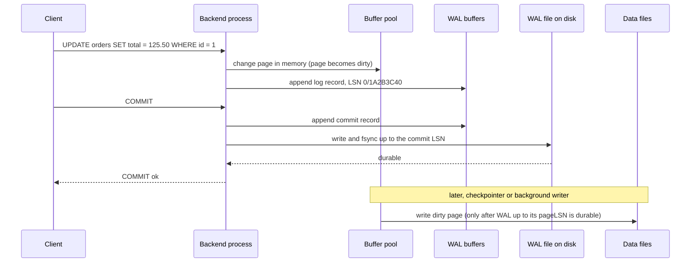
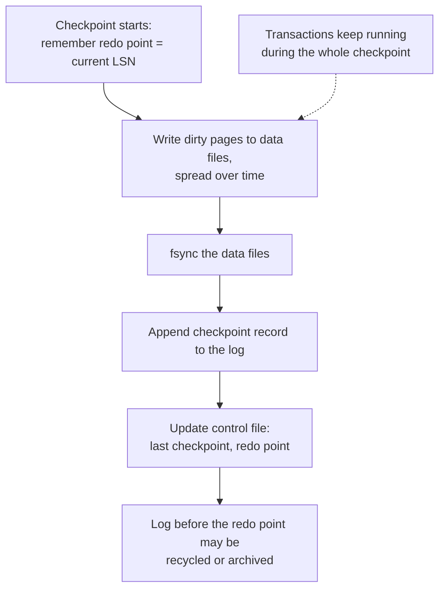
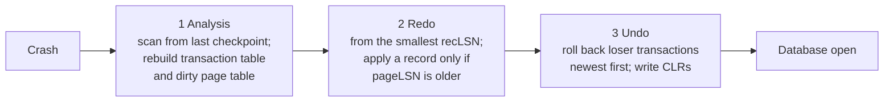

<div dir="rtl" markdown="1">

# 11. WAL، redo/undo، checkpoint و بازیابی

> **سطح:** L3 ارشد (بخش‌های 1 و 2 در سطح L2) | **بخش:** I | **ارجاع‌های Rowlit خوانده‌شده در:** `1d57848` (Rowlit 1.6.3)
> **در یک جمله:** موتور commit را با نوشتن یک لاگ ترتیبی پیش از تغییر صفحه‌های داده ماندگار می‌کند و پس از خرابی، با بازاجرا و بازگرداندن همان لاگ به وضعیت درست برمی‌گردد.
> **چه می‌آموزید:**
> - قاعدهٔ لاگ پیش‌نویس، رکوردهای لاگ و شمارهٔ ترتیبی لاگ (LSN)؛
> - هنگام COMMIT روی دیسک چه رخ می‌دهد و commit گروهی چگونه آن را سریع می‌کند؛
> - checkpoint چیست و چرا زمان بازیابی را محدود می‌کند؛
> - سه مرحلهٔ بازیابی به سبک ARIES و تفاوت PostgreSQL، SQL Server، Oracle، InnoDB و SQLite؛
> - تنظیم‌های ماندگاری که ایمنی را با سرعت معاوضه می‌کنند، صفحهٔ پاره و بافر نوشتن دوگانه؛
> - چرا لاگ‌ها رشد می‌کنند و چه چیزی کوتاه‌کردنشان را ممکن می‌کند.
>
> **پیش‌نیازها:** [6. سازوکار درونی ذخیره‌سازی](06-storage-internals.md) (صفحه، استخر بافر، صفحهٔ کثیف)، [9. تراکنش‌ها](09-transactions-and-isolation.md)، [10. هم‌روندی](10-concurrency-locking-mvcc.md) (undo، MVCC).
>
> [English](../../en/part1/11-logging-and-recovery.md) · قبلی: [10. هم‌روندی: قفل، latch و MVCC](10-concurrency-locking-mvcc.md) · بعدی: [12. پشتیبان‌گیری، همانندسازی و دسترس‌پذیری بالا](12-backup-replication-ha.md)
>
> برچسب‌های نمودارها به انگلیسی نگه داشته شده‌اند تا در GitHub درست نمایش داده شوند.

---

<a id="1-the-idea-beginner"></a>
## 1. ایده (مبتدی)

پایگاه داده جدول‌هایش را در صفحه‌های 8 یا 16 کیلوبایتی نگه می‌دارد که در فایل‌های بزرگ پراکنده‌اند. یک `UPDATE` روی یک سفارش ممکن است یک
صفحهٔ جدول، دو صفحهٔ نمایه و یک صفحهٔ حسابداری فضای آزاد را تغییر دهد، هر کدام در جای متفاوتی از دیسک. نوشتن همهٔ آن‌ها پیش از گفتن «commit
شد» کند است (نوشتن تصادفی)، و قطع برق در میانه ممکن است بعضی صفحه‌ها را تازه و بعضی را قدیمی باقی بگذارد.

راه‌حل همان روش حسابدار است: نخست تغییر موردنظر را به‌صورت یک سطر در دفتر روزنامه، به ترتیب، بنویس و بعد دفترهای کل را سر فرصت به‌روز کن.
دفتر روزنامهٔ پایگاه داده **[لاگ پیش‌نویس (write-ahead log, WAL)](../glossary.md#wal)** است؛ SQL Server آن را
*[لاگ تراکنش (transaction log)](../glossary.md#transaction-log)* می‌نامد و Oracle و MySQL آن را *redo log*. افزودن به انتهای یک فایل سریع است، و
وقتی سطر commit با اطمینان روی دیسک نشست، تغییر را همیشه می‌توان از روی لاگ بازساخت، حتی اگر صفحه‌های داده هرگز نوشته نشده باشند. پس از
خرابی، موتور **[بازیابی پس از خرابی (crash recovery)](../glossary.md#crash-recovery)** را اجرا می‌کند: لاگ را می‌خواند، آنچه commit شده ولی هنوز
در صفحه‌ها نیست را **بازاجرا (redo)** می‌کند و آنچه در صفحه‌ها هست ولی هرگز commit نشده را **بازمی‌گرداند (undo)**. حرف‌های «A» و «D» در ACID
([9](09-transactions-and-isolation.md#21-acid-letter-by-letter)) این‌گونه نگه داشته می‌شوند.

<a id="2-how-it-works-practitioner"></a>
## 2. چگونه کار می‌کند (کاربردی)

<a id="21-the-write-ahead-rule"></a>
### 2.1 قاعدهٔ نوشتن پیشاپیش

کل این روش روی دو قاعده بنا شده است:

1. **لاگ پیش از داده.** صفحهٔ دادهٔ تغییرکرده فقط وقتی می‌تواند روی دیسک نوشته شود که همهٔ رکوردهای لاگی که تغییرهای آن صفحه را توصیف می‌کنند
   روی حافظهٔ پایدار باشند.
2. **لاگ پیش از commit.** تراکنش فقط وقتی commitشده به شمار می‌آید که رکورد commit آن (و در نتیجه همهٔ رکوردهای پیش از آن) روی حافظهٔ پایدار باشد.

این قاعده‌ها به مدیر [استخر بافر (buffer pool)](../glossary.md#buffer-pool) اجازه می‌دهند از دو جهت آسان بگیرد که کتاب‌های درسی آن را
*[steal و no-force](../glossary.md#steal-no-force)* می‌نامند:

- **steal**: صفحه‌ای که تراکنشی *commitنشده* تغییرش داده می‌تواند روی دیسک نوشته شود (مثلاً برای آزادکردن فضای بافر). پس از خرابی این تغییرها
  باید **[بازگردانده](../glossary.md#undo-log)** شوند، پس لاگ (یا یک انبارهٔ undo) باید مقدار قدیمی را نگه دارد.
- **no-force**: صفحه‌هایی که تراکنشی *commitشده* تغییرشان داده لازم نیست هنگام commit نوشته شوند. پس از خرابی ممکن است این تغییرها در فایل‌های
  داده نباشند و باید از روی لاگ **[بازاجرا](../glossary.md#redo)** شوند، پس لاگ باید مقدار تازه را نگه دارد.

تقریباً همهٔ موتورهای دیسکی steal / no-force هستند. این بهترین کارایی را در زمان اجرا می‌دهد و همهٔ زحمت را به بازیابی می‌سپارد.

<a id="22-log-records-and-the-lsn"></a>
### 2.2 رکوردهای لاگ و LSN

یک **[رکورد لاگ (log record)](../glossary.md#log-record)** یک تغییر را توصیف می‌کند: کدام تراکنش، کدام صفحه، چه چیزی تغییر کرده (به شکل فیزیکی
«بایت‌های 120 تا 128 صفحهٔ 7 فایل 16410» یا منطقی «کلید 7 را در نمایهٔ X درج کن») و اشاره‌گری به رکورد قبلی همان تراکنش. هر رکورد یک
**[شمارهٔ ترتیبی لاگ (LSN)](../glossary.md#lsn)** دارد، موقعیتی یکنواخت‌افزاینده در لاگ. هر صفحهٔ داده LSN آخرین رکوردی را که روی آن اعمال شده نگه
می‌دارد (*[pageLSN](../glossary.md#pagelsn)*)؛ بازیابی از همین راه می‌فهمد که آیا رکوردی پیش‌تر به صفحه رسیده یا نه.

| موتور | نام لاگ | LSN چه شکلی است | کجا ببینیم |
|---|---|---|---|
| PostgreSQL 17 | WAL، فایل‌های segment شانزده‌مگابایتی در `pg_wal/` | `0/1A2B3C4D` (موقعیت بایتی 64 بیتی) | `SELECT pg_current_wal_lsn();` |
| SQL Server 2022 | لاگ تراکنش (`.ldf`)، تقسیم‌شده به [فایل‌های لاگ مجازی](../glossary.md#vlf) (VLF) | `00000025:00000100:0001` (VLF : block : slot) | `sys.dm_db_log_info`، `fn_dblog` (مستندنشده) |
| Oracle 23ai | گروه‌های redo آنلاین، redo بایگانی‌شده | SCN (`CURRENT_SCN`) و نشانی بایتی redo | `SELECT current_scn FROM v$database;` |
| MySQL 8 InnoDB | redo log (`#innodb_redo/` از 8.0.30) | شمار بایت، `Log sequence number 21673456` | `SHOW ENGINE INNODB STATUS` (بخش `LOG`) |
| SQLite 3.4x | rollback journal یا فایل `-wal` | شمارهٔ frame در WAL | `PRAGMA wal_checkpoint;` |

می‌توانید اندازه بگیرید که یک دستور چقدر لاگ تولید می‌کند. در PostgreSQL (خروجی نمونه):

</div>

```sql
EXPLAIN (ANALYZE, WAL, COSTS OFF) UPDATE lab.orders SET total = total + 1 WHERE id = 1;
--  Update on orders (actual time=0.081..0.082 rows=0 loops=1)
--    WAL: records=1 fpi=1 bytes=8279
--    ->  Index Scan using orders_pkey on orders (actual time=0.020..0.022 rows=1 loops=1)
--          Index Cond: (id = 1)
```

<div dir="rtl" markdown="1">

`fpi=1` یعنی یک **تصویر کامل صفحه (full page image)**: این نخستین تغییر آن صفحه پس از آخرین checkpoint بود، پس PostgreSQL کل صفحهٔ 8 کیلوبایتی
را ثبت کرد ([3.6](#36-torn-pages-full-page-writes-and-the-doublewrite-buffer)). همان به‌روزرسانی را دوباره اجرا کنید تا WAL به یک رکورد کوچک
حدود 70 بایتی برسد. (`lab.orders` همان کپی آزمایشی ساخته‌شده در [فصل 9](09-transactions-and-isolation.md#25-the-anomalies-on-shop) است.)

<a id="23-the-commit-path"></a>
### 2.3 مسیر commit

**شکل 11.1 — میان UPDATE و «COMMIT ok» چه رخ می‌دهد (نام‌ها از PostgreSQL است؛ الگو همه‌جا یکی است).**

</div>



<div dir="rtl" markdown="1">

تنها عملیات دیسکی هم‌زمان در مسیر commit، **[fsync](../glossary.md#fsync)** لاگ است (فراخوان سیستمی که فقط وقتی برمی‌گردد که سیستم‌عامل داده
را به دستگاه ذخیره‌سازی رسانده باشد). صفحه‌های داده بعداً در پس‌زمینه نوشته می‌شوند. به همین دلیل تأخیر commit به دستگاه لاگ بستگی دارد و
پایگاه‌های داده لاگ را روی سریع‌ترین و کم‌تأخیرترین حافظهٔ در دسترس می‌گذارند.

**[commit گروهی (group commit)](../glossary.md#group-commit)** چند commit را در یک fsync شریک می‌کند. وقتی یک fsync در جریان است، تراکنش‌های دیگر
رکورد commit خود را به بافر می‌افزایند و fsync بعدی همهٔ آن‌ها را یک‌جا ماندگار می‌کند. زیر بار، توان عملیاتی بالا می‌رود در حالی که هر commit
همچنان فقط منتظر یک flush است. می‌توان به PostgreSQL گفت کمی صبر کند تا commitهای بیشتری جمع شوند (`commit_delay`، `commit_siblings`؛ به‌طور
پیش‌فرض خاموش)؛ MySQL flushهای binlog و redo تراکنش‌های هم‌زمان را خودکار گروه می‌کند.

<a id="24-checkpoints"></a>
### 2.4 checkpointها

اگر موتور هرگز [صفحه‌های کثیف (dirty page)](../glossary.md#dirty-page) را نمی‌نوشت، بازیابی باید لاگ را از آغاز زمان بازاجرا می‌کرد.
**[checkpoint](../glossary.md#checkpoint)** این کار را محدود می‌کند: مطمئن می‌شود همهٔ تغییرهای پیش از یک LSN معین
(*[نقطهٔ بازاجرا (redo point)](../glossary.md#redo-point)*) در فایل‌های داده هستند، تا بازیابی بتواند از آنجا شروع کند و لاگ قدیمی‌تر بازیافت شود.

**شکل 11.2 — یک checkpoint (فازی).**

</div>



<div dir="rtl" markdown="1">

checkpointهای امروزی *[فازی](../glossary.md#fuzzy-checkpoint)* هستند: تراکنش‌ها اجرا می‌شوند و صفحه‌ها در حالی تغییر می‌کنند که checkpoint
می‌نویسد. پس بازیابی از نقطهٔ بازاجرایی که در *آغاز* checkpoint به خاطر سپرده شده شروع می‌شود، نه از رکورد checkpoint.

معاوضه میان زمان اجرا و زمان بازیابی است. checkpoint پرتکرار یعنی بازیابی کوتاه اما نوشتن صفحهٔ بیشتر (و در PostgreSQL تصویرهای کامل صفحهٔ
بیشتر در WAL). checkpoint کم‌تکرار یعنی تقویت نوشتن کمتر اما بازیابی طولانی‌تر.

| موتور | چه چیزی checkpoint را راه می‌اندازد | پیش‌فرض‌ها |
|---|---|---|
| PostgreSQL 17 | زمان یا حجم WAL، هر کدام زودتر | `checkpoint_timeout = 5min`، `max_wal_size = 1GB`، `checkpoint_completion_target = 0.9` (پخش نوشتن در 90 درصد بازه) |
| SQL Server 2022 | *checkpointهای غیرمستقیم* با هدف زمان بازیابی | `TARGET_RECOVERY_TIME = 60 SECONDS` برای پایگاه‌های داده‌ای که از SQL Server 2016 به بعد ساخته شده‌اند |
| Oracle 23ai | checkpointهای افزایشی بر پایهٔ هدف بازیابی، به‌علاوهٔ تعویض لاگ | `FAST_START_MTTR_TARGET` |
| MySQL 8 InnoDB | checkpointهای فازی با پرشدن فضای redo | `innodb_redo_log_capacity` (پیش‌فرض 100 مگابایت از 8.0.30) |
| SQLite (WAL) | وقتی WAL به شمار معینی صفحه برسد | `wal_autocheckpoint = 1000` صفحه |

پیامی در لاگ PostgreSQL مانند `checkpoints are occurring too frequently (12 seconds apart)` با پیشنهاد بالا بردن `max_wal_size` یعنی حجم WAL،
و نه زمان، checkpointها را اجباری می‌کند. از PostgreSQL 15 گزینهٔ `log_checkpoints` به‌طور پیش‌فرض روشن است، پس هر checkpoint ثبت می‌کند چند بافر
نوشته و چقدر طول کشیده.

<a id="25-log-truncation-and-log-growth"></a>
### 2.5 کوتاه‌سازی لاگ و رشد لاگ

فضای لاگ فقط وقتی دوباره استفاده می‌شود که دیگر هیچ چیز به رکوردهای قدیمی نیاز نداشته باشد. **[کوتاه‌سازی لاگ (log truncation)](../glossary.md#log-truncation)**
(واژهٔ SQL Server؛ PostgreSQL segmentهای WAL را *بازیافت* می‌کند) را هر چیزی که هنوز لاگ قدیمی را لازم دارد مسدود می‌کند:

- **تراکنش فعالی** که پیش از آن نقطه شروع شده (ممکن است لازم باشد برگردانده شود)؛
- **checkpointی** که هنوز انجام نشده (رکوردها ممکن است هنوز برای redo لازم باشند)؛
- **پشتیبان لاگی** که گرفته نشده (مدل بازیابی FULL در SQL Server، [12](12-backup-replication-ha.md))؛
- **رونوشت یا replication slotی** که هنوز رکوردها را دریافت نکرده؛
- **بایگان‌کننده‌ای** که شکست خورده (اگر `archive_command` در PostgreSQL خطا برگرداند، همهٔ segmentها نگه داشته می‌شوند).

SQL Server مستقیم می‌گوید کدام است:

</div>

```sql
SELECT name, recovery_model_desc, log_reuse_wait_desc FROM sys.databases WHERE name = N'shop';
-- shop  FULL  LOG_BACKUP          ← nobody has taken a log backup: the log will grow until the disk is full
SELECT * FROM sys.dm_db_log_space_usage;     -- size and used percent of the current database's log
```

<div dir="rtl" markdown="1">

مقدارهای معمول `log_reuse_wait_desc` این‌ها هستند: `NOTHING`، `CHECKPOINT`، `LOG_BACKUP`، `ACTIVE_TRANSACTION`، `REPLICATION` و
`AVAILABILITY_REPLICA`. در PostgreSQL بررسی‌های هم‌ارز این‌ها هستند:

</div>

```sql
SELECT slot_name, active, pg_size_pretty(pg_wal_lsn_diff(pg_current_wal_lsn(), restart_lsn)) AS retained
FROM pg_replication_slots;                          -- an inactive slot retains WAL forever (unless max_slot_wal_keep_size is set)
SELECT last_failed_wal, last_failed_time FROM pg_stat_archiver;
```

<div dir="rtl" markdown="1">

کوچک‌کردن (shrink) فایل لاگ واکنش نخست درستی نیست. دلیل استفاده‌نشدن دوباره را پیدا و رفع کنید و فقط پس از آن اندازهٔ فایل را درست تنظیم کنید.
در SQL Server لاگی که در گام‌های کوچک فراوان رشد کرده، هزاران VLF هم پیدا می‌کند که بازیابی و پشتیبان‌گیری لاگ را کند می‌کند؛ آن را با گام‌های
بزرگ و ثابت رشد دهید.

<a id="26-durability-settings"></a>
### 2.6 تنظیم‌های ماندگاری

هر موتور اجازه می‌دهد تضمین «تراکنش commitشده از خرابی جان به در می‌برد» را با سرعت معاوضه کنید. هیچ‌کدام از این تنظیم‌ها به‌تنهایی پایگاه داده
را خراب نمی‌کند (مگر جاهایی که مشخص شده)؛ تعیین می‌کنند چند commit **آخر** ممکن است از دست برود.

| موتور | تنظیم | پیش‌فرض امن | گزینهٔ سریع‌تر و خطر آن |
|---|---|---|---|
| PostgreSQL | `synchronous_commit` | `on` | `off`: COMMIT پیش از flush شدن WAL برمی‌گردد؛ خرابی ممکن است حدود 3 × `wal_writer_delay` (پیش‌فرض 200 میلی‌ثانیه) از commitهای آخر را از بین ببرد، هرگز خرابی داده نمی‌سازد. برای هر تراکنش جداگانه قابل تنظیم است. |
| PostgreSQL | `fsync` | `on` | `off`: **ممکن است کل خوشه را** در خرابی سیستم‌عامل یا قطع برق خراب کند. فقط برای دادهٔ آزمایشی دورریختنی. |
| SQL Server | [ماندگاری تأخیری (delayed durability)](../glossary.md#delayed-durability) | `DISABLED` | `ALTER DATABASE … SET DELAYED_DURABILITY = ALLOWED` و سپس `COMMIT WITH (DELAYED_DURABILITY = ON)`: بافر لاگ بعداً flush می‌شود (وقتی پر شود، یا با `sp_flush_log`). |
| Oracle | `COMMIT_WAIT`، `COMMIT_LOGGING` | `WAIT`، `IMMEDIATE` | `COMMIT WRITE BATCH NOWAIT`: commit منتظر LGWR نمی‌ماند. |
| MySQL InnoDB | `innodb_flush_log_at_trx_commit` | `1` (نوشتن و flush در هر commit) | `2`: نوشتن به سیستم‌عامل در commit و flush هر ثانیه یک بار (از خرابی MySQL جان به در می‌برد، از خرابی سیستم‌عامل نه)؛ `0`: نوشتن و flush هر ثانیه یک بار. |
| MySQL | `sync_binlog` | `1` | `0` یا `N`: binlog ممکن است تراکنش‌هایی را که InnoDB commit کرده نداشته باشد، و این رونوشت‌ها و بازیابی به نقطه‌ای از زمان را می‌شکند. |
| SQLite | `PRAGMA synchronous` | `FULL` (2) | `NORMAL` (1) در حالت WAL: خرابی داده ندارد اما commitهای آخر ممکن است پس از قطع برق برگردند؛ `OFF`: در قطع برق خرابی ممکن است. |
| Cassandra | `commitlog_sync` | `periodic`، هر 10 ثانیه | `batch` / `group` برای ماندگاری در هر نوشتن؛ ماندگاری معمولاً از رونوشت‌ها می‌آید. |

> **در Rowlit:** انباره‌های کوچک SQLite خود Rowlit در حالت WAL کار می‌کنند: تاریخچهٔ پرس‌وجوها
> (`engine/src/DbStudio.Core/Services/HistoryService.cs:67`) و تاریخچهٔ محلی اشیا
> (`engine/src/DbStudio.Core/LocalHistory/LocalHistoryService.cs:83`). پایگاه دادهٔ نمونه‌ای که ساخته می‌شود در حالت rollback journal پر می‌شود
> (`engine/src/DbStudio.Core/Sample/SampleDatabase.cs:245`)، پس فایل `-wal` کنارش باقی نمی‌ماند.

<a id="3-deep-dive-senior"></a>
## 3. ژرفا (ارشد)

<a id="31-aries-style-crash-recovery"></a>
### 3.1 بازیابی به سبک ARIES

**[ARIES](../glossary.md#aries)** (Mohan و همکاران، IBM، 1992) الگوریتم بازیابی‌ای است که بیشتر موتورها روحش را دنبال می‌کنند. سه اصل آن:
لاگ پیش‌نویس؛ *تکرار تاریخ* در redo (بازاجرای همه چیز، commitشده یا نه، تا صفحه‌ها دقیقاً به وضعیت لحظهٔ خرابی برگردند)؛ و *ثبت لاگ در حین undo*
(هر کنش بازگردانی یک **[رکورد لاگ جبرانی (CLR)](../glossary.md#compensation-log-record)** می‌نویسد، تا خرابی در حین بازیابی هرگز یک تغییر را دوبار
برنگرداند).

**شکل 11.3 — سه مرحلهٔ بازیابی ARIES.**

</div>



<div dir="rtl" markdown="1">

1. **تحلیل (analysis)** از آخرین checkpoint به جلو می‌خواند؛ checkpoint *جدول تراکنش‌ها* (تراکنش‌های فعال و آخرین LSN هر کدام) و *جدول صفحه‌های
   کثیف* (هر صفحهٔ کثیف و *recLSN* آن، یعنی نخستین رکوردی که کثیفش کرد) را ذخیره کرده بود. در پایان می‌داند کدام تراکنش‌ها **بازنده (loser)**اند
   (رکورد commit ندارند) و redo باید از کجا شروع شود (کوچک‌ترین recLSN).
2. **بازاجرا (redo)** از آن نقطه به جلو می‌خواند و هر تغییری را که pageLSN صفحه‌اش از رکورد قدیمی‌تر است دوباره اعمال می‌کند. پس از redo، پایگاه داده
   دقیقاً همان شکل لحظهٔ خرابی را دارد، از جمله تغییرهای commitنشده.
3. **بازگردانی (undo)** رکوردهای بازنده‌ها را به عقب می‌پیماید و برمی‌گرداند و برای هر گام یک CLR می‌نویسد. CLR مقدار `undoNextLSN` را دارد، یعنی
   رکورد بعدی که باید برگردانده شود؛ پس اگر سامانه در حین undo دوباره از کار بیفتد، بازیابی بعدی از همان جایی ادامه می‌دهد که قبلی ماند.

<a id="32-postgresql-recovery-is-redo-only"></a>
### 3.2 PostgreSQL: بازیابی فقط redo است

PostgreSQL قاعدهٔ WAL را رعایت می‌کند و مرحلهٔ redo دارد، اما **مرحلهٔ undo ندارد**. به لطف MVCC، نسخه‌های سطرِ تراکنش لغوشده یا قطع‌شده از پیش
نادیدنی‌اند: commit log (`pg_xact`) آن تراکنش را commitشده علامت نمی‌زند، پس همهٔ خواننده‌ها نادیده‌اش می‌گیرند و VACUUM بعداً پاکشان می‌کند
([10](10-concurrency-locking-mvcc.md#32-postgresql-mvcc-in-detail)). بنابراین بازیابی فقط WAL را از نقطهٔ بازاجرای ذخیره‌شده در `pg_control` بازاجرا
می‌کند (`pg_controldata` آن را با عنوان `Latest checkpoint's REDO location` چاپ می‌کند).

ابزارها و واقعیت‌های سودمند:

- `pg_waldump` فایل‌های WAL را رمزگشایی می‌کند. یک رکورد کوتاه‌شده (خروجی نمونه):

</div>

```text
rmgr: Heap        len (rec/tot): 72/72, tx: 813, lsn: 0/01A2B3C8, prev 0/01A2B390, desc: HOT_UPDATE old_xmax: 813, old_off: 1, new_xmax: 0, new_off: 7, blkref #0: rel 1663/16384/16410 blk 0
rmgr: Transaction len (rec/tot): 34/34, tx: 813, lsn: 0/01A2B418, prev 0/01A2B3C8, desc: COMMIT 2026-10-28 10:15:02.123456 UTC
```

<div dir="rtl" markdown="1">

- `wal_level` تعیین می‌کند چه مقدار ثبت شود: `minimal` (فقط بازیابی پس از خرابی)، `replica` (پیش‌فرض؛ کافی برای بایگانی و standby فیزیکی) و
  `logical` (آنچه logical decoding لازم دارد را می‌افزاید، [12](12-backup-replication-ha.md)).
- همین جریان WAL خوراک **بایگانی** (`archive_mode`، `archive_command` یا `archive_library`) و **همانندسازی جریانی** است. یک پشتیبان پایه به‌علاوهٔ WAL
  بایگانی‌شده همان چیزی است که بازیابی به نقطه‌ای از زمان را ممکن می‌کند ([12](12-backup-replication-ha.md#22-point-in-time-recovery)). بازیابی،
  همانندسازی و PITR یک سازوکارند: «بازاجرای WAL روی نسخهٔ قدیمی‌تری از صفحه‌ها».

<a id="33-sql-server-the-transaction-log-and-its-phases"></a>
### 3.3 SQL Server: لاگ تراکنش و مرحله‌های آن

فایل `.ldf` دنباله‌ای چرخشی از **VLF**هاست. SQL Server اطلاعات redo و undo را در همان رکوردها ثبت می‌کند. هنگام راه‌اندازی، error log سه مرحلهٔ
ARIES را به‌صراحت نشان می‌دهد، مثلاً *Recovery of database 'shop' (5) is 50% complete … Phase 2 of 3*. **[مدل بازیابی (recovery model)](../glossary.md#recovery-model)**
تعیین می‌کند لاگ کی کوتاه شود: `SIMPLE` (هنگام checkpoint)، `FULL` (فقط پس از پشتیبان لاگ)، `BULK_LOGGED` (مانند FULL، اما عملیات انبوه فقط
تخصیص صفحه را ثبت می‌کنند).

**[Accelerated Database Recovery](../glossary.md#accelerated-database-recovery)** (ADR، SQL Server 2019 به بعد) تصویر را عوض می‌کند: نسخه‌های سطر در
انبارهٔ نسخهٔ ماندگار درون پایگاه داده نگه داشته می‌شوند، پس undo به یک *برگرداندن منطقی* (اشاره دادن خواننده‌ها به نسخهٔ قدیمی) تبدیل می‌شود که
عملاً آنی است، و لاگ حتی وقتی تراکنشی طولانی باز است هم کوتاه می‌شود. rollbackهای طولانی و بازیابی‌های طولانی پس از خرابی همان مشکلاتی‌اند که ADR
برای حذفشان ساخته شده.

<a id="34-oracle-redo-undo-and-undo-protected-by-redo"></a>
### 3.4 Oracle: redo، undo، و undoی که redo از آن محافظت می‌کند

Oracle redo را در یک **log buffer** می‌نویسد؛ فرایند log writer (LGWR) آن را هنگام commit، وقتی بافر یک‌سوم پر شده، و هر چند ثانیه یک بار flush
می‌کند. redo logهای آنلاین حلقه‌ای از دست‌کم دو **گروه** هستند (معمولاً با عضوهای آینه‌ای)؛ هنگام *تعویض لاگ*، در
[حالت `ARCHIVELOG`](../glossary.md#archivelog-mode)، بایگان‌کننده گروه پر را پیش از استفادهٔ دوباره در یک **redo log بایگانی‌شده** کپی می‌کند. در حالت
`NOARCHIVELOG` فقط بازیابی پس از خرابی ممکن است، نه بازیابی رسانه یا PITR.

undo در یک tablespace مخصوص undo است و هر تغییر در بلوک undo خودش با redo محافظت می‌شود. پس *بازیابی instance* (که SMON پس از خرابی خودکار انجام
می‌دهد) ابتدا با redo به جلو می‌رود، که undo را هم بازمی‌سازد، سپس پایگاه داده را باز می‌کند و تراکنش‌های commitنشده را با همان undo، در پس‌زمینه و
بر حسب نیاز، برمی‌گرداند («fast-start rollback»). *بازیابی رسانه* (پس از از دست رفتن یک فایل داده) فایل را از پشتیبان بازمی‌گرداند و redo
بایگانی‌شده و آنلاین را روی آن اعمال می‌کند.

<a id="35-mysql-innodb-redo-doublewrite-undo-and-the-binary-log"></a>
### 3.5 MySQL InnoDB: redo، doublewrite، undo و binary log

InnoDB رکوردهای **redo** فیزیکی‌ـ‌منطقی را در یک redo log چرخشی می‌نویسد و undo را در tablespaceهای undo نگه می‌دارد (که مانند Oracle با redo محافظت
می‌شوند). پس از خرابی redo را اعمال می‌کند و سپس تراکنش‌های ناتمام را در پس‌زمینه برمی‌گرداند.

MySQL لاگ دومی هم بالای آن دارد: **[binary log](../glossary.md#binlog)** (binlog) که لایهٔ سرور می‌نویسد و برای همانندسازی و بازیابی به نقطه‌ای از
زمان به کار می‌رود ([12](12-backup-replication-ha.md)). برای هماهنگ نگه‌داشتن این دو لاگ، commit یک **commit دومرحله‌ای** درونی است: InnoDB *آماده
می‌کند* (redo با علامت prepare flush می‌شود)، سرور binlog را می‌نویسد و sync می‌کند، سپس InnoDB commit می‌کند. در بازیابی پس از خرابی، تراکنش
prepared اگر رویدادش در binlog باشد commit و اگر نباشد برگردانده می‌شود. به همین دلیل `sync_binlog = 1` و `innodb_flush_log_at_trx_commit = 1` با هم
می‌آیند.

<a id="36-torn-pages-full-page-writes-and-the-doublewrite-buffer"></a>
### 3.6 صفحهٔ پاره، نوشتن صفحهٔ کامل و بافر نوشتن دوگانه

صفحهٔ پایگاه داده (8 یا 16 کیلوبایت) از واحدی که حافظه می‌تواند به‌صورت اتمی بنویسد بزرگ‌تر است (اغلب 4 کیلوبایت، در گذشته 512 بایت). قطع برق در
میانهٔ نوشتن یک صفحه ممکن است **[صفحهٔ پاره (torn page)](../glossary.md#torn-page)** بسازد: نیمی تازه، نیمی قدیمی. redo نمی‌تواند ترمیمش کند، چون
رکوردهای redo تغییرهایی *روی* یک صفحه را توصیف می‌کنند و فرض می‌کنند خود صفحه سالم است.

- **PostgreSQL** از **[نوشتن صفحهٔ کامل (full page write)](../glossary.md#full-page-write)** استفاده می‌کند (`full_page_writes = on`): نخستین تغییر هر
  صفحه پس از هر checkpoint تصویر کامل صفحه را ثبت می‌کند، پس redo ابتدا صفحه را از WAL بازمی‌گرداند. این همان شمارش `fpi` در بخش 2.2 است و دلیل
  جهش حجم WAL درست پس از هر checkpoint. `wal_compression` هزینه را کم می‌کند.
- **InnoDB** از **[بافر نوشتن دوگانه (doublewrite buffer)](../glossary.md#doublewrite-buffer)** استفاده می‌کند (`innodb_doublewrite = ON`): صفحه‌ها ابتدا
  دسته‌ای در ناحیهٔ ویژهٔ doublewrite نوشته و sync می‌شوند، سپس در جای واقعی خود. پس از خرابی، صفحهٔ پاره با کپی سالمش از ناحیهٔ doublewrite جایگزین
  می‌شود.
- **SQL Server** صفحهٔ پاره را با `PAGE_VERIFY CHECKSUM` (پیش‌فرض) کشف و خطای 824 گزارش می‌کند؛ جز از روی آینه یا رونوشت availability group (ترمیم
  خودکار صفحه) خودکار ترمیمش نمی‌کند. بازگردانی از پشتیبان ترمیم معمول است.
- **Oracle** بلوک‌های خراب (از جمله fractured) را با checksum بلوک کشف و با *block media recovery* از پشتیبان و redo ترمیم می‌کند.
- **SQLite** به ژورنالش تکیه دارد: در حالت rollback ژورنال محتوای اصلی صفحه را دارد و در حالت WAL صفحهٔ تازه پیش از آن‌که checkpoint کپی‌اش کند،
  کامل در WAL است.

تنها حالتی که می‌توان این محافظت‌ها را با خیال راحت خاموش کرد، اجرا روی حافظه‌ای است که نوشتن اتمی صفحه را تضمین کند (برخی سیستم‌فایل‌ها و
دستگاه‌ها این را دارند).

<a id="37-sqlite-two-journals-two-directions"></a>
### 3.7 SQLite: دو ژورنال، دو جهت

SQLite دو طراحی پایهٔ لاگ را در یک موتور کوچک کنار هم نشان می‌دهد:

- **Rollback [ژورنال](../glossary.md#journal)** (`journal_mode = DELETE`، پیش‌فرض؛ همچنین `TRUNCATE` و `PERSIST`): SQLite پیش از تغییر یک صفحه، صفحهٔ
  **اصلی** را در فایل `-journal` کپی و sync می‌کند. commit یعنی sync فایل پایگاه داده و سپس حذف (یا کوتاه‌کردن) ژورنال. پس از خرابی، ژورنال «داغ»
  بازپخش می‌شود تا صفحه‌های قدیمی برگردند. این یک **لاگ undo** است.
- **[حالت WAL](../glossary.md#wal-mode)** (`journal_mode = WAL`): صفحه‌های تغییرکرده به فایل `-wal` افزوده می‌شوند؛ تا checkpoint به فایل پایگاه داده دست
  زده نمی‌شود. commit یعنی افزودن یک frame commit و sync کردن WAL. خواننده‌ها تازه‌ترین نسخهٔ هر صفحه را از راه نمایهٔ `-shm` پیدا می‌کنند. پس از
  خرابی، frameهای پس از آخرین frame commit نادیده گرفته می‌شوند. این یک **لاگ redo** است و دلیل این‌که حالت WAL خواندن در حین نوشتن را مجاز می‌کند
  ([10](10-concurrency-locking-mvcc.md#36-sqlite-one-writer-per-file)).

</div>

```sql
PRAGMA journal_mode = WAL;            -- persistent: stays set for the database file
PRAGMA synchronous = NORMAL;          -- common pairing with WAL
PRAGMA wal_checkpoint(TRUNCATE);      -- copy WAL into the database and truncate the -wal file
```

<div dir="rtl" markdown="1">

<a id="38-engines-without-a-classic-wal"></a>
### 3.8 موتورهای بدون WAL کلاسیک

- جدول‌های MergeTree در **ClickHouse** هر `INSERT` را به‌صورت یک part تازه و تغییرناپذیر (پوشه‌ای از فایل‌های ستونی) می‌نویسند. WALی جلوی آن‌ها نیست
  و به‌طور پیش‌فرض partها هنگام درج fsync نمی‌شوند (تنظیم‌های MergeTree یعنی `fsync_after_insert` و `fsync_part_directory` خاموش‌اند)؛ ماندگاری در
  محیط عملیاتی از رونوشت‌های `Replicated*MergeTree` می‌آید ([12](12-backup-replication-ha.md)).
- **Cassandra** هر نوشتن را به **[commitlog](../glossary.md#commitlog)** و به یک memtable درون حافظه می‌افزاید و سپس memtableها را در SSTable
  می‌ریزد؛ commitlog پس از خرابی بازپخش می‌شود. با sync پیش‌فرض `periodic` یک گره ممکن است تا 10 ثانیه از نوشتن‌های تأییدشده را از دست بدهد که
  رونوشت‌ها جبرانش می‌کنند ([16](16-nosql-families.md)).
- **Snowflake** سرویسی مدیریت‌شده است: ماندگاری را object store ابری زیر micro-partitionهایش فراهم می‌کند و بازیابی از اشتباه کاربر با **Time Travel**
  و **Fail-safe** است ([12](12-backup-replication-ha.md)، [15](15-oltp-vs-olap-columnar.md)).

<a id="4-in-each-engine"></a>
## 4. در هر موتور

| موضوع | PostgreSQL 17 | SQL Server 2022 | Oracle 23ai | MySQL 8 InnoDB | SQLite 3.4x |
|---|---|---|---|---|---|
| لاگ | segmentهای WAL (16 مگابایت) | لاگ تراکنش، VLFها | redo آنلاین و بایگانی‌شده، tablespace undo | redo log + undo + binlog | rollback journal یا WAL |
| undo هنگام بازیابی | ندارد (MVCC + commit log) | دارد (با ADR آنی) | دارد، پس از باز شدن | دارد، در پس‌زمینه | rollback journal خودش undo است |
| محافظت در برابر صفحهٔ پاره | نوشتن صفحهٔ کامل | کشف با checksum | کشف با checksum + block media recovery | بافر نوشتن دوگانه | journal / WAL |
| تنظیم checkpoint | `checkpoint_timeout`، `max_wal_size` | `TARGET_RECOVERY_TIME` | `FAST_START_MTTR_TARGET` | `innodb_redo_log_capacity` | `wal_autocheckpoint` |
| تنظیم ماندگاری commit | `synchronous_commit` | `DELAYED_DURABILITY` | `COMMIT_WAIT` | `innodb_flush_log_at_trx_commit`، `sync_binlog` | `PRAGMA synchronous` |
| چرا لاگ دوباره استفاده نمی‌شود | slot، بایگان‌کننده، `wal_keep_size` | `log_reuse_wait_desc` | بایگان‌کننده، standby | سن checkpoint، انقضای binlog | خوانندهٔ باز جلوی checkpoint را می‌گیرد |

<a id="5-exercises"></a>
## 5. تمرین‌ها

1. یک سرور PostgreSQL ساعت 10:00:00 checkpoint اجرا می‌کند. ساعت 10:03 تراکنشی commit می‌شود؛ ساعت 10:04 برق پیش از نوشته‌شدن هر صفحه‌ای که تغییر داده
   قطع می‌شود. گام‌به‌گام توضیح دهید تغییر چگونه باقی می‌ماند. بازیابی خواندن WAL را از کجا شروع می‌کند؟
2. چرا PostgreSQL درست پس از checkpoint بیشتر از میانهٔ بازهٔ checkpoint، WAL می‌نویسد؟ کدام تنظیم بدون خطر صفحهٔ پاره این هزینه را کم می‌کند؟
3. یک پایگاه دادهٔ SQL Server در مدل FULL فایل لاگی 200 گیگابایتی دارد که مدام رشد می‌کند؛ `log_reuse_wait_desc` مقدار `LOG_BACKUP` را نشان می‌دهد. راه‌حل
   درست چیست و چرا رفتن به SIMPLE و shrink کردن برای پایگاه دادهٔ عملیاتی راه‌حل نیست؟
4. تیمی `innodb_flush_log_at_trx_commit = 2` می‌گذارد و `sync_binlog = 1` را نگه می‌دارد. اگر (الف) فرایند mysqld از کار بیفتد، (ب) سیستم‌عامل از کار
   بیفتد، چه چیزی ممکن است از دست برود؟
5. چرا بازیابی پس از خرابی در PostgreSQL به مرحلهٔ undo نیاز ندارد، در حالی که InnoDB دارد؟
6. یک برنامهٔ SQLite در حالت WAL می‌بیند فایل `-wal` آن تا چند گیگابایت بزرگ شده. علت محتمل و دو راه‌حل را نام ببرید.

<a id="answers"></a>
## پاسخ‌ها

کلید پاسخ همهٔ فصل‌های بخش یک در [18. کلید پاسخ و راه‌اندازی آزمایشگاه](18-exercise-answers.md) گرد آمده است.

<details><summary>پاسخ‌های فصل 11</summary>

1. هنگام COMMIT، backend لاگ WAL را تا رکورد commit flush کرد (قاعدهٔ WAL)، پس تغییر در WAL هست هرچند هیچ صفحهٔ داده‌ای نوشته نشده. پس از راه‌اندازی
   دوباره، PostgreSQL فایل `pg_control` را می‌خواند، نقطهٔ بازاجرای checkpoint ساعت 10:00 را پیدا می‌کند و هر رکورد WAL از آنجا به بعد را بازاجرا
   می‌کند؛ رکورد به‌روزرسانی ساعت 10:03 دوباره روی صفحه (که pageLSN آن قدیمی‌تر است) اعمال می‌شود و رکورد commit تراکنش را در `pg_xact` commitشده
   علامت می‌زند. بازیابی از **نقطهٔ بازاجرایی** شروع می‌شود که در آغاز checkpoint ساعت 10:00 ثبت شد.
2. با `full_page_writes` نخستین تغییر هر صفحه پس از checkpoint تصویر کامل صفحه را ثبت می‌کند؛ درست پس از checkpoint تقریباً هر تغییری «نخستین تغییر»
   است. `wal_compression` (مثلاً `lz4`) این تصویرها را کوچک می‌کند؛ بازهٔ checkpoint طولانی‌تر هم شمارشان را کم می‌کند به بهای بازیابی طولانی‌تر.
3. پشتیبان لاگ بگیرید (و زمان‌بندی‌اش کنید، مثلاً هر 15 دقیقه)؛ پس از پشتیبان لاگ بعدی فضای لاگ دوباره قابل استفاده می‌شود، سپس یک بار اندازهٔ فایل را
   به مقدار معقول برگردانید. رفتن به SIMPLE زنجیرهٔ پشتیبان لاگ را می‌شکند، پس تا پشتیبان کامل بعدی بازیابی به نقطه‌ای از زمان ناممکن می‌شود، و shrink
   کردن لاگی که دوباره رشد خواهد کرد فقط چندتکه‌شدن VLF و توقف‌های رشد را می‌افزاید.
4. (الف) هیچ چیز commitشده‌ای: با مقدار `2`، redo در هر commit در page cache سیستم‌عامل نوشته می‌شود و سیستم‌عامل هنوز آن را دارد. (ب) تا حدود یک ثانیه
   از commitها در InnoDB، چون cache سیستم‌عامل پیش از flush ثانیه‌ای از دست رفت. بدتر، binlog (که sync شده) ممکن است حالا تراکنش‌هایی داشته باشد که
   InnoDB از دست داده، پس رونوشت‌ها ممکن است از اصلی جلوتر باشند.
5. PostgreSQL هرگز سطری را در جای خود بازنویسی نمی‌کند: تغییر commitنشده نسخهٔ تازه‌ای از تاپل است که هیچ خواننده‌ای آن را دیدنی نمی‌داند مگر commit log
   بگوید commit شده، پس می‌توان آن را برای VACUUM رها کرد. InnoDB رکورد نمایهٔ خوشه‌ای را در جا به‌روز می‌کند و نسخهٔ قدیمی را در undo نگه می‌دارد، پس پس
   از خرابی تغییرهای درجای commitنشده باید برگردانده شوند.
6. یک تراکنش خواندن طولانی یا هرگز بسته‌نشده نمی‌گذارد checkpoint از snapshot آن جلوتر برود (یا برنامه checkpoint خودکار را خاموش کرده). راه‌حل‌ها:
   تراکنش‌های خواندن را زود ببندید (و دستورها را تا ابد در حال step نگه ندارید)، و `PRAGMA wal_checkpoint(TRUNCATE)` را در لحظه‌های آرام اجرا کنید یا
   `wal_autocheckpoint` را روشن نگه دارید.

</details>

<a id="related-chapters"></a>
## فصل‌های مرتبط

- [9. تراکنش‌ها، ACID و جداسازی](09-transactions-and-isolation.md) — اتمی‌بودن و ماندگاری به‌عنوان وعده.
- [10. هم‌روندی: قفل، latch و MVCC](10-concurrency-locking-mvcc.md) — undo و نسخه‌ها از نگاه خواننده.
- [12. پشتیبان‌گیری، همانندسازی و دسترس‌پذیری بالا](12-backup-replication-ha.md) — همان لاگ برای PITR و همانندسازی.
- [6. سازوکار درونی ذخیره‌سازی](06-storage-internals.md) — صفحه، استخر بافر و صفحهٔ کثیف.
- [16. خانواده‌های NoSQL](16-nosql-families.md) — commitlog و درخت‌های LSM در Cassandra.

<a id="glossary-terms-introduced-here"></a>
## اصطلاحات واژه‌نامه در این فصل

[لاگ پیش‌نویس (WAL)](../glossary.md#wal) ·
[لاگ تراکنش](../glossary.md#transaction-log) ·
[بازاجرا (redo)](../glossary.md#redo) ·
[لاگ بازگردانی](../glossary.md#undo-log) ·
[steal / no-force](../glossary.md#steal-no-force) ·
[رکورد لاگ](../glossary.md#log-record) ·
[LSN](../glossary.md#lsn) ·
[pageLSN](../glossary.md#pagelsn) ·
[fsync](../glossary.md#fsync) ·
[commit گروهی](../glossary.md#group-commit) ·
[checkpoint](../glossary.md#checkpoint) ·
[نقطهٔ بازاجرا](../glossary.md#redo-point) ·
[checkpoint فازی](../glossary.md#fuzzy-checkpoint) ·
[کوتاه‌سازی لاگ](../glossary.md#log-truncation) ·
[VLF](../glossary.md#vlf) ·
[مدل بازیابی](../glossary.md#recovery-model) ·
[بازیابی پس از خرابی](../glossary.md#crash-recovery) ·
[ARIES](../glossary.md#aries) ·
[رکورد لاگ جبرانی](../glossary.md#compensation-log-record) ·
[نوشتن صفحهٔ کامل](../glossary.md#full-page-write) ·
[صفحهٔ پاره](../glossary.md#torn-page) ·
[بافر نوشتن دوگانه](../glossary.md#doublewrite-buffer) ·
[ماندگاری تأخیری](../glossary.md#delayed-durability) ·
[Accelerated Database Recovery](../glossary.md#accelerated-database-recovery) ·
[حالت ARCHIVELOG](../glossary.md#archivelog-mode) ·
[ژورنال](../glossary.md#journal) ·
[حالت WAL](../glossary.md#wal-mode)

در این فصل به کار رفته و جای دیگر تعریف شده: [binary log](../glossary.md#binlog) (فصل 12)، [commitlog](../glossary.md#commitlog) (فصل 16)،
[صفحهٔ کثیف](../glossary.md#dirty-page) و [استخر بافر](../glossary.md#buffer-pool) (فصل 6).

</div>
