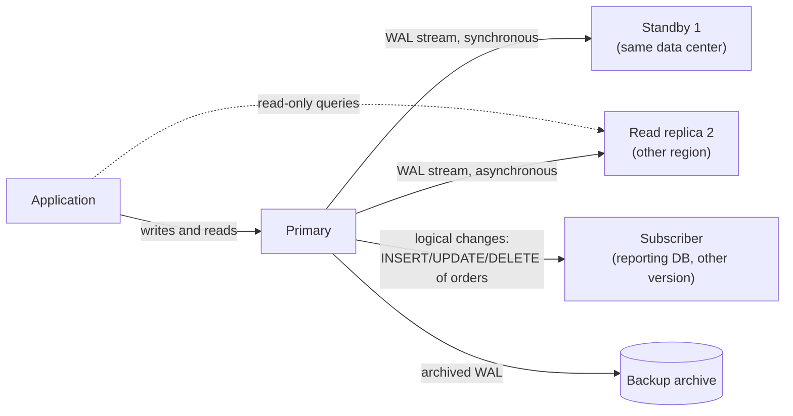
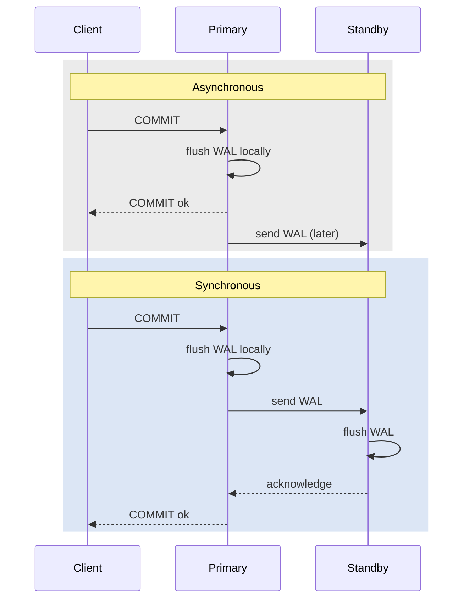
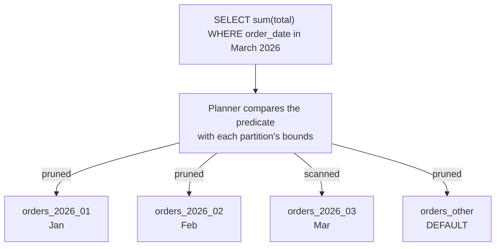
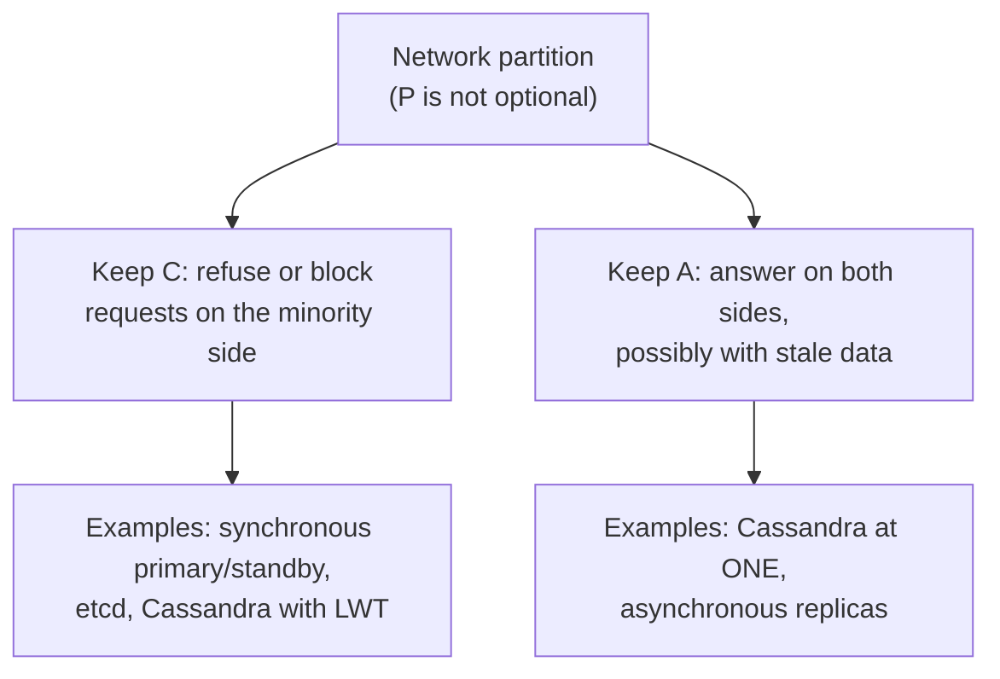

<div dir="rtl" markdown="1">

# 12. پشتیبان‌گیری، PITR، همانندسازی، دسترس‌پذیری بالا، پارتیشن‌بندی و شاردینگ

> **سطح:** L2 کاربردی ← L3 ارشد | **بخش:** I | **ارجاع‌های Rowlit خوانده‌شده در:** `1d57848` (Rowlit 1.6.3)
> **در یک جمله:** پشتیبان در برابر از دست رفتن داده، همانندسازی در برابر از دست رفتن سرور، پارتیشن‌بندی برای تقسیم یک جدول بزرگ به تکه‌های قابل مدیریت و شاردینگ برای پخش یک پایگاه داده روی چند سرور است؛ هر کدام بهای دقیقی در سازگاری و پیچیدگی دارد.
> **چه می‌آموزید:**
> - انواع پشتیبان (کامل، تفاضلی، افزایشی، لاگ)، RPO و RTO، بازیابی به نقطه‌ای از زمان و اهمیت تمرین بازگردانی؛
> - همانندسازی فیزیکی در برابر منطقی، همگام در برابر ناهمگام، failover، split brain و تأخیر همانندسازی؛
> - پارتیشن‌بندی جدول (بازه، فهرست، هش) و هرس پارتیشن، با مثالی در PostgreSQL روی `shop`؛
> - شاردینگ: کلید شارد، توازن‌بخشی دوباره، پرس‌وجوهای میان‌شاردی؛
> - اجماع (Raft)، مدل‌های سازگاری، CAP و PACELC، و commit دومرحله‌ای.
>
> **پیش‌نیازها:** [9. تراکنش‌ها](09-transactions-and-isolation.md)، [11. WAL، redo/undo، checkpoint و بازیابی](11-logging-and-recovery.md).
>
> [English](../../en/part1/12-backup-replication-ha.md) · قبلی: [11. WAL، redo/undo، checkpoint و بازیابی](11-logging-and-recovery.md) · بعدی: [13. روش تنظیم کارایی](13-performance-tuning.md)
>
> برچسب‌های نمودارها به انگلیسی نگه داشته شده‌اند تا در GitHub درست نمایش داده شوند.

---

<a id="1-the-idea-beginner"></a>
## 1. ایده (مبتدی)

ماندگاری ([11](11-logging-and-recovery.md)) از دادهٔ commitشده در برابر از کار افتادن *فرایند* محافظت می‌کند. وقتی دیسک می‌میرد، وقتی مرکز داده یک
روز بی‌برق می‌ماند، یا وقتی کسی `DELETE FROM orders` را بدون `WHERE` اجرا می‌کند، کمکی نمی‌کند. برای این‌ها به نسخه‌های دیگر نیاز دارید:
**[پشتیبان (backup)](../glossary.md#backup)** نسخه‌ای است که کنار گذاشته می‌شود تا بعداً بازگردانده شود؛ **[همانندسازی (replication)](../glossary.md#replication)**
یک نسخهٔ زنده را روی سرور دیگری نگه می‌دارد که هر تغییر را دنبال می‌کند. این دو مسئله‌های متفاوتی را حل می‌کنند. رونوشت همان `DELETE` تصادفی را در
چند میلی‌ثانیه با وفاداری کامل بازاجرا می‌کند، پس پشتیبان نیست؛ بازگرداندن پشتیبان ساعت‌ها طول می‌کشد، پس دسترس‌پذیری بالا نیست.

وقتی یک جدول یا یک سرور بیش از اندازه بزرگ شود، آن را تقسیم می‌کنید. **[پارتیشن‌بندی (table partitioning)](../glossary.md#table-partitioning)** یک
جدول را درون یک پایگاه داده به تکه‌هایی می‌بُرد (مثلاً یک تکه برای هر ماه)، تا پرس‌وجو و نگه‌داری فقط به تکه‌های لازم دست بزنند.
**[شاردینگ (sharding)](../glossary.md#sharding)** سطرها را روی چند سرور مستقل پخش می‌کند تا سامانه از توان یک ماشین فراتر برود. به محض آن‌که داده روی
بیش از یک ماشین باشد، شبکهٔ میان آن‌ها ممکن است قطع شود و باید انتخاب کنید سامانه آنگاه چه کند: از پاسخ‌دادن سر باز زند یا با دادهٔ احتمالاً کهنه
پاسخ دهد. این انتخاب موضوع قضیهٔ CAP در پایان همین فصل است.

<a id="2-how-it-works-practitioner"></a>
## 2. چگونه کار می‌کند (کاربردی)

<a id="21-backups-rpo-and-rto"></a>
### 2.1 پشتیبان، RPO و RTO

دو عدد تعیین می‌کنند راهبرد پشتیبان‌گیری باید به چه برسد:

- **[RPO](../glossary.md#rpo)** (هدف نقطهٔ بازیابی): چه مقدار داده، بر حسب زمان، مجاز است از دست برود. «RPO پنج دقیقه» یعنی پس از فاجعه باید بتوانید
  همه چیز را تا حداکثر پنج دقیقه پیش از آن بازگردانید.
- **[RTO](../glossary.md#rto)** (هدف زمان بازیابی): بازگردانی چقدر مجاز است طول بکشد تا سامانه دوباره قابل استفاده شود.

انواع پشتیبان:

| نوع | شامل چیست | بازگردانی به چه نیاز دارد |
|---|---|---|
| **[کامل (full)](../glossary.md#full-backup)** | کل پایگاه داده | همان پشتیبان |
| **[تفاضلی (differential)](../glossary.md#differential-backup)** | صفحه‌های تغییرکرده از آخرین پشتیبان *کامل* | کامل + آخرین تفاضلی |
| **[افزایشی (incremental)](../glossary.md#incremental-backup)** | صفحه‌های تغییرکرده از آخرین پشتیبانِ *هر* نوع | کامل + همهٔ افزایشی‌های پس از آن، به ترتیب |
| **[پشتیبان لاگ (log backup)](../glossary.md#log-backup)** (بایگانی WAL، redo بایگانی‌شده، binlog) | رکوردهای لاگ از پشتیبان لاگ قبلی | یک کامل (به‌علاوهٔ تفاضلی‌ها) + زنجیرهٔ ناگسستهٔ پشتیبان‌های لاگ |

و دو شکل آن:

- پشتیبان **[فیزیکی](../glossary.md#physical-backup)** فایل‌ها یا صفحه‌های داده را کپی می‌کند (`pg_basebackup`، `BACKUP DATABASE` در SQL Server، RMAN در
  Oracle، Percona XtraBackup). بازگردانی سریع، فقط همان نسخهٔ موتور و همان سکو، همیشه کل خوشه یا کل پایگاه داده.
- پشتیبان **[منطقی](../glossary.md#logical-backup)** SQL یا سطرها را برون‌بری می‌کند (`pg_dump`، `mysqldump`، Oracle Data Pump، `.dump` در SQLite). میان
  نسخه‌ها قابل انتقال و قابل انتخاب برای هر جدول، اما برای پایگاه‌های بزرگ بازگردانی کند است (نمایه‌ها دوباره ساخته می‌شوند) و فقط یک لحظه را ثبت
  می‌کند (بدون PITR).

مثال‌هایی روی `shop`:

</div>

```bash
# PostgreSQL 17: logical dump of one database (custom format) and restore into a new database
pg_dump -h localhost -p 15432 -U shop -Fc -f shop.dump shop
createdb -h localhost -p 15432 -U shop shop_copy && pg_restore -h localhost -p 15432 -U shop -d shop_copy shop.dump

# PostgreSQL 17: physical base backup of the whole cluster, WAL streamed alongside
pg_basebackup -h localhost -p 15432 -U shop -D ./base -Ft -z -X stream -P
```

```sql
-- SQL Server 2022: full, differential and log backups with page checksums
BACKUP DATABASE shop TO DISK = N'/var/opt/mssql/backup/shop_full.bak' WITH COMPRESSION, CHECKSUM;
BACKUP DATABASE shop TO DISK = N'/var/opt/mssql/backup/shop_diff.bak' WITH DIFFERENTIAL, COMPRESSION, CHECKSUM;
BACKUP LOG shop TO DISK = N'/var/opt/mssql/backup/shop_log_1015.trn' WITH COMPRESSION, CHECKSUM;
```

```bash
# MySQL 8: consistent logical dump without locking InnoDB tables, recording the binlog position
mysqldump -h 127.0.0.1 -P <port> -u root -p --single-transaction --routines --triggers --source-data=2 shop > shop.sql
```

```sql
-- SQLite: an online copy that is consistent even while the database is in use
VACUUM INTO 'shop-backup.sqlite';
```

<div dir="rtl" markdown="1">

جزئیات موتورها که دانستنشان می‌ارزد: PostgreSQL 17 **پشتیبان افزایشی بومی** را افزود (`pg_basebackup --incremental` که به `summarize_wal = on` نیاز دارد
و بعداً با `pg_combinebackup` ترکیب می‌شود). RMAN در Oracle میان level 0 (پشتیبان کاملی که می‌تواند پایهٔ افزایشی‌ها باشد) و level 1 (به‌طور پیش‌فرض
تفاضلی، و در صورت درخواست `CUMULATIVE`) فرق می‌گذارد. `COPY_ONLY` در SQL Server پشتیبان کاملی می‌گیرد که پایهٔ تفاضلی را به هم نمی‌زند. کپی‌کردن فایل
SQLite با سیستم‌عامل در حالی که در آن نوشته می‌شود ممکن است کپی خرابی بسازد؛ در حالت WAL فایل `-wal` دادهٔ commitشده‌ای دارد که هنوز در فایل اصلی
نیست.

سامانه‌هایی با رویکرد خودشان: **ClickHouse** دستور `BACKUP TABLE shop.orders TO Disk('backups', 'orders.zip')` (یا `S3(...)`) دارد، با پشتیبان افزایشی
از راه `SETTINGS base_backup = …`. **Snowflake** micro-partitionهای قدیمی را برای **Time Travel** نگه می‌دارد (`SELECT … AT(OFFSET => -300)`،
`UNDROP TABLE`، `CLONE` بدون کپی؛ به‌طور پیش‌فرض یک روز، تا 90 روز در نسخهٔ Enterprise) و پس از آن 7 روز Fail-safe که فقط پشتیبانی Snowflake می‌تواند از
آن بازگرداند. **Cassandra** برای هر گره `nodetool snapshot` می‌گیرد (پیوند سخت به SSTableها) و می‌تواند پشتیبان افزایشی از هر SSTable تخلیه‌شده نگه
دارد.

<a id="22-point-in-time-recovery"></a>
### 2.2 بازیابی به نقطه‌ای از زمان

**[بازیابی به نقطه‌ای از زمان (PITR)](../glossary.md#pitr)** پایگاه داده را به هر لحظه‌ای بازمی‌گرداند، مثلاً 10:14:00، یک دقیقه پیش از `DELETE` تصادفی
ساعت 10:15. این همان بازاجرای WAL در فصل 11 است روی یک پشتیبان قدیمی‌تر، که در لحظهٔ انتخاب‌شده متوقف می‌شود.

PostgreSQL به یک پشتیبان پایه و بایگانی پیوستهٔ WAL نیاز دارد:

</div>

```ini
# postgresql.conf on the primary
wal_level = replica
archive_mode = on
archive_command = 'test ! -f /archive/%f && cp %p /archive/%f'   # or a tool such as pgBackRest / WAL-G
```

<div dir="rtl" markdown="1">

برای بازیابی: پشتیبان پایه را در یک پوشهٔ دادهٔ خالی بازگردانید، سپس هدف را تنظیم کنید و فایل `recovery.signal` را بسازید:

</div>

```ini
# postgresql.conf (or postgresql.auto.conf) of the restored copy
restore_command = 'cp /archive/%f %p'
recovery_target_time = '2026-10-28 10:14:00+00'
recovery_target_action = 'pause'      # default: stop and let you inspect before promoting
```

<div dir="rtl" markdown="1">

سرور را راه بیندازید؛ WAL بایگانی‌شده را تا 10:14:00 بازاجرا می‌کند و مکث می‌کند. داده را با پرس‌وجوهای فقط‌خواندنی بررسی کنید، سپس
`SELECT pg_wal_replay_resume();` را صدا بزنید تا بازیابی پایان یابد و برای نوشتن باز شود (با `recovery_target_action = 'pause'` این کار نسخه را ارتقا
می‌دهد). سطرهای گم‌شده را به پایگاه دادهٔ عملیاتی برگردانید یا به نسخهٔ بازگردانده‌شده سوئیچ کنید.

SQL Server از دنبالهٔ بازگردانی و `STOPAT` استفاده می‌کند:

</div>

```sql
RESTORE DATABASE shop_pitr FROM DISK = N'/var/opt/mssql/backup/shop_full.bak'
  WITH MOVE N'shop' TO N'/var/opt/mssql/data/shop_pitr.mdf', MOVE N'shop_log' TO N'/var/opt/mssql/data/shop_pitr.ldf',
       NORECOVERY;
RESTORE LOG shop_pitr FROM DISK = N'/var/opt/mssql/backup/shop_log_1015.trn'
  WITH STOPAT = N'2026-10-28T10:14:00', RECOVERY;
```

<div dir="rtl" markdown="1">

(نام‌های منطقی فایل `shop` و `shop_log` پیش‌فرض پایگاه داده‌ای است که با `CREATE DATABASE shop` ساخته شده؛ با `RESTORE FILELISTONLY` بررسی‌شان کنید.)
MySQL لاگ‌های binlog را از موقعیتی که در dump ثبت شده بازپخش می‌کند (`mysqlbinlog --start-position=… --stop-datetime="2026-10-28 10:14:00"
binlog.000042 | mysql`). Oracle از RMAN استفاده می‌کند (`RUN { SET UNTIL TIME "…"; RESTORE DATABASE; RECOVER DATABASE; }` و سپس `ALTER DATABASE OPEN
RESETLOGS`) یا، اگر flashback logging روشن باشد، از `FLASHBACK DATABASE TO TIMESTAMP …` که بسیار سریع‌تر است چون فقط بلوک‌های تغییرکرده را به عقب
برمی‌گرداند.

<a id="23-restore-drills"></a>
### 2.3 تمرین بازگردانی

پشتیبانی که هرگز بازگردانده نشده یک امید است، نه پشتیبان. راه‌های رایجی که پشتیبان‌ها بی‌فایده از آب درمی‌آیند: زنجیرهٔ لاگ شکاف دارد، فرمان بایگانی
هفته‌ها بی‌صدا شکست خورده، از کلید رمزنگاری یا گواهی پشتیبان گرفته نشده، پشتیبان روی همان حافظه‌ای است که از کار افتاده، یا بازگردانی 14 ساعت طول
می‌کشد در حالی که RTO دو ساعت است. با **[تمرین‌های بازگردانی (restore drill)](../glossary.md#restore-drill)** منظم تمرین کنید:

- **منظم بازگردانی کنید**، روی سروری جدا، و بررسی‌ها را اجرا کنید (شمار سطرها، `DBCC CHECKDB` در SQL Server، `pg_amcheck` در PostgreSQL، آزمون‌های دود
  برنامه). زمان را بسنجید: RTO واقعی شما همین است.
- **درستی پشتیبان را وارسی کنید**: `WITH CHECKSUM` به‌علاوهٔ `RESTORE VERIFYONLY` (SQL Server)، `pg_verifybackup` (PostgreSQL)، `RESTORE VALIDATE` (RMAN).
- **قاعدهٔ 3-2-1**: سه نسخه، روی دو رسانهٔ متفاوت، یکی بیرون از محل (یا تغییرناپذیر در object storage)، تا باج‌افزار یا اشتباه یک مدیر نتواند همه را
  پاک کند.
- **زنجیرهٔ لاگ را پایش کنید**: وقتی پشتیبان لاگ یا بایگانی WAL عقب می‌افتد هشدار دهید، چون مستقیماً RPO شما را گشادتر می‌کند.

<a id="24-replication-physical-and-logical"></a>
### 2.4 همانندسازی: فیزیکی و منطقی

**شکل 12.1 — یک اصلی با یک standby همگام، یک رونوشت ناهمگام و یک مشترک منطقی.**

</div>



<div dir="rtl" markdown="1">

**[همانندسازی فیزیکی (physical replication)](../glossary.md#physical-replication)** خود لاگ را (WAL، لاگ تراکنش، redo) می‌فرستد و رونوشت آن را مانند
بازیابی پس از خرابی‌ای بی‌پایان بازاجرا می‌کند. رونوشت کپی بایت‌به‌بایت است: همان نسخهٔ موتور، همهٔ پایگاه‌های داده، نمایه‌ها و حتی حجیم‌شدگی، و معمولاً
فقط‌خواندنی. مثال‌ها: **[همانندسازی جریانی (streaming replication)](../glossary.md#streaming-replication)** در PostgreSQL، availability groupهای Always On
و log shipping در SQL Server، physical standby در Oracle Data Guard.

**[همانندسازی منطقی (logical replication)](../glossary.md#logical-replication)** تغییرهای سطر را می‌فرستد («این سطر را در `orders` درج کن»). مشترک یک
پایگاه دادهٔ مستقل و قابل نوشتن است و می‌تواند نمایه‌های دیگر، نسخهٔ اصلی متفاوت یا فقط برخی جدول‌ها را داشته باشد. مثال‌ها: publication و subscription
در PostgreSQL، همانندسازی binlog در MySQL (قالب row)، transactional replication در SQL Server، Oracle GoldenGate. این همان راه ارتقای نسخه با کمترین
توقف و تغذیهٔ سامانه‌های دیگر است. محدودیت‌هایش: تغییرهای طرح (DDL) معمولاً خودکار همانندسازی نمی‌شوند (PostgreSQL 17 هنوز نمی‌کند)، sequenceها رسیدگی
جداگانه می‌خواهند، و هر جدول به کلید اصلی یا replica identity نیاز دارد.

</div>

```sql
-- PostgreSQL 17 logical replication of two shop tables (publisher needs wal_level = logical)
CREATE PUBLICATION shop_pub FOR TABLE public.orders, public.customers;          -- on the publisher
CREATE SUBSCRIPTION shop_sub CONNECTION 'host=pg-primary dbname=shop user=repl'  -- on the subscriber
  PUBLICATION shop_pub;
```

<div dir="rtl" markdown="1">

**[ثبت تغییرات داده (CDC)](../glossary.md#cdc)** همانندسازی منطقی به مقصدی است که پایگاه داده نیست: ابزاری لاگ را می‌خواند (logical decoding در
PostgreSQL، **[binlog](../glossary.md#binlog)** در MySQL، جدول‌های تغییر CDC در SQL Server) و هر تغییر را به‌صورت رویداد منتشر می‌کند، معمولاً به Kafka
([16](16-nosql-families.md)). Debezium شناخته‌شده‌ترین نمونهٔ متن‌باز است.

PostgreSQL برای رونوشت یا مشترکی که عقب است، WAL را با یک **[replication slot](../glossary.md#replication-slot)** نگه می‌دارد. slotی که مصرف‌کننده‌اش
ناپدید شده WAL را تا ابد نگه می‌دارد و می‌تواند دیسک را پر کند ([11](11-logging-and-recovery.md#25-log-truncation-and-log-growth))؛
`max_slot_wal_keep_size` برایش سقف می‌گذارد.

<a id="25-synchronous-or-asynchronous"></a>
### 2.5 همگام یا ناهمگام

**شکل 12.2 — COMMIT کی برمی‌گردد؟ همانندسازی ناهمگام در برابر همگام.**

</div>



<div dir="rtl" markdown="1">

- همانندسازی **[ناهمگام](../glossary.md#asynchronous-replication)** تأخیری به commit نمی‌افزاید، اما وقتی اصلی از کار بیفتد، اگر failover کنید تراکنش‌هایی
  که هنوز به رونوشت نرسیده بودند از دست می‌روند. پنجرهٔ از دست رفتن داده همان تأخیر همانندسازی است.
- همانندسازی **[همگام](../glossary.md#synchronous-replication)** COMMIT را منتظر تأیید دست‌کم یک standby نگه می‌دارد، پس failover به آن standby هیچ چیز
  را از دست نمی‌دهد. هزینه، یک رفت‌وبرگشت شبکه برای هر commit است، و اگر هیچ standby همگامی در دسترس نباشد، commitها **منتظر می‌مانند** (PostgreSQL) یا
  سامانه باید برای بازگشت به حالت ناهمگام پیکربندی شده باشد.

PostgreSQL با `synchronous_commit` تعیین می‌کند standby *چه چیزی* را باید تأیید کند: `remote_write` (دریافت و نوشتن در سیستم‌عامل)، `on` (flush روی
دیسک)، `remote_apply` (بازاجرا، پس خواندن روی standby تغییر را می‌بیند). `synchronous_standby_names = 'ANY 1 (s1, s2)'` حد نصابِ هر یک از دو standby را
می‌خواهد. availability groupهای SQL Server رونوشت‌های *synchronous-commit* و *asynchronous-commit* دارند؛ Oracle Data Guard حالت‌های حفاظتی
*Maximum Protection* (همگام؛ اگر هیچ standby تأیید نکند اصلی متوقف می‌شود)، *Maximum Availability* (همگام، با بازگشت به ناهمگام) و *Maximum Performance*
(ناهمگام، پیش‌فرض) را دارد. همانندسازی MySQL به‌طور پیش‌فرض ناهمگام است؛ همانندسازی *نیمه‌همگام* صبر می‌کند تا یک رونوشت رویدادها را *دریافت* کند (نه
اعمال).

<a id="26-failover-split-brain-and-fencing"></a>
### 2.6 failover، split brain و حصارکشی

**[failover](../glossary.md#failover)** یک [رونوشت را به اصلی](../glossary.md#primary-replica) ارتقا می‌دهد وقتی اصلی از کار بیفتد.
*[switchover](../glossary.md#switchover)* نسخهٔ برنامه‌ریزی‌شدهٔ آن است (برای وصله‌کردن) و داده از دست نمی‌رود. failover سه بخش دشوار دارد:

1. **تشخیص خرابی.** اصلی‌ای که کند است، یا فقط از دید ناظر دسترس‌ناپذیر است، مرده به نظر می‌رسد. مهلت‌های خیلی کوتاه failoverهای بی‌دلیل می‌سازند و
   مهلت‌های خیلی بلند توقف را طولانی می‌کنند.
2. **انتخاب اصلی تازه**: به‌روزترین رونوشت، و ترجیحاً یک رونوشت همگام.
3. **اطمینان از توقف اصلی قدیمی.** اگر اصلی قدیمی هنوز زنده باشد (مثلاً فقط شبکهٔ میان مرکزهای داده قطع شده) و همچنان نوشتن بپذیرد در حالی که اصلی تازه
   هم می‌پذیرد، **[split brain (دوپارگی)](../glossary.md#split-brain)** دارید: دو اصلی، دو تاریخچهٔ واگرا، و هیچ راه خودکاری برای ادغامشان.

جلوی split brain را **حد نصاب** و **[حصارکشی (fencing)](../glossary.md#fencing)** می‌گیرند. حد نصاب یعنی یک گره فقط وقتی می‌تواند اصلی باشد که به اکثریت
رأی‌دهنده‌ها دسترسی داشته باشد (شمار فرد گره، یا یک witness/observer در مکان سوم). حصارکشی یعنی خوشه فعالانه اصلی قدیمی را قطع کند: دسترسی‌اش به حافظه
را بگیرد، خاموشش کند («STONITH»)، یا وقتی lease خود را از دست داد، خودش را تنزل دهد. ابزارهای معمول: Patroni (PostgreSQL، lease رهبر در
etcd/Consul/ZooKeeper)، Windows Server Failover Clustering یا Pacemaker زیر availability groupهای SQL Server، Data Guard broker در Oracle با Fast-Start
Failover و یک observer، و MySQL InnoDB Cluster با MySQL Router.

پس از failover، برنامه‌ها باید به اصلی تازه وصل شوند. یک listener یا IP مجازی (AG listener در SQL Server)، رشتهٔ اتصال چندمیزبانی
(`host=a,b target_session_attrs=read-write` در libpq / Npgsql) یا یک proxy این تغییر را پنهان می‌کند.

<a id="27-read-replicas-and-replication-lag"></a>
### 2.7 رونوشت‌های خواندنی و تأخیر همانندسازی

رونوشت‌ها می‌توانند ترافیک فقط‌خواندنی را پاسخ دهند. دام کار **[تأخیر همانندسازی (replication lag)](../glossary.md#replication-lag)** است: رونوشت چند
میلی‌ثانیه یا، زیر بار، چند دقیقه عقب است. کاربری که سفارشی ثبت می‌کند و سپس برای «سفارش‌های من» به رونوشت فرستاده می‌شود ممکن است آن را نبیند.
راهبردها:

- نوشته‌های تازهٔ خود کاربر را از اصلی بخوانید (برای چند ثانیه پس از نوشتن، یا برای نشست همان کاربر)؛
- برای رونوشت‌هایی که باید به‌روز باشند اعمال همگام (`remote_apply`) به کار ببرید؛
- LSN مربوط به commit را به خواننده بدهید و صبر کنید تا رونوشت آن را بازاجرا کند.

تأخیر را روی اصلی یا رونوشت بسنجید:

</div>

```sql
-- PostgreSQL: on the primary
SELECT application_name, state, sync_state, write_lag, flush_lag, replay_lag FROM pg_stat_replication;
-- SQL Server: queues of each availability-group database
SELECT database_id, log_send_queue_size, redo_queue_size FROM sys.dm_hadr_database_replica_states;
```

<div dir="rtl" markdown="1">

MySQL در `SHOW REPLICA STATUS` مقدار `Seconds_Behind_Source` را گزارش می‌کند؛ این مقدار سنِ رویدادی را که در حال اعمال است می‌سنجد، پس ممکن است 0
نشان دهد در حالی که رونوشت هنوز رویدادهای آخر را حتی دریافت نکرده است.

<a id="28-table-partitioning"></a>
### 2.8 پارتیشن‌بندی جدول

**پارتیشن‌بندی جدول** یک جدول منطقی را بر پایهٔ مقدار یک **[کلید پارتیشن (partition key)](../glossary.md#partition-key-table)** به تکه‌های فیزیکی تقسیم
می‌کند:

- **بازه (range)**: بر پایهٔ بازه‌ها، معمولاً زمان (`order_date` برای هر ماه)؛
- **فهرست (list)**: بر پایهٔ مقدارهای گسسته (`country_id IN (1, 2)` در یک پارتیشن، `3` در دیگری)؛
- **هش (hash)**: بر پایهٔ `hash(customer_id) mod N`، برای پخش یکنواخت سطرها.

آنچه به دست می‌آورید: **[هرس پارتیشن (partition pruning)](../glossary.md#partition-pruning)** (برنامه‌ریز از پارتیشن‌هایی که نمی‌توانند سطر منطبق داشته
باشند می‌گذرد)، حذف انبوه ارزان دادهٔ قدیمی (جداکردن یا drop کردن یک پارتیشن به‌جای یک `DELETE` عظیم)، و نگه‌داری جداگانهٔ هر پارتیشن (vacuum، بازسازی
نمایه، حافظهٔ متفاوت). آنچه خودبه‌خود به دست نمی‌آورید: سرعت برای پرس‌وجوهایی که روی کلید پارتیشن فیلتر نمی‌کنند. این‌ها حالا *همهٔ* پارتیشن‌ها را
می‌خوانند و اغلب از یک جدول با نمایهٔ خوب کندترند.

یک مثال کامل در PostgreSQL 17 در طرح آزمایشی `lab` از [فصل 9](09-transactions-and-isolation.md#25-the-anomalies-on-shop):

</div>

```sql
CREATE TABLE lab.orders_p (
  id integer NOT NULL, customer_id integer NOT NULL, order_date timestamptz NOT NULL,
  total numeric(12,2) NOT NULL, status public.order_status NOT NULL DEFAULT 'new',
  PRIMARY KEY (id, order_date)                        -- a unique key must include the partition key
) PARTITION BY RANGE (order_date);
CREATE TABLE lab.orders_2026_01 PARTITION OF lab.orders_p FOR VALUES FROM ('2026-01-01') TO ('2026-02-01');
CREATE TABLE lab.orders_2026_02 PARTITION OF lab.orders_p FOR VALUES FROM ('2026-02-01') TO ('2026-03-01');
CREATE TABLE lab.orders_2026_03 PARTITION OF lab.orders_p FOR VALUES FROM ('2026-03-01') TO ('2026-04-01');
CREATE TABLE lab.orders_other   PARTITION OF lab.orders_p DEFAULT;
INSERT INTO lab.orders_p SELECT id, customer_id, order_date, total, status FROM public.orders;

EXPLAIN (COSTS OFF) SELECT sum(total) FROM lab.orders_p WHERE order_date >= '2026-03-01' AND order_date < '2026-04-01';
```

<div dir="rtl" markdown="1">

خروجی نمونه (شش سفارش seed در ژانویه، فوریه و مارس 2026 می‌افتند):

</div>

```text
 Aggregate
   ->  Seq Scan on orders_2026_03 orders_p
         Filter: ((order_date >= '2026-03-01 00:00:00+00'::timestamp with time zone) AND (order_date < '2026-04-01 00:00:00+00'::timestamp with time zone))
```

<div dir="rtl" markdown="1">

فقط `orders_2026_03` پویش می‌شود. شرط `WHERE` را بردارید تا طرح اجرا به یک `Append` روی هر چهار پارتیشن تبدیل شود.

**شکل 12.3 — هرس پارتیشن: برنامه‌ریز شرط را با مرزهای هر پارتیشن مقایسه می‌کند.**

</div>



<div dir="rtl" markdown="1">

هرس برای ثابت‌ها در زمان برنامه‌ریزی انجام می‌شود و از PostgreSQL 11 برای پارامترها و مقدارهای آمده از join **در زمان اجرا** هم (طرح اجرا
`Subplans Removed: N` نشان می‌دهد). هرس فقط وقتی کار می‌کند که پرس‌وجو خود کلید پارتیشن را مقایسه کند: `WHERE date_trunc('month', order_date) =
'2026-03-01'` ستون را درون یک تابع پنهان می‌کند و هیچ چیز را هرس نمی‌کند ([13](13-performance-tuning.md#sargable-predicates)).

بیرون‌بردن دادهٔ قدیمی یک عملیات فراداده است:

</div>

```sql
ALTER TABLE lab.orders_p DETACH PARTITION lab.orders_2026_01 CONCURRENTLY;   -- PostgreSQL 14+, no long lock
DROP TABLE lab.orders_2026_01;                                               -- or archive it first
-- … when done with the example:  DROP SCHEMA lab CASCADE;
```

<div dir="rtl" markdown="1">

موتورهای دیگر: **SQL Server** از partition function و partition scheme استفاده می‌کند و `ALTER TABLE … SWITCH PARTITION` یک پارتیشن کامل را در یک لحظه
جابه‌جا می‌کند (*پنجرهٔ لغزان* کلاسیک)؛ نمایه‌های «هم‌تراز» با partition scheme امکان switch را حفظ می‌کنند. **Oracle** پارتیشن‌بندی range، list،
hash، interval (پارتیشن‌های بازه‌ای تازهٔ خودکار)، reference و ترکیبی دارد. **MySQL** از RANGE، LIST، HASH و KEY پشتیبانی می‌کند؛ هر کلید یکتا باید
ستون‌های پارتیشن را داشته باشد و جدول‌های InnoDB پارتیشن‌بندی‌شده کلید خارجی ندارند. **ClickHouse** روی جدول‌های MergeTree `PARTITION BY` تعریف
می‌کند؛ seed مربوط به `shop` سفارش‌ها را با `PARTITION BY toYYYYMM(order_date)` ماهانه پارتیشن می‌کند
(`engine/tests/docker/seed-clickhouse.sql:53`) و `ALTER TABLE … DROP PARTITION` یک ماه را یک‌جا حذف می‌کند. **Snowflake** هر جدول را خودکار به
micro-partitionها تقسیم و بر پایهٔ فرادادهٔ min/max آن‌ها هرس می‌کند؛ فقط با کلید clustering می‌توانید بر آن اثر بگذارید ([15](15-oltp-vs-olap-columnar.md)).
**SQLite** پارتیشن‌بندی ندارد.

<a id="29-sharding"></a>
### 2.9 شاردینگ

شاردینگ سطرهای مختلف را روی سرورهای مختلف (**شاردها**) می‌گذارد که هر کدام یک پایگاه دادهٔ کامل برای زیرمجموعهٔ خود است. یک
**[کلید شارد (shard key)](../glossary.md#shard-key)** تعیین می‌کند هر سطر کجا زندگی کند. انتخاب آن پرپیامدترین تصمیم طراحی یک سامانهٔ شاردشده است:

| راهبرد | چگونه | خوب در | بد در |
|---|---|---|---|
| هش | `hash(customer_id) mod N` یا حلقهٔ هش | پخش یکنواخت داده و بار | پرس‌وجوی بازه‌ای روی کلید؛ افزودن شارد (مگر با consistent hashing) |
| بازه | بازه‌های کلید (`customer_id` از 1 تا 1M روی شارد 1، …) | پویش بازه‌ای، همسایگی داده | نقطهٔ داغ (همهٔ سطرهای تازه به آخرین بازه می‌روند) |
| فهرست راهنما (directory) | یک جدول جست‌وجو کلید را به شارد نگاشت می‌کند | جای‌گذاری انعطاف‌پذیر، جابه‌جایی تک‌مستأجرها | فهرست راهنما مؤلفهٔ دیگری است که باید دسترس‌پذیر بماند |

قاعده‌های سرانگشتی: کلیدی بردارید که تقریباً در هر پرس‌وجو بیاید (تا پرس‌وجو به *یک* شارد برود)، سطرهایی را که با هم نوشته می‌شوند روی یک شارد نگه دارد
(تا تراکنش روی یک شارد بماند)، و مقدارهای متمایز فراوان و یکنواخت داشته باشد. برای `shop`، `customer_id` کلید شارد طبیعی است: سفارش‌ها، سطرها و فاکتورهای
یک مشتری می‌توانند کنار هم باشند. seed مربوط به Cassandra در `shop` همین ایده را نشان می‌دهد: `orders_by_customer` کلید `PRIMARY KEY ((customer_id),
order_date, order_id)` دارد، پس همهٔ سفارش‌های یک مشتری یک پارتیشن روی همان رونوشت‌ها می‌سازند (`engine/tests/docker/seed-cassandra.cql:80-87`).

هزینه‌ها:

- **پرس‌وجوهای میان‌شاردی** («درآمد برای هر کشور») باید از همهٔ شاردها بپرسند و نتیجه‌ها را ادغام کنند
  ([پخش و گردآوری (scatter-gather)](../glossary.md#scatter-gather))؛ join میان سطرهای شاردهای مختلف گران یا پشتیبانی‌نشده است.
- **تراکنش‌های میان‌شاردی** به پروتکلی توزیع‌شده مانند commit دومرحله‌ای نیاز دارند ([3.4](#34-distributed-transactions-and-two-phase-commit)).
- **[توازن‌بخشی دوباره (rebalancing)](../glossary.md#rebalancing)**: افزودن شارد یعنی جابه‌جایی داده در حالی که سامانه کار می‌کند. consistent hashing با
  گره‌های مجازی فراوان (حلقهٔ توکن Cassandra) یا شاردهای کوچک ثابت فراوان برای هر سرور (Citus، chunkهای MongoDB، Vitess) جابه‌جایی‌ها را کوچک نگه
  می‌دارند.
- **یکتایی سراسری** (ایمیل یکتا در همهٔ شاردها) و sequenceها طراحی اضافه می‌خواهند (UUID، تخصیص‌دهندهٔ مرکزی).

محصولات: Citus (افزونهٔ PostgreSQL)، Vitess (MySQL)، خوشه‌های شاردشدهٔ MongoDB؛ Cassandra و ClickHouse (موتور جدول `Distributed` روی شاردها) ذاتاً
شاردشده‌اند؛ SQL Server و PostgreSQL ساده شاردینگ توکار ندارند، پس شاردینگ در برنامه یا یک middleware زندگی می‌کند. فقط وقتی شارد کنید که یک سرور تنها و
خوب‌تنظیم‌شده با رونوشت‌ها واقعاً از پس بار برنیاید: پارتیشن‌بندی، رونوشت‌های خواندنی و نمایه‌های بهتر بسیار ارزان‌ترند.

<a id="3-deep-dive-senior"></a>
## 3. ژرفا (ارشد)

<a id="31-consensus-and-raft"></a>
### 3.1 اجماع و Raft

failover خودکار و فرادادهٔ توزیع‌شده نیاز دارند گره‌ها بر یک مقدار توافق کنند («رهبر در دورهٔ 7 کیست؟»، «آیا مدخل 42 لاگ commit شده؟») حتی وقتی برخی
گره‌ها از کار می‌افتند یا پیام‌ها دیر می‌رسند. این **[اجماع (consensus)](../glossary.md#consensus)** است. Paxos (Lamport) نخستین الگوریتم عملی بود؛
**[Raft](../glossary.md#raft)** (Ongaro و Ousterhout، 2014) الگوریتمی است که بیشتر سامانه‌ها امروز به کار می‌برند، چون پیاده‌سازی درستش آسان‌تر است.

Raft در پنج جمله. زمان به **دوره‌های (term)** شماره‌دار تقسیم می‌شود؛ در هر دوره حداکثر یک **رهبر** با اکثریت آرا برگزیده می‌شود. کلاینت‌ها فرمان‌ها را
به رهبر می‌فرستند و رهبر آن‌ها را به لاگ خود می‌افزاید و به پیروان همانندسازی می‌کند. مدخلی **commitشده** است که اکثریت آن را ذخیره کرده باشند؛
مدخل‌های commitشده هرگز از دست نمی‌روند، چون هر رهبر آینده باید آن‌ها را داشته باشد (نامزد نمی‌تواند رأی گره‌ای را بگیرد که لاگش به‌روزتر است).
پیروانی که در یک مهلت انتخاباتی تصادفی خبری از رهبر نشنوند، انتخابات را آغاز می‌کنند. با 2f + 1 گره، سامانه از خرابی f گره جان به در می‌برد؛ با 3 گره،
یکی؛ با 5 گره، دو.

کجا با آن روبه‌رو می‌شوید: etcd و Consul (زیر Patroni)، ClickHouse Keeper (به‌جای ZooKeeper، زیر `Replicated*MergeTree`)، Kafka KRaft
([16](16-nosql-families.md))، انتخابات replica set در MongoDB (پروتکلی شبیه Raft)، CockroachDB و TiDB (یک گروه Raft برای هر بازهٔ داده). MySQL Group
Replication گونه‌ای از Paxos را به کار می‌برد.

<a id="32-consistency-models"></a>
### 3.2 مدل‌های سازگاری

مدل سازگاری می‌گوید وقتی داده همانندسازی شده، یک خواندن کدام مقدارها را ممکن است برگرداند. از قوی‌ترین به ضعیف‌ترین:

| مدل | وعده | مثال |
|---|---|---|
| **[خطی‌پذیری (linearizability)](../glossary.md#linearizability)** | هر عملیات گویی در یک لحظه میان آغاز و پایانش اثر می‌کند؛ وقتی نوشتنی تأیید شد، هر خواندن بعدی آن را برمی‌گرداند. | خواندن از یک اصلیِ تنها پس از commit؛ تراکنش‌های سبک Cassandra؛ etcd. |
| سازگاری ترتیبی (sequential) | همهٔ کلاینت‌ها عملیات را به یک ترتیب می‌بینند، سازگار با ترتیب خود هر کلاینت، اما نه لزوماً زمان واقعی. | — |
| **[سازگاری علّی (causal consistency)](../glossary.md#causal-consistency)** | اگر A می‌توانست بر B اثر بگذارد (B نتیجهٔ A را خوانده)، همه A را پیش از B می‌بینند؛ نوشتن‌های بی‌ربط ممکن است به ترتیب‌های متفاوت دیده شوند. | نشست‌های سازگار علّی در MongoDB. |
| **[خواندن نوشته‌های خود (read-your-writes)](../glossary.md#read-your-writes)** | کلاینت همیشه نوشته‌های پیشین خودش را می‌بیند. | خواندن از اصلی پس از نوشتن. |
| خواندن یکنواخت (monotonic reads) | کلاینت هرگز نمی‌بیند زمان به عقب برگردد (مقدار قدیمی‌تر پس از مقدار تازه‌تر). | چسباندن کلاینت به یک رونوشت. |
| **[سازگاری نهایی (eventual consistency)](../glossary.md#eventual-consistency)** | اگر نوشتن متوقف شود، همهٔ رونوشت‌ها سرانجام هم‌سان می‌شوند. دربارهٔ خواندن‌های میان آن هیچ وعده‌ای نیست. | رونوشت‌های ناهمگام؛ Cassandra با سطح `ONE`. |

خطی‌پذیری را با **سریال‌پذیری** یکی نگیرید ([9](09-transactions-and-isolation.md#31-serializability-and-two-ways-to-get-it)): سریال‌پذیری دربارهٔ
*تراکنش‌ها روی اشیای فراوان* است که در یک ترتیب سریال دیده شوند (نه لزوماً ترتیب زمان واقعی)؛ خطی‌پذیری دربارهٔ *اشیای تکی* است که زمان واقعی را رعایت
کنند. *سریال‌پذیری سخت‌گیرانه (strict serializability)* هر دو است، و همان چیزی است که Spanner و PostgreSQL تک‌گره در سطح SERIALIZABLE ارائه می‌کنند.

**Cassandra** مدل را به انتخابی برای هر درخواست با **سطح‌های سازگاری** تبدیل می‌کند. با ضریب همانندسازی RF، نوشتن در سطح W منتظر W رونوشت می‌ماند و
خواندن در سطح R از R رونوشت می‌پرسد و تازه‌ترین مهر زمانی را برمی‌گرداند. اگر **R + W > RF** باشد، مجموعهٔ خواندن با مجموعهٔ نوشتن هم‌پوشانی دارد، پس
خواندن آخرین نوشتن تأییدشده را می‌بیند (این قاعدهٔ **[حد نصاب (quorum)](../glossary.md#quorum)** است؛ `QUORUM` = ⌊RF/2⌋ + 1، که برای RF برابر 3 می‌شود 2):

</div>

```sql
-- cqlsh
CONSISTENCY QUORUM;                                   -- for this cqlsh session
SELECT order_id, total FROM shop.orders_by_customer WHERE customer_id = 1;
```

<div dir="rtl" markdown="1">

keyspace آزمایشگاه از `SimpleStrategy` با `replication_factor: 1` استفاده می‌کند (`engine/tests/docker/seed-cassandra.cql:23-25`)، پس روی تک‌گرهٔ
آزمایشگاه همهٔ سطح‌ها یکسان رفتار می‌کنند؛ سطح‌ها فقط با RF برابر 3 یا بیشتر معنا پیدا می‌کنند. `LOCAL_QUORUM` فقط رونوشت‌های مرکز دادهٔ محلی را
می‌شمارد و انتخاب معمول برای خوشه‌های چندمنطقه‌ای است. خواندن و نوشتن quorum زیر نوشتن‌های هم‌زمان و خرابی‌ها همچنان خطی‌پذیر نیستند (آخرین نوشتن بر
پایهٔ مهر زمانی برنده است)؛ تراکنش‌های سبک خطی‌پذیرند.

<a id="33-cap-and-pacelc"></a>
### 3.3 CAP و PACELC

**[قضیهٔ CAP](../glossary.md#cap)** (Brewer در 2000، اثبات Gilbert و Lynch در 2002) می‌گوید: وقتی یک **گسست** شبکه رونوشت‌ها را از هم جدا می‌کند،
سامانه باید از **سازگاری** (به معنای CAP: خطی‌پذیری) یا **دسترس‌پذیری** (هر درخواست به یک گرهٔ سالم پاسخی بدون خطا بگیرد) بگذرد. در حین گسست راه
سومی نیست، چون دو طرف نمی‌توانند با هم حرف بزنند.

**شکل 12.4 — CAP: در حین گسست، C یا A را انتخاب کنید.**

</div>



<div dir="rtl" markdown="1">

CAP را اغلب «دو تا از سه تا را انتخاب کن» می‌فهمند. در عمل گسست چه بخواهید چه نخواهید رخ می‌دهد، پس انتخاب واقعی میان C و A است *وقتی رخ می‌دهد*.
**[PACELC](../glossary.md#pacelc)** (Abadi) تصویر را کامل می‌کند: اگر گسست (**P**artition) هست، میان دسترس‌پذیری (**A**) و سازگاری (**C**) انتخاب کن؛
وگرنه (**E**lse، در کارکرد عادی) میان تأخیر (**L**atency) و سازگاری (**C**). همانندسازی همگام برای سازگار ماندن در هر commit تأخیر می‌پردازد؛ همانندسازی
ناهمگام تأخیر کم را با خواندن کهنه و پنجرهٔ از دست رفتن داده می‌خرد.

مثال‌ها، با این قید که بیشتر سامانه‌ها قابل پیکربندی‌اند:

- PostgreSQL یا SQL Server تک‌اصلی با standbyهای **همگام** مانند PC/EC رفتار می‌کند: وقتی هیچ standby همگامی تأیید نکند commitها منتظر می‌مانند، و هر
  commit یک رفت‌وبرگشت می‌پردازد.
- همان با رونوشت‌های **ناهمگام** برای خواندن از رونوشت مانند PA/EL رفتار می‌کند و failover ممکن است commitهای اخیر را از دست بدهد.
- Cassandra در سطح `ONE` PA/EL است و هرچه سطح‌های سازگاری را بالا ببرید یا تراکنش سبک به کار ببرید به PC/EC نزدیک‌تر می‌شود.

<a id="34-distributed-transactions-and-two-phase-commit"></a>
### 3.4 تراکنش‌های توزیع‌شده و commit دومرحله‌ای

وقتی یک تراکنش در دو پایگاه داده می‌نویسد (دو شارد، یا یک پایگاه داده و یک صف پیام)، اتمی‌بودن به پروتکل نیاز دارد.
**[commit دومرحله‌ای (2PC)](../glossary.md#two-phase-commit)** یک **هماهنگ‌کننده** به کار می‌برد:

1. **آماده‌سازی (prepare)**: هماهنگ‌کننده از هر شرکت‌کننده می‌خواهد آماده شود. هر کدام تراکنش را ماندگار ولی هنوز نادیدنی می‌کند (باید بتواند بعداً
   commit *یا* rollback کند، حتی پس از خرابی)، قفل‌هایش را نگه می‌دارد و رأی بله یا نه می‌دهد.
2. **commit / لغو**: اگر همه بله گفتند، هماهنگ‌کننده «commit» را ثبت می‌کند و به همه می‌گوید commit کنند؛ وگرنه به همه می‌گوید برگردانند.

نقطهٔ ضعف: شرکت‌کننده‌ای که بله گفته و سپس ارتباطش با هماهنگ‌کننده قطع می‌شود **در تردید (in doubt)** است. نمی‌تواند تنهایی تصمیم بگیرد، پس تا بازگشت
هماهنگ‌کننده قفل‌هایش را نگه می‌دارد. همین انسداد دلیل آن است که 2PC را کم به کار می‌برند.

پشتیبانی موتورها: `PREPARE TRANSACTION 'tx1'` / `COMMIT PREPARED 'tx1'` در PostgreSQL (به‌طور پیش‌فرض خاموش، `max_prepared_transactions = 0`؛ تراکنش
prepared فراموش‌شده قفل نگه می‌دارد و جلوی VACUUM را می‌گیرد، [10](10-concurrency-locking-mvcc.md#32-postgresql-mvcc-in-detail) را ببینید)،
`XA START … XA PREPARE … XA COMMIT` در MySQL، در SQL Server از راه Microsoft Distributed Transaction Coordinator (MSDTC)، و در Oracle تراکنش‌های توزیع‌شده
روی database link (تراکنش‌های در تردید در `DBA_2PC_PENDING` دیده می‌شوند).

بسیاری از سامانه‌های امروزی میان سرویس‌ها از 2PC دوری می‌کنند و به‌جایش **[saga](../glossary.md#saga)** به کار می‌برند: دنباله‌ای از تراکنش‌های محلی که
هر کدام کنشی جبرانی دارد («برگرداندن پرداخت») تا اگر گام بعدی شکست خورد اثرش را خنثی کند، و اغلب با رویدادهایی از یک جدول *outbox* که در همان تراکنش
محلیِ تغییر کسب‌وکار نوشته می‌شود هدایت می‌شود. sagaها جداسازی (دیگران وضعیت‌های میانی را می‌بینند) را با دسترس‌پذیری معاوضه می‌کنند.

<a id="35-what-replication-does-not-do"></a>
### 3.5 آنچه همانندسازی انجام نمی‌دهد

- در برابر خطای منطقی محافظت نمی‌کند: `DELETE` تصادفی یا یک migration بد در چند میلی‌ثانیه همانندسازی می‌شود. فقط پشتیبان، PITR، رونوشت‌های با تأخیر
  (`recovery_min_apply_delay` در PostgreSQL، `SOURCE_DELAY` در MySQL) یا Time Travel کمک می‌کنند.
- نوشتن را مقیاس‌پذیر نمی‌کند: هر رونوشت هر نوشتن را اعمال می‌کند. نوشتن فقط با شاردینگ مقیاس می‌پذیرد.
- نیاز به آزمودن failover را از بین نمی‌برد: رشته‌های اتصال، TTL مربوط به DNS، کارهایی که فقط روی اصلی اجرا می‌شوند، loginها و agent jobهایی که فقط روی
  اصلی قدیمی هستند (SQL Server) غافل‌گیری‌های همیشگی‌اند.

<a id="4-in-each-engine"></a>
## 4. در هر موتور

| موضوع | PostgreSQL 17 | SQL Server 2022 | Oracle 23ai | MySQL 8 / MariaDB 11 | SQLite 3.4x | ClickHouse 24 | Snowflake | Cassandra 4/5 |
|---|---|---|---|---|---|---|---|---|
| پشتیبان فیزیکی | `pg_basebackup`، pgBackRest | `BACKUP DATABASE` | RMAN | XtraBackup، MySQL Enterprise Backup، CLONE | `VACUUM INTO`، backup API | `BACKUP … TO Disk/S3` | مدیریت‌شده | `nodetool snapshot` |
| پشتیبان منطقی | `pg_dump` | `bcp`، BACPAC | Data Pump | `mysqldump`، MySQL Shell dump | `.dump` | `SELECT … INTO OUTFILE`، `clickhouse-client` | `COPY INTO @stage` | `COPY` (cqlsh) |
| افزایشی / لاگ | افزایشی PG 17، بایگانی WAL | تفاضلی، پشتیبان لاگ | level 1، redo بایگانی‌شده | binlog | — | `base_backup` | Time Travel، Fail-safe | SSTableهای افزایشی |
| PITR | `recovery_target_time` | `STOPAT` | `SET UNTIL TIME`، Flashback Database | `mysqlbinlog --stop-datetime` | — | — | `AT(TIMESTAMP => …)` | — |
| همانندسازی فیزیکی | جریانی، hot standby | AGها، log shipping | Data Guard | (InnoDB CLONE برای آغاز) | — | `ReplicatedMergeTree` | database replication | هر گره یک رونوشت است |
| همانندسازی منطقی / CDC | publication، logical decoding | transactional replication، CDC | GoldenGate، LogMiner | binlog (row)، Group Replication | — | — | streams | جدول‌های CDC |
| پارتیشن‌بندی | declarative range/list/hash | partition function + scheme | range/list/hash/interval/reference | RANGE/LIST/HASH/KEY | ندارد | `PARTITION BY` | micro-partitionهای خودکار | partition key |
| شاردینگ | Citus (افزونه) | توکار ندارد | Oracle Sharding | Vitess، NDB | — | موتور `Distributed` | مدیریت‌شده | توکار (حلقهٔ توکن) |

<a id="5-exercises"></a>
## 5. تمرین‌ها

1. فروشگاهی پایگاه دادهٔ SQL Server سیصدگیگابایتی دارد با RPO پانزده دقیقه و RTO دو ساعت. یک برنامهٔ پشتیبان‌گیری (کامل، تفاضلی، لاگ) طراحی کنید و
   فهرست کنید بازگردانی به ساعت 10:14 روز پنجشنبه به چه چیزهایی نیاز دارد.
2. توضیح دهید چرا رونوشت جریانی پشتیبان نیست. دو سازوکار نام ببرید که در برابر `DELETE FROM orders` تصادفی محافظت می‌کنند.
3. در مثال پارتیشن‌بندی بخش 2.8، PostgreSQL برای (الف) `WHERE id = 4`، (ب) `WHERE order_date = '2026-02-11 09:30:00+00'`،
   (ج) `WHERE order_date::date = '2026-02-11'` کدام پارتیشن‌ها را پویش می‌کند؟ چرا؟
4. تیمی PostgreSQL را با یک standby همگام به کار می‌برد (`synchronous_standby_names = 's1'`). دیسک standby از کار می‌افتد. بر سر commitهای برنامه چه
   می‌آید و `ANY 1 (s1, s2)` با یک standby دوم چه تغییری می‌دهد؟
5. یک خوشهٔ Cassandra ضریب RF = 3 دارد. برای هر زوج (W, R) = (ONE, ONE)، (QUORUM, QUORUM)، (ALL, ONE) بگویید آیا خواندن تضمین می‌کند آخرین نوشتن
   تأییدشده را ببیند، و کدام انتخاب از از کار افتادن یک گره هم برای خواندن و هم برای نوشتن جان به در می‌برد.
6. چرا `customer_id` برای سفارش‌های `shop` کلید شارد بهتری از `order_date` است، و کدام پرس‌وجو سخت‌تر می‌شود؟

<a id="answers"></a>
## پاسخ‌ها

کلید پاسخ همهٔ فصل‌های بخش یک در [18. کلید پاسخ و راه‌اندازی آزمایشگاه](18-exercise-answers.md) گرد آمده است.

<details><summary>پاسخ‌های فصل 12</summary>

1. برای نمونه: پشتیبان کامل هر یکشنبه، تفاضلی هر شب، پشتیبان لاگ هر 10 تا 15 دقیقه (برای RPO)، همه با `CHECKSUM` و کپی‌شده به بیرون از سرور. بازگردانی
   به پنجشنبه 10:14 به این‌ها نیاز دارد: پشتیبان کامل یکشنبه، تفاضلی شب چهارشنبه و هر پشتیبان لاگ پس از آن تفاضلی تا پشتیبانی که 10:14 را دربرمی‌گیرد،
   که همه با `NORECOVERY` و آخری با `STOPAT = '…10:14'` بازگردانده می‌شوند. زمان را بیازمایید: اگر بازگردانی 300 گیگابایت به‌علاوهٔ لاگ‌ها بیش از دو ساعت
   طول بکشد، RTO به حافظهٔ سریع‌تر، تفاضلی‌های پرتکرارتر یا یک standby نیاز دارد.
2. رونوشت هر تغییر، از جمله `DELETE`، را در چند میلی‌ثانیه اعمال می‌کند، پس همان داده را از دست داده است. محافظت: PITR از پشتیبان پایه/کامل به‌علاوهٔ
   بایگانی لاگ/WAL تا درست پیش از `DELETE`؛ رونوشت با تأخیر (`recovery_min_apply_delay = '1h'`) که سطرها را از آن برمی‌گردانید؛ در Oracle، Flashback؛
   در Snowflake، Time Travel.
3. (الف) هر چهار: `id` کلید پارتیشن نیست، پس چیزی هرس نمی‌شود (هر پارتیشن، در بهترین حالت از راه نمایهٔ کلید اصلی‌اش، وارسی می‌شود). (ب) فقط
   `orders_2026_02`: ثابتی که با کلید پارتیشن مقایسه شده. (ج) هر چهار: cast کلید پارتیشن را درون یک عبارت پنهان می‌کند، پس برنامه‌ریز نمی‌تواند آن را با
   مرزها مقایسه کند. به این شکل بازنویسی کنید: `order_date >= '2026-02-11' AND order_date < '2026-02-12'`.
4. با یک standby همگام تنها، commitهای اصلی **معلق می‌مانند** (منتظر تأییدی که هرگز نمی‌رسد) تا standby برگردد یا مدیری `synchronous_standby_names` را
   تغییر دهد. با `ANY 1 (s1, s2)` هر commit به تأیید هر یک از دو standby نیاز دارد، پس از دست رفتن یک standby commitها را متوقف نمی‌کند.
5. (ONE, ONE): 1 + 1 = 2، بزرگ‌تر از 3 نیست، تضمینی نیست. (QUORUM, QUORUM): 2 + 2 = 4 > 3، تضمین‌شده. (ALL, ONE): 3 + 1 = 4 > 3، تضمین‌شده، اما وقتی هر
   گره‌ای از کار بیفتد نوشتن شکست می‌خورد. فقط (QUORUM, QUORUM) هم تضمین می‌دهد *و* از از کار افتادن یک گره برای خواندن و نوشتن جان به در می‌برد (و
   (ONE, ONE) بدون تضمین جان به در می‌برد).
6. بیشتر پرس‌وجوها و تراکنش‌ها برای هر مشتری هستند (سفارش‌ها، سطرها، فاکتورهایش)، پس با `customer_id` به یک شارد می‌خورند و محلی می‌مانند؛ داده هم
   یکنواخت پخش می‌شود. `order_date` همهٔ سفارش‌های تازه را به آخرین بازه می‌فرستد (نقطهٔ داغ نوشتن). با `customer_id`، پرس‌وجوهای میان مشتریان بر پایهٔ
   زمان («همهٔ سفارش‌های مارس») به پخش و گردآوری روی همهٔ شاردها تبدیل می‌شوند.

</details>

<a id="related-chapters"></a>
## فصل‌های مرتبط

- [11. WAL، redo/undo، checkpoint و بازیابی](11-logging-and-recovery.md) — لاگی که پشتیبان، PITR و همانندسازی دوباره به کار می‌برند.
- [9. تراکنش‌ها، ACID و جداسازی](09-transactions-and-isolation.md) — سریال‌پذیری در برابر خطی‌پذیری.
- [13. روش تنظیم کارایی](13-performance-tuning.md) — پارتیشن‌ها و رونوشت‌ها به‌عنوان ابزار تنظیم.
- [15. OLTP در برابر OLAP و موتورهای ستونی](15-oltp-vs-olap-columnar.md) — پارتیشن‌های MergeTree، micro-partitionهای Snowflake و Time Travel.
- [16. خانواده‌های NoSQL](16-nosql-families.md) — replica set، حلقهٔ توکن، Kafka و KRaft.
- بخش دوم: [16. پایگاه‌های دادهٔ پیوندی و فدراسیون](../part2/16-linked-databases-federation.md) — پرس‌وجو روی چند پایگاه داده با هم، بدون شاردینگ.

<a id="glossary-terms-introduced-here"></a>
## اصطلاحات واژه‌نامه در این فصل

[پشتیبان](../glossary.md#backup) ·
[پشتیبان کامل](../glossary.md#full-backup) ·
[پشتیبان تفاضلی](../glossary.md#differential-backup) ·
[پشتیبان افزایشی](../glossary.md#incremental-backup) ·
[پشتیبان لاگ](../glossary.md#log-backup) ·
[پشتیبان فیزیکی](../glossary.md#physical-backup) ·
[پشتیبان منطقی](../glossary.md#logical-backup) ·
[RPO](../glossary.md#rpo) ·
[RTO](../glossary.md#rto) ·
[PITR](../glossary.md#pitr) ·
[تمرین بازگردانی](../glossary.md#restore-drill) ·
[همانندسازی](../glossary.md#replication) ·
[همانندسازی فیزیکی](../glossary.md#physical-replication) ·
[همانندسازی منطقی](../glossary.md#logical-replication) ·
[همانندسازی جریانی](../glossary.md#streaming-replication) ·
[اصلی / رونوشت](../glossary.md#primary-replica) ·
[همانندسازی همگام](../glossary.md#synchronous-replication) ·
[همانندسازی ناهمگام](../glossary.md#asynchronous-replication) ·
[replication slot](../glossary.md#replication-slot) ·
[CDC](../glossary.md#cdc) ·
[binlog](../glossary.md#binlog) ·
[failover](../glossary.md#failover) ·
[switchover](../glossary.md#switchover) ·
[split brain](../glossary.md#split-brain) ·
[حصارکشی](../glossary.md#fencing) ·
[تأخیر همانندسازی](../glossary.md#replication-lag) ·
[پارتیشن‌بندی جدول](../glossary.md#table-partitioning) ·
[کلید پارتیشن](../glossary.md#partition-key-table) ·
[هرس پارتیشن](../glossary.md#partition-pruning) ·
[شاردینگ](../glossary.md#sharding) ·
[کلید شارد](../glossary.md#shard-key) ·
[توازن‌بخشی دوباره](../glossary.md#rebalancing) ·
[پخش و گردآوری](../glossary.md#scatter-gather) ·
[اجماع](../glossary.md#consensus) ·
[Raft](../glossary.md#raft) ·
[خطی‌پذیری](../glossary.md#linearizability) ·
[سازگاری علّی](../glossary.md#causal-consistency) ·
[خواندن نوشته‌های خود](../glossary.md#read-your-writes) ·
[سازگاری نهایی](../glossary.md#eventual-consistency) ·
[حد نصاب](../glossary.md#quorum) ·
[CAP](../glossary.md#cap) ·
[PACELC](../glossary.md#pacelc) ·
[commit دومرحله‌ای](../glossary.md#two-phase-commit) ·
[saga](../glossary.md#saga)

</div>
