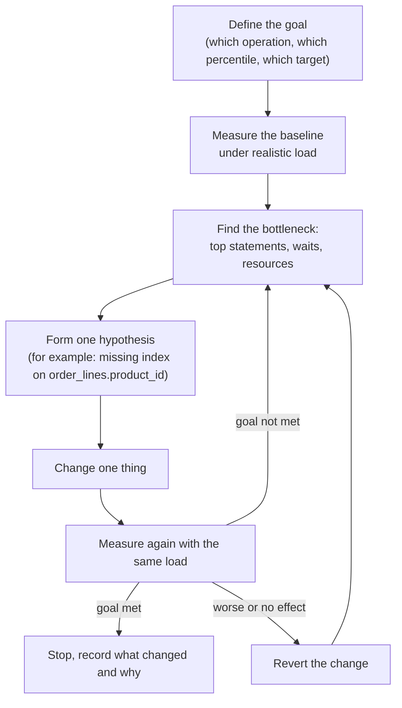
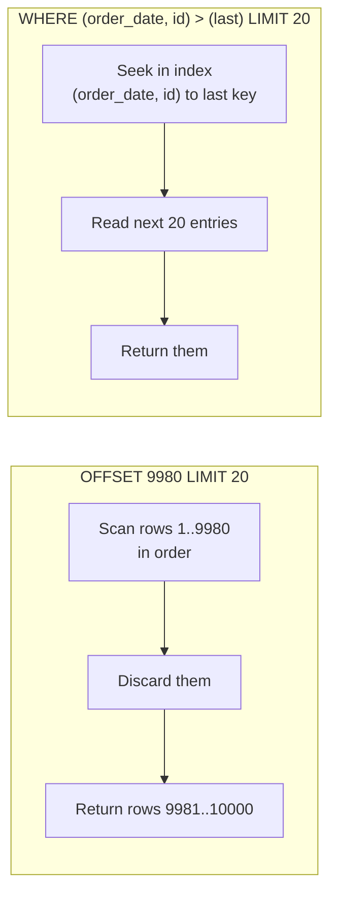

<div dir="rtl" markdown="1">

# 13. روش تنظیم کارایی

> **سطح:** L2 کاربردی ← L3 ارشد | **بخش:** I | **ارجاع‌های Rowlit خوانده‌شده در:** `1d57848` (Rowlit 1.6.3)
> **در یک جمله:** تنظیم کارایی چرخه‌ای است از اندازه‌گیری، یافتن تنها گلوگاهی که اهمیت دارد، تغییر یک چیز و اندازه‌گیری دوباره؛ بیشتر بهبودها از فهرستی کوتاه از ضدالگوهای شناخته‌شده می‌آیند.
> **چه می‌آموزید:**
> - یک روش تکرارپذیر تنظیم، و تفاوت تأخیر، توان عملیاتی و صدک‌ها؛
> - هر موتور زمانش را کجا ثبت می‌کند (`pg_stat_statements`، DMVها و Query Store، AWR/ASH، لاگ پرس‌وجوهای کند، `system.query_log`، تاریخچهٔ پرس‌وجو)؛
> - خواندن آمار انتظار؛
> - فهرست ضدالگوها: N+1، `SELECT *`، شرط‌های غیر SARGable، تبدیل ضمنی، `OR`، نمایه‌گذاری بیش از اندازه، تراکنش‌های بزرگ و بیشتر؛
> - دسته‌بندی و بارگذاری انبوه، صفحه‌بندی offset در برابر keyset، استخر اتصال و حافظهٔ نهان؛
> - کی دست نگه داریم.
>
> **پیش‌نیازها:** [7. نمایه‌ها](07-indexes.md)، [8. مسیر پرس‌وجو و بهینه‌ساز](08-query-processing.md)، [10. هم‌روندی](10-concurrency-locking-mvcc.md).
>
> [English](../../en/part1/13-performance-tuning.md) · قبلی: [12. پشتیبان‌گیری، همانندسازی و دسترس‌پذیری بالا](12-backup-replication-ha.md) · بعدی: [14. امنیت پایگاه داده](14-security.md)
>
> برچسب‌های نمودارها به انگلیسی نگه داشته شده‌اند تا در GitHub درست نمایش داده شوند.

---

<a id="1-the-idea-beginner"></a>
## 1. ایده (مبتدی)

«پایگاه داده کند است» مسئله‌ای نیست که بشود حلش کرد؛ یک احساس است. تنظیم کارایی با تبدیل این احساس به عدد شروع می‌شود («صفحهٔ سفارش در صدک 95 ام
2.3 ثانیه طول می‌کشد و هدف 300 میلی‌ثانیه است») و سپس با یافتن این‌که زمان *کجا* می‌رود. آیا سرور مشغول محاسبه است، منتظر دیسک است، منتظر قفل است، یا
منتظر این‌که برنامه سطرها را بگیرد؟ یک پرس‌وجوی کند است، یا همان پرس‌وجوی سریع ده هزار بار اجرا می‌شود؟ هر پاسخ راه‌حل متفاوتی دارد و درست‌کردن چیز
اشتباه روزها هدر می‌دهد.

خبر خوب این است که بیشتر سامانه‌های کند از چند اشتباه یکسان رنج می‌برند: نمایه‌ای که نیست یا قابل استفاده نیست، پرس‌وجویی پنهان در یک حلقه، شرطی که
طوری نوشته شده که نمایه به کار نمی‌آید، تراکنشی که قفل‌ها را بیش از اندازه نگه می‌دارد، یا اتصالی که برای هر درخواست باز می‌شود. این فصل یک روش، ابزارهای
اندازه‌گیری هر موتور و فهرستی از این اشتباه‌ها و راه‌حل‌هایشان را، همه روی جدول‌های `shop`، به شما می‌دهد.

<a id="2-how-it-works-practitioner"></a>
## 2. چگونه کار می‌کند (کاربردی)

<a id="21-a-method"></a>
### 2.1 یک روش

**شکل 13.1 — چرخهٔ تنظیم.**

</div>



<div dir="rtl" markdown="1">

چهار قاعده این چرخه را کارآمد می‌کنند:

1. **نخست هدف را تعریف کنید.** کدام کنش کاربر، کدام صدک، کدام هدف، زیر چه باری. بدون هدف نمی‌دانید کی دست نگه دارید.
2. **اندازه بگیرید، حدس نزنید.** شهود دربارهٔ این‌که زمان کجا می‌رود به‌طرز شگفت‌آوری اغلب نادرست است. کل مسیر را بسنجید: برنامه، شبکه، پایگاه داده.
3. **[گلوگاه (bottleneck)](../glossary.md#bottleneck)** را پیدا کنید (تنها منبع یا گامی که کل را محدود می‌کند) و فقط روی آن کار کنید. سریع‌کردن گامی که
   گلوگاه نیست چیزی را برای کاربر تغییر نمی‌دهد.
4. **هر بار یک چیز را تغییر دهید** و شرایط اندازه‌گیری را ثابت نگه دارید، وگرنه نمی‌فهمید کدام تغییر کمک کرد.

<a id="22-latency-throughput-and-percentiles"></a>
### 2.2 تأخیر، توان عملیاتی و صدک‌ها

- **[تأخیر (latency)](../glossary.md#latency)** زمانی است که یک عملیات طول می‌کشد (میلی‌ثانیه برای هر پرس‌وجو).
- **[توان عملیاتی (throughput)](../glossary.md#throughput)** شمار عملیاتی است که در واحد زمان تمام می‌شوند (پرس‌وجو یا تراکنش در ثانیه).

این دو با **[قانون لیتل (Little's law)](../glossary.md#littles-law)** به هم پیوسته‌اند: *هم‌روندی = توان عملیاتی × تأخیر*. اگر هر پرس‌وجو 10 میلی‌ثانیه
طول بکشد و 50 نشست هم‌زمان مشغول باشند، سامانه حداکثر 5,000 پرس‌وجو در ثانیه تمام می‌کند؛ برای بیشتر رفتن باید تأخیر را کم کنید یا ظرفیت موازی بیفزایید.
و نزدیک اشباع با هم می‌جنگند: وقتی یک منبع به 100 درصد بهره‌وری نزدیک می‌شود، صف‌ها شکل می‌گیرند و تأخیر بسیار سریع بالا می‌رود، خیلی پیش از آن‌که رشد
توان عملیاتی متوقف شود. سروری با CPU در 95 درصد «از سخت‌افزارش خوب استفاده نمی‌کند»؛ در صف است.

**[صدک‌ها (percentile)](../glossary.md#percentile)** را گزارش کنید، نه میانگین را. اگر 99 درخواست 10 میلی‌ثانیه و یکی 5 ثانیه طول بکشد، میانگین 60 میلی‌ثانیه
است که حال هیچ‌کس را توصیف نمی‌کند. میانه (p50) برابر 10 میلی‌ثانیه و p99 برابر 5 ثانیه است: از هر صد کاربر یکی پنج ثانیه منتظر می‌ماند. تأخیر دُم
(p95، p99) همان چیزی است که کاربران به یاد می‌آورند و معمولاً قفل‌ها، نبودن داده در حافظهٔ نهان یا تغییر طرح اجرا را آشکار می‌کند.

<a id="23-where-to-measure-per-engine"></a>
### 2.3 کجا اندازه بگیریم، در هر موتور

هر موتور آماری دربارهٔ دستورهایی که اجرا می‌کند نگه می‌دارد. دو سه نمای موتور خودتان را از بر کنید.

#### PostgreSQL 17

</div>

```sql
-- Needs shared_preload_libraries = 'pg_stat_statements' (server restart) and, once per database:
CREATE EXTENSION IF NOT EXISTS pg_stat_statements;

-- Top statements by total time (normalised: literals become $1, $2 …)
SELECT calls, round(total_exec_time) AS total_ms, round(mean_exec_time, 2) AS mean_ms, rows,
       shared_blks_hit, shared_blks_read, left(query, 80) AS query
FROM pg_stat_statements ORDER BY total_exec_time DESC LIMIT 10;
```

<div dir="rtl" markdown="1">

در [`pg_stat_statements`](../glossary.md#pg-stat-statements) نخست بر پایهٔ زمان **کل** مرتب کنید: پرس‌وجویی 2 میلی‌ثانیه‌ای که روزی 3 میلیون بار
صدا زده می‌شود از گزارشی 20 ثانیه‌ای که یک بار اجرا می‌شود گران‌تر است. مقایسهٔ `shared_blks_read` (بلوک‌هایی که از بیرون shared buffers خوانده شده‌اند) با
`shared_blks_hit` نشان می‌دهد دستور گرفتار I/O است یا نه. منابع دیگر: `pg_stat_activity` (آنچه *همین حالا* اجرا می‌شود و `wait_event` آن)،
`log_min_duration_statement = 500` (ثبت هر دستور کندتر از 500 میلی‌ثانیه)، ماژول `auto_explain` (ثبت طرح اجرای دستورهای کند)، `track_io_timing` (زمان I/O در
`EXPLAIN (ANALYZE, BUFFERS)`)، `pg_stat_user_tables` / `pg_stat_user_indexes` (پویش‌ها برای هر جدول و نمایه)، و از PostgreSQL 16، `pg_stat_io`.

> **در Rowlit:** منبع لاگ PostgreSQL دستورهای پرهزینه را از `pg_stat_statements` می‌خواند و بسته به نسخهٔ سرور ستون `total_exec_time` یا ستون پیش از
> نسخهٔ 13 یعنی `total_time` را برمی‌گزیند (`engine/src/DbStudio.Logs/Providers/PostgreSql/PgLogSource.cs:44-55`). [فصل 21 بخش دوم](../part2/21-logs-activity-resources.md)
> را ببینید.

#### SQL Server 2022

</div>

```sql
-- Top cached statements by total CPU (only plans still in the plan cache)
SELECT TOP (10) qs.execution_count, qs.total_worker_time / 1000 AS cpu_ms, qs.total_elapsed_time / 1000 AS elapsed_ms,
       qs.total_logical_reads, SUBSTRING(t.text, qs.statement_start_offset / 2 + 1, 200) AS statement_text
FROM sys.dm_exec_query_stats qs CROSS APPLY sys.dm_exec_sql_text(qs.sql_handle) t
ORDER BY qs.total_worker_time DESC;

SET STATISTICS IO, TIME ON;     -- per-statement logical reads and CPU/elapsed time in the Messages output
```

<div dir="rtl" markdown="1">

**[DMVها](../glossary.md#dmv)** (نماهای مدیریتی پویا، `sys.dm_*`) وضعیت زنده و انباشته را نشان می‌دهند؛ با راه‌اندازی دوباره صفر می‌شوند و دستورهایی که
طرحشان از cache بیرون رفته را فراموش می‌کنند. **[Query Store](../glossary.md#query-store)** متن پرس‌وجو، طرح اجرا و آمار اجرا را درون خود پایگاه داده ماندگار
نگه می‌دارد، از راه‌اندازی دوباره جان به در می‌برد، تغییر طرح اجرا را در طول زمان نشان می‌دهد و می‌تواند یک طرح خوب شناخته‌شده را اجباری کند. در SQL Server
2022 برای پایگاه‌های دادهٔ تازه به‌طور پیش‌فرض روشن است. Extended Events دستورهای کند، بن‌بست‌ها و انتظارها را تک‌تک ثبت می‌کند.

#### Oracle 23ai

`V$SQL` (انباشته برای هر cursor: `executions`، `elapsed_time`، `buffer_gets`، `disk_reads`)، `V$SESSION` (هر نشست همین حالا منتظر چیست) و
`DBMS_XPLAN.DISPLAY_CURSOR(sql_id, NULL, 'ALLSTATS LAST')` برای شمار واقعی سطرهای آخرین اجرا. **[AWR](../glossary.md#awr)** (مخزن خودکار بار کاری)
تصویرهای ساعتی همهٔ آمار را نگه می‌دارد و ASH (Active Session History) هر ثانیه از هر نشست فعال نمونه می‌گیرد؛ هر دو، و مشاور ADDM که روی آن‌ها ساخته
شده، در نسخهٔ Enterprise به مجوز Diagnostics Pack نیاز دارند. Statspack هم‌ارز رایگان و قدیمی‌تر AWR است.

#### MySQL 8 / MariaDB 11

**[لاگ پرس‌وجوهای کند (slow query log)](../glossary.md#slow-query-log)** (`slow_query_log = ON`، `long_query_time` بر حسب ثانیه با پیش‌فرض 10، پس کمترش
کنید) هر دستوری کندتر از آستانه را ثبت می‌کند؛ `pt-query-digest` یا `mysqldumpslow` آن را گروه‌بندی می‌کنند.
`performance_schema.events_statements_summary_by_digest` هم‌ارز `pg_stat_statements` است و طرح `sys` نماهای خوانایی روی آن دارد (`sys.statement_analysis`،
`sys.statements_with_full_table_scans`). `EXPLAIN ANALYZE` (MySQL 8.0.18 به بعد) دستور را اجرا می‌کند و زمان واقعی هر گرهٔ طرح اجرا را نشان می‌دهد.

#### SQLite، ClickHouse، Snowflake، Cassandra

- **SQLite** آمار سمت سرور ندارد. در برنامه یا در CLI اندازه بگیرید (`.timer on`، `.eqp on`)، `EXPLAIN QUERY PLAN` را بخوانید و آمار را با `ANALYZE` یا
  `PRAGMA optimize` تازه نگه دارید.
- **ClickHouse** هر پرس‌وجو را در `system.query_log` با `query_duration_ms`، `read_rows`، `read_bytes`، `memory_usage` و `normalized_query_hash` برای گروه‌بندی
  ثبت می‌کند؛ `system.processes` پرس‌وجوهای در حال اجرا را نشان می‌دهد و `EXPLAIN indexes = 1` نشان می‌دهد کلید اصلی و skip indexها چند part و granule را
  کنار گذاشته‌اند ([15](15-oltp-vs-olap-columnar.md)).
- **Snowflake** تابع `INFORMATION_SCHEMA.QUERY_HISTORY()` (چند روز اخیر) و نمای `SNOWFLAKE.ACCOUNT_USAGE.QUERY_HISTORY` (یک سال، با کمی تأخیر) و نیز Query
  Profile گرافیکی را دارد. ستون‌های کلیدی: partitionهای پویش‌شده در برابر کل (هرس)، بایت‌های سرریزشده به حافظهٔ محلی یا دور (warehouse برای پرس‌وجو
  کوچک است) و زمان در صف (warehouse زیر بار زیاد است).
- **Cassandra**: `TRACING ON` در cqlsh هر گام یک درخواست را میان رونوشت‌ها نشان می‌دهد؛ `nodetool tablestats` و `nodetool tablehistograms` اندازهٔ پارتیشن‌ها
  و تأخیرها را نشان می‌دهند؛ هشدارهای لاگ دربارهٔ پارتیشن‌های بزرگ و tombstoneها علت معمول خواندن‌های کندند ([16](16-nosql-families.md)).

<a id="24-wait-statistics"></a>
### 2.4 آمار انتظار

یک نشست همیشه یکی از دو کار را می‌کند: روی CPU اجرا می‌شود، یا منتظر چیزی است. **[آمار انتظار (wait statistics)](../glossary.md#wait-statistics)** ثبت
می‌کند نشست‌ها منتظر چه هستند و چه مدت، و مستقیم به گلوگاه اشاره می‌کند.

| معنای انتظار | `wait_event` در PostgreSQL | نوع انتظار در SQL Server | رویداد Oracle | علت معمول |
|---|---|---|---|---|
| خواندن صفحه از دیسک | `DataFileRead` | `PAGEIOLATCH_SH` | `db file sequential read` / `scattered read` | نبود نمایه، حافظهٔ کم، پویش‌های بزرگ |
| flush لاگ هنگام commit | `WALSync`، `WALWrite` | `WRITELOG` | `log file sync` | تراکنش‌های ریز فراوان، دستگاه لاگ کند |
| انتظار برای قفل | `Lock: transactionid`، `relation` | `LCK_M_*` | `enq: TX - row lock contention` | تراکنش‌های طولانی، سطرهای داغ ([10](10-concurrency-locking-mvcc.md)) |
| رقابت درون حافظه | `LWLock: *`، `BufferContent` | `PAGELATCH_*` | `latch: *`، `buffer busy waits` | صفحه‌های داغ، درج در صفحهٔ آخر |
| کلاینت نتیجه را نمی‌خواند | `ClientWrite` | `ASYNC_NETWORK_IO` | `SQL*Net more data to client` | برنامه سطرها را یکی‌یکی پردازش می‌کند یا بیش از نیاز سطر می‌گیرد |
| هماهنگی پرس‌وجوی موازی | `BgWorkerShutdown`، رویدادهای parallel | `CXPACKET`، `CXCONSUMER` | `PX Deq: *` | معمولاً یک نشانه است؛ به طرح اجرا نگاه کنید |

</div>

```sql
-- SQL Server: top waits since the last restart, ignoring benign background waits
SELECT TOP (10) wait_type, waiting_tasks_count, wait_time_ms / 1000 AS wait_s
FROM sys.dm_os_wait_stats
WHERE wait_type NOT IN (N'SLEEP_TASK', N'LAZYWRITER_SLEEP', N'BROKER_TASK_STOP', N'XE_TIMER_EVENT',
                        N'REQUEST_FOR_DEADLOCK_SEARCH', N'SQLTRACE_INCREMENTAL_FLUSH_SLEEP', N'CHECKPOINT_QUEUE')
ORDER BY wait_time_ms DESC;

-- PostgreSQL: what the active sessions wait on right now (sample it several times)
SELECT wait_event_type, wait_event, count(*) FROM pg_stat_activity WHERE state = 'active' GROUP BY 1, 2 ORDER BY 3 DESC;
```

<div dir="rtl" markdown="1">

انتظارهای انباشته از آخرین راه‌اندازی، با تاریخچه تار می‌شوند؛ دو تصویر را که چند دقیقه فاصله دارند زیر بار مشکل‌دار مقایسه کنید. و انتظار یک *نشانه*
است: `PAGEIOLATCH_SH` می‌گوید «از دیسک زیاد خواندیم»، طرح اجرا می‌گوید *چرا*.

<a id="25-the-anti-pattern-catalogue"></a>
### 2.5 فهرست ضدالگوها

برای هر مورد: نشانه، مثالی روی `shop`، راه‌حل.

<a id="n1-queries"></a>
#### پرس‌وجوهای N+1

در الگوی **[N+1](../glossary.md#n-plus-1)** برنامه یک پرس‌وجو برای فهرست اجرا می‌کند و سپس یک پرس‌وجوی دیگر **برای هر قلم**: 1 + N
**[رفت‌وبرگشت (round trip)](../glossary.md#round-trip)** (درخواستی که به سرور فرستاده می‌شود و پاسخش که برمی‌گردد).

</div>

```sql
-- 1 query …
SELECT id, name FROM customers;
-- … then, in a loop in the application, N queries
SELECT id, total FROM orders WHERE customer_id = $1;     -- run once per customer
```

<div dir="rtl" markdown="1">

هر دستور سریع است، پس چیزی در لاگ کند دیده نمی‌شود؛ اما با رفت‌وبرگشت شبکهٔ 0.5 میلی‌ثانیه، 10,000 مشتری 5 ثانیه انتظار خالص هزینه دارند. راه‌حل یک
پرس‌وجوی مجموعه‌محور است:

</div>

```sql
SELECT c.id, c.name, o.id AS order_id, o.total
FROM customers c LEFT JOIN orders o ON o.customer_id = c.id
ORDER BY c.id, o.id;
-- or two queries: the customers, then  SELECT … FROM orders WHERE customer_id = ANY($1)  with all ids at once
```

<div dir="rtl" markdown="1">

`pg_stat_statements` (یا digestهای SQL Server و MySQL) الگوی N+1 را به‌صورت دستوری ارزان با شمار `calls` عظیم نشان می‌دهد. این رایج‌ترین مشکل ORMهاست
([3.1](#31-orms-and-n1)).

<a id="select"></a>
#### SELECT *

`SELECT *` همهٔ ستون‌ها را می‌خواند و می‌فرستد، از جمله ستون‌های بزرگی که باید از TOAST یا حافظهٔ LOB آورده شوند ([6](06-storage-internals.md))، و جلوی
index-only scan را می‌گیرد: `SELECT customer_id, total FROM orders WHERE customer_id = 4` را می‌توان فقط از `ix_orders_customer … INCLUDE (total)` پاسخ داد
(`engine/tests/docker/seed-postgres.sql:56`)، در حالی که `SELECT *` باید به جدول سر بزند. همچنین وقتی ستونی افزوده یا جابه‌جا شود، کد بی‌صدا می‌شکند.
ستون‌هایی را که لازم دارید نام ببرید.

<a id="sargable-predicates"></a>
#### شرط‌های SARGable

شرطی **[SARGable](../glossary.md#sargable)** است (از «search argument») که موتور بتواند برای یافتن سطرهای منطبق از نمایه استفاده کند، و این لازم دارد که ستون
نمایه‌دار **تنها** در یک سوی مقایسه بیاید. پیچیدن ستون در یک تابع یا عبارت موتور را وادار می‌کند آن را برای هر سطر حساب کند:

| غیر SARGable | بازنویسی SARGable |
|---|---|
| `WHERE EXTRACT(YEAR FROM order_date) = 2026` | `WHERE order_date >= '2026-01-01' AND order_date < '2027-01-01'` |
| `WHERE order_date::date = '2026-02-11'` | `WHERE order_date >= '2026-02-11' AND order_date < '2026-02-12'` |
| `WHERE total * 1.19 > 100` | `WHERE total > 100 / 1.19` |
| `WHERE lower(email) = 'alice@example.com'` | نمایهٔ عبارتی `CREATE INDEX ON customers (lower(email))`، یا collation حساس‌نبودن به بزرگی و کوچکی حروف |
| `WHERE coalesce(country_id, 0) = 1` | `WHERE country_id = 1` |
| `WHERE name LIKE '%board'` | هیچ B-treeی به wildcard آغازین کمک نمی‌کند: نمایهٔ trigram (`pg_trgm` با GIN) یا جست‌وجوی تمام‌متن ([7](07-indexes.md)) |

`LIKE 'Key%'` (پیشوند ثابت) SARGable است؛ `LIKE '%key%'` نیست.

<a id="implicit-conversion"></a>
#### تبدیل ضمنی

وقتی دو سوی مقایسه نوع متفاوتی دارند، موتور یکی را تبدیل می‌کند (یک **[تبدیل ضمنی (implicit conversion)](../glossary.md#implicit-conversion)**). اگر
**ستون** را تبدیل کند، شرط دیگر SARGable نیست، هرچند SQL بی‌گناه به نظر برسد:

- **SQL Server**: ستونی از نوع `VARCHAR` که با پارامتر `NVARCHAR` مقایسه شود (آنچه .NET برای `string` می‌فرستد مگر نوع پارامتر تعیین شود) در سوی ستون با
  `CONVERT_IMPLICIT` تبدیل می‌شود، چون `NVARCHAR` اولویت نوع بالاتری دارد. بسته به collation نتیجه یک پویش یا یک seek بازه‌ای کندتر است؛ طرح اجرا هشدار
  نشان می‌دهد. پارامترها را دقیقاً با نوع و طول ستون اعلام کنید.
- **MySQL**: مقایسهٔ ستون رشته‌ای با عدد (`WHERE phone = 5551234`) رشتهٔ هر سطر را به عدد تبدیل می‌کند؛ نمایه به کار نمی‌آید و `'5551234abc'` هم منطبق
  می‌شود. ثابت را در نقل‌قول بگذارید.
- **PostgreSQL** به‌ندرت بی‌صدا تبدیل می‌کند، اما `WHERE id = 4.0` روی ستون `integer` به‌صورت `numeric` مقایسه می‌شود و نمی‌تواند از نمایهٔ integer
  استفاده کند. هرجا پارامترها از درایور می‌آیند با `EXPLAIN` بررسی کنید.

<a id="or-across-different-columns"></a>
#### OR روی ستون‌های مختلف

`WHERE customer_id = 4 OR total > 200` را یک نمایه نمی‌تواند پاسخ دهد. PostgreSQL می‌تواند دو نمایه را با `BitmapOr` ترکیب کند، SQL Server و MySQL گاهی با
index union یا index merge؛ وگرنه نتیجه یک پویش کامل است. وقتی مهم است، آن را به `UNION` بازنویسی کنید (یا `UNION ALL` که شاخهٔ دوم سطرهای شاخهٔ اول را
کنار بگذارد) تا هر شاخه نمایهٔ خودش را به کار ببرد. `OR` روی *همان* ستون (`status = 'new' OR status = 'paid'`) یک فهرست `IN` است و مشکلی ندارد.

<a id="over-indexing"></a>
#### نمایه‌گذاری بیش از اندازه

**[نمایه‌گذاری بیش از اندازه (over-indexing)](../glossary.md#over-indexing)** یعنی نمایه‌هایی بیش از نیاز بار کاری. هر نمایه برخی خواندن‌ها را سریع و
**هر** نوشتن را کند می‌کند: هر `INSERT` همهٔ نمایه‌ها را به‌روز می‌کند، هر `UPDATE` روی ستون نمایه‌دار هم، و در PostgreSQL نمایه روی ستونی که به‌روز می‌شود
جلوی به‌روزرسانی HOT را می‌گیرد ([10](10-concurrency-locking-mvcc.md#32-postgresql-mvcc-in-detail)). نمایه‌ها برای حافظه هم رقابت می‌کنند. نمایه‌های
بی‌استفاده را پیدا کنید (و پیش از drop کردن رونوشت‌ها را هم بررسی کنید، چون آمار استفاده برای هر سرور جداست):

</div>

```sql
-- PostgreSQL
SELECT relname, indexrelname, idx_scan, pg_size_pretty(pg_relation_size(indexrelid)) AS size
FROM pg_stat_user_indexes WHERE idx_scan = 0 ORDER BY pg_relation_size(indexrelid) DESC;
-- SQL Server: sys.dm_db_index_usage_stats (user_seeks, user_scans, user_lookups versus user_updates)
```

<div dir="rtl" markdown="1">

دنبال نمایه‌های تکراری و نمایه‌هایی که پیشوند چپ نمایهٔ دیگری‌اند هم بگردید (`(customer_id)` در کنار `(customer_id, order_date)`).

<a id="missing-indexes-on-foreign-keys"></a>
#### نبود نمایه روی کلیدهای خارجی

بیشتر موتورها سوی ارجاع‌دهندهٔ کلید خارجی را خودکار نمایه نمی‌کنند (MySQL InnoDB می‌کند). بدون آن، حذف یا به‌روزرسانی سطر والد جدول فرزند را پویش
می‌کند و join از والد به فرزند نمی‌تواند seek کند. در seed مربوط به PostgreSQL در `shop`، `fk_order_lines_products` از `order_lines.product_id` به
`products(id)` ارجاع می‌دهد (`engine/tests/docker/seed-postgres.sql:45`)، و تنها نمایهٔ `order_lines` کلید اصلی `(order_id, product_id)` است (سطر 48) که
ستون آغازینش `order_id` است. پس `DELETE FROM products WHERE id = 4` باید `order_lines` را برای یافتن ارجاع‌ها پویش کند. با هفت سطر کسی متوجه نمی‌شود؛ با
هفتاد میلیون سطر یعنی قفلی که چند دقیقه نگه داشته می‌شود. راه‌حل `CREATE INDEX ON order_lines (product_id);` است.

<a id="big-transactions"></a>
#### تراکنش‌های بزرگ

یک `UPDATE` یا `DELETE` تنها روی میلیون‌ها سطر، قفل همهٔ آن‌ها را تا commit نگه می‌دارد (و در SQL Server ممکن است به قفل جدول ارتقا یابد)، انفجاری از WAL
می‌سازد که رونوشت‌ها باید بازاجرایش کنند، نسخه‌های قدیمی را زنده نگه می‌دارد (حجیم‌شدگی، انبارهٔ نسخه‌ها، undo) و اگر شکست بخورد، به اندازهٔ مدت اجرایش
rollback می‌کند ([9](09-transactions-and-isolation.md#34-the-cost-of-a-long-transaction)). در تکه‌ها پردازش کنید، هر تکه در تراکنش کوتاه خودش، با پیمایش
کلید اصلی:

</div>

```sql
-- PostgreSQL: archive cancelled orders in chunks of 5,000; repeat until it affects 0 rows
WITH batch AS (
  SELECT id FROM orders WHERE status = 'cancelled' ORDER BY id LIMIT 5000 FOR UPDATE SKIP LOCKED
)
DELETE FROM orders o USING batch b WHERE o.id = b.id;
```

<div dir="rtl" markdown="1">

<a id="row-by-row-processing"></a>
#### پردازش ردیف به ردیف

حلقه‌ای که یک سطر را می‌گیرد، حساب می‌کند و برمی‌گرداند (cursor در یک stored procedure، یا حلقه‌ای در برنامه) با N دستور همان کاری را می‌کند که یک
`UPDATE … FROM` یا `MERGE` مجموعه‌محور با یک دستور می‌کند، با N برابر رفت‌وبرگشت، flush لاگ و اجرای طرح. اهل SQL به آن [RBAR](../glossary.md#rbar) می‌گویند،
«row by agonizing row».

<a id="smaller-items-worth-a-check"></a>
#### موارد کوچک‌تری که ارزش بررسی دارند

- **`COUNT(*)` برای آزمودن وجود**: `SELECT count(*) … > 0` همهٔ تطابق‌ها را می‌شمارد؛ `EXISTS (SELECT 1 …)` در نخستین تطابق می‌ایستد.
- **نتیجه‌های بی‌کران**: صفحه 50 سطر نشان می‌دهد اما پرس‌وجو 200,000 سطر برمی‌گرداند؛ حد بگذارید و صفحه‌بندی کنید (2.7).
- **`DISTINCT` برای پنهان‌کردن تکرارها**ی ناشی از join نادرست؛ join را درست کنید.
- **تابع‌های اسکالر برای هر سطر** در فهرست `SELECT` یا `WHERE` (تابع‌های اسکالر تعریف‌شده توسط کاربر در SQL Server پیش از scalar UDF inlining در SQL Server 2019
  ردیف به ردیف اجرا می‌شدند).
- **parameter sniffing** و تغییر طرح اجرا: طرحی که برای مقداری نادر کامپایل شده برای مقداری رایج دوباره به کار می‌رود ([8](08-query-processing.md)).
- **آمار کهنه** پس از بارگذاری انبوه: بهینه‌ساز 1 سطر تخمین می‌زند و برای 1 میلیون سطر nested loop برمی‌گزیند ([7](07-indexes.md)).

<a id="26-batching-and-bulk-load"></a>
### 2.6 دسته‌بندی و بارگذاری انبوه

هزینهٔ یک نوشتن بیشتر سربار ثابت هر دستور و هر commit است (رفت‌وبرگشت، تجزیه، طرح اجرا، flush لاگ). آن را سرشکن کنید:

1. **چند سطر در هر دستور**: `INSERT INTO order_lines VALUES (1,3,1), (2,4,2), …` به‌جای یک دستور برای هر سطر.
2. **یک دستور prepared که دسته‌ای اجرا شود** (`addBatch` در JDBC، `NpgsqlBatch`، array binding در Oracle).
3. **سطرهای زیاد در هر تراکنش**: یک commit برای هر 1,000 تا 10,000 سطر به‌جای هر سطر، که هزاران flush لاگ را به چند flush تبدیل می‌کند (انتظارهای
   `WRITELOG` / `WALSync` ناپدید می‌شوند).
4. **مسیر انبوه موتور**، برای بارگذاری‌های بزرگ:

| موتور | مسیر انبوه |
|---|---|
| PostgreSQL | `COPY orders FROM STDIN (FORMAT csv)` (`\copy` در psql)؛ وقتی نمایه‌ها پس از بارگذاری ساخته شوند سریع‌ترین است |
| SQL Server | `BULK INSERT`، `bcp`، `SqlBulkCopy`؛ با `TABLOCK` در مدل بازیابی SIMPLE یا BULK_LOGGED حداقل ثبت لاگ |
| Oracle | SQL*Loader با direct path، `INSERT /*+ APPEND */ … SELECT`، `FORALL` در PL/SQL |
| MySQL | `LOAD DATA [LOCAL] INFILE` |
| ClickHouse | درج‌های بزرگ (هر کدام چندین هزار سطر) یا `async_insert = 1`؛ درج‌های ریز فراوان partهای بیش از اندازه می‌سازند |
| Snowflake | `COPY INTO table FROM @stage` با فایل‌هایی حدود 100 تا 250 مگابایت فشرده |
| SQLite | یک تراکنش دور همهٔ درج‌ها (وگرنه هر درج تراکنش جداگانه با sync جداگانهٔ خودش است) |

**[بارگذاری انبوه (bulk load)](../glossary.md#bulk-load)** در جدولی با نمایه‌های فراوان ممکن است با drop کردن نمایه‌های ثانویه و ساختن دوباره‌شان پس از آن
سریع‌تر شود؛ اندازه بگیرید، چون بازسازی هم زمان می‌برد و جدول در این فاصله کمتر محافظت شده است.

<a id="27-pagination-offset-or-keyset"></a>
### 2.7 صفحه‌بندی: offset یا keyset

راه معمول نمایش صفحهٔ 500 فهرست سفارش‌ها **[صفحه‌بندی با OFFSET (offset pagination)](../glossary.md#offset-pagination)** است:

</div>

```sql
SELECT id, order_date, total FROM orders ORDER BY order_date, id LIMIT 20 OFFSET 9980;
```

<div dir="rtl" markdown="1">

موتور باید 9,980 سطر را بسازد و **دور بریزد** تا 20 سطر برگرداند: صفحهٔ 500 پانصد برابر صفحهٔ 1 هزینه دارد. سطرهایی که میان دو درخواست صفحه درج یا حذف
می‌شوند هم باعث می‌شوند سطری دوبار دیده شود یا میان صفحه‌ها گم شود.

**[صفحه‌بندی کلیدی (keyset pagination)](../glossary.md#keyset-pagination)** (که *روش seek* هم نامیده می‌شود) به یاد می‌سپارد صفحهٔ قبل کجا تمام شد و سطرهای
پس از آن را می‌خواهد:

</div>

```sql
-- PostgreSQL, MySQL 8, SQLite: row-value comparison
SELECT id, order_date, total FROM orders
WHERE (order_date, id) > ($1, $2)          -- the order_date and id of the last row on the previous page
ORDER BY order_date, id
LIMIT 20;
CREATE INDEX ix_orders_date_id ON orders (order_date, id);   -- makes each page an index range scan
```

```sql
-- SQL Server (no row-value comparison): spell it out
SELECT TOP (20) Id, OrderDate, Total FROM dbo.Orders
WHERE OrderDate > @d OR (OrderDate = @d AND Id > @id)
ORDER BY OrderDate, Id;
```

<div dir="rtl" markdown="1">

**شکل 13.2 — offset سطرها را می‌خواند و دور می‌ریزد؛ keyset تا آخرین کلید seek می‌کند و یک صفحه می‌خواند.**

</div>



<div dir="rtl" markdown="1">

هزینهٔ صفحه‌های keyset در هر عمقی یکسان است و زیر درج‌ها پایدار می‌مانند. پیش‌نیازها: مرتب‌سازی باید روی کلیدی یکتا باشد (`id` را برای شکستن تساوی
بیفزایید)، نمایه‌ای به همان ترتیب باید باشد، و کاربر نمی‌تواند مستقیم به «صفحهٔ 500» بپرد (فقط بعدی / قبلی، که همان چیزی است که پیمایش بی‌پایان و بیشتر
APIها به هر حال لازم دارند).

> **در Rowlit:** Data tabها با `OFFSET`/`FETCH` یا `LIMIT`/`OFFSET` صفحه‌بندی می‌کنند (`ui/src/data/sqlgen.ts:465-486`) و همیشه بر پایهٔ ستون‌های کلید (یا
> شبه‌ستونی مانند `rowid`) مرتب می‌کنند تا صفحه‌ها قطعی باشند (`ui/src/data/sqlgen.ts:449-451`). [فصل 13 بخش دوم](../part2/13-results-grid-and-data-editing.md)
> را ببینید.

<a id="28-connection-pooling"></a>
### 2.8 استخر اتصال

بازکردن اتصال گران است: دست‌دهی TCP، اغلب دست‌دهی TLS ([14](14-security.md))، احراز هویت، و سروری که یک نشست راه می‌اندازد (PostgreSQL برای هر اتصال یک
**فرایند** تازه آغاز می‌کند؛ SQL Server و MySQL یک رشته به‌علاوهٔ حافظه). این چند تا چند ده میلی‌ثانیه است، بیشتر از زمان بسیاری از پرس‌وجوها. برنامه‌ای که
برای هر درخواست وصل می‌شود بیشتر وقتش را صرف وصل‌شدن می‌کند.

**[استخر اتصال (connection pool)](../glossary.md#connection-pool)** اتصال‌های باز را نگه می‌دارد و قرض می‌دهد:

- **استخرهای سمت کلاینت** در درایور یا برنامه زندگی می‌کنند: ADO.NET (از جمله Npgsql و Microsoft.Data.SqlClient) خودکار بر پایهٔ رشتهٔ اتصال استخر
  می‌سازد و Java از HikariCP استفاده می‌کند. `Open()` اتصالی از استخر برمی‌دارد و `Close()` آن را برمی‌گرداند؛ درایور هنگام استفادهٔ دوباره وضعیت نشست را
  بازنشانی می‌کند (`sp_reset_connection` در SQL Server).
- **استخرهای سمت سرور** میان کلاینت‌های فراوان و سرور می‌نشینند: [PgBouncer](../glossary.md#pgbouncer) و Pgpool-II برای PostgreSQL، ProxySQL برای MySQL،
  DRCP در Oracle، proxyهای ابری. PgBouncer سه حالت دارد: *session* (یک اتصال سرور برای هر نشست کلاینت)، *transaction* (یک اتصال سرور برای هر تراکنش، سودمندترین)
  و *statement*. حالت transaction هر چیزی را که در نشست میان تراکنش‌ها زندگی می‌کند می‌شکند: `SET` بدون `LOCAL`، جدول‌های موقت، advisory lockهای نشست،
  `LISTEN` و (پیش از آن‌که PgBouncer 1.21 پشتیبانی‌اش را بیفزاید) prepared statementها.

**اندازهٔ استخر**: کوچک‌تر از آنچه مردم انتظار دارند. سرور پایگاه داده‌ای با 16 هسته نمی‌تواند 500 پرس‌وجو را هم‌زمان اجرا کند؛ فقط میانشان جابه‌جا می‌شود،
با قفل‌ها و از دست رفتن‌های cache بیشتر. مستندات HikariCP پیشنهاد می‌کند از حدود *هسته‌ها × 2 + دیسک‌های مؤثر* اتصال شروع کنید و اندازه بگیرید. اگر 2,000
رشتهٔ برنامه به پایگاه داده نیاز دارند، یک استخر 40 تایی جلویش بگذارید و بگذارید در برنامه صف بکشند، جایی که صف ارزان است.

چرا یک IDE نشست‌های ویرایشگرش را در استخر نمی‌گذارد: نشست تعاملی وضعیت‌دار است. کاربر `SET search_path` اجرا می‌کند، جدول موقت می‌سازد، در یک دستور تراکنشی
باز می‌کند و ده دقیقه بعد commit می‌کند؛ برگرداندن اتصال به استخر میان دستورها همهٔ این‌ها را از بین می‌برد یا نشت می‌دهد.

> **در Rowlit:** هر زبانهٔ ویرایشگر یک اتصال فیزیکی با استخر خاموش دارد «تا وضعیت نشست (search_path، SET، جدول‌های موقت، یک تراکنش باز) از آنِ زبانه باشد»،
> در حالی که اتصال‌های catalog، designer و diagnostics در استخرند (`engine/src/DbStudio.Providers.PostgreSql/PgConnectionStrings.cs:39-43`؛ SQL Server
> `engine/src/DbStudio.Providers.SqlServer/SqlServerConnectionStrings.cs:28`؛ SQLite `engine/src/DbStudio.Providers.Sqlite/SqliteConnections.cs:59`). شمار
> نشست‌ها برای هر پروفایل اتصال سقف دارد که پیش‌فرض آن 8 است (`engine/src/DbStudio.Core/Services/SessionManager.cs:171`).
> [فصل 8 بخش دوم](../part2/08-connections-sessions-execution.md) را ببینید.

<a id="29-caching"></a>
### 2.9 حافظهٔ نهان

سریع‌ترین پرس‌وجو همانی است که اجرا نمی‌کنید. لایه‌ها، از پایگاه داده به بیرون:

- **استخر بافر** صفحه‌ها را در حافظهٔ نهان نگه می‌دارد ([6](06-storage-internals.md)). نرخ برخورد بالا پیامد یک طراحی خوب است، نه هدف؛ پرس‌وجویی که 10
  میلیون صفحهٔ در حافظه را می‌خواند همچنان کند است.
- **حافظهٔ نهان نتیجه در موتور**: Snowflake نتیجهٔ یک پرس‌وجوی یکسان را تا 24 ساعت، اگر داده تغییر نکرده باشد، دوباره به کار می‌برد؛ Oracle `RESULT_CACHE` دارد؛
  MySQL حافظهٔ نهان پرس‌وجویش را در 8.0 حذف کرد چون بی‌اعتبارسازی آن نوشتن‌ها را سریالی می‌کرد.
- **materialized viewها** نتیجهٔ یک پرس‌وجو را به‌صورت جدول نگه می‌دارند و بر حسب نیاز تازه می‌شوند. seed مربوط به PostgreSQL در `shop` یکی دارد،
  `customer_totals` (`engine/tests/docker/seed-postgres.sql:74`)؛ `REFRESH MATERIALIZED VIEW CONCURRENTLY` (با یک نمایهٔ یکتا) آن را بدون مسدودکردن خواننده‌ها
  تازه می‌کند.
- **حافظه‌های نهان برنامه** (درون فرایند، یا Redis، [16](16-nosql-families.md)) اشیای محاسبه‌شده را نگه می‌دارند. بخش سخت بی‌اعتبارسازی است: برای هر قلم
  تصمیم بگیرید چقدر می‌تواند کهنه باشد، و وقتی نمی‌توانید با رویداد بی‌اعتبار کنید، با زمان منقضی کنید.

<a id="3-deep-dive-senior"></a>
## 3. ژرفا (ارشد)

<a id="31-orms-and-n1"></a>
### 3.1 ORMها و N+1

نگاشت‌گرهای شیء‌ـ‌رابطه‌ای (ORM) الگوی N+1 را آسان می‌کنند، چون **[بارگذاری تنبل (lazy loading)](../glossary.md#lazy-loading)** یک دسترسی بی‌گناه به ویژگی
(`customer.Orders`) را به یک پرس‌وجو تبدیل می‌کند. بارگذاری 100 مشتری و دست‌زدن به سفارش‌های هر کدام 101 پرس‌وجو اجرا می‌کند. راه‌حل‌ها قابلیت‌های بارگذاری
مشتاقانهٔ ORM هستند (`Include` در Entity Framework، `JOIN FETCH` در JPA، `select_related` / `prefetch_related` در Django) که یا یک join صادر می‌کنند یا یک
پرس‌وجوی اضافه با فهرست `IN`. دو هشدار: join هم‌زمان چند مجموعه سطرها را ضرب می‌کند (انفجار دکارتی: 100 مشتری × 10 سفارش × 5 سطر = 5,000 سطر برای ساختن
100 شیء)، پس برای چند مجموعه پرس‌وجوهای جدا را ترجیح دهید؛ و در توسعه ثبت SQL را روشن کنید تا دستورهایی را که ORM واقعاً می‌فرستد ببینید.

<a id="32-schema-level-fixes"></a>
### 3.2 راه‌حل‌های سطح طرح پایگاه داده

برخی مشکلات در پرس‌وجو حل نمی‌شوند:

- **نوع داده**: `id` ذخیره‌شده به‌صورت متن، تاریخ ذخیره‌شده به‌صورت رشته، `float` برای پول ([5](05-modelling-and-normalisation.md)). نوع نادرست فضا هدر
  می‌دهد، با تبدیل‌ها نمایه‌ها را بی‌اثر می‌کند و نتیجهٔ نادرست می‌دهد.
- **نمایه‌هایی که برای بار کاری طراحی شده‌اند**: نمایه‌های ترکیبی به ترتیب ستون‌های تساوی سپس بازه، نمایه‌های پوشا برای پرس‌وجوهای داغ، نمایه‌های جزئی برای
  مقدارهای نامتوازن (`ix_orders_open … WHERE status <> 'cancelled'` در seed، `engine/tests/docker/seed-postgres.sql:57`) ([7](07-indexes.md)).
- **پارتیشن‌بندی** برای جدول‌های بسیار بزرگ با کلید زمانی طبیعی ([12](12-backup-replication-ha.md#28-table-partitioning)).
- **غیرنرمال‌سازی** جایی که یک join میلیون‌ها بار اجرا می‌شود و داده کم تغییر می‌کند، با مالکی روشن برای درست نگه‌داشتن نسخهٔ کپی ([5](05-modelling-and-normalisation.md)).
- **بیرون‌بردن تحلیل از پایگاه دادهٔ OLTP** به یک رونوشت یا موتوری ستونی ([15](15-oltp-vs-olap-columnar.md)).

<a id="33-reading-a-statements-cost"></a>
### 3.3 خواندن هزینهٔ یک دستور

پیش و پس از هر تغییر، *کاری* را که دستور انجام می‌دهد بسنجید، نه فقط زمانش را (زمان با وضعیت cache و بار تغییر می‌کند):

- PostgreSQL: `EXPLAIN (ANALYZE, BUFFERS)` ← بلوک‌های `shared hit` + `read`، سطرهای واقعی هر گره در برابر تخمین.
- SQL Server: `SET STATISTICS IO ON` ← logical reads برای هر جدول؛ طرح اجرای واقعی ← سطرهای تخمینی در برابر واقعی.
- Oracle: `buffer_gets` برای هر اجرا در `V$SQL`، `A-Rows` در برابر `E-Rows` در `DISPLAY_CURSOR`.
- MySQL: `EXPLAIN ANALYZE` ← سطرها و loopهای واقعی؛ شمارنده‌های وضعیت `Handler_read_*`.

تغییری که logical reads را نصف می‌کند بهبودی واقعی است، حتی اگر یک اجرای آزمایشی تفاوتی در زمان نشان ندهد؛ تغییری که یک آزمون را سریع‌تر و خواندن‌ها را دو
برابر می‌کند احتمالاً فقط به cache گرم‌تری خورده است. فاصلهٔ بزرگ میان سطرهای تخمینی و واقعی به آمار یا به شرطی اشاره می‌کند که بهینه‌ساز نمی‌تواند تخمینش
بزند ([8](08-query-processing.md)).

<a id="34-when-to-stop"></a>
### 3.4 کی دست نگه داریم

دست نگه دارید وقتی:

- هدف گام 1 زیر بار واقع‌گرایانه، با کمی حاشیه، برآورده شده؛
- گلوگاه به بیرون از پایگاه داده رفته (CPU برنامه، شبکه، یک سرویس بیرونی): کار بیشتر روی پایگاه داده دیگر آنچه کاربران می‌بینند را تغییر نمی‌دهد؛
- گام بعدی بیش از ارزشش هزینه دارد (بازنویسی برای 3 درصد، ارتقای سخت‌افزاری که از یک هفته کار ارزان‌تر است)؛
- تغییر، سامانه را برای سودی اندک به‌طور چشمگیری سخت‌فهم‌تر یا سخت‌اداره‌تر می‌کند.

بنویسید چه چیزی را، چرا، تغییر دادید و عددهای پیش و پس را. با رشد داده طرح‌های اجرا تغییر می‌کنند و نفر بعدی (یا خود شما، یک سال بعد) به خط پایه نیاز دارد.

<a id="4-in-each-engine"></a>
## 4. در هر موتور

| نیاز | PostgreSQL 17 | SQL Server 2022 | Oracle 23ai | MySQL 8 / MariaDB 11 | SQLite 3.4x | ClickHouse 24 | Snowflake |
|---|---|---|---|---|---|---|---|
| دستورهای پرهزینه | `pg_stat_statements` | Query Store، `sys.dm_exec_query_stats` | AWR، `V$SQL` | `events_statements_summary_by_digest`، `sys.statement_analysis` | زمان‌سنجی در برنامه | `system.query_log` | `QUERY_HISTORY` |
| در حال اجرا | `pg_stat_activity` | `sys.dm_exec_requests` | `V$SESSION`، ASH | `SHOW PROCESSLIST`، `performance_schema.threads` | — | `system.processes` | `QUERY_HISTORY` (در حال اجرا) |
| انتظارها | `wait_event` | `sys.dm_os_wait_stats`، `sys.dm_exec_session_wait_stats` | `V$SYSTEM_EVENT`، ASH | `performance_schema.events_waits_*` | — | `ProfileEvents` در `query_log` | ستون‌های صف / سرریز |
| لاگ کند | `log_min_duration_statement`، `auto_explain` | Extended Events | SQL trace، SQL Monitor | slow query log | — | `query_log` | — |
| طرح اجرای واقعی | `EXPLAIN (ANALYZE, BUFFERS)` | actual execution plan | `DISPLAY_CURSOR … 'ALLSTATS LAST'` | `EXPLAIN ANALYZE` | `EXPLAIN QUERY PLAN` | `EXPLAIN PIPELINE`، `indexes = 1` | Query Profile |
| بارگذاری انبوه | `COPY` | `BULK INSERT`، `SqlBulkCopy` | SQL*Loader، `APPEND` | `LOAD DATA INFILE` | یک تراکنش | دسته‌های بزرگ، `async_insert` | `COPY INTO` |
| استخر | PgBouncer، Pgpool-II | استخر کلاینت | DRCP، استخر کلاینت | ProxySQL، استخر کلاینت | — | استخر کلاینت | استخر کلاینت |

<a id="5-exercises"></a>
## 5. تمرین‌ها

1. صفحه‌ای هر یک از 200 مشتری را با آخرین سفارشش نشان می‌دهد. پایش 201 دستور برای هر نمایش صفحه نشان می‌دهد که هر کدام زیر 1 میلی‌ثانیه است، با این حال
   صفحه 300 میلی‌ثانیه طول می‌کشد. چه خبر است و چگونه آن را با SQL روی `shop` درست می‌کنید؟
2. هر شرط را طوری بازنویسی کنید که نمایه‌ای روی ستون به کار آید: (الف) `WHERE date_trunc('month', order_date) = '2026-03-01'`، (ب) `WHERE total + 10 > 200`،
   (ج) `WHERE substring(name, 1, 3) = 'Mon'` روی `products`.
3. یک برنامهٔ .NET از جدولی در SQL Server پرس‌وجو می‌کند که ستون `Code` آن `VARCHAR(20)` و نمایه‌دار است و مقدار را به‌صورت پارامتر `string` ساده می‌فرستد.
   طرح اجرا یک index scan و هشدار `CONVERT_IMPLICIT` نشان می‌دهد. توضیح دهید و درست کنید.
4. پرس‌وجوی keyset برای صفحهٔ *بعدی* `orders` مرتب‌شده بر پایهٔ `total DESC, id DESC` را بنویسید، با این فرض که آخرین سطر صفحهٔ جاری `total = 120.50, id = 1`
   داشته، برای PostgreSQL و برای SQL Server. کدام نمایه کمک می‌کند؟
5. سرویسی 400 رشته دارد و هر کدام برای هر درخواست یک اتصال تازهٔ PostgreSQL باز می‌کند. سرور پایگاه داده 8 هسته دارد و CPU بالا با backendهای کوتاه‌عمر فراوان
   نشان می‌دهد. دو تغییر و ترتیب انجامشان را پیشنهاد کنید.
6. پس از افزودن یک نمایه، یک پرس‌وجوی آزمایشی به‌جای 60 میلی‌ثانیه در 40 میلی‌ثانیه اجرا می‌شود. همکارتان می‌گوید این ثابت می‌کند نمایه کمک می‌کند. پیش از
   باورکردن چه چیزهایی را بررسی می‌کنید؟

<a id="answers"></a>
## پاسخ‌ها

کلید پاسخ همهٔ فصل‌های بخش یک در [18. کلید پاسخ و راه‌اندازی آزمایشگاه](18-exercise-answers.md) گرد آمده است.

<details><summary>پاسخ‌های فصل 13</summary>

1. الگوی N+1: یک پرس‌وجو برای مشتری‌ها، سپس یکی برای هر مشتری؛ زمان صرف رفت‌وبرگشت‌ها می‌شود، نه اجرا. یک پرس‌وجو:
   `SELECT c.id, c.name, o.id, o.order_date, o.total FROM customers c LEFT JOIN LATERAL (SELECT id, order_date, total FROM orders WHERE customer_id = c.id
   ORDER BY order_date DESC LIMIT 1) o ON true;` (PostgreSQL)، یا `ROW_NUMBER() OVER (PARTITION BY customer_id ORDER BY order_date DESC)` که در هر موتوری به 1
   فیلتر شود.
2. (الف) `WHERE order_date >= '2026-03-01' AND order_date < '2026-04-01'`. (ب) `WHERE total > 190`. (ج) `WHERE name LIKE 'Mon%'` (پیشوند ثابت؛ در PostgreSQL با
   collation غیر C، نمایه برای `LIKE` به operator class از نوع `text_pattern_ops` نیاز دارد).
3. پارامتر به‌صورت `NVARCHAR` فرستاده می‌شود که اولویتی بالاتر از `VARCHAR` دارد، پس SQL Server ستون را در هر سطر تبدیل می‌کند و نمی‌تواند به‌طور عادی seek
   کند. پارامتر را `SqlDbType.VarChar` با اندازهٔ 20 (یا نوع هم‌ارز در نگاشت ORM) اعلام کنید تا مقایسه `VARCHAR = VARCHAR` باشد.
4. PostgreSQL: `SELECT id, total FROM orders WHERE (total, id) < (120.50, 1) ORDER BY total DESC, id DESC LIMIT 20;`
   SQL Server: `SELECT TOP (20) Id, Total FROM dbo.Orders WHERE Total < 120.50 OR (Total = 120.50 AND Id < 1) ORDER BY Total DESC, Id DESC;`. نمایه‌ای روی
   `(total, id)` (که رو به عقب پویش شود) یا `(total DESC, id DESC)`.
5. نخست استخر اتصال بیفزایید: یک استخر سمت کلاینت در سرویس (مثلاً 16 تا 20 اتصال) تا اتصال‌ها دوباره به کار روند و رشته‌ها در برنامه صف بکشند؛ اگر نمونه‌های
   سرویس فراوان‌اند، PgBouncer در حالت transaction جلوی پایگاه داده. سپس، با رفتن طوفان اتصال‌ها، دوباره اندازه بگیرید و دستورهای پرهزینهٔ
   `pg_stat_statements` را تنظیم کنید.
6. اندازه‌گیری را در هر دو حالت با شرایط cache یکسان چند بار تکرار کنید (اجرای دوم ممکن است فقط گرم باشد)، *کار* را مقایسه کنید (بلوک‌های
   `EXPLAIN (ANALYZE, BUFFERS)`، logical reads) و مطمئن شوید طرح اجرا واقعاً از نمایه استفاده می‌کند، با حجم دادهٔ واقع‌گرایانه و مقدارهای پارامتر واقعی
   بیازمایید، و هزینهٔ نوشتنی را که نمایه به بار کاری می‌افزاید بررسی کنید.

</details>

<a id="related-chapters"></a>
## فصل‌های مرتبط

- [7. نمایه‌ها](07-indexes.md) و [8. مسیر پرس‌وجو و بهینه‌ساز](08-query-processing.md) — یک طرح اجرا چه می‌تواند بکند و چه نمی‌تواند.
- [10. هم‌روندی: قفل، latch و MVCC](10-concurrency-locking-mvcc.md) — انتظار قفل و رقابت بر سر latch.
- [11. WAL، redo/undo، checkpoint و بازیابی](11-logging-and-recovery.md) — هزینهٔ commit و flush لاگ.
- [12. پشتیبان‌گیری، همانندسازی و دسترس‌پذیری بالا](12-backup-replication-ha.md) — پارتیشن‌بندی و رونوشت‌های خواندنی.
- [15. OLTP در برابر OLAP و موتورهای ستونی](15-oltp-vs-olap-columnar.md) — وقتی بار کاری جایش در موتور دیگری است.
- بخش دوم: [8. اتصال‌ها، نشست‌ها و اجرای SQL](../part2/08-connections-sessions-execution.md)، [21. لاگ‌ها و فعالیت](../part2/21-logs-activity-resources.md).

<a id="glossary-terms-introduced-here"></a>
## اصطلاحات واژه‌نامه در این فصل

[گلوگاه](../glossary.md#bottleneck) ·
[تأخیر](../glossary.md#latency) ·
[توان عملیاتی](../glossary.md#throughput) ·
[قانون لیتل](../glossary.md#littles-law) ·
[صدک](../glossary.md#percentile) ·
[pg_stat_statements](../glossary.md#pg-stat-statements) ·
[DMV](../glossary.md#dmv) ·
[Query Store](../glossary.md#query-store) ·
[AWR](../glossary.md#awr) ·
[لاگ پرس‌وجوهای کند](../glossary.md#slow-query-log) ·
[آمار انتظار](../glossary.md#wait-statistics) ·
[رفت‌وبرگشت](../glossary.md#round-trip) ·
[N+1](../glossary.md#n-plus-1) ·
[SARGable](../glossary.md#sargable) ·
[تبدیل ضمنی](../glossary.md#implicit-conversion) ·
[نمایه‌گذاری بیش از اندازه](../glossary.md#over-indexing) ·
[RBAR](../glossary.md#rbar) ·
[بارگذاری انبوه](../glossary.md#bulk-load) ·
[صفحه‌بندی با OFFSET](../glossary.md#offset-pagination) ·
[صفحه‌بندی کلیدی](../glossary.md#keyset-pagination) ·
[استخر اتصال](../glossary.md#connection-pool) ·
[PgBouncer](../glossary.md#pgbouncer) ·
[بارگذاری تنبل](../glossary.md#lazy-loading)

</div>
