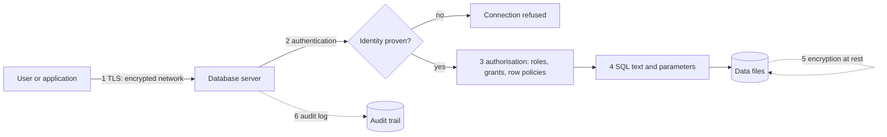
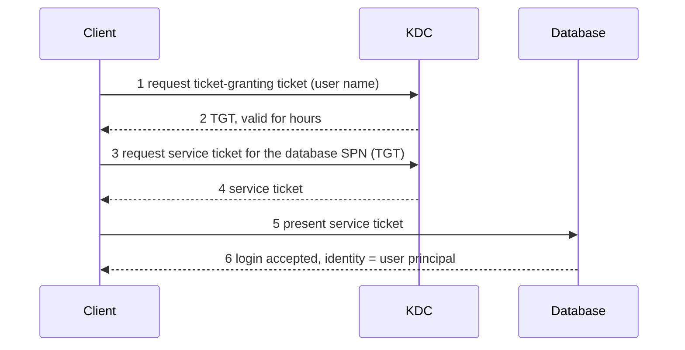
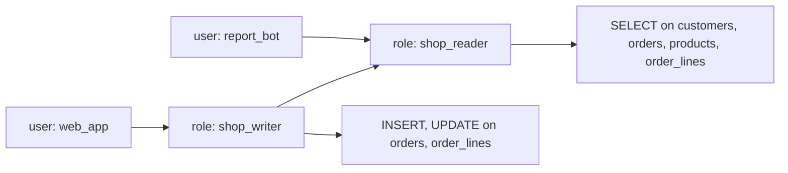
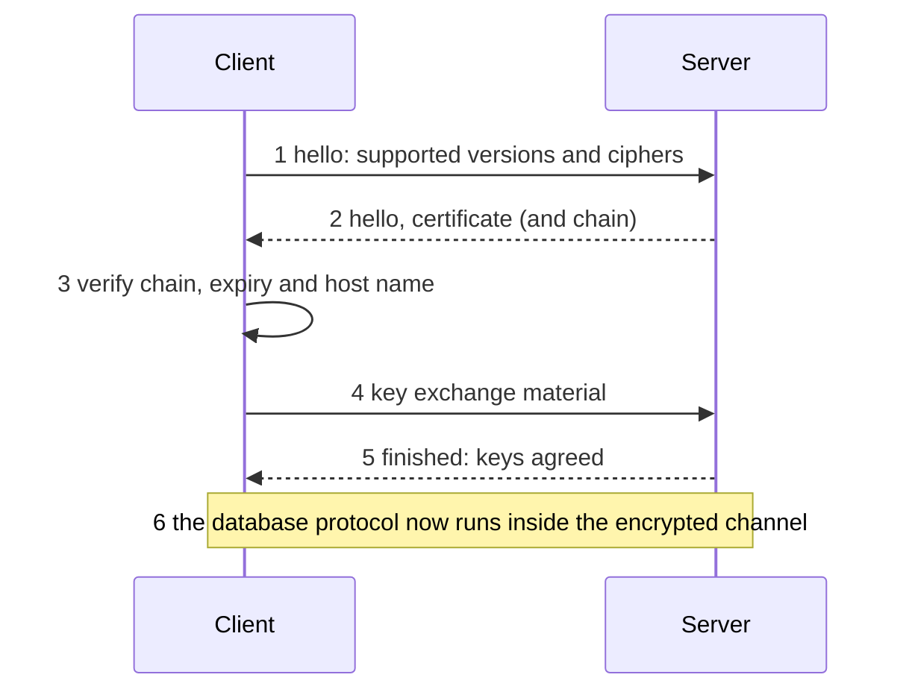
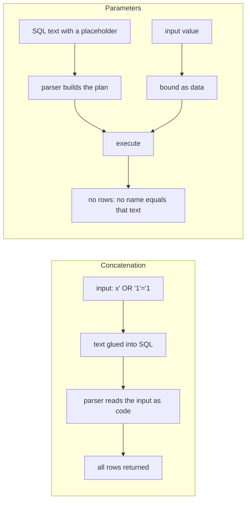

<div dir="rtl" markdown="1">

# ۱۴. امنیت پایگاه داده

> **سطح:** L2 کاربر حرفه‌ای (با بخش‌های L3 برای پیشرفته‌ها) | **بخش:** I | **کد Rowlit در نسخهٔ** `08528ae` **بررسی شده است**
>
> **در یک جمله:** پایگاه داده زمانی امن است که بتوانید اثبات کنید چه کسی وصل شده، کار او را محدود کنید، بایت‌ها را هم روی شبکه و هم روی دیسک خصوصی نگه دارید، نگذارید برنامهٔ خودتان علیه خودتان استفاده شود و از هر اتفاق ردی بماند.
>
> **یاد می‌گیرید:**
>
> - تفاوت احراز هویت، مجوزدهی، رمزنگاری، دفاع در برابر تزریق و ممیزی و چگونگی لایه‌لایه شدن آن‌ها
> - روش‌های احراز هویت: گذرواژه، Kerberos، گواهی، جفت‌کلید، OAuth و SSO
> - نقش‌ها، دسترسی‌ها، `GRANT` و `REVOKE` و معنای حداقل دسترسی روی پایگاه `shop`
> - امنیت سطح سطر و پوشانی داده، با یک مثال اجراشدنی در PostgreSQL
> - معنای واقعی `Encrypt`، `TrustServerCertificate` و `sslmode` و تنظیم‌هایی که هنوز اجازهٔ حملهٔ مرد میانی می‌دهند
> - تزریق SQL چگونه رخ می‌دهد، چرا پارامتر آن را حل می‌کند و چه چیزهایی را حل نمی‌کند
>
> **پیش‌نیاز:** [فصل ۱](01-what-is-a-database.md)، [فصل ۳](03-sql-basics.md)
>
> **نسخهٔ انگلیسی:** [English](../../en/part1/14-security.md) | **قبلی:** [۱۳ تنظیم کارایی](13-performance-tuning.md) | **بعدی:** [۱۵ OLTP و OLAP](15-oltp-vs-olap-columnar.md)
>
> برچسب‌های نمودارها به انگلیسی نگه داشته شده‌اند تا در GitHub درست نمایش داده شوند.

> **دربارهٔ مثال‌ها.** مثال‌های PostgreSQL 17 روی پایگاه `shop` در آزمایشگاه Docker اجرا می‌شوند (راه‌اندازی در [فصل ۱۸](18-exercise-answers.md)). هنگام نوشتن این فصل موتور Docker روشن نبود؛ بنابراین هر خروجی زیر با عبارت *خروجی نمونه (illustrative output)* مشخص شده است: بر پایهٔ رفتار مستند سرور نوشته شده و از یک اجرای واقعی برداشته نشده است.

## ۱. ایده (مبتدی)

پایگاه داده چیزهایی را نگه می‌دارد که کسب‌وکار نمی‌تواند از دست بدهد یا فاش کند: مشتریان، سفارش‌ها، فاکتورها و گذرواژهٔ سیستم‌های دیگر. امنیت یک کلید خاموش و روشن نیست؛ پنج پرسش جدا است و هر کدام ابزار خودش را دارد:

1. **تو کیستی؟** این [احراز هویت (authentication)](../glossary.md#authentication) است: سرور یک مدرک هویت را بررسی می‌کند (گذرواژه، بلیت، گواهی یا توکن امضاشده).
2. **چه کاری مجازی؟** این [مجوزدهی (authorisation)](../glossary.md#authorisation) است: وقتی سرور فهمید تو کیستی، می‌سنجد چه چیزی را می‌توانی بخوانی، تغییر بدهی یا بسازی.
3. **آیا کسی می‌تواند شنود کند یا دیسک را بدزدد؟** این رمزنگاری در مسیر (شبکه) و در حالت ذخیره (فایل‌ها) است.
4. **آیا می‌شود برنامهٔ خودت را فریب داد؟** این [تزریق SQL (SQL injection)](../glossary.md#sql-injection) است: مهاجم پایگاه داده را نمی‌شکند؛ برنامهٔ شما را متقاعد می‌کند SQL مخرب بفرستد.
5. **چه اتفاقی افتاد؟** این [ممیزی (audit)](../glossary.md#audit) است: ثبتی دست‌نخورده از ورودها، تغییرها و خواندن‌ها.

هیچ لایه‌ای به‌تنهایی کافی نیست. به این اصل [دفاع چندلایه (defence in depth)](../glossary.md#defence-in-depth) می‌گویند: اگر گذرواژه‌ای فاش شود، مجوزدهی هنوز دامنهٔ آسیب را محدود می‌کند؛ اگر مجوزها بیش از حد باز باشند، ممیزی نشان می‌دهد چه چیزی برداشته شده است. بانک را در نظر بگیرید: قفل در (احراز هویت)، کارت‌هایی که فقط بعضی اتاق‌ها را باز می‌کنند (مجوزدهی)، خودروی زرهی (رمزنگاری در مسیر)، خزانه (رمزنگاری در حالت ذخیره)، قاعدهٔ «هرچه مشتری گفت را عیناً به‌عنوان دستور اجرا نکن» (دفاع در برابر تزریق) و دوربین‌ها (ممیزی).

**شکل ۱۴٫۱ — جای هر دفاع میان کاربر و داده.**

</div>



<div dir="rtl" markdown="1">

در مثال `shop`، فروشگاه وب با یک حساب وصل می‌شود، ابزار گزارش‌گیری با حسابی دیگر و مدیر پایگاه داده (DBA) با حساب سوم. هر حساب باید فقط کاری را بتواند انجام دهد که وظیفه‌اش می‌طلبد. کل فصل در همین یک جمله است؛ بقیه این است که هر موتور آن را چگونه می‌نویسد.

## ۲. چگونه کار می‌کند (کاربر حرفه‌ای)

### ۲٫۱ احراز هویت: اثبات اینکه کیستید

روش‌های رایج، از قدیمی‌تر به جدیدتر:

| روش | سرور چه چیزی را بررسی می‌کند | موتورهای معمول |
|---|---|---|
| گذرواژه | رازی که هر دو طرف می‌دانند (به‌صورت هش نمک‌دار ذخیره می‌شود، نه متن ساده) | همه |
| [Kerberos](../glossary.md#kerberos) / یکپارچه | بلیتی که یک مرجع مرکزی صادر کرده؛ گذرواژه روی شبکه نمی‌رود | SQL Server (Windows Authentication)، PostgreSQL (`gss` و `sspi`)، Oracle، ClickHouse |
| گواهی | کلاینت یک گواهی TLS ارائه می‌کند که مرجع مورد اعتماد امضا کرده | PostgreSQL (`cert`)، MongoDB (X.509)، Kafka (mTLS)، MySQL، ClickHouse |
| [جفت‌کلید (key pair)](../glossary.md#key-pair-authentication) | کلاینت یک توکن کوتاه‌عمر (JWT) را با کلید خصوصی امضا می‌کند؛ سرور کلید عمومی را دارد | Snowflake |
| توکن [OAuth](../glossary.md#oauth) | توکن حامل (bearer) که یک ارائه‌دهندهٔ هویت صادر کرده | Snowflake، Elasticsearch، Kafka (`OAUTHBEARER`) |
| [SSO](../glossary.md#sso) (ورود یکپارچه) | ارائه‌دهندهٔ هویت، معمولاً در مرورگر، شما را وارد می‌کند و مدرکی به پایگاه می‌دهد | Snowflake (`externalbrowser`)، SQL Server و دیگران از طریق هویت ابری |
| کلید API | رشتهٔ تصادفی بلندی که برای یک برنامه ساخته شده | Elasticsearch |

**گذرواژه هرگز به‌صورت متن مقایسه نمی‌شود.** موتورهای امروزی از [SCRAM](../glossary.md#scram) استفاده می‌کنند (Salted Challenge Response Authentication Mechanism). سرور یک هش نمک‌دار و تکرارشده ذخیره می‌کند؛ هنگام ورود هر دو طرف با پاسخ به یک چالش تازه ثابت می‌کنند گذرواژه را می‌دانند، پس خود گذرواژه فرستاده نمی‌شود و ورودِ ضبط‌شده قابل بازپخش نیست. مقدار پیش‌فرض `password_encryption` در PostgreSQL از نسخهٔ ۱۴ به بعد `scram-sha-256` است؛ MongoDB دو گزینهٔ `SCRAM-SHA-256` و `SCRAM-SHA-1` دارد؛ Kafka دو گزینهٔ `SCRAM-SHA-256` و `SCRAM-SHA-512`. MySQL 8 به‌طور پیش‌فرض افزونهٔ `caching_sha2_password` را به کار می‌برد و در 8.4 افزونهٔ قدیمی `mysql_native_password` به‌صورت پیش‌فرض غیرفعال است. اگر روش `PLAIN` باشد و اتصال رمزنشده، گذرواژه قابل سرقت است؛ پس روش و مسیر انتقال را باید با هم انتخاب کرد (بخش ۲٫۴).

**سرور تصمیم می‌گیرد کدام روش اجرا شود.** PostgreSQL این را در فایلی به نام [`pg_hba.conf`](../glossary.md#pg-hba-conf) نگه می‌دارد (host-based authentication). هر خط می‌گوید: «برای این پایگاه، این کاربر، از این نشانی، این روش لازم است»:

</div>

```text
# TYPE   DATABASE  USER     ADDRESS        METHOD
hostssl  shop      shop     10.0.0.0/8     scram-sha-256
host     all       all      0.0.0.0/0      reject
```

<div dir="rtl" markdown="1">

کلاینت نمی‌تواند روشی ضعیف‌تر از خط سرور انتخاب کند؛ فقط می‌تواند وصل نشود. SQL Server دو سطح دارد: *login* (در سطح سرور، حساب SQL یا حساب ویندوز) و *user* (در سطح پایگاه). Oracle علاوه بر کاربران، دسترسی‌های مدیریتی ویژهٔ `SYSDBA` و `SYSOPER` را دارد.

**Kerberos در چهار گام.** گذرواژه روی ایستگاه کاری می‌ماند. کاربر از یک **KDC** (مرکز توزیع کلید) یک *بلیت اعطای بلیت* (TGT) می‌گیرد، با آن برای **SPN** (نام اصل سرویس) پایگاه داده یک *بلیت سرویس* می‌خواهد و همان بلیت را به پایگاه نشان می‌دهد؛ پایگاه با کلیدی که با KDC مشترک دارد آن را اعتبارسنجی می‌کند.

**شکل ۱۴٫۲ — ورود به پایگاه داده با Kerberos (ساده‌شده).**

</div>



<div dir="rtl" markdown="1">

Windows Authentication در SQL Server همین سازوکار است، وقتی کلاینت و سرور عضو یک دامنه باشند. روی macOS و Linux همین گزینه «احراز هویت یکپارچه از طریق Kerberos» نام دارد: فرم اتصال Rowlit آن را در ویندوز «Windows Authentication» و در جاهای دیگر «Integrated (Kerberos)» می‌نامد (`engine/src/DbStudio.Providers.SqlServer/SqlServerConnectionStrings.cs:17-20`).

### ۲٫۲ مجوزدهی: نقش، دسترسی، GRANT و REVOKE

واژگان مجوزدهی در موتورهای مختلف شبیه هم است:

- [موجودیت امنیتی (principal)](../glossary.md#principal) هر چیزی است که می‌توان به آن دسترسی داد: کاربر، گروه یا [نقش (role)](../glossary.md#role). نقش بستهٔ نام‌داری از دسترسی‌ها است؛ نقش را به کاربران می‌دهید، پس به‌جای آدم‌ها «شغل‌ها» را مدیریت می‌کنید.
- [دسترسی (privilege)](../glossary.md#privilege) یک اجازهٔ منفرد است: `SELECT` روی یک جدول، `EXECUTE` روی یک تابع، `CREATE TABLE` در یک schema، `CONNECT` به یک پایگاه. *دسترسی شیء* به یک شیء اعمال می‌شود و *دسترسی سیستمی* (یا سطح سرور) به کل سرور.
- `GRANT` دسترسی می‌دهد و `REVOKE` پس می‌گیرد ([GRANT / REVOKE](../glossary.md#grant-revoke)). `DENY` فقط در SQL Server هست و بر `GRANT` غلبه می‌کند.
- **مالکیت (ownership).** سازندهٔ یک شیء مالک آن است و هر کاری با آن می‌تواند بکند. به همین دلیل اصل حداقل دسترسی مهم است: برنامهٔ وب هرگز نباید با حساب مالک جدول‌ها وصل شود.
- **schema به‌عنوان مرز.** به‌جای جدول‌به‌جدول، روی کل schema دسترسی بدهید (`GRANT SELECT ON SCHEMA …` در SQL Server، `GRANT USAGE ON SCHEMA` به‌علاوهٔ دسترسی جدول‌ها در PostgreSQL) و اشیای حساس را در schemaای بگذارید که نقش‌های عمومی نمی‌بینند.
- **PUBLIC.** هر موتور یک شبه‌نقش دارد که همه عضو آن هستند. هرچه به `PUBLIC` داده شود به همه داده شده است. از PostgreSQL 15 به بعد، `PUBLIC` در پایگاه‌های تازه دیگر `CREATE` روی schema با نام `public` را ندارد؛ خوشه‌های قدیمی‌تر هنوز دارند مگر اینکه آن را پس بگیرید.

قاعدهٔ [حداقل دسترسی (least privilege)](../glossary.md#least-privilege) می‌گوید: هر حساب کوچک‌ترین مجموعه دسترسی را بگیرد که انجام کارش را ممکن می‌کند. *کاربر فقط‌خواندنی* برای یک داشبورد فقط `SELECT` دارد؛ سرویس پرداخت روی `orders` و `order_lines` دسترسی `SELECT`، `INSERT` و `UPDATE` دارد و به `customers.email` که لازم ندارد دست نمی‌زند.

**شکل ۱۴٫۳ — نقش‌ها دسترسی‌ها را بسته می‌کنند؛ کاربران نقش می‌گیرند.**

</div>



<div dir="rtl" markdown="1">

اینجا `shop_writer` هر چه `shop_reader` دارد را به ارث می‌برد و دسترسی نوشتن اضافه می‌کند. تحلیل‌گر تازه فقط `shop_reader` می‌گیرد.

#### PostgreSQL — نقش فقط‌خواندنی روی یک کپی از `shop`

در یک schema موقت کار کنید تا داده‌های نمونه دست‌نخورده بماند:

</div>

```sql
CREATE SCHEMA lab14;
CREATE TABLE lab14.customers AS SELECT * FROM public.customers;
CREATE TABLE lab14.orders    AS SELECT * FROM public.orders;

CREATE ROLE shop_reader NOLOGIN;
GRANT USAGE ON SCHEMA lab14 TO shop_reader;
GRANT SELECT ON ALL TABLES IN SCHEMA lab14 TO shop_reader;

CREATE ROLE report_bot LOGIN PASSWORD 'change-me-in-the-lab';  -- a real password belongs in a secret store
GRANT shop_reader TO report_bot;
```

<div dir="rtl" markdown="1">

کاربر آزمایشگاه Docker ابرکاربر (superuser) است، پس با `SET ROLE` می‌توانید بدون اتصال دوم نقش حساب محدود را بازی کنید:

</div>

```sql
SET ROLE report_bot;
SELECT count(*) FROM lab14.customers;     -- 5
DELETE FROM lab14.customers;              -- fails
RESET ROLE;
```

<div dir="rtl" markdown="1">

خروجی نمونه (illustrative output):

</div>

```text
 count
-------
     5

ERROR:  permission denied for table customers
```

<div dir="rtl" markdown="1">

`SET ROLE` فقط به این دلیل کار می‌کند که کاربر نشست اجازه دارد به `report_bot` تبدیل شود؛ کاربر عادی نمی‌توانست این کار را با نقشی که به او داده نشده انجام دهد. برای محدود کردن *ستون‌ها* روی فهرست ستون‌ها دسترسی بدهید: `GRANT SELECT (id, name, country_id) ON lab14.customers TO shop_reader;` (و کل جدول را ندهید) ستون `email` را پنهان می‌کند.

#### همین ایده در موتورهای دیگر

| موتور | ساخت حساب | دادن دسترسی خواندن به داده‌های shop |
|---|---|---|
| PostgreSQL 17 | `CREATE ROLE report_bot LOGIN PASSWORD '…'` | `GRANT SELECT ON ALL TABLES IN SCHEMA public TO report_bot` (به‌علاوهٔ `USAGE` روی schema) |
| SQL Server 2022 | `CREATE LOGIN report_bot WITH PASSWORD = '…'` در `master` و سپس `CREATE USER report_bot FOR LOGIN report_bot` در `shop` | `ALTER ROLE db_datareader ADD MEMBER report_bot` یا `GRANT SELECT ON SCHEMA::dbo TO report_bot` |
| Oracle 23 | `CREATE USER report_bot IDENTIFIED BY "…"` و `GRANT CREATE SESSION TO report_bot` | برای هر جدول `GRANT SELECT ON shop.customers TO report_bot` (یا `GRANT SELECT ANY TABLE` که بسیار گسترده است)، معمولاً از طریق نقش |
| MySQL 8 / MariaDB 11 | `CREATE USER 'report_bot'@'%' IDENTIFIED BY '…'` (بخش میزبان جزو هویت است) | `GRANT SELECT ON shop.* TO 'report_bot'@'%'` |
| SQLite | اصلاً حسابی وجود ندارد: هر که بتواند فایل را باز کند می‌تواند بخواند | مجوزهای فایل‌سیستم؛ فایل را فقط‌خواندنی باز کنید |
| ClickHouse 24+ | `CREATE USER report_bot IDENTIFIED WITH sha256_password BY '…'` (کنترل دسترسی مبتنی بر SQL) | `GRANT SELECT ON shop.* TO report_bot` |
| Snowflake | `CREATE USER report_bot …`؛ کار اصلی را نقش‌ها می‌کنند | `GRANT USAGE ON DATABASE SHOP`، `GRANT USAGE ON SCHEMA SHOP.PUBLIC`، `GRANT SELECT ON ALL TABLES IN SCHEMA SHOP.PUBLIC TO ROLE reader`، `GRANT USAGE ON WAREHOUSE …` و سپس `GRANT ROLE reader TO USER report_bot` |
| Cassandra 4/5 | `CREATE ROLE report_bot WITH LOGIN = true AND PASSWORD = '…'` | `GRANT SELECT ON KEYSPACE shop TO report_bot` |

سه تلهٔ این جدول:

- **SQLite مجوزدهی ندارد.** حفاظت آن همان سیستم‌عامل است. حالت باز کردن فقط‌خواندنی تنها نگهبان است.
- **Cassandra با احراز هویت خاموش عرضه می‌شود.** `AllowAllAuthenticator` پیش‌فرض هر کسی را می‌پذیرد؛ پیش از در معرض قرار دادن خوشه باید در `cassandra.yaml` به `PasswordAuthenticator` و `CassandraAuthorizer` بروید و ابرکاربر پیش‌فرض `cassandra` را عوض کنید.
- **Snowflake دسترسی انبار (warehouse) هم می‌خواهد.** خواندن یک جدول به `USAGE` روی یک انبار مجازی هم نیاز دارد که توان محاسباتی را فراهم می‌کند (به [فصل ۱۵](15-oltp-vs-olap-columnar.md) نگاه کنید).

> **غواصی عمیق (L3): حقوق تعریف‌کننده و ارتقای دسترسی.** یک روال ذخیره‌شده می‌تواند با حقوق *فراخواننده* (invoker's rights) یا با حقوق *مالک* (definer's rights) اجرا شود: `SECURITY DEFINER` در PostgreSQL، `EXECUTE AS OWNER` در SQL Server، حالت پیش‌فرض PL/SQL در Oracle، `SQL SECURITY DEFINER` در MySQL. حقوق تعریف‌کننده اجازه می‌دهد برشی کنترل‌شده از داده را عرضه کنید (تابعی که فقط سفارش‌های فراخواننده را برمی‌گرداند) بی‌آنکه خود جدول را بدهید. اما یک روال بی‌دقت می‌تواند در پشتی شود: تابع `SECURITY DEFINER` که SQL را از آرگومان‌هایش می‌سازد، متن مهاجم را با قدرت مالک اجرا می‌کند. قاعده‌ها: برای روال‌های تعریف‌کننده در PostgreSQL `search_path` ثابت بگذارید (وگرنه فراخواننده می‌تواند نام تابع را سایه بزند)، همهٔ آرگومان‌ها را اعتبارسنجی کنید و بازبینی کنید چه کسی اجازهٔ اجرا دارد.

### ۲٫۳ امنیت سطح سطر و پوشانی ستون

دسترسی جدول برای هر ستون همه‌یا‌هیچ است. گاهی پرسش این است که کاربر *کدام سطرها* را ببیند یا *چقدر از یک مقدار* را.

- **[امنیت سطح سطر (row-level security)](../glossary.md#row-level-security)** یا RLS شرطی را به هر پرس‌وجو روی جدول می‌چسباند. کاربر حتی با SQL آزاد نمی‌تواند آن را بردارد.
- **[پوشانی داده (data masking)](../glossary.md#data-masking)** مقداری مبدل (`aXXX@XXXX.com`) به کاربرانی برمی‌گرداند که دسترسی «رفع پوشش» ندارند، در حالی که مقدار ذخیره‌شده دست‌نخورده می‌ماند.

| موتور | امنیت سطح سطر | پوشانی |
|---|---|---|
| PostgreSQL 17 | `ALTER TABLE … ENABLE ROW LEVEL SECURITY` و `CREATE POLICY … USING (…)` | قابلیت داخلی ندارد (از view یا افزونهٔ `anon` استفاده کنید) |
| SQL Server 2022 | `CREATE SECURITY POLICY` با یک تابع جدول‌مقدار درون‌خطی به‌عنوان گزارهٔ فیلتر یا بلاک | Dynamic Data Masking: `ALTER COLUMN … ADD MASKED WITH (FUNCTION = 'email()')`؛ دسترسی `UNMASK` آن را برمی‌دارد |
| Oracle 23 | Virtual Private Database (`DBMS_RLS.ADD_POLICY`) | Data Redaction (`DBMS_REDACT`) |
| MySQL 8 / MariaDB 11 | ندارد؛ با view روی `CURRENT_USER()` شبیه‌سازی کنید | داخلی ندارد (نسخهٔ Enterprise توابع پوشانی دارد) |
| SQLite | ندارد | ندارد |
| ClickHouse 24+ | `CREATE ROW POLICY … USING … TO …` | داخلی ندارد؛ یک view عرضه کنید |
| Snowflake | سیاست‌های دسترسی سطر (`CREATE ROW ACCESS POLICY`) | سیاست‌های پوشانی (`CREATE MASKING POLICY`) که با برچسب (tag) هم قابل اتصال‌اند |
| Cassandra 4/5 | ندارد | اینجا بررسی نشده است؛ یادداشت‌های انتشار نسخهٔ خودتان را ببینید |

#### PostgreSQL — هر مشتری فقط سفارش‌های خودش را می‌بیند

در همان schema به نام `lab14` ادامه دهید و سیاست را اضافه کنید. برنامه با یک تنظیم نشست به نام `app.customer_id` به پایگاه می‌گوید چه کسی می‌پرسد:

</div>

```sql
ALTER TABLE lab14.orders ENABLE ROW LEVEL SECURITY;

CREATE POLICY own_orders ON lab14.orders
  FOR SELECT TO shop_reader
  USING (customer_id = current_setting('app.customer_id', true)::int);

SET ROLE report_bot;
SET app.customer_id = '1';
SELECT id, total FROM lab14.orders ORDER BY id;
RESET ROLE;
```

<div dir="rtl" markdown="1">

خروجی نمونه (illustrative output). مشتری ۱ یعنی Alice در دادهٔ اولیه سفارش‌های ۱ و ۲ را دارد:

</div>

```text
 id | total
----+--------
  1 | 120.50
  2 |  19.50
```

<div dir="rtl" markdown="1">

پیش از اعتماد به RLS قاعده‌هایش را بخوانید:

- اگر RLS فعال باشد و **هیچ** سیاستی نباشد، کاربرِ غیرمالک **صفر** سطر می‌بیند (پیش‌فرض: رد).
- **مالک جدول** و **ابرکاربرها** سیاست‌ها را دور می‌زنند، و هر نقشی که ویژگی `BYPASSRLS` دارد هم همین‌طور. با `ALTER TABLE … FORCE ROW LEVEL SECURITY` مالک را هم مجبور به رعایت کنید.
- `current_setting('app.customer_id', true)` وقتی تنظیم وجود نداشته باشد `NULL` برمی‌گرداند و هیچ سطری مطابقت نمی‌کند. اگر تنظیم رشتهٔ خالی باشد، تبدیل `::int` خطا می‌دهد؛ هر دو حالت را در برنامه مدیریت کنید.
- یک تنظیم فقط به اندازهٔ کدی قابل اعتماد است که آن را می‌گذارد. اگر هر کاربری بتواند برای خودش `SET app.customer_id = '2'` بزند، RLS هیچ چیز را حفاظت نمی‌کند. سیستم‌های واقعی هویت را از نقش احرازشده (`current_user`) یا از مقداری امضاشده که سرور برنامه می‌گذارد می‌گیرند، نه از رشته‌ای که کلاینت می‌فرستد.

پس از پایان پاک‌سازی کنید:

</div>

```sql
DROP SCHEMA lab14 CASCADE;
DROP OWNED BY shop_reader;      -- removes the grants
DROP ROLE report_bot, shop_reader;
```

<div dir="rtl" markdown="1">

> **غواصی عمیق (L3): RLS از کانال‌های جانبی نشت می‌کند.** اگر بهینه‌ساز ارزان‌تر بداند، ممکن است تابعی که کاربر داده را *پیش از* فیلتر سیاست اجرا کند. تابعی که خطایی شامل آرگومانش پرتاب می‌کند می‌تواند در این حالت یک سطر پنهان را لو بدهد. PostgreSQL توابعی را که اجرای زودهنگام‌شان بی‌خطر است `LEAKPROOF` علامت می‌زند (فقط ابرکاربر می‌تواند) و معمولاً شرط‌های سیاست را اول ارزیابی می‌کند؛ درس این است که RLS *نتیجه‌ها* را محدود می‌کند، نه *هر رفتار قابل مشاهده* را. زمان‌بندی، تعداد سطرها و متن خطای نقض یکتایی هم قابل مشاهده‌اند. RLS را یک لایه بدانید، نه یک جعبهٔ شنی (sandbox).

### ۲٫۴ رمزنگاری در مسیر: TLS

گذرواژه یا مجموعه‌نتیجه‌ای که از شبکه عبور می‌کند، اگر اتصال رمزنگاری نشده باشد، برای هر چیزی در مسیر خواناست. استاندارد [TLS](../glossary.md#tls) است (Transport Layer Security، جانشین SSL). اتصال TLS سه چیز می‌دهد: **محرمانگی** (کسی نمی‌خواند)، **صحت** (کسی تغییر نمی‌دهد) و، اگر بخواهید، **اصالت سرور** (واقعاً به پایگاه خودتان رسیده‌اید، نه یک جعلی).

**شکل ۱۴٫۴ — طرح کلی دست‌دهی TLS.**

</div>



<div dir="rtl" markdown="1">

گام ۳ همان است که مردم خاموشش می‌کنند. [گواهی (certificate)](../glossary.md#certificate) یک کلید عمومی به‌علاوهٔ یک هویت (نام میزبان) است که یک [مرجع صدور گواهی (CA)](../glossary.md#certificate-authority) مورد اعتماد کلاینت امضا کرده است. راستی‌آزمایی دو بخش دارد: زنجیرهٔ امضا باید به یک CA مورد اعتماد برسد و نام گواهی باید با میزبانی که خواسته‌اید بخواند. اگر هر کدام را رد کنید، هنوز رمزنگاری دارید، اما شاید با مهاجمی حرف می‌زنید که ترافیک شما را رله می‌کند: [حملهٔ مرد میانی (man-in-the-middle)](../glossary.md#man-in-the-middle). **رمزنگاری بدون راستی‌آزمایی از شنود جلوگیری می‌کند، نه از جعل هویت.**

هر موتور این را با چند گزینه عرضه می‌کند. نام‌ها فرق دارند، ایده‌ها نه:

| گزینهٔ موتور / درایور | مقادیر | معنا |
|---|---|---|
| `sslmode` در PostgreSQL | `disable`، `allow`، `prefer`، `require`، `verify-ca`، `verify-full` | `prefer` TLS را امتحان می‌کند و بی‌صدا به متن ساده برمی‌گردد. `require` رمز می‌کند اما گواهی را راستی‌آزمایی نمی‌کند. `verify-ca` زنجیره را می‌سنجد. `verify-full` زنجیره **و** نام میزبان را می‌سنجد. فقط `verify-full` جلوی مرد میانی را می‌گیرد. |
| `Encrypt` در SQL Server | `Optional`، `Mandatory`، `Strict` | `Optional` فقط وقتی سرور بخواهد رمز می‌کند (بستهٔ ورود همیشه رمز است). `Mandatory` همیشه رمز می‌کند. `Strict` (TDS 8.0، SQL Server 2022) کل گفتگو را از بایت اول در TLS می‌پیچد. |
| `TrustServerCertificate` در SQL Server | true / false | `true` اعتبارسنجی زنجیره و نام را رد می‌کند (گواهی خودامضا کار می‌کند؛ جعلی هم همین‌طور). |
| `SslMode` در MySQL | `None`، `Preferred`، `Required`، `VerifyCA`، `VerifyFull` | همان نردبان PostgreSQL |
| Cassandra | `ssl` به‌علاوهٔ `sslSkipVerify` | روشن/خاموش، با گزینهٔ پذیرش هر گواهی |
| ClickHouse | HTTP (درگاه 8123) یا HTTPS (8443) | `skipCertificateValidation` گواهی‌های نامعتبر را می‌پذیرد |
| MongoDB، Redis، Elasticsearch | `tls` به‌علاوهٔ `tlsAllowInvalid` / `tlsSkipVerify` | روشن/خاموش با یک دریچهٔ فرار |
| `security.protocol` در Kafka | `PLAINTEXT`، `SSL`، `SASL_PLAINTEXT`، `SASL_SSL` | گزینه‌های `SASL_*` احراز هویت اضافه می‌کنند؛ فقط گزینه‌های `*_SSL` رمز می‌کنند |
| Snowflake | فقط HTTPS | گزینهٔ متن ساده وجود ندارد |
| Oracle | `PROTOCOL=TCPS` در توصیف‌گر اتصال یا رمزنگاری بومی شبکه در `sqlnet.ora` | یک شنوندهٔ جدای TCPS (قراردادی درگاه 2484) TLS را سرویس می‌دهد |

فرم‌های اتصال Rowlit دقیقاً همین گزینه‌ها را عرضه می‌کنند و چند جزئیات ارزش دانستن دارد چون مردم را غافلگیر می‌کند:

- فرم SQL Server مقدار `Encrypt` را *Optional* و `Trust server certificate` را *true* پیش‌فرض می‌گذارد (`SqlServerConnectionStrings.cs:22-24`). این برای لپ‌تاپ راحت است و برای محیط تولید غلط: `Mandatory` یا `Strict` را بگذارید و اعتماد را خاموش کنید.
- فرم PostgreSQL مقدار `SSL mode` را `prefer` پیش‌فرض می‌گذارد (`PgConnectionStrings.cs:23`). توضیح کد می‌گوید Npgsql 8 به بعد در حالت `Require` گواهی را اعتبارسنجی نمی‌کند و تیک زدن «Trust server certificate» با حالت‌های `verify-*` به `Require` برمی‌گردد (`PgConnectionStrings.cs:57-60`). این را قاعده‌ای کلی بخوانید: *تیک «اعتماد» راستی‌آزمایی را تنزل می‌دهد*.
- گزینهٔ «Skip certificate validation» در ClickHouse روی HTTPS یک callback نصب می‌کند که برای هر گواهی true برمی‌گرداند (`ChConnections.cs:172`).

> **در Rowlit:** گزینه‌های اتصال و نگهداری رازها در بخش II شرح داده شده است، [فصل ۸](../part2/08-connections-sessions-execution.md) و [فصل ۱۹](../part2/19-security-and-secrets.md). Rowlit همچنین می‌تواند از راه یک تونل SSH به پایگاه برسد و کلید میزبان SSH را در نخستین استفاده به خاطر می‌سپارد (`engine/src/DbStudio.Core/Services/Tunnels/SshKnownHosts.cs:3-9`): همان ایدهٔ «اعتماد در نخستین بار» که خود `ssh` دارد، برای محافظت از پرشی که پیش از پایگاه داده است.

> **غواصی عمیق (L3): چرا `PLAIN` روی `SASL_PLAINTEXT` خطرناک است و channel binding چه اضافه می‌کند.** سازوکار SASL به نام `PLAIN` گذرواژه را عیناً داخل تبادل SASL می‌فرستد؛ فقط یک لایهٔ TLS زیرین آن را امن می‌کند و برای همین Kafka گزینهٔ `SASL_SSL` را دارد. SCRAM از فرستادن گذرواژه پرهیز می‌کند، اما مرد میانی هنوز می‌تواند تبادل SCRAM را رله کند مگر اینکه کانال TLS به آن گره خورده باشد. *Channel binding* (در PostgreSQL به صورت `scram-sha-256-plus`) اثر انگشت گواهی TLS را در اثبات وارد می‌کند، پس رله از طریق نشست TLS دیگری شکست می‌خورد. `verify-full` و یک نوع SCRAM همراه channel binding هر دو در را می‌بندند.

### ۲٫۵ رمزنگاری در حالت ذخیره

فایل‌ها، پشتیبان‌ها و نسخه‌های همانند همان داده‌های پایگاه زنده را دارند. [TDE](../glossary.md#tde) (رمزنگاری شفاف داده) فایل‌های داده را زیر لایهٔ SQL رمز می‌کند، پس دیسک یا پشتیبان دزدیده‌شده بی‌کلید خوانا نیست؛ پایگاه صفحه‌ها را هنگام خواندن رمزگشایی می‌کند و برنامه‌ها چیزی متوجه نمی‌شوند.

| موتور | گزینهٔ حالت ذخیره |
|---|---|
| SQL Server | TDE: `CREATE DATABASE ENCRYPTION KEY …` و سپس `ALTER DATABASE shop SET ENCRYPTION ON`. *Always Encrypted* ستون‌های انتخابی را در سمت کلاینت رمز می‌کند تا حتی DBA هم نتواند بخواند. |
| Oracle | TDE برای tablespace یا ستون، با کلید در wallet یا HSM (`ADMINISTER KEY MANAGEMENT`) |
| MySQL | رمزنگاری tablespace در InnoDB با افزونه یا مؤلفهٔ keyring |
| PostgreSQL | سرور جامعه TDE داخلی ندارد؛ از حجم‌ها یا فایل‌سیستم‌های رمز‌شده استفاده کنید یا ستون‌ها را با `pgcrypto` رمز کنید |
| SQLite | داخلی نیست؛ نسخه‌ها یا افزونه‌هایی مانند SQLCipher و SEE فایل را رمز می‌کنند |
| ClickHouse | دیسک‌های رمز‌شده (نوع دیسک `encrypted` در پیکربندی ذخیره‌سازی) |
| Snowflake | همیشه روشن، با سلسله‌مراتب کلید مدیریت‌شده؛ کلید مدیریت‌شده توسط مشتری افزونه است |
| Cassandra | سرور متن‌باز به دیسک رمز‌شده تکیه دارد؛ TDE در سطح جدول ویژگی توزیع‌های تجاری بود |
| MongoDB | رمزنگاری WiredTiger در حالت ذخیره در نسخهٔ Enterprise؛ وگرنه حجم‌های رمز‌شده |

دو قاعده از فهرست قابلیت‌ها مهم‌تر است. **کلید باید جای دیگری بماند** (سرویس مدیریت کلید یا ماژول سخت‌افزاری امنیت)؛ کلیدی که کنار داده است تزئین است. **پشتیبان‌ها هم باید رمز شوند**، چون سرقت پشتیبان اغلب آسان‌تر از سرقت سرور است.

### ۲٫۶ تزریق SQL

[تزریق SQL](../glossary.md#sql-injection) زمانی رخ می‌دهد که برنامه SQL را با چسباندن ورودی کاربر به متن می‌سازد. پایگاه داده نمی‌تواند تشخیص بدهد کدام بخش را شما به‌عنوان کد خواسته‌اید و کدام از کاربر آمده، پس کاربر می‌تواند معنای دستور را عوض کند.

این یک کادر جست‌وجو در یک برنامه است (جاوااسکریپت، اما هر زبانی همین‌طور رفتار می‌کند):

</div>

```js
// DANGEROUS: do not do this
const sql = "SELECT id, name FROM customers WHERE name = '" + name + "'";
```

<div dir="rtl" markdown="1">

با `name = "Alice"` متن بی‌ضرر است. با `name = "x' OR '1'='1"` متن این می‌شود:

</div>

```sql
SELECT id, name FROM customers WHERE name = 'x' OR '1'='1'
```

<div dir="rtl" markdown="1">

عبارت `OR '1'='1'` همیشه درست است، پس هر پنج مشتری برمی‌گردند. نوع‌های بدتر از `UNION SELECT` برای خواندن جدول‌های دیگر استفاده می‌کنند، از `--` برای کامنت کردن بقیهٔ دستور، از نقطه‌ویرگول برای افزودن دستور دوم (`; DROP TABLE …` هرجا درایور چند دستور در یک فراخوانی را بپذیرد) یا از تزریق *مرتبهٔ دوم*، که مقداری به‌ظاهر بی‌ضرر اول ذخیره می‌شود و بعداً بخش دیگری از برنامه آن را در SQL می‌چسباند.

راه‌حل [پرس‌وجوی پارامتری (parameterised query)](../glossary.md#parameterised-query) است (که دستور آماده یا prepared statement هم می‌گویند، با [متغیرهای پیوندی (bind variables)](../glossary.md#bind-variable)): متن SQL را با جانگهدار می‌فرستید و مقدارها را جداگانه.

**شکل ۱۴٫۵ — الحاق رشته کد و داده را قاطی می‌کند؛ پارامتر آن‌ها را جدا نگه می‌دارد.**

</div>



<div dir="rtl" markdown="1">

اصل کار را می‌توانید با SQL ساده در PostgreSQL ببینید:

</div>

```sql
PREPARE by_name(text) AS
  SELECT id, name FROM public.customers WHERE name = $1;

EXECUTE by_name('Alice');
EXECUTE by_name('x'' OR ''1''=''1');   -- the quote marks are now just characters of the value

DEALLOCATE by_name;
```

<div dir="rtl" markdown="1">

خروجی نمونه (illustrative output):

</div>

```text
 id | name
----+-------
  1 | Alice
(1 row)

 id | name
----+------
(0 rows)
```

<div dir="rtl" markdown="1">

در SQL Server همین درس این‌طور است. فراخوانی اول متن را می‌چسباند و همهٔ سطرها را فاش می‌کند؛ دومی `@n` را از راه `sp_executesql` پیوند می‌دهد:

</div>

```sql
DECLARE @name nvarchar(100) = N'x'' OR 1=1 --';

-- DANGEROUS: dynamic SQL built by concatenation
EXEC (N'SELECT Id, Name FROM dbo.Customers WHERE Name = N''' + @name + N'''');

-- safe: parameters
EXEC sys.sp_executesql
     N'SELECT Id, Name FROM dbo.Customers WHERE Name = @n',
     N'@n nvarchar(100)',
     @n = @name;
```

<div dir="rtl" markdown="1">

**جانگهدار به شکل‌های مختلف به سرور می‌رسد**، و دانستنش رفتارهایی را که می‌بینید توضیح می‌دهد (فصل ۱۷ نحو جانگهدار هر گویش را فهرست می‌کند):

- PostgreSQL پروتکل گسترش‌یافته را به کار می‌برد: پیام `Parse` متن را با `$1` می‌برد و پیام `Bind` مقدارها را.
- SQL Server دسته را با `sp_executesql` و فهرست پارامتر نوع‌دار می‌فرستد.
- Oracle متغیرهای نام‌دار (`:name`) را پیوند می‌دهد و می‌تواند طرح را برای مقدارهای مختلف دوباره به کار ببرد.
- درایور .NET برای MySQL (MySqlConnector که Rowlit استفاده می‌کند) مقدارها را *در سمت کلاینت* به‌صورت لیترال escape‌شده در متن می‌گذارد، نه با دستور آمادهٔ سمت سرور (`engine/src/DbStudio.Providers.MySql/Params/MySqlParamBinder.cs:12-16`). اگر درایور درست escape کند باز هم امن است، اما نشان می‌دهد «پارامتری» گاهی قراردادی دربارهٔ escape است، نه همیشه پیام جدای شبکه.
- ClickHouse پارامترهای نوع‌دار سمت سرور دارد که به‌شکل `{name:Type}` نوشته می‌شوند (`engine/src/DbStudio.Providers.ClickHouse/Params/ChParamBinder.cs:12-21`).

**آنچه پارامتر محافظت نمی‌کند:** فقط *مقدار* می‌تواند پارامتر باشد. نام جدول، نام ستون، جهت مرتب‌سازی یا کلیدواژه نمی‌تواند. اگر صفحه‌ای اجازه می‌دهد کاربر ستون مرتب‌سازی را انتخاب کند، متن کاربر را در `ORDER BY` نچسبانید؛ از یک **فهرست مجاز (allowlist)** انتخاب کنید:

</div>

```js
const allowed = { name: "name", date: "order_date", total: "total" };
const column = allowed[req.query.sort] ?? "id";
const sql = `SELECT id, total FROM orders ORDER BY ${column}`;   // only known words reach the text
```

<div dir="rtl" markdown="1">

وقتی ناچار به نقل‌قول کردن شناسه هستید از تابع خود موتور استفاده کنید: `QUOTENAME()` در SQL Server، `format('%I', name)` یا `quote_ident()` در PostgreSQL، `DBMS_ASSERT.ENQUOTE_NAME` در Oracle. قاعدهٔ نقل‌قول در هر گویش فرق دارد (فصل ۱۷، بخش ۲٫۲): کروشه `]` پایانی را دوبرابر می‌کند، گیومه `"` را و بک‌تیک بک‌تیک را.

رده‌های دیگر همین منطق را دارند. الگوی `LIKE` یک مقدار است، اما `%` و `_` داخل آن حروف جایگزین‌اند؛ اگر نمی‌خواهید کاربر کنترل‌شان کند escape کنید. فهرست `IN (…)` به‌ازای هر عضو یک جانگهدار می‌خواهد (یا پارامتر آرایه‌ای در PostgreSQL، پارامتر جدول‌مقدار در SQL Server). NoSQL هم تزریق خودش را دارد: در MongoDB اگر برنامه JSON تجزیه‌شده را مستقیم به درایور بدهد، پرس‌وجوی ورود را می‌توان با `{"password": {"$ne": null}}` دور زد و `$where` جاوااسکریپت اجرا می‌کند؛ نوع‌ها را اعتبارسنجی کنید و هرگز متن کاربر را در سند پرس‌وجو یا رشتهٔ CQL نچسبانید.

> **چرا IDE پارامتر می‌خواهد.** IDE پایگاه داده SQL *شما* را اجرا می‌کند، پس تزریق بیشتر دربارهٔ برنامه‌هایی است که می‌نویسید. اما همین سازوکار هنگام آزمایش مفید است: نوشتن `WHERE id = @id` و دادن مقدار در یک گفتگو، مقدار را پیوند می‌دهد به‌جای اینکه در متن بچسباند، دقیقاً همان کاری که برنامهٔ شما باید بکند. پیوندگرهای پارامتر Rowlit (یکی برای هر provider) جانگهدار هر گویش را به پارامتر واقعی درایور تبدیل می‌کنند؛ [فصل ۸ بخش II](../part2/08-connections-sessions-execution.md) را ببینید.

### ۲٫۷ ممیزی

[ممیزی (audit)](../glossary.md#audit) ثبت می‌کند چه کسی چه کاری را کی انجام داد، در جایی که فرد ممیزی‌شده نتواند ویرایشش کند. رویدادهای معمول: ورودهای موفق و ناموفق، تغییر دسترسی‌ها، DDL (`CREATE`، `ALTER`، `DROP`)، دسترسی به جدول‌های حساس و کارهای مدیر.

| موتور | سازوکار |
|---|---|
| PostgreSQL | تنظیم‌های سرور `log_connections`، `log_disconnections`، `log_statement = 'ddl'`؛ افزونهٔ `pgaudit` برای ممیزی در سطح شیء |
| SQL Server | `CREATE SERVER AUDIT` به‌علاوهٔ مشخصات ممیزی سرور یا پایگاه؛ خروجی به فایل، event log ویندوز یا log برنامه |
| Oracle | Unified Auditing: `CREATE AUDIT POLICY …` و سپس `AUDIT POLICY …` |
| MySQL / MariaDB | افزونهٔ ممیزی Enterprise، افزونهٔ `server_audit` در MariaDB یا general log (سنگین) |
| ClickHouse | جدول‌های `system.query_log` و `system.session_log` |
| Snowflake | viewهای `SNOWFLAKE.ACCOUNT_USAGE` مانند `LOGIN_HISTORY`، `QUERY_HISTORY` و `ACCESS_HISTORY` |
| Cassandra | ممیزی (از 4.0) با پیکربندی `audit_logging_options` |
| SQLite | ندارد؛ در برنامه ثبت کنید |

یک طرح برای SQL Server (نام‌ها نمونه‌اند؛ ممیزی سرور در `master` ساخته می‌شود و مشخصات آن در `shop`):

</div>

```sql
CREATE SERVER AUDIT shop_audit TO FILE (FILEPATH = '/var/opt/mssql/audit/');
ALTER  SERVER AUDIT shop_audit WITH (STATE = ON);

CREATE DATABASE AUDIT SPECIFICATION shop_customers_read
  FOR SERVER AUDIT shop_audit
  ADD (SELECT ON OBJECT::dbo.Customers BY public)
  WITH (STATE = ON);
```

<div dir="rtl" markdown="1">

سه قاعدهٔ عملی: *کمتر اما معنادار* ممیزی کنید (ثبت هر `SELECT` سیگنال را در نویز و دیسک را در حجم غرق می‌کند)؛ لاگ را **بیرون از میزبان پایگاه** بفرستید تا سرور نفوذشده نتواند آن را پاک کند؛ و ورودهای ناموفق را ممیزی کنید، چون ازدحام شکست‌ها نخستین نشانهٔ حملهٔ حدس گذرواژه است.

### ۲٫۸ رازها در سمت کلاینت

پایگاه داده فقط به اندازهٔ شیوهٔ نگه‌داری گذرواژه‌اش در کلاینت‌ها امن است. اشتباه‌های رایج: گذرواژه در رشتهٔ اتصال که در مخزن کد commit شده، در یک تصویر صفحه، در یک صفحه‌گسترده مشترک یا در متغیر محیطی که گزارش خرابی چاپش کرده است. روش بهتر: گاوصندوق یا مدیر راز، اعتبارنامهٔ کوتاه‌عمر (توکن یا بلیت به‌جای گذرواژه بلندمدت) و ابزارهایی که راز را در مخزن محافظت‌شدهٔ سیستم‌عامل نگه می‌دارند، نه در فایل پیکربندی متن ساده.

> **در Rowlit:** فهرست اتصال‌های ذخیره‌شده راز ندارد؛ گذرواژه و هر فیلد از نوع password پیش از نوشتن فهرست حذف و در یک `ISecretStore` نگه‌داری می‌شود (`engine/src/DbStudio.Core/Services/ConnectionStore.cs:9-16`). اینکه این مخزن در هر سیستم‌عامل چیست موضوع بخش II است، [فصل ۱۹](../part2/19-security-and-secrets.md).

## ۳. غواصی عمیق (پیشرفته)

**اول مدل تهدید.** پیش از انتخاب کنترل‌ها بنویسید از چه کسی دفاع می‌کنید و او چه می‌تواند. فهرستی کوتاه برای یک پایگاه کسب‌وکار معمولی:

| مهاجم | توانایی | کنترل‌های مهم‌تر |
|---|---|---|
| بیرونی در اینترنت | به یک درگاه در دسترس می‌رسد | آن را در معرض نگذارید؛ TLS با `verify-full`؛ دیوار آتش؛ احراز هویت قوی |
| بیرونی داخل شبکه | می‌تواند ترافیک را شنود یا رله کند | TLS با راستی‌آزمایی؛ channel binding؛ تفکیک شبکه |
| برنامهٔ نفوذشده | SQL خود برنامه را اجرا می‌کند | حداقل دسترسی؛ RLS؛ روال ذخیره‌شده به‌جای دسترسی جدول؛ حساب مالک نه |
| خودی کنجکاو یا بدخواه | حساب معتبر دارد | حداقل دسترسی؛ پوشانی؛ ممیزی؛ تفکیک وظایف |
| سارق دیسک یا پشتیبان | فایل‌ها را دارد | TDE یا رمزنگاری دیسک؛ پشتیبان رمز‌شده؛ کلید جای دیگر |

**تفکیک وظایف.** حسابی که تغییر schema را مستقر می‌کند نباید حسابی باشد که برنامه به کار می‌برد و هیچ‌کدام نباید بتوانند تنظیم‌های ممیزی را عوض کنند. SQL Server `db_owner`، `db_securityadmin` و `db_ddladmin` را جدا کرده؛ PostgreSQL `CREATEROLE`، `CREATEDB` و `SUPERUSER` را؛ Oracle دسترسی‌های مدیریتی `SYSDBA` و `SYSOPER` را از نقش‌های DBA معمولی جدا می‌کند.

**واگذاری Kerberos و «پرش دوگانه».** کلاینت با Kerberos به یک سرور وب احراز هویت می‌شود و سرور وب باید *به‌جای آن کلاینت* به پایگاه احراز هویت شود. به‌طور پیش‌فرض سرور وب نمی‌تواند بلیت را دوباره به کار ببرد؛ دامنه باید واگذاری محدود (constrained delegation) را برای آن سرویس مجاز کند. اگر واگذاری پیکربندی نشده باشد، نشانه شکست ورود برای `NT AUTHORITY\ANONYMOUS LOGON` است.

**چرا بهینه‌ساز به امنیت مربوط است.** گزاره‌هایی که RLS را می‌سازند بخشی از طرح می‌شوند. آمار ستونِ فیلترشده تعیین می‌کند سیاست ارزان است یا هر پرس‌وجو را به پویش کامل بدل می‌کند. ستونی را که سیاست به کار می‌برد نمایه کنید، طرح را آزمایش کنید (به [فصل ۸](08-query-processing.md) نگاه کنید) و به یاد داشته باشید تابع سیاستی که درون‌خطی نشود (تابع چندعبارتی در SQL Server، تابع غیر `STABLE` در PostgreSQL) می‌تواند طرح‌های خوب را غیرفعال کند.

**هش گذرواژه، مختصر.** اعتبارنامهٔ ذخیره‌شده باید هش کند و نمک‌دار باشد (SCRAM در PostgreSQL به‌طور پیش‌فرض PBKDF2 با ۴۰۹۶ تکرار؛ `caching_sha2_password` در MySQL از SHA-256 با دورهای زیاد). هدف کندی، گران کردن حدس آفلاین است اگر جدول اعتبارنامه‌ها نشت کند. طرح‌های قدیمی (MD5 در احراز `md5`، `mysql_native_password` با SHA-1) ضعیف‌ترند و کنار گذاشته می‌شوند.

**رمزنگاری برابر کنترل دسترسی نیست.** TDE از *سرقت فایل* محافظت می‌کند، نه از کاربری که اجازهٔ `SELECT` دارد. برعکس، مدل دسترسی بی‌نقص از پشتیبان کپی‌شده محافظت نمی‌کند. هر دو لازم‌اند و هیچ‌کدام جای دیگری را نمی‌گیرد.

## ۴. در هر موتور

| | احراز هویت | مدل مجوزدهی | TLS | امنیت سطر / پوشانی | حالت ذخیره | ممیزی |
|---|---|---|---|---|---|---|
| **PostgreSQL 17** | SCRAM، `gss`/`sspi`، `cert`، LDAP، peer، `pg_hba.conf` | نقش، `GRANT`، مالکیت، دسترسی ستون | `sslmode` شش مقدار | سیاست RLS؛ پوشانی با view | رمزنگاری حجم/سیستم‌عامل، `pgcrypto` | تنظیم‌های log، `pgaudit` |
| **SQL Server 2022** | SQL login، Windows/Kerberos، Entra (Azure AD) | login، user، نقش، `GRANT`/`DENY`، schema | `Encrypt` سه مقدار، `TrustServerCertificate` | security policy؛ Dynamic Data Masking | TDE، Always Encrypted | SQL Server Audit |
| **Oracle 23** | گذرواژه، Kerberos، سیستم‌عامل، گواهی، نقش `SYSDBA` | کاربر، نقش، دسترسی سیستمی و شیء | رمزنگاری بومی شبکه یا TCPS | VPD، Data Redaction | TDE | Unified Auditing |
| **MySQL 8 / MariaDB 11** | `caching_sha2_password`، `mysql_native_password`، PAM، LDAP (Enterprise) | کاربر `'name'@'host'`، نقش، `GRANT` | `SslMode` پنج مقدار | view؛ RLS بومی ندارد | رمزنگاری tablespace | افزونه‌های ممیزی |
| **SQLite 3.4x** | ندارد | ندارد (مجوز فایل) | ندارد (شبکه ندارد) | ندارد | فقط افزونه‌ها | ندارد |
| **ClickHouse 24+** | هش گذرواژه، LDAP، Kerberos، گواهی | کاربر، نقش، سیاست سطر، سهمیه | HTTPS 8443 | سیاست سطر | دیسک رمز‌شده | `system.query_log`، `system.session_log` |
| **Snowflake** | گذرواژه، جفت‌کلید، OAuth، SSO | سلسله‌مراتب نقش، `GRANT … TO ROLE` | همیشه TLS | سیاست دسترسی سطر و پوشانی | همیشه روشن | viewهای `ACCOUNT_USAGE` |
| **Cassandra 4/5** | `PasswordAuthenticator` (به‌صورت پیش‌فرض خاموش) | نقش، `GRANT` روی keyspace/جدول | گزینه‌های رمزنگاری کلاینت و گره | ندارد | رمزنگاری دیسک | ممیزی (audit logging) |

و فرم‌های اتصال Rowlit که فهرست گزینه‌های واقعی هر درایور را نشان می‌دهند (همه در کد بررسی شده‌اند):

| provider در Rowlit | انتخاب‌های احراز هویت در فرم | انتخاب‌های TLS در فرم |
|---|---|---|
| SQL Server | SQL Login، Windows Authentication / Integrated (Kerberos) (`SqlServerConnectionStrings.cs:17-20`) | Encrypt سه مقدار Optional / Mandatory / Strict؛ اعتماد به گواهی (`:22-24`) |
| PostgreSQL | کاربر و گذرواژه | SSL mode شش مقدار؛ اعتماد به گواهی (`PgConnectionStrings.cs:23-29`) |
| Oracle | کاربر و گذرواژه؛ نقش Normal / SYSDBA / SYSOPER (`OracleConnectionStrings.cs:31`) | روی فرم ندارد (متن توصیف‌گر آزاد است) |
| MySQL / MariaDB | کاربر و گذرواژه؛ «allow public key retrieval» برای تبادل کلید RSA (`MySqlConnectionStrings.cs:30`) | SSL mode پنج مقدار؛ فایل CA (`:22-28`) |
| SQLite | ندارد؛ باز کردن فایل فقط‌خواندنی (`SqliteConnections.cs:49-55`) | کاربرد ندارد |
| ClickHouse | کاربر و گذرواژه | HTTP یا HTTPS؛ رد اعتبارسنجی (`ChConnections.cs:31-38`) |
| Snowflake | Password، Key pair (JWT)، Browser SSO، توکن OAuth (`SnowflakeConnectionStrings.cs:37-44`) | همیشه HTTPS |
| Cassandra | کاربر و گذرواژه؛ بستهٔ اتصال امن Astra | SSL، رد راستی‌آزمایی، فایل CA (`CqlConnectionSettings.cs:53-56`) |
| Redis | کاربر ACL و گذرواژه | TLS، رد راستی‌آزمایی (`RedisProvider.cs:35-36`) |
| MongoDB | SCRAM-SHA-256، SCRAM-SHA-1، X.509، PLAIN (LDAP) (`MongoProvider.cs:39-45`) | TLS، فایل CA، پذیرش نامعتبر (`:46-48`) |
| Kafka | SASL PLAIN، SCRAM-SHA-256، SCRAM-SHA-512، OAUTHBEARER (`KafkaProvider.cs:38-44`) | PLAINTEXT / SSL / SASL_PLAINTEXT / SASL_SSL؛ گواهی و کلید کلاینت (`:31-50`) |
| Elasticsearch | هیچ، basic، کلید API، توکن bearer (`EsProvider.cs:31-41`) | رد راستی‌آزمایی TLS، فایل CA (`:42-44`) |

## ۵. تمرین‌ها

1. **روش را انتخاب کنید.** برای هر مورد روش احراز هویت را نام ببرید: (الف) یک برنامهٔ دسکتاپ ویندوز در دامنهٔ شرکت بدون پنجرهٔ ورود به SQL Server وصل می‌شود؛ (ب) یک کار شبانه در سامانهٔ CI بدون حضور انسان به Snowflake وصل می‌شود؛ (ج) تحلیل‌گری نوت‌بوکی باز می‌کند که باید از ارائه‌دهندهٔ هویت شرکت وارد شود؛ (د) یک ریزسرویس با خوشهٔ Kafka کار می‌کند که هر کلاینتش گواهی خودش را دارد.
2. **دسترسی‌ها را بنویسید.** روی کپی `lab14` از `shop` نقشی به نام `support` بسازید که بتواند `customers.id`، `customers.name` و `customers.country_id` و همهٔ `orders` را بخواند، نتواند `customers.email` را بخواند و چیزی را تغییر ندهد. با `SET ROLE` آزمایش کنید.
3. **سیاستی برای تیم فروش.** یک سیاست امنیت سطح سطر در PostgreSQL بنویسید تا اعضای نقش `sales_eu` فقط سفارش‌های مشتریانی را ببینند که در آلمان یا فرانسه‌اند. (راهنما: سیاست می‌تواند زیرپرس‌وجو روی `customers` و `countries` داشته باشد.) برای ابرکاربر چه می‌شود و چگونه مالک جدول را به رعایت وادار می‌کنید؟
4. **ایراد را پیدا کنید.** صفحه‌ای با `ORDER BY ` + `req.query.sort` ترتیب را می‌گیرد و همچنین `WHERE status = '` + `req.query.status` + `'` را می‌سازد. توضیح دهید پارامتر کدام بخش را درست می‌کند و بخش دیگر را با فهرست مجاز اصلاح کنید.
5. **کدام تنظیم جلوی مرد میانی را می‌گیرد؟** `sslmode=require`، `verify-ca` و `verify-full` را بر اساس حمله‌هایی که می‌گیرند مرتب کنید. همکارتان می‌گوید «ما از `Encrypt=True;TrustServerCertificate=True` استفاده می‌کنیم، پس امنیم». چه چیزی جا افتاده؟
6. **ممیزی طراحی کنید.** برای پایگاه `shop` پنج رویداد را که ممیزی می‌کنید فهرست کنید، بگویید لاگ کجا می‌رود و یک رویداد را نام ببرید که عمداً ممیزی *نمی‌کنید* و دلیلش.

## پاسخ‌ها

پاسخ‌ها در [فصل ۱۸](18-exercise-answers.md#chapter-14) گردآوری می‌شوند. اینجا هم تکرار شده‌اند تا فصل به‌تنهایی خواندنی باشد.

</div>

<details>
<summary>نمایش پاسخ‌ها</summary>

<div dir="rtl" markdown="1">

1. (الف) Integrated / Kerberos (Windows Authentication). (ب) احراز هویت جفت‌کلید (JWT)، چون کلید خصوصی در مخزن راز CI می‌ماند و کسی نباید گذرواژه تایپ کند یا پنجرهٔ مرورگر را تأیید کند. (ج) SSO یا OAuth از راه ارائه‌دهندهٔ هویت. (د) احراز هویت با گواهی (TLS دوطرفه).
2. نمونه:

</div>

```sql
CREATE ROLE support NOLOGIN;
GRANT USAGE ON SCHEMA lab14 TO support;
GRANT SELECT (id, name, country_id) ON lab14.customers TO support;
GRANT SELECT ON lab14.orders TO support;
```

<div dir="rtl" markdown="1">

   دستور `SET ROLE support; SELECT email FROM lab14.customers;` با `permission denied for table customers` شکست می‌خورد (ستون پوشش داده نشده)، در حالی که `SELECT id, name FROM lab14.customers;` کار می‌کند. توجه کنید `SELECT *` هم شکست می‌خورد چون `email` را شامل می‌شود.

3. نمونه:

</div>

```sql
ALTER TABLE lab14.orders ENABLE ROW LEVEL SECURITY;
CREATE POLICY eu_orders ON lab14.orders FOR SELECT TO sales_eu
  USING (customer_id IN (
     SELECT c.id FROM public.customers c
     JOIN public.countries k ON k.id = c.country_id
     WHERE k.name IN ('Germany', 'France')));
```

<div dir="rtl" markdown="1">

   نقش به `SELECT` روی جدول‌هایی که زیرپرس‌وجو می‌خواند هم نیاز دارد. ابرکاربرها (و نقش‌های `BYPASSRLS`) سیاست‌ها را رد می‌کنند. `ALTER TABLE lab14.orders FORCE ROW LEVEL SECURITY` مالک جدول را هم وادار به رعایت می‌کند؛ ابرکاربرها همچنان دور می‌زنند.

4. پارامتر فیلتر `status` را درست می‌کند (مقدار است): `WHERE status = $1`. `ORDER BY` را نمی‌تواند، چون نام ستون مقدار نیست. کلمهٔ کاربر را از راه فهرست مجاز به یک ستون شناخته‌شده نگاشت کنید و پیش‌فرض را ستونی امن بگذارید.
5. `require` فقط جلوی شنود غیرفعال را می‌گیرد. `verify-ca` گواهی‌هایی را که یک CA مورد اعتماد امضا نکرده رد می‌کند. `verify-full` نام میزبان را هم می‌سنجد و جلوی مهاجمی را می‌گیرد که گواهی معتبر برای میزبانی دیگر دارد. `TrustServerCertificate=True` اعتبارسنجی گواهی را خاموش می‌کند، پس اتصال رمز‌شده است اما احراز نشده؛ راه‌حل `Encrypt=Strict` یا `Mandatory` با گواهی‌ای است که کلاینت به آن اعتماد دارد و `TrustServerCertificate=False`.
6. نمونه: ورودهای موفق و ناموفق؛ `GRANT`/`REVOKE`؛ DDL؛ هر `SELECT` روی `customers` از حساب‌هایی غیر از برنامه؛ استفاده از حساب‌های مدیر. لاگ را به یک گردآورندهٔ جدا بفرستید. هر `SELECT` روی `products` را ممیزی نکنید: داده عمومی است، حجم بالاست و سیگنال‌های واقعی را دفن می‌کند.

</div>

</details>

<div dir="rtl" markdown="1">

## فصل‌های مرتبط

- [فصل ۱: پایگاه داده چیست](01-what-is-a-database.md): کلاینت، سرور، اتصال.
- [فصل ۳: SQL I](03-sql-basics.md): خواندن با `SELECT`.
- [فصل ۸: پردازش پرس‌وجو](08-query-processing.md): گزاره‌های سیاست چگونه وارد طرح می‌شوند.
- [فصل ۱۲: پشتیبان، همانندسازی و HA](12-backup-replication-ha.md): پشتیبان‌ها و نسخه‌های همانند کپی داده‌اند و همان حفاظت را می‌خواهند.
- [فصل ۱۶: خانواده‌های NoSQL](16-nosql-families.md): ACL در Redis، نقش‌ها در MongoDB، ACL در Kafka.
- [فصل ۱۷: مقایسهٔ گویش‌ها](17-dialect-comparison.md): نحو جانگهدار و نقل‌قول شناسه که برای دفاع در برابر تزریق مهم‌اند.
- بخش II: [فصل ۸ اتصال‌ها](../part2/08-connections-sessions-execution.md) و [فصل ۱۹ مدل امنیتی](../part2/19-security-and-secrets.md).

## اصطلاحات واژه‌نامه که در این فصل معرفی شدند

[authentication](../glossary.md#authentication)، [authorisation](../glossary.md#authorisation)، [defence in depth](../glossary.md#defence-in-depth)، [Kerberos](../glossary.md#kerberos)، [key-pair authentication](../glossary.md#key-pair-authentication)، [OAuth](../glossary.md#oauth)، [SSO](../glossary.md#sso)، [SCRAM](../glossary.md#scram)، [pg_hba.conf](../glossary.md#pg-hba-conf)، [principal](../glossary.md#principal)، [role](../glossary.md#role)، [privilege](../glossary.md#privilege)، [GRANT / REVOKE](../glossary.md#grant-revoke)، [least privilege](../glossary.md#least-privilege)، [row-level security](../glossary.md#row-level-security)، [data masking](../glossary.md#data-masking)، [TLS](../glossary.md#tls)، [certificate](../glossary.md#certificate)، [certificate authority](../glossary.md#certificate-authority)، [man-in-the-middle](../glossary.md#man-in-the-middle)، [Encrypt / TrustServerCertificate](../glossary.md#encrypt-trustservercertificate)، [sslmode](../glossary.md#sslmode)، [TDE](../glossary.md#tde)، [SQL injection](../glossary.md#sql-injection)، [parameterised query](../glossary.md#parameterised-query)، [bind variable](../glossary.md#bind-variable)، [audit](../glossary.md#audit).

</div>
