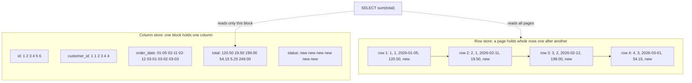
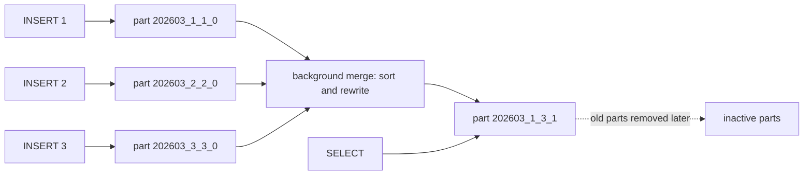
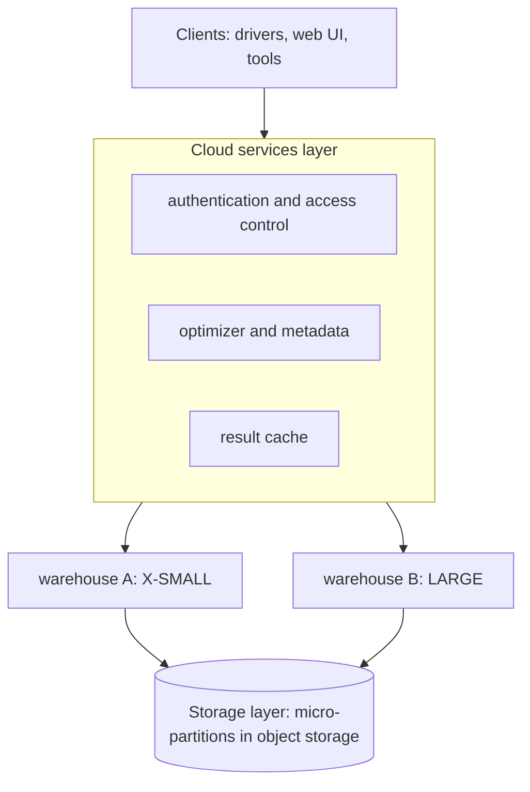
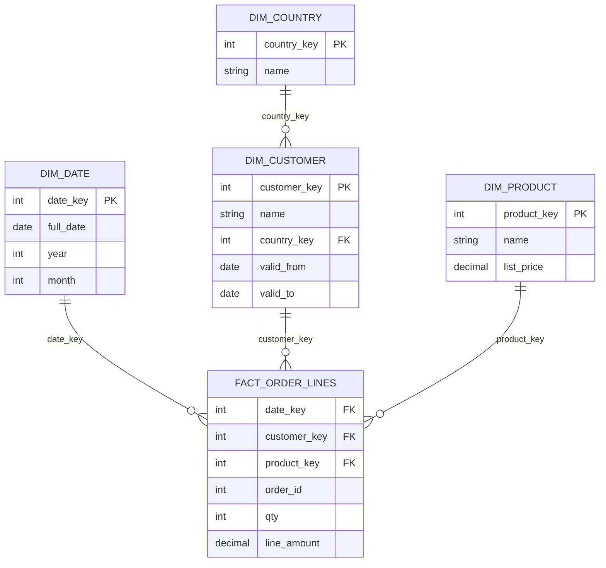

<div dir="rtl" markdown="1">

# ۱۵. OLTP در برابر OLAP و موتورهای ستونی

> **سطح:** L2 کاربر حرفه‌ای → L3 پیشرفته | **بخش:** I | **کد Rowlit در نسخهٔ** `08528ae` **بررسی شده است**
>
> **در یک جمله:** سامانه‌های تراکنشی چند سطر کامل را بسیار سریع می‌خوانند و می‌نویسند، سامانه‌های تحلیلی چند ستون از میلیاردها سطر را پویش می‌کنند، و این دو کار چیدمان ذخیره‌سازی مخالف می‌خواهند؛ برای همین موتورهای تحلیلی داده را ستون‌به‌ستون نگه می‌دارند.
>
> **یاد می‌گیرید:**
>
> - تفاوت بار کاری OLTP و OLAP و اینکه HTAP می‌خواهد چه کند
> - چرا ذخیره‌سازی ستونی کمتر می‌خواند، بهتر فشرده می‌شود و تجمیع‌ها را سریع‌تر اجرا می‌کند
> - فشرده‌سازی (run-length، dictionary، delta) و اجرای برداری چگونه کار می‌کنند
> - MergeTree در ClickHouse: part، granule، پارتیشن، ادغام، جهش، نمای مادی‌شده و دیکشنری
> - طراحی Snowflake: ریزپارتیشن‌ها، انبارهای مجازی، سفر در زمان، stage، stream و task
> - ستون‌انبار (columnstore) و batch mode در SQL Server و مدل‌سازی داده تحلیلی با طرح ستاره‌ای
>
> **پیش‌نیاز:** [فصل ۶ درون ذخیره‌سازی](06-storage-internals.md)، [فصل ۷ نمایه‌ها](07-indexes.md)، [فصل ۹ تراکنش‌ها](09-transactions-and-isolation.md)
>
> **نسخهٔ انگلیسی:** [English](../../en/part1/15-oltp-vs-olap-columnar.md) | **قبلی:** [۱۴ امنیت](14-security.md) | **بعدی:** [۱۶ خانواده‌های NoSQL](16-nosql-families.md)
>
> برچسب‌های نمودارها به انگلیسی نگه داشته شده‌اند تا در GitHub درست نمایش داده شوند.

> **دربارهٔ مثال‌ها.** مثال‌های ClickHouse و SQL Server روی پایگاه‌های Docker به نام `shop` در [فصل ۱۸](18-exercise-answers.md) اجرا می‌شوند؛ مثال‌های Snowflake فقط بر پایهٔ مستندات‌اند (آزمایشگاه حساب Snowflake ندارد). هنگام نوشتن این فصل موتور Docker روشن نبود، پس هر خروجی با عبارت *خروجی نمونه (illustrative output)* مشخص شده است: بر پایهٔ رفتار مستند نوشته شده و از اجرای واقعی برداشته نشده است.

## ۱. ایده (مبتدی)

دو شغل را در یک فروشگاه تصور کنید.

**صندوق‌دار** هر بار یک مشتری را رسیدگی می‌کند: مشتری را پیدا می‌کند، سفارش اضافه می‌کند، نشانی را عوض می‌کند. هر کار چند سطر را با همهٔ فیلدهایشان لمس می‌کند، هزاران بار در دقیقه، و هر کار باید درست و سریع باشد. این همان [OLTP](../glossary.md#oltp) است (پردازش تراکنشی برخط).

**تحلیل‌گر** دربارهٔ کل کسب‌وکار سؤال می‌پرسد: «درآمد هر کشور در هر ماه طی سه سال گذشته چقدر بود؟» این سؤال همهٔ سفارش‌ها را لمس می‌کند، اما فقط سه فیلدشان را (تاریخ، کشور، مبلغ). کم اجرا می‌شود، ممکن است چند ثانیه طول بکشد و باید داده زیادی را کارآمد بخواند. این [OLAP](../glossary.md#olap) است (پردازش تحلیلی برخط).

| | OLTP (صندوق‌دار) | OLAP (تحلیل‌گر) |
|---|---|---|
| دستور معمول | `INSERT` یک سفارش، `SELECT` یک مشتری | `SUM(total)` گروه‌بندی‌شده بر اساس ماه و کشور |
| سطرهای لمس‌شده | کم (۱ تا چند صد) | میلیون‌ها تا میلیاردها |
| ستون‌های لمس‌شده | بیشتر سطر | ۲ تا ۵ از شاید ۱۰۰ |
| هدف تأخیر | میلی‌ثانیه | ثانیه تا دقیقه |
| همزمانی | هزاران تراکنش کوچک | ده‌ها پرس‌وجوی بزرگ |
| نوشتن | بسیار و کوچک، درجا | دسته‌های بزرگ، بیشتر افزودن |
| طرح | نرمال‌شده ([فصل ۵](05-modelling-and-normalisation.md)) | طرح ستاره‌ای یا جدول‌های عریض غیرنرمال |
| بهترین ذخیره‌سازی | [ذخیره‌سازی سطری (row store)](../glossary.md#row-store) | [ذخیره‌سازی ستونی (column store)](../glossary.md#column-store) |

**ذخیره‌سازی سطری** همهٔ فیلدهای یک سطر را کنار هم در یک صفحه نگه می‌دارد (همان که [فصل ۶](06-storage-internals.md) گفت). برای صندوق‌دار ایده‌آل است: خواندن یک صفحه کل مشتری را می‌دهد. **ذخیره‌سازی ستونی** همهٔ مقدارهای یک ستون را کنار هم در فایل‌ها یا بلوک‌های جدا نگه می‌دارد. برای تحلیل‌گر ایده‌آل است: جمع `total` فقط ستون `total` را می‌خواند و ۹۹ ستون دیگر را رد می‌کند.

**شکل ۱۵٫۱ — همان شش سطر `orders` به‌صورت سطری و ستونی.**

</div>



<div dir="rtl" markdown="1">

(سمت سطری فقط چهار سفارش اول از شش سفارش دادهٔ اولیه را نشان می‌دهد تا تصویر کوچک بماند. در دادهٔ اولیهٔ PostgreSQL همهٔ سفارش‌ها وضعیت پیش‌فرض `new` دارند.)

همهٔ ایده‌های این فصل از یک واقعیت می‌آیند: **در پرس‌وجوی تحلیلی، هزینهٔ اصلی I/O است و ذخیره‌سازی ستونی اجازه می‌دهد فقط برای ستون‌هایی که به کار می‌برید هزینه بدهید.** باقی (فشرده‌سازی، اجرای برداری، موتورهای ویژهٔ جدول) این مزیت را بزرگ‌تر می‌کند.

## ۲. چگونه کار می‌کند (کاربر حرفه‌ای)

### ۲٫۱ چرا ستون‌انبار کمتر می‌خواند

یک بار حساب کنید. فرض کنید `orders` یک میلیارد سطر دارد و هر سطر با ۲۰ ستون حدود ۱۰۰ بایت است. ذخیره‌سازی سطری که برای جمع `total` باید همهٔ صفحه‌ها را بخواند، حدود ۱۰۰ گیگابایت می‌خواند. ذخیره‌سازی ستونی که `total` را به‌صورت عدد ۸ بایتی دارد، بدون فشرده‌سازی حدود ۸ گیگابایت می‌خواند و پس از فشرده‌سازی اغلب کمتر از ۲ گیگابایت (بخش ۲٫۲). یعنی ۱۲ تا ۵۰ برابر I/O کمتر برای آن پرس‌وجو. این‌ها مرتبهٔ بزرگی برای فهم‌اند، نه اندازه‌گیری.

هزینه در طرف مقابل ظاهر می‌شود. گرفتن یک سطر کامل از ستون‌انبار یعنی سر زدن به ۲۰ فایل و بازسازی سطر. به‌روزرسانی یک مقدار یعنی بازنویسی یک بلوک فشرده. درج‌های کوچک زیاد، فایل‌های ریز زیاد می‌سازد. برای همین ستون‌انبارها درج دسته‌ای بزرگ را ترجیح می‌دهند، به‌ندرت به‌روزرسانی می‌کنند و جای پایگاه OLTP را نمی‌گیرند.

### ۲٫۲ فشرده‌سازی

داده ستونی خوب فشرده می‌شود چون یک ستون مقدارهایی هم‌نوع دارد، اغلب مرتب یا تکراری. چهار تکنیک پایه، روی `orders` دادهٔ اولیه:

- **[کدگذاری dictionary](../glossary.md#compression-rle-dictionary-delta):** هر رشتهٔ متمایز را با عددی کوچک جایگزین می‌کنیم. `status` چهار مقدار ممکن دارد (`new`، `paid`، `shipped`، `cancelled`)، پس هر مقدار در ۲ بیت جا می‌شود نه ۴ تا ۹ بایت. ClickHouse این نوع را `LowCardinality(String)` می‌نامد و دادهٔ اولیهٔ shop آن را برای `orders.status` به کار برده است.
- **کدگذاری طول‌دنباله (RLE):** مقدار و تعداد تکرارش را ذخیره می‌کنیم. `customer_id` در دادهٔ اولیه `1 1 2 3 4 4` است که می‌شود `(1,×2) (2,×1) (3,×1) (4,×2)`. ستون مرتب با تنوع کم به چند جفت فشرده می‌شود؛ `status` در دادهٔ اولیه `(new,×6)` است.
- **کدگذاری تفاضلی (delta):** مقدار اول را ذخیره می‌کنیم و بعد تفاوت‌ها را. شش تاریخ سفارش بر حسب روز این‌طور می‌شود: `…, +37, +1, +17, +1, +1` (۵ ژانویه، ۱۱ فوریه، ۱۲ فوریه، ۱ مارس، ۲ مارس، ۳ مارس ۲۰۲۶). عددهای کوچک بیت کمتری از تاریخ کامل می‌خواهند. برای زمان‌های با فاصلهٔ منظم، *delta of delta* تغییرِ تغییر را ذخیره می‌کند و اغلب تقریباً همه‌اش صفر است.
- **بسته‌بندی بیتی و فشرده‌سازی عمومی:** پس از تبدیل‌های بالا، الگوریتمی عمومی و سریع (LZ4 یا ZSTD) بقیه را فشرده می‌کند. ClickHouse اجازه می‌دهد برای هر ستون انتخاب کنید: `CODEC(Delta, ZSTD)`؛ پیش‌فرضش LZ4 است.

چیدمان خوب روی داده‌های واقعی به نسبت‌های ۵ تا ۱۰ برابر می‌رسد و گاهی خیلی بیشتر؛ نسبت دقیق به داده بستگی دارد، پس اندازه بگیرید.

### ۲٫۳ اجرای برداری و تحقق دیرهنگام

اجرای کلاسیک (مدل Volcano در [فصل ۸](08-query-processing.md)) از هر عملگر **یک سطر** در هر بار می‌خواهد. برای یک میلیارد سطر، یعنی یک میلیارد فراخوانی تابع برای هر عملگر. اجرای **[برداری (vectorised)](../glossary.md#vectorised-execution)** **دسته‌ای از مقدارهای یک ستون** (صدها تا ده‌ها هزار) را بین عملگرها رد و بدل می‌کند و دسته را در حلقه‌ای فشرده روی یک آرایه پردازش می‌کند. این از سه راه کمک می‌کند: فراخوانی تابع بسیار کمتر، داده‌ای که در حافظهٔ نهان CPU جا می‌شود و حلقه‌هایی که کامپایلر آن‌ها را به دستورهای SIMD تبدیل می‌کند (یک دستور ۴ یا ۸ عدد را با هم جمع می‌کند). ClickHouse بلوک‌هایی حدود ۶۵٬۰۰۰ سطر پردازش می‌کند (تنظیم `max_block_size`)؛ *batch mode* در SQL Server دسته‌هایی حدود ۹۰۰ سطر.

**[تحقق دیرهنگام (late materialisation)](../glossary.md#late-materialisation)** بازسازی سطر را به تعویق می‌اندازد. فیلتر `WHERE order_date >= '2026-03-01'` اول فقط `order_date` را می‌خواند، *موقعیت* سطرهای منطبق را می‌سازد و بعد ستون‌های دیگر را فقط در همان موقعیت‌ها می‌خواند. ClickHouse این را با `PREWHERE` خودکار اعمال می‌کند: ستون‌های فیلتر اول خوانده می‌شوند و بقیه فقط برای granuleهایی که می‌مانند.

### ۲٫۴ ClickHouse و خانوادهٔ MergeTree

ClickHouse یک ستون‌انبار متن‌باز است که برای تحلیل ساخته شده. تقریباً هر جدول جدی از موتورهای خانوادهٔ [MergeTree](../glossary.md#mergetree) استفاده می‌کند. دادهٔ اولیهٔ `shop` برای ClickHouse (`engine/tests/docker/seed-clickhouse.sql`) همه‌جا از آن استفاده می‌کند، پس می‌توانیم تعریف‌های واقعی را بخوانیم:

</div>

```sql
CREATE TABLE shop.orders
(
    id UInt32,
    customer_id UInt32,
    order_date DateTime('UTC'),
    total Decimal(12, 2),
    status LowCardinality(String) DEFAULT 'new',
    order_month UInt32 MATERIALIZED toYYYYMM(order_date),
    INDEX ix_orders_customer customer_id TYPE minmax GRANULARITY 1,
    CONSTRAINT ck_orders_total CHECK total >= 0
)
ENGINE = MergeTree
PARTITION BY toYYYYMM(order_date)
ORDER BY (id)
TTL order_date + INTERVAL 30 YEAR
SETTINGS index_granularity = 8192;
```

<div dir="rtl" markdown="1">

بند به بند بخوانید.

- `ENGINE = MergeTree` داده را در **[partها (parts)](../glossary.md#part)**ی تغییرناپذیر نگه می‌دارد.
- `ORDER BY (id)` **کلید مرتب‌سازی** است: سطرها درون هر part بر اساس آن مرتب‌اند. *کلید اصلی* به‌طور پیش‌فرض همان کلید مرتب‌سازی است و یک **نمایهٔ تُنُک (sparse)** روی آن است، نه قید یکتایی.
- `PARTITION BY toYYYYMM(order_date)` جدول را به **[پارتیشن‌ها](../glossary.md#partition-clickhouse)** تقسیم می‌کند، اینجا یکی برای هر ماه. partها هرگز پارتیشن‌ها را قاطی نمی‌کنند.
- `TTL` سطرها را پس از مدتی حذف (یا جابه‌جا) می‌کند.
- `index_granularity = 8192` اندازهٔ **[granule](../glossary.md#granule)** را تعیین می‌کند: واحد نمایهٔ تُنُک، به‌طور پیش‌فرض ۸٬۱۹۲ سطر.
- `INDEX … TYPE minmax` یک **نمایهٔ پرش (skipping index)** است: برای هر گروه granule کمینه و بیشینهٔ ستون را نگه می‌دارد تا موتور گروه‌هایی را که نمی‌توانند منطبق شوند رد کند.

**part و ادغام.** هر `INSERT` یک یا چند part تازه می‌نویسد (یکی برای هر پارتیشنی که لمس می‌شود) و برمی‌گردد. part مرتب و فشرده است و ستون‌هایش در فایل‌های جدا ذخیره می‌شوند. سپس یک فرایند پس‌زمینه partهای کوچک همان پارتیشن را **[ادغام (merge)](../glossary.md#merge)** می‌کند و partهای بزرگ‌تر می‌سازد؛ این تعداد partها را محدود و داده را مرتب نگه می‌دارد. نام part تبارش را نشان می‌دهد: `202603_7_7_0` یعنی پارتیشن 202603، بازهٔ بلوک ۷ تا ۷، سطح ادغام ۰؛ پس از ادغام بلوک‌های ۷ تا ۹ می‌شود `202603_7_9_1`.

**شکل ۱۵٫۲ — درج‌ها part می‌سازند؛ ادغام‌های پس‌زمینه آن‌ها را یکی می‌کنند.**

</div>



<div dir="rtl" markdown="1">

چون هر درج یک part می‌سازد، قاعدهٔ ClickHouse این است: **درج‌ها را بزرگ و دسته‌ای بزنید** (مستندات دست‌کم ۱٬۰۰۰ سطر در هر درج را توصیه می‌کند، ترجیحاً ده‌ها هزار) یا درج ناهمگام را روشن کنید. اگر partها سریع‌تر از ادغام‌ها جمع شوند، سرور اول درج‌ها را کند می‌کند و در پایان با خطای «too many parts» ردشان می‌کند.

**نمایهٔ اصلی تُنُک.** نمایه برای هر granule یک مدخل (یک *mark*) دارد: مقدار کلید اولین سطرش. برای یک میلیارد سطر و granuleهای ۸٬۱۹۲ سطری حدود ۱۲۲٬۰۰۰ مدخل است، آنقدر کوچک که در حافظه جا شود. پرس‌وجویی با شرط روی کلید مرتب‌سازی، markها را دودویی جست‌وجو می‌کند و فقط granuleهایی را می‌خواند که ممکن است منطبق باشند. نمی‌تواند یک سطر را دقیقاً پیدا کند (کل granule را می‌خواند)، و برای همین ClickHouse پایگاه OLTP خوبی نیست. تصویر نمایهٔ تُنُک در فصل ۷ است.

**جهش‌ها (mutations).** به‌روزرسانی درجا وجود ندارد. `ALTER TABLE … UPDATE` و `ALTER TABLE … DELETE` **[جهش (mutation)](../glossary.md#mutation)**اند: سرور همهٔ partهای درگیر را در پس‌زمینه بازنویسی می‌کند، پیشرفت را در `system.mutations` ثبت می‌کند و دستور پیش از پایان کار برمی‌گردد. `DELETE FROM` سبک در عوض سطرها را حذف‌شده علامت می‌زند و داده در ادغام بعدی از نظر فیزیکی ناپدید می‌شود. نشست ClickHouse در Rowlit دقیقاً به همین دلیل جهش را با خواندن `system.mutations` گزارش می‌کند (`engine/src/DbStudio.Providers.ClickHouse/ChSession.cs:26-27`، پرس‌وجو در `:256`).

ClickHouse همچنین **تراکنش چنددستوری ندارد**. هر دستور به‌تنهایی اعمال می‌شود، که برای بارگذاری‌های بزرگ و تکرارپذیر مناسب است و برای سبد خرید نه (`ChSession.cs:25` و `:32-33`).

**خانوادهٔ موتورها.** گونه‌های `Replacing`، `Summing`، `Aggregating` و `Collapsing` تغییر می‌دهند که *هنگام ادغام partها* چه رخ دهد:

| موتور | هنگام ادغام | کاربرد معمول |
|---|---|---|
| `MergeTree` | کار ویژه‌ای نمی‌کند | واقعیت‌های خام، لاگ |
| `ReplacingMergeTree(version)` | سطرهای با کلید مرتب‌سازی یکسان به سطر با بالاترین نسخه فرو می‌ریزند | «آخرین وضعیت» یک موجودیت؛ دادهٔ اولیهٔ shop آن را برای `reviews` به کار برده |
| `SummingMergeTree` | ستون‌های عددی سطرهای با کلید یکسان جمع می‌شوند | شمارندهٔ از پیش تجمیع‌شده؛ دادهٔ اولیه آن را برای `daily_sales_agg` دارد |
| `AggregatingMergeTree` | وضعیت‌های جزئی تجمیع (توابع `-State`) را نگه می‌دارد و ادغام می‌کند | تجمیع افزایشی |
| `CollapsingMergeTree` | جفت سطرهای با علامت +1 و -1 یکدیگر را خنثی می‌کنند | جریان تغییر با لغو |
| پیشوند `Replicated…` | هر part را از طریق ClickHouse Keeper به replicaهای دیگر کپی می‌کند | دسترس‌پذیری بالا |

تذکر اساسی: ادغام‌ها **سرانجام** رخ می‌دهند، پس پرس‌وجو می‌تواند تکرارهای ادغام‌نشده را ببیند. باید یا هنگام پرس‌وجو دوباره تجمیع کنید (`sum(...) GROUP BY key`) یا نمای ادغام‌شده را با `FINAL` وادار کنید.

**نماهای مادی‌شده** در ClickHouse *محرک درج* هستند. [نمای مادی‌شده](../glossary.md#materialized-view-clickhouse) `SELECT` خود را روی هر بلوکی که به جدول مبدأ درج می‌شود اجرا می‌کند و نتیجه را در جدول مقصد می‌نویسد. دادهٔ اولیه یکی دارد:

</div>

```sql
CREATE MATERIALIZED VIEW shop.daily_sales TO shop.daily_sales_agg AS
SELECT toDate(order_date) AS day, count() AS orders, sum(toDecimal128(total, 2)) AS revenue
FROM shop.orders
GROUP BY day;
```

<div dir="rtl" markdown="1">

هر درج به `shop.orders` بی‌درنگ یک سطر خلاصه برای بلوکش به `daily_sales_agg` اضافه می‌کند که یک `SummingMergeTree` است و آن‌ها را به مرور یکی می‌کند. توجه کنید چه کاری *نمی‌کند*: سطرهایی را که پیش از ساخته شدنش وجود داشتند هرگز نمی‌بیند (مگر populate شده باشد) و `UPDATE` یا `DELETE` روی `orders` به آن نمی‌رسد.

**[دیکشنری‌ها](../glossary.md#dictionary-clickhouse)** جدول‌های کلید‌به‌ویژگی در حافظه‌اند برای جست‌وجوی سریع به‌جای join. دادهٔ اولیه `shop.product_dict` را روی جدول `products` با چیدمان `FLAT` و تازه‌سازی `LIFETIME(MIN 60 MAX 300)` تعریف می‌کند:

</div>

```sql
SELECT order_id,
       dictGet('shop.product_dict', 'name', toUInt64(product_id)) AS product,
       qty
FROM shop.order_lines
ORDER BY order_id, product_id;
```

<div dir="rtl" markdown="1">

**[پروجکشن (projection)](../glossary.md#projection-clickhouse)** نسخهٔ دوم پنهانی از داده‌های جدول درون هر part است، با مرتب‌سازی یا تجمیع متفاوت؛ بهینه‌ساز وقتی به پرس‌وجو بخورد خودکار از آن استفاده می‌کند.

#### ClickHouse — دیدن part و ادغام در یک جدول موقت

</div>

```sql
CREATE TABLE shop.lab15_events
(
    day    Date,
    kind   LowCardinality(String),
    amount Decimal(12, 2)
)
ENGINE = MergeTree
PARTITION BY toYYYYMM(day)
ORDER BY (kind, day);

INSERT INTO shop.lab15_events VALUES ('2026-03-01', 'sale', 10.00);
INSERT INTO shop.lab15_events VALUES ('2026-03-02', 'sale', 20.00);
INSERT INTO shop.lab15_events VALUES ('2026-03-03', 'refund', -5.00);

SELECT name, rows, level
FROM system.parts
WHERE database = 'shop' AND table = 'lab15_events' AND active
ORDER BY name;
```

<div dir="rtl" markdown="1">

خروجی نمونه (illustrative output): سه درج، سه part در پارتیشن `202603`؛ شمارهٔ بلوک‌ها روی سرور شما می‌تواند فرق کند:

</div>

```text
┌─name─────────┬─rows─┬─level─┐
│ 202603_1_1_0 │    1 │     0 │
│ 202603_2_2_0 │    1 │     0 │
│ 202603_3_3_0 │    1 │     0 │
└──────────────┴──────┴───────┘
```

<div dir="rtl" markdown="1">

ادغام را وادار کنید، دوباره نگاه کنید و پاک‌سازی کنید:

</div>

```sql
OPTIMIZE TABLE shop.lab15_events FINAL;

SELECT name, rows, level
FROM system.parts
WHERE database = 'shop' AND table = 'lab15_events' AND active;

DROP TABLE shop.lab15_events;
```

<div dir="rtl" markdown="1">

خروجی نمونهٔ پس از ادغام: یک part فعال مانند `202603_1_3_1` با `rows = 3` و `level = 1`. (`OPTIMIZE … FINAL` برای نمایش است؛ در محیط تولید روی جدول‌های بزرگ اجرایش نکنید، چون همه‌چیز را بازنویسی می‌کند.)

تذکر `ReplacingMergeTree` را به‌آسانی می‌توان دید:

</div>

```sql
CREATE TABLE shop.lab15_prices
(
    product_id UInt32,
    price      Decimal(10, 2),
    version    UInt32
)
ENGINE = ReplacingMergeTree(version)
ORDER BY product_id;

INSERT INTO shop.lab15_prices VALUES (1, 49.90, 1);
INSERT INTO shop.lab15_prices VALUES (1, 44.90, 2);

SELECT * FROM shop.lab15_prices;          -- may show both rows until a merge
SELECT * FROM shop.lab15_prices FINAL;    -- always one row: version 2, price 44.90

DROP TABLE shop.lab15_prices;
```

<div dir="rtl" markdown="1">

#### ClickHouse — دیدن فیلتر پارتیشن و نمایه

</div>

```sql
EXPLAIN indexes = 1
SELECT sum(total) FROM shop.orders WHERE order_date >= '2026-03-01';
```

<div dir="rtl" markdown="1">

خروجی نمونه (illustrative output، کوتاه‌شده):

</div>

```text
ReadFromMergeTree (shop.orders)
Indexes:
  MinMax
    Keys: order_date
    Condition: (order_date in [1772323200, +Inf))
    Parts: 1/3
    Granules: 1/3
  Partition
    Keys: toYYYYMM(order_date)
    Condition: (toYYYYMM(order_date) in [202603, +Inf))
    Parts: 1/3
    Granules: 1/3
  PrimaryKey
    Condition: true
    Parts: 1/1
    Granules: 1/1
```

<div dir="rtl" markdown="1">

این‌طور بخوانید: از سه part (یکی برای هر ماه) فیلتر پارتیشن یکی را نگه می‌دارد؛ کلید اصلی کمکی نمی‌کند چون پرس‌وجو شرطی روی `id` ندارد. خط‌های `Parts: x/y` همان چیزی‌اند که هنگام تنظیم باید دنبالشان بگردید. خواننده‌ٔ طرح ClickHouse در Rowlit دقیقاً همین آمار نمایه را درخواست می‌کند (`engine/src/DbStudio.Providers.ClickHouse/Plans/ChPlanReader.cs:13-18` و ثابت در `:22`).

> **غواصی عمیق (L3): تقویت نوشتن و زمان‌بندی ادغام.** سطری که یک بار نوشته می‌شود، هر بار که partش در ادغامی شرکت کند دوباره بازنویسی می‌شود. اگر ادغام‌ها حدود *k* part هم‌اندازه را یکی کنند، سطر تقریباً `log_k(N)` بار بازنویسی می‌شود تا پارتیشن از یک بلوک به *N* بلوک برسد؛ این همان *تقویت نوشتن (write amplification)* در طراحی‌های شبیه LSM است (همین ایده را در Cassandra دوباره می‌بینید، [فصل ۱۶](16-nosql-families.md)). سرور ادغام‌هایی را برمی‌گزیند که اندازهٔ partها را متوازن نگه دارند و اندازهٔ part ادغام‌شده را سقف می‌گذارد، پس پارتیشن‌های بسیار بزرگ از ادغام می‌ایستند و به چند part بزرگ تبدیل می‌شوند. پیامدهای عملی: درج‌های کمتر و بزرگ‌تر را ترجیح دهید؛ با چیزی درشت پارتیشن‌بندی کنید (ماه، نه روز، مگر دلیلی داشته باشید) چون هر پارتیشن partها و ادغام‌های خودش را دارد؛ و هرگز بار کاری‌ای طراحی نکنید که تک‌سطر به‌روزرسانی کند.

### ۲٫۵ Snowflake

Snowflake یک انبار داده ابری است که به‌صورت سرویس فروخته می‌شود. طراحی آن سه لایه را جدا می‌کند که انبارهای قدیمی‌تر در هم می‌پیچیدند:

1. **ذخیره‌سازی.** جدول‌ها به **[ریزپارتیشن‌ها (micro-partitions)](../glossary.md#micro-partition)** بریده می‌شوند: فایل‌های ستونی، فشرده و تغییرناپذیر که هرکدام تقریباً ۵۰ تا ۵۰۰ مگابایت داده (پیش از فشرده‌سازی) دارند و در ذخیره‌سازی شیء ارائه‌دهندهٔ ابری قرار می‌گیرند. برای هر ریزپارتیشن و هر ستون، Snowflake فراداده ثبت می‌کند (کمینه، بیشینه، تعداد مقدارهای متمایز).
2. **محاسبه.** **[انبار مجازی (virtual warehouse)](../glossary.md#virtual-warehouse)** خوشه‌ای از گره‌های محاسباتی است که اندازه‌اش را شما تعیین می‌کنید (`X-SMALL`، `SMALL`، … هر اندازه تعداد گره و اعتبار در ساعت را دو برابر می‌کند) و مستقل روشن، معلق و از سر گرفته می‌شود. چند انبار می‌توانند همزمان همان جدول‌ها را بخوانند بی‌آنکه با هم رقابت کنند، چون داده در لایهٔ ذخیره‌سازی است.
3. **سرویس‌های ابری.** «مغز»: احراز هویت، مخزن فراداده، بهینه‌ساز، مدیریت تراکنش و حافظهٔ نهان نتایج. عملیات فراداده (`SHOW`، `DESCRIBE`، `GET_DDL`) همین‌جا اجرا می‌شود و برای همین مرور یک schema در Snowflake انبار نمی‌خواهد؛ خواننده‌ٔ کاتالوگ Rowlit دقیقاً به همین تکیه می‌کند تا مرور «هرگز انباری را از سر نگیرد (بدون اعتبار)» (`engine/src/DbStudio.Providers.Snowflake/SnowflakeCatalogReader.cs:12-13`).

**شکل ۱۵٫۳ — سه لایهٔ Snowflake.**

</div>



<div dir="rtl" markdown="1">

**هرس (pruning).** وقتی پرس‌وجو روی ستونی فیلتر می‌کند، بهینه‌ساز فیلتر را با فرادادهٔ کمینه/بیشینهٔ هر ریزپارتیشن می‌سنجد و فقط آن‌هایی را می‌خواند که ممکن است منطبق شوند. این فقط وقتی کار می‌کند که مقدارهای مشابه در ریزپارتیشن‌های یکسان باشند، پس داده‌ای که به ترتیب تاریخ بارگذاری شده بر اساس تاریخ خوب هرس می‌شود. **کلید خوشه‌بندی (clustering key)** (`ALTER TABLE ORDERS CLUSTER BY (TO_DATE(ORDER_DATE))`) به Snowflake می‌گوید داده را در پس‌زمینه بازچینی کند تا این ویژگی حفظ شود.

**حافظه‌های نهان و سفر در زمان.** پرس‌وجوی یکسان روی داده‌ای که تغییر نکرده می‌تواند بدون انبار از **حافظهٔ نهان نتیجه** جواب بگیرد. **[سفر در زمان (time travel)](../glossary.md#time-travel)** نسخه‌های قدیمی داده‌ی تغییرکرده یا حذف‌شده را یک مدت نگه می‌دارد (به‌طور پیش‌فرض یک روز؛ در ویرایش‌های بالاتر تا ۹۰ روز) و پس از آن برای جدول‌های دائمی یک *fail-safe* هفت‌روزه برقرار است. چون ریزپارتیشن‌ها تغییرناپذیرند، نگه‌داری تاریخچه فقط هزینهٔ فایل‌های تغییرکرده را دارد. `CLONE` بدون کپی هم از همین سازوکار استفاده می‌کند.

مثال‌های Snowflake (فقط بر پایهٔ مستندات؛ چیزی اجرا نشده):

</div>

```sql
-- the table as it was five minutes ago
SELECT * FROM ORDERS AT(OFFSET => -60*5);

-- recover a dropped table within the retention period
DROP TABLE ORDERS;
UNDROP TABLE ORDERS;

-- an instant, storage-sharing copy
CREATE TABLE ORDERS_COPY CLONE ORDERS;

-- how well is the table clustered by date?
SELECT SYSTEM$CLUSTERING_INFORMATION('ORDERS', '(TO_DATE(ORDER_DATE))');
```

<div dir="rtl" markdown="1">

**بارگذاری و خودکارسازی.** **[stage](../glossary.md#stage)** مکانی نام‌دار برای فایل‌ها است (درونی Snowflake یا یک bucket بیرونی). `COPY INTO` از stage بارگذاری می‌کند؛ **[pipe](../glossary.md#pipe)** (یعنی Snowpipe) همین را پیوسته با رسیدن فایل‌ها انجام می‌دهد. **[stream](../glossary.md#stream-snowflake)** تغییرات (درج، به‌روزرسانی، حذف) جدول را از آخرین باری که مصرف کرده‌اید ثبت می‌کند، یعنی یک ضبط تغییر داده (CDC) داخلی. **[task](../glossary.md#task-snowflake)** یک دستور SQL را طبق زمان‌بندی یا وقتی stream داده دارد اجرا می‌کند. با هم یک خط لولهٔ کوچک می‌سازند، بدون زمان‌بند بیرونی:

</div>

```sql
CREATE STREAM ORDERS_STREAM ON TABLE ORDERS;

CREATE TASK ORDERS_HISTORY_LOAD
  WAREHOUSE = COMPUTE_WH
  SCHEDULE  = '5 MINUTE'
  WHEN SYSTEM$STREAM_HAS_DATA('ORDERS_STREAM')
AS
  INSERT INTO ORDERS_HISTORY SELECT ID, CUSTOMER_ID, TOTAL, METADATA$ACTION FROM ORDERS_STREAM;

ALTER TASK ORDERS_HISTORY_LOAD RESUME;
```

<div dir="rtl" markdown="1">

Snowflake محاسبه را ثانیه‌ای حساب می‌کند تا وقتی انبار روشن است، پس اهرم‌های اصلی هزینه این‌ها است: انبارها را زود معلق کنید (`AUTO_SUSPEND`)، اندازه را با پرس‌وجو متناسب کنید، خوب هرس کنید و از `SELECT *` روی جدول‌های عریض بپرهیزید.

### ۲٫۶ ستون‌انبار در SQL Server

SQL Server یک پایگاه سطری است که می‌تواند روی همان جدول یک نمایهٔ ستونی هم نگه دارد. نمایهٔ **[columnstore](../glossary.md#columnstore)** داده را در **row group**هایی تا ۱٬۰۴۸٬۵۷۶ سطر ذخیره می‌کند؛ هر ستون در قطعهٔ (segment) خودش فشرده و کمینه و بیشینه‌اش ثبت می‌شود (*segment elimination* قطعه‌های ناسازگار را رد می‌کند). سطرهای جدید اول در یک **delta store** سطری می‌نشینند و یک *tuple mover* پس‌زمینه گروه‌های پر را فشرده می‌کند؛ بارگذاری‌های انبوه دست‌کم ۱۰۲٬۴۰۰ سطری مستقیم فشرده می‌شوند. عملگرهایی که columnstore را می‌خوانند در **batch mode** اجرا می‌شوند، یعنی همان اجرای برداری بخش ۲٫۳.

#### SQL Server — کپی columnstore خوشه‌ای از سفارش‌ها

</div>

```sql
SELECT * INTO dbo.OrdersCS FROM dbo.Orders;           -- scratch copy of the shop table
CREATE CLUSTERED COLUMNSTORE INDEX cci_OrdersCS ON dbo.OrdersCS;

SELECT YEAR(OrderDate) AS Y, SUM(Total) AS Revenue
FROM dbo.OrdersCS
GROUP BY YEAR(OrderDate);

DROP TABLE dbo.OrdersCS;
```

<div dir="rtl" markdown="1">

با شش سطر چیزی قابل اندازه‌گیری نیست؛ نکته طرح اجرا است. طرح تخمینی یک **Columnstore Index Scan** نشان می‌دهد و ویژگی *Actual Execution Mode* عملگر `Batch` است (به [فصل ۸](08-query-processing.md) نگاه کنید). روی جدولی با میلیون‌ها سطر همین پرس‌وجو فقط `OrderDate` و `Total` را می‌خواند و معمولاً چند برابر سریع‌تر از طرح سطری است. نمایهٔ columnstore *غیرخوشه‌ای* روی جدول OLTP شکلی محدود از HTAP می‌دهد: تحلیل از نسخهٔ ستونی می‌خواند و تراکنش‌ها بخش سطری را به‌روز می‌کنند.

### ۲٫۷ موتورهای دیگر، HTAP و گزینهٔ تعبیه‌شده

- **HTAP** (پردازش تراکنشی و تحلیلی ترکیبی) یعنی یک سامانه هر دو کار را انجام می‌دهد، معمولاً با نگه‌داشتن دو نسخه از داده در دو چیدمان و همگام‌سازی آن‌ها: SQL Server (rowstore به‌علاوهٔ نمایهٔ columnstore)، Oracle Database In-Memory (نسخهٔ ستونی در حافظه)، TiDB (سطرهای TiKV به‌علاوهٔ ستون‌های TiFlash)، جدول‌های ترکیبی Snowflake. بهایش فضای ذخیره‌سازی و هزینهٔ نوشتن بیشتر است.
- **PostgreSQL** در هستهٔ سرور ذخیره‌سازی ستونی ندارد. افزونه‌ها و محصولات آن را اضافه می‌کنند (Citus columnar، Hydra، قطعه‌های فشردهٔ TimescaleDB) و افزونهٔ `pg_duckdb` اجازه می‌دهد پرس‌وجوها از موتور DuckDB استفاده کنند. تا چند صد گیگابایت، PostgreSQL ساده با پارتیشن‌بندی، نمایه‌های BRIN و پرس‌وجوی موازی اغلب کافی است.
- **MySQL** با InnoDB سطری است؛ HeatWave یک موتور ستونی درون‌حافظه به‌صورت سرویس مدیریت‌شده اضافه می‌کند. **MariaDB** موتور جدای ColumnStore دارد.
- **SQLite** سطری است. برای تحلیل روی یک فایل، مردم از **DuckDB** استفاده می‌کنند، یک پایگاه تعبیه‌شدهٔ ستونی و برداری («SQLite برای تحلیل»). Rowlit از DuckDB به‌عنوان موتور پایگاه‌های پیوندی‌اش استفاده می‌کند (بخش II، [فصل ۱۶](../part2/16-linked-databases-federation.md)).
- **Cassandra** را ذخیره‌ساز *wide-column* می‌نامند، اما به معنای این فصل ستون‌انبار نیست: سطرها را گروه‌بندی‌شده بر اساس پارتیشن ذخیره می‌کند. [فصل ۱۶](16-nosql-families.md) را ببینید.

### ۲٫۸ مدل‌سازی برای تحلیل: طرح ستاره‌ای

پرس‌وجوهای تحلیلی روی **[طرح ستاره‌ای (star schema)](../glossary.md#star-schema)** ساده‌ترین و سریع‌ترین‌اند: یک **[جدول واقعیت (fact table)](../glossary.md#fact-dimension-table)** بزرگ در مرکز، که **جدول‌های بُعد** کوچک دورش را گرفته‌اند.

- **واقعیت (fact)** رویدادی است با عددهایی که جمع می‌شوند (سنجه‌ها یا measure): یک ردیف سفارش با `qty` و `line_amount`.
- **بُعد (dimension)** زمینهٔ واقعیت‌ها را توصیف می‌کند: چه کسی (مشتری)، چه چیزی (کالا)، کِی (تاریخ)، کجا (کشور).
- **دانه (grain)** معنای یک سطر واقعیت است. اول آن را تصمیم بگیرید و بنویسید: *«یک سطر برای هر کالا در هر سفارش»*. هر سنجه و هر بعد باید در همان دانه درست باشد.

**شکل ۱۵٫۴ — طرح ستاره‌ای برای shop.**

</div>



<div dir="rtl" markdown="1">

اینجا `DIM_COUNTRY` به `DIM_CUSTOMER` آویزان است: این یک *طرح دانه‌برفی (snowflake schema)* است، یعنی ستارهٔ نرمال‌شده (نام آن ربطی به محصول Snowflake ندارد). کمی فضا ذخیره می‌کند و یک join بیشتر خرج دارد؛ بیشتر انبارها ستارهٔ تخت را ترجیح می‌دهند که `country` در بعد مشتری کپی شده است.

چهار عادت به این سبک تعلق دارد:

- **کلیدهای جانشین (surrogate)** در ابعاد (`customer_key`) به‌جای شناسهٔ سامانهٔ مبدأ، تا تاریخچه‌ها با هم برخورد نکنند.
- **ابعاد با تغییر آهسته (SCD).** وقتی مشتری از آلمان به فرانسه می‌رود، نوع ۱ سطر را بازنویسی می‌کند (تاریخچه از دست می‌رود)، نوع ۲ سطر قدیمی را می‌بندد (`valid_to`) و سطر تازه‌ای درج می‌کند (تاریخچه می‌ماند؛ ستون‌های `valid_from` / `valid_to` بالا) و نوع ۳ مقدار قبلی را در ستونی دوم نگه می‌دارد.
- **عمداً غیرنرمال کنید.** join بخش گران OLAP است، پس بُعد `country` را متن نگه می‌دارد، نه فقط کلید.
- **ELT به‌جای ETL.** انبارهای مدرن اول داده خام را بار می‌کنند و با SQL درون انبار تبدیلش می‌کنند (ELT)، نه اینکه پیش از بارگذاری در ابزاری بیرونی تبدیل شود (ETL).

**[انبار داده (data warehouse)](../glossary.md#data-warehouse)** پایگاهی است که این‌طور سازمان یافته و از سامانه‌های عملیاتی تغذیه می‌شود. *دریاچهٔ داده (data lake)* فایل‌های خام (CSV، JSON، Parquet) را ارزان در ذخیره‌سازی شیء نگه می‌دارد. **[lakehouse](../glossary.md#lakehouse)** یک قالب جدول تراکنشی (Apache Iceberg، Delta Lake، Apache Hudi) را روی فایل‌های ستونی دریاچه (Parquet) می‌گذارد تا موتورهایی مانند Spark، Trino، DuckDB، ClickHouse یا Snowflake بتوانند یک نسخه را با تضمین ACID پرس‌وجو کنند.

## ۳. غواصی عمیق (پیشرفته)

**مدل هزینهٔ پویش ستونی.** برای تجمیع فیلترشده، زمان تقریباً `بایت‌های خوانده‌شده پس از هرس ÷ پهنای باند پویش` به‌علاوهٔ رمزگشایی و محاسبه است. هرس *بایت‌های خوانده‌شده* را کم می‌کند؛ فشرده‌سازی *بایت در هر مقدار* را؛ برداری‌سازی *مقدار در ثانیه* را بالا می‌برد. سه عامل ضرب می‌شوند. برای همین جدول خوب خوشه‌بندی‌شده روی ماشین متوسط می‌تواند از ماشین بزرگ‌تری که داده بد چیده را می‌خواند جلو بزند.

**چرا ترتیب از نمایه مهم‌تر است.** ستون‌انبار B-tree ندارد که چیدمان بد را نجات دهد. کلید مرتب‌سازی (`ORDER BY` در ClickHouse)، کلید خوشه‌بندی (Snowflake) و ترتیب بارگذاری columnstore تعیین می‌کنند کدام بلوک‌ها رد می‌شوند و دنباله‌ها چقدر فشرده می‌شوند. ستون‌های با تنوع کم و پرفیلتر را در کلید مرتب‌سازی ClickHouse اول بگذارید: `(kind, day)` اجازه می‌دهد فیلتر روی `kind` بیشتر granuleها را رد کند و `kind` را در چند دنباله فشرده کند.

**Parquet، قالب تبادل.** بیشتر فایل‌های تحلیلی باز از Parquet استفاده می‌کنند: فایل به *row group*ها (معمولاً صد مگابایت یا بیشتر) تقسیم می‌شود، هر row group هر ستون را به‌صورت *column chunk* ذخیره می‌کند که به *صفحه*‌های فشرده تقسیم شده، و پاورقی (footer) طرح و آمار کمینه/بیشینهٔ هر chunk را دارد. ستون‌انباری است که در فایل منجمد شده: موتورها با آمار footer row groupها را رد می‌کنند و فقط ستون‌های لازم را می‌خوانند. قالب‌های جدول lakehouse یک لاگ اضافه می‌کنند که می‌گوید کدام فایل‌ها به کدام نسخهٔ جدول تعلق دارند.

**delta store و tuple mover در columnstore.** درج‌های قطره‌ای در columnstore خوشه‌ای در یک delta store به شکل B-tree می‌نشینند، چون فشرده کردن چند سطر یک row group را هدر می‌دهد. خواندن باید delta store و گروه‌های فشرده را ادغام کند؛ حذف‌ها سطرها را در یک bitmap علامت می‌زنند و فقط بازسازی فضا را پس می‌دهد. بارهای قطره‌ای سنگین برای همین row groupهای کوچک جمع می‌کنند و از دسته‌ای کردن درج‌ها (هر وقت ممکن است دست‌کم ۱۰۲٬۴۰۰ سطر) و `ALTER INDEX … REORGANIZE` دوره‌ای سود می‌برند.

**سازگاری نمای مادی‌شده در برابر نمای ClickHouse.** نمای مادی‌شدهٔ کلاسیک (PostgreSQL، Oracle) نتیجهٔ پرس‌وجو را ذخیره می‌کند و بر حسب درخواست تازه می‌شود: تا آخرین تازه‌سازی سازگار است. نمای مادی‌شدهٔ ClickHouse افزایشی است، به‌ازای هر بلوک درج‌شده سازگار است و نسبت به به‌روزرسانی و حذف کور است. انتخاب بسته به اینکه مبدأ فقط‌افزودنی هست یا نه.

## ۴. در هر موتور

| موتور | جهت ذخیره‌سازی | برازندگی OLTP | برازندگی OLAP | قابلیت‌های تحلیلی | تراکنش |
|---|---|---|---|---|---|
| PostgreSQL 17 | سطری (heap) | عالی | تا صدها گیگابایت خوب؛ پرس‌وجوی موازی، پارتیشن‌بندی، BRIN | نمای مادی‌شده (تازه‌سازی دستی)؛ ستونی با افزونه | ACID کامل |
| SQL Server 2022 | سطری، به‌علاوهٔ columnstore اختیاری | عالی | با columnstore بسیار خوب | batch mode، پارتیشن‌بندی، نمای نمایه‌شده | ACID کامل |
| Oracle 23 | سطری؛ نسخهٔ ستونی In-Memory اختیاری | عالی | با گزینه‌ها بسیار خوب | پارتیشن‌بندی، نمایهٔ bitmap، نمای مادی‌شده، In-Memory | ACID کامل |
| MySQL 8 / MariaDB 11 | سطری (InnoDB) | خوب | محدود (HeatWave یا ColumnStore جدا) | پارتیشن‌بندی، ستون‌های تولیدشده | ACID (InnoDB) |
| SQLite 3.4x | سطری (فایل B-tree) | برای تعبیه‌شده خوب | فقط داده کوچک | توابع پنجره‌ای، CTE | ACID، یک نویسنده |
| ClickHouse 24+ | ستونی (partهای MergeTree) | ضعیف | عالی | نمایهٔ تُنُک، پارتیشن، نمای مادی‌شده، دیکشنری، پروجکشن | ندارد (سطح دستور) |
| Snowflake | ستونی (ریزپارتیشن) | ضعیف (جز جدول‌های ترکیبی) | عالی | هرس، خوشه‌بندی، سفر در زمان، stream، task، کلون بدون کپی | ACID، DDL ضمناً commit می‌کند |
| Cassandra 4/5 | سطرهای پارتیشن‌بندی‌شده (LSM)، نه ستونی | کاربرد ندارد: بر پایهٔ کلید | برای پویش ضعیف | نمایهٔ ثانویه، نمای مادی‌شده | ندارد (batch اتمی در هر پارتیشن، تراکنش سبک) |

## ۵. تمرین‌ها

1. **بایت‌های خوانده‌شده.** جدولی ۲ میلیارد سطر و ۴۰ ستون ۸ بایتی دارد (۳۲۰ بایت در سطر، بدون سربار). `SELECT SUM(total) FROM t` را اجرا می‌کنید. ذخیره‌سازی سطری چقدر می‌خواند و ستونی پیش از فشرده‌سازی چقدر؟ اگر فشرده‌سازی ۴ به ۱ باشد، پس از آن چقدر؟
2. **دستی کدگذاری کنید.** ستون `country_id` = `1,1,1,1,2,2,3,3,3,1` را با RLE کدگذاری کنید. شناسه‌های مرتب `1001,1002,1003,1005,1006,1010` را با delta کدگذاری کنید. هر تکنیک برای کدام ستون مناسب است و چرا؟
3. **یک MergeTree طراحی کنید.** جدولی ماهانه ۵ میلیارد رویداد وب با ستون‌های `site`، `ts`، `user_id`، `url`، `status` می‌گیرد. داشبوردها بر اساس `site` و یک بازهٔ زمانی اخیر فیلتر می‌کنند. بندهای `PARTITION BY` و `ORDER BY` را بنویسید و توجیه کنید. چرا `PARTITION BY toDate(ts)` برای ده سال داده اشتباه است؟
4. **تکرارهایی که نمی‌روند.** جدول `ReplacingMergeTree` در یک داشبورد برای یک کلید دو سطر نشان می‌دهد. دو راه برای گرفتن یک سطر به‌ازای هر کلید نام ببرید و هزینهٔ هر کدام را بگویید.
5. **طرح ستاره‌ای.** برای پایگاه `shop` دانهٔ جدول واقعیت `fact_orders` (یک سطر برای هر سفارش) را بگویید و سنجه‌ها و ابعادش را فهرست کنید. اگر `total` سطح سفارش را با سطرهای سطح ردیف سفارش در یک جدول واقعیت قاطی کنید چه خراب می‌شود؟
6. **هزینهٔ Snowflake.** داشبوردی `SELECT SUM(TOTAL) FROM ORDERS WHERE ORDER_DATE >= '2026-03-01'` را روی جدول ۲ ترابایتی اجرا می‌کند که به ترتیب تصادفی بار شده، و کند و گران است. سه تغییر نام ببرید و توضیح دهید هرکدام چطور هزینه را کم می‌کند.

## پاسخ‌ها

پاسخ‌ها در [فصل ۱۸](18-exercise-answers.md#chapter-15) گردآوری می‌شوند و اینجا هم تکرار شده‌اند.

</div>

<details>
<summary>نمایش پاسخ‌ها</summary>

<div dir="rtl" markdown="1">

1. ذخیره‌سازی سطری: همهٔ صفحه‌ها را می‌خواند، حدود ۲ × ۱۰⁹ × ۳۲۰ بایت = ۶۴۰ گیگابایت. ستونی: فقط `total`، ۲ × ۱۰⁹ × ۸ بایت = ۱۶ گیگابایت بدون فشرده‌سازی؛ با فشرده‌سازی ۴ به ۱ حدود ۴ گیگابایت. یعنی ۴۰ برابر کمتر پیش از فشرده‌سازی و ۱۶۰ برابر کمتر پس از آن.
2. RLE برای `1,1,1,1,2,2,3,3,3,1` می‌شود `(1,×4) (2,×2) (3,×3) (1,×1)`: چهار جفت برای ده مقدار. delta برای `1001,1002,1003,1005,1006,1010` پایهٔ `1001` است و بعد `+1,+1,+2,+1,+4`، عددهای کوچک که هرکدام چند بیت می‌خواهند. RLE برای مقدارهای تکراری با تنوع کم مناسب است (و وقتی ستون مرتب باشد بهترین کار را می‌کند)؛ delta برای عددهای افزایشی یا زمان.
3. `PARTITION BY toYYYYMM(ts)` و `ORDER BY (site, ts)`. فیلتر روی site و بازهٔ اخیر آن‌گاه پارتیشن‌ها را بر اساس ماه و granuleها را اول بر اساس `site` و بعد زمان هرس می‌کند. پارتیشن‌بندی روزانه برای ده سال حدود ۳٬۶۵۰ پارتیشن می‌سازد که هرکدام part و ادغام خودش را دارد؛ سرور زیر partهای ریز و فراداده می‌ماند. پارتیشن برای مدیریت داده (حذف یک ماه) است، نه سرعت پرس‌وجو.
4. به پرس‌وجو `FINAL` اضافه کنید (درست است اما هنگام خواندن باید ادغام کند، پس روی جدول‌های بزرگ کندتر است) یا هنگام پرس‌وجو با `argMax(value, version)` گروه‌بندی‌شده بر اساس کلید تجمیع کنید (مقیاس‌پذیرتر، پرحرف‌تر). راه سوم `OPTIMIZE … FINAL` روی پارتیشن است (گران و فقط یک اصلاح موقت).
5. دانه: یک سطر برای هر سفارش. سنجه‌ها: `total` و شاید `item_count`. ابعاد: تاریخ، مشتری (و از طریق او کشور)، وضعیت. اگر `total` سطح سفارش را با ردیف‌های سطح ردیف سفارش قاطی کنید، مبلغ روی هر ردیف تکرار می‌شود و `SUM(total)` به تعداد ردیف‌ها بیش‌شمار می‌شود؛ جدول واقعیت باید یک دانه داشته باشد.
6. (الف) جدول را بر اساس `TO_DATE(ORDER_DATE)` خوشه‌بندی کنید (یا مرتب‌شده بر اساس تاریخ دوباره بار کنید) تا ریزپارتیشن‌ها بازهٔ تاریخ باریک داشته باشند و فیلتر بیشترشان را هرس کند. (ب) انبار با اندازهٔ مناسب و `AUTO_SUSPEND` کوتاه بگیرید تا برای ثانیه‌های محاسبه پول بدهید نه زمان بیکاری. (ج) پیش‌تجمیع یا ذخیره کنید: نمای مادی‌شده یا جدول خلاصهٔ روزانه، تا داشبورد جدول کوچکی را بخواند (و پرس‌وجوهای یکسان تکراری به حافظهٔ نهان نتیجه برسند).

</div>

</details>

<div dir="rtl" markdown="1">

## فصل‌های مرتبط

- [فصل ۵: مدل‌سازی و نرمال‌سازی](05-modelling-and-normalisation.md): مدل OLTP که طرح ستاره‌ای عمداً آن را شل می‌کند.
- [فصل ۶: درون ذخیره‌سازی](06-storage-internals.md): چیدمان سطر، صفحه و استخر بافر.
- [فصل ۷: نمایه‌ها](07-indexes.md): نمایهٔ اصلی تُنُک، نمایه‌های پرش و columnstore.
- [فصل ۸: پردازش پرس‌وجو](08-query-processing.md): Volcano در برابر اجرای برداری، batch mode.
- [فصل ۱۲: پشتیبان، همانندسازی و HA](12-backup-replication-ha.md): پارتیشن‌بندی، همانندسازی و مدل‌های سازگاری.
- [فصل ۱۶: خانواده‌های NoSQL](16-nosql-families.md): درخت LSM پشت Cassandra و اینکه چرا «wide-column» با «ستونی» یکی نیست.
- بخش II: [فصل ۹ providerهای رابطه‌ای](../part2/09-relational-providers.md)، [فصل ۱۵ طرح‌ها](../part2/15-import-export-plans-er.md)، [فصل ۱۶ فدراسیون با DuckDB](../part2/16-linked-databases-federation.md).

## اصطلاحات واژه‌نامه که در این فصل معرفی شدند

[OLTP](../glossary.md#oltp)، [OLAP](../glossary.md#olap)، [HTAP](../glossary.md#htap)، [row store](../glossary.md#row-store)، [column store](../glossary.md#column-store)، [compression (RLE / dictionary / delta)](../glossary.md#compression-rle-dictionary-delta)، [vectorised execution](../glossary.md#vectorised-execution)، [late materialisation](../glossary.md#late-materialisation)، [MergeTree](../glossary.md#mergetree)، [part](../glossary.md#part)، [granule](../glossary.md#granule)، [partition (ClickHouse)](../glossary.md#partition-clickhouse)، [merge](../glossary.md#merge)، [mutation](../glossary.md#mutation)، [materialized view (ClickHouse)](../glossary.md#materialized-view-clickhouse)، [dictionary (ClickHouse)](../glossary.md#dictionary-clickhouse)، [projection (ClickHouse)](../glossary.md#projection-clickhouse)، [micro-partition](../glossary.md#micro-partition)، [virtual warehouse](../glossary.md#virtual-warehouse)، [time travel](../glossary.md#time-travel)، [stage](../glossary.md#stage)، [stream (Snowflake)](../glossary.md#stream-snowflake)، [task (Snowflake)](../glossary.md#task-snowflake)، [pipe](../glossary.md#pipe)، [star schema](../glossary.md#star-schema)، [fact / dimension table](../glossary.md#fact-dimension-table)، [data warehouse](../glossary.md#data-warehouse)، [lakehouse](../glossary.md#lakehouse)، [columnstore](../glossary.md#columnstore).

</div>
