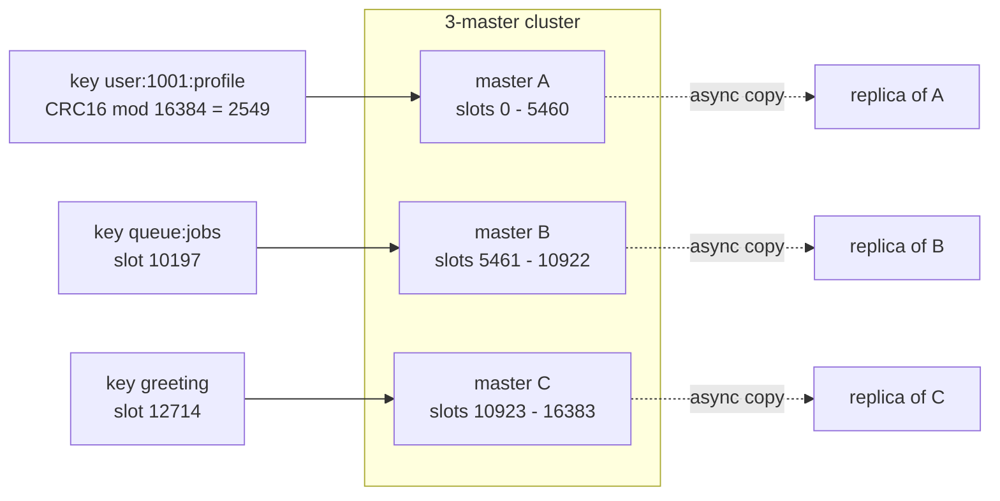
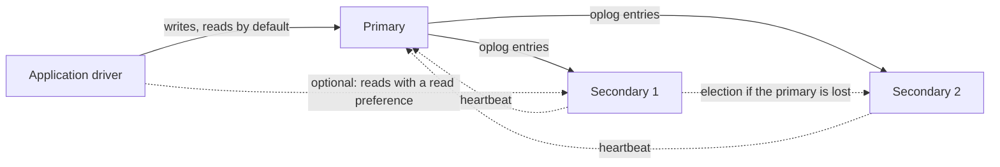
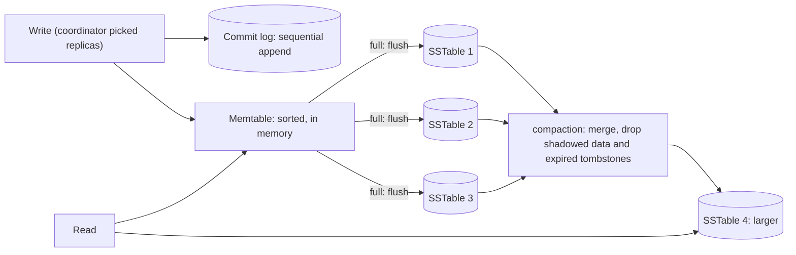
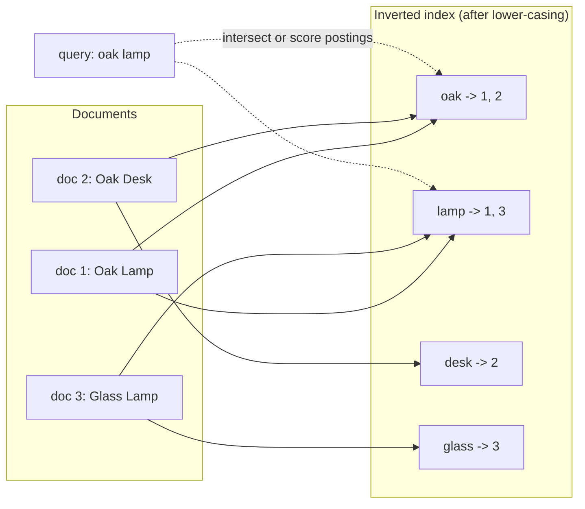
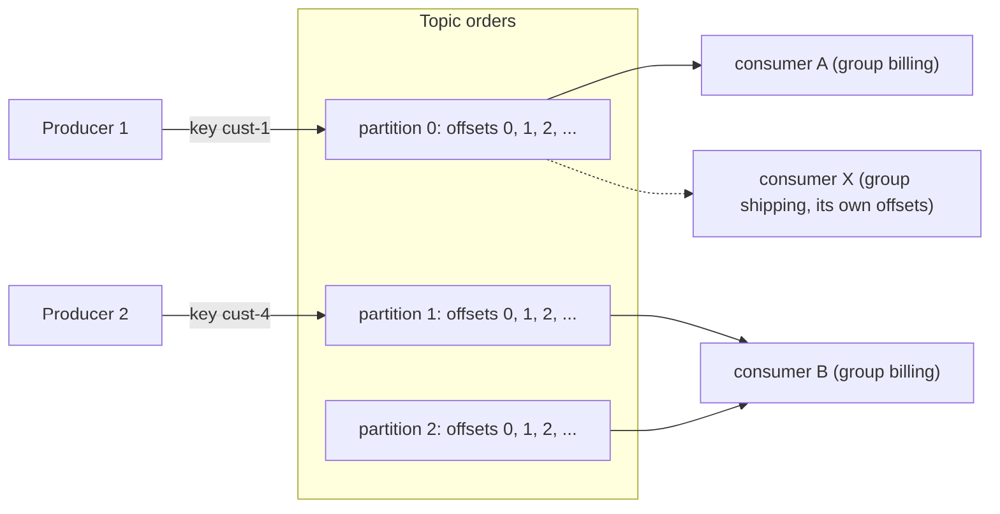

<div dir="rtl" markdown="1">

# ۱۶. خانواده‌های NoSQL و درون آن‌ها

> **سطح:** L2 کاربر حرفه‌ای → L3 پیشرفته | **بخش:** I | **کد Rowlit در نسخهٔ** `08528ae` **بررسی شده است**
>
> **در یک جمله:** سامانه‌های NoSQL بخشی از قرارداد رابطه‌ای (طرح ثابت، join یا تراکنش سخت‌گیرانه) را کنار می‌گذارند تا مقیاس، سرعت یا مدل دادهٔ متناسب با یک الگوی دسترسی را به دست آورند، و هر یک از پنج خانواده حول ساختار درونی متفاوتی ساخته شده است.
>
> **یاد می‌گیرید:**
>
> - پنج خانواده (کلید-مقدار، سندمحور، wide-column، جست‌وجو، لاگ) و کاربرد هر کدام
> - Redis: نوع‌های داده، ماندگاری (RDB و AOF)، Sentinel، hash slotهای Cluster و پروتکل RESP
> - MongoDB: BSON، WiredTiger، replica set و oplog، نمایه‌ها، خط لولهٔ تجمیع، change stream
> - Cassandra: کلید پارتیشن و کلید خوشه‌بندی، حلقهٔ توکن، سطح‌های سازگاری، درخت LSM، compaction و tombstone
> - Elasticsearch: نمایهٔ معکوس، analyzer، mapping، shard، قطعه‌های Lucene و refresh
> - Kafka: topic، partition، offset، گروه مصرف‌کننده، retention، compaction، KRaft و Schema Registry
> - NewSQL چه چیزی اضافه می‌کند و چگونه انتخاب کنیم
>
> **پیش‌نیاز:** [فصل ۷ نمایه‌ها](07-indexes.md)، [فصل ۱۱ لاگ‌گذاری و بازیابی](11-logging-and-recovery.md)، [فصل ۱۲ همانندسازی و CAP](12-backup-replication-ha.md)، [فصل ۱۵ موتورهای ستونی](15-oltp-vs-olap-columnar.md)
>
> **نسخهٔ انگلیسی:** [English](../../en/part1/16-nosql-families.md) | **قبلی:** [۱۵ OLTP و OLAP](15-oltp-vs-olap-columnar.md) | **بعدی:** [۱۷ مقایسهٔ گویش‌ها](17-dialect-comparison.md)
>
> برچسب‌های نمودارها به انگلیسی نگه داشته شده‌اند تا در GitHub درست نمایش داده شوند.

> **دربارهٔ مثال‌ها.** دستورها و پرس‌وجوها از دادهٔ اولیهٔ آزمایشگاه Docker استفاده می‌کنند (`seed-redis.sh`، `seed-mongo.js`، `seed-cassandra.cql`، `seed-elasticsearch.sh` و `seed-kafka.sh` در `engine/tests/docker/`). هنگام نوشتن این فصل موتور Docker روشن نبود، پس هر خروجی با عبارت *خروجی نمونه (illustrative output)* مشخص شده است: بر پایهٔ رفتار مستند نوشته شده و از اجرای واقعی برداشته نشده است. hash slotهای Redis در این فصل با الگوریتم منتشرشدهٔ CRC16 محاسبه شده‌اند.

## ۱. ایده (مبتدی)

«[NoSQL](../glossary.md#nosql)» برچسبی برای جمعیتی از سامانه‌ها است که به معنای دقیق پایگاه رابطه‌ای نیستند. بیشترشان پدید آمدند چون پایگاه رابطه‌ای روی یک سرور نمی‌توانست نیازی را برآورده کند: نوشتن بیش از آنچه یک دیسک تاب می‌آورد، داده‌ای که در جدول نمی‌گنجد، کادر جست‌وجویی که باید اشتباه تایپی را ببخشد، یا جریان رویدادی که برنامه‌های زیادی باید بازپخشش کنند. هر سامانه چیزی را کنار گذاشت تا چیزی به دست آورد. خلاصهٔ صادقانه: **NoSQL مجموعه‌ای از ابزارهای تخصصی است و انتخاب از الگوی دسترسی می‌آید، نه از مُد.**

| خانواده | مدل داده | پرسشی که جواب می‌دهد | نمونه‌ها | در Rowlit |
|---|---|---|---|---|
| [کلید-مقدار](../glossary.md#key-value-store) | کلید ← مقدار (اغلب ساختاریافته) | «مقدار این کلید را سریع بده» | Redis، Valkey، DynamoDB | نوع منبع `KeyValue` |
| [سندمحور](../glossary.md#document-store) | کلید ← سند تو‌در‌تو (شبیه JSON) | «این سفارش را با آیتم‌هایش بده» | MongoDB، Couchbase | نوع منبع `Document` |
| [Wide-column](../glossary.md#wide-column-store) | کلید پارتیشن ← سطرهای مرتب | «آخرین رویدادهای این مشتری» در مقیاس عظیم | Cassandra، ScyllaDB، HBase | provider با گویش CQL |
| [موتور جست‌وجو](../glossary.md#search-engine) | سند + نمایهٔ معکوس | «سندهای دربارهٔ … را با رتبه‌بندی ارتباط پیدا کن» | Elasticsearch، OpenSearch، Solr | نوع منبع `Search` |
| [لاگ رویداد](../glossary.md#event-log) | لاگ مرتب فقط‌افزودنی از رویدادها | «هر چه رخ داد را به ترتیب بگو و بگذار بازپخش کنم» | Kafka، Pulsar، Redpanda | نوع منبع `Stream` |

ستون «در Rowlit» از کد می‌آید: enum به نام `SourceKind { Relational, KeyValue, Document, Stream, Search }` (`engine/src/DbStudio.Core/Models/CoreModels.cs:21`)، ویژگی `Kind` هر provider منبع (`RedisProvider.cs:18`، `MongoProvider.cs:29`، `KafkaProvider.cs:26`، `EsProvider.cs:22`) و اینکه Cassandra یک provider به سبک رابطه‌ای با `Dialect.Cql` است (`CassandraProvider.cs`). [فصل ۱۷](../part2/17-sources-redis-mongo.md) و [فصل ۱۸](../part2/18-sources-kafka-elasticsearch.md) بخش II شرح می‌دهند Rowlit چگونه با آن‌ها حرف می‌زند.

سه مبادله در کل فصل جریان دارد:

- **سازگاری در برابر دسترس‌پذیری و تأخیر.** بسیاری از سامانه‌ها ناهمگام همانندسازی می‌کنند یا اجازه می‌دهند انتخاب کنید چند replica باید موافق باشند ([فصل ۱۲](12-backup-replication-ha.md)، CAP و PACELC).
- **طرح انعطاف‌پذیر در برابر تضمین‌ها.** ذخیره‌ساز سندمحور هر شکلی را می‌پذیرد، پس «شکل» به‌جای پایگاه داده در کد برنامهٔ شما زندگی می‌کند.
- **قدرت پرس‌وجو در برابر مقیاس.** دسترسی بر پایهٔ کلید تقریباً بی‌حد مقیاس می‌گیرد؛ join و تجمیع دلخواه نه.

## ۲. چگونه کار می‌کند (کاربر حرفه‌ای)

### ۲٫۱ کلید-مقدار: Redis

Redis کل مجموعه‌داده را در حافظه نگه می‌دارد و دستورها را روی یک نخ اجرا می‌کند، پس هر دستور اتمی است و معمولاً در حد میکروثانیه طول می‌کشد. کلید به **مقداری با نوع** نگاشت می‌شود، نه فقط یک blob:

| نوع | چیست | کاربرد معمول | مثال از دادهٔ اولیه |
|---|---|---|---|
| string | بایت‌ها (متن، عدد، JSON) تا ۵۱۲ مگابایت | حافظهٔ نهان، شمارنده (`INCR`)، پرچم | `greeting` = `hello world` |
| hash | نگاشت فیلد ← مقدار | شیء با ویژگی‌ها | `user:1001:profile` |
| list | لیست پیوندی رشته‌ها | صف، موارد اخیر | `queue:jobs` |
| set | رشته‌های یکتای بی‌ترتیب | برچسب، عضویت | `tags` |
| sorted set | اعضای یکتا مرتب بر اساس امتیاز | جدول امتیازات، نمایهٔ زمانی | `leaderboard` |
| stream | لاگ فقط‌افزودنی با گروه مصرف‌کننده | لاگ رویداد، صف کار | `events` (گروه `analytics`) |
| JSON، جست‌وجو، سری زمانی | ماژول‌های Redis Stack | سند، نمایه | `doc:product:1` |
| bitmap، HyperLogLog، geo | کدگذاری ویژه روی string و sorted set | شمارش، برآورد مقدارهای متمایز، جست‌وجوی نزدیک | — |

دستورها روی دادهٔ اولیهٔ آزمایشگاه (`seed-redis.sh`):

</div>

```text
127.0.0.1:6379> GET greeting
"hello world"
127.0.0.1:6379> HGETALL user:1001:profile
1) "name"
2) "Alice"
3) "email"
4) "alice@example.com"
5) "tier"
6) "gold"
127.0.0.1:6379> ZREVRANGE leaderboard 0 1 WITHSCORES
1) "carol"
2) "4100"
3) "alice"
4) "3200"
127.0.0.1:6379> TTL session:abc123
(integer) 3587
127.0.0.1:6379> JSON.GET doc:product:1 $.name
"[\"Widget\"]"
```

<div dir="rtl" markdown="1">

این خروجی نمونه است: TTL از ۳۶۰۰ ثانیه می‌شمارد، پس در اجرای شما فرق می‌کند.

**انقضا و تخلیه.** `EXPIRE` یا `SET … EX` به کلید زمان زندگی می‌دهد ([TTL](../glossary.md#ttl)). وقتی حافظه به `maxmemory` برسد، **سیاست تخلیه (eviction)** تعیین می‌کند چه شود: `noeviction` (پیش‌فرض: نوشتن‌ها شکست می‌خورند)، `allkeys-lru`، `allkeys-lfu`، `volatile-lru`، `volatile-ttl` و غیره. حافظهٔ نهان سیاست `allkeys-*` می‌خواهد؛ ذخیره‌ساز اصلی `noeviction`.

**ماندگاری.** با توقف فرایند حافظه از بین می‌رود، پس Redis می‌تواند به دو روش روی دیسک بنویسد:

- **[RDB](../glossary.md#rdb-aof)** عکس لحظه‌ای است. Redis fork می‌کند و فرزند فایلی فشرده می‌نویسد در حالی که والد سرویس می‌دهد. بازیابی سریع و کم‌حجم، اما هرچه پس از آخرین عکس بوده را از دست می‌دهید.
- **AOF** (فایل فقط‌افزودنی) هر دستور نوشتن را ثبت می‌کند. `appendfsync` ماندگاری را تعیین می‌کند: `always` (fsync برای هر نوشتن، کند)، `everysec` (پیش‌فرض: حداکثر حدود یک ثانیه از دست می‌رود)، `no` (سیستم‌عامل تصمیم می‌گیرد). لاگ گاهی بازنویسی می‌شود تا کوچک بماند. همان ایدهٔ write-ahead log در [فصل ۱۱](11-logging-and-recovery.md) است.
- هر دو با هم (عکس به‌علاوهٔ لاگ) شروع دوبارهٔ سریع و اتلاف کم می‌دهد. بسیاری از حافظه‌های نهان هر دو را خاموش می‌کنند.

**همانندسازی، Sentinel و Cluster.** همانندسازی ناهمگام است: primary دستورهایش را به replicaها جریان می‌دهد، پس failover می‌تواند چند نوشتن آخر را از دست بدهد. **[Sentinel](../glossary.md#sentinel)** مجموعه‌ای از فرایندهای ناظر جداست که primary را پایش می‌کنند، با حدنصاب (quorum) توافق می‌کنند که از کار افتاده، یک replica را ارتقا می‌دهند و نشانی جدید را به کلاینت‌ها می‌گویند. دسترس‌پذیری بالا برای یک شارد داده فراهم می‌کند. **[Redis Cluster](../glossary.md#redis-cluster)** مقیاس افقی می‌دهد: فضای کلید به **۱۶٬۳۸۴ [hash slot](../glossary.md#hash-slot)** تقسیم می‌شود؛ slot هر کلید `CRC16(key) mod 16384` است و هر master بازه‌ای از slotها را دارد.

**شکل ۱۶٫۱ — Redis Cluster: هش کلید slot را تعیین می‌کند و slot گره را.**

</div>



<div dir="rtl" markdown="1">

کلاینتی که از گره اشتباه بپرسد تغییر مسیر می‌گیرد (`MOVED 9393 10.0.0.2:6379`) و نگاشت را به خاطر می‌سپارد. دستوری که چند کلید را لمس کند فقط وقتی کار می‌کند که همهٔ کلیدها در یک slot باشند، وگرنه سرور `CROSSSLOT` جواب می‌دهد. برای کنار هم نگه داشتن کلیدهای مرتبط **hash tag** درون آکولاد بگذارید: فقط متن درون اولین `{…}` هش می‌شود، پس `{user:1001}:profile` و `{user:1001}:cart` هر دو به slot 5712 می‌روند (با CRC16 محاسبه شده). Cluster سازگاری قوی نمی‌دهد: همانندسازی ناهمگام است و primary جداافتاده می‌تواند نوشتن‌هایی بپذیرد که با ارتقای replica گم می‌شوند. آزمایشگاه یک پروفایل خوشهٔ سه‌masterی دارد (`compose.yml`، پروفایل `cluster`).

**دو احتیاط برای محیط تولید.** `KEYS *` کل فضای کلید را روی نخ تک دستور می‌پیماید و همه را مسدود می‌کند؛ از `SCAN` استفاده کنید (مکان‌نمایی که در هر فراخوانی چند کلید برمی‌گرداند). و یک کلید بسیار بزرگ (لیستی با میلیون‌ها عضو) «کلید بزرگ» است: حذفش مسدود می‌کند، پس از `UNLINK` استفاده کنید که حافظه را در نخ پس‌زمینه آزاد می‌کند.

**پروتکل RESP.** کلاینت‌ها و سرورها [RESP](../glossary.md#resp) (REdis Serialization Protocol) صحبت می‌کنند، پروتکلی ساده با قاب‌بندی متنی و امن برای بایت. درخواست آرایه‌ای از رشته‌های bulk است؛ هر نوع پیشوند یک‌نویسه‌ای دارد و خط‌ها با `\r\n` تمام می‌شوند:

| پیشوند | نوع | مثال |
|---|---|---|
| `+` | رشتهٔ ساده | `+OK` |
| `-` | خطا | `-ERR unknown command` |
| `:` | عدد صحیح | `:1000` |
| `$` | رشتهٔ bulk (با طول) | `$11` و بعد `hello world` |
| `*` | آرایه | `*2` و بعد دو عضو |

`GET greeting` روی سیم (هر `\r\n` به‌صورت شکست خط نشان داده شده):

</div>

```text
*2
$3
GET
$8
greeting
```

<div dir="rtl" markdown="1">

و پاسخ `$11\r\nhello world\r\n` است. RESP2 همان است که بیشتر ابزارها صحبت می‌کنند؛ RESP3 نقشه، مجموعه و پیام push اضافه می‌کند. چون قاب‌بندی ساده است، بعضی عملیات که نباید روی اتصال چندگانه‌شده (multiplexed) مشترک بروند روی اتصال خام RESP انجام می‌شود: `MONITOR` (هر دستوری که سرور اجرا می‌کند را جریان می‌دهد)، تراکنش‌های `MULTI`/`EXEC`، `WATCH` و دستورهای مسدودکننده مانند `BLPOP`. Rowlit دقیقاً برای همین موارد یک خواننده RESP2 دارد (`engine/src/DbStudio.Sources.Redis/RawRedisConnection.cs:10-12` و `:23-27`).

**تراکنش و پیام‌رسانی.** `MULTI … EXEC` دستورها را صف می‌کند و بدون درهم‌آمیختگی اجرا می‌کند، اما بازگردانی (rollback) وجود ندارد: دستوری که درون آن شکست بخورد بقیه را خنثی نمی‌کند. `WATCH key` باعث می‌شود اگر کلید تغییر کرده باشد `EXEC` شکست بخورد، که همزمانی خوش‌بینانه می‌دهد. **[Pub/sub](../glossary.md#pub-sub)** (`PUBLISH`، `SUBSCRIBE`) بفرست-و-فراموش‌کن است: مشترکِ آفلاین پیام را از دست می‌دهد. **Stream**ها ورودی‌ها را نگه می‌دارند و گروه‌های مصرف‌کننده (`XGROUP`، `XREADGROUP`) پیگیری می‌کنند هر مصرف‌کننده کدام ورودی‌ها را خوانده، همان مدل Kafka در بخش ۲٫۵.

> **غواصی عمیق (L3): failover خوشه و جابه‌جایی slot.** گره‌ها روی درگاه دوم (درگاه کلاینت به‌علاوهٔ ۱۰۰۰۰) gossip می‌کنند و وقتی اکثریت masterها توافق کنند همتایی در دسترس نیست آن را در حال شکست علامت می‌زنند. replicaهای master ازکارافتاده انتخاباتی برگزار می‌کنند و برنده slotهایش را می‌گیرد. جابه‌جایی slot عملیاتی زنده است: مبدأ slot را `MIGRATING` و مقصد را `IMPORTING` علامت می‌زند، کلیدها یکی‌یکی با `MIGRATE` می‌روند و کلاینتی که کلید جابه‌جاشده را بخواهد به‌جای `MOVED` (به‌روزرسانی دائمی جدول slot) یک `ASK` (تغییر مسیر یک‌باره) می‌گیرد. چون نوشتن‌ها پیش از رسیدن به replicaها تأیید می‌شوند، `WAIT n timeout` ابزار درخواست تأیید replica است وقتی لازم دارید.

### ۲٫۲ سندمحور: MongoDB

MongoDB **سند**ها را در **collection**ها نگه می‌دارد. سند مجموعه‌ای از فیلدهای نام‌دار با مقدار نوع‌دار است، با تو‌در‌توی دلخواه، که به‌صورت **[BSON](../glossary.md#bson)** (Binary JSON) سریال می‌شود. BSON نوع‌هایی را که JSON ندارد اضافه می‌کند: عدد ۶۴ بیتی و ۱۲۸ بیتی اعشاری (`Decimal128`)، تاریخ، داده دودویی و `ObjectId`. حد اندازه ۱۶ مبی‌بایت برای هر سند است.

هر سند یک **[`_id`](../glossary.md#_id)** یکتا دارد؛ اگر ندهید درایور `ObjectId` می‌سازد: ۱۲ بایت شامل ۴ بایت زمان، ۵ بایت تصادفی و ۳ بایت شمارنده، پس شناسه‌ها تقریباً به ترتیب زمان ساخت مرتب می‌شوند.

برای نمایش نوع‌های BSON به‌صورت متن، MongoDB **[Extended JSON](../glossary.md#extended-json)** را تعریف کرده. حالت *relaxed* عددها و تاریخ‌ها را مثل JSON می‌نویسد. حالت *canonical* هر نوع را دقیق نگه می‌دارد، مثلاً `{"$numberLong": "5550000001"}` برای عدد صحیح ۶۴ بیتی و `{"$oid": "c0ffee000000000000000001"}` برای `ObjectId`. Rowlit سندها را به‌صورت Extended JSON حالت canonical به رابط کاربری می‌فرستد (`engine/src/DbStudio.Sources.Mongo/Ejson.cs:8-9` و `:22`).

**مدل‌سازی: تو‌در‌توی کردن یا ارجاع.** دادهٔ اولیه (`seed-mongo.js`) هر دو را نشان می‌دهد. سفارش آیتم‌هایش را **تو‌در‌تو (embed)** می‌کند (همیشه با سفارش خوانده می‌شوند و هرگز تنها نه) و مشتری را با شناسه **ارجاع** می‌دهد (مشتری مشترک است و مستقل تغییر می‌کند):

</div>

```js
{
  _id: ObjectId("0de2…"),
  customerId: ObjectId("c0ffee…"),     // reference
  status: "paid",
  createdAt: ISODate("2025-03-04T…"),
  items: [                              // embedded: read together, written together
    { sku: "SKU-0007", productId: ObjectId("ab0de0…"), qty: 2, price: 129.9 }
  ],
  total: 259.8
}
```

<div dir="rtl" markdown="1">

تو‌در‌توی کردن «join» را به یک خواندن تبدیل می‌کند و اتمی بودن تک‌سند را رایگان می‌دهد؛ ارجاع از تکرار و رشد بی‌کران سند جلوگیری می‌کند. قاعدهٔ سرانگشتی: آنچه رابطهٔ «جزئی از» دقیق و اندازهٔ محدود دارد embed کنید؛ آنچه مشترک است یا بی‌حد رشد می‌کند ارجاع دهید.

**ذخیره‌سازی: WiredTiger.** موتور ذخیره‌سازی پیش‌فرض WiredTiger است. هر collection و نمایه را به‌صورت B-tree نگه می‌دارد، بلوک‌های collection را به‌طور پیش‌فرض با snappy فشرده می‌کند (zstd یا zlib اختیاری) و نمایه‌ها را با فشرده‌سازی پیشوندی، از **کنترل همزمانی در سطح سند** با عکس‌های MVCC استفاده می‌کند (خواننده نویسنده را مسدود نمی‌کند)، حافظهٔ نهان درونی دارد (به‌طور پیش‌فرض بزرگ‌ترین مقدار بین ۲۵۶ مگابایت و نصف RAM منهای ۱ گیگابایت)، تقریباً هر ۶۰ ثانیه یک **checkpoint** می‌نویسد و در فاصله‌ها یک **journal** از نوع write-ahead، پس بازیابی پس از خرابی تا آخرین checkpoint به‌علاوهٔ journal است. این همان طرح بازیابی [فصل ۱۱](11-logging-and-recovery.md) در پایگاه سندمحور است.

**Replica set.** MongoDB تولیدی به‌صورت **[replica set](../glossary.md#replica-set)** اجرا می‌شود: یک primary نوشتن را می‌پذیرد؛ secondaryها با دنبال کردن **[oplog](../glossary.md#oplog)** آن را کپی می‌کنند، یک collection محدودشده (`local.oplog.rs`) که هر تغییر را به‌صورت عملیاتی خودتوان (idempotent) ثبت می‌کند. اگر primary ناپدید شود، اعضا انتخابات برگزار می‌کنند (پروتکل شبیه Raft؛ به‌طور پیش‌فرض ضربان هر ۲ ثانیه و مهلت انتخابات ۱۰ ثانیه) و یک secondary primary می‌شود.

**شکل ۱۶٫۲ — یک replica set در MongoDB.**

</div>



<div dir="rtl" markdown="1">

ماندگاری برای هر عملیات با **write concern** انتخاب می‌شود: `w: 1` پس از اعمال روی primary تأیید می‌کند، `w: "majority"` صبر می‌کند تا اکثر اعضا داشته باشند (پس از انتخابات زنده می‌ماند) و `j: true` برای journal هم صبر می‌کند. **read concern** تعیین می‌کند چه چیزی را ببینید (`local`، `majority`، `snapshot`). در نسخه‌های اخیر write concern ضمنی برای بیشتر استقرارها `majority` است، اما نسخهٔ خودتان را بررسی کنید. **شاردینگ** یک collection را با **کلید شارد** بین چند replica set پخش می‌کند، با مسیریاب‌های `mongos` و سرورهای پیکربندی که نقشهٔ chunk را دارند ([فصل ۱۲](12-backup-replication-ha.md)).

**نمایه‌ها.** نمایه‌های MongoDB B-tree هستند. دادهٔ اولیه این‌ها را می‌سازد:

</div>

```js
db.orders.createIndex({ status: 1, createdAt: -1 });        // compound
db.orders.createIndex({ customerId: 1 });                   // single field
db.customers.createIndex({ email: 1 }, { unique: true });   // unique
db.products.createIndex({ name: 'text', description: 'text' });   // text
db.sessions.createIndex({ lastSeen: 1 }, { expireAfterSeconds: 3600 }); // TTL
```

<div dir="rtl" markdown="1">

انواع دیگر: **multikey** (نمایه روی فیلد آرایه برای هر عضو یک مدخل می‌گیرد، خودکار)، **wildcard**، **partial**، **hashed** و جغرافیایی. برای نمایه‌های مرکب **قاعدهٔ ESR** را دنبال کنید: فیلدهای برابری (**E**quality) اول، بعد فیلد مرتب‌سازی (**S**ort)، بعد فیلدهای بازه (**R**ange). پرس‌وجوی `find({ status: "paid" }).sort({ createdAt: -1 })` با `{ status: 1, createdAt: -1 }` بدون مرتب‌سازی در حافظه سرویس می‌شود، چون status برابری است و createdAt در ترتیب نمایه بعد از آن می‌آید. `explain("executionStats")` آن را نشان می‌دهد: مرحلهٔ `IXSCAN` و بدون مرحلهٔ `SORT`.

**خط لولهٔ تجمیع.** **[خط لولهٔ تجمیع (aggregation pipeline)](../glossary.md#aggregation-pipeline)** آرایه‌ای از مرحله‌هاست؛ هر مرحله جریان سندهای مرحلهٔ قبل را دگرگون می‌کند:

</div>

```js
db.orders.aggregate([
  { $match:  { status: { $in: ["paid", "shipped"] } } },        // filter (can use an index)
  { $group:  { _id: "$status", orders: { $sum: 1 }, revenue: { $sum: "$total" } } },
  { $sort:   { revenue: -1 } }
])
```

<div dir="rtl" markdown="1">

شکل نمونهٔ نتیجه (تعدادها به دادهٔ تصادفی بذرگذاری‌شده بستگی دارند):

</div>

```js
{ _id: "paid",    orders: <n>, revenue: <x> }
{ _id: "shipped", orders: <m>, revenue: <y> }
```

<div dir="rtl" markdown="1">

مرحله‌های رایج: `$match`، `$project`، `$group`، `$sort`، `$limit`، `$unwind` (یک سند به‌ازای هر عضو آرایه)، `$lookup` (join خارجی چپ به collection دیگر)، `$facet`. `$match` و `$sort` را اول بگذارید تا بتوانند از نمایه استفاده کنند.

**Change stream، اعتبارسنجی و تراکنش.** **[change stream](../glossary.md#change-stream)** اجازه می‌دهد برنامه مشترک درج‌ها، به‌روزرسانی‌ها و حذف‌های یک collection شود؛ روی oplog ساخته شده و برای همین replica set می‌خواهد. آزمایشگاه به همین دلیل یک replica set تک‌گره‌ای به نام `rs0` دارد (`compose.yml`، توضیح بالای سرویس `mongo`). **اعتبارسنجی طرح** یک `$jsonSchema` به collection می‌چسباند؛ دادهٔ اولیه `customers` را با سطح `moderate` و کنش `warn` اعتبارسنجی می‌کند، پس تخلف‌ها ثبت می‌شوند نه رد. **تراکنش چندسندی** وجود دارد (replica set از 4.0، خوشهٔ شاردشده از 4.2) اما کارایی را کم می‌کند؛ طراحی خوب سند نیاز به آن را برمی‌دارد.

> **غواصی عمیق (L3): چرا ورودی‌های oplog خودتوان‌اند.** `$inc` به‌صورت `$set` حاصل ثبت می‌شود، پس اعمال همان ورودی دو بار همان وضعیت را می‌دهد. این همگام‌سازی اولیه، تلاش دوباره پس از خطای شبکه و رسیدن replication به عقب‌ماندگی را امن می‌کند. اگر primary پس از تأیید نوشتن `w: 1` که هیچ secondaryای دریافت نکرده بود از کار بیفتد، primary قدیمی هنگام بازگشت آن عملیات را *بازمی‌گرداند (rollback)* (آن‌ها را در فایلی کنار می‌گذارد) تا با primary جدید یکی شود. با `w: "majority"` نوشتن تأییدشده را نمی‌توان بازگرداند.

### ۲٫۳ Wide-column: Cassandra

Cassandra (و ScyllaDB که سازگار است) ساخته شده تا حجم عظیمی داده را روی ماشین‌های زیاد، بدون نقطهٔ شکست یگانه و با تأخیر قابل پیش‌بینی برای پرس‌وجوهای شناخته‌شده نگه دارد. مدل دادهٔ آن شبیه جدول SQL است (با **CQL** یا Cassandra Query Language پرس‌وجو می‌شود) اما متفاوت کار می‌کند.

**کلید اصلی دو چیز است.** در `PRIMARY KEY ((customer_id), order_date, order_id)`:

- **[کلید پارتیشن (partition key)](../glossary.md#partition-key)** (`customer_id`، پرانتز درونی) تعیین می‌کند سطر در **کدام گره‌ها** ذخیره شود. همهٔ سطرهای با کلید پارتیشن یکسان روی همان replicaها کنار هم‌اند.
- **[کلید خوشه‌بندی (clustering key)](../glossary.md#clustering-key)** (`order_date`، `order_id`) **ترتیب سطرها درون پارتیشن** را روی دیسک تعیین می‌کند.

دادهٔ اولیه این جدول را برای پرس‌وجوی «سفارش‌های یک مشتری، تازه‌ترین اول» دارد:

</div>

```sql
CREATE TABLE shop.orders_by_customer (
  customer_id int,
  order_date  timestamp,
  order_id    int,
  status      text,
  total       decimal,
  PRIMARY KEY ((customer_id), order_date, order_id)
) WITH CLUSTERING ORDER BY (order_date DESC, order_id ASC);

SELECT order_id, total FROM shop.orders_by_customer WHERE customer_id = 1;
```

<div dir="rtl" markdown="1">

خروجی نمونه (illustrative output). مشتری ۱ سفارش‌های ۱ و ۲ را دارد؛ ترتیب خوشه‌بندی تازه‌ترین را اول می‌گذارد:

</div>

```text
 order_id | total
----------+--------
        2 |  19.50
        1 | 120.50
```

<div dir="rtl" markdown="1">

جدول دومِ دادهٔ اولیه **کلید پارتیشن مرکب** را نشان می‌دهد: `events_by_day` با `PRIMARY KEY ((customer_id, day), event_time)` هر «مشتری-روز» را یک پارتیشن می‌کند و اندازهٔ پارتیشن را محدود نگه می‌دارد. همچنین `default_time_to_live = 7776000` (۹۰ روز) دارد که پس از آن سطرها منقضی می‌شوند.

**برای پرس‌وجوها مدل کنید، نه برای داده.** CQL join ندارد و پرس‌وجو باید کلید پارتیشن را نام ببرد (پویش کل جدول عملی عادی نیست). پس در Cassandra **برای هر پرس‌وجو یک جدول** می‌نویسید، غیرنرمال، و همان واقعیت را در چند جدول می‌نویسید. سرآغاز دادهٔ اولیه همین را می‌گوید: *«یک جدول برای هر پرس‌وجو، غیرنرمال»* با `orders`، `orders_by_customer` و نمای مادی‌شدهٔ `orders_by_status`. فیلتر روی ستون غیرکلید رد می‌شود مگر `ALLOW FILTERING` اضافه کنید که خوشه را وادار به پویش می‌کند؛ این کلیدواژه را علامت خطر بدانید:

</div>

```sql
SELECT * FROM shop.orders WHERE total > 100;
-- InvalidRequest: Cannot execute this query as it might involve data filtering and
-- thus may have unpredictable performance. ... use ALLOW FILTERING
```

<div dir="rtl" markdown="1">

**[حلقهٔ توکن (token ring)](../glossary.md#token-ring).** Cassandra کلید پارتیشن را با یک partitioner (Murmur3) به **توکن** در بازهٔ −۲⁶³ تا ۲⁶³−۱ هش می‌کند. هر گره چند برش از این حلقه را دارد (**گره‌های مجازی**؛ در پیش‌فرض‌های اخیر ۱۶ به‌ازای هر گره، در نسخه‌های قدیمی ۲۵۶)، پس افزودن گره برش‌های کوچک از همهٔ گره‌های دیگر می‌گیرد. رهبری وجود ندارد: هر گره می‌تواند **coordinator** یک درخواست باشد و آن را به replicaهای مالک توکن می‌فرستد. **[ضریب همانندسازی (replication factor)](../glossary.md#replication-factor)** یا RF می‌گوید هر پارتیشن در چند گره ذخیره شود. دادهٔ اولیه keyspace را با `SimpleStrategy` و RF 1 برای گره تک آزمایشگاه می‌سازد؛ محیط تولید `NetworkTopologyStrategy` با RF برای هر مرکز داده می‌گیرد، معمولاً ۳.

**[سطح‌های سازگاری (consistency level)](../glossary.md#consistency-level).** برای هر خواندن و نوشتن، کلاینت انتخاب می‌کند چند replica باید پیش از موفقیت جواب بدهند:

| سطح | replicaهایی که باید پاسخ دهند |
|---|---|
| `ONE`، `TWO`، `THREE` | همان تعداد |
| `QUORUM` | اکثریت همهٔ replicaها: `floor(RF/2) + 1` |
| `LOCAL_QUORUM` | اکثریت در مرکز دادهٔ coordinator |
| `EACH_QUORUM` | اکثریت در هر مرکز داده (نوشتن) |
| `ALL` | همهٔ replicaها |
| `ANY` | فقط نوشتن: حتی یک hint ذخیره‌شده هم حساب می‌شود |
| `SERIAL`، `LOCAL_SERIAL` | برای تراکنش‌های سبک (پایین‌تر) |

قاعدهٔ سازگاری قوی **R + W > RF** است: اگر replicaهایی که از آن‌ها می‌خوانید و آن‌هایی که روی‌شان نوشتید باید هم‌پوشانی داشته باشند، خواندن آخرین نوشتن را می‌بیند. با RF 3، خواندن و نوشتن `QUORUM` (۲ + ۲ > ۳) قوی است، `ONE` و `ONE` (۱ + ۱ < ۳) فقط سرانجام‌سازگار. فرم اتصال Rowlit مقدار پیش‌فرض را `LOCAL_QUORUM` می‌گذارد (`engine/src/DbStudio.Providers.Cassandra/CqlConnectionSettings.cs:21`). این همان «سازگاری قابل تنظیم» [فصل ۱۲](12-backup-replication-ha.md) است.

**مسیر نوشتن: درخت LSM.** Cassandra هرگز درجا به‌روز نمی‌کند. هر نوشتن به دو جا می‌رود: **[commit log](../glossary.md#commitlog)** (فایل فقط‌افزودنی ترتیبی، برای بازیابی خرابی) و **[memtable](../glossary.md#memtable)** (جدول مرتب درون حافظه برای هر جدول Cassandra). وقتی memtable پر شود **flush** می‌شود و روی دیسک به‌صورت **[SSTable](../glossary.md#sstable)** (sorted string table) تغییرناپذیر درمی‌آید و بخش‌های commit log که پوشش می‌داد دور ریخته می‌شود. این ساختار **[درخت LSM](../glossary.md#lsm-tree)** (log-structured merge tree) است. به‌طور پیش‌فرض commit log به‌صورت دوره‌ای (هر ۱۰ ثانیه) همگام می‌شود، پس قطع برق می‌تواند ثانیه‌های آخر را روی همان یک گره از دست بدهد؛ همانندسازی به گره‌های دیگر است که از این محافظت می‌کند.

**شکل ۱۶٫۳ — مسیر نوشتن در Cassandra و compaction.**

</div>



<div dir="rtl" markdown="1">

SSTable مجموعه‌ای از فایل‌هاست: `Data.db` (سطرها)، `Index.db` و `Summary.db` (پارتیشن‌ها کجا شروع می‌شوند)، `Filter.db` (یک **فیلتر Bloom**: ساختاری کوچک که جواب می‌دهد «این SSTable قطعاً پارتیشن را ندارد» یا «شاید داشته باشد»)، `Statistics.db` و غیره. **خواندن** memtable را می‌بیند و سپس برای هر SSTable که فیلتر Bloom کنار نگذاشته، نمایه را، و همهٔ تکه‌ها را ادغام می‌کند و برای هر سلول نسخه‌ای با تازه‌ترین زمان‌مهر را برمی‌دارد («آخرین نوشتن برنده»). پس با تلنبار شدن SSTableها خواندن کندتر می‌شود و **[compaction](../glossary.md#compaction)** فرایند پس‌زمینه‌ای است که SSTableها را در تعداد کمتر و بزرگ‌تر ادغام می‌کند. راهبردها: `SizeTieredCompactionStrategy` (پیش‌فرض؛ فایل‌های هم‌اندازه را ادغام می‌کند؛ برای بار نوشتنی)، `LeveledCompactionStrategy` (فایل‌های کوچک بی‌هم‌پوشانی در هر سطح؛ برای بار خواندنی به قیمت نوشتن بیشتر)، `TimeWindowCompactionStrategy` (یک پنجره برای هر بازهٔ زمانی؛ برای سری زمانی با TTL) و از 5.0 `UnifiedCompactionStrategy`.

**[Tombstone](../glossary.md#tombstone).** چون SSTableها تغییرناپذیرند، حذف نمی‌تواند داده را بردارد؛ نشانه‌ای می‌نویسد، یک tombstone، که نسخه‌های قدیمی‌تر را پنهان می‌کند. tombstoneها به مدت `gc_grace_seconds` (به‌طور پیش‌فرض ۸۶۴٬۰۰۰ ثانیه = ۱۰ روز) نگه داشته می‌شوند تا replicaای که هنگام حذف از کار افتاده بود هنگام repair خبردار شود؛ فقط پس از آن compaction می‌تواند پاکشان کند. مقدارهای TTL منقضی هم tombstone می‌شوند. پرس‌وجویی که tombstone زیاد بپیماید کند است و Cassandra به‌طور پیش‌فرض در ۱٬۰۰۰ هشدار و در ۱۰۰٬۰۰۰ tombstone در هر پرس‌وجو شکست می‌دهد. قاعده‌ها: حذف تک‌سلول با نرخ بالا نکنید، جدول را به‌عنوان صف به کار نبرید، TTL را با `TimeWindowCompactionStrategy` ترجیح دهید و **repair** را منظم اجرا کنید (anti-entropy که درخت‌های Merkle را میان replicaها مقایسه می‌کند).

**قابلیت‌های دیگر، مختصر.** نوشتن‌های مربوط به replicaی که از کار افتاده چند ساعت به‌صورت **hint** نزد coordinator می‌ماند و بعداً بازپخش می‌شود (hinted handoff)؛ خواندنی که ناهمخوانی replicaها را ببیند ترمیمشان می‌کند (read repair). **تراکنش سبک (lightweight transaction)** (`INSERT … IF NOT EXISTS`، `UPDATE … IF col = value`) با یک دور Paxos مقایسه-و-تنظیم می‌دهد، با چند برابر هزینهٔ نوشتن عادی. **batch** (`BEGIN BATCH … APPLY BATCH`) اتمی است (همه یا هیچ، سرانجام) اما *ایزوله* نیست و ابزار کارایی نیست؛ برای هم‌گام نگه داشتن جدول‌های غیرنرمال به کار می‌رود. ستون **counter** (`product_views` در دادهٔ اولیه) افزایش را پشتیبانی می‌کند. **collection**ها (`set`، `list`، `map`) و **نوع‌های تعریف‌شده توسط کاربر** (نوع `address`) درون سطر زندگی می‌کنند. برای پرس‌وجو بیرون از کلید پارتیشن، Cassandra **نمایهٔ ثانویه** (دادهٔ اولیه نمایهٔ storage-attached یعنی `USING 'sai'` از نسخهٔ 5 را به کار می‌برد) و **نمای مادی‌شده** (سمت سرور نگهداری می‌شود، اما در 5.0 به‌طور پیش‌فرض غیرفعال است، چنان‌که سرآغاز دادهٔ اولیه می‌گوید) دارد. Cassandra `EXPLAIN` ندارد؛ **tracing** را روشن می‌کنید و رویدادهای هر replica را می‌خوانید، همان کاری که کنسول Rowlit می‌کند (`CqlSession.cs:37-39`).

> **غواصی عمیق (L3): تقویت خواندن و فیلتر Bloom.** خواندن در بدترین حالت یک memtable به‌علاوهٔ هر SSTable را می‌بیند که ممکن است پارتیشن را داشته باشد. فیلتر Bloom با *m* بیت برای *n* کلید و *k* تابع هش نرخ مثبت کاذب حدود `(1 − e^(−kn/m))^k` دارد؛ با ۱۰ بیت برای هر کلید و ۷ هش کمتر از ۱٪ است. گزینهٔ جدول `bloom_filter_fp_chance` (پیش‌فرض ۰٫۰۱) هدف را تعیین می‌کند و حافظه را با خواندن‌های بی‌فایدهٔ دیسک کمتر معاوضه می‌کند. برای همین بار پر از tombstone یا SSTableهای هم‌پوشان کند است: فیلترهای Bloom بیشتر «شاید» می‌گویند و ادغام تکه‌های بیشتری برای آشتی دارد.

### ۲٫۴ جست‌وجو: Elasticsearch و OpenSearch

`LIKE '%keyboard%'` رابطه‌ای هر سطر را پویش می‌کند. موتور جست‌وجو همان پرسش را در میلی‌ثانیه جواب می‌دهد و نتیجه را رتبه‌بندی می‌کند، چون یک **[نمایهٔ معکوس (inverted index)](../glossary.md#inverted-index)** نگه می‌دارد: نگاشتی از هر *واژه* به فهرست سندهایی که آن را دارند (postings list)، وارونهٔ «سند ← واژه‌ها».

**شکل ۱۶٫۴ — نمایهٔ معکوس روی سه سند.**

</div>



<div dir="rtl" markdown="1">

پرس‌وجوی `oak lamp` هر دو واژه را جست‌وجو می‌کند، postingها را ترکیب می‌کند و به هر سند امتیاز می‌دهد؛ سند ۱ هر دو را دارد و اول می‌آید. تابع امتیازدهی پیش‌فرض **BM25** است که واژهٔ کمیاب و بسامد واژه را پاداش می‌دهد و برای طول سند نرمال می‌کند.

**[تحلیل‌گرها (analyzer)](../glossary.md#analyzer).** متن را تحلیل‌گر به واژه‌ها می‌برد: فیلترهای نویسه، یک **tokenizer** (شکستن در مرز واژه) و **فیلترهای token** (حروف کوچک، حذف واژه‌های توقف، ریشه‌یابی). همین تحلیل‌گر هنگام نمایه‌سازی روی سند و هنگام جست‌وجو روی متن پرس‌وجو اجرا می‌شود، برای همین اگر ریشه‌یاب پیکربندی شده باشد `Keyboards` را `keyboard` پیدا می‌کند. تحلیل‌گر پیش‌فرض `standard` در مرز واژه‌های یونیکد می‌شکند و حروف را کوچک می‌کند؛ برای متن فارسی Elasticsearch تحلیل‌گر `persian` دارد که نویسه‌ها را هم نرمال می‌کند و واژه‌های توقف فارسی را حذف می‌کند، که برای نام‌های فارسی در دادهٔ اولیه اهمیت دارد.

**[نگاشت (mapping)](../glossary.md#mapping).** mapping نوع هر فیلد را اعلام می‌کند و نوع تعیین می‌کند چگونه نمایه شود. دادهٔ اولیه (`seed-elasticsearch.sh`) تمایز کلیدی را نشان می‌دهد:

</div>

```json
"name": { "type": "text", "fields": { "keyword": { "type": "keyword", "ignore_above": 256 } } }
```

<div dir="rtl" markdown="1">

`text` تحلیل می‌شود و واژه‌به‌واژه جست‌وجوپذیر است، اما نمی‌توان معنادار روی آن مرتب‌سازی یا تجمیع کرد؛ `keyword` به‌صورت یک واژهٔ دقیق ذخیره می‌شود و برای فیلتر، مرتب‌سازی و تجمیع است. چندفیلدی `name.keyword` هر دو را می‌دهد. mappingهای دیگر دادهٔ اولیه: `date`، `double`، `nested` (`items` یک سفارش به‌صورت سندهای جدای پنهان نمایه می‌شود، پس پرس‌وجو می‌تواند `sku` *و* `qty` یک آیتم را با هم تطبیق دهد نه اینکه آیتم‌ها را قاطی کند) و `binary`. اگر mapping نتعریف کنید، mapping پویا از اولین مقدار حدس می‌زند، که راحت است و اغلب غلط.

**shard، replica و خوشه.** نمایه به **[shard](../glossary.md#shard-replica-elasticsearch)**ها تقسیم می‌شود که هرکدام یک نمایهٔ مستقل Lucene است؛ سند به شارد `hash(_routing) mod number_of_primary_shards` می‌رود که routing به‌طور پیش‌فرض شناسهٔ سند است. به‌خاطر این فرمول، **تعداد shardهای primary هنگام ساخت نمایه ثابت می‌شود** (عملیات split یا shrink نمایهٔ تازه می‌سازد). هر shard اصلی صفر یا چند shard **replica** روی گره‌های دیگر دارد که خواندن را سرویس می‌دهند و اگر primary گم شود جایش را می‌گیرند. دادهٔ اولیه `shop-orders` را با دو shard اصلی و بدون replica می‌سازد و `shop-customers` را با یکی. سلامت خوشه `green` (همهٔ shardها تخصیص یافته)، `yellow` (primaryها بله، بعضی replicaها نه: گره تک با replica برابر ۱ زرد است) یا `red` (یک primary نیست) گزارش می‌شود. نام مستعار (alias) مانند `shop-sales` به یک یا چند نمایه اشاره می‌کند تا بتوانید نمایه‌ها را بی‌تغییر برنامه عوض کنید.

**قطعه‌های Lucene، refresh و translog.** درون یک shard، Lucene **[قطعه (segment)](../glossary.md#segment)**ها را می‌نویسد: نمایه‌های کوچک تغییرناپذیر. سندهای تازه اول در حافظه بافر می‌شوند و به **translog** (write-ahead log این دنیا؛ به‌طور پیش‌فرض برای هر درخواست fsync می‌شود) اضافه می‌شوند. **[refresh](../glossary.md#refresh)**، به‌طور پیش‌فرض هر ثانیه، بافر را به قطعهٔ جست‌وجوپذیر تازه‌ای تبدیل می‌کند: برای همین Elasticsearch *تقریباً بلادرنگ* است نه آنی. **flush** قطعه‌ها را روی دیسک commit می‌کند و translog را کوتاه می‌کند. چون قطعه‌ها تغییر نمی‌کنند، حذف فقط سند را در یک bitmap علامت می‌زند و به‌روزرسانی حذف به‌علاوهٔ درج است؛ **ادغام (merge)** پس‌زمینه قطعه‌ها را یکی می‌کند و سرانجام سندهای حذف‌شده را برمی‌دارد، همان الگوی compaction در LSM. فیلدها **doc values** هم می‌گیرند، ساختار ستونی روی دیسک برای مرتب‌سازی و تجمیع (با [فصل ۱۵](15-oltp-vs-olap-columnar.md) مقایسه کنید).

**پرس‌وجو.** رابط اصلی **Query DSL** از نوع JSON است؛ لایهٔ SQL هم هست:

</div>

```json
POST shop-customers/_search
{
  "query": { "bool": {
      "must":   [ { "match": { "name": "علی" } } ],
      "filter": [ { "term":  { "tier": "gold" } } ]
  } },
  "aggs": { "by_country": { "terms": { "field": "address.country" } } }
}
```

<div dir="rtl" markdown="1">

بندهای `must` امتیاز می‌گیرند، بندهای `filter` امتیاز نمی‌گیرند و کش می‌شوند؛ `aggs` شمارش گروه‌بندی‌شده می‌سازد. شکل SQL: `POST _sql?format=txt` با `{"query": "SELECT tier, COUNT(*) FROM \"shop-customers\" GROUP BY tier"}`. هر دو در ماژول Elasticsearch در Rowlit پوشش داده شده‌اند (فصل ۱۸ بخش II).

**کنترل همزمانی.** هر نوشتن `_seq_no` و `_primary_term` برمی‌گرداند ([seq_no / primary_term](../glossary.md#seq-no-primary-term)). فرستادن آن‌ها به‌صورت `if_seq_no` و `if_primary_term` باعث می‌شود به‌روزرسانی فقط وقتی موفق شود که کسی سند را در این فاصله عوض نکرده باشد؛ وگرنه سرور `409 Conflict` می‌دهد. این قفل‌گذاری خوش‌بینانه است ([فصل ۱۰](10-concurrency-locking-mvcc.md)). OpenSearch انشعابی از Elasticsearch 7.10 است که AWS و دیگران نگه می‌دارند؛ مفاهیم بالا برای هر دو صادق است.

> **غواصی عمیق (L3): اندازهٔ shard و چرا shard زیاد ضرر دارد.** هر shard حافظه، file handle و یک واحد کار برای هر جست‌وجو خرج دارد و جست‌وجو به یک نسخه از هر shard نمایه‌های درگیر پخش می‌شود. رهنمود رایج هدف‌گیری shardهایی با اندازهٔ چند ده گیگابایت و پرهیز از هزاران shard ریز است. داده‌های زمانی برای هر دوره یک نمایه (یا data stream) می‌گیرند تا داده قدیمی با حذف نمایه برود، که از حذف سند بسیار ارزان‌تر است.

### ۲٫۵ لاگ رویداد: Kafka

Kafka یک **commit log توزیع‌شده** است. تولیدکننده‌ها **رویداد**ها (رکوردی با کلید، مقدار، زمان‌مهر و هدر) را به یک **[topic](../glossary.md#topic)** اضافه می‌کنند؛ مصرف‌کننده‌ها به ترتیب و هر چند بار که بخواهند می‌خوانند، چون Kafka رویداد را با خوانده شدن حذف نمی‌کند. با **[retention](../glossary.md#retention)** حذف می‌کند: بر اساس سن (پیش‌فرض ۷ روز) یا اندازه.

- **[broker](../glossary.md#broker)** یک سرور Kafka است؛ خوشه چند تا دارد.
- topic به **[partition](../glossary.md#partition-kafka)**ها تقسیم می‌شود. partition دنبالهٔ مرتب و فقط‌افزودنی رکوردها است که به‌صورت فایل‌های segment روی دیسک ذخیره می‌شود. **ترتیب فقط درون یک partition تضمین می‌شود.**
- جایگاه رکورد در partitionش **[offset](../glossary.md#offset)** آن است، عددی که فقط بالا می‌رود. مصرف‌کننده به خاطر می‌سپارد «تا offset برابر N خوانده‌ام».
- **کلید** رکورد partition را تعیین می‌کند: `murmur2(key) mod partitions`. همهٔ رکوردهای با کلید یکسان به یک partition می‌روند، پس به ترتیب می‌مانند. رکوردهای بی‌کلید بین partitionها پخش می‌شوند.

topic دادهٔ اولیه یعنی `orders` (`seed-kafka.sh`) سه partition و ۱۲۰ رکورد JSON با کلیدهای `cust-0` تا `cust-6` دارد، پس رکوردهای هر مشتری درون partitionشان مرتب‌اند.

**[گروه‌های مصرف‌کننده (consumer group)](../glossary.md#consumer-group).** مصرف‌کننده‌هایی که `group.id` مشترک دارند partitionها را بین خود تقسیم می‌کنند: هر partition در هر لحظه توسط **دقیقاً یک** مصرف‌کنندهٔ گروه خوانده می‌شود. افزودن مصرف‌کننده تا تعداد partitionها خواندن را مقیاس می‌دهد (مصرف‌کنندهٔ چهارم روی topic سه‌partitionی بیکار می‌ماند). گروه‌های مختلف مستقل‌اند و هرکدام offsetهای خودش را دارد که Kafka در topic درونی `__consumer_offsets` نگه می‌دارد. اگر مصرف‌کننده‌ای بپیوندد یا برود، گروه **rebalance** می‌شود. **[تأخیر مصرف (consumer lag)](../glossary.md#consumer-lag)** یک partition برابر `log end offset − committed offset` است: چند رکورد هنوز باید پردازش شود. دادهٔ اولیه دو گروه روی `orders` می‌سازد: `billing` که روی offset 10 بازنشانده شده (عقب است، پس lag دارد) و `shipping` که در انتها است (lag صفر).

**شکل ۱۶٫۵ — topic با سه partition که گروهی از مصرف‌کننده‌ها می‌خوانند.**

</div>



<div dir="rtl" markdown="1">

**همانندسازی و ماندگاری.** هر partition یک **leader** و replicaهای دنبال‌کننده روی brokerهای دیگر دارد. **[ISR](../glossary.md#isr)** (replicaهای همگام) مجموعهٔ دنبال‌کننده‌هایی است که به‌روزند. تولیدکننده با `acks=all` فقط پس از آنکه هر عضو ISR رکورد را داشته باشد تأیید می‌گیرد؛ با `min.insync.replicas=2` و ضریب همانندسازی ۳، نوشتن با از دست رفتن هر یک broker زنده می‌ماند. `acks=1` پس از leader تنها تأیید می‌کند (خرابی leader می‌تواند رکورد را گم کند)؛ `acks=0` اصلاً صبر نمی‌کند. تولیدکننده‌ها از Kafka 3.0 به بعد به‌طور پیش‌فرض خودتوان‌اند، پس تلاش دوباره تکرار نمی‌سازد. **معناشناسی تحویل** از این می‌آید: حداکثر یک‌بار (offset را پیش از پردازش commit کنید)، دست‌کم یک‌بار (پس از پردازش commit کنید؛ تکرار ممکن، انتخاب معمول) و دقیقاً یک‌بار (تراکنش‌های خواندن-پردازش-نوشتن، درون Kafka).

**Compaction.** علاوه بر حذف بر اساس سن، topic می‌تواند **[compaction لاگ (log compaction)](../glossary.md#log-compaction)** (`cleanup.policy=compact`) داشته باشد: Kafka فقط **آخرین رکورد به‌ازای هر کلید** را نگه می‌دارد و رکوردی با کلید و مقدار null (یک *tombstone*) سرانجام کلید را برمی‌دارد. این topic را به changelog وضعیت فعلی تبدیل می‌کند، مثل جدول. topic دادهٔ اولیه `compacted-users` این‌طور پیکربندی شده.

**فراداده: KRaft.** Kafka قدیمی فراداده خوشه را در ZooKeeper نگه می‌داشت. **[KRaft](../glossary.md#kraft)** (Kafka Raft) آن را با حدنصاب Raft از گره‌های controller درون خود Kafka جایگزین می‌کند؛ پشتیبانی ZooKeeper در Kafka 4.0 برداشته شد. آزمایشگاه `apache/kafka:3.8.0` را در حالت KRaft اجرا می‌کند (`compose.yml`، `engine/tests/docker/README.md`).

**[Schema Registry](../glossary.md#schema-registry).** topic فقط بایت است، پس تولیدکننده و مصرف‌کننده باید دربارهٔ قالب رکورد در طول تکامل آن توافق کنند. Schema Registry (سرویس جدا) طرح‌های نسخه‌دار را که **subject** نام دارند و معمولاً `<topic>-value` نامیده می‌شوند ذخیره می‌کند و قاعدهٔ **سازگاری** (مثلاً `BACKWARD`: طرح جدید می‌تواند داده قدیمی را بخواند) را اعمال می‌کند. هر پیام پیشوند ۵ بایتی دارد: یک بایت صفر و شناسهٔ ۴ بایتی طرح؛ خواننده طرح را با شناسه می‌گیرد و رمزگشایی می‌کند. قالب‌های پشتیبانی‌شده **Avro** (دودویی فشرده با طرح؛ انتخاب معمول)، **Protobuf** و JSON Schema هستند. دادهٔ اولیه `payments-avro-value` (Avro) و `events-proto-value` (Protobuf) را ثبت می‌کند. فصل ۱۸ بخش II نشان می‌دهد Rowlit این‌ها را چگونه رمزگشایی می‌کند.

دستورهای مفید درون کانتینر Kafka (illustrative):

</div>

```bash
kafka-consumer-groups.sh --bootstrap-server localhost:9092 --describe --group billing
# GROUP    TOPIC   PARTITION  CURRENT-OFFSET  LOG-END-OFFSET  LAG
# billing  orders  0          10              <end of p0>     <end of p0 - 10>
# billing  orders  1          10              <end of p1>     <end of p1 - 10>
# billing  orders  2          10              <end of p2>     <end of p2 - 10>
```

<div dir="rtl" markdown="1">

> **غواصی عمیق (L3): high watermark و leader epoch.** مصرف‌کننده‌ها فقط رکوردهای زیر **high watermark** را می‌بینند: offsetی که به هر عضو ISR همانندسازی شده. پس از خرابی leader، leader تازه از ISR انتخاب می‌شود، پس رکورد commitشده‌ای گم نمی‌شود؛ دنبال‌کننده‌ها رکوردهای فراتر از لاگ leader جدید را کوتاه می‌کنند و برای یافتن نقطهٔ درست کوتاه‌سازی از شمارهٔ **leader epoch** استفاده می‌کنند. `unclean.leader.election.enable` (به‌طور پیش‌فرض خاموش) اجازه می‌داد replica ناهمگام رهبر شود و ماندگاری را با دسترس‌پذیری معاوضه می‌کرد.

### ۲٫۶ NewSQL و SQL توزیع‌شده

سامانه‌های **NewSQL** (و **[SQL توزیع‌شده](../glossary.md#newsql)**) می‌کوشند SQL و تراکنش ACID را نگه دارند و مثل NoSQL مقیاس افقی بگیرند. الگو همه‌جا یکی است: داده به بازه‌ها بریده می‌شود، هر بازه با **پروتکل اجماع** (Raft یا Paxos، [فصل ۱۲](12-backup-replication-ha.md)) همانندسازی می‌شود و لایه‌ای تراکنشی بین بازه‌ها هماهنگی می‌کند.

- **Google Spanner** از ساعت‌های اتمی همگام (TrueTime) برای سازگاری بیرونی در قاره‌ها استفاده می‌کند.
- **CockroachDB** پروتکل سیم PostgreSQL را صحبت می‌کند، داده را به بازه‌هایی حدود ۵۱۲ مبی‌بایت تقسیم می‌کند، هر کدام را با Raft همانندسازی می‌کند و به‌طور پیش‌فرض ایزولاسیون serializable دارد.
- **TiDB** پروتکل MySQL را صحبت می‌کند؛ ذخیره‌سازی‌اش (TiKV) با Raft همانندسازی می‌شود و برای تحلیل یک نسخهٔ ستونی (TiFlash) دارد (HTAP، [فصل ۱۵](15-oltp-vs-olap-columnar.md)).
- **YugabyteDB** لایهٔ سازگار با PostgreSQL روی یک ذخیره‌ساز همانندسازی‌شده با Raft عرضه می‌کند.

بها تأخیر است: commit به اکثریت replicaها نیاز دارد، پس نوشتنی که از چند منطقه می‌گذرد رفت‌وبرگشت را می‌پردازد. اینکه provider PostgreSQL یا MySQL در Rowlit بتواند چنین پایگاهی را از راه پروتکل سیم مرور کند اینجا بررسی نشده است؛ سامانهٔ خودتان را آزمایش کنید.

### ۲٫۷ انتخاب

| نیاز | انتخاب | چون | مراقب باشید |
|---|---|---|---|
| حافظهٔ نهان، شمارنده، نشست، جدول امتیازات، محدودیت نرخ | Redis | تأخیر میکروثانیه، نوع‌های غنی | هزینهٔ حافظه، تنظیم‌های ماندگاری |
| سندهای تو‌در‌توی انعطاف‌پذیر، بک‌اند وب معمولی | MongoDB | مدل سند، پرس‌وجوی غنی، اتمی بودن تک‌سند | انضباط طرح، طراحی نمایه |
| حجم نوشتن عظیم، پرس‌وجوهای شناخته‌شده، چند مرکز داده، همیشه روشن | Cassandra | بدون leader، مقیاس خطی، سازگاری قابل تنظیم | مدل‌سازی برای هر پرس‌وجو، tombstone، بدون join |
| جست‌وجوی متن کامل، تحلیل لاگ، رتبه‌بندی ارتباط | Elasticsearch / OpenSearch | نمایهٔ معکوس، تجمیع | منبع حقیقت نیست، برنامه‌ریزی shard |
| جریان رویداد، یکپارچه‌سازی سرویس‌ها، تاریخچهٔ قابل بازپخش | Kafka | لاگ مرتب ماندگار، مصرف‌کنندهٔ مستقل زیاد | ترتیب فقط در هر partition، هزینهٔ عملیات |
| مدل رابطه‌ای در مقیاس جهانی | NewSQL | SQL به‌علاوهٔ ACID به‌علاوهٔ مقیاس | تأخیر بین مناطق، بلوغ |
| هر چیز دیگر | پایگاه رابطه‌ای | join، قید، تراکنش، ابزار | مقیاس فراتر از یک سرور طراحی می‌خواهد |

سامانه‌های واقعی **چندزبانه (polyglot)** هستند: سفارش در PostgreSQL، نمایهٔ جست‌وجویش در Elasticsearch، نشست‌هایش در Redis و رویدادهایش روی Kafka، هر ذخیره‌ساز از منبع حقیقت تغذیه می‌شود، معمولاً با جریان تغییر یا لاگ رویداد. هم‌سازگار نگه داشتن آن‌ها وظیفهٔ شماست.

## ۳. غواصی عمیق (پیشرفته)

**یک ساختار، چند نام.** سه خانواده ایدهٔ *لاگ به‌علاوهٔ فایل‌های مرتب تغییرناپذیر به‌علاوهٔ ادغام پس‌زمینه* را مشترک دارند: Cassandra (commit log، memtable، SSTable، compaction)، Elasticsearch (translog، بافر، قطعهٔ Lucene، ادغام) و ClickHouse (part، ادغام؛ [فصل ۱۵](15-oltp-vs-olap-columnar.md)). Kafka لاگ بدون ادغام است و AOF در Redis لاگ با بازنویسی. دلیل فیزیکی است: افزودن ترتیبی روی دیسک و SSD سریع است، به‌روزرسانی تصادفی درجا کند، و فایل‌های تغییرناپذیر برای کش، کپی و فشرده‌سازی آسان‌اند. بها همه‌جا یکی است: تقویت نوشتن از ادغام، تقویت خواندن از مراجعه به چند فایل، و تقویت فضا از نسخه‌های قدیمی هنوز ادغام‌نشده. تنظیم سامانهٔ LSM یعنی انتخاب اینکه کجا بپردازید.

**تضمین‌ها از کجا می‌آیند.** مقایسه کنید هر سامانه داده را چگونه ماندگار و سازگار می‌کند: Redis (همانندسازی ناهمگام، fsync اختیاری) هنگام failover یک دم را از دست می‌دهد؛ MongoDB (journal به‌علاوهٔ `w: majority`) نوشتن‌های تأییدشدهٔ اکثریتی را گم نمی‌کند؛ Cassandra (RF و quorum) قابل تنظیم و به‌طور پیش‌فرض سرانجام‌سازگار است؛ Elasticsearch (translog به‌علاوهٔ primary-backup در هر shard) در نسخه‌های قدیمی‌تر در موارد نادر جداافتادگی می‌توانست داده گم کند و از 6.x به شمارهٔ ترتیب تکیه دارد؛ Kafka (ISR به‌علاوهٔ `acks=all`) تا وقتی ISR خالی نیست رکورد تأییدشده را گم نمی‌کند. وقتی نیازی می‌گوید «بدون اتلاف داده»، تنظیم دقیقی را در سامانهٔ خودتان پیدا کنید که آن را فراهم می‌کند، نه نام خانواده را.

**سازگاری و CAP در یک جدول.** در جداافتادگی شبکه: Cassandra با `ONE` در هر دو طرف دسترس‌پذیر می‌ماند و بعداً آشتی می‌کند (AP)؛ با `QUORUM` طرف اقلیت درخواست را رد می‌کند (متمایل به CP)؛ MongoDB با write concern برابر `majority` نوشتن را در طرف اقلیت رد می‌کند (CP)؛ masterهای اقلیت در Redis Cluster پس از یک مهلت نوشتن را نمی‌پذیرند اما ممکن است پیش از آن چند نوشتن پذیرفته باشند؛ Kafka وقتی کمتر از `min.insync.replicas` همگام باشند نوشتن با `acks=all` را رد می‌کند. PACELC مبادلهٔ روزمره را اضافه می‌کند: حتی بدون جداافتادگی، خواندن quorum تأخیر خرج دارد.

## ۴. در هر موتور

Part I جزئیات Rowlit را در بخش II نگه می‌دارد. هر سامانه در کدام ماژول Rowlit پوشش داده شده:

| سامانه | خانواده | ماژول Rowlit (بخش II) | نکات فرم اتصال |
|---|---|---|---|
| Redis (و سرورهای سازگار با Valkey) | کلید-مقدار | [فصل ۱۷](../part2/17-sources-redis-mongo.md) | standalone / cluster / sentinel، کاربر ACL، TLS (`RedisProvider.cs:30-36`) |
| MongoDB | سندمحور | [فصل ۱۷](../part2/17-sources-redis-mongo.md) | URI یا فیلدها، سازوکار احراز هویت، TLS (`MongoProvider.cs:36-48`) |
| Cassandra / ScyllaDB | wide-column | [فصل ۹ providerها](../part2/09-relational-providers.md) | نقطه‌های تماس، مرکز دادهٔ محلی، سازگاری، SSL (`CqlConnectionSettings.cs:44-70`) |
| Elasticsearch / OpenSearch | جست‌وجو | [فصل ۱۸](../part2/18-sources-kafka-elasticsearch.md) | نشانی گره‌ها، احراز هویت none/basic/API key/bearer (`EsProvider.cs:28-44`) |
| Kafka | لاگ رویداد | [فصل ۱۸](../part2/18-sources-kafka-elasticsearch.md) | bootstrap servers، پروتکل امنیتی، SASL، Schema Registry (`KafkaProvider.cs:28-53`) |

سرویس‌های آزمایشگاه (`engine/tests/docker/README.md`): Redis Stack 7.4 روی درگاه 16379، خوشهٔ ۳ masterی Redis (پروفایل `cluster`)، MongoDB 7 به‌عنوان replica set با نام `rs0` روی 27018، Kafka 3.8 (KRaft) روی 19092 با Schema Registry روی 18081 (پروفایل `kafka`)، Elasticsearch روی 19200 (پروفایل `search`، امنیت خاموش) و Cassandra روی 19042 (پروفایل `cassandra`).

## ۵. تمرین‌ها

1. **ذخیره‌ساز را انتخاب کنید.** برای هر مورد خانواده‌ای انتخاب کنید و دلیل بیاورید: (الف) سبد خرید هر کاربر که پس از ۳۰ دقیقه منقضی می‌شود؛ (ب) ۲ میلیون قرائت حسگر در ثانیه که بر اساس حسگر و روز خوانده می‌شود؛ (ج) کاتالوگ محصولی که کالاهایش ویژگی‌های بسیار متفاوت دارند؛ (د) کادر جست‌وجو روی ۵۰ میلیون مقاله با تحمل اشتباه تایپی؛ (ه) رد ممیزی که سه سرویس باید مستقل مصرفش کنند و بازپخش کنند.
2. **slot و hash tag.** در Redis Cluster، `MGET user:1001:profile user:1002:profile` پاسخ `CROSSSLOT` می‌دهد اما `MGET {user:1001}:profile {user:1001}:cart` کار می‌کند. با شماره‌های slot یعنی 2549، 9393 و 5712 این فصل توضیح دهید چرا.
3. **در Cassandra مدل کنید.** دو پرس‌وجو لازم دارید: «۱۰ سفارش آخر یک مشتری» و «همهٔ سفارش‌هایی با وضعیت `paid` که در یک روز مشخص ثبت شده‌اند». برای هر کدام یک جدول طراحی کنید: `PRIMARY KEY` و ترتیب خوشه‌بندی را بنویسید و بگویید چرا یک جدول هر دو را سرویس نمی‌دهد.
4. **حساب سازگاری.** با RF = 3، آیا `write QUORUM + read ONE` سازگار قوی است؟ و `write ONE + read ALL`؟ کمینهٔ مجموع خواندن و نوشتن چقدر است؟
5. **کدام نمایهٔ Mongo؟** برای `find({ customerId: X, status: "paid" }).sort({ createdAt: -1 })` بهترین نمایهٔ مرکب را با قاعدهٔ ESR بنویسید و ترتیب را توضیح دهید. آیا `{ createdAt: -1, customerId: 1, status: 1 }` به همان خوبی است؟
6. **partitionهای Kafka.** topic ۶ partition دارد. گروهی ۸ مصرف‌کننده دارد. چند تا بیکارند؟ پیام‌های یک مشتری باید به ترتیب پردازش شوند: تولیدکننده چه باید بکند؟ گروه `billing` روی partitionی که log end offset آن 41 است offset commitشده 10 دارد. lag چقدر است؟

## پاسخ‌ها

پاسخ‌ها در [فصل ۱۸](18-exercise-answers.md#chapter-16) گردآوری می‌شوند و اینجا هم تکرار شده‌اند.

</div>

<details>
<summary>نمایش پاسخ‌ها</summary>

<div dir="rtl" markdown="1">

1. (الف) کلید-مقدار (رشته یا hash در Redis با `EXPIRE 1800`): کوچک، موقت، با کلید کاربر. (ب) Wide-column (Cassandra) با کلید پارتیشن `(sensor_id, day)` و زمان‌مهر به‌عنوان کلید خوشه‌بندی؛ حجم نوشتن و خواندن‌های بازه‌ای زمانی می‌خواند. (ج) ذخیره‌ساز سندمحور (MongoDB): آیتم‌هایی با شکل‌های متفاوت در یک collection. (د) موتور جست‌وجو (Elasticsearch) با analyzer و تطبیق فازی. (ه) لاگ رویداد (Kafka): هر سرویس گروه مصرف‌کنندهٔ خودش را دارد و retention تاریخچه را برای بازپخش نگه می‌دارد.
2. slot هر کلید `CRC16(key) mod 16384` است. `user:1001:profile` در slot 2549 و `user:1002:profile` در slot 9393 است؛ به masterهای مختلف تعلق دارند (2549 در 0–5460 و 9393 در 5461–10922 در تقسیم سه‌masterی) و دستور چندکلیدی همهٔ کلیدها را روی یک گره می‌خواهد، پس `CROSSSLOT`. با hash tag فقط متن درون `{…}` هش می‌شود، پس `{user:1001}:profile` و `{user:1001}:cart` هر دو `user:1001` را هش می‌کنند، slot 5712، یک گره.
3. ۱۰ سفارش آخر مشتری: `PRIMARY KEY ((customer_id), order_date, order_id)` با `CLUSTERING ORDER BY (order_date DESC, order_id ASC)`؛ با `LIMIT 10` بپرسید. سفارش‌های `paid` هر روز: `PRIMARY KEY ((status, day), order_date, order_id)` (یا بسته به حجم `((day), status, order_id)`) مثلاً `WHERE status = 'paid' AND day = '2026-03-01'`. کلید پارتیشن باید در پرس‌وجو نام برده شود و دو پرس‌وجو کلید پارتیشن متفاوت می‌خواهند، پس یک جدول هر دو را با خواندن یک پارتیشن نمی‌دهد. هر دو جدول را بنویسید (batch ثبت‌شده آن‌ها را هم‌گام نگه می‌دارد).
4. نوشتن `QUORUM` (۲) + خواندن `ONE` (۱) = ۳ که از RF = ۳ بزرگ‌تر نیست، پس خواندن می‌تواند آخرین نوشتن را از دست بدهد: سازگار قوی نیست. نوشتن `ONE` (۱) + خواندن `ALL` (۳) = ۴ > ۳: سازگار قوی (اما اگر یک replica بیفتد خواندن شکست می‌خورد). قاعده R + W > RF است.
5. `{ customerId: 1, status: 1, createdAt: -1 }`: فیلدهای برابری (`customerId`، `status`) اول، بعد فیلد مرتب‌سازی. نمایه ورودی‌های منطبق را از قبل مرتب بر اساس `createdAt` برمی‌گرداند، پس مرتب‌سازی در حافظه نیست. `{ createdAt: -1, customerId: 1, status: 1 }` باید کل نمایه را به ترتیب تاریخ بپیماید و هر ورودی را بسنجد، که برای شرط‌های برابری گزینشی بسیار بدتر است.
6. دو مصرف‌کننده بیکارند (هر partition حداکثر توسط یک مصرف‌کنندهٔ گروه خوانده می‌شود). تولیدکننده باید برای همهٔ رکوردهای یک مشتری کلید یکسان بدهد (مثلاً شناسهٔ مشتری) تا به یک partition بروند. lag = 41 − 10 = 31.

</div>

</details>

<div dir="rtl" markdown="1">

## فصل‌های مرتبط

- [فصل ۷: نمایه‌ها](07-indexes.md): B-tree (MongoDB)، نمایهٔ معکوس، نمایه‌های ثانویه در Cassandra.
- [فصل ۱۰: همزمانی، قفل و MVCC](10-concurrency-locking-mvcc.md): همزمانی خوش‌بینانه، مانند `if_seq_no` در Elasticsearch.
- [فصل ۱۱: لاگ‌گذاری و بازیابی](11-logging-and-recovery.md): ایدهٔ write-ahead log پشت AOF، journal، commit log و translog.
- [فصل ۱۲: پشتیبان، همانندسازی و HA](12-backup-replication-ha.md): CAP، quorum، Raft، شاردینگ و مدل‌های سازگاری.
- [فصل ۱۴: امنیت](14-security.md): ACL، SASL و گزینه‌های TLS این سامانه‌ها.
- [فصل ۱۵: OLTP و OLAP](15-oltp-vs-olap-columnar.md): ایدهٔ ادغام در ClickHouse و doc values در Lucene.
- بخش II: [فصل ۱۷ Redis و MongoDB](../part2/17-sources-redis-mongo.md)، [فصل ۱۸ Kafka و Elasticsearch](../part2/18-sources-kafka-elasticsearch.md).

## اصطلاحات واژه‌نامه که در این فصل معرفی شدند

[NoSQL](../glossary.md#nosql)، [key-value store](../glossary.md#key-value-store)، [document store](../glossary.md#document-store)، [wide-column store](../glossary.md#wide-column-store)، [search engine](../glossary.md#search-engine)، [event log](../glossary.md#event-log)، [BSON](../glossary.md#bson)، [Extended JSON](../glossary.md#extended-json)، [_id](../glossary.md#_id)، [replica set](../glossary.md#replica-set)، [oplog](../glossary.md#oplog)، [aggregation pipeline](../glossary.md#aggregation-pipeline)، [change stream](../glossary.md#change-stream)، [partition key](../glossary.md#partition-key)، [clustering key](../glossary.md#clustering-key)، [token ring](../glossary.md#token-ring)، [replication factor](../glossary.md#replication-factor)، [consistency level](../glossary.md#consistency-level)، [LSM tree](../glossary.md#lsm-tree)، [memtable](../glossary.md#memtable)، [SSTable](../glossary.md#sstable)، [compaction](../glossary.md#compaction)، [tombstone](../glossary.md#tombstone)، [commitlog](../glossary.md#commitlog)، [inverted index](../glossary.md#inverted-index)، [analyzer](../glossary.md#analyzer)، [mapping](../glossary.md#mapping)، [shard / replica (Elasticsearch)](../glossary.md#shard-replica-elasticsearch)، [segment](../glossary.md#segment)، [refresh](../glossary.md#refresh)، [seq_no / primary_term](../glossary.md#seq-no-primary-term)، [broker](../glossary.md#broker)، [topic](../glossary.md#topic)، [partition (Kafka)](../glossary.md#partition-kafka)، [offset](../glossary.md#offset)، [consumer group](../glossary.md#consumer-group)، [consumer lag](../glossary.md#consumer-lag)، [ISR](../glossary.md#isr)، [retention](../glossary.md#retention)، [log compaction](../glossary.md#log-compaction)، [KRaft](../glossary.md#kraft)، [Schema Registry](../glossary.md#schema-registry)، [RESP](../glossary.md#resp)، [Sentinel](../glossary.md#sentinel)، [Redis Cluster](../glossary.md#redis-cluster)، [hash slot](../glossary.md#hash-slot)، [RDB / AOF](../glossary.md#rdb-aof)، [TTL](../glossary.md#ttl)، [pub/sub](../glossary.md#pub-sub)، [NewSQL](../glossary.md#newsql)، [distributed SQL](../glossary.md#newsql).

</div>
