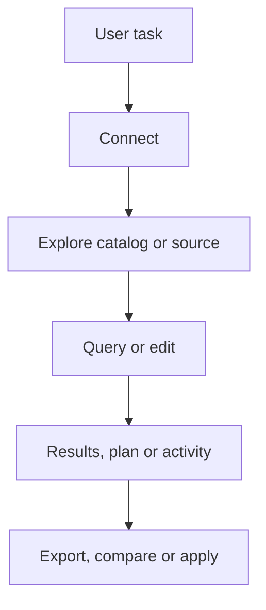

# 1. IDE پایگاه داده چیست و Rowlit چیست

> **سطح:** L1 | **بخش:** II | **کد بررسی‌شده در:** `94ae9c7`
> **در یک جمله:** Rowlit یک کلاینت و IDE پایگاه داده است که نوشتن SQL، شناخت ساختار داده، مشاهده و ویرایش نتیجه و کار با چند خانوادهٔ منبع را در یک برنامه جمع می‌کند.
> **خواهید آموخت:** فرق DBMS و client؛ نقشهٔ قابلیت‌ها؛ خانوادهٔ فراهم‌کننده‌ها؛ مرز مسئولیت برنامه.
> [English](../../en/part2/01-what-is-a-database-ide.md) | بعدی: [گردش در برنامه](02-tour-of-the-app.md)

## 1. ایده برای مبتدی

[کلاینت پایگاه داده](../glossary.md#database-client) برنامه‌ای است که به DBMS وصل می‌شود، درخواست می‌فرستد و پاسخ را قابل فهم می‌کند. [IDE](../glossary.md#ide) علاوه بر اتصال، ویرایشگر، تکمیل کد، مرور کاتالوگ، ابزار طراحی، آزمون و گردش‌کار نگهداری را کنار هم می‌گذارد. Rowlit داده را جای سرور نگه نمی‌دارد و جای پشتیبان‌گیری یا کنترل دسترسی سرور نیست؛ رابطی برای کار ایمن‌تر با آن‌هاست.

کار روزمره از چهار بخش تشکیل می‌شود: اتصال، کشف ساختار، اجرای دستور و تفسیر نتیجه. Rowlit این مسیر را با Explorer، console، results grid، Data tab، designer، import/export، schema/data compare، transfer و ابزارهای Activity پوشش می‌دهد.

## 2. سازوکار برای برنامه‌نویس

پروفایل اتصال یک `providerId` دارد. فراهم‌کننده (provider) رفتار مخصوص SQL Server، PostgreSQL، MySQL/MariaDB، SQLite، Oracle، ClickHouse، Snowflake یا Cassandra را پیاده می‌کند. Redis، MongoDB، Kafka و Elasticsearch «منبع» غیررابطه‌ای هستند و workspace خود را دارند. linked database با DuckDB پرس‌وجوی فدره روی چند عضو می‌سازد.

تاریخ نام‌گذاری DbStudio به Rowlit باعث نشده شناسه‌های داخلی و namespaceها یک‌باره شکسته شوند؛ نام فایل و API فقط زمانی تغییر می‌کند که مهاجرت سازگار وجود داشته باشد. نسخهٔ محصول از `version.json` می‌آید.

## 3. بررسی عمیق

Rowlit سه لایهٔ اجرایی دارد: Electron چرخهٔ دسکتاپ را کنترل می‌کند، React وضعیت و تجربهٔ کاربر را می‌سازد و sidecar .NET اتصال و اجرای پایگاه داده را انجام می‌دهد. این جدایی مرز اعتماد و crash را روشن می‌کند، ولی هزینهٔ پروتکل و هماهنگی نسخه دارد.

## 4. مرزها

- قابلیت‌ها میان فراهم‌کننده‌ها یکسان نیستند؛ UI باید unsupported را صریح نشان دهد.
- read-only از نوشتن تصادفی جلوگیری می‌کند، اما جای مجوز سرور نیست.
- نتیجهٔ بزرگ محدود یا صفحه‌بندی می‌شود؛ export مسیر جداگانه دارد.
- ابزارهای DBA به مجوزهای catalog نیاز دارند.

## 5. چگونه آزموده می‌شود

آزمون‌های conformance قرارداد مشترک فراهم‌کننده‌ها را می‌سنجند؛ Vitest فرمان‌ها و workspaceها را می‌آزماید؛ walkthroughهای `docs/qa` مسیر واقعی را ثبت می‌کنند.

## فصل‌های مرتبط

[معماری](03-big-picture-architecture.md)، [اتصال و نشست](08-connections-sessions-execution.md)، [فراهم‌کننده‌ها](09-relational-providers.md).

## واژه‌های این فصل

[IDE](../glossary.md#ide)، [database client](../glossary.md#database-client)، [provider](../glossary.md#provider)، [source](../glossary.md#source)، [sidecar](../glossary.md#sidecar).

## فایل‌ها

| مسیر | مسئولیت |
|---|---|
| `README.md` | نقشهٔ قابلیت و سیستم‌های پشتیبانی‌شده |
| `version.json` | نسخهٔ محصول |
| `engine/src/DbStudio.Core/Models/CoreModels.cs` | خانوادهٔ منبع و مدل اتصال |

