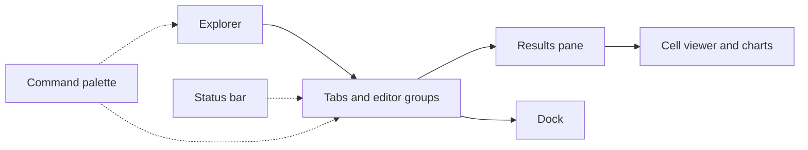

# 2. گردش در برنامه

> **سطح:** L1 | **بخش:** II | **کد بررسی‌شده در:** `94ae9c7`
> **در یک جمله:** این فصل هر ناحیهٔ رابط را به کاری که کاربر در آن انجام می‌دهد وصل می‌کند.
> [English](../../en/part2/02-tour-of-the-app.md) | قبلی: [Rowlit چیست](01-what-is-a-database-ide.md) | بعدی: [معماری](03-big-picture-architecture.md)

## 1. ایده برای مبتدی

Explorer سمت چپ اتصال‌ها، پایگاه‌ها، schemaها و objectها را نشان می‌دهد. مرکز برنامه editor groupها و tabهاست. console شامل Monaco و results pane است. Dock برای History، Connections و Bookmarks به کار می‌رود و StatusBar وضعیت اتصال، تراکنش، منابع و موتور را خلاصه می‌کند. Command Palette همان فرمان‌ها را بدون حفظ مسیر منو در دسترس می‌گذارد.

## 2. گردش‌کارها

برای پرس‌وجو، اتصال را باز کنید، console بسازید، SQL را اجرا کنید و result را در grid ببینید. یک نتیجه را می‌توان pin و با اجرای بعدی compare کرد. Data tab جدول را صفحه‌بندی می‌کند و تغییرها تا Apply به‌صورت pending می‌مانند. Object tab ساختار، DDL و dependency را نشان می‌دهد؛ designer تغییر را ابتدا به SQL preview تبدیل می‌کند.

منوی اتصال export/import پروفایل‌ها و تنظیم SSH tunnel را دارد. روی database یا table می‌توان schema compare، data compare، transfer، generate data یا import را آغاز کرد. Security کاربران و نقش‌ها را نشان می‌دهد؛ Monitor و Activity وضعیت زندهٔ سرور را می‌خوانند. اتصال read-only دکمه‌های نوشتن را حذف یا در موتور رد می‌کند.

## 3. بررسی عمیق

هر tab یک مدل پایدار در Zustand دارد. viewهای سنگین تنبل بار می‌شوند. registry فرمان، shortcut، منو و palette را از یک تعریف مشترک تغذیه می‌کند؛ بنابراین همان قابلیت از چند نقطه با یک شرط `when` اجرا می‌شود. tab جداشده به window دیگر منتقل می‌شود، نه اینکه نشست پایگاه داده را کپی کند.

## 4. مرزها

- بعضی منوها فقط برای نوع object یا provider مناسب دیده می‌شوند.
- بستن اتصال ممکن است به‌علت تراکنش یا کار فعال blocker نشان دهد.
- آزاد کردن result حافظه را پس می‌دهد و برای استفاده دوباره نیاز به rerun دارد.
- shortcut بر اساس keymap انتخابی تغییر می‌کند.

## 5. آزمون

آزمون command smoke ثبت فرمان‌ها، آزمون shell بازیابی tab و testهای هر feature جریان اصلی را می‌سنجند. walkthroughهای QA برای رفتار بصری و پایگاه واقعی مکمل‌اند.

## فصل‌های مرتبط

[معماری UI](20-ui-architecture.md)، [grid](13-results-grid-and-data-editing.md)، [کاتالوگ](10-catalog-and-metadata.md).

## واژه‌ها

[Explorer](../glossary.md#explorer)، [console](../glossary.md#console)، [dock](../glossary.md#dock)، [command palette](../glossary.md#command-palette)، [editor group](../glossary.md#editor-group).

## فایل‌ها

| مسیر | مسئولیت |
|---|---|
| `ui/src/components/Explorer/` | درخت اشیا |
| `ui/src/components/layout/` | shell، tab و group |
| `ui/src/commands/` | registry و keymap |
| `ui/src/store/` | وضعیت پایدار رابط |

