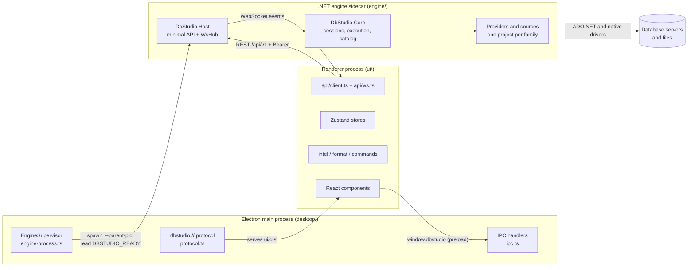
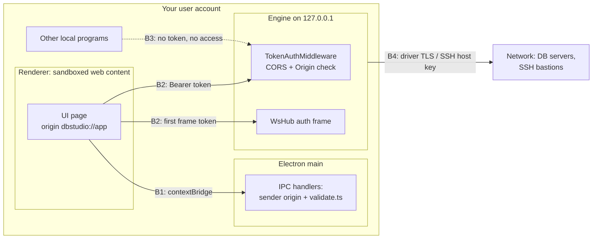
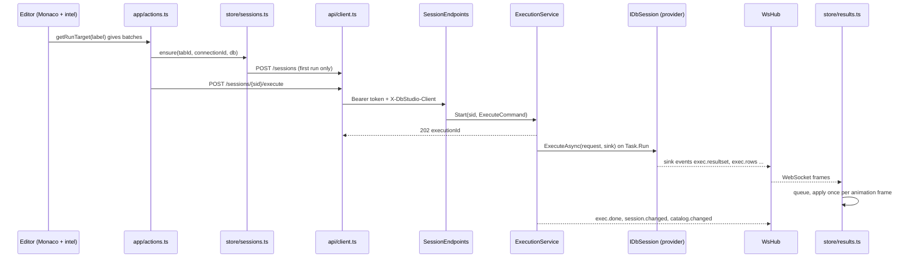
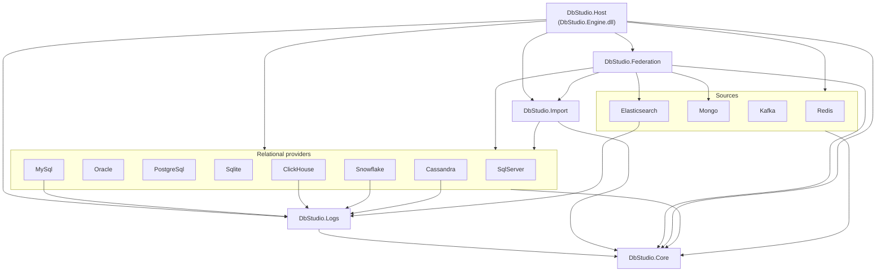
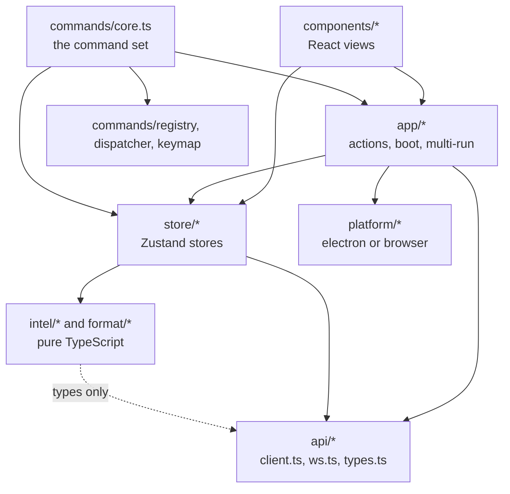

# 3. معماری کلان

> **سطح:** L1 مبتدی ← L3 ارشد | **بخش:** II | **کد خوانده‌شده در:** `08528ae` (Rowlit 1.6.3)
> [English](../../en/part2/03-big-picture-architecture.md) · قبلی: [2. گشتی در برنامه](02-tour-of-the-app.md) · بعدی: [4. اجرا از روی کد منبع](04-development-setup.md)
>
> **در یک جمله:** Rowlit از سه برنامهٔ همکار ساخته شده است (پوستهٔ Electron، رابط کاربری React و موتور ‎.NET که همهٔ درایورهای پایگاه داده را در اختیار دارد) که از راه HTTP محلی و یک WebSocket با هم حرف می‌زنند، و خود موتور مجموعه‌ای لایه‌ای از پروژه‌هاست که در مرز فراهم‌کننده‌ها درزهایی از جنس واسط (interface) دارد.
>
> **در این فصل یاد می‌گیرید:**
> - Rowlit از کدام سه فرایند تشکیل شده، هرکدام اجازهٔ چه کاری دارد و چرا از هم جدا شده‌اند؛
> - مرزهای اعتماد کجا هستند و چه چیزی از هرکدام محافظت می‌کند؛
> - وقتی Ctrl+Enter را می‌زنید، قدم‌به‌قدم و پرونده‌به‌پرونده چه اتفاقی می‌افتد؛
> - مخزن کد و پروژه‌های موتور چطور چیده شده‌اند و وابستگی‌ها به کدام سمت اشاره می‌کنند؛
> - معماری «لایه‌ای»، «تمیز»، «شش‌ضلعی» و «پیازی» یعنی چه و هرکدام چقدر صادقانه بر Rowlit منطبق است.
>
> **پیش‌نیازها:** [1. پایگاه داده IDE چیست](01-what-is-a-database-ide.md)، [2. گشتی در برنامه](02-tour-of-the-app.md). مفید: [I-01 پایگاه داده چیست](../part1/01-what-is-a-database.md).
>
> برچسب‌های نمودارها به انگلیسی نگه داشته شده‌اند تا در GitHub درست نمایش داده شوند.

## 1. ایده (مبتدی)

وقتی با Rowlit کار می‌کنید یک پنجره می‌بینید، ولی پشت آن سه برنامهٔ جدا هم‌زمان در حال اجرا هستند. اولی **پوستهٔ رومیزی** است که با Electron ساخته شده و قاب پنجره، منوی بومی سیستم‌عامل و پنجره‌های انتخاب پرونده را می‌سازد. دومی **رابط کاربری** است؛ یک صفحهٔ وب نوشته‌شده با React که ویرایشگر، درخت کاوشگر و جدول نتیجه‌ها را نشان می‌دهد. سومی **موتور** است؛ برنامه‌ای ‎.NET که اصلاً پنجره ندارد. فقط موتور با پایگاه‌های داده حرف می‌زند. رابط کاربری از موتور چیزی می‌خواهد («این پرس‌وجو را اجرا کن»، «جدول‌های `shop` را فهرست کن») و موتور پاسخ می‌دهد. یک [فرایند (process)](../glossary.md#process) (برنامه‌ای در حال اجرا با حافظهٔ مخصوص خودش که سیستم‌عامل آن را از برنامه‌های دیگر جدا نگه می‌دارد) نمی‌تواند حافظهٔ فرایند دیگری را بخواند؛ پس این سه با فرستادن پیام با هم حرف می‌زنند: پوسته و صفحهٔ وب از کانال IPC خود Electron استفاده می‌کنند، و صفحهٔ وب و موتور فقط روی همین رایانه از HTTP و یک WebSocket.

چرا یک برنامه را سه تکه کنیم؟ درایورهای پایگاه داده بزرگ و بومی (native) هستند و گاهی از کار می‌افتند. اگر در فرایند جداگانه‌ای باشند، خرابی درایور پنجره را با خود پایین نمی‌کشد؛ پوسته می‌فهمد موتور مُرده و پیشنهاد می‌کند دوباره راهش بیندازد. همچنین رابط کاربری هیچ‌وقت به درایور نیاز ندارد و همان صفحهٔ وب هم در Electron اجرا می‌شود و هم هنگام توسعه در یک مرورگر معمولی. درون موتور، کد لایه‌لایه چیده شده است: هسته‌ای که قاعده‌های عمومی را می‌داند (نشست‌ها، اجرا، کاتالوگ‌ها، خطاها)، برای هر خانوادهٔ پایگاه داده یک پروژه که جزئیات یک درایور را می‌داند، و یک میزبان نازک که همه‌چیز را به نقطه‌های پایانی HTTP تبدیل می‌کند. ادامهٔ فصل این قطعه‌ها را یکی‌یکی نشان می‌دهد، یک پرس‌وجو را از اول تا آخر دنبال می‌کند و با مقایسه‌ای صادقانه با نام‌های معماری که در کتاب‌ها می‌بینید تمام می‌شود.

## 2. چگونه کار می‌کند (کاربردی)

### 2.1 سه فرایند

طرح M1 قاعده را در یک خط گفته است: «رابط کاربری هرگز به درایور پایگاه داده دست نمی‌زند؛ موتور هرگز به DOM دست نمی‌زند» (`docs/PLAN.md:26`). شکل 3.1 همان تصویر ASCII پرونده‌ٔ `README.md:136-163` را با فراهم‌کننده‌های امروز دوباره می‌کشد.

**شکل 3.1 — سه فرایند Rowlit و راه گفت‌وگوی آن‌ها.**

هر فرایند یک کار دارد.

- **[فرایند اصلی (main process)](../glossary.md#main-process)** (فرایند Node.js خود Electron که صاحب پنجره‌ها و APIهای بومی است) موتور را راه می‌اندازد، منتظر دست‌دهی آن می‌ماند و رابط کاربری ساخته‌شده را از یک طرح (scheme) خصوصی سرو می‌کند. `EngineSupervisor` موتور را با `--parent-pid <pid>` اجرا می‌کند (و اگر رابط کاربری از Vite بیاید، با `--dev`) (`desktop/src/main/engine-process.ts:134`، `:149`)، سپس خروجی استاندارد را می‌خواند تا به سطر `DBSTUDIO_READY {"port":…,"token":"…"}` برسد (`engine-process.ts:15`، `:207-221`). برای موتور بسته‌بندی‌شده پس از ۱۵ ثانیه و برای `dotnet run` پس از ۱۸۰ ثانیه دست می‌کشد (`engine-process.ts:46-48`). رابط کاربری از `dbstudio://app` سرو می‌شود؛ طرحی که پیش از آماده شدن برنامه به‌عنوان طرح ممتاز ثبت شده است (`desktop/src/main/protocol.ts:44`). فصل [22](22-desktop-shell.md) به پوسته می‌پردازد.
- **[رندرکننده (renderer)](../glossary.md#renderer)** (فرایند Chromium که صفحهٔ وب را رسم می‌کند) برنامهٔ React را اجرا می‌کند. این فرایند در جعبهٔ شنی (sandbox) است: `contextIsolation: true`، `sandbox: true`، `nodeIntegration: false` (`desktop/src/main/window.ts:160-163`). تنها درِ آن به پوسته `window.dbstudio` است که اسکریپت [preload](../glossary.md#preload) (اسکریپت کوچکی که پیش از صفحه اجرا می‌شود و به پل Electron دسترسی دارد) آن را با `contextBridge.exposeInMainWorld` منتشر می‌کند (`desktop/src/preload/preload.ts:120`). در مرورگر معمولی این شیء وجود ندارد و `getPlatform()` به‌جایش مبدل مرورگر را برمی‌دارد (`ui/src/platform/index.ts:12-13`).
- **موتور** یک [فرایند همراه (sidecar)](../glossary.md#sidecar) است (فرایند کمکی‌ای که برنامهٔ اصلی راه می‌اندازد و صاحب آن است و با آن زنده است و با آن می‌میرد). موتور یک برنامهٔ ASP.NET Core است که روی `127.0.0.1` و درگاهی که سیستم‌عامل انتخاب می‌کند گوش می‌دهد (`engine/src/DbStudio.Host/Program.cs:74`؛ پوسته `--port` نمی‌فرستد، پس `EngineOptions.Port` صفر می‌ماند، `engine/src/DbStudio.Host/EngineOptions.cs:42`). موتور روی خروجی استاندارد دقیقاً یک سطر چاپ می‌کند: سطر READY (`Program.cs:191-199`). فصل [5](05-engine-host-and-api.md) راه‌اندازی آن را قدم‌به‌قدم شرح می‌دهد.

سه دلیل برای این جداسازی، همه برگرفته از طرح و کد:

1. **درایورها بیرون از رابط کاربری می‌مانند.** ODP.NET، SqlClient (با کتابخانهٔ بومی SNI)، librdkafka، DuckDB و هستهٔ بومی Snowflake کتابخانه‌های ‎.NET یا بومی‌اند و یک صفحهٔ مرورگر نمی‌تواند بارشان کند (`docs/PLAN.md:20`). موتور می‌تواند.
2. **جداسازی خرابی.** اگر موتور بمیرد، پوسته پنجرهٔ «راه‌اندازی دوباره» را نشان می‌دهد و رابط کاربری با درگاه و توکن تازه دوباره وصل می‌شود (`README.md:171`). خرابی رندرکننده هم نشست‌های باز پایگاه داده را نمی‌کشد، چون آن‌ها مال موتورند.
3. **یک رابط کاربری برای دو میزبان.** «رابط کاربری در Electron و در مرورگر معمولی یکسان است؛ فقط مبدل `platform` فرق می‌کند» (`docs/PLAN.md:26`). توسعه، حالت ساختگی (mock) و آزمون‌های رابط کاربری همه همان کد React را در مرورگر اجرا می‌کنند (فصل [4](04-development-setup.md)).

### 2.2 مرزهای اعتماد

[مرز اعتماد (trust boundary)](../glossary.md#trust-boundary) خطی در سامانه است که داده یا فراخوانی از سمتی کم‌اعتمادتر به سمتی پراعتمادتر می‌گذرد، پس چیزی باید آن را بررسی کند. Rowlit چهار مرز دارد که شکل 3.2 نشانشان می‌دهد.

**شکل 3.2 — مرزهای اعتماد و نگهبان هرکدام.**

- **B1، رندرکننده ← فرایند اصلی.** رندرکننده محتوای وبِ نامطمئن است. فقط می‌تواند تابع‌هایی را صدا بزند که preload در دسترسش گذاشته، و هر گردانندهٔ IPC مبدأ فرستنده را بررسی و آرگومان‌هایش را اعتبارسنجی می‌کند (`desktop/src/main/ipc.ts`، `validate.ts`؛ فصل [19](19-security-and-secrets.md)).
- **B2، رندرکننده ← موتور.** هر درخواست زیر `/api` به `Authorization: Bearer <token>` نیاز دارد (`engine/src/DbStudio.Host/Infrastructure/Middleware.cs:85-104`). WebSocket به‌جای آن با فریم اولش `{"type":"auth","token":…}` خود را ثابت می‌کند، چون مرورگر نمی‌تواند روی WebSocket سرآیند بگذارد ([فصل 6](06-websocket-protocol.md)). این توکن یک [توکن حامل (bearer token)](../glossary.md#bearer-token) است (هرکس آن را داشته باشد مورد اعتماد است): ۳۲ بایت تصادفی با کدگذاری base64url (`EngineOptions.cs:78-79`) که روی خروجی استاندارد به پوسته و از راه `window.dbstudio` به صفحه می‌رسد و هرگز در URL نمی‌آید (تصمیم D-6، `docs/PLAN.md:626`). [CORS](../glossary.md#cors) (قاعدهٔ مرورگر برای این‌که کدام مبدأهای وب حق صدا زدن یک کارساز را دارند) فقط `dbstudio://app` را می‌پذیرد و در حالت `--dev` مبدأهای localhost خود Vite را هم (`EngineOptions.cs:21-38`).
- **B3، برنامه‌های محلی دیگر ← موتور.** موتور روی [حلقهٔ محلی (loopback)](../glossary.md#loopback) گوش می‌دهد (واسط `127.0.0.1` که هرگز از رایانه بیرون نمی‌رود)، پس هیچ چیز از شبکه به آن نمی‌رسد. برنامه‌هایی که با حساب خود شما روی همین رایانه اجرا می‌شوند به درگاه دسترسی دارند، ولی بدون توکن پاسخ `401 UNAUTHORIZED` می‌گیرند. محدودیت واقعی مدل همین‌جاست: کاربران دیگر و میزبان‌های دور را بیرون نگه می‌دارد، نه بدافزاری را که با حساب شما اجرا می‌شود (فصل [19](19-security-and-secrets.md)).
- **B4، موتور ← شبکه.** فقط موتور از رایانه بیرون می‌رود. رمزنگاری درایور (TLS، `Encrypt`، `sslmode`) و از زمان کار تونل‌ها، یک گام SSH با بررسی کلید میزبان از این لبه محافظت می‌کنند (`engine/src/DbStudio.Core/Services/Tunnels/SshKnownHosts.cs`؛ فصل [8](08-connections-sessions-execution.md#22-ssh-tunnels)).

رمزها هم از همین خط‌ها پیروی می‌کنند. گذرواژه‌های ذخیره‌شده فقط در [انبار رمز (secret store)](../glossary.md#secret-store) موتور نگه داشته می‌شوند (DPAPI در ویندوز، Keychain ورود در macOS، و در جاهای دیگر پرونده‌ای با AES-GCM) که `SecretStoreFactory.Create` انتخابش می‌کند (`Program.cs:91`). `GET /connections` فقط `hasPassword` را برمی‌گرداند و هرگز خود گذرواژه را (`docs/PLAN.md:223`).

### 2.3 یک Ctrl+Enter، از اول تا آخر

طرح برای «Ctrl+Enter» پنج قدم برمی‌شمارد (`docs/PLAN.md:55-60`). این‌جا همان قدم‌ها را آن‌طور که کد امروز انجام می‌دهد می‌بینید، همراه با پرونده‌هایی که برای دنبال کردنشان باید باز کنید. شکل 3.3 همین جریان را نشان می‌دهد.

**شکل 3.3 — Ctrl+Enter از فشردن کلید تا جدول نتیجه.**

1. **ویرایشگر تصمیم می‌گیرد چه اجرا شود.** فشردن کلید یک فرمان ثبت‌شده را اجرا می‌کند؛ فرمان `runActive` را صدا می‌زند و این تابع «هدف اجرا» را از ویرایشگر می‌پرسد (`ui/src/app/actions.ts:201-246`). `run-target.ts` در ویرایشگر دستور زیر مکان‌نما را از کتابخانهٔ IntelliSense می‌پرسد (`ui/src/editor/run-target.ts:36`). رابط کاربری تنها مرجع مرز دستورها و دسته‌هاست (تصمیم D-2، `docs/PLAN.md:622`): موتور دقیقاً همان دسته‌هایی را اجرا می‌کند که دریافت کرده، هرکدام با سطر و ستونش در سند.
2. **رابط کاربری بررسی می‌کند، بعد می‌فرستد.** `runInTab` اجرای دوم در همان کنسول را نمی‌پذیرد، پیش از دستور ویرانگر تأیید می‌گیرد (مگر این‌که اتصال فقط‌خواندنی باشد که آن‌جا موتور تصمیم می‌گیرد)، مقدار پارامترها را می‌پرسد، یک اجرای محلی در استور نتیجه‌ها ثبت می‌کند و مطمئن می‌شود زبانه نشست دارد (`actions.ts:115-169`). بعد `POST /api/v1/sessions/{sid}/execute` را می‌فرستد (`actions.ts:171-175`). کلاینت نوع‌دار به هر فراخوانی `Authorization: Bearer …` و `X-DbStudio-Client` اضافه می‌کند (`ui/src/api/client.ts:99`).
3. **موتور می‌پذیرد و شروع می‌کند.** نقطهٔ پایانی بدنه را اعتبارسنجی می‌کند، `maxRows` پیش‌فرض را از تنظیمات برمی‌دارد و برچسب را عادی‌سازی می‌کند (`engine/src/DbStudio.Host/Endpoints/SessionEndpoints.cs:116-126`). `ExecutionService.Start` دسته‌ها را اعتبارسنجی می‌کند، نگهبان فقط‌خواندنی و پارامترهای مقیدشده را اعمال می‌کند، نشست را رزرو می‌کند (اگر از قبل در حال اجرا باشد، 409 `SESSION_BUSY`) و `RunAsync` را روی استخر نخ‌ها راه می‌اندازد (`engine/src/DbStudio.Core/Services/ExecutionService.cs:83-101`). پاسخ HTTP بی‌درنگ `202 { executionId }` است؛ نتیجه‌ها هرگز در پاسخ HTTP نمی‌آیند.
4. **فراهم‌کننده از راه یک گیرنده جاری می‌کند.** `RunAsync` رویداد `exec.started` را منتشر می‌کند، اگر اتصال آزاد یا خراب شده باشد دوباره بازش می‌کند و `IDbSession.ExecuteAsync(request, sink)` را صدا می‌زند (`ExecutionService.cs:146-165`). فراهم‌کننده هر مجموعهٔ نتیجه، هر دستهٔ سطرها، هر پیام و هر خطا را از راه [گیرنده (sink)](../glossary.md#sink) گزارش می‌دهد (شیئی که رشته‌ای از فراخوانی‌های برگشتی را دریافت می‌کند؛ این‌جا `EventExecutionSink`، `ExecutionService.cs:235-306`) و گیرنده هرکدام را به‌صورت یک رویداد WebSocket منتشر می‌کند. در سمت رابط کاربری، `boot.ts` هر رویداد `exec.*` را به استور نتیجه‌ها می‌فرستد (`ui/src/app/boot.ts:112`) که آن‌ها را صف می‌کند و در هر فریم نمایش یک بار اعمالشان می‌کند (`ui/src/store/results.ts:44`، `:129`). جدول از روی استور دوباره رسم می‌شود.
5. **پس از اجرا.** `RunAsync` رویداد `exec.done` را همراه `txOpen` و رویداد `session.changed` را منتشر می‌کند (`ExecutionService.cs:186-191`)، از طبقه‌بند دستورها می‌پرسد آیا دستهٔ موفقی از نوع DDL بوده و اگر بوده کاتالوگ را باطل می‌کند (`ExecutionService.cs:193`، `:197-215`). `CatalogService` شِما را دوباره بار می‌کند و `catalog.changed` را منتشر می‌کند (`engine/src/DbStudio.Core/Catalog/CatalogService.cs:429`، `:496`) و رابط کاربری آن را روی استور کاتالوگ خود اعمال می‌کند (`boot.ts:129`) تا IntelliSense جدول تازه را ببیند. در پایان اجرا در تاریخچه نوشته می‌شود (`ExecutionService.cs:194`).

فصل [8](08-connections-sessions-execution.md) قدم‌های 3 تا 5 را با جزئیات دنبال می‌کند؛ فصل [6](06-websocket-protocol.md) رویدادها را و فصل [13](13-results-grid-and-data-editing.md) جدول نتیجه را توضیح می‌دهد.

### 2.4 چیدمان مخزن کد

| پوشه | چه چیزی آن‌جاست | اول این را بخوانید |
|---|---|---|
| `engine/src/DbStudio.Core` | قراردادها (`Providers/`)، مدل‌ها و همهٔ سرویس‌های مستقل از فراهم‌کننده: نشست‌ها، اجرا، کاتالوگ، نتیجه‌ها، تاریخچه، تنظیمات، رمزها، جریان‌ها، کارها، منابع، طراح، خروجی، جست‌وجو، مقایسهٔ شِما، تونل‌های SSH | `Providers/IDbProvider.cs`، `Services/SessionManager.cs` |
| `engine/src/DbStudio.Host` | `Program.cs` (ریشهٔ ترکیب)، میان‌افزارها، گروه‌های نقطهٔ پایانی REST، `Ws/WsHub.cs`، DTOها | `Program.cs` |
| `engine/src/DbStudio.Providers.*` | برای هر خانوادهٔ رابطه‌ای یک پروژه: SqlServer، Oracle، PostgreSql، Sqlite، MySql (MySQL و MariaDB)، ClickHouse، Snowflake، Cassandra | `*Provider.cs` و `*Session.cs` هرکدام |
| `engine/src/DbStudio.Sources.*` | خانواده‌های غیررابطه‌ای: Redis، Mongo، Kafka، Elasticsearch | `*Module.cs` هرکدام |
| `engine/src/DbStudio.Logs` | لاگ‌ها و فعالیت کارساز برای هر فراهم‌کننده، لاگ موتور، جریان‌های دنبال‌کردن لاگ | `LogsModule.cs` |
| `engine/src/DbStudio.Import` | موتور جادوگر ورود داده (منبع‌های سطر از پرونده، نویسنده‌های مقصد) | `ImportModule.cs` |
| `engine/src/DbStudio.Federation` | پایگاه‌های دادهٔ پیوندی: فدراسیون DuckDB، واکشی‌کننده‌ها، فروراندن | `FederationModule.cs` |
| `engine/tests/*` | پروژه‌های xUnit برای هر پروژهٔ موتور، مجموعهٔ آزمون انطباق مشترک، نمونه‌های Docker، اسکریپت‌های دود (smoke) | `DbStudio.Providers.Conformance/` |
| `ui/src` | برنامهٔ React: `api/`، `store/`، `app/`، `components/` و بخش‌های بی‌چارچوب `intel/`، `format/`، `commands/` (رجیستری) و منطق `designer/` | `main.tsx`، `App.tsx`، `app/boot.ts` |
| `desktop/src` | بخش‌های `main/` و `preload/` الکترون و `shared/channels.ts` | `main/main.ts`، `main/engine-process.ts` |
| `scripts/`، `.github/` | `dev.ps1`، `build.ps1`، `build.sh`، مُهر نسخه، گردش‌کارهای CI و انتشار | فصل [24](24-build-ci-release-contributing.md) |
| `docs/` | طرح‌ها با جدول تصمیم‌ها (`PLAN*.md`)، یادداشت‌های بسته‌های کاری، گشت‌های QA، یادداشت‌های انتشار | `docs/PLAN.md` |

### 2.5 لایه‌های درون موتور

موتور مجموعه‌ای از پروژه‌های ‎.NET است. شکل 3.4 ارجاع‌های `ProjectReference` آن‌ها را دقیقاً همان‌طور که پرونده‌های `.csproj` فهرست کرده‌اند رسم می‌کند. هر پیکان یعنی «ارجاع می‌دهد به»، پس پیکان از کاربرِ کد به کدی که استفاده می‌شود اشاره می‌کند.

**شکل 3.4 — ارجاع‌های پروژه‌های موتور (از روی پرونده‌های csproj).**

منبع‌ها: `engine/src/DbStudio.Host/DbStudio.Host.csproj:20-38`، `DbStudio.Federation.csproj:25-38`، `DbStudio.Import.csproj:16-23` و csproj هر فراهم‌کننده (مثلاً `DbStudio.Providers.MySql.csproj:16-17`). دو جزئیات در تصویر ساده شده‌اند: `Import` به هفت فراهم‌کنندهٔ رابطه‌ای از هشت تا ارجاع می‌دهد (Cassandra نه)، و `Federation` به هر هشت تا به‌علاوهٔ Mongo و Elasticsearch.

آن را سه لایه بخوانید:

1. **هسته** (`DbStudio.Core`) در پایین. هیچ `ProjectReference`ای **ندارد** (`DbStudio.Core.csproj:9-19`) و نمی‌تواند هیچ فراهم‌کننده‌ای را ببیند. قراردادها را تعریف می‌کند (`IDbProvider`، `IDbSession`، `ICatalogReader`، `IExecutionSink`، `IDataSourceProvider`، `IEngineModule` و واسط‌های قابلیت‌های کلیددار) و هر سرویسی را که برای همهٔ پایگاه‌های داده یکسان کار می‌کند پیاده‌سازی می‌کند.
2. **خانواده‌ها و قابلیت‌ها** در میانه: فراهم‌کننده‌ها، منبع‌ها، لاگ‌ها، ورود داده، فدراسیون. هرکدام قراردادهای هسته را برای یک خانواده پیاده می‌کنند یا یک قابلیت اضافه می‌کنند. بیشترشان فقط هسته را می‌شناسند (و برای منبع لاگشان `Logs` را). دو استثنای عمدی `Import` و `Federation` هستند که از فراهم‌کننده‌های مشخص برای خواندن و نوشتن سطرها دوباره استفاده می‌کنند.
3. **میزبان** در بالا. `DbStudio.Host` به همه‌چیز ارجاع می‌دهد، همه را در `Program.cs` به هم وصل می‌کند و سرویس‌ها را به مسیرهای HTTP تبدیل می‌کند. نام اسمبلی آن `DbStudio.Engine` است و با نام `Rowlit.Engine.exe` منتشر می‌شود (`DbStudio.Host.csproj:7-9`).

این یک [معماری لایه‌ای (layered architecture)](../glossary.md#layered-architecture) است (کدی که در سطح‌هایی چیده شده و هر سطح فقط از سطح‌های زیرینش استفاده می‌کند). این‌که میزبان چطور ماژول‌های لایهٔ میانی را بی‌آن‌که نامشان را در `Program.cs` بیاورد پیدا می‌کند، موضوع فصل [7](07-engine-modules-and-di.md) است.

### 2.6 لایه‌های درون رابط کاربری

رابط کاربری پروندهٔ پروژه‌ای ندارد که لایه‌بندی را تحمیل کند، پس قاعده یک قرارداد نانوشته است. شکل 3.5 جهت importهایی را که در کد برقرارند نشان می‌دهد.

**شکل 3.5 — پوشه‌های رابط کاربری و جهت importهای آن‌ها.**

جست‌وجوی importها در `08528ae` این را نشان می‌دهد:

- ‏`ui/src/intel/**` (۳۹ پروندهٔ غیرآزمونی) و `ui/src/format/**` (۱۵ پرونده) نه React را import می‌کنند، نه استوری را و نه مؤلفه‌ای را. `intel` فقط نوع‌ها را از `api/types.ts` و چند کمکی را از `lib/` می‌آورد (مثلاً `ui/src/intel/complete/completer.ts:2`، `:11`). به همین دلیل آزمون‌های IntelliSense در محیط Node و بدون DOM اجرا می‌شوند (`ui/vitest.intel.config.ts`، فصل [11](11-intellisense.md)).
- ‏`ui/src/api/**` هیچ استور، مؤلفه یا Reactای را import نمی‌کند؛ این لایهٔ انتقال است.
- سازوکار فرمان‌ها (`commands/registry.ts`، `dispatcher.ts`، `keymap.ts`) فقط هم‌پوشه‌ای‌های خودش را import می‌کند (`registry.ts:14-15`، `dispatcher.ts:9-11`). ولی *مجموعهٔ فرمان‌ها* در `commands/core.ts` که فرمان‌های مشخص را ثبت می‌کند، استورها و مؤلفه‌ها را import می‌کند (`commands/core.ts:13-33`)؛ این بخش چسب است، نه کد دامنه.
- ‏`store/*` در یک جا React را import می‌کند: `store/consoleSchema.ts:2` (یک قلاب `useMemo`) و همان‌جا یک کمکی از `app/` را (`consoleSchema.ts:4`). پس لایهٔ استورها کاملاً از لایه‌های بالاتر رها نیست.

فصل [20](20-ui-architecture.md) معماری رابط کاربری را کامل شرح می‌دهد.

### 2.7 واژگان

واژه‌هایی که این راهنما برای ساختار Rowlit به کار می‌برد، هرکدام همراه با جایی که واقعاً وجود دارد:

- **[ماژول (module)](../glossary.md#module)** — واحدی از کد با یک هدف و واسطی روشن. در موتور این واژه معنای دقیقی دارد: کلاسی که `IEngineModule` را پیاده می‌کند و سرویس‌ها و مسیرهای یک بستهٔ قابلیت را ثبت می‌کند (`engine/src/DbStudio.Core/Providers/IDataSourceProvider.cs:50-55`). هفده ماژول وجود دارد (فصل [7](07-engine-modules-and-di.md)).
- **[ریشهٔ ترکیب (composition root)](../glossary.md#composition-root)** — تنها جایی که برنامه گراف اشیای خود را می‌سازد و پیاده‌سازی‌ها را به واسط‌ها وصل می‌کند. Rowlit برای هر بستهٔ قابلیت یکی دارد (`IEngineModule` آن) و `Program.cs` میزبان هم یکی است.
- **فراهم‌کننده (provider)** — نامی که Rowlit بر کدی گذاشته که یک خانوادهٔ پایگاه داده را با قراردادهای هسته جور می‌کند (`IDbProvider` برای رابطه‌ای‌ها، `IDataSourceProvider` برای بقیه). به زبان کتاب‌ها، فراهم‌کننده یک [مبدل (adapter)](../glossary.md#adapter) است (کدی که یک واسط را به واسطی که کلاینت انتظار دارد تبدیل می‌کند).
- **[فرایند همراه (sidecar)](../glossary.md#sidecar)** — فرایند موتور در کنار پوسته.
- **[جداسازی دغدغه‌ها (separation of concerns)](../glossary.md#separation-of-concerns)** — هر بخش یک نوع مسئله را حل می‌کند: درایورها در موتور، پیکسل‌ها در رندرکننده، یکپارچگی با سیستم‌عامل در فرایند اصلی.

## 3. نگاه عمیق (ارشد)

### 3.1 سه نام معماری، با تعریف دقیق

کتاب‌ها و سخنرانی‌ها برای «قاعده‌های کسب‌وکار را از ابزارها مستقل نگه دار» چند نام دارند. این نام‌ها خیلی با هم هم‌پوشانی دارند، پس پیش از مقایسه بهتر است دقیق تعریفشان کنیم.

**[معماری تمیز (clean architecture)](../glossary.md#clean-architecture).** نامی که رابرت سی. مارتین (۲۰۱۲) بر مجموعه‌ای از دایره‌های هم‌مرکز گذاشت: موجودیت‌ها (قاعده‌های سازمانی) در مرکز، بعد موردهای کاربرد (قاعده‌های برنامه)، بعد مبدل‌های واسط (کنترل‌گرها، ارائه‌دهنده‌ها، دروازه‌ها) و در بیرونی‌ترین حلقه چارچوب‌ها و درایورها (چارچوب وب، پایگاه داده، رابط کاربری). تنها قاعدهٔ الزام‌آور آن [قاعدهٔ وابستگی (dependency rule)](../glossary.md#dependency-rule) است: وابستگی‌های کد منبع فقط به سمت درون اشاره می‌کنند؛ دایرهٔ درونی هرگز نام چیزی را که در دایرهٔ بیرونی تعریف شده نمی‌آورد، نه کلاس، نه تابع، نه قالب داده.

برای این‌که این ممکن شود وقتی جریان کنترل به بیرون می‌رود (یک مورد کاربرد باید چیزی را در پایگاه داده ذخیره کند)، معماری تمیز از [وارونگی وابستگی (dependency inversion)](../glossary.md#dependency-inversion) استفاده می‌کند: دایرهٔ درونی واسطی را که نیاز دارد تعریف می‌کند و دایرهٔ بیرونی آن را پیاده می‌کند. چارچوب به جزئیاتی تبدیل می‌شود که در لبه وصل می‌شود. داده‌ای که از مرز می‌گذرد به‌شکل ساختارهای ساده‌ای منتقل می‌شود که به دایرهٔ درونی تعلق دارند.

**[معماری شش‌ضلعی (hexagonal architecture)](../glossary.md#hexagonal-architecture)، یا [درگاه‌ها و مبدل‌ها (ports and adapters)](../glossary.md#ports-and-adapters).** نام قدیمی‌تر آلیستر کاکبرن (۲۰۰۵) برای همین شهود که به‌شکل شش‌ضلعی کشیده می‌شود تا نشان دهد «بالا» و «پایینی» در کار نیست. هستهٔ برنامه فقط از راه **درگاه‌ها** با جهان حرف می‌زند: واسط‌هایی که مال هسته‌اند. درگاه‌های *راننده* (اولیه) چیزی‌اند که بیرون به درون صدا می‌زند (APIای که پرس‌وجو را اجرا می‌کند)؛ درگاه‌های *رانده‌شده* (ثانویه) چیزی‌اند که هسته به بیرون صدا می‌زند (یک انبار، یک گذرگاه پیام، یک پایگاه داده). **مبدل‌ها** بیرون می‌نشینند و ترجمه می‌کنند: مبدل HTTP درخواست‌ها را به فراخوانی روی یک درگاه راننده تبدیل می‌کند؛ مبدل SQL یک درگاه رانده‌شده را با درایور واقعی پیاده می‌کند.

محک یک طراحی شش‌ضلعی جانشینی است: می‌توانید هسته را روی هر درگاه با یک مبدل آزمونی اجرا کنید (پایگاه دادهٔ ساختگی، اسکریپت به‌جای رابط کاربری) و هیچ چیز درون آن تغییر نمی‌کند.

**[معماری پیازی (onion architecture)](../glossary.md#onion-architecture).** نامی که جفری پالرمو (۲۰۰۸) گذاشت؛ باز هم لایه‌های هم‌مرکز: مدل دامنه، سرویس‌های دامنه، سرویس‌های برنامه و یک حلقهٔ بیرونی از زیرساخت، رابط کاربری و آزمون‌ها. تأکیدش این است که پایگاه داده مرکز نیست (واکنشی به لایه‌بندی کلاسیک که در آن همه‌چیز به لایهٔ دسترسی به داده وابسته است) و زیرساخت به هسته وابسته است، نه برعکس.

هر سه، پالایش‌هایی از [معماری لایه‌ای](../glossary.md#layered-architecture) به‌علاوهٔ وارونگی وابستگی‌اند. سبک لایه‌ای کلاسیک (نمایش ← کسب‌وکار ← دسترسی به داده) به لایهٔ کسب‌وکار اجازه می‌دهد به لایهٔ داده وابسته باشد؛ سه سبک «حلقه‌ای» همین یک پیکان را برمی‌گردانند.

### 3.2 مقایسهٔ صادقانهٔ Rowlit

اسناد Rowlit هیچ‌کدام از این نام‌ها را به کار نمی‌برند (جست‌وجو در `docs/` هیچ «clean architecture»، «hexagonal» یا «onion»ی پیدا نمی‌کند؛ طرح از «انتزاع فراهم‌کننده» حرف می‌زند، `docs/PLAN.md:90`، و از ماژول‌های موتور، `docs/PLAN-M2.md` تصمیم D4). نزدیک‌ترین توصیف صادقانه این است: **موتوری لایه‌ای با درزهایی از جنس واسط در مرز فراهم‌کننده‌ها، که در همان مرز به درگاه‌ها و مبدل‌ها شبیه است، اما بدون آن نام‌گذاری و بدون وارونگی سخت‌گیرانهٔ وابستگی در یک معماری تمیز کامل.** جدول زیر شاهدهای هر دو نیمهٔ این جمله را کنار هم می‌گذارد.

| اصل | جایی که Rowlit از آن پیروی می‌کند | جایی که نمی‌کند |
|---|---|---|
| هسته به درایورها وابسته نیست | ‏`DbStudio.Core.csproj` هیچ `ProjectReference`ای ندارد (`:9-19`)؛ هر فراهم‌کننده به هسته ارجاع می‌دهد و هرگز برعکس | خود هسته به `Microsoft.Data.Sqlite` (تاریخچه، پایگاه دادهٔ نمونه، تاریخچهٔ محلی؛ `DbStudio.Core.csproj:10`) و `SSH.NET` (تونل‌ها؛ `:13`) ارجاع می‌دهد |
| درگاه‌های رانده‌شده مال هسته‌اند | ‏`IDbProvider`، `IDbSession`، `ICatalogReader`، `IExecutionSink`، `IDataSourceProvider`، `ISecretStore`، `ITunnelResolver` در هسته تعریف و بیرون از آن یا در لبه پیاده شده‌اند | بعضی مبدل‌ها *درون* هسته‌اند: `AdoSessionBase` (کلاس پایهٔ ADO.NET، `Core/Services/AdoSessionBase.cs`)، `SshTunnelService`، سه انبار رمز، `HistoryService` روی SQLite |
| هسته از چارچوب تحویل رهاست | هیچ کنترل‌گر یا نوع HTTPای در سرویس‌ها نیست؛ DTOها مال میزبان‌اند (`Host/Contracts/Api.cs:7-8`) | هسته `FrameworkReference Microsoft.AspNetCore.App` دارد (`DbStudio.Core.csproj:16-19`) چون `IEngineModule.MapEndpoints` یک `RouteGroupBuilder` می‌گیرد (`IDataSourceProvider.cs:50-55`)؛ ماژول‌های خود هسته مسیر نگاشت می‌کنند (`Core/Queries/QueriesModule.cs:25-65`). طرح M1 وعدهٔ «بدون ارجاع ASP.NET» در هسته را داده بود (`docs/PLAN.md:73`)؛ تصمیم D4 در M2 این را تغییر داد |
| هسته از جزئیات پایگاه داده رهاست | ویژگی‌های هر گویش به‌صورت داده‌اند، نه شاخه‌هایی پراکنده در همه‌جا: `DialectInfo` (`Core/Models/DialectInfo.cs:8-63`) | هسته هر نُه گویش را با نام می‌شناسد (شمارش `Dialect`، `CoreModels.cs:14`)، در `StatementClassifier` و `SearchSql` بلوک‌های مخصوص هر گویش دارد و `TunnelTargets` روی شناسهٔ فراهم‌کننده‌ها switch می‌کند تا میزبان و درگاه را بازنویسی کند (`Core/Services/Tunnels/TunnelTargets.cs:30-46`) |
| مبدل‌های جانشین‌پذیر (محک شش‌ضلعی) | همهٔ فراهم‌کننده‌های رابطه‌ای از یک مجموعهٔ آزمون مشترک `ProviderConformanceTests<TFixture>` می‌گذرند؛ Mongo و Kafka پشت درزهای دروازه با نسخه‌های ساختگی‌اند؛ رابط کاربری روی mockهای MSW یا یک موتور ساختگی اجرا می‌شود | موتور به‌طور کامل و «بی‌سر» روی فراهم‌کننده‌های ساختگی اجرا نمی‌شود؛ آزمون‌ها سرویس‌های واقعی را با SQLite یا Docker می‌سازند |
| موجودیت‌ها و موردهای کاربرد در مرکز | سرویس‌هایی مثل `ExecutionService` و `SessionManager` همان موردهای کاربردند | لایهٔ موجودیت جدایی وجود ندارد: «دامنهٔ» Rowlit ابزار پایگاه داده است، پس مدل‌ها بیشتر رکوردهایی شبیه DTOاند (`ConnectionProfile`، `ColumnInfo`) که با قالب انتقال مشترک‌اند |

دو نکته جدول را در جای درستش می‌نشاند.

نخست، انحراف‌ها بیشتر **مصالحه‌هایی آگاهانه**اند که در تصمیم‌ها ثبت شده‌اند، نه تصادف. D4 پذیرفت ASP.NET وارد هسته شود تا هر بسته بتواند مسیرهای خودش را بی‌ویرایش `Program.cs` داشته باشد (`docs/PLAN-M2.md:12`). توضیح خود `DialectInfo` می‌گوید ویژگی‌ها به آن‌جا منتقل شدند «تا گویش تازه هرگز توکن‌ساز را ویرایش نکند» (`DialectInfo.cs:5-6`): تیم دانش داده‌محور دربارهٔ گویش‌ها در هسته را بر یک درز افزونه‌ای کامل برای واژه‌کاوی ترجیح داد. ‏`IDbProvider` «با بخش 2.2 طرح منجمد شده» است (`IDbProvider.cs:7`) و قابلیت‌های بعدی به‌جای عضو تازه، به‌صورت *سرویس‌های کلیددار* کنار آن اضافه شدند (`ProviderFeatures.cs:8-11`)؛ این کار درگاه را پایدار نگه می‌دارد.

دوم، مرز فراهم‌کننده واقعاً به معنای کاکبرن یک درگاه است. `ITunnelResolver` نمونه‌ای کتابی است: هسته آنچه را نیاز دارد اعلام می‌کند («یک نمایهٔ اتصال را به نمایه‌ای تبدیل کن که درایور باید باز کند»)، امروز یک مبدل آن را پیاده می‌کند و توضیح کد نام مبدل بعدی‌ای را که به همین درگاه وصل خواهد شد هم آورده است: یک حل‌کنندهٔ پراکسی HTTP/SOCKS (`Core/Services/Tunnels/ITunnelResolver.cs:5-9`).

### 3.3 قاعده‌های وابستگی که برقرارند

این قاعده‌ها در `08528ae` درست‌اند و ارزش دارد هنگام تغییر کد نگهشان دارید:

1. **هسته به هیچ فراهم‌کننده، منبع یا بستهٔ قابلیتی ارجاع نمی‌دهد.** کامپایلر این را تحمیل می‌کند: هسته ارجاع پروژه‌ای ندارد.
2. **فراهم‌کننده‌ها به هم ارجاع نمی‌دهند.** csproj هر فراهم‌کننده فقط به هسته ارجاع می‌دهد (و فراهم‌کننده‌های جدیدتر به Logs). دو فراهم‌کنندهٔ شبیه به هم کد مشترکشان را از راه `AdoSessionBase` هسته به اشتراک می‌گذارند، هرگز از راه یکدیگر.
3. **فقط میزبان، Import و Federation فراهم‌کننده‌های مشخص را می‌بینند.** بقیهٔ موتور از راه `ProviderRegistry`، `SourceRegistry` یا یک سرویس کلیددار و با شناسه به فراهم‌کننده می‌رسد.
4. **سرویس‌های زبانی رابط کاربری بی‌چارچوب‌اند.** `intel` و `format` هیچ React، استور یا نوع DOMای را import نمی‌کنند؛ رجیستری و توزیع‌کنندهٔ فرمان‌ها فقط هم‌پوشه‌ای‌هایشان را.
5. **رندرکننده هرگز درایوری بار نمی‌کند و موتور هرگز رسم نمی‌کند.** هیچ کد ‎.NETای برای رابط کاربری HTML نمی‌سازد؛ رابط کاربری هیچ کتابخانهٔ کلاینت پایگاه داده ندارد.

[وارونگی وابستگی](../glossary.md#dependency-inversion)، حرف «D» در [SOLID](../glossary.md#solid) (پنج اصل طراحی شیءگرا: مسئولیت یگانه، باز/بسته، جانشینی لیسکوف، تفکیک واسط، وارونگی وابستگی)، همان‌جایی به کار رفته که بیشترین اهمیت را دارد: لبهٔ درایور. همه‌جا به کار نرفته است؛ برای نمونه `ExecutionService` خود کلاس‌های مشخص `SessionManager`، `ResultStore`، `HistoryService` و `CatalogService` را می‌گیرد (`ExecutionService.cs:68-69`) که اشکالی ندارد، چون همه در یک لایه‌اند.

### 3.4 تک‌پارچه، تک‌پارچهٔ ماژولار، ریزسرویس‌ها

[تک‌پارچه (monolith)](../glossary.md#monolith) یک برنامهٔ قابل‌استقرار است؛ [ریزسرویس‌ها (microservices)](../glossary.md#microservices) برنامه‌های کوچک بسیاری‌اند که هرکدام جدا مستقر و مقیاس‌دهی می‌شوند و از راه شبکه با هم حرف می‌زنند. موتور یک **[تک‌پارچهٔ ماژولار (modular monolith)](../glossary.md#modular-monolith)** است: یک فرایند (`Rowlit.Engine`) که کدش در ماژول‌هایی با درزهای صریح تقسیم شده، همه در آن کامپایل شده‌اند و هنگام شروع کشف می‌شوند (بارگذاری افزونه در زمان اجرا وجود ندارد؛ فصل [7](07-engine-modules-and-di.md)). درون Rowlit نه کارگزار پیام (message broker) هست، نه شبکهٔ سرویس (service mesh) و نه مؤلفهٔ کارساز: همه‌چیز روی رایانهٔ کاربر اجرا می‌شود. هاب WebSocket یک پخش درون‌فرایندی است، نه یک گذرگاه.

آیا طراحی سه‌فرایندی «ریزسرویس» است؟ نه. فرایندها برای جداسازی و به دلایل سکویی از هم جدا شده‌اند، نه برای استقرار مستقل: پوسته، رابط کاربری و موتور با هم در یک نصب‌کننده و با یک نسخه که از `version.json` مُهر می‌خورد عرضه می‌شوند (فصل [24](24-build-ci-release-contributing.md)).

### 3.5 چرا فرایند همراه و نه ماژول بومی

جایگزین‌هایی که طرح به‌طور ضمنی کنار گذاشته ارزش نام بردن دارند. یک افزونهٔ بومی Node.js یا پل `edge-js`، ‎.NET را درون فرایند اصلی Electron بار می‌کرد: یک خرابی پنجره را پایین می‌کشید و حالت توسعه در مرورگر موتوری نداشت. یک کارساز دور برای ابزاری رومیزی و تک‌کاربره، حساب کاربری و امنیت شبکه را اضافه می‌کرد. هزینهٔ فرایند همراه یک بار راه‌اندازی فرایند است (محدود به مهلت ۱۵ ثانیه‌ای READY)، یک درگاه محلی و یک توکن؛ و در عوض جداسازی خرابی، حالت مرورگر و مرز زبانی تمیز به دست می‌آید. ناظر هنگام خروج کل درخت فرایند را می‌کشد و موتور هم مراقب والدش است (`--parent-pid`، `ParentWatchdog`)، پس پوستهٔ ازکارافتاده موتور یتیمی را در حال اجرا رها نمی‌کند (فصل [5](05-engine-host-and-api.md#28-the-parent-watchdog-and-shutdown)).

## 4. حالت‌های مرزی و محدودیت‌ها

- **افزونه در زمان اجرا وجود ندارد.** همهٔ ماژول‌ها درون موتور کامپایل شده‌اند و با بازتاب (reflection) روی اسمبلی‌های ارجاع‌شده پیدا می‌شوند (`Core/Services/EngineModules.cs:6-12`). افزودن یک پایگاه داده یعنی یک پروژهٔ تازه و یک لنگر تازه در `Host/ModuleAssemblies.cs` و سپس ساخت دوباره.
- **راه‌اندازی دوبارهٔ موتور وضعیت نشست‌ها را از دست می‌دهد.** نشست‌ها، تراکنش‌های باز، انبارهای نتیجه و جریان‌ها در حافظهٔ موتور زندگی می‌کنند. پس از راه‌اندازی دوباره، رابط کاربری با درگاه و توکن تازه وصل می‌شود، ولی تراکنش‌های باز از دست رفته‌اند (کارساز وقتی سوکت بسته شد آن‌ها را rollback کرده است).
- **یک کاربر، یک رایانه.** توکن در برابر کاربران دیگر و میزبان‌های دور محافظت می‌کند، نه در برابر برنامه‌هایی که با همان کاربر اجرا می‌شوند. حالت توسعهٔ مرورگر از توکن ثابت `dev-token` استفاده می‌کند (`EngineOptions.cs:13`، `:73`)؛ هرگز موتوری با `--dev` را بیرون از رایانهٔ خودتان در دسترس نگذارید.
- **لایه‌بندی در بعضی جاها فقط قرارداد است.** هیچ چیز جلوی تغییری را در آینده نمی‌گیرد که از راه یک switch رشته‌ای ایده‌ای مخصوص یک فراهم‌کننده را به هسته بیاورد (`TunnelTargets` همین حالا چنین می‌کند). نگهبان، بازبینی کد و قاعده‌های مالکیت بسته‌های کاری‌اند (`docs/wp-notes/README.md:7-28`)، نه کامپایلر.
- **نشتی لایهٔ استور.** ‏`store/consoleSchema.ts` هم React و هم یک کمکی از `app/` را import می‌کند؛ آن را استثنا بدانید، نه الگو.

## 5. چگونه آزموده می‌شود

معماری از راه درزهایش آزموده می‌شود، نه با یک آزمون واحد:

- **درز فراهم‌کننده.** پروژهٔ آزمون هر فراهم‌کنندهٔ رابطه‌ای مجموعهٔ انتزاعی مشترک `ProviderConformanceTests<TFixture>` را در `engine/tests/DbStudio.Providers.Conformance/` اجرا می‌کند (Cassandra زیرمجموعهٔ خودش را دوباره پیاده می‌کند، `docs/wp-notes/wp0.md:13-14`). فصل [9](09-relational-providers.md#5-how-it-is-tested) را ببینید.
- **درز ماژول.** آزمون‌های هر بستهٔ قابلیت `EngineModules.Discover(typeof(XModule).Assembly)` را صدا می‌زنند و بررسی می‌کنند ماژول چه چیزهایی ثبت می‌کند (مثلاً `engine/tests/DbStudio.Sources.Redis.Tests/RedisModuleTests.cs` و `engine/tests/DbStudio.Logs.Tests/LogsModuleTests.cs`).
- **درز فرایند.** ‏`engine/tests/smoke/smoke.mjs` موتوری در حال اجرا را با توکن توسعه از راه REST و WebSocket می‌راند؛ گام «Engine native smoke» در CI باینری *منتشرشدهٔ* موتور را اجرا می‌کند، منتظر `DBSTUDIO_READY` می‌ماند و API را صدا می‌زند، پس کتابخانهٔ بومی‌ای که بار نشود ساخت را شکست می‌دهد (`scripts/ci/kafka-native-smoke.mjs:2-19`). آزمون‌های رومیزی پوسته را روی `desktop/test/fake-engine.mjs` اجرا می‌کنند که بی‌نیاز از ‎.NET، دست‌دهی READY را اجرا می‌کند.
- **درزهای رابط کاربری.** آزمون‌های رابط کاربری روی گرداننده‌های MSW و یک سوکت ساختگی اجرا می‌شوند (`ui/src/mocks/*`) و `intel` پیکربندی آزمون Node مخصوص خودش را دارد (`ui/vitest.intel.config.ts`). فصل [23](23-testing-and-qa.md) همهٔ لایه‌ها را فهرست می‌کند.

## فصل‌های مرتبط

- [5. میزبان موتور](05-engine-host-and-api.md) — راه‌اندازی، میان‌افزارها، نقطه‌های پایانی، خطاها.
- [6. پروتکل WebSocket](06-websocket-protocol.md) — سمت رویدادهای شکل 3.3.
- [7. ماژول‌های موتور و DI](07-engine-modules-and-di.md) — لایهٔ میانی چطور سیم‌کشی می‌شود.
- [8. اتصال‌ها، نشست‌ها و اجرا](08-connections-sessions-execution.md) — قدم‌های 3 تا 5 Ctrl+Enter با جزئیات.
- [9. فراهم‌کننده‌های رابطه‌ای](09-relational-providers.md) — مبدل‌های پشت درگاه فراهم‌کننده.
- [19. مدل امنیتی](19-security-and-secrets.md) — مرزهای اعتماد با جزئیات.
- [20. معماری رابط کاربری](20-ui-architecture.md) و [22. پوستهٔ Electron](22-desktop-shell.md).

## واژه‌های واژه‌نامه در این فصل

[process](../glossary.md#process) · [sidecar](../glossary.md#sidecar) · [main process](../glossary.md#main-process) · [renderer](../glossary.md#renderer) · [preload](../glossary.md#preload) · [trust boundary](../glossary.md#trust-boundary) · [bearer token](../glossary.md#bearer-token) · [loopback](../glossary.md#loopback) · [CORS](../glossary.md#cors) · [secret store](../glossary.md#secret-store) · [sink](../glossary.md#sink) · [layered architecture](../glossary.md#layered-architecture) · [clean architecture](../glossary.md#clean-architecture) · [hexagonal architecture](../glossary.md#hexagonal-architecture) · [ports and adapters](../glossary.md#ports-and-adapters) · [onion architecture](../glossary.md#onion-architecture) · [dependency rule](../glossary.md#dependency-rule) · [dependency inversion](../glossary.md#dependency-inversion) · [composition root](../glossary.md#composition-root) · [module](../glossary.md#module) · [adapter](../glossary.md#adapter) · [separation of concerns](../glossary.md#separation-of-concerns) · [SOLID](../glossary.md#solid) · [monolith](../glossary.md#monolith) · [modular monolith](../glossary.md#modular-monolith) · [microservices](../glossary.md#microservices)

## پرونده‌ها

| مسیر | مسئولیت |
|---|---|
| `README.md` (بخش «Architecture») | تصویر سه‌فرایندی و خلاصهٔ امنیت |
| `docs/PLAN.md` §1–2، §7 | نمای کلی معماری، جریان Ctrl+Enter، تصمیم‌های D-1 تا D-15 |
| `desktop/src/main/engine-process.ts` | اجرای موتور، تجزیهٔ `DBSTUDIO_READY`، راه‌اندازی دوباره |
| `desktop/src/main/window.ts`، `desktop/src/preload/preload.ts` | رندرکنندهٔ جعبهٔ شنی، پل `window.dbstudio` |
| `ui/src/main.tsx`، `ui/src/app/boot.ts` | شروع رابط کاربری، مسیریابی رویدادهای موتور به استورها |
| `ui/src/app/actions.ts` | مسیر اجرا (`runActive`، `runInTab`) |
| `ui/src/api/client.ts`، `ui/src/api/ws.ts` | کلاینت REST با توکن، آن یک WebSocket |
| `engine/src/DbStudio.Host/Program.cs` | ریشهٔ ترکیب موتور و خط لولهٔ آن |
| `engine/src/DbStudio.Host/ModuleAssemblies.cs` | لنگرهای اسمبلی‌های ماژول‌ها |
| `engine/src/DbStudio.Core/Providers/*.cs` | درگاه‌های فراهم‌کننده |
| `engine/src/DbStudio.Core/Services/ExecutionService.cs` | قدم‌های 3 تا 5 یک اجرا |
| `engine/src/*/*.csproj` | گراف پروژه‌های شکل 3.4 |

