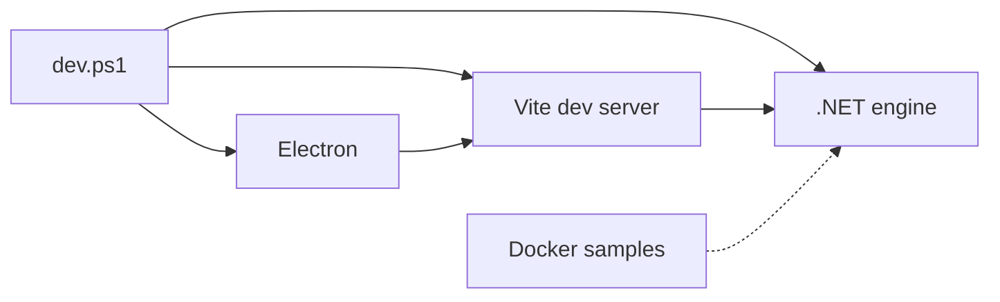

# 4. اجرای Rowlit از منبع

> **سطح:** L1 | **بخش:** II | **کد بررسی‌شده در:** `94ae9c7`
> **در یک جمله:** محیط توسعه سه فرایند هماهنگ و چند حالت جایگزین برای عیب‌یابی سریع دارد.
> [English](../../en/part2/04-development-setup.md)

## 1. ایده برای مبتدی

پیش‌نیازها شامل SDK .NET مطابق repo، Node، وابستگی‌های UI/desktop و در صورت آزمون یکپارچه Docker است. `dev.ps1` موتور، Vite و Electron را برای توسعه هماهنگ می‌کند. browser mode رابط را بدون پوستهٔ دسکتاپ باز می‌کند؛ mock mode برای کار UI بدون سرور واقعی است؛ fake engine برای آزمون lifecycle دسکتاپ به کار می‌رود.

## 2. راه‌اندازی

ابتدا restore/build موتور و typecheck رابط را اجرا کنید. پوشهٔ داده را از دادهٔ شخصی تولید جدا نگه دارید. token و نشانی engine هنگام startup به renderer داده می‌شود و نباید hard-code شود. sample serverهای `engine/tests/docker/compose.yml` فقط برای توسعه‌اند؛ credentialهای آن‌ها تولیدی نیست.

SSH tunnel در خود profile ذخیره می‌شود، اما secret در secret store است. برای آزمون مسیر tunnel همان `ConnectionStore.ResolveForOpenAsync` باید استفاده شود. اجرای `npm install` تصادفی می‌تواند lockfile و dependency graph را عوض کند؛ دستورهای repo را دنبال کنید.

## 3. بررسی عمیق

ready handshake باعث می‌شود Electron پیش از آماده‌شدن endpoint، window اصلی را به engine وصل نکند. hot reload فقط کد UI را جایگزین می‌کند؛ تغییر قرارداد API ممکن است restart موتور بخواهد. مسیرهای packaged و repo متفاوت‌اند و `desktop/src/main/paths.ts` آن‌ها را تعیین می‌کند.

## 4. خطاهای رایج

- port اشغال یا engine قدیمی؛ فقط فرایندی را که خودتان ساخته‌اید متوقف کنید.
- Docker ناسالم؛ unit/fake test را اجرا و محدودیت را گزارش کنید.
- node_modules ناسازگار؛ نسخه و lockfile را بررسی کنید.
- data dir اشتباه؛ هرگز profile تولید را برای آزمایش پاک نکنید.

## 5. آزمون setup

engine health، desktop fake-engine، browser smoke و Docker integration هرکدام مرز متفاوتی را می‌سنجند. typecheck و lint قبل از اجرای UI خطاهای ارزان را پیدا می‌کنند.

## فصل‌های مرتبط

[موتور و API](05-engine-host-and-api.md)، [دسکتاپ](22-desktop-shell.md)، [آزمون](23-testing-and-qa.md).

## واژه‌ها

[development server](../glossary.md#development-server)، [hot reload](../glossary.md#hot-reload)، [mock mode](../glossary.md#mock-mode)، [data directory](../glossary.md#data-directory).

## فایل‌ها

| مسیر | مسئولیت |
|---|---|
| `dev.ps1` | اجرای توسعه در Windows |
| `ui/vite.config.ts` | dev server رابط |
| `engine/tests/docker/` | سرورهای نمونه |
| `desktop/src/main/paths.ts` | مسیرهای repo و packaged |

