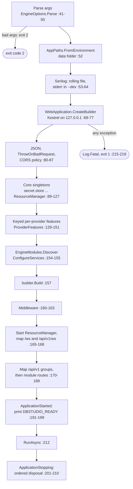
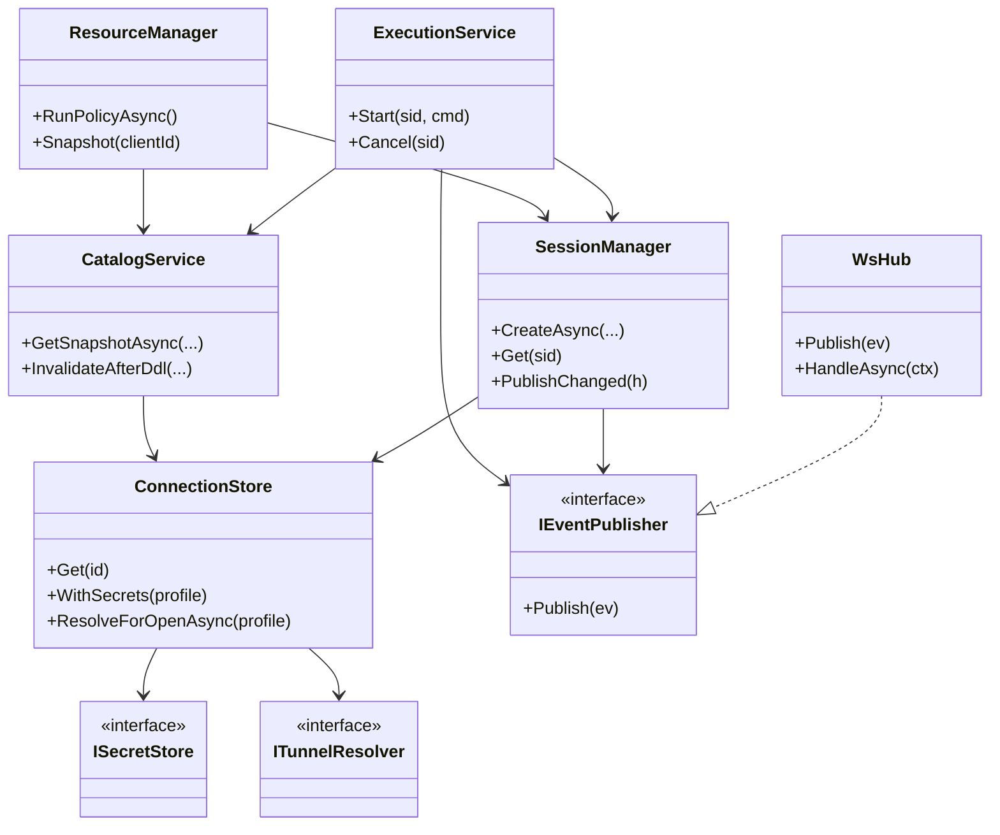
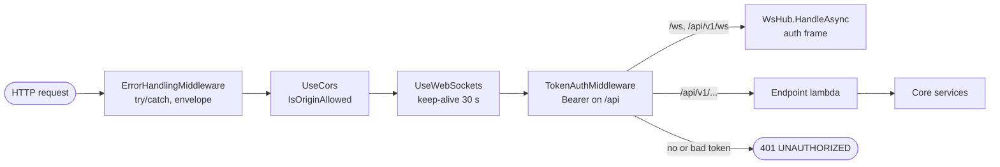
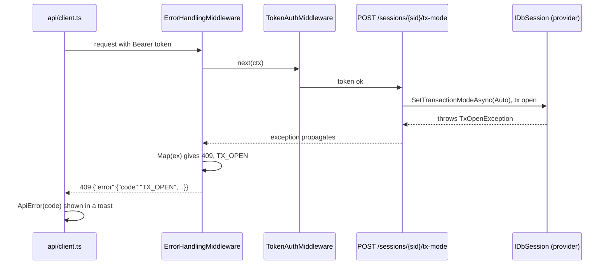

<div dir="rtl">

# 5. میزبان موتور: راه‌اندازی، REST API، خطاها

> **سطح:** L2 کاربردی ← L3 ارشد | **بخش:** II | **کد خوانده‌شده در:** `08528ae` (Rowlit 1.6.3)
> [English](../../en/part2/05-engine-host-and-api.md) · قبلی: [4. اجرا از روی کد منبع](04-development-setup.md) · بعدی: [6. پروتکل رویداد WebSocket](06-websocket-protocol.md)
>
> **در یک جمله:** ‏`DbStudio.Host/Program.cs` برنامه‌ای ۲۲۵ سطری با سبک minimal API در ASP.NET Core است که چهار پرچم خط فرمان را تجزیه می‌کند، لاگ و یک کارساز Kestrel فقط روی حلقهٔ محلی برپا می‌کند، همهٔ سرویس‌های موتور را به‌صورت تک‌نمونه ثبت می‌کند، چهار میان‌افزار نصب می‌کند، مسیرهای REST و WebSocket را نگاشت می‌کند، یک سطر READY چاپ می‌کند و هنگام توقف سرویس‌ها را با ترتیبی ثابت خاموش می‌کند.
>
> **در این فصل یاد می‌گیرید:**
> - هر قدم راه‌اندازی موتور را، به همان ترتیبی که کد اجرا می‌کند؛
> - تزریق وابستگی، سرویس‌های کلیددار و ماژول‌ها چطور ثبت می‌شوند و چرا تقریباً همه‌چیز تک‌نمونه است؛
> - خط لولهٔ میان‌افزارها و این‌که هرکدام از چه چیزی محافظت می‌کند؛
> - نقشهٔ مسیرهای REST، از جمله مسیرهایی که ماژول‌های قابلیت اضافه می‌کنند؛
> - پاکت خطا، همهٔ کدهای خطا و این‌که یک استثنا چطور به وضعیت HTTP تبدیل می‌شود؛
> - موتور چطور می‌فهمد Electron رفته است و چطور خاموش می‌شود.
>
> **پیش‌نیازها:** [3. معماری کلان](03-big-picture-architecture.md). مفید: کمی C# و HTTP.
>
> برچسب‌های نمودارها به انگلیسی نگه داشته شده‌اند تا در GitHub درست نمایش داده شوند.

## 1. ایده (مبتدی)

موتور یک کارساز وب کوچک است که فقط رایانهٔ خود شما به آن دسترسی دارد. وقتی Electron آن را اجرا می‌کند، موتور خط فرمانش را می‌خواند، یک پروندهٔ لاگ باز می‌کند، روی `127.0.0.1` و یک درگاه آزاد شروع به گوش دادن می‌کند و یک سطر چاپ می‌کند که درگاه و یک توکن مخفی را به Electron می‌گوید. از آن به بعد رابط کاربری درخواست‌های معمولی HTTP مثل `GET /api/v1/connections` یا `POST /api/v1/sessions/{id}/execute` را همراه توکن می‌فرستد و JSON پس می‌گیرد. نتیجه‌های طولانی از راه یک WebSocket جداگانه می‌آیند (فصل [6](06-websocket-protocol.md)).

درون برنامه فهرستی از *سرویس‌ها* هست: شیئی که نشست‌ها را مدیریت می‌کند، شیئی که پرس‌وجوها را اجرا می‌کند، شیئی که کاتالوگ‌ها را در حافظهٔ نهان نگه می‌دارد و الی آخر. روشی به نام [تزریق وابستگی (dependency injection)](../glossary.md#dependency-injection) (یک ظرف هر شیء را می‌سازد و اشیای دیگری را که لازم دارد به آن می‌دهد، تا کلاس‌ها خودشان وابستگی‌هایشان را نسازند) این‌ها را یک بار هنگام راه‌اندازی به هم وصل می‌کند. هر درخواست پیش از رسیدن به کدِ مسیرش از زنجیرهٔ کوتاهی از بررسی‌ها می‌گذرد (خطاها، CORS، WebSocket، توکن). وقتی چیزی شکست می‌خورد، پاسخ همیشه یک شکل دارد، `{"error":{"code","message","detail"}}`، تا رابط کاربری بتواند پیامی دقیق نشان دهد. وقتی Electron بسته می‌شود، موتور متوجه می‌شود و آرام خاموش می‌شود: تراکنش‌های باز را rollback می‌کند و همهٔ اتصال‌ها را می‌بندد.

## 2. چگونه کار می‌کند (کاربردی)

### 2.1 راه‌اندازی در یک نگاه

شکل 5.1 تمام `Program.cs` را به‌صورت یک نمودار جریان نشان می‌دهد. هر جعبه سطرهایی را که آن را پیاده می‌کنند نام می‌برد.

**شکل 5.1 — توالی راه‌اندازی موتور (`engine/src/DbStudio.Host/Program.cs`).**

</div>



<div dir="rtl">

فرایند برای آرگومان نامعتبر `2` (`Program.cs:46-50`)، وقتی راه‌اندازی استثنا بدهد `1` (`:215-219`) و پس از خاموشی عادی `0` (`:212-213`) برمی‌گرداند. بلوک `finally` در هر حالت Serilog را تخلیه می‌کند (`:221-224`).

### 2.2 خط فرمان: `EngineOptions`

‏`EngineOptions.Parse` (`engine/src/DbStudio.Host/EngineOptions.cs:40-75`) چهار پرچم را می‌فهمد که هرکدام به شکل `--name=value` هم پذیرفته می‌شوند (`:66-68`):

| پرچم | اثر | پیش‌فرض |
|---|---|---|
| `--port N` | درگاهی که روی آن گوش می‌دهد؛ صفر یعنی «بگذار سیستم‌عامل انتخاب کند» (`:52-55`) | صفر (پوسته هرگز آن را نمی‌فرستد) |
| `--token T` | توکن حاملی که هر درخواست باید داشته باشد (`:56-58`) | ۳۲ بایت تصادفی، base64url بدون padding (`:78-79`) |
| `--dev` | حالت توسعه: توکن ثابت، مبدأهای CORS بیشتر، لاگ روی کنسول (`:59-61`) | خاموش |
| `--parent-pid P` | وقتی فرایند P تمام شد، خارج شو (`:62-64`) | ندارد |

دو جزئیات مهم است. آرگومان‌های ناشناخته عمداً نادیده گرفته می‌شوند، «تا راه‌اندازها بتوانند آرگومان‌های خودشان را اضافه کنند» (`:69`). توکن خالی یا فقط فاصله جایگزین می‌شود: در `--dev` با `dev-token` (`EngineOptions.DevToken`، `:13`) و در غیر این صورت با یک توکن تصادفی تازه (`:73`). ‏`IsOriginAllowed` (`:29-38`) تنها قاعدهٔ مبدأ است که هم CORS و هم ارتقای WebSocket از آن استفاده می‌کنند: همیشه `dbstudio://app`؛ در `--dev` علاوه بر آن `http://localhost:5173`، `http://127.0.0.1:5173` و هر مبدأ `http://localhost:<port>` یا `http://127.0.0.1:<port>` بدون مسیر، پرس‌وجو یا اطلاعات کاربر، تا Vite بتواند روی درگاه دیگری اجرا شود.

برنامه همچنین آرگومان‌های خودش را به سامانهٔ پیکربندی ASP.NET نمی‌دهد: سازنده `Args = []` می‌گیرد (`Program.cs:68-69`)، چون `--dev` بدون مقدار، فراهم‌کنندهٔ پیکربندی خط فرمان را گیج می‌کند.

### 2.3 پوشهٔ داده

‏`AppPaths.FromEnvironment()` (`Program.cs:52`؛ `engine/src/DbStudio.Core/Services/Infrastructure.cs:11-30`) پوشه‌ای را پیدا می‌کند که `connections.json`، `secrets.dat`، `settings.json`، `history.db` و `logs/` را نگه می‌دارد. خود این تشخیص کار `DataDirectory.Resolve` است (`engine/src/DbStudio.Core/Platform/DataDirectory.cs:44-59`)؛ تابعی خالص تا بتوان آن را برای هر سیستم‌عاملی روی هر سیستم‌عاملی آزمود:

1. اگر `DBSTUDIO_DATA_DIR` تنظیم شده باشد، برنده است (`:48-49`). برنامهٔ رومیزی همیشه آن را تنظیم می‌کند (`:11-12`).
2. وگرنه پوشهٔ والد مخصوص هر سیستم‌عامل (`:62-79`): Roaming AppData در ویندوز، `~/Library/Application Support` در macOS، و در جاهای دیگر `$XDG_CONFIG_HOME` (فقط اگر مطلق باشد) یا `~/.config`؛ به‌علاوهٔ نام پوشهٔ `Rowlit` (`:22`).
3. اگر `Rowlit` وجود نداشته باشد ولی پوشهٔ قدیمی پیش از ۱.۲، یعنی `DbStudio`، باشد، همان پوشهٔ قدیمی استفاده می‌شود (`:53-57`)، تا موتوری که تنها اجرا شده پیش از آن‌که برنامهٔ رومیزی پوشه را جابه‌جا کند هرگز اتصال‌های ذخیره‌شده را «گم» نکند.

سیستم‌عامل از `HostPlatform.Current` می‌آید (`engine/src/DbStudio.Core/Platform/HostPlatform.cs:13-19`)؛ FreeBSD و بقیه مثل لینوکس رفتار می‌شوند. نوشتن پرونده‌ها در این پوشه اتمی است: یک پروندهٔ موقت کنار مقصد نوشته و روی دیسک تخلیه می‌شود و بعد `File.Move(…, overwrite: true)` (`Infrastructure.cs:33-59`).

### 2.4 لاگ با Serilog

[Serilog](../glossary.md#serilog) یک کتابخانهٔ [لاگ ساخت‌یافته (structured logging)](../glossary.md#structured-logging) است (هر رویداد لاگ مقدارهای نام‌دارش مثل `{Port}` را به‌صورت داده نگه می‌دارد، نه فقط متن). پیکربندی (`Program.cs:53-64`):

- کمینهٔ سطح `Information`؛ `Microsoft.AspNetCore` روی `Warning` تا لاگ درخواست‌ها پرونده را پر نکند؛ `Microsoft.Hosting.Lifetime` روی `Information`؛
- یک مقصد پرونده، `logs/engine-<date>.log`، چرخشی روزانه، با نگه داشتن ۱۰ پرونده و قالب `{Timestamp:yyyy-MM-dd HH:mm:ss.fff zzz} [{Level:u3}] {SourceContext}: {Message:lj}` (`:58-59`)؛
- در `--dev`: کمینهٔ `Debug` و یک مقصد کنسول که *همهٔ* سطح‌ها را روی **stderr** می‌نویسد (`standardErrorFromLevel: LogEventLevel.Verbose`، `:60-63`).

چرا stderr؟ چون stdout یک کانال پروتکل است: دقیقاً یک سطر حمل می‌کند، یعنی سطر READY (`Program.cs:39`)، و `EngineSupervisor` برای پیدا کردن آن stdout را تجزیه می‌کند (`desktop/src/main/engine-process.ts:207-221`). فراهم‌کننده‌های لاگ خود ASP.NET حذف (`builder.Logging.ClearProviders()`، `:70`) و Serilog جایگزینشان می‌شود (`:71`)، پس هر `ILogger<T>` در موتور از راه Serilog می‌نویسد. نمای لاگ‌ها می‌تواند این پرونده را به‌عنوان «لاگ موتور» نشان دهد (`EngineLogSource`، فصل [21](21-logs-activity-resources.md)).

### 2.5 ‏Kestrel و سازنده

[Kestrel](../glossary.md#kestrel) کارساز HTTP درونی ASP.NET Core است. موتور آن را در سه سطر پیکربندی می‌کند (`Program.cs:72-77`): فقط روی `IPAddress.Loopback` و درگاه `options.Port` گوش بده؛ بدنهٔ درخواست‌ها را به **64 MB** محدود کن (`MaxRequestBodySize = 64L * 1024 * 1024`، برای یک اسکریپت بزرگ یا بارگذاری پرونده برای ورود داده کافی است)؛ و سرآیند `Server` نفرست. ریشهٔ محتوا پوشهٔ پروندهٔ اجرایی است (`AppContext.BaseDirectory`، `:69`)، نه پوشهٔ جاری، چون پوسته ممکن است موتور را از هر جایی اجرا کند.

برنامه یک [minimal API](../glossary.md#minimal-api) در [ASP.NET Core](../glossary.md#asp-net-core) (چارچوب وب مایکروسافت برای ‎.NET) است: هر [نقطهٔ پایانی (endpoint)](../glossary.md#endpoint) (یک متد HTTP همراه یک مسیر و کدی که پاسخش را می‌دهد) lambdaیی است که با `MapGet` / `MapPost` روی یک [گروه مسیر (route group)](../glossary.md#route-group) ثبت می‌شوند (پیشوندی مثل `/api/v1/sessions` که میان چند نقطهٔ پایانی مشترک است) و پارامترهایشان از مسیر، رشتهٔ پرس‌وجو، بدنهٔ JSON و بر اساس نوع از ظرف DI مقید می‌شوند. هیچ کنترل‌گری (controller) در کار نیست.

### 2.6 ثبت سرویس‌ها، به ترتیب

همهٔ ثبت‌ها پیش از `builder.Build()` انجام می‌شوند (`Program.cs:157`) و در چهار بلوک می‌آیند.

**بلوک ۱ — تک‌نمونه‌های هسته** (`Program.cs:89-127`). هر ثبت در DI یک [طول عمر سرویس (service lifetime)](../glossary.md#service-lifetime) دارد (یک نمونه چقدر زنده می‌ماند: تک‌نمونه، یکی برای هر درخواست (scoped)، یا یکی برای هر بار حل کردن (transient)). [تک‌نمونه (singleton)](../glossary.md#singleton) (یک نمونه برای کل عمر فرایند) طول عمر طبیعی موتوری است که وضعیتش *همان* جدول نشست‌ها، حافظه‌های نهان و جریان‌های باز است:

| سطر | سرویس | چرا این‌جاست |
|---|---|---|
| 89-90 | `EngineOptions`، `AppPaths` | پیکربندی به‌صورت اشیای ساده |
| 91 | `ISecretStore` از راه `SecretStoreFactory.Create` | DPAPI، Keychain یا پروندهٔ AES، بسته به سیستم‌عامل (فصل [19](19-security-and-secrets.md)) |
| 92-95 | چهار `IDbProvider`: SQL Server، Oracle، SQLite، PostgreSQL | فراهم‌کننده‌های M1/M2 مستقیم ثبت می‌شوند؛ جدیدترها از ماژول‌ها می‌آیند (بلوک ۴) |
| 96، 98 | `ProviderRegistry`، `SourceRegistry` | پیدا کردن فراهم‌کننده با شناسه (فصل [7](07-engine-modules-and-di.md)) |
| 100-102 | `SshTunnelService` و `ITunnelResolver` (همان نمونه) | تونل‌های SSH، با میزبان‌های شناخته‌شده در پوشهٔ داده (فصل [8](08-connections-sessions-execution.md#22-ssh-tunnels)) |
| 103-104 | `ConnectionStore(...).UseTunnels(resolver)` | هر باز کردن درایور، رمزها و تونل‌ها را از راه آن حل می‌کند |
| 105-108 | `SettingsService`، `HistoryService`، `ResultStore`، `ClientPresence` | پروندهٔ تنظیمات، `history.db`، آخرین نتیجه‌های هر نشست، کلاینت‌های زندهٔ رابط کاربری |
| 109-110 | `WsHub` و `IEventPublisher` (همان نمونه) | هاب *همان* ناشری است که هر سرویس برای فرستادن رویداد از آن استفاده می‌کند |
| 111-121 | `SessionManager`، `SourceClientManager`، `StreamManager`، `JobManager`، `CatalogService`، `ExecutionService`، `ExportService` | موردهای کاربرد موتور |
| 123-126 | `ResourceManager` | آزادسازی نشست‌های بیکار، سقف‌ها، فشار حافظه (فصل [21](21-logs-activity-resources.md)) |
| 127 | `ParentWatchdog` (سرویس میزبانی‌شده) | خروج همراه والد (بخش 2.8) |

چند ثبت به‌جای `AddSingleton<T>()` از یک lambda کارخانه استفاده می‌کنند. میزبان این‌طور آرگومان‌هایی را می‌دهد که ظرف نمی‌تواند حدس بزند: `SourceClientManager` مقدار `reapInterval: Timeout.InfiniteTimeSpan` را می‌گیرد چون `ResourceManager` جمع‌کنندهٔ بیکارهایش را می‌راند (`:112-114`)، و `StreamManager` یک تابع جست‌وجوی `kind => sp.GetKeyedService<IStreamFactory>(kind)` می‌گیرد (`:115-117`) تا کارخانه‌های جریان را به‌تأخیر و بر اساس نوع حل کند.

**بلوک ۲ — قابلیت‌های کلیددار هر فراهم‌کننده** (`Program.cs:129-147`). [سرویس کلیددار (keyed service)](../glossary.md#keyed-service) ثبتی در DI همراه یک کلید است (این‌جا شناسهٔ فراهم‌کننده، مثل `"sqlserver"`) که با `GetKeyedService<T>(key)` حل می‌شود. طرح M1.5 این را انتخاب کرد تا `IDbProvider` بزرگ نشود: نویسنده‌های اسکریپت DDL، پایگاه‌های دادهٔ طراح، خواننده‌های طرح اجرا و مقیدکننده‌های پارامتر برای چهار فراهم‌کنندهٔ درونی زیر شناسه‌هایشان ثبت می‌شوند (`:130-146`) و `ProviderFeatures.FromServices` (`:147`) هنگام فراخوانی پیدایشان می‌کند (`engine/src/DbStudio.Core/Services/ProviderFeatures.cs:32-46`). توضیح سطر `:142` هنوز قابلیت‌های PostgreSQL را «stubهای M2-0 که تا پیاده‌سازی PG-A استثنای NotSupportedException می‌دهند» می‌نامد؛ این توضیح کهنه است: `PgDdlScripter` و بقیهٔ قابلیت‌های PostgreSQL امروز پیاده‌سازی کامل دارند (`engine/src/DbStudio.Providers.PostgreSql/Designer/PgDdlScripter.cs`، ۳۸۵ سطر).

**بلوک ۳ — سرویس‌های بیشتر هسته** (`Program.cs:148-151`): ‏`FilterStore`، `DesignerService`، `DescribeService`، `SampleDatabase`.

**بلوک ۴ — ماژول‌ها** (`Program.cs:153-155`). ‏`EngineModules.Discover(ModuleAssemblies.All)` همهٔ `IEngineModule`ها را پیدا می‌کند و `ConfigureServices(services)` هرکدام روی همان مجموعه اجرا می‌شود. MySQL، ClickHouse، Snowflake، Cassandra، منبع‌ها، لاگ‌ها، ورود داده و فدراسیون همه این‌جا ثبت می‌شوند. پس از `Build()` میزبان فهرست ماژول‌ها را لاگ می‌کند (`:158`). فصل [7](07-engine-modules-and-di.md) سازوکار کشف را توضیح می‌دهد.

شکل 5.2 سرویس‌های اصلی و وابستگی‌هایشان را نشان می‌دهد (پارامترهای سازنده همان‌طور که در `Program.cs` ثبت شده‌اند).

**شکل 5.2 — سرویس‌های هسته و وابستگی‌های اصلی آن‌ها.**

</div>



<div dir="rtl">

### 2.7 خط لولهٔ میان‌افزارها

[میان‌افزار (middleware)](../glossary.md#middleware) زنجیره‌ای از مؤلفه‌هاست که هرکدام درخواست را در مسیر رفت و پاسخ را در مسیر برگشت می‌بینند. Rowlit چهار میان‌افزار را به این ترتیب نصب می‌کند (`Program.cs:160-163`)؛ شکل 5.3 مسیر یک درخواست را نشان می‌دهد.

**شکل 5.3 — خط لولهٔ میان‌افزارهای میزبان موتور.**

</div>



<div dir="rtl">

1. **`ErrorHandlingMiddleware`** (`engine/src/DbStudio.Host/Infrastructure/Middleware.cs:28-55`) اول است، پس همه‌چیزِ بعد از خود را در بر می‌گیرد. هر استثنایی را می‌گیرد و پاکت خطا را می‌نویسد (بخش 2.12). پاسخ‌های خالی `404` و `405` را هم با یک پاکت (کد `NOT_FOUND`) پر می‌کند، ولی هرگز برای درخواست WebSocket (`:35-42`). ‏`OperationCanceledException`ای که به‌خاطر رفتن کلاینت رخ داده، بی‌صدا بلعیده می‌شود (`:44-47`).
2. **`UseCors`** (`Program.cs:161`) سیاست پیش‌فرضی را اعمال می‌کند که در `:82-87` ساخته شده: مبدأها با `IsOriginAllowed`، هر سرآیند، هر متد، سرآیندهای آشکارشدهٔ `ETag` و `Content-Disposition` (رابط کاربری ETag کاتالوگ و نام پروندهٔ دانلودها را می‌خواند) و نگه‌داری نتیجهٔ preflight برای یک ساعت. [preflight](../glossary.md#preflight) درخواست `OPTIONS`ی است که مرورگر پیش از فراخوانی میان‌مبدأیی با سرآیندهای سفارشی می‌فرستد.
3. **`UseWebSockets`** (`Program.cs:162`) درخواست‌های ارتقا را به سوکت تبدیل می‌کند و هر ۳۰ ثانیه یک ping زنده‌نگه‌دار در سطح پروتکل می‌فرستد.
4. **`TokenAuthMiddleware`** (`Middleware.cs:85-104`) روی هر مسیری که با `/api` شروع شود `Authorization: Bearer <token>` را لازم می‌داند، به‌جز preflightهای `OPTIONS` و دو مسیر WebSocket که با فریم اولشان احراز هویت می‌کنند (`:92`، `:101`). مقایسه با `CryptographicOperations.FixedTimeEquals` انجام می‌شود (`:103`)، پس زمانی که طول می‌کشد لو نمی‌دهد چند نویسهٔ ابتدایی درست بوده‌اند. توکن نبودن یا نادرست بودنش پاسخ `401 UNAUTHORIZED` همراه پاکت را می‌گیرد (`:98`).

ترتیب مهم است. چون میان‌افزار خطا بیرونی‌ترین است، حتی شکستی درون CORS یا بررسی توکن هم یک پاکت برمی‌گرداند. چون بررسی توکن پس از CORS می‌آید، preflightها (که بنا به طراحی توکن ندارند) را CORS پاسخ می‌دهد و از بررسی توکن رد می‌شوند (`HttpMethods.IsOptions`، `:92`).

<a id="28-the-parent-watchdog-and-shutdown"></a>

### 2.8 نگهبان والد و خاموشی

**نگهبان.** ‏`ParentWatchdog` (`engine/src/DbStudio.Host/Infrastructure/ParentWatchdog.cs:6-58`) یک [سرویس میزبانی‌شده (hosted service)](../glossary.md#hosted-service) است (یک `BackgroundService` که میزبان همراه برنامه راهش می‌اندازد و همراهش متوقفش می‌کند). با `--parent-pid P`:

- اگر P در حال اجرا نباشد، بی‌درنگ برنامه را متوقف می‌کند (`:14-21`)؛
- وگرنه منتظر `parent.WaitForExitAsync` می‌ماند (`:28`)؛ بعضی والدها حق دسترسی لازم برای این فراخوانی را نمی‌دهند، پس با `InvalidOperationException` یا `Win32Exception` به پرس‌وجوی دوره‌ای `Process.GetProcessById` در هر ثانیه برمی‌گردد (`:30-34`)؛
- وقتی والد خارج شد، «Parent process {Pid} exited; shutting down» را لاگ می‌کند و `StopApplication()` را صدا می‌زند (`:41-43`).

این تور ایمنی برای حالتی است که پوسته خودش نمی‌تواند از پسش برآید: از کار افتادن یا کشته شدن Electron. در خروج عادی، ناظر درخت فرایند موتور را می‌کشد (فصل [22](22-desktop-shell.md)).

**ترتیب خاموشی.** وقتی میزبان متوقف می‌شود، فراخوان `ApplicationStopping` (`Program.cs:201-210`) سرویس‌های دارای وضعیت را یکی پس از دیگری، هرکدام با انتظاری محدود، dispose می‌کند:

| ترتیب | سرویس | انتظار | dispose چه می‌کند |
|---|---|---|---|
| 1 | `ResourceManager` | ۲ ثانیه | زمان‌سنج سیاست را متوقف می‌کند تا وسط خاموشی نشستی را آزاد نکند |
| 2 | `SessionManager` | ۱۰ ثانیه | «تراکنش‌های باز را rollback کن و اتصال‌های زبانه‌ها را ببند» (`:204`) |
| 3 | `StreamManager` | ۵ ثانیه | جریان‌ها را با دلیل `shutdown` پایان می‌دهد (`:206`) |
| 4 | `JobManager` | ۵ ثانیه | کارهای در حال اجرا را لغو می‌کند |
| 5 | `SourceClientManager` | ۵ ثانیه | کلاینت‌های Redis، Mongo، Kafka و Elasticsearch را می‌بندد |

نشست‌ها بیشترین زمان را می‌گیرند چون rollback هر تراکنش یک رفت‌وبرگشت به کارساز برای هر نشست است. انتظارها فراخوانی‌های `.Wait(TimeSpan)` هستند، پس یک dispose گیرکرده نمی‌تواند خاموشی را بیش از سهمش معطل کند؛ بدترین حالت ۲۷ ثانیه به توقف اضافه می‌کند. هدف یک [خاموشی آرام (graceful shutdown)](../glossary.md#graceful-shutdown) است (نپذیرفتن کار تازه، تمام یا لغو کردن کار جاری، آزاد کردن منابع و سپس خروج) و این سهم‌ها آن را محدود نگه می‌دارند.

### 2.9 سطر READY و `/health`

وقتی Kestrel درگاهش را گرفت، فراخوان `ApplicationStarted` (`Program.cs:191-199`) نشانی واقعی را از `IServerAddressesFeature` می‌خواند (وقتی `--port 0` به کار رفته، درگاه تازه اکنون معلوم است)، `{ port, token }` را سریال می‌کند، `DBSTUDIO_READY {"port":…,"token":"…"}` را روی stdout می‌نویسد و تخلیه می‌کند. همین یک سطر کل دست‌دهی با پوسته است؛ ناظر آن را با `parseReadyLine` تجزیه می‌کند و هر چیز بدشکلی را رد می‌کند (`desktop/src/main/engine-process.ts:207-221`). پروندهٔ لاگ همان رویداد را بدون توکن ثبت می‌کند (`Program.cs:198`).

‏`GET /api/v1/health`، یعنی [بررسی سلامت (health check)](../glossary.md#health-check) موتور (نقطهٔ پایانی ارزانی که فقط می‌گوید «زنده‌ام»)، مقدار `{ status: "ok", version, pid, dev }` را برمی‌گرداند (`engine/src/DbStudio.Host/Endpoints/MetaEndpoints.cs:11-12`؛ `Contracts/Api.cs:10`). توجه کنید که زیر `/api` است، پس مثل هر چیز دیگری به توکن نیاز دارد. آزمون دود هر دو را بررسی می‌کند: درخواست بدون توکن 401 می‌گیرد و `/health` با توکن 200 (`engine/tests/smoke/smoke.mjs:78-80`).

### 2.10 نقشهٔ مسیرها

همهٔ مسیرهای REST زیر یک گروه زندگی می‌کنند، `app.MapGroup("/api/v1")` (`Program.cs:170`). پرونده‌های نقطهٔ پایانی خود میزبان گروه‌هایشان را در زنجیره‌ای ثابت اضافه می‌کنند (`:171-188`)؛ سپس `MapEndpoints(api)` هر ماژول گروه‌های خودش را (`:189`).

| افزونه (پرونده) | پیشوند | چه سرو می‌کند |
|---|---|---|
| `MapMeta` (`MetaEndpoints.cs`) | `/health`، `/providers`، `/settings`، `/sql/format` | سلامت، فهرست فراهم‌کننده‌ها با مشخصات فرم، خواندن و وصلهٔ تنظیمات؛ `/sql/format` پاسخ 400 `NOT_SUPPORTED` می‌دهد چون قالب‌بندی در رابط کاربری انجام می‌شود (`MetaEndpoints.cs:27-28`) |
| `MapConnections` | `/connections` | ایجاد، خواندن، ویرایش، حذف و `POST /connections/test` |
| `MapCatalog` | `/connections/{id}/catalog` | پایگاه‌های داده، شِماها، تصویر لحظه‌ای با ETag/304، شیء، DDL، خطاها، نوع‌های سیستمی، مترادف، تازه‌سازی |
| `MapObjects` | `/connections/{id}/catalog/objects`، `/dependencies` | فهرست اشیا، «استفاده می‌کند / استفاده می‌شود» |
| `MapSessions` | `/sessions` | ایجاد، فهرست، بستن، پایگاه داده، شِما، حالت تراکنش، اتصال دوباره، commit، rollback، اجرا، لغو |
| `MapExecutions` | `/executions/{xid}/resultsets/{rs}`، `/export` | بازپخش سطرها، خانهٔ کامل، خروجی یک مجموعهٔ نتیجه، خروجی جریانی یک پرس‌وجو |
| `MapHistory`، `MapSql` | `/history`، `/sql/diagnostics` | جست‌وجو، سنجاق و حذف تاریخچه؛ پیام‌های تشخیصی کارساز |
| `MapFilters`، `MapDescribe`، `MapPlans`، `MapDesigner`، `MapSampleDb` | `/filters`، `/sessions/{sid}/describe`، `/sessions/{sid}/explain`، `/connections/{id}/designer`، `/sample-db` | قابلیت‌های M1.5 |
| `MapStreams` | `/streams`، `/jobs` | باز کردن (202 `{streamId}`)، مکث، ادامه، بستن؛ فهرست و لغو کارها |
| `MapSources` | `/sources` | کلاینت‌های غیررابطه‌ای: فهرست، باز کردن، بستن |
| `MapResources` | `/resources`، `/connections/{id}/resources`، `/connections/{id}/close` | دادهٔ نوار وضعیت، گزارش حافظه، کوچک‌سازی، بستن |
| ماژول‌ها | `/links`، `/redis/{cid}`، `/mongo/{cid}`، `/kafka/{cid}`، `/es/{cid}`، `/logs/{cid}`، `/connections/{cid}/import`، `/connections/{cid}/queries`، `/connections/{cid}/er/layouts`، `/local-history`، `/schema-compare`، `/clickhouse/{cid}`، `/snowflake/{cid}`، `/snowflake/sessions/{sid}`، `/cassandra` | بسته‌های قابلیت (فصل [7](07-engine-modules-and-di.md)) |

گردانندهٔ WebSocket دو بار نگاشت شده، در `/ws` و `/api/v1/ws` (`Program.cs:166-168`)؛ فصل [6](06-websocket-protocol.md) توضیح می‌دهد چرا رابط کاربری اول دومی را امتحان می‌کند.

**سرآیند کلاینت.** هر درخواست رابط کاربری `X-DbStudio-Client: <uuid>` را دارد (`ui/src/api/client.ts:99`) که `HttpContext.ClientId()` آن را می‌خواند (`engine/src/DbStudio.Host/Infrastructure/ClientIdentity.cs:9-16`) و `ClientPresence.Normalize` عادی‌سازی‌اش می‌کند: فاصله‌های دو طرف حذف می‌شود و حداکثر ۱۲۸ نویسهٔ ASCII چاپ‌پذیر می‌ماند، وگرنه null (`engine/src/DbStudio.Core/Services/ClientPresence.cs:12`، `:23-33`). موتور از این راه می‌داند کدام پنجره صاحب یک نشست است (`SessionEndpoints.Touch` نشست را برای فراخواننده می‌گیرد، `SessionEndpoints.cs:137-143`) یا صاحب یک جریان (`StreamEndpoints.cs:24`). ‏`ClientPresence` تعداد WebSocketهای زندهٔ هر کلاینت را می‌شمارد و وقتی آخرینشان بسته شد `ClientGone` را بالا می‌آورد (`ClientPresence.cs:35-62`) تا مدیران نشست و جریان بتوانند پس از پنجره‌ای که ناپدید شده تمیزکاری کنند (فصل [8](08-connections-sessions-execution.md)).

### 2.11 قراردادهای JSON

‏`CoreJson.Configure` (`engine/src/DbStudio.Core/Services/CoreJson.cs:18-29`) روی سریال‌ساز minimal API اعمال می‌شود (`Program.cs:80`) و هاب، پاکت خطا و پرونده‌های خود موتور هم مستقیم از آن استفاده می‌کنند؛ پس همه‌جا یک قرارداد هست:

- پیش‌فرض‌های Web، نام ویژگی‌ها به‌صورت **[camelCase](../glossary.md#camelcase)** و خواندن بی‌حساس به بزرگی و کوچکی حروف؛
- کلیدهای دیکشنری همان‌طور که هستند نگه داشته می‌شوند (`DictionaryKeyPolicy = null`)، تا کلیدهای `props` اتصال مثل `ssh.host` و کلیدهای تنظیمات در رفت‌وبرگشت سالم بمانند؛
- ‏`NumberHandling.Strict`: عددی که در گیومه آمده خطای اعتبارسنجی است، نه چیزی که بی‌صدا پذیرفته شود؛
- شمارش‌ها (enum) به‌صورت رشتهٔ camelCase، هرگز عدد صحیح (`allowIntegerValues: false`)؛
- دو مبدل سفارشی پیش از بقیه اجرا می‌شوند: `Dialect` به‌صورت `tsql | plsql | sqlite | pgsql | mysql | clickhouse | snowflake | cql | duckdb` (`:31-57`، `:81-90`) و `SourceKind` به‌صورت `relational | keyvalue | document | stream | search` (`:59-77`، `:93-102`). camelCase سادهٔ پیش‌فرض `tSql` و `keyValue` می‌ساخت.

شکل درخواست‌ها و پاسخ‌ها [DTO](../glossary.md#dto) (شیء انتقال داده: رکوردهای ساده‌ای که فقط داده حمل می‌کنند) هستند و در `engine/src/DbStudio.Host/Contracts/{Api,M15,M2}.cs` قرار دارند و `ui/src/api/types.ts` آینهٔ آن‌هاست (`Api.cs:7-8`). این دو با هم [قرارداد (contract)](../glossary.md#contract) API را می‌سازند (شکل توافق‌شدهٔ درخواست‌ها، پاسخ‌ها و رویدادها که هر دو طرف بر اساس آن کد می‌نویسند). پاسخ‌هایی که خودشان مدل‌های سادهٔ هسته‌اند (`ConnectionProfile`، `SessionInfo`، `ObjectDetails`…) مستقیم سریال می‌شوند.

<a id="212-the-error-envelope-and-error-codes"></a>

### 2.12 پاکت خطا و کدهای خطا

هر پاسخ غیر 2xx بدنه‌ای یکسان دارد که `ErrorEnvelope` آن را می‌نویسد (`Middleware.cs:11-25`):

</div>

```json
{ "error": { "code": "TX_OPEN", "message": "A transaction is open. Commit or roll back first.", "detail": null } }
```

<div dir="rtl">

سرویس‌ها شکست را به‌صورت `EngineException(status, code, message, detail)` بالا می‌آورند (`engine/src/DbStudio.Core/Services/ExecutionContracts.cs:21-44`) که برای موردهای رایج کارخانه دارد (`NotFound`، `Validation`، `SourceUnavailable`، `StreamLimit`، `Privilege`، `ReadOnly`). نوع‌های دیگر استثنا را `ErrorHandlingMiddleware.Map` نگاشت می‌کند (`Middleware.cs:57-81`). جدول زیر هر دو را با کدهای وضعیتی که کد واقعاً به کار می‌برد ادغام کرده است (از جست‌وجوی همهٔ `new EngineException(<status>, <code>` در `engine/src`):

| کد | وضعیت | چه وقت |
|---|---|---|
| `UNAUTHORIZED` | 401 | توکن حامل نیست یا نادرست است (`Middleware.cs:98`) |
| `NOT_FOUND` | 404 (برای نشست disposeشده 409) | شناسه، مسیر یا متد ناشناخته (`Middleware.cs:38-41`)؛ `ObjectDisposedException` ← 409 «The session is closed.» (`:73`) |
| `VALIDATION` | 400 | بدنه یا آرگومان نادرست، `BadHttpRequestException`، `JsonException`، `ArgumentException` (`:64-65`، `:71`) |
| `SESSION_BUSY` | 409 | یک دستور از قبل روی نشست در حال اجراست (`:60`؛ `ExecutionService.cs:92-93`) |
| `SESSION_BROKEN` | 409 | اتصال نشست شکسته است (`:61`) |
| `SESSION_LIMIT` | 429 | نشست‌ها از `maxSessionsPerProfile` بیشتر شده‌اند (`engine/src/DbStudio.Core/Services/SessionManager.cs:229`) |
| `TX_OPEN` | 409 | عمل، تراکنشی باز را پایان می‌دهد یا به پایانش نیاز دارد (`:62`) |
| `READ_ONLY` | 403 | نوشتن روی اتصال فقط‌خواندنی (`ExecutionContracts.cs:42-43`؛ فصل [8](08-connections-sessions-execution.md)) |
| `PRIVILEGE` | 403 | کارساز دسترسی به یک نمای سیستمی را رد کرده؛ `detail.needs` مجوز لازم را نام می‌برد (`ExecutionContracts.cs:39`) |
| `NOT_SUPPORTED` | 400 (در سه جا 501) | ‏`NotSupportedException` (`:63`)، فراهم‌کننده‌ای که قابلیتی را ندارد (`ProviderFeatures.cs:52-53`) |
| `PROVIDER_ERROR` | 422 (و نیز 400/409/500/504) | یک `DbException` همراه `detail.providerCode` و `detail.sqlState` (`:68`)؛ استثناهای درایورهای Oracle، `Microsoft.Data.*` و Cassandra (`:74-79`)؛ `TimeoutException` ← 504 (`:72`) |
| `SERVER_UNREACHABLE` | 503 | ‏`ConnectionGuard.IsBrokenConnection` یک سوکت مرده یا پایان مهلت را تشخیص می‌دهد (`:67`) |
| `SSH_TUNNEL` | 503 | گام SSH شکست خورده؛ `detail.hop = "ssh"` (`engine/src/DbStudio.Core/Services/Tunnels/SshTunnelService.cs:456`) |
| `SOURCE_UNAVAILABLE` | 503 | کلاینت Redis/Mongo/Kafka/ES نمی‌تواند وصل شود (`ExecutionContracts.cs:33`) |
| `STREAM_LIMIT` | 429 | جریان‌های باز کلاینت بیش از حد است (`ExecutionContracts.cs:36`) |
| `RESOURCE_BUSY` | 409 | بستن اتصال تراکنشی را rollback یا کاری در حال اجرا را لغو می‌کند (فصل [21](21-logs-activity-resources.md)) |
| `GROUP_ACTIVE` | 409 | ‏Kafka: گروه مصرف‌کننده عضو فعال دارد |
| `DDL_FAILED` | 409 | اعمال طراح شکست خورده (`engine/src/DbStudio.Core/Designer/DesignerContracts.cs:67`) |
| `BIND_VARS_UNSUPPORTED`، `CANCELLED` | — | کدهای خطای اجرا که به‌جای وضعیت HTTP درون رویدادهای `exec.error` می‌آیند (`ExecutionContracts.cs:51-52`) |
| `ENGINE_ERROR` | 500 | هر چیز دیگر: یک اشکال در کد (`Middleware.cs:80`) که همراه رد پشته در سطح `Error` لاگ می‌شود (`:51`) |

شکل 5.4 یک درخواستِ شکست‌خورده را دنبال می‌کند.

**شکل 5.4 — درخواستی که شکست می‌خورد به یک پاکت تبدیل می‌شود.**

</div>



<div dir="rtl">

در سمت رابط کاربری، `api/client.ts` هر پاسخ غیر 2xx را به یک `ApiError` با فیلد `code` تبدیل می‌کند و مسیرهای کد بر اساس آن تصمیم می‌گیرند؛ برای نمونه `isApiError(e, 'READ_ONLY')` تا گزینهٔ دور زدن حالت فقط‌خواندنی را پیشنهاد دهد (`ui/src/app/actions.ts:178-184`).

## 3. نگاه عمیق (ارشد)

### 3.1 ‏minimal API به‌جای کنترل‌گرها

ASP.NET Core دو سبک دارد: کنترل‌گرهای MVC (کلاس‌هایی با متدهای action، مسیریابی با attribute، فیلترها و مقیدسازی مدل در خط لولهٔ MVC) و minimal API (lambdaهایی که روی گروه‌های مسیر نگاشت می‌شوند و بر اساس نوع پارامتر مقید می‌شوند). Rowlit فقط دومی را به کار می‌برد. دلیل‌هایی که در کد دیده می‌شوند:

- **ترکیب از راه ماژول‌ها.** ‏`IEngineModule.MapEndpoints(RouteGroupBuilder api)` گروه `/api/v1` را به هر ماژول می‌دهد (`engine/src/DbStudio.Core/Providers/IDataSourceProvider.cs:50-55`). ماژول با چند فراخوانی `MapGet` روی همین گروه مسیر اضافه می‌کند؛ با کنترل‌گرها باید application partها و پویش اسمبلی‌ها در میزبان پیکربندی می‌شد.
- **سطح کوچک.** بیشتر نقطه‌های پایانی سه تا ده سطرند که اعتبارسنجی می‌کنند، یک سرویس را صدا می‌زنند و یک مدل هسته یا یک DTO برمی‌گردانند (مثلاً `SessionEndpoints.cs:116-126`). منطق در هسته است، و این نقطه‌های پایانی را نازک و از راه سرویس‌ها آزمودنی نگه می‌دارد.
- **پاسخ‌های صریح.** نقطه‌های پایانی وقتی وضعیتی مثل 202 لازم دارند `Results.Json(…, CoreJson.Options, statusCode: …)` برمی‌گردانند (`SessionEndpoints.cs:125`)، برای تصویر لحظه‌ای ازپیش‌سریال‌شدهٔ کاتالوگ همراه ETagش `Results.Bytes` (`CatalogEndpoints.cs:32-41`) و در بقیهٔ موارد اشیای ساده.

هزینه این است که رفتارهای مشترک (خطاها، احراز هویت) باید میان‌افزار باشند، نه فیلترهای MVC؛ Rowlit به‌هرحال همین را می‌خواهد، چون WebSocket هم باید پوشش داده شود.

### 3.2 ‏`ThrowOnBadRequest` و خطاهای مقیدسازی

به‌طور پیش‌فرض، وقتی یک نقطهٔ پایانی minimal API نتواند پارامتری را مقید کند (JSON بدشکل، رشته به‌جای `int`)، چارچوب پاسخ 400 با بدنهٔ خالی می‌دهد و در سطح debug لاگ می‌کند. ‏`RouteHandlerOptions.ThrowOnBadRequest = true` (`Program.cs:81`) کاری می‌کند که به‌جایش `BadHttpRequestException` پرتاب شود. میان‌افزار خطا آن را به `400 VALIDATION` با پیام درونی نگاشت می‌کند (`Middleware.cs:64`)، پس کلاینتی که بدنهٔ بد می‌فرستد همچنان پاکت استاندارد و متنی مفید می‌گیرد. دقت کنید چقدر از نقطه‌های پایانی بدنه را nullable می‌گیرند (`ExecuteRequestDto? req`) و خودشان `null` را بررسی می‌کنند (`SessionEndpoints.cs:118`): بدنهٔ خالی آن‌وقت پیام `VALIDATION` دقیقی با جزئیات `field` می‌سازد، نه یک خطای مقیدسازی عمومی.

### 3.3 چرا هسته به ASP.NET Core ارجاع می‌دهد

طرح M1 گفته بود هسته «هیچ ارجاع ASP.NETای» نخواهد داشت (`docs/PLAN.md:73`). کد فرق می‌کند: `DbStudio.Core.csproj` عبارت `<FrameworkReference Include="Microsoft.AspNetCore.App" />` را با توضیح «IEngineModule نقطه‌های پایانی minimal API را نگاشت (RouteGroupBuilder) و سرویس‌ها را ثبت می‌کند» دارد (`DbStudio.Core.csproj:16-19`). تصمیم D4 در طرح M2 ماژول‌ها را معرفی کرد (`docs/PLAN-M2.md:12`) و واسط ماژول باید در هسته زندگی کند، چون هر پروژهٔ قابلیت به هسته ارجاع می‌دهد ولی به میزبان نه. تنها نوع‌های ASP.NET که هسته در قراردادهایش به کار می‌برد `IServiceCollection` و `RouteGroupBuilder` هستند (`IDataSourceProvider.cs:2-3`)؛ ماژول‌های خود هسته (`DiagramsModule`، `QueriesModule`، `SearchModule`، `LocalHistoryModule`، `SchemaCompareModule`) مسیر نگاشت می‌کنند، ولی سرویس‌های هسته (`SessionManager`، `ExecutionService`، `CatalogService`) هیچ نوع HTTPای نمی‌گیرند. فصل [3](03-big-picture-architecture.md#32-how-rowlit-compares-honestly) بحث می‌کند که این برای مقایسه با «معماری تمیز» چه معنایی دارد.

### 3.4 طراحی نگاشت استثناها

‏`Map` یک عبارت `switch` در C# روی استثناست (`Middleware.cs:57-81`) و ترتیبش مهم است:

1. اول `EngineException`: سرویس‌هایی که وضعیت و کد درست را می‌دانند همیشه برنده‌اند.
2. بعد استثناهای مخصوص موتور (`SessionBusyException`، `SessionBrokenException`، `TxOpenException`)، تا با این‌که از `InvalidOperationException` مشتق شده‌اند کدهایشان را نگه دارند.
3. خطاهای ورودی چارچوب (`NotSupportedException`، `BadHttpRequestException`، `JsonException`).
4. ‏`ConnectionGuard.IsBrokenConnection(ex)` **پیش از** `DbException`. سوکت مرده درون یک درایور اغلب به‌صورت زیرکلاسی از `DbException` ظاهر می‌شود؛ بررسی اول اتصال آن را به `503 SERVER_UNREACHABLE` («Server not reachable: …») تبدیل می‌کند، نه یک `422` که شبیه اشتباهی در SQL کاربر به نظر برسد (`:66-67`).
5. ‏`DbException` ← `422 PROVIDER_ERROR`، با `providerCode` و `sqlState` در `detail` تا رابط کاربری نشانشان دهد (`:68`).
6. آزمون‌های فضای‌نام برای درایورهایی که استثناهایشان از `DbException` مشتق نمی‌شود (`Oracle.*`، `Microsoft.Data.*`) و برای Cassandra که در آن `NoHostAvailableException` به 503 تبدیل می‌شود (`:74-79`). تطبیق با رشتهٔ فضای‌نام نیاز میزبان به ارجاع مستقیم به درایور Cassandra را از بین می‌برد.
7. حالت پیش‌فرض `500 ENGINE_ERROR` (`:80`)، تنها حالتی که همراه پشته در سطح `Error` لاگ می‌شود (`:51`).

فقط شکست‌های *خود درخواست* به این نگاشت می‌رسند. خطای SQL درون یک دسته شکست HTTP نیست: فراهم‌کننده آن را از راه `IExecutionSink.Error` گزارش می‌دهد و به‌صورت رویداد `exec.error` منتقل می‌شود، در حالی که فراخوانی `execute` مدت‌ها پیش 202 برگردانده است (`engine/src/DbStudio.Core/Providers/IDbProvider.cs:97-102`).

### 3.5 تک‌نمونه‌ها و ایمنی نخ

همهٔ سرویس‌ها تک‌نمونه‌اند و درخواست‌های minimal API هم‌زمان روی استخر نخ‌ها اجرا می‌شوند، پس هر سرویس باید در برابر نخ‌ها ایمن باشد. کد این را با مجموعه‌های هم‌روند و قفل‌های کوچک برآورده می‌کند؛ برای نمونه `ClientPresence` از دو دیکشنری با یک `lock` محافظت می‌کند و رویدادش را بیرون از قفل بالا می‌آورد (`ClientPresence.cs:15-62`)، و `ExecutionService.Start` پیش از شروع کار نشست را با یک `TryReserve` اتمی رزرو می‌کند (`ExecutionService.cs:92-93`). هیچ سرویس scoped (وضعیت به ازای هر درخواست) وجود ندارد و به همین دلیل scopeهای DI این‌جا نقشی ندارند. [`CancellationToken`](../glossary.md#cancellationtoken)ها از درخواست به فراخوانی سرویس‌ها می‌روند (`ct` در امضای بیشتر نقطه‌های پایانی)، پس درخواستی که کلاینت رهایش کرده کار سمت کارسازش را متوقف می‌کند؛ کار طولانی‌ای مثل یک اجرا عمداً از توکن درخواست استفاده **نمی‌کند**، چون باید پس از پاسخ 202 هم زنده بماند (`ExecutionService.cs:97`؛ `:165` مقدار `CancellationToken.None` را می‌دهد). [`TimeProvider`](../glossary.md#timeprovider) در چند کلاس تزریق می‌شود (مثلاً `ClientPresence`، `:9`، `:14`) تا آزمون‌ها بتوانند زمان را جلو ببرند.

### 3.6 فاصلهٔ میان توضیح‌ها و کد

خواندن دقیق میزبان سه ناسازگاری کوچک را نشان می‌دهد که دانستنشان مانع گمراهی می‌شود:

- توضیح «stubهای» PostgreSQL (`Program.cs:142`) که همان‌طور که بخش 2.6 نشان داد کهنه است؛
- ‏`MetaEndpoints.cs:14-15` می‌گوید `/providers` فهرست «sqlserver, oracle, postgresql, sqlite, redis, mongodb, kafka» را برمی‌گرداند؛ فهرست و ترتیب واقعی از `SourceRegistry.DisplayOrder` می‌آید که ۱۴ شناسه دارد، از جمله فراهم‌کننده‌های Batch 3 و `linked` (`engine/src/DbStudio.Core/Services/SourceRegistry.cs:18-19`)؛
- ‏`/sql/format` هنوز پاسخ «SQL formatting is planned for M2.» می‌دهد (`MetaEndpoints.cs:27-28`)، در حالی که قالب‌بند عرضه شده، آن هم در رابط کاربری (`ui/src/format`، فصل [12](12-editor-and-formatter.md)).

## 4. حالت‌های مرزی و محدودیت‌ها

- **‏`--port` اشغال‌شده.** با درگاه صریحی که در حال استفاده است، Kestrel هنگام شروع استثنا می‌دهد؛ بلوک catch آن را به‌عنوان خطای مرگبار لاگ می‌کند و با کد 1 خارج می‌شود (`Program.cs:215-219`). پوسته هرگز `--port` نمی‌فرستد، پس نسخه‌های بسته‌بندی‌شده به این برنمی‌خورند.
- **مقدار غیرعددی برای پرچم.** ‏`--port abc` یک `FormatException` می‌دهد که به‌عنوان آرگومان نامعتبر گرفته می‌شود: خروج با کد 2 و «Invalid arguments: …» روی stderr (`Program.cs:46-50`).
- **بدنهٔ بیش از حد بزرگ.** درخواست‌های بالای 64 MB پیش از رسیدن به نقطهٔ پایانی در Kestrel شکست می‌خورند.
- **پاسخی که شروع شده.** اگر استثنا پس از شروع جریان پاسخ رخ دهد (مثلاً در یک خروجی)، `ErrorEnvelope.WriteAsync` کاری نمی‌کند (`Middleware.cs:15`): کلاینت پاسخی بریده‌شده می‌بیند، نه پاسخی خراب.
- **کلاینتی که رفته.** ‏`OperationCanceledException` ناشی از `RequestAborted` بلعیده می‌شود (`Middleware.cs:44-47`) و چیزی به‌عنوان خطا لاگ نمی‌شود.
- **سهم زمانی خاموشی.** ‏disposeای که در زمان انتظارش تمام نشود رها می‌شود (بخش 2.8). نشست‌هایی که نتوانستند در ۱۰ ثانیه rollback کنند با خروج فرایند بسته می‌شوند؛ کارساز وقتی سوکت قطع شد خودش rollback می‌کند.
- **‏`/health` توکن لازم دارد.** ابزارهای پایش باید مثل رابط کاربری آن را بفرستند.
- **‏CORS در `--dev`.** هر مبدأ `http://localhost:<port>` پذیرفته می‌شود. پس یک صفحهٔ وب بدخواه محلی که از localhost سرو شود می‌تواند موتور `--dev` را صدا بزند، *اگر* توکن را بداند، و در `--dev` توکن همان `dev-token` عمومی است. ‏`--dev` را فقط برای توسعه به کار ببرید.

<a id="5-how-it-is-tested"></a>

## 5. چگونه آزموده می‌شود

- **آزمون دود سرتاسری.** ‏`engine/tests/smoke/smoke.mjs` (که `run-smoke.ps1` آن را با موتوری روی یک پوشهٔ دادهٔ موقت اجرا می‌کند) 401 بدون توکن، `/health`، `/providers`، `/settings`، `auth.ok` و ping/pong در WebSocket را بررسی می‌کند و سپس یک رفت‌وبرگشت کامل SQLite را: اتصال، آزمون، کاتالوگ، نشست، اجرا ← 202، رویدادهای مرتب `exec.*`، مقدارهای انتقال، `catalog.changed`، بازپخش سطرها، واکشی خانه و خروجی (`smoke.mjs:78-150`).
- **آزمون دود باینری منتشرشده در CI.** ‏`scripts/ci/kafka-native-smoke.mjs`، `Rowlit.Engine` منتشرشده را با `--dev --port 0` اجرا می‌کند، منتظر `DBSTUDIO_READY` می‌ماند و `/providers`، `/kafka/library`، `/connections/test` و `/links/engine` را صدا می‌زند، پس کتابخانهٔ بومی‌ای که در انتشار تک‌پرونده‌ای بار نشود ساخت را شکست می‌دهد (`:2-19`).
- **سمت رومیزی دست‌دهی.** آزمون‌های پوسته روی `desktop/test/fake-engine.mjs` اجرا می‌شوند که یک سطر READY چاپ می‌کند و یک API ساختگی سرو می‌کند؛ `parseReadyLine` سطرهای بدشکل را رد می‌کند (فصل [22](22-desktop-shell.md)).
- **نقطه‌های پایانی درون ماژول‌ها.** پروژهٔ آزمون جداگانه‌ای برای میزبان وجود ندارد. آزمون‌های نقطهٔ پایانی با `Microsoft.AspNetCore.TestHost` (که `engine/tests/DbStudio.Core.Tests/DbStudio.Core.Tests.csproj` به آن ارجاع می‌دهد) یک میزبان کوچک می‌سازند؛ مثلاً `engine/tests/DbStudio.Core.Tests/Queries/SavedQueryEndpointTests.cs`.
- **قطعه‌های خالص.** ‏`DataDirectory.Resolve` به‌صورت تابعی خالص برای آزمون واحد هر سیستم‌عامل نوشته شده است (`DataDirectory.cs:34-35`؛ `engine/tests/DbStudio.Core.Tests/Platform/`).
- **بدون آزمون واحد اختصاصی، تا جایی که جست‌وجو نشان می‌دهد:** ‏`EngineOptions.Parse`، `ErrorHandlingMiddleware.Map` و `TokenAuthMiddleware` (آزمون دود فقط مسیر 401 را پوشش می‌دهد).

## فصل‌های مرتبط

- [3. معماری کلان](03-big-picture-architecture.md) — میزبان کجا می‌نشیند.
- [6. پروتکل WebSocket](06-websocket-protocol.md) — ‏`/ws`، فریم احراز هویت، رویدادها.
- [7. ماژول‌های موتور و DI](07-engine-modules-and-di.md) — بلوک ۴ ثبت‌ها با جزئیات.
- [8. اتصال‌ها، نشست‌ها و اجرا](08-connections-sessions-execution.md) — مسیرهای نشست و اجرا چه می‌کنند.
- [19. مدل امنیتی](19-security-and-secrets.md) — توکن، CORS، مبدأها، رمزها.
- [21. لاگ‌ها، فعالیت و منابع](21-logs-activity-resources.md) — لاگ موتور، `ResourceManager`.
- [22. پوستهٔ Electron](22-desktop-shell.md) — سوی دیگر دست‌دهی READY.

## واژه‌های واژه‌نامه در این فصل

[ASP.NET Core](../glossary.md#asp-net-core) · [minimal API](../glossary.md#minimal-api) · [Kestrel](../glossary.md#kestrel) · [middleware](../glossary.md#middleware) · [endpoint](../glossary.md#endpoint) · [route group](../glossary.md#route-group) · [dependency injection](../glossary.md#dependency-injection) · [singleton](../glossary.md#singleton) · [service lifetime](../glossary.md#service-lifetime) · [keyed service](../glossary.md#keyed-service) · [hosted service](../glossary.md#hosted-service) · [Serilog](../glossary.md#serilog) · [structured logging](../glossary.md#structured-logging) · [CORS](../glossary.md#cors) · [preflight](../glossary.md#preflight) · [camelCase](../glossary.md#camelcase) · [DTO](../glossary.md#dto) · [contract](../glossary.md#contract) · [health check](../glossary.md#health-check) · [graceful shutdown](../glossary.md#graceful-shutdown) · [CancellationToken](../glossary.md#cancellationtoken) · [TimeProvider](../glossary.md#timeprovider) · [error envelope](../glossary.md#error-envelope) · [error code](../glossary.md#error-code) · [parent watchdog](../glossary.md#parent-watchdog) · [DBSTUDIO_READY](../glossary.md#dbstudio-ready) · [data folder](../glossary.md#data-folder) · [client id](../glossary.md#client-id) · [client presence](../glossary.md#client-presence)

## پرونده‌ها

| مسیر | مسئولیت |
|---|---|
| `engine/src/DbStudio.Host/Program.cs` | راه‌اندازی، DI، ترتیب میان‌افزارها، نقشهٔ مسیرها، سطر READY، ترتیب خاموشی |
| `engine/src/DbStudio.Host/EngineOptions.cs` | خط فرمان، ساخت توکن، مبدأهای مجاز |
| `engine/src/DbStudio.Host/Infrastructure/Middleware.cs` | ‏`ErrorEnvelope`، `ErrorHandlingMiddleware.Map`، `TokenAuthMiddleware` |
| `engine/src/DbStudio.Host/Infrastructure/ParentWatchdog.cs` | خروج همراه فرایند والد |
| `engine/src/DbStudio.Host/Infrastructure/ClientIdentity.cs` | ‏`X-DbStudio-Client` ← شناسهٔ کلاینت |
| `engine/src/DbStudio.Host/Endpoints/*.cs` | گروه‌های مسیر REST |
| `engine/src/DbStudio.Host/Contracts/{Api,M15,M2}.cs` | ‏DTOهای درخواست و پاسخ |
| `engine/src/DbStudio.Core/Services/ExecutionContracts.cs` | ‏`EngineException`، `ErrorCodes` |
| `engine/src/DbStudio.Core/Services/CoreJson.cs` | قراردادهای JSON و مبدل‌ها |
| `engine/src/DbStudio.Core/Services/Infrastructure.cs` | ‏`AppPaths`، `AtomicFile`، `Ids` |
| `engine/src/DbStudio.Core/Platform/{DataDirectory,HostPlatform}.cs` | تشخیص پوشهٔ داده و سیستم‌عامل |
| `engine/src/DbStudio.Core/Services/ClientPresence.cs` | کلاینت‌های زندهٔ رابط کاربری |
| `engine/tests/smoke/smoke.mjs`، `scripts/ci/kafka-native-smoke.mjs` | آزمون‌های دود سرتاسری و باینری منتشرشده |

</div>
