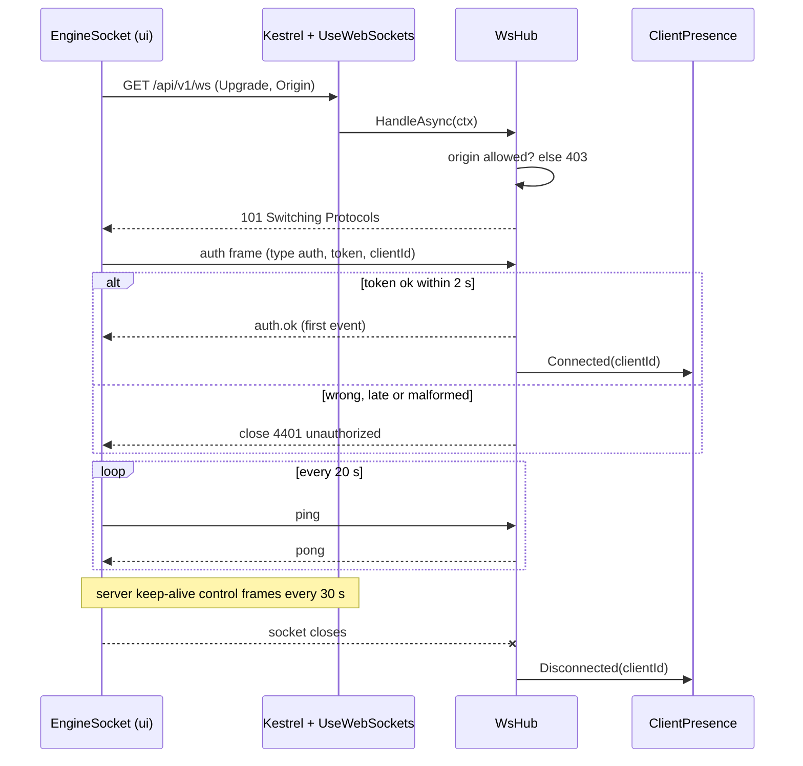
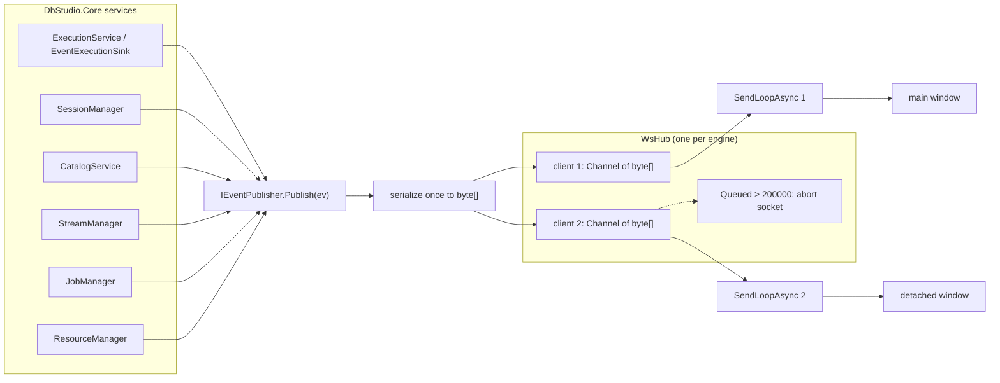
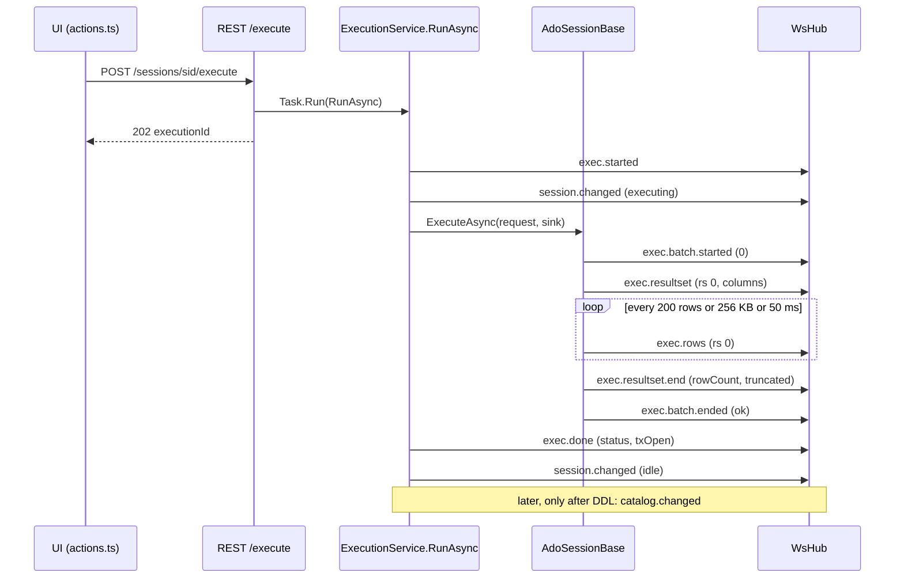
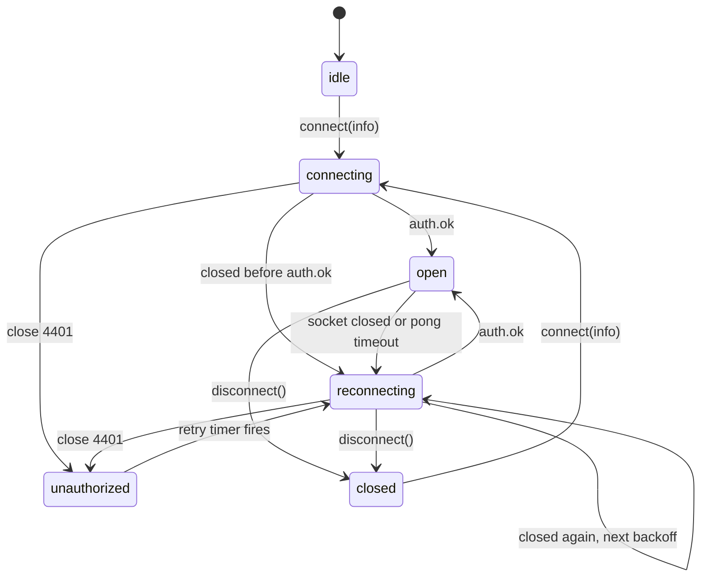
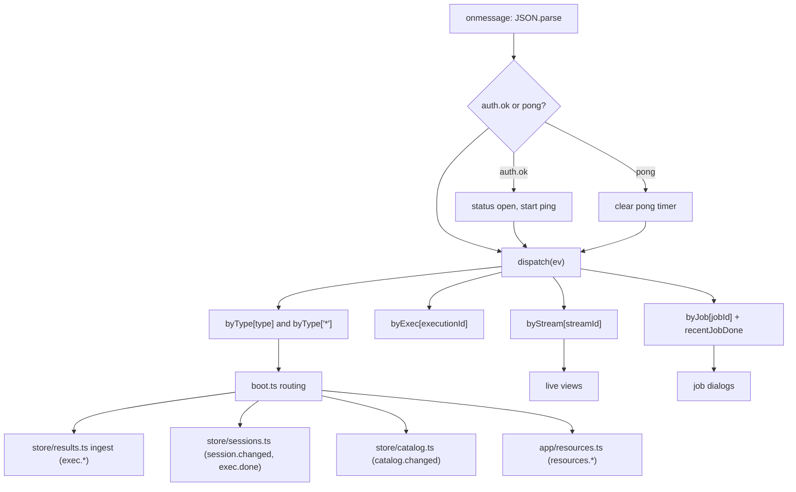
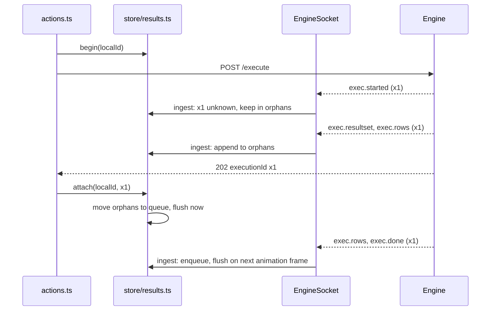

<div dir="rtl">

# 6. پروتکل رویداد WebSocket

> **سطح:** L2 کاربردی ← L3 ارشد | **بخش:** II | **کد خوانده‌شده در:** `08528ae` (Rowlit 1.6.3)
> [English](../../en/part2/06-websocket-protocol.md) · قبلی: [5. میزبان موتور](05-engine-host-and-api.md) · بعدی: [7. ماژول‌های موتور و DI](07-engine-modules-and-di.md)
>
> **در یک جمله:** موتور هر چیزی را که در طول زمان رخ می‌دهد (سطرهای یک پرس‌وجوی در حال اجرا، تغییر نشست‌ها، اقلام جریان‌ها، پیشرفت کارها) به‌صورت رویدادهای کوچک JSON روی یک WebSocket احرازشده برای هر پنجره به رابط کاربری می‌فرستد، و رابط کاربری هر رویداد را به استوری می‌رساند که به آن نیاز دارد.
>
> **در این فصل یاد می‌گیرید:**
> - چرا Rowlit برای هر پنجره دقیقاً یک WebSocket دارد و همهٔ فرمان‌ها را با REST می‌فرستد (تصمیم D-6)؛
> - سوکت چطور باز می‌شود، با فریم اول احراز هویت می‌شود و زنده می‌ماند؛
> - هاب چطور یک رویداد را به همهٔ کلاینت‌ها پخش می‌کند و با کلاینتی که دیگر نمی‌خواند چه می‌کند؛
> - فهرست کامل انواع رویداد، فرستندهٔ هرکدام و شنوندهٔ آن؛
> - ترتیب دقیق رویدادهای یک پرس‌وجو و جایی که سطرها دسته‌بندی می‌شوند؛
> - `EngineSocket` در رابط کاربری چطور دوباره وصل می‌شود، رویدادها را مسیریابی می‌کند و از مسابقهٔ میان رویداد و پاسخ REST جان سالم به در می‌برد.
>
> **پیش‌نیازها:** [3. معماری کلان](03-big-picture-architecture.md)، [5. میزبان موتور](05-engine-host-and-api.md). مفید: [8. اتصال‌ها، نشست‌ها و اجرا](08-connections-sessions-execution.md).
>
> برچسب‌های نمودارها به انگلیسی نگه داشته شده‌اند تا در GitHub درست نمایش داده شوند.

## 1. ایده (مبتدی)

بیشتر چیزهایی که رابط کاربری از موتور می‌پرسد سؤال‌هایی ساده با یک پاسخ‌اند: «اتصال‌های مرا فهرست کن»، «ستون‌های این جدول را بده». برای این‌ها Rowlit از درخواست‌های معمولی HTTP استفاده می‌کند (REST؛ [فصل 5](05-engine-host-and-api.md)). اما بعضی پاسخ‌ها تکه‌تکه و در مدتی طولانی می‌رسند. یک پرس‌وجو ممکن است صد هزار سطر برگرداند؛ یک تاپیک Kafka مدام پیام تولید می‌کند؛ یک ورود داده هر چند ثانیه پیشرفتش را گزارش می‌دهد. اگر رابط کاربری مدام بپرسد «چیز تازه‌ای هست؟» هم کند است و هم پرهزینه. پس موتور یک خط باز با هر پنجره نگه می‌دارد و خبرها را همان لحظه‌ای که رخ می‌دهند روی آن خط *هل می‌دهد*. این خط یک [WebSocket](../glossary.md#websocket) است (اتصالی ماندگار و دوطرفه که با یک درخواست HTTP شروع می‌شود و بعد پیام‌های مستقل را در هر دو جهت حمل می‌کند).

هر خبر یک [رویداد (event)](../glossary.md#event) است (یک شیء کوچک JSON با یک `type` مثل `exec.rows` و یک مُهر زمانی `ts`) که به‌صورت یک [فریم (frame)](../glossary.md#frame) فرستاده می‌شود (یک پیام روی سوکت). گفت‌وگوهای مختلف زیادی از همین یک خط استفاده می‌کنند: سطرهای پرس‌وجوی زبانهٔ ۱، سطرهای پرس‌وجوی زبانهٔ ۲، دنبال‌کردن یک لاگ، یک کار. به این اشتراک [تسهیم (multiplexing)](../glossary.md#multiplexing) می‌گویند (چند کانال منطقی روی یک اتصال فیزیکی). هر رویداد یک شناسه دارد (`executionId`، `streamId`، `jobId`، `sessionId`، `connectionId`) تا رابط کاربری بتواند آن را به جای درست برساند؛ درست مثل اداره‌ٔ پست که نامه‌ها را بر اساس نشانی جدا می‌کند.

بقیهٔ فصل این خط را از هر دو سر دنبال می‌کند: سمت موتور، کلاسی به نام `WsHub`، و سمت رابط کاربری، کلاسی به نام `EngineSocket`.

## 2. چگونه کار می‌کند (کاربردی)

### 2.1 چرا فقط یک سوکت

این تصمیم در طرح M1 با شمارهٔ **D-6** ثبت شده است: «یک WebSocket برای هر نمونهٔ رابط کاربری، تسهیم‌شده با `executionId`/`sessionId`؛ REST برای همهٔ فرمان‌ها؛ توکن در سرآیند یا فریم اول WS، هرگز در URL» (`docs/PLAN.md:626`). سه پیامد دارد.

1. **فرمان‌ها با REST می‌روند، خبرها با سوکت می‌آیند.** رابط کاربری هیچ‌وقت از راه سوکت از موتور نمی‌خواهد کاری *انجام دهد*. اجرای پرس‌وجو یعنی `POST /api/v1/sessions/{sid}/execute` که فوراً یک `executionId` برمی‌گرداند؛ نتیجه‌ها بعد به‌صورت رویدادهای `exec.*` می‌رسند (`docs/PLAN.md:57-58`). تنها فریم‌هایی که کلاینت می‌تواند بفرستد `auth` و `ping` هستند (`ui/src/api/types.ts:459`) و هاب هر `type` دیگری را نادیده می‌گیرد (`engine/src/DbStudio.Host/Ws/WsHub.cs:160-169`).
2. **یک سوکت برای هر پنجره، نه برای هر پرس‌وجو.** باز کردن یک سوکت برای هر اجرا یعنی یک دست‌دهی TCP، یک ارتقای HTTP و یک احراز هویت برای هر پرس‌وجو، و قطعه‌های متحرک بیشتر هنگام اتصال دوباره. با یک سوکت، رابط کاربری فقط یک وضعیت اتصال دارد که در نوار وضعیت نشانش دهد (`ui/src/components/StatusBar/StatusBar.tsx:24-27`) و فقط یک حلقهٔ اتصال دوباره.
3. **توکن هرگز در URL نمی‌آید.** URLها در لاگ‌ها و تاریخچهٔ مرورگر می‌مانند. درخواست‌های REST سرآیند `Authorization: Bearer <token>` دارند؛ API مرورگر برای WebSocket نمی‌تواند این سرآیند را بگذارد، پس سوکت با پیام اولش احراز هویت می‌کند (بخش 2.2).

موتور یک گرداننده را روی دو مسیر نگاشت می‌کند: `/ws` و `/api/v1/ws` (`engine/src/DbStudio.Host/Program.cs:166-168`). رابط کاربری اول `/api/v1/ws` را امتحان می‌کند و بعد سراغ `/ws` می‌رود (`ui/src/api/ws.ts:22-23`). هر دو مسیر از میان‌افزار توکن حامل مستثنا شده‌اند، چون سوکت احراز هویت خودش را دارد (`engine/src/DbStudio.Host/Infrastructure/Middleware.cs:92`، `:101`).

### 2.2 دست‌دهی: ارتقا، بررسی مبدأ، فریم احراز هویت

یک WebSocket زندگی‌اش را با یک `GET` معمولی HTTP و سرآیند `Upgrade: websocket` شروع می‌کند. [میان‌افزار (middleware)](../glossary.md#middleware) ‏`UseWebSockets` در ASP.NET Core ‏(`Program.cs:162`) چنین درخواستی را به سوکت تبدیل می‌کند و `WsHub.HandleAsync` کار را به دست می‌گیرد (`WsHub.cs:66-111`):

1. درخواستی که ارتقا نیست پاسخ `400` با متن «WebSocket upgrade expected.» می‌گیرد (`WsHub.cs:68-73`).
2. اگر درخواست سرآیند `Origin` داشته باشد، باید یک [مبدأ (origin)](../glossary.md#origin) مجاز باشد (طرح + میزبان + درگاه صفحه‌ای که سوکت را باز کرده)، وگرنه پاسخ `403` است (`WsHub.cs:74-79`). مجموعهٔ مجاز همان مجموعهٔ [CORS](../glossary.md#cors) است: همیشه `dbstudio://app`، و در حالت `--dev` علاوه بر آن `http://localhost:5173` و `http://127.0.0.1:5173` و هر `http://localhost:<port>` (`engine/src/DbStudio.Host/EngineOptions.cs:20-38`). درخواستی *بدون* سرآیند `Origin` (کلاینتی غیرمرورگری مثل یک ابزار آزمون) از این بررسی رد می‌شود، ولی همچنان توکن لازم دارد.
3. سوکت پذیرفته می‌شود و هاب حداکثر **۲ ثانیه** منتظر **فریم احراز هویت** می‌ماند (`WsHub.cs:116-117`). [فریم احراز هویت (auth frame)](../glossary.md#auth-frame) چنین است: `{"type":"auth","token":"…","clientId":"…"}` و حداکثر 16 KB حجم دارد (`WsHub.cs:120`).
4. توکن با `CryptographicOperations.FixedTimeEquals` مقایسه می‌شود (`WsHub.cs:126`)؛ مقایسه‌ای که زمانش به تعداد نویسه‌های مشترک ابتدای دو رشته وابسته نیست، پس مهاجم نمی‌تواند از روی زمان پاسخ، توکن را بایت‌به‌بایت حدس بزند.
5. در صورت موفقیت، `clientId` اختیاری عادی‌سازی می‌شود (`ClientPresence.Normalize`: فقط ASCII چاپ‌پذیر، حداکثر ۱۲۸ نویسه؛ `engine/src/DbStudio.Core/Services/ClientPresence.cs:12`، `:23-33`). بعد هاب `auth.ok` را **پیش از** ثبت کلاینت برای پخش، در صف همان کلاینت می‌گذارد (`WsHub.cs:86-88`)؛ پس `auth.ok` همیشه اولین رویدادی است که کلاینت دریافت می‌کند.
6. در هر شکستی (پایان مهلت، JSON خراب، توکن نادرست، فریم بیش از حد بزرگ) هاب سوکت را با کد بستن سفارشی **4401** و دلیل `unauthorized` می‌بندد (`WsHub.cs:20`، `:139-151`). اگر حتی بستن هم شکست بخورد، سوکت را قطع (abort) می‌کند.

</div>

```csharp
// engine/src/DbStudio.Host/Ws/WsHub.cs:116-131
timeout.CancelAfter(TimeSpan.FromSeconds(2));
var frame = await ReceiveTextAsync(socket, 16 * 1024, timeout.Token);
if (frame is not null)
{
    using var doc = JsonDocument.Parse(frame);
    if (doc.RootElement.TryGetProperty("type", out var t) && t.GetString() == "auth"
        && doc.RootElement.TryGetProperty("token", out var tok) && tok.ValueKind == JsonValueKind.String
        && CryptographicOperations.FixedTimeEquals(Encoding.UTF8.GetBytes(tok.GetString()!), _token))
    {
        var clientId = /* "clientId" normalized by ClientPresence.Normalize, or null */;
        return (true, clientId);
    }
}
```

<div dir="rtl">

`clientId` نام پنجرهٔ رابط کاربری است، نه نام سوکت. رابط کاربری آن را یک بار برای هر صفحه می‌سازد و در `sessionStorage` نگه می‌دارد، پس بارگذاری دوبارهٔ صفحه همان شناسه را حفظ می‌کند (`ui/src/api/clientId.ts:1-4`، `:18-36`)؛ همین شناسه در سرآیند `X-DbStudio-Client` همهٔ درخواست‌های REST هم می‌رود (`engine/src/DbStudio.Host/Infrastructure/ClientIdentity.cs:11-15`). تا وقتی دست‌کم یک سوکت از یک کلاینت باز است، [حضور کلاینت (client presence)](../glossary.md#client-presence) آن کلاینت را زنده می‌شمارد (`ClientPresence.cs:35-62`). نشست‌ها و جریان‌هایی که مال کلاینتی هستند که بیش از `connections.orphanGraceSeconds` غایب بوده (پیش‌فرض ۹۰ ثانیه؛ `engine/src/DbStudio.Core/Services/SessionManager.cs:174`) بسته می‌شوند؛ نشست‌ها در [فصل 8](08-connections-sessions-execution.md) و جریان‌ها در بخش 2.7 همین فصل آمده‌اند.

**شکل 6.1 — باز کردن، احراز هویت و زنده نگه داشتن سوکت.**

</div>



<div dir="rtl">

### 2.3 زنده نگه داشتن خط: ping، pong و keep-alive

دو ضربان مستقل وجود دارد.

- **ping در سطح برنامه.** پس از `auth.ok`، رابط کاربری هر ۲۰ ثانیه `{"type":"ping"}` می‌فرستد (`ui/src/api/ws.ts:25`، `:231-242`) و هاب به هرکدام یک رویداد `pong` پاسخ می‌دهد (`WsHub.cs:164`). اگر تا ۱۰ ثانیه `pong` نرسد (`ws.ts:26`)، رابط کاربری فرض می‌کند اتصال «نیمه‌باز» است (پیوند TCP مرده ولی هیچ طرف متوجه نشده) و خودش سوکت را با کد 4000 و دلیل `pong timeout` می‌بندد (`ws.ts:236-240`) که اتصال دوباره را آغاز می‌کند. زمان‌سنج pong فقط وقتی مسلح می‌شود که زمان‌سنج دیگری در انتظار نباشد، پس موتوری که کند پاسخ می‌دهد زمان‌سنج‌ها را روی هم انباشته نمی‌کند (`ws.ts:235`).
- **[زنده‌نگه‌داری (keep-alive)](../glossary.md#keep-alive) در سطح پروتکل.** میزبان `UseWebSockets` را با `KeepAliveInterval = 30 s` پیکربندی می‌کند (`Program.cs:162`). این باعث می‌شود WebSocket در .NET خودش فریم‌های کنترلی بفرستد تا هیچ واسطه‌ای اتصال بیکار را قطع نکند. طبق مستندات .NET، وقتی مهلت keep-alive تنظیم نشده باشد (مثل این‌جا)، این‌ها فریم‌های کنترلی pong ناخواسته‌اند؛ این جزئیات رفتار چارچوب است و در این مخزن وارسی نشده است. کد رابط کاربری این فریم‌ها را نمی‌بیند.

بنابراین تشخیص طرف مرده کار رابط کاربری است. موتور فقط وقتی متوجه کلاینت مرده می‌شود که یک ارسال یا دریافت شکست بخورد؛ آن‌وقت کلاینت حذف می‌شود (بخش 2.4).

### 2.4 انتشار، پخش و صف هر کلاینت

هر سرویسی در Core که خبری دارد، یک متد از یک واسط را صدا می‌زند:

</div>

```csharp
// engine/src/DbStudio.Core/Services/Events.cs:7-11
public interface IEventPublisher
{
    /// Queues the event for every authenticated client. Never blocks; ordering per publisher thread is preserved.
    void Publish(EngineEvent ev);
}
```

<div dir="rtl">

Core چیزی دربارهٔ WebSocket نمی‌داند؛ میزبان `WsHub` را به‌عنوان پیاده‌سازی ثبت می‌کند (`Program.cs:109-110`). آزمون‌ها به‌جای آن `NullEventPublisher` یا یک جعلی ضبط‌کننده به کار می‌برند (`Events.cs:109-113`، `engine/tests/DbStudio.Core.Tests/M2/SourceFrameworkTests.cs:104`). این همان [هاب WebSocket ‏(WebSocket hub)](../glossary.md#websocket-hub) است: شیئی که همهٔ کلاینت‌های وصل را می‌شناسد و [پخش (fan-out)](../glossary.md#fan-out) را انجام می‌دهد (رساندن یک رویداد به چند گیرنده).

</div>

```csharp
// engine/src/DbStudio.Host/Ws/WsHub.cs:37-64
public void Publish(EngineEvent ev)
{
    if (_clients.IsEmpty) return;
    byte[] payload = JsonSerializer.SerializeToUtf8Bytes(ev, ev.GetType(), CoreJson.Options); // once
    foreach (var c in _clients.Values) Enqueue(c, payload);
}
private void Enqueue(Client c, byte[] payload)
{
    if (Interlocked.Increment(ref c.Queued) > MaxQueuedFrames)   // 200_000
    {
        c.Queue.Writer.TryComplete();  // a client that stopped reading must not exhaust memory
        c.Socket.Abort();
        return;
    }
    c.Queue.Writer.TryWrite(payload);
}
```

<div dir="rtl">

گام‌به‌گام چه اتفاقی می‌افتد:

1. **بدون کلاینت، بدون کار.** اگر هیچ پنجره‌ای وصل نباشد، `Publish` پیش از سریال‌سازی برمی‌گردد (`WsHub.cs:39`). رویداد به‌سادگی از دست می‌رود؛ هاب هیچ تاریخچه‌ای نگه نمی‌دارد.
2. **یک بار سریال‌سازی.** رویداد یک بار به بایت‌های JSON با UTF-8 تبدیل می‌شود؛ با نوع زمان اجرایش تا فیلدهای رکورد واقعی هم بیایند، و با قراردادهای JSON موتور (نام‌های camelCase، enumها به‌صورت رشتهٔ camelCase، `Dialect` با توکن‌های انتقال: `engine/src/DbStudio.Core/Services/CoreJson.cs:20-27`). همان یک `byte[]` میان همهٔ کلاینت‌ها مشترک است.
3. **یک صف برای هر کلاینت.** هر کلاینت یک [کانال (channel)](../glossary.md#channel) بی‌کران دارد (`System.Threading.Channels.Channel<byte[]>`، صف تولیدکننده/مصرف‌کنندهٔ درون حافظه) که با `SingleReader = true` ساخته شده (`WsHub.cs:29-35`). `Publish` فقط در این صف‌ها می‌نویسد، پس هیچ‌وقت منتظر ارسال شبکه نمی‌ماند.
4. **یک حلقهٔ ارسال برای هر کلاینت.** `SendLoopAsync` صف را به ترتیب می‌خواند و هر محموله را به‌صورت یک پیام متنی کامل (`endOfMessage: true`) می‌فرستد (`WsHub.cs:177-185`). کلاینت کند فقط حلقهٔ خودش را عقب می‌اندازد.
5. **قاعدهٔ سرریز.** شمارنده‌ای به نام `Queued` تعداد فریم‌های منتظر در صف یک کلاینت را نگه می‌دارد: با هر قرار دادن در صف یکی بالا می‌رود و وقتی حلقهٔ ارسال فریمی برمی‌دارد یکی پایین می‌آید (`WsHub.cs:55`، `:181`). وقتی از `MaxQueuedFrames` = **200 000** بگذرد (`WsHub.cs:21`)، هاب پیام «WebSocket client {Id} is not reading; disconnecting» را لاگ می‌کند، صف را کامل‌شده علامت می‌زند و سوکت را قطع می‌کند (`WsHub.cs:55-61`). این قطع، حلقهٔ دریافت را به خطا می‌اندازد و بلوک `finally` آن کلاینت را حذف می‌کند، صف را می‌بندد، حلقهٔ ارسال را لغو می‌کند و قطع اتصال را به `ClientPresence` گزارش می‌دهد (`WsHub.cs:102-110`). رابط کاربری یک بستن غیرعادی می‌بیند و دوباره وصل می‌شود (بخش 2.8). فریم‌هایی که هنوز در صف بودند همراه صف دور ریخته می‌شوند.

پس شمار [فریم‌های در صف (queued frames)](../glossary.md#queued-frames) تنها سازوکار [فشار برگشتی (back-pressure)](../glossary.md#back-pressure) در هاب است، و هیچ‌کس را کند نمی‌کند: مصرف‌کننده‌ای را که نمی‌تواند پابه‌پا بیاید حذف می‌کند. بخش 3.4 معنای این را بررسی می‌کند.

**شکل 6.4 — پخش از سرویس‌ها، از راه هاب، به صف‌های هر کلاینت.**

</div>



<div dir="rtl">

سمت دریافت کوچک است. `ReceiveLoopAsync` پیام‌های متنی تا 64 KB را می‌خواند (`WsHub.cs:158`)، به `ping` با `pong` پاسخ می‌دهد و JSON خراب را نادیده می‌گیرد (`WsHub.cs:160-169`). پیام بزرگ‌تر خطای «Frame too large.» می‌دهد و اتصال را پایان می‌دهد (`WsHub.cs:197`). وقتی کلاینت یک بستن عادی را شروع کند، هاب با کد 1000 و دلیل `bye` پاسخ می‌دهد (`WsHub.cs:171-174`).

### 2.5 فهرست رویدادها

هر رویداد یک `record` در C# است که از `EngineEvent` مشتق شده و `type` و `ts` را اول JSON می‌گذارد (`[JsonPropertyOrder(-2)]` و `(-1)`)؛ `ts` یک مُهر زمانی ISO به وقت UTC با میلی‌ثانیه است (`Events.cs:14-20`). رابط کاربری همین مجموعه را به‌صورت اجتماع TypeScript به نام `WsEvent` بازتاب می‌دهد (`ui/src/api/types.ts:407-452`)؛ `WsEventOf<'exec.rows'>` یک عضو را جدا می‌کند (`types.ts:454-455`). جدول زیر هر رشتهٔ `type` تعریف‌شده در `Events.cs`، فیلدهای محموله (روی سیم به‌صورت camelCase)، هر جایی که آن را منتشر می‌کند و مصرف‌کننده‌های اصلی‌اش در رابط کاربری را نشان می‌دهد.

</div>

| `type` | Payload fields | Published by | Consumed by |
|---|---|---|---|
| `auth.ok` | none | `WsHub.cs:87` | `ws.ts:215-219` (status `open`, start ping) |
| `pong` | none | `WsHub.cs:164` | `ws.ts:220-223` (clear pong timer) |
| `exec.started` | `executionId, sessionId, batchCount` | `ExecutionService.cs:154`, `ExecutionService.Explain.cs:53` | `resultsReducer.ts:155-160` |
| `exec.batch.started` | `executionId, batchIndex` | `ExecutionService.cs:248` (sink) | `resultsReducer.ts:161-164` |
| `exec.resultset` | `executionId, resultSetId, batchIndex, columns[]` | `ExecutionService.cs:255` | `resultsReducer.ts:165-177` |
| `exec.rows` | `executionId, resultSetId, rows[][]` | `ExecutionService.cs:262` | `resultsReducer.ts:178-185` |
| `exec.resultset.end` | `executionId, resultSetId, rowCount, truncated, elapsedMs` | `ExecutionService.cs:270` | `resultsReducer.ts:186-195` |
| `exec.affected` | `executionId, batchIndex, count, statementKind` | `ExecutionService.cs:276` | `resultsReducer.ts:196-202` |
| `exec.message` | `executionId, batchIndex, severity, text, line, code, source` | `ExecutionService.cs:161`, `:282`; `ExecutionService.Explain.cs:57`, `:70` | `resultsReducer.ts:203-209` |
| `exec.error` | `executionId, batchIndex, code, message, line, col, detail` | `ExecutionService.cs:293` | `resultsReducer.ts:210-216` |
| `exec.batch.ended` | `executionId, batchIndex, elapsedMs, status` | `ExecutionService.cs:300` | `resultsReducer.ts:217-219` |
| `exec.diagnostics` | `executionId, diagnostics[]` | `ExecutionService.cs:306` | `resultsReducer.ts:220-222` |
| `exec.plan` | `executionId, dialect, mode, root, raw, rawFormat, warnings[]` | `ExecutionService.Explain.cs:74` | `components/PlanView/explain.ts:123` |
| `exec.done` | `executionId, sessionId, status, elapsedMs, resultSets, rowsAffected, txOpen, outParams?` | `ExecutionService.cs:187`, `ExecutionService.Explain.cs:102` | `resultsReducer.ts:223-266`, `app/boot.ts:114-121` |
| `session.changed` | `sessionId, state, txOpen, database, txMode, schema, searchPath, released, releasedReason?, hasTempObjects` | `SessionManager.cs:404` (`PublishChanged`), `:554` (closed) | `app/boot.ts:122-128` |
| `catalog.changed` | `connectionId, database, schemas[], version` | `CatalogService.cs:394` (refresh), `:496` (after DDL) | `app/boot.ts:129` → `store/catalog.ts` |
| `export.progress` | `exportId, rows` | `ExportService.cs:203`, `:225` | `components/Export/serverExport.ts:40-43` |
| `export.done` | `exportId, path, rows, status, error` | `ExportService.cs:160` | `components/Export/serverExport.ts:44-47` |
| `engine.log` | `level, message` | record defined (`Events.cs:90`); no publisher found in `engine/src` | `app/boot.ts:135-137` (toast on `error`) |
| `stream.data` | `streamId, items[], seq` | `StreamManager.cs:408` | `onStream` subscribers (Kafka, Redis, Mongo, Logs, ES, Search) |
| `stream.state` | `streamId, state, reason, dropped` | `StreamManager.cs:254`, `:361`, `:382` | `onStream` subscribers |
| `source.client` | `connectionId, state` (`open`, `closed`, `broken`) | `SourceClientManager.cs:128`, `:224` | `app/boot.ts:134` |
| `job.progress` | `jobId, kind, done, total, message` | `JobManager.cs:45` | `onJob` subscribers |
| `job.done` | `jobId, kind, status, error, result` | `JobManager.cs:119` | `onJob` subscribers, `recentJobDone` |
| `resources.released` | `connectionId, connectionName, reason, sessions, sourceClient` | `ResourceManager.cs:323`, `:390` | `app/resources.ts:222` |
| `resources.pressure` | `level, usedBytes, limitBytes` | `ResourceManager.cs:260` | `app/resources.ts:223` |

<div dir="rtl">

(`ExecutionService.cs`، `ExecutionService.Explain.cs`، `SessionManager.cs`، `StreamManager.cs`، `JobManager.cs`، `ResourceManager.cs` و `SourceClientManager.cs` در `engine/src/DbStudio.Core/Services/` هستند؛ `CatalogService.cs` در `Core/Catalog/`؛ `ExportService.cs` در `Core/Export/`؛ مسیرهای رابط کاربری زیر `ui/src/` هستند.)

سه نکته دربارهٔ جدول:

- **طرح و کد کمی فرق دارند.** بخش 3.6 در `docs/PLAN.md` رویداد `exec.done` را بدون `sessionId` و `session.changed` را بدون فیلدهای طرح‌واره و منابع آورده است (`docs/PLAN.md:293-313`). کد `sessionId` را به `exec.done` افزوده (`Events.cs:40`)، `outParams` را برای پارامترهای OUT (`Events.cs:43-45`)، `schema` و `searchPath` را (`Events.cs:56-59`) و `released`، `releasedReason` و `hasTempObjects` را هم (`Events.cs:61-69`). حرف آخر را کد می‌زند.
- **`engine.log` تعریف شده ولی فرستاده نمی‌شود.** رکوردش در هر دو طرف هست و رابط کاربری به آن گوش می‌دهد، ولی جست‌وجو در `engine/src` هیچ `Publish(new EngineLogEvent…)` پیدا نمی‌کند. لاگ موتور به‌جای آن از راه قابلیت Logs به رابط کاربری می‌رسد (جریان `logs.tail` روی شناسهٔ اتصال `engine`؛ `StreamManager.cs:159-160`؛ [فصل 21](21-logs-activity-resources.md)).
- **مقدارهای enum رشته‌های camelCase هستند.** `status` یکی از `"ok" | "error" | "cancelled"`، `severity` یکی از `"info" | "warning" | "error"` و `source` یکی از `"server" | "dbmsOutput" | "engine"` است (`engine/src/DbStudio.Core/Models/CoreModels.cs:31-34`، `CoreJson.cs:27`).

### 2.6 ترتیب رویدادهای یک اجرا

یک Ctrl+Enter روی `SELECT * FROM shop.orders` در یک کنسول را در نظر بگیرید. پیش از هر رویدادی، `ExecutionService.Execute` درخواست را اعتبارسنجی می‌کند، نشست را رزرو می‌کند، [شناسهٔ اجرا (execution id)](../glossary.md#execution-id) را می‌سازد (`Ids.New("x")`)، `RunAsync` را روی استخر نخ‌ها راه می‌اندازد و **تازه بعد از آن** پاسخ `202 { executionId }` را برمی‌گرداند (`engine/src/DbStudio.Core/Services/ExecutionService.cs:91-99`). پس نخستین رویدادها ممکن است پیش از پاسخ HTTP به رابط کاربری برسند؛ بخش 2.9 نشان می‌دهد رابط کاربری با این چه می‌کند.

`RunAsync` رویداد `exec.started` و یک `session.changed` (وضعیت `executing`) منتشر می‌کند (`ExecutionService.cs:154-155`). اگر اتصال نشست آزاد شده یا شکسته بوده، باز کردن دوباره‌اش یک `exec.message` با شمارهٔ دستهٔ 0 اضافه می‌کند (`ExecutionService.cs:157-161`). سپس نشست فراهم‌کننده دسته‌ها را اجرا می‌کند (`ExecutionService.cs:163-165`). برای فراهم‌کننده‌های ADO.NET این حلقه در `AdoSessionBase` است ([فصل 9](09-relational-providers.md)): برای هر دسته `exec.batch.started` (`engine/src/DbStudio.Core/Services/AdoSessionBase.cs:1011`)، سپس برای هر مجموعهٔ نتیجه `exec.resultset`، هر تعداد `exec.rows` و `exec.resultset.end` (`AdoSessionBase.cs:1251-1290`)، بعد `exec.affected`/`exec.message`/`exec.error` هر وقت رخ دهند، و در پایان `exec.batch.ended` (`AdoSessionBase.cs:1082`). وقتی همهٔ دسته‌ها تمام شد، اجرا `exec.done` و یک `session.changed` دیگر (وضعیت `idle` با `txOpen` به‌روز) منتشر می‌کند (`ExecutionService.cs:186-191`). فقط پس از آن دسته‌ها را از نظر DDL طبقه‌بندی می‌کند؛ اگر جدولی ساخته یا تغییر داده شده باشد، کاتالوگ طرح‌واره‌های متأثر را در پس‌زمینه دوباره بار می‌کند و `catalog.changed` را بعداً منتشر می‌کند (`ExecutionService.cs:193`، `:197-215`؛ `engine/src/DbStudio.Core/Catalog/CatalogService.cs:429-444`، `:496`).

**شکل 6.2 — رویدادهای یک اجرا با یک دسته و یک مجموعهٔ نتیجه.**

</div>



<div dir="rtl">

**سطرها کجا دسته‌بندی می‌شوند.** طرح M1 می‌گوید سطرها «دسته‌ای … ۲۰۰ سطر یا 256 KB در هر فریم، تخلیه دست‌کم هر ۵۰ میلی‌ثانیه» حرکت می‌کنند (`docs/PLAN.md:58`). در کد، این دسته‌بندی نه در هاب است نه در `ExecutionService`؛ یک `RowBuffer` خصوصی درون `AdoSessionBase` است با سه حد که زیرکلاس‌ها می‌توانند بازنویسی کنند:

</div>

```csharp
// engine/src/DbStudio.Core/Services/AdoSessionBase.cs:204-211, 1481-1487
protected virtual int RowBatchSize => 200;                                      // rows per exec.rows
protected virtual TimeSpan RowFlushInterval => TimeSpan.FromMilliseconds(50);   // max age of pending rows
protected virtual int RowBatchMaxBytes => 256 * 1024;                           // approximate payload
// …
_rows.Add(row);
foreach (var v in row) _bytes += ValueConverter.EstimateSize(v) / 2; // rough JSON size of the value
if (_rows.Count >= maxRows || _bytes >= maxBytes || Stopwatch.GetElapsedTime(_lastFlush) >= maxAge)
    await FlushAsync().ConfigureAwait(false);
```

<div dir="rtl">

دو جزئیات با عبارت طرح فرق دارد. نخست، سن ۵۰ میلی‌ثانیه فقط وقتی بررسی می‌شود که سطر *بعدی* برسد (`AdoSessionBase.cs:1485`)؛ هیچ زمان‌سنجی در کار نیست. اگر سرور یک سطر بفرستد و بعد ده ثانیه فکر کند، آن سطر تا رسیدن سطر بعدی، پایان مجموعهٔ نتیجه (`AdoSessionBase.cs:1281-1285`) یا یک پیام در بافر می‌ماند. دوم، اندازهٔ بایتی تخمینی است: `EstimateSize` اندازهٔ مقدار انتقالی در حافظه را می‌سنجد (دو بایت برای هر نویسهٔ UTF-16 به‌علاوهٔ سربار؛ `engine/src/DbStudio.Core/Services/ValueConverter.cs:158-165`) و نصفش به‌عنوان اندازهٔ تقریبی JSON حساب می‌شود. نشست Cassandra که بر ADO.NET نیست، تکه‌بندی خودش را دارد: ۲۰۰ سطر در هر ارسال (`engine/src/DbStudio.Providers.Cassandra/CqlSession.cs:18-19`، `:980`).

**ترتیب پیام‌ها و سطرها.** درایورها بعضی پیام‌ها را از گرداننده‌های رویداد بالا می‌آورند، مثلاً `InfoMessage` در SQL Server. ‏`AdoSessionBase.EmitMessageAsync` و هم‌خانواده‌هایش پیش از رساندن پیام، سطرهای در انتظار را تخلیه می‌کنند (`AdoSessionBase.cs:96-98`، `:646-652`)؛ پس یک `PRINT` میان دو `SELECT` بعد از سطرهای اولی دیده می‌شود.

### 2.7 رویدادهای نشست، کاتالوگ، جریان، کار، خروجی و منابع

**`session.changed`** را `SessionManager.PublishChanged` منتشر می‌کند (`SessionManager.cs:401-410`) که وضعیت عمومی نشست را در رویداد کپی می‌کند. پیرامون هر اجرا فرستاده می‌شود (`ExecutionService.cs:155`، `:191`)، پس از کنش‌های REST روی نشست مثل commit، rollback، عوض کردن پایگاه داده یا حالت تراکنش (`engine/src/DbStudio.Host/Endpoints/SessionEndpoints.cs:21`، `:49`، `:77`، `:87`، `:104`، `:112`)، هنگام آزادسازی و باز کردن دوباره (`SessionManager.cs:456`، `:534`، `:595`، `:651`) و هنگام بستن (`SessionManager.cs:554`). رابط کاربری آن را روی `store/sessions.ts` اعمال می‌کند، اگر پایگاه دادهٔ نشست عوض شده باشد زبانه را هم جابه‌جا می‌کند و تازه‌سازی شمارنده‌های کل موتور را ۴۰۰ میلی‌ثانیه بعد زمان‌بندی می‌کند (`ui/src/app/boot.ts:122-128`).

**`catalog.changed`** به رابط کاربری می‌گوید تصویر لحظه‌ای یک طرح‌واره `version` تازه‌ای دارد. پس از تازه‌سازی صریح (`CatalogService.cs:377-397`) و پس از بارگذاری دوبارهٔ پس‌زمینه‌ای که در پی DDL می‌آید (`CatalogService.cs:446-498`) فرستاده می‌شود. استور رابط کاربری طرح‌واره‌های نام‌برده را دوباره می‌گیرد ([فصل 10](10-catalog-and-metadata.md)).

**جریان‌ها** (`stream.data`، `stream.state`) خوراک‌های طولانی مثل دنبال‌کردن Kafka یا `MONITOR` در Redis را حمل می‌کنند. با REST ساخته می‌شوند (`POST /streams` یک `streamId` برمی‌گرداند؛ تصمیم D3 در `docs/PLAN-M2.md:11`). `StreamManager` با یک صف دوم و کران‌دار برای هر جریان از سوکت محافظت می‌کند:

- اقلام در کانالی کران‌دار با `FullMode = DropOldest` می‌روند و هر قلم دورریخته شمارنده‌ای را بالا می‌برد (`engine/src/DbStudio.Core/Services/StreamManager.cs:484-486`). ظرفیت، تنظیم `streams.maxQueuedItems` با پیش‌فرض 50 000 است (`StreamManager.cs:155`، `:293-299`)؛
- حلقهٔ تخلیه صف را به دسته‌های `stream.data` با حداکثر ۲۰۰ قلم تبدیل می‌کند، دست‌بالا ۱۰۰ میلی‌ثانیه پس از نخستین قلم هر دسته (`StreamManager.cs:122-125`، `:366-414`). هر دسته یک [شمارهٔ ترتیب (sequence number)](../glossary.md#sequence-number) به نام `seq` دارد که برای هر دسته از آن جریان یکی بالا می‌رود (`StreamManager.cs:406`، `Events.cs:94-95`)؛
- تا وقتی اقلام دور ریخته می‌شوند، یک `stream.state` با وضعیت `open` و مجموع جاری `dropped` حداکثر یک بار در ثانیه فرستاده می‌شود (`StreamManager.cs:136-137`، `:374-383`). این [اقلام دورریخته (dropped items)](../glossary.md#dropped-items) را نماهایی مثل پنل‌های Kafka، ‏Redis و Logs نشان می‌دهند؛
- مکث و ازسرگیری، `stream.state` با `paused`/`open` منتشر می‌کنند (`StreamManager.cs:243-257`). در حال مکث، اقلام دور ریخته می‌شوند مگر این‌که جریان بتواند منبعش را متوقف کند (`StreamManager.cs:512-520`)؛
- پایان، یک `stream.state` با وضعیت `ended` یا `error` و یک دلیل است: `closed`، `client-gone`، `source-closed`، `source-broken`، `shutdown`، `completed` یا پیام استثنا (`StreamManager.cs:146-151`، `:340-361`). ‏`client-gone` وقتی رخ می‌دهد که کلاینت مالک بیش از مهلت یتیمی غایب بوده باشد (`StreamManager.cs:431-453`)؛
- حدها: ۸ جریان باز برای هر کلاینت و ۶۴ جریان در کل موتور؛ بیش از آن `POST /streams` با `429 STREAM_LIMIT` شکست می‌خورد (`StreamManager.cs:126-131`، `:156-157`).

**کارها** (`job.progress`، `job.done`) عملیات طولانی‌ای هستند که با REST آغاز می‌شوند و فوراً `202 { jobId }` پاسخ می‌دهند (`engine/src/DbStudio.Core/Services/JobManager.cs:49-75`). ‏`JobContext.Report` حداکثر یک `job.progress` در هر ۱۰۰ میلی‌ثانیه منتشر می‌کند مگر `force` روشن باشد (`JobManager.cs:36-46`)؛ این همان [محدودسازی نرخ (throttling)](../glossary.md#throttling) است که طرح M2 با «حدود ۱۰ بار در ثانیه» توصیف می‌کند. ‏`job.done` شامل `status` (`ok`، `cancelled`، `error`)، متن خطا و نتیجهٔ سریال‌شده با قراردادهای JSON موتور است (`JobManager.cs:95-120`).

**خروجی‌ها** (`export.progress`، `export.done`): خروجی سمت سرور از یک پرس‌وجوی تازه، پیشرفت را حداکثر هر ۵۰۰ میلی‌ثانیه و یک بار دیگر در پایان منتشر می‌کند و سپس `export.done` با مسیر پرونده و وضعیت (`engine/src/DbStudio.Core/Export/ExportService.cs:160`، `:195-205`، `:219-226`).

**منابع** (`resources.pressure`، `resources.released`): ‏`ResourceManager` سطح حافظه را فقط وقتی تغییر کند منتشر می‌کند (`engine/src/DbStudio.Core/Services/ResourceManager.cs:255-261`) و برای هر اتصال می‌گوید چند نشست را به‌خاطر بیکاری یا فشار حافظه (`ResourceManager.cs:310-323`) یا به‌خاطر حد اتصال‌های باز (`ResourceManager.cs:390`) آزاد کرده است. رابط کاربری برای `pressure` و `limit` پیام کوتاه (toast) نشان می‌دهد (`Events.cs:72-78`؛ [فصل 21](21-logs-activity-resources.md)).

**کلاینت‌های منبع** (`source.client`): وقتی یک کلاینت Redis، ‏MongoDB، ‏Kafka یا Elasticsearch باز، بسته یا شکسته می‌شود (`engine/src/DbStudio.Core/Services/SourceClientManager.cs:128`، `:224`)، پنل Connections و نوار وضعیت نقطه‌هایشان را به‌روز می‌کنند (`ui/src/app/boot.ts:134`).

### 2.8 سمت رابط کاربری: `EngineSocket`

`ui/src/api/ws.ts` یک کلاس به نام `EngineSocket` تعریف می‌کند و یک نمونه به نام `engineSocket` صادر می‌کند (`ws.ts:28`، `:290`). پس هر صفحهٔ renderer (پنجرهٔ اصلی، هر پنجرهٔ جداشده، یک زبانهٔ مرورگر) سوکت خودش را دارد.

**ماشین وضعیت.** وضعیت سوکت یک `WsStatus` است: `idle | connecting | open | reconnecting | unauthorized | closed` (`ws.ts:17`). نوار وضعیت آن را با برچسب‌هایی مثل «Engine connected» و «Engine: reconnecting…» نشان می‌دهد (`StatusBar.tsx:24-27`، `:64-65`).

**شکل 6.3 — گذارهای `WsStatus` در `EngineSocket`.**

</div>



<div dir="rtl">

**وصل شدن.** ‏`connect(info)` نشانی پایه و توکن را ذخیره می‌کند، شمارندهٔ تلاش را صفر می‌کند، هر سوکت قدیمی را برمی‌چیند و `open()` را صدا می‌زند (`ws.ts:56-62`). ‏`open()` پیشوند `http` را به `ws` تبدیل می‌کند، مسیر جاری را برمی‌دارد و وضعیت را در تلاش اول `connecting` و در تلاش‌های بعدی `reconnecting` می‌گذارد (`ws.ts:169-174`). در `onopen` فریم احراز هویت را با `uiClientId()` می‌فرستد (`ws.ts:184-187`). با رسیدن `auth.ok` سوکت را احرازشده علامت می‌زند، تلاش‌ها را صفر می‌کند، وضعیت را `open` می‌کند و زمان‌سنج ping را راه می‌اندازد (`ws.ts:215-219`). سپس هر پیام، از جمله خود `auth.ok` و `pong`، به مشترکان توزیع می‌شود (`ws.ts:224`). ‏JSON خراب نادیده گرفته می‌شود (`ws.ts:209-214`).

**[اتصال دوباره (reconnect)](../glossary.md#reconnect) و [عقب‌نشینی (backoff)](../glossary.md#backoff).** وقتی سوکتی بسته می‌شود، `onclose` زمان‌سنج‌ها را پاک می‌کند و تصمیم می‌گیرد (`ws.ts:192-205`):

- کد **4401**: وضعیت `unauthorized` و سپس یک تلاش دوباره (`ws.ts:197-200`)؛
- بسته شدن بدون این‌که هرگز باز شده باشد: شاید مسیر اشتباه است، پس تلاش بعدی از مسیر دیگر استفاده می‌کند (`ws.ts:202-203`)؛
- در غیر این صورت: یک تلاش دوباره.

`scheduleReconnect` به اندازهٔ `BACKOFF_MS[attempt]` از فهرست **250، 500، 1000، 2000، 4000، 8000 میلی‌ثانیه** صبر می‌کند (با سقف آخرین مقدار) به‌علاوهٔ نوسانی تصادفی تا ۲۵٪ همان مقدار، تا چند پنجره درست در یک لحظه دوباره وصل نشوند (`ws.ts:24`، `:244-255`). اگر سوکتی که بسته شد احرازشده بوده باشد، شمارندهٔ تلاش از 0 شروع می‌شود و نخستین تلاش پس از یک اتصال سالم سریع است (`ws.ts:246`).

**نقشه‌های گرداننده.** مشترکان در چهار نقشه ثبت می‌شوند (`ws.ts:32-35`):

| API | کلید نقشه | کاربر نمونه |
|---|---|---|
| `on(type, fn)` / `onAny(fn)` | `type` رویداد یا `'*'` | مسیریابی به استورها در `app/boot.ts:111-137` |
| `onExecution(executionId, fn)` | `executionId` | اجراهای یک‌باره |
| `onStream(streamId, fn)` | `streamId` | نماهای زنده (دنبال‌کردن Kafka، ‏MONITOR در Redis، جریان تغییرات Mongo، ‏Logs، کارهای ES، جست‌وجو در پایگاه داده) |
| `onJob(jobId, fn)` | `jobId` | پنجره‌های کار (تحلیل Redis، ورود Mongo، materialize، مقایسهٔ طرح‌واره، جادوگر ورود داده) |

هر فراخوانی یک تابع لغو اشتراک برمی‌گرداند و مجموعه‌های خالی حذف می‌شوند (`ws.ts:148-161`). این [اشتراک (subscription)](../glossary.md#subscription) فقط در رابط کاربری وجود دارد: موتور هر رویداد را به همهٔ کلاینت‌ها می‌فرستد و صافی‌کردن در `dispatch` انجام می‌شود (`ws.ts:125-146`). هر گرداننده درون `safe()` اجرا می‌شود؛ پس گردانندهٔ خراب فقط خطا لاگ می‌کند و جلوی بقیه را نمی‌گیرد (`ws.ts:282-288`).

**`recentJobDone`.** ممکن است کاری پیش از آن‌که `202 { jobId }` به کدی که می‌خواهد مشترک شود برسد، تمام شود. ‏`dispatch` پنجاه `job.done` آخر را نگه می‌دارد (`ws.ts:139-142`) و `onJob` رویداد هم‌خوان را یک بار، در یک microtask، دوباره پخش می‌کند تا فراخواننده فرصت کند تابع لغو اشتراکش را اول ذخیره کند (`ws.ts:94-105`).

**راه‌اندازی دوبارهٔ موتور.** در برنامهٔ رومیزی، موتور ممکن است از کار بیفتد و ناظر Electron آن را با درگاه و توکن تازه دوباره راه بیندازد. ‏`app/boot.ts` سوکت را با اطلاعات تازه دوباره وصل می‌کند، استور نشست‌ها را خالی می‌کند، کلاینت‌های منبع را بازنشانی می‌کند و `endAllStreams('engine-restarted')` را صدا می‌زند که یک `stream.state` مصنوعی با `ended` برای همهٔ مشترکان جریان‌ها توزیع می‌کند (`ui/src/app/boot.ts:188-198`، `ws.ts:111-117`).

**شکل 6.5 — مسیر یک رویداد ورودی در رابط کاربری.**

</div>



<div dir="rtl">

### 2.9 استور نتیجه‌ها: رویدادهای یتیم و دسته‌بندی به ازای فریم

`app/boot.ts` همهٔ رویدادهای `exec.*` را به `useResults.getState().ingest(ev)` می‌فرستد (`ui/src/app/boot.ts:111-113`). استور نتیجه‌ها (استور [Zustand](../glossary.md#zustand) در `ui/src/store/results.ts`) دو مشکل را حل می‌کند.

**رویدادهایی که پیش از دانستن executionId می‌رسند.** رابط کاربری پیش از صدا زدن `POST /execute` یک اجرا با شناسهٔ *محلی* می‌سازد و وقتی `202` رسید، `executionId` موتور را به آن پیوست می‌کند (`ui/src/app/actions.ts:161-176`). چون موتور پیش از پاسخ دادن اجرا را شروع می‌کند (بخش 2.6)، `exec.started` و حتی سطرها ممکن است زودتر برسند. ‏`ingest` شناسهٔ اجرا را در `xidToLocal` می‌جوید؛ اگر ناشناخته باشد، رویداد به نقشهٔ `orphans` می‌رود (`results.ts:37-39`، `:105-119`). سپس `attach` یتیم‌ها را به صف منتقل می‌کند و همان لحظه تخلیه می‌کند (`results.ts:86-97`). یتیم‌های قدیمی‌تر از ۳۰ ثانیه هر بار که یتیم تازه‌ای می‌رسد هرس می‌شوند (`results.ts:117-118`)؛ این رویدادهای اجراهای پنجره‌های دیگر را هم پوشش می‌دهد.

**شکل 6.6 — مسابقه میان نخستین رویدادها و پاسخ `202`.**

</div>



<div dir="rtl">

**[دسته‌بندی به ازای فریم نمایش (animation-frame batching)](../glossary.md#animation-frame-batching).** یک پرس‌وجوی سریع می‌تواند در هر ثانیه صدها فریم `exec.rows` بفرستد. به‌روزرسانی وضعیت React برای هرکدام یعنی صدها بار بازرسم پنل نتیجه. به‌جای آن، `enqueue` رویدادها را به صف همان اجرا اضافه می‌کند و یک `flush` را با `requestAnimationFrame` زمان‌بندی می‌کند (یا با زمان‌سنج ۱۶ میلی‌ثانیه‌ای اگر آن در دسترس نباشد) (`results.ts:40-63`). ‏`flush` همهٔ رویدادهای صف هر اجرا را با یک فراخوانی `applyEvents` اعمال می‌کند و وضعیت تازه را با یک `set` ثبت می‌کند (`results.ts:121-140`). توضیح کد هدف را صریح می‌گوید: جریان صد هزار سطری باید به ازای هر فریم یک به‌روزرسانی React هزینه داشته باشد، نه به ازای هر پیام WS (`results.ts:9-13`). ‏`applyEvents` سطرها را بدون کپی کردن سطرهای قبلی به یک `ChunkedList` می‌افزاید و هر آرایهٔ پوششی را در هر فراخوانی حداکثر یک بار کپی می‌کند (`ui/src/store/resultsReducer.ts:121-185`). اگر نخستین مجموعهٔ نتیجه وقتی ظاهر شود که نمای Messages فعال است، `flush` زبانه را به همان مجموعهٔ نتیجه می‌برد (`results.ts:131-136`).

## 3. نگاه عمیق (ارشد)

### 3.1 تضمین‌های ترتیب

آن‌چه کد تضمین می‌کند، از پایین به بالا:

- **برای هر کلاینت، سوکت FIFO است.** یک کانال برای هر کلاینت، یک خواننده (`SingleReader = true`)، یک حلقهٔ ارسال، و هر محموله به‌صورت یک پیام کامل (`WsHub.cs:33`، `:177-185`). فریم‌ها به همان ترتیبی می‌روند که در صف قرار گرفته‌اند.
- **برای هر نخ منتشرکننده، ترتیب صف همان ترتیب فراخوانی است.** ‏`Publish` پیش از بازگشت، رویداد را به‌صورت هم‌گام در کانال همهٔ کلاینت‌ها می‌گذارد (`WsHub.cs:50`)، و این همان وعدهٔ واسط است: «ترتیب برای هر نخ منتشرکننده حفظ می‌شود» (`Events.cs:9`).
- **برای هر اجرا، رویدادها پشت سر هم‌اند.** ‏`RunAsync` و `AdoSessionBase` هر فراخوانی گیرنده (sink) را به نوبت await می‌کنند (`ExecutionService.cs:146-195`، `AdoSessionBase.cs:1006-1084`)؛ پس رویدادهای `exec.*` یک اجرا یک توالی منطقی می‌سازند، حتی اگر ادامه‌ها میان نخ‌های استخر جابه‌جا شوند. فراخوانی‌های برگشتی درایور مثل `InfoMessage` اول سطرها را تخلیه می‌کنند (`AdoSessionBase.cs:646-652`).

آن‌چه تضمین *نمی‌شود*:

- **ترتیب سراسری میان منتشرکننده‌ها وجود ندارد.** یک `session.changed` از نخ REST و یک `exec.rows` از نخ اجرا می‌توانند به هر ترتیبی در هم بیفتند. دو فراخوانی هم‌زمان `Publish` حتی ممکن است به دو کلاینت با دو ترتیب متفاوت برسند، چون هر فراخوانی جداگانه روی کلاینت‌ها حلقه می‌زند. رابط کاربری به ترتیب میان خانواده‌های مختلف رویداد وابسته نیست؛ هر استور فقط ترتیب درون کلید خودش را لازم دارد.
- **تحویل به کلاینت‌های دیررس تضمین نیست.** کلاینتی که پس از شروع پیمایش یک `Publish` ثبت شود ممکن است آن رویداد را ببیند یا نبیند (`_clients` یک `ConcurrentDictionary` است و پیمایشش قفل نمی‌گیرد). رویدادهایی که پیش از احراز هویت کلاینت منتشر شده‌اند هرگز به او نمی‌رسند.
- **رویدادهای `exec.*` شمارهٔ ترتیب ندارند.** فقط `stream.data` فیلد `seq` دارد (`Events.cs:94-95`). تا جایی که جست‌وجو در `ui/src/components` نشان می‌دهد، رابط کاربری مقدارهای `seq` را برای یافتن شکاف مقایسه نمی‌کند و به شمارندهٔ `dropped` که موتور گزارش می‌دهد تکیه می‌کند.

### 3.2 چرا برای هر کلاینت یک `Channel<byte[]>`

هاب هرگز نباید تولیدکننده را مسدود کند: نخ اجرایی که منتظر ارسال شبکه بماند، یک اتصال پایگاه داده را بیهوده باز نگه می‌دارد. ‏`Channel<T>` دو طرف را از هم جدا می‌کند. ‏`TryWrite` روی کانال بی‌کران همیشه فوراً موفق می‌شود؛ ‏`SendLoopAsync` هر کلاینت روی `ReadAllAsync` و `SendAsync` منتظر می‌ماند (`WsHub.cs:177-185`). ‏`SingleReader = true` به کانال اجازه می‌دهد پیاده‌سازی درونی ارزان‌تری به کار ببرد و با قاعدهٔ WebSocket هم جور است که در هر لحظه فقط یک ارسال روی یک سوکت می‌تواند در جریان باشد.

چرا کانال کران‌دار با `DropOldest`، مثل جریان‌ها، به کار نرفته است؟ دور ریختن فریم‌های دلخواه از یک اجرا نتیجه را خراب می‌کند: نبودِ یک `exec.resultset` همهٔ `exec.rows`های بعدی‌اش را بی‌معنا می‌کند (کاهنده سطرهای مجموعه‌های نتیجهٔ ناشناخته را نادیده می‌گیرد؛ `resultsReducer.ts:178-180`). برای اجراها، از دست دادن کل اتصال، که رابط کاربری می‌تواند تشخیص دهد و گزارش کند، از گم شدن بی‌صدای چند فریم امن‌تر است. جریان‌ها می‌توانند اقلام را دور بریزند چون هر قلم مستقل است و دورریختن شمرده و گزارش می‌شود.

حد 200 000 با `Interlocked.Increment` و `Interlocked.Decrement` روی یک `int` ساده اعمال می‌شود (`WsHub.cs:34`، `:55`، `:181`)، نه با شمارش خود کانال، چون کانال بی‌کران در همهٔ پیاده‌سازی‌ها شمار ارزانی از اقلام منتظر در اختیار نمی‌گذارد. این بررسی زیر هم‌روندی تقریبی است (چند منتشرکننده ممکن است هم‌زمان از حد بگذرند)، که برای یک دریچهٔ اطمینان اهمیتی ندارد.

### 3.3 یک بار سریال‌سازی، چند بار ارسال

`JsonSerializer.SerializeToUtf8Bytes(ev, ev.GetType(), CoreJson.Options)` برای هر رویداد یک بار اجرا می‌شود و آرایهٔ حاصل میان صف همهٔ کلاینت‌ها مشترک است (`WsHub.cs:43-50`). با یک پنجرهٔ اصلی و دو پنجرهٔ جداشده، یک فریم `exec.rows` با ۲۰۰ سطر یک سریال‌سازی و سه ارجاع هزینه دارد، نه سه سریال‌سازی. سریال‌سازی با `ev.GetType()` به‌جای نوع ایستای `EngineEvent` همان چیزی است که فیلدهای رکورد واقعی (`rows`، `columns`، `seq`، …) را در JSON می‌آورد. ‏`byte[]` پس از ساخته شدن هرگز تغییر نمی‌کند، پس اشتراکش میان حلقه‌های ارسال بدون قفل امن است. شکست سریال‌سازی لاگ می‌شود و رویداد برای همه دور ریخته می‌شود (`WsHub.cs:45-49`)؛ استثنایی به سرویس منتشرکننده پرتاب نمی‌شود.

### 3.4 فشار برگشتی: چه کسی کند می‌شود

[فشار برگشتی](../glossary.md#back-pressure) کلاسیک پیام «آهسته‌تر» را از مصرف‌کنندهٔ کند به تولیدکننده می‌رساند. هاب عمداً چنین نمی‌کند: ‏`Publish` «هرگز مسدود نمی‌کند» (`Events.cs:9`). به‌جای آن، تولیدکننده‌ها در جای دیگری کران‌دار شده‌اند:

- یک اجرا برای هر مجموعهٔ نتیجه حداکثر `MaxRows` سطر تولید می‌کند (پیش‌فرض 10 000 طبق `docs/PLAN.md:164`؛ تنظیم و حدهایش در [فصل 8](08-connections-sessions-execution.md))؛
- یک جریان با صف «قدیمی‌ترین را دور بریز» خودش کران‌دار است (بخش 2.7)؛
- کارها و خروجی‌ها رویدادهای پیشرفتشان را محدود می‌کنند (۱۰۰ و ۵۰۰ میلی‌ثانیه).

حد خود هاب **فریم** می‌شمارد، **نه بایت**. یک فریم می‌تواند یک `pong` سی‌بایتی باشد یا یک `exec.rows` تا حدود 256 KB (طبق تخمین بافر سطر). در نظریه، کلاینتی متوقف با `MaxRows` نامحدود می‌تواند پیش از رسیدن به حد 200 000 فریم مقدار زیادی حافظه را در صفش منتظر نگه دارد. در عمل، کلاینت روی همان ماشین و از راه loopback است و سریع می‌خواند، و هر محموله میان کلاینت‌ها مشترک است نه کپی‌شده. این تحلیل نویسنده از ثابت‌هاست، نه یک تصمیم مستند.

### 3.5 هنگام اتصال دوباره چه از دست می‌رود و رابط کاربری چطور بازیابی می‌کند

هاب هیچ بافر بازپخش، تاریخچهٔ کلاینت یا توکن ازسرگیری ندارد. هر چیزی که در مدتی منتشر شود که پنجره سوکت احرازشده‌ای ندارد، برای آن پنجره از دست رفته است. رابط کاربری برای هر قابلیت جداگانه بازیابی می‌کند:

- **نشست‌ها.** وقتی وضعیت پس از یک بار باز بودن دوباره `open` شود، `boot.ts` تابع `reattachSessions(false)` را صدا می‌زند که `GET /sessions` را دوباره بار می‌کند و نشست‌های زبانه‌های باز را دوباره به آن‌ها پیوند می‌دهد (`ui/src/app/boot.ts:49-58`، `:102-107`). کلاینت‌های منبع در هر `open` تازه‌سازی می‌شوند (`boot.ts:109`).
- **زبانه‌های Data و خروجی‌های سمت سرور** سوکتی را که `reconnecting`، `closed` یا `unauthorized` شود برای عملیات در جریان کشنده می‌دانند: اجراکنندهٔ زبانهٔ Data با پیام «Connection to the engine was lost — retry» و کد `ENGINE_DISCONNECTED` رد می‌شود (`ui/src/components/DataTab/runner.ts:43-44`، `:118-121`) و پنجرهٔ خروجی با «Connection to the engine was lost; the export may still be running.» پایان می‌یابد (`ui/src/components/Export/serverExport.ts:48-53`).
- **جریان‌ها** اگر پنجره در مهلت یتیمی برگردد در موتور به کارشان ادامه می‌دهند (`StreamManager.cs:431-443`) و مشترکانشان پس از اتصال دوباره باز هم `stream.data` دریافت می‌کنند؛ اقلامی که در فاصلهٔ قطع فرستاده شده‌اند گم می‌شوند بی‌آن‌که در `dropped` شمرده شوند. پس از راه‌اندازی دوبارهٔ موتور، همهٔ جریان‌ها با وضعیت مصنوعی `engine-restarted` پایان می‌یابند (`ws.ts:111-117`).
- **اجراهای کنسول.** مسیری در کد پیدا نشد که اجرای کنسولی را که رویدادهای `exec.*` آن هنگام اتصال دوباره گم شده‌اند ترمیم کند. سطرها هنوز در [انبارهٔ نتیجه (result store)](../glossary.md#result-store) موتور هستند و با `GET /executions/{xid}/resultsets/{rs}/rows` صفحه‌به‌صفحه قابل دریافت‌اند (`ui/src/api/client.ts:244`)؛ نتیجه‌های آزادشده هم همین‌طور دوباره بار می‌شوند ([فصل 13](13-results-grid-and-data-editing.md)). این‌که رابط کاربری چنین اجرایی را بدون `exec.done` هرگز تمام‌شده نشان می‌دهد یا نه، وارسی نشد.

### 3.6 رویدادهای یتیم و چند پنجره

چون هاب پخش همگانی می‌کند، هر پنجره رویدادهای `exec.*` همهٔ پنجره‌های دیگر را هم دریافت می‌کند. استور نتیجه‌ها نمی‌تواند «رویدادی برای اجرای خودم که `202`اش هنوز نرسیده» را از «رویدادی برای اجرای پنجرهٔ دیگر» تشخیص دهد؛ پس هر دو به `orphans` می‌روند. رویدادهایی که هرگز پیوست نمی‌شوند پس از ۳۰ ثانیه هرس می‌شوند (`results.ts:117-118`)؛ چون هرس فقط با رسیدن یتیم دیگری اجرا می‌شود، چند مدخل کهنه ممکن است تا وقتی پنجره آرام است در حافظه بمانند. اجراکنندهٔ زبانهٔ Data بافر زودرس خودش را با همین ایده دارد: تا وقتی executionId خودش را نمی‌داند رویدادهای `exec.*` را جمع می‌کند و بعد فقط هم‌خوان‌ها را اعمال می‌کند (`ui/src/components/DataTab/runner.ts:110-115`).

پخش همگانی همچنین یعنی هر پنجره می‌تواند سطرهای پرس‌وجوهای پنجره‌های دیگر را ببیند. همهٔ پنجره‌ها مال یک کاربر روی یک ماشین‌اند و همه توکن را دارند، پس این افشای تازه‌ای نیست؛ با این حال هنگام استدلال دربارهٔ مصرف حافظه با چند پنجرهٔ جداشده، دانستنش مفید است.

### 3.7 جایگزین‌ها: SSE، نظرسنجی طولانی، SignalR (مقایسهٔ نویسنده)

اسناد Rowlit جایگزین‌های WebSocket خام را بررسی نمی‌کنند (جست‌وجوی SignalR یا Server-Sent Events در `docs/` چیزی نمی‌یابد)؛ پس این بخش مقایسهٔ نویسنده است که با قیدهای کد و D-6 سنجیده شده است.

- **Server-Sent Events (SSE)** (جریانی یک‌طرفه از رویدادهای متنی روی یک پاسخ عادی HTTP) با جهت ترافیک جور است، چون فقط سرور حرف می‌زند. اما API ‏`EventSource` مرورگر نمی‌تواند سرآیند `Authorization` بگذارد، پس توکن باید در URL یا کوکی برود، که D-6 آن را رد می‌کند («هرگز در URL»). مرورگرها اتصال‌های HTTP/1.1 را برای هر مبدأ به حدود شش محدود می‌کنند و هر `EventSource` باز یکی از آن‌ها را می‌گیرد. API ‏WebSocket هم نمی‌تواند سرآیند بگذارد؛ Rowlit این را با فریم احراز هویت حل می‌کند که به پیامی از کلاینت به سرور نیاز دارد و SSE چنین چیزی ندارد.
- **نظرسنجی طولانی (long polling)** (کلاینت درخواستی می‌فرستد که سرور تا رسیدن خبر نگهش می‌دارد، و بعد بلافاصله درخواست بعدی را می‌فرستد) همه‌جا کار می‌کند، ولی برای هر دسته یک رفت‌وبرگشت کامل HTTP می‌افزاید، مسئلهٔ ترتیب میان درخواست‌ها را به دوش کلاینت می‌اندازد و در یک جریان صد هزار سطری تعداد درخواست‌ها را چند برابر می‌کند.
- **SignalR در ASP.NET Core** (چارچوبی که روی WebSocket هاب، فراخوانی متد، گروه‌ها، اتصال دوبارهٔ خودکار و جایگزینی انتقال اضافه می‌کند) بخش زیادی از آن‌چه `WsHub` و `EngineSocket` دستی پیاده کرده‌اند را فراهم می‌کرد. ولی یک درخواست مذاکره، قاب‌بندی پیام خودش و یک کتابخانهٔ کلاینت در بستهٔ renderer هم اضافه می‌کرد، که بودجهٔ اندازه دارد (`docs/PLAN-M2.md:18`، D10). Rowlit فقط به پخش یک‌طرفه به‌علاوهٔ `ping` نیاز دارد و حدود ۲۰۰ خط در هر طرف آن را پیاده می‌کند؛ هیچ‌جای مخزن نمی‌گوید چرا SignalR انتخاب نشد.

## 4. حالت‌های مرزی و محدودیت‌ها

**حدها و زمان‌ها (همه از ثابت‌ها):**

| چه چیزی | مقدار | کجا |
|---|---|---|
| مهلت فریم احراز هویت | 2 s | `WsHub.cs:117` |
| بیشینهٔ اندازهٔ فریم احراز هویت | 16 KB | `WsHub.cs:120` |
| بیشینهٔ فریم‌های بعدی کلاینت | 64 KB | `WsHub.cs:158` |
| فریم‌های در صف هر کلاینت پیش از قطع | 200 000 | `WsHub.cs:21` |
| فاصلهٔ keep-alive سرور | 30 s | `Program.cs:162` |
| فاصلهٔ ping رابط کاربری / مهلت pong | 20 s / 10 s | `ws.ts:25-26` |
| فهرست عقب‌نشینی (+ تا ۲۵٪ نوسان) | 250، 500، 1000، 2000، 4000، 8000 ms | `ws.ts:24`، `:248` |
| سطر در هر `exec.rows` / بیشینهٔ سن / بایت تقریبی | 200 / 50 ms (با سطر بعدی بررسی می‌شود) / 256 KB | `AdoSessionBase.cs:204-211`، `:1485` |
| سطر در هر ارسال Cassandra | 200 | `CqlSession.cs:980` |
| دستهٔ جریان / تخلیه / صف / گزارش دورریز | 200 قلم / 100 ms / 50 000 قلم / 1 s | `StreamManager.cs:122-137`، `:155` |
| جریان برای هر کلاینت / کل موتور | 8 / 64 | `StreamManager.cs:156-157` |
| محدودسازی پیشرفت کار | 100 ms | `JobManager.cs:43` |
| محدودسازی پیشرفت خروجی | 500 ms | `ExportService.cs:200` |
| اندازهٔ `recentJobDone` | 50 | `ws.ts:141` |
| نگهداری رویدادهای یتیم اجرا | 30 s | `results.ts:118` |
| بیشینهٔ طول شناسهٔ کلاینت | 128 نویسهٔ ASCII چاپ‌پذیر | `ClientPresence.cs:12`، `:23-33` |
| مهلت یتیمی نشست‌ها و جریان‌ها | پیش‌فرض 90 s (`connections.orphanGraceSeconds`) | `SessionManager.cs:174` |

**کدهای وضعیت و بستن:**

| کد | چه کسی | معنا |
|---|---|---|
| HTTP 400 | موتور | درخواست روی `/ws` ارتقای WebSocket نیست (`WsHub.cs:68-73`) |
| HTTP 403 | موتور | سرآیند `Origin` هست و مجاز نیست (`WsHub.cs:74-79`) |
| 4401 `unauthorized` | موتور | در ۲ ثانیه فریم احراز هویت معتبری نرسید (`WsHub.cs:20`، `:144`) |
| 4000 `pong timeout` | رابط کاربری | ۱۰ ثانیه پس از `ping` هیچ `pong`ی نرسید (`ws.ts:239`) |
| 1000 `reconnect` | رابط کاربری | سوکت قدیمی با `connect()`/`disconnect()` برچیده شد (`ws.ts:274`) |
| 1000 `bye` | موتور | پاسخ به بستنی که کلاینت آغاز کرده (`WsHub.cs:173`) |
| abort (در کلاینت 1006) | موتور | صف کلاینت از 200 000 فریم گذشت (`WsHub.cs:60`) |

**حالت‌های مرزی دیگر که دانستنشان مفید است:**

- **توکن نادرست تند تکرار می‌شود.** پس از 4401، ‏`onclose` تابع `scheduleReconnect(true)` را صدا می‌زند که شمارندهٔ تلاش را صفر می‌کند (`ws.ts:197-200`، `:246`). پس پنجره‌ای با توکن نادرست تقریباً هر 250 تا 312 میلی‌ثانیه دوباره تلاش می‌کند و عقب‌نشینی نمی‌کند. در عمل توکن فقط با راه‌اندازی دوبارهٔ موتور عوض می‌شود و آن‌وقت `boot.ts` تابع `connect()` را با توکن تازه صدا می‌زند.
- **چرخش مسیر.** اگر سوکتی بی‌آن‌که هرگز باز شود بسته شود، تلاش بعدی مسیر دیگر را به کار می‌برد (`ws.ts:202-203`). با موتور واقعی هر دو مسیر کار می‌کنند (`Program.cs:167-168`)، پس این فقط برای پراکسی‌ها یا میزبان‌های آزمون دیگر اهمیت دارد.
- **فریم‌های کلاینت به جز `ping` نادیده گرفته می‌شوند.** اشتراک یا لغو اشتراک سمت سرور وجود ندارد؛ فرستادن `{"type":"subscribe"}` هیچ اثری ندارد (`WsHub.cs:163-164`).
- **رویدادهای بی‌شنونده هم فرستاده می‌شوند.** موتور نمی‌تواند بداند کدام پنجره به چه اهمیت می‌دهد، پس همه چیز را برای همه می‌فرستد. هزینه‌اش یک ارجاع بیشتر برای هر کلاینت در هر رویداد است.
- **خاموشی.** وقتی موتور متوقف می‌شود، میزبان به ترتیب منابع، نشست‌ها، جریان‌ها (که `stream.state` با `ended`/`shutdown` منتشر می‌کنند)، کارها و کلاینت‌های منبع را آزاد می‌کند (`Program.cs:201-209`)؛ سوکت‌ها با توقف Kestrel بسته می‌شوند. رابط کاربری سپس تا برگشتن موتور `reconnecting` نشان می‌دهد.
- **`engine.log`** در هر دو قرارداد هست ولی منتشرکننده‌ای ندارد (بخش 2.5).

## 5. چگونه آزموده می‌شود

- **منطق سوکت رابط کاربری.** ‏`ui/src/api/ws.m2.test.ts` مستقیماً `EngineSocket.dispatch` را به کار می‌اندازد: رویدادهای جریان فقط به مشترکان `streamId` خودشان می‌رسند؛ گرداننده‌های لغو اشتراک‌شده دیگر چیزی دریافت نمی‌کنند؛ ‏`endAllStreams` مشترکان باقی‌مانده را با `engine-restarted` باخبر می‌کند؛ رویدادهای کار بر اساس `jobId` مسیریابی می‌شوند و اشتراک‌های بر اساس نوع هم کار می‌کنند؛ یک `job.done` سریع یک بار و ناهم‌گام دوباره پخش می‌شود و اگر فراخواننده زودتر لغو اشتراک کند اصلاً پخش نمی‌شود (`ws.m2.test.ts:8-60`).
- **کل لوله بدون موتور.** ‏`ui/src/mocks/fakeSocket.ts` واسط `SocketLike` را روی موتور ساختگی پیاده می‌کند: فریم احراز هویت را بررسی می‌کند، با توکن بد با 4401 می‌بندد، به `ping` با `pong` پاسخ می‌دهد و رویدادهای موتور ساختگی را می‌رساند (`fakeSocket.ts:6-51`). ‏`EngineSocket.setSocketFactory` آن را وصل می‌کند (`ws.ts:52-54`). ‏`ui/src/app/run.test.ts` با آن یک نتیجهٔ ۱۵۰ هزار سطری را در ذخیره‌سازی تکه‌ای جریان می‌دهد و بریدگی، خط‌های خطا، تأیید دستور ویرانگر، تراکنش‌ها و لغو را از راه REST + ‏WebSocket + استورها می‌آزماید (`run.test.ts:14`، `:27-30`، `:41-119`).
- **کاهنده.** ‏`ui/src/store/resultsReducer.test.ts` ساخت مجموعه‌های نتیجه و پیام‌ها از یک جریان رویداد، اشتراک ساختاری، لغو بدون `exec.resultset.end`، سطرهای مجموعه‌های نتیجهٔ ناشناخته و افزودن سریع بیش از صد هزار سطر بدون کپی را پوشش می‌دهد (`resultsReducer.test.ts:20-100`).
- **سوکت گم‌شده.** ‏`ui/src/components/DataTab/runner.test.ts` بررسی می‌کند که پرس‌وجوی زبانهٔ Data وقتی WebSocket وسط دستور قطع شود با «connection lost» رد شود، وقتی از قبل قطع است سریع شکست بخورد، و با پایان مهلت همراه لغو کنار برود (`runner.test.ts:15-44`).
- **تولیدکننده‌های سمت موتور.** ‏`engine/tests/DbStudio.Core.Tests/M2/SourceFrameworkTests.cs` یک منتشرکنندهٔ ضبط‌کننده به کار می‌برد که می‌تواند `stream.data` را برای «شبیه‌سازی یک WebSocket کند» مسدود کند (`:104`، `:181`) و دسته‌بندی بر اساس تعداد و زمان با `seq` یکنوا، دورریختن قدیمی‌ترین با شمار `dropped` گزارش‌شده، مکث، بسته شدن یتیم پس از مهلت، حد جریان‌ها، پایان با خطا، رویدادهای کلاینت منبع و پیشرفت/نتیجه/لغو کارها را می‌آزماید (`:137-485`). ‏`engine/tests/DbStudio.Core.Tests/B1/B1EngineTests.cs` ‏`ClientPresence` و عادی‌سازی شناسه را می‌آزماید (`:485-545`).
- **پوشش داده نشده.** هیچ آزمونی در `engine/tests` یا `desktop/test` به `WsHub` ارجاع نمی‌دهد: مهلت احراز هویت، بستن با 4401، بررسی مبدأ و قطع پس از 200 000 فریم با آزمون خودکار اجرا نمی‌شوند (جست‌وجوی `WsHub` در آزمون‌ها چیزی نمی‌یابد). این‌ها در هر اجرای دستی برنامه به کار می‌افتند.

## فصل‌های مرتبط

- [3. معماری کلان](03-big-picture-architecture.md): جای سوکت میان فرایندها.
- [5. میزبان موتور](05-engine-host-and-api.md): ‏`Program.cs`، ترتیب میان‌افزارها و توکن.
- [8. اتصال‌ها، نشست‌ها و اجرا](08-connections-sessions-execution.md): آن‌چه رویدادهای `exec.*` و `session.changed` را تولید می‌کند.
- [9. فراهم‌کننده‌های رابطه‌ای](09-relational-providers.md): ‏`AdoSessionBase` و بافر سطر.
- [10. کاتالوگ و فراداده](10-catalog-and-metadata.md): رابط کاربری با `catalog.changed` چه می‌کند.
- [13. جدول نتیجه و ویرایش داده](13-results-grid-and-data-editing.md): سرنوشت سطرها پس از استور.
- [17. منابع I: ‏Redis و MongoDB](17-sources-redis-mongo.md)، [18. منابع II](18-sources-kafka-elasticsearch.md): کاربران جریان‌ها و کارها.
- [19. امنیت و رازها](19-security-and-secrets.md): توکن، مبدأها و مدل تهدید.
- [21. لاگ‌ها، فعالیت و منابع](21-logs-activity-resources.md): رویدادهای `resources.*` و جریان لاگ موتور.

## واژه‌های واژه‌نامه در این فصل

[WebSocket](../glossary.md#websocket) · [فریم (frame)](../glossary.md#frame) · [رویداد (event)](../glossary.md#event) · [انواع رویداد (event types)](../glossary.md#event-types) · [تسهیم (multiplexing)](../glossary.md#multiplexing) · [پخش (fan-out)](../glossary.md#fan-out) · [هاب WebSocket](../glossary.md#websocket-hub) · [فریم احراز هویت (auth frame)](../glossary.md#auth-frame) · [فریم‌های در صف (queued frames)](../glossary.md#queued-frames) · [فشار برگشتی (back-pressure)](../glossary.md#back-pressure) · [کانال (channel)](../glossary.md#channel) · [زنده‌نگه‌داری (keep-alive)](../glossary.md#keep-alive) · [ping/pong](../glossary.md#ping-pong) · [عقب‌نشینی (backoff)](../glossary.md#backoff) · [اتصال دوباره (reconnect)](../glossary.md#reconnect) · [اشتراک (subscription)](../glossary.md#subscription) · [شمارهٔ ترتیب (sequence number)](../glossary.md#sequence-number) · [اقلام دورریخته (dropped items)](../glossary.md#dropped-items) · [دسته‌بندی به ازای فریم نمایش (animation-frame batching)](../glossary.md#animation-frame-batching)

پیوندداده، متعلق به فصل‌های دیگر: [میان‌افزار](../glossary.md#middleware) · [مبدأ](../glossary.md#origin) · [CORS](../glossary.md#cors) · [حضور کلاینت](../glossary.md#client-presence) · [شناسهٔ اجرا](../glossary.md#execution-id) · [انبارهٔ نتیجه](../glossary.md#result-store) · [محدودسازی نرخ](../glossary.md#throttling) · [Zustand](../glossary.md#zustand)

## پرونده‌ها

</div>

| Path | Responsibility (مسئولیت) |
|---|---|
| `engine/src/DbStudio.Host/Ws/WsHub.cs` | هاب: ارتقا، بررسی مبدأ، فریم احراز هویت، صف هر کلاینت، حلقه‌های ارسال و دریافت، قطع هنگام سرریز |
| `engine/src/DbStudio.Host/Program.cs` | keep-alive در `UseWebSockets`، نگاشت `/ws` و `/api/v1/ws`، ثبت `IEventPublisher` |
| `engine/src/DbStudio.Host/Infrastructure/Middleware.cs` | میان‌افزار توکن حامل که مسیرهای سوکت را رد می‌کند |
| `engine/src/DbStudio.Host/EngineOptions.cs` | مبدأهای مجاز برای CORS و ارتقای WebSocket |
| `engine/src/DbStudio.Host/Infrastructure/ClientIdentity.cs` | سرآیند `X-DbStudio-Client` |
| `engine/src/DbStudio.Core/Services/Events.cs` | ‏`IEventPublisher`، ‏`EngineEvent` و همهٔ رکوردهای رویداد |
| `engine/src/DbStudio.Core/Services/ClientPresence.cs` | کدام کلاینت‌ها سوکت زنده دارند؛ ‏`ClientGone` |
| `engine/src/DbStudio.Core/Services/ExecutionService.cs` | رویدادهای `exec.*` از راه `EventExecutionSink`؛ ترتیب پیرامون یک اجرا |
| `engine/src/DbStudio.Core/Services/ExecutionService.Explain.cs` | ‏`exec.plan` و رویدادهای اجرای explain |
| `engine/src/DbStudio.Core/Services/AdoSessionBase.cs` | ‏`RowBuffer`: دسته‌بندی ۲۰۰ سطر / ۵۰ میلی‌ثانیه / 256 KB؛ ترتیب پیام‌ها |
| `engine/src/DbStudio.Core/Services/StreamManager.cs` | صف‌های کران‌دار جریان با دورریختن قدیمی‌ترین، دسته‌بندی `stream.data`، ‏`stream.state` |
| `engine/src/DbStudio.Core/Services/JobManager.cs` | محدودسازی `job.progress` و `job.done` |
| `ui/src/api/ws.ts` | ‏`EngineSocket`: ماشین وضعیت، احراز هویت، ping، عقب‌نشینی، نقشه‌های گرداننده، ‏`recentJobDone` |
| `ui/src/api/types.ts` | اجتماع `WsEvent` و `WsClientFrame` |
| `ui/src/api/clientId.ts` | شناسهٔ کلاینت پنجره |
| `ui/src/app/boot.ts` | مسیریابی رویدادها به استورها؛ رسیدگی به اتصال دوباره و راه‌اندازی دوبارهٔ موتور |
| `ui/src/store/results.ts` | بافر یتیم‌ها، صف هر اجرا، تخلیه به ازای فریم نمایش |
| `ui/src/store/resultsReducer.ts` | ‏`applyEvents`: ماشین وضعیت اجرا در سمت رابط کاربری |
| `ui/src/mocks/fakeSocket.ts` | جانشین سوکت برای آزمون‌ها و حالت ساختگی |
