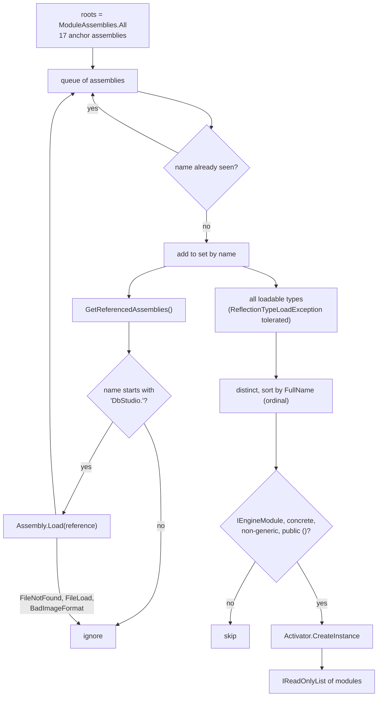
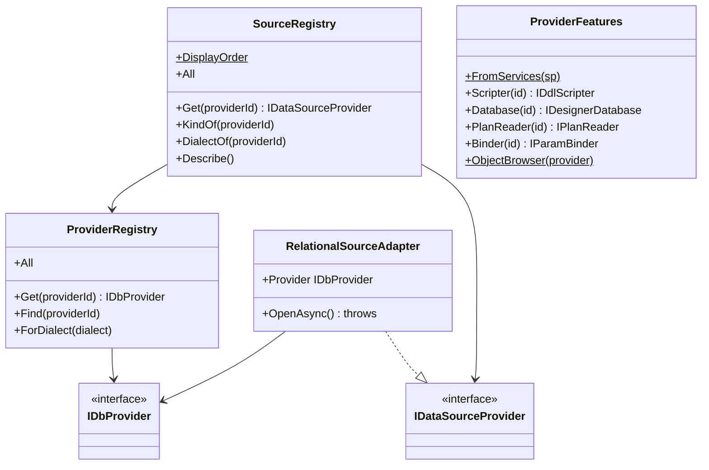

<div dir="rtl">

# 7. ماژول‌های موتور، DI و قابلیت‌های کلیددار

> **سطح:** L3 ارشد | **بخش:** II | **کد خوانده‌شده در:** `08528ae` (Rowlit 1.6.3)
> [English](../../en/part2/07-engine-modules-and-di.md) · قبلی: [6. پروتکل رویداد WebSocket](06-websocket-protocol.md) · بعدی: [8. اتصال‌ها، نشست‌ها و اجرای SQL](08-connections-sessions-execution.md)
>
> **در یک جمله:** هر بستهٔ قابلیت در موتور یک کلاس ریشهٔ ترکیب دارد که `IEngineModule` را پیاده می‌کند؛ میزبان همهٔ آن‌ها را هنگام راه‌اندازی با بازتاب (reflection) پیدا می‌کند، به هرکدام اجازه می‌دهد سرویس‌هایش را ثبت کند (اغلب به‌صورت تک‌نمونه‌های کلیددار زیر شناسهٔ یک فراهم‌کننده یا نوع یک جریان) و مسیرهایش را نگاشت کند، و رجیستری‌ها و `ProviderFeatures` وقتی درخواستی به آن سرویس‌ها نیاز دارد با شناسه پیدایشان می‌کنند.
>
> **در این فصل یاد می‌گیرید:**
> - ریشهٔ ترکیب چیست و چرا Rowlit برای هر بسته یکی دارد؛
> - ‏`EngineModules.Discover` دقیقاً چطور اسمبلی‌ها را می‌پیماید و چرا `ModuleAssemblies.cs` نوع‌های «لنگر» را فهرست می‌کند؛
> - سرویس‌های کلیددار، رجیستری‌ها و `ProviderFeatures` چطور شناسهٔ یک فراهم‌کننده را به پیاده‌سازی درست تبدیل می‌کنند؛
> - هرکدام از ۱۷ ماژول چه چیزی ثبت می‌کند؛
> - چهار راه وصل کردن یک قابلیت به فراهم‌کننده و این‌که کی کدام را به کار ببرید؛
> - قاعده‌های مالکیت بسته‌های کاری (`// WP-MY begin … end`) و این‌که چرا این یک سامانهٔ افزونه نیست.
>
> **پیش‌نیازها:** [5. میزبان موتور](05-engine-host-and-api.md) (بخش‌های 2.6 و 2.10). مفید: آشنایی پایه با تزریق وابستگی در ‎.NET.
>
> برچسب‌های نمودارها به انگلیسی نگه داشته شده‌اند تا در GitHub درست نمایش داده شوند.

## 1. ایده (مبتدی)

آشپزخانه‌ای را تصور کنید که از واحدهای آماده ساخته می‌شود: واحد سینک، واحد فر، واحد یخچال. هر واحد لوله‌کشی و سیم‌کشی خودش را از قبل درون خود دارد و نصاب فقط باید آن را جا بیندازد و به لوله‌های اصلی وصل کند. موتور Rowlit همین‌طور کار می‌کند. پشتیبانی Redis، پشتیبانی Kafka، فراهم‌کنندهٔ MySQL، قابلیت پایگاه‌های دادهٔ پیوندی: هرکدام پروژه‌ای جداست و هرکدام یک کلاس کوچک دارد که می‌گوید «این سرویس‌های من است و این مسیرهای وب من». موتور هنگام شروع، قطعه‌های سازندهٔ خودش را می‌گردد، همهٔ این کلاس‌ها را پیدا می‌کند و از هرکدام می‌خواهد خودش را وصل کند.

این کار جلوی تبدیل شدن `Program.cs`، پروندهٔ اصلی موتور، به فهرستی صدها سطری را که هر تیمی باید ویرایشش کند می‌گیرد. تیمی که پشتیبانی ClickHouse را اضافه می‌کند فقط درون پروژهٔ ClickHouse کد می‌نویسد. موتور سپس به راهی نیاز دارد که وقتی یک اتصال ClickHouse چیزی می‌خواهد، مثلاً طرح اجرا، «نسخهٔ ClickHouse» آن قابلیت را بردارد. برای این، سرویس‌ها با یک *کلید*، یعنی شناسهٔ فراهم‌کنندهٔ `"clickhouse"`، ثبت و در لحظهٔ استفاده با همان کلید پیدا می‌شوند.

## 2. چگونه کار می‌کند (کاربردی)

### 2.1 ریشه‌های ترکیب و `IEngineModule`

[ریشهٔ ترکیب (composition root)](../glossary.md#composition-root) تنها جایی است که برنامه اشیایش را می‌سازد و پیاده‌سازی‌ها را به واسط‌هایی که کد دیگر به آن‌ها وابسته است وصل می‌کند. توصیهٔ کلاسیک این است: «یکی برای کل برنامه، تا جای ممکن نزدیک نقطهٔ ورود». Rowlit این را برای میزبان (`Program.cs`) نگه می‌دارد و **برای هر بستهٔ قابلیت** هم یک ریشهٔ ترکیب اضافه می‌کند تا سیم‌کشی هر بسته کنار کد خودش باشد. قرارداد دو متد است (`engine/src/DbStudio.Core/Providers/IDataSourceProvider.cs:45-55`):

</div>

```csharp
// engine/src/DbStudio.Core/Providers/IDataSourceProvider.cs:50-55
public interface IEngineModule
{
    void ConfigureServices(IServiceCollection services);

    void MapEndpoints(RouteGroupBuilder api);
}
```

<div dir="rtl">

‏`ConfigureServices` **پیش از** `builder.Build()` اجرا می‌شود، وقتی هنوز می‌شود مجموعهٔ سرویس‌ها را تغییر داد؛ `MapEndpoints` **پس از** آن و روی گروه `/api/v1` (`engine/src/DbStudio.Host/Program.cs:154-155`، `:189`). [ماژول (module)](../glossary.md#module) در این فصل همیشه یعنی کلاسی که این واسط را پیاده می‌کند. تصمیم D4 در طرح M2 آن را معرفی کرد: ماژول‌ها «با بازتاب روی اسمبلی‌هایی که میزبان به آن‌ها ارجاع می‌دهد کشف می‌شوند (trimming به کار نمی‌رود). هر بسته کلاس ماژول خودش را در پروژهٔ خودش اضافه می‌کند؛ `Program.cs` یک بار ویرایش می‌شود (M2-0)» (`docs/PLAN-M2.md:12`).

### 2.2 کشف: پیمایش

‏`EngineModules.Discover(params Assembly[] roots)` (`engine/src/DbStudio.Core/Services/EngineModules.cs:21-53`) دو کار می‌کند که شکل 7.1 نشانشان می‌دهد.

**شکل 7.1 — ‏`EngineModules.Discover` ماژول‌ها را چطور پیدا و مرتب می‌کند.**

</div>



<div dir="rtl">

1. **گردآوری اسمبلی‌ها.** یک پیمایش سطح‌به‌سطح از ریشه‌ها شروع می‌شود و هر اسمبلی ارجاع‌شده‌ای را که نامش با `"DbStudio."` شروع شود دنبال می‌کند (`EngineModules.AssemblyPrefix`، `:15`، `:30-33`). هر اسمبلی یک بار دیده می‌شود و کلیدش نام سادهٔ آن است، بی‌حساس به بزرگی و کوچکی حروف (`:23`، `:29`). ارجاعی که بار نشود («یک ارجاع اختیاری که مستقر نشده») به‌جای شکست دادن راه‌اندازی، کنار گذاشته می‌شود (`:38-41`). [اسمبلی (assembly)](../glossary.md#assembly) یک کتابخانه یا برنامهٔ اجرایی کامپایل‌شدهٔ ‎.NET است (`DbStudio.Core.dll`)؛ [بازتاب (reflection)](../glossary.md#reflection) API زمان اجرایی است که اسمبلی‌ها و نوع‌هایشان را وارسی می‌کند.
2. **ساختن ماژول‌ها.** همهٔ نوع‌های قابل‌بارگذاری همهٔ اسمبلی‌های گردآوری‌شده برداشته می‌شوند (یک `ReflectionTypeLoadException` نوع‌هایی را که بار شده‌اند برمی‌گرداند، `:55-65`)، تکراری‌ها حذف و **بر اساس نام کامل نوع با مقایسهٔ ترتیبی (ordinal)** مرتب می‌شوند (`:46`). هر نوعی که `IEngineModule` را پیاده کند، انتزاعی یا واسط نباشد، پارامتر عام باز نداشته باشد و سازندهٔ عمومی بی‌پارامتر داشته باشد با `Activator.CreateInstance` ساخته می‌شود (`:48-50`).

ترتیب قطعی است، و این برای ثبت‌هایی که به «چه کسی اول ثبت کرد» وابسته‌اند مهم است. در `08528ae` مرتب‌سازی این را می‌دهد:

| # | ماژول | پروژه |
|---|---|---|
| 1 | `DbStudio.Core.Diagrams.DiagramsModule` | Core |
| 2 | `DbStudio.Core.LocalHistory.LocalHistoryModule` | Core |
| 3 | `DbStudio.Core.Queries.QueriesModule` | Core |
| 4 | `DbStudio.Core.SchemaCompare.SchemaCompareModule` | Core |
| 5 | `DbStudio.Core.Search.SearchModule` | Core |
| 6 | `DbStudio.Federation.FederationModule` | Federation |
| 7 | `DbStudio.Host.Endpoints.DiagramEndpoints` | Host |
| 8 | `DbStudio.Import.ImportModule` | Import |
| 9 | `DbStudio.Logs.LogsModule` | Logs |
| 10 | `DbStudio.Providers.Cassandra.CassandraModule` | Cassandra |
| 11 | `DbStudio.Providers.ClickHouse.ClickHouseModule` | ClickHouse |
| 12 | `DbStudio.Providers.MySql.MySqlModule` | MySql |
| 13 | `DbStudio.Providers.Snowflake.SnowflakeModule` | Snowflake |
| 14 | `DbStudio.Sources.Elasticsearch.ElasticsearchModule` | Elasticsearch |
| 15 | `DbStudio.Sources.Kafka.KafkaModule` | Kafka |
| 16 | `DbStudio.Sources.Mongo.MongoModule` | Mongo |
| 17 | `DbStudio.Sources.Redis.RedisModule` | Redis |

لاگ موتور همین فهرست را هنگام شروع با عنوان «Engine modules: …» چاپ می‌کند (`Program.cs:158`)؛ سریع‌ترین راه برای این‌که ببینید ماژول تازه پیدا شده یا نه.

### 2.3 چرا لنگرها وجود دارند

اگر میزبان از قبل به همهٔ پروژه‌ها ارجاع می‌دهد (`engine/src/DbStudio.Host/DbStudio.Host.csproj:20-38`)، چرا `ModuleAssemblies.cs` برای هر اسمبلی یک نوع فهرست می‌کند؟

</div>

```csharp
// engine/src/DbStudio.Host/ModuleAssemblies.cs:12-20
public static Assembly[] All { get; } =
[
    typeof(ModuleAssemblies).Assembly,
    typeof(Core.Services.EngineModules).Assembly,                 // Core (e.g. M2-ER DiagramsModule)
    typeof(Providers.PostgreSql.PostgreSqlProvider).Assembly,     // PG-A (Logs/ sources by M2-L)
    typeof(Sources.Redis.RedisModule).Assembly,                   // M2-R
    typeof(Sources.Mongo.MongoModule).Assembly,                   // M2-M
    // …
];
```

<div dir="rtl">

چون `ProjectReference` با ارجاعی که در اسمبلی کامپایل‌شده نوشته می‌شود یکی نیست. کامپایلر C# فقط برای اسمبلی‌هایی که کد میزبان واقعاً نوعی از آن‌ها را به کار می‌برد، ارجاع اسمبلی را در فرادادهٔ `DbStudio.Engine.dll` می‌نویسد. پروژهٔ قابلیتی که میزبان هرگز در کد نامش را نمی‌برد (به بستهٔ Redis فقط از راه ماژولش می‌رسیم) در پوشهٔ خروجی کپی می‌شود ولی در `GetReferencedAssemblies()` **ظاهر نمی‌شود**، پس پیمایش هرگز پیدایش نمی‌کند. توضیح خود پرونده همین را می‌گوید: «یک نوع لنگر برای هر اسمبلی قابلیت، ارجاع زمان کامپایل را نگه می‌دارد (کامپایلر ارجاع به اسمبلی‌هایی را که هیچ نوعشان استفاده نشده حذف می‌کند)» (`ModuleAssemblies.cs:5-9`). [نوع لنگر (anchor type)](../glossary.md#anchor-type) همان یک `typeof(...)` برای هر اسمبلی است.

دو پیامد دارد. کلاس ماژول تازه در پروژه‌ای که *از قبل* لنگر دارد (`DiagramsModule`، `QueriesModule`، `SearchModule`… در هسته) به هیچ تغییری در میزبان نیاز ندارد (`EngineModules.cs:10-11`). *پروژهٔ* تازه یک سطر در `ModuleAssemblies.cs` و یک `ProjectReference` در csproj میزبان لازم دارد، و هر دو پرونده‌های منجمدی‌اند که فقط بستهٔ کاری پایه ویرایششان می‌کند (`docs/wp-notes/README.md:20-24`).

### 2.4 سرویس‌های کلیددار

‏‎.NET 8 [DI کلیددار (keyed DI)](../glossary.md#keyed-service) را اضافه کرد: یک ثبت کلیدی دارد و مصرف‌کننده با `GetKeyedService<T>(key)` (یا `GetRequiredKeyedService`) آن را حل می‌کند. Rowlit دو نوع کلید به کار می‌برد:

- **شناسهٔ فراهم‌کننده‌ها** (`"sqlserver"`، `"mysql"`، `"clickhouse"`…) برای قابلیت‌های هر فراهم‌کننده: `IDdlScripter`، `IDesignerDatabase`، `IPlanReader`، `IParamBinder`، `ILogSource`، `IActivitySource` و در فدراسیون `ISourceFetcher`؛
- **نوع جریان‌ها** (`"redis.monitor"`، `"kafka.tail"`، `"mongo.changes"`، `"es.tasks"`، `"db.search"` و نوع‌های دنبال‌کردن لاگ و پرس‌وجوی دوره‌ای فعالیت) برای `IStreamFactory`.

فراهم‌کننده‌های درونی قابلیت‌های کلیددارشان را در `Program.cs:129-146` ثبت می‌کنند؛ فراهم‌کننده‌های ماژولی در `ConfigureServices`، مثلاً حلقهٔ MySQL روی دو شناسه‌اش:

</div>

```csharp
// engine/src/DbStudio.Providers.MySql/MySqlModule.cs:28-40
services.AddSingleton<IDbProvider, MySqlProvider>();
services.AddSingleton<IDbProvider, MariaDbProvider>();
foreach (var id in ProviderIds)                       // ["mysql", "mariadb"]
{
    services.AddKeyedSingleton<IDdlScripter>(id, (_, _) => new MySqlDdlScripter(id));
    services.AddKeyedSingleton<IDesignerDatabase>(id, (_, _) => new MySqlDesignerDatabase(id));
    services.AddKeyedSingleton<IPlanReader>(id, (_, _) => new MySqlPlanReader(id));
    services.AddKeyedSingleton<IParamBinder>(id, MySqlParamBinder.Instance);
    services.AddKeyedSingleton(id, (sp, _) => new MySqlLogSource(sp.GetRequiredService<ISqlRunnerFactory>(), id));
    services.AddKeyedSingleton<ILogSource>(id, (sp, key) => sp.GetRequiredKeyedService<MySqlLogSource>(key));
    services.AddKeyedSingleton<IActivitySource>(id, (sp, key) => sp.GetRequiredKeyedService<MySqlLogSource>(key));
}
```

<div dir="rtl">

دو الگو پیداست. یک کلاس می‌تواند با گرفتن شناسه به دو کلید خدمت کند (`new MySqlDdlScripter(id)`)، پس MariaDB و MySQL کد مشترک دارند ولی نمونه‌هایشان جداست. و یک شیء می‌تواند با یک بار ثبت نوع مشخص کلیددار و ارجاع دادن، زیر دو واسط عرضه شود (`ILogSource` و `IActivitySource` هر دو به همان `MySqlLogSource` حل می‌شوند).

### 2.5 رجیستری‌ها و `ProviderFeatures`

سه شیء جست‌وجو یک شناسه را به کد تبدیل می‌کنند و هرکدام نمونه‌ای از [الگوی رجیستری (registry pattern)](../glossary.md#registry-pattern) هستند (یک شیء که کلیدها را به پیاده‌سازی‌ها نگاشت می‌کند تا فراخواننده‌ها هرگز خودشان آن‌ها را نسازند). شکل 7.2 آن‌ها را همراه واسط‌هایی که تحویل می‌دهند نشان می‌دهد.

**شکل 7.2 — رجیستری‌ها و قابلیت‌های کلیددار.**

</div>



<div dir="rtl">

- **‏`ProviderRegistry`** (`engine/src/DbStudio.Core/Services/ProviderRegistry.cs:7-25`) مقدار `IEnumerable<IDbProvider>` را می‌گیرد، یعنی همهٔ فراهم‌کننده‌های رابطه‌ای که `Program.cs` *و* ماژول‌ها ثبت کرده‌اند، و در دیکشنری‌ای بی‌حساس به حروف می‌گذارد. ‏`Get` برای شناسهٔ ناشناخته `400 VALIDATION` با «Unknown provider» پرتاب می‌کند (`:19-20`). اگر دو فراهم‌کننده شناسهٔ یکسان داشته باشند، اولی بی‌صدا برنده است (`TryAdd`، `:14`).
- **‏`SourceRegistry`** (`engine/src/DbStudio.Core/Services/SourceRegistry.cs:15-68`) نمای M2 از *همهٔ* فراهم‌کننده‌هاست (تصمیم D1، `docs/PLAN-M2.md:9`): هر فراهم‌کنندهٔ رابطه‌ای را در یک `RelationalSourceAdapter` می‌پیچد (`:27`، `:74-87`) و `IDataSourceProvider`های ماژول‌های منبع را اضافه می‌کند. «شناسهٔ فراهم‌کنندهٔ رابطه‌ای همیشه برنده است؛ ماژول نباید سایه‌اش بیندازد» (`:30-31`). ‏`Describe()` پاسخ `GET /providers` را با ترتیب ثابت `DisplayOrder` از ۱۴ شناسه می‌سازد (`:18-19`، `:57-58`) و شناسه‌های ناشناخته را پس از آن‌ها می‌آورد. ‏`OpenAsync` مبدل عمداً استثنا می‌دهد، چون اتصال‌های رابطه‌ای از نشست‌های زبانه استفاده می‌کنند، نه کلاینت‌های منبع مشترک (`:85-86`).
- **‏`ProviderFeatures`** (`engine/src/DbStudio.Core/Services/ProviderFeatures.cs:12-54`) که با `ProviderFeatures.FromServices(sp)` ساخته می‌شود (`Program.cs:147`)، چهار قابلیت کلیددار M1.5 را **هنگام فراخوانی** حل می‌کند (`:32-38`). قابلیتی که نباشد به `400 NOT_SUPPORTED` با «The provider 'x' does not support the table designer» تبدیل می‌شود (`:43-45`، `:52-53`)؛ نبودن مقیدکنندهٔ پارامتر مجاز است (`Binder` مقدار null برمی‌گرداند، `:46`). سازندهٔ دومی برای آزمون‌ها فهرست‌های ساده می‌گیرد (`:19-30`).

همین جست‌وجوی دیرهنگام است که ترتیب ثبت را برای این قابلیت‌ها بی‌اهمیت می‌کند؛ یادداشت‌های WP0 صریحاً این را می‌گویند: «`ProviderRegistry`/`SourceRegistry` پس از اجرای همهٔ ماژول‌ها `IEnumerable<IDbProvider>`/`IEnumerable<IDataSourceProvider>` را حل می‌کنند، `ProviderFeatures` و `LogService` سرویس‌های کلیددار را هنگام فراخوانی پیدا می‌کنند، پس ترتیب ثبت مهم نیست» (`docs/wp-notes/wp0.md:63-65`).

### 2.6 گشتی در ۱۷ ماژول

| ماژول | ‏`ConfigureServices` چه ثبت می‌کند | ‏`MapEndpoints` چه نگاشت می‌کند |
|---|---|---|
| ‏`DiagramsModule` (Core) | ‏`DiagramStore` (`Core/Diagrams/DiagramsModule.cs:14`) | هیچ؛ ماژول `DiagramEndpoints` میزبان صاحب مسیرهاست (`:8-10`) |
| ‏`DiagramEndpoints` (Host) | هیچ | فهرست، درج/به‌روزرسانی و حذف `/connections/{cid}/er/layouts` (`Host/Endpoints/DiagramEndpoints.cs:20-37`) |
| ‏`LocalHistoryModule` (Core) | ‏`LocalHistoryService` | ‏`/local-history` |
| ‏`QueriesModule` (Core) | ‏`SavedQueryStore` | ایجاد، خواندن، ویرایش، حذف و تکثیر در `/connections/{cid}/queries` (`Core/Queries/QueriesModule.cs:23-65`) |
| ‏`SchemaCompareModule` (Core) | ‏`SchemaCompareService` | ‏`/schema-compare` |
| ‏`SearchModule` (Core) | ‏`DatabaseSearchService` و `IStreamFactory` کلیددار `"db.search"` (`Core/Search/SearchModule.cs:20-25`) | هیچ: «جست‌وجو در پایگاه داده» به‌صورت جریان از راه `POST /streams` اجرا می‌شود (`:11-14`) |
| ‏`FederationModule` | ‏`DuckDbEngineFactory`، `LinkRuntime`، `IDbProvider` از نوع `LinkedProvider`، `IParamBinder` کلیددار برای `linked`، `ISourceFetcher` کلیددار برای هر شناسهٔ رابطه‌ای و برای Mongo، Elasticsearch و پرونده‌ها؛ `LinkedViewStore`، `MaterializeService` (`Federation/FederationModule.cs:21-41`) | ‏`/links/engine` و مسیرهای پیوندها (`:43-54`) |
| ‏`ImportModule` | ‏`ImportService` | ‏`/connections/{cid}/import` |
| ‏`LogsModule` | ‏`EngineLogSource`، `ISqlRunnerFactory`، درزهای دروازه برای Redis/Mongo/Kafka (همه با `TryAdd`)، منبع‌های لاگ کلیددار برای `sqlserver`، `oracle`، `postgresql`، `redis`، `mongodb`، `kafka`؛ `LogService`؛ کارخانه‌های جریان برای دنبال‌کردن لاگ و پرس‌وجوی دوره‌ای فعالیت (`Logs/LogsModule.cs:25-55`) | ‏`/logs/{cid}` (`:70`) |
| ‏`CassandraModule` | ‏`CqlClusterPool`، `CassandraProvider` (به‌عنوان `IDbProvider` هم)، نویسندهٔ اسکریپت و پایگاه دادهٔ طراح کلیددار، و یک `IPlanReader` کلیددار **گذرا (transient)** که کارخانه‌اش `NOT_SUPPORTED` پرتاب می‌کند (`Providers.Cassandra/CassandraModule.cs:20-29`) | ‏`/cassandra` |
| ‏`ClickHouseModule` | یک نمونهٔ `ClickHouseProvider` که هم به‌عنوان خودش و هم به‌عنوان `IDbProvider` به اشتراک گذاشته می‌شود، نویسندهٔ اسکریپت، پایگاه دادهٔ طراح، خوانندهٔ طرح اجرا، مقیدکننده، منبع لاگ/فعالیت کلیددار و `ChAdminService` (`Providers.ClickHouse/ClickHouseModule.cs:25-38`) | ‏`/clickhouse/{cid}` (partها، mutationها، mergeها) |
| ‏`MySqlModule` | ‏`MySqlProvider` و `MariaDbProvider` و قابلیت‌های کلیددار برای هر دو شناسه (`Providers.MySql/MySqlModule.cs:26-41`) | هیچ: «هر چیز مخصوص MySQL از راه APIهای رابطه‌ای مشترک می‌رود» (`:19-20`، `:45`) |
| ‏`SnowflakeModule` | ‏`SnowflakeSecrets`، `ISnowflakeGatewayFactory`، `SnowflakeProvider` (به‌عنوان `IDbProvider` هم)، قابلیت‌های کلیددار، منبع لاگ/فعالیت (`Providers.Snowflake/SnowflakeModule.cs:41-57`) | ‏`/snowflake/{cid}` (انبارها، نقش‌ها، اشیا) و `/snowflake/sessions/{sid}` (زمینه، use) (`:26-35`) |
| ‏`ElasticsearchModule` | ‏`IDataSourceProvider` از نوع `EsProvider`، هشت سرویس، جریان کلیددار `"es.tasks"` | ‏`/es/{cid}` |
| ‏`KafkaModule` | ‏`IDataSourceProvider` از نوع `KafkaProvider`، هفت سرویس، جریان‌های کلیددار `"kafka.tail"` و `"kafka.fetch"` (`Sources.Kafka/KafkaModule.cs:16-34`) | ‏`/kafka/{cid}` |
| ‏`MongoModule` | ‏`IDataSourceProvider` از نوع `MongoProvider`، ده سرویس، جریان کلیددار `"mongo.changes"` (`Sources.Mongo/MongoModule.cs:16-36`) | ‏`/mongo/{cid}` |
| ‏`RedisModule` | ‏`IDataSourceProvider` از نوع `RedisProvider`، پنج سرویس، جریان‌های کلیددار `"redis.monitor"` و `"redis.subscribe"` (`Sources.Redis/RedisModule.cs:17-27`) | ‏`/redis/{cid}` |

چهار فراهم‌کنندهٔ رابطه‌ای M1/M2 (SQL Server، Oracle، SQLite، PostgreSQL) ماژول خودشان را ندارند؛ آن‌ها از D4 قدیمی‌ترند و در `Program.cs:92-95` و `:129-146` ثبت می‌شوند. منبع‌های لاگشان در پروژهٔ Logs است و `LogsModule` ثبتشان می‌کند (`LogsModule.cs:38-49`). SQLite منبع لاگ ندارد: «زبانهٔ Logs آن فقط لاگ موتور را نشان می‌دهد» (`:19-20`).

## 3. نگاه عمیق (ارشد)

<a id="31-four-ways-to-attach-a-capability-to-a-provider"></a>

### 3.1 چهار راه وصل کردن قابلیت به فراهم‌کننده

‏`IDbProvider` منجمد است: «قرارداد با بخش 2.2 در docs/PLAN.md منجمد شده: پیش از تغییر این پرونده طرح را تغییر دهید» (`engine/src/DbStudio.Core/Providers/IDbProvider.cs:5-8`). با این حال فراهم‌کننده‌ها پس از M1 طراح، طرح اجرا، پارامتر، لاگ، فهرست اشیا، جست‌وجو و تونل گرفتند. کد چهار روش را نشان می‌دهد که هرکدام دلیلی دارد.

1. **[عضوهای پیش‌فرض واسط (default interface members)](../glossary.md#default-interface-member) به‌صورت افزودنی.** ‏C# اجازه می‌دهد عضو واسط بدنه داشته باشد. ‏`IDbProvider.ClearPooledConnections` به‌طور پیش‌فرض کاری نمی‌کند (`IDbProvider.cs:38-44`)؛ `IDbSession` برای `SchemaMode`، `CurrentSchema`، `SearchPath`، `RefreshSchemaAsync`، `ChangeSchemaAsync`، `LostTransaction` و `FindUnboundParameter` پیش‌فرض دارد (`IDbProvider.cs:70-119`) که هرکدام با «Additive» علامت خورده‌اند. این را برای رفتار کوچکی به کار ببرید که هر فراهم‌کننده به شکلی دارد.
2. **سرویس‌های کلیددار با شناسهٔ فراهم‌کننده.** قابلیت‌های بزرگ‌تر با کلاس‌ها و وابستگی‌های خودشان (طراح، طرح اجرا، مقیدکننده، لاگ‌ها، واکشی‌کننده‌ها) واسط‌های جدایی‌اند که زیر شناسه ثبت می‌شوند و `ProviderFeatures` یا `LogService` پیدایشان می‌کند. کلاس فراهم‌کننده حتی از وجودشان خبر ندارد. این را وقتی به کار ببرید که قابلیت طول عمر یا وابستگی‌های خودش را دارد، یا ممکن است فراهم‌کننده‌ای آن را نداشته باشد.
3. **[واسط‌های نقش (role interfaces)](../glossary.md#role-interface) که با cast کشف می‌شوند** (واسط‌های کوچکی که کلاس برای اعلام یک قابلیت پیاده می‌کند). ‏`IObjectBrowserProvider` و `IDatabaseSearchProvider` را خود کلاس فراهم‌کننده پیاده می‌کند و فراخواننده‌ها وجودشان را می‌آزمایند: `provider as IObjectBrowserProvider ?? throw NotSupported(...)` (`ProviderFeatures.cs:49-50`)، `providers.Find(profile.ProviderId) as IDatabaseSearchProvider` (`engine/src/DbStudio.Core/Search/DatabaseSearchService.cs:57`). یادداشت‌های WP0 همین را برای فراهم‌کننده‌های Batch 3 تجویز می‌کنند، «همان‌طور که PostgreSQL می‌کند» (`docs/wp-notes/wp0.md:65-66`). این را وقتی به کار ببرید که قابلیت به منطق خصوصی اتصال فراهم‌کننده نیاز دارد.
4. **واسط‌های اختیاری گیرنده.** ‏`IExecutionDiagnosticsSink` گیرندهٔ اجرا را برای فراهم‌کننده‌هایی گسترش می‌دهد که حین اجرا پیام تشخیصی کارساز تولید می‌کنند؛ فراهم‌کننده‌ها به‌جای آزمودن آن، `AdoSessionBase.EmitDiagnosticsAsync` را صدا می‌زنند (`engine/src/DbStudio.Core/Services/ExecutionContracts.cs:5-14`).

این همان [تفکیک واسط (interface segregation)](../glossary.md#solid) در عمل است: هیچ فراهم‌کننده‌ای مجبور نیست طراحی را که ندارد پیاده کند و پاسخ «نمی‌توانم» یکسان است (`400 NOT_SUPPORTED`).

### 3.2 ترفندهایی که ارزش شناختن دارند

- **کارخانهٔ کلیدداری که استثنا می‌دهد.** ‏Cassandra طرح اجرا ندارد. به‌جای ثبت نکردن کلید (که پیام عمومی «does not support explain plans» را می‌داد)، یک ثبت کلیدار *گذرا* انجام می‌دهد که کارخانه‌اش یک `EngineException` با پیام خود Cassandra و اشاره به tracing پرتاب می‌کند (`CassandraModule.cs:15-16`، `:27-28`). نقطهٔ پایانی مشترک explain همان پیام را بی‌تغییر برمی‌گرداند؛ طول عمر گذرا می‌گوید قرار نیست چیزی نگه داشته شود.
- **شکستن چرخهٔ ساخت با جست‌وجوی دیرهنگام.** ‏`ConnectionStore` به `SourceRegistry` وابسته است، آن به `ProviderRegistry`، آن به همهٔ `IDbProvider`ها از جمله `SnowflakeProvider`، و آن به رمزهایی از `ConnectionStore`. ‏Snowflake چرخه را با lambdaیی می‌شکند که انبار اتصال‌ها را فقط هنگام خواندن رمز حل می‌کند: `new SnowflakeSecrets((id, key) => sp.GetService<ConnectionStore>()?.GetSecret(id, key))`، با توضیح «ConnectionStore به رجیستری فراهم‌کننده‌ها وابسته است که به ما وابسته است» (`SnowflakeModule.cs:43-44`).
- **اشتراک یک نمونه.** ‏ClickHouse فراهم‌کننده‌اش را هنگام ثبت با `new` می‌سازد تا پایگاه دادهٔ طراح همان نمونه را نگه دارد (`ClickHouseModule.cs:27-31`). ‏Snowflake و Cassandra همین را با ثبت نوع مشخص و ارجاع دادن `IDbProvider` به آن به دست می‌آورند (`SnowflakeModule.cs:46-47`، `CassandraModule.cs:23-24`). بدون این ارجاع، `AddSingleton<IDbProvider, X>()` به‌علاوهٔ `AddSingleton<X>()` دو نمونه می‌ساخت.
- **‏`TryAdd` برای درزها.** ‏`LogsModule` دروازه‌هایش را با `TryAddSingleton` ثبت می‌کند تا «یکپارچه‌ساز بتواند پیش از آن مبدل‌هایی روی کلاینت‌های M2-R/M/K ثبت کند» (`LogsModule.cs:19-21`، `:27-36`)؛ `FederationModule` همین را برای کارخانهٔ موتور و runtimeاش می‌کند (`FederationModule.cs:25-28`)، که به آزمون‌ها اجازه می‌دهد پیشاپیش نسخهٔ ساختگی را ثبت کنند. چون ماژول‌ها به ترتیب نام نوع اجرا می‌شوند و `Program.cs` پیش از همه، «اول» پیش‌بینی‌پذیر است. در مقابل `AddSingleton` *اضافه* می‌کند؛ در حل سادهٔ یک سرویس غیرکلیددار **آخرین** ثبت برنده است، در حالی که `IEnumerable<T>` همه را می‌بیند.
- **متد ایستای `AddServices` برای آزمون‌ها.** ‏Mongo و Kafka «همه‌چیز جز فراهم‌کننده» را در یک متد ایستای عمومی جدا کرده‌اند تا آزمون‌ها فراهم‌کننده‌ای روی یک دروازهٔ ساختگی ثبت کنند و بقیه را دوباره به کار ببرند (`MongoModule.cs:22-36`، `KafkaModule.cs:22-34`).

### 3.3 هزینهٔ بازتاب، trimming و انتشار تک‌پرونده‌ای

کشف یک بار هنگام شروع اجرا می‌شود. ۱۷ اسمبلی `DbStudio.*` را بار می‌کند (که موتور به‌هرحال لازمشان دارد) و نوع‌هایشان را یک بار برمی‌شمارد؛ هیچ بازتابی به ازای هر درخواست انجام نمی‌شود. این طراحی به دو انتخاب ساخت وابسته است:

- **بدون [trimming](../glossary.md#trimming).** ‏trimmer زبان میانی کدی را که نتواند ثابت کند استفاده می‌شود حذف می‌کند؛ نوع‌هایی که فقط از راه `Activator.CreateInstance` ساخته می‌شوند حذف می‌شدند. موتور trim نمی‌شود («موتور trim نمی‌شود، پس بازتاب امن است»، `EngineModules.cs:8-9`؛ در هیچ پروژه یا اسکریپت ساختی `PublishTrimmed` نیست).
- **انتشار تک‌پرونده‌ای کار می‌کند.** ‏`scripts/build.ps1` یک تک‌پروندهٔ خودکفا منتشر می‌کند (`-p:PublishSingleFile=true`، `scripts/build.ps1:74-77`). اسمبلی‌هایی که در تک‌پرونده بسته‌بندی شده‌اند همچنان با نام از راه `Assembly.Load` بار می‌شوند و `GetReferencedAssemblies` فراداده را می‌خواند نه پرونده‌ها را، پس پیمایش همان رفتار را دارد. آزمون دود بومی CI دقیقاً همین باینری منتشرشده را می‌آزماید (فصل [5](05-engine-host-and-api.md#5-how-it-is-tested)).

‏`ReflectionTypeLoadException` تحمل می‌شود (`EngineModules.cs:61-64`)، چون نوعی که به یک وابستگی اختیاری غایب ارجاع دهد در غیر این صورت باعث می‌شد `GetTypes()` کل اسمبلی استثنا بدهد.

### 3.4 چرا این یک سامانهٔ افزونه نیست

[سامانهٔ افزونه (plugin system)](../glossary.md#plugin-system) کدی را بار می‌کند که هنگام ساخت شناخته‌شده نبوده است: پوشه‌ای از DLLها که در زمان اجرا پویش می‌شود، جداسازی از راه `AssemblyLoadContext`، قراردادهای افزونهٔ نسخه‌دار. Rowlit هیچ‌کدام را ندارد. هر اسمبلی ماژول را پروژهٔ میزبان ارجاع می‌دهد، همه با هم کامپایل و منتشر می‌شوند و فقط با دنبال کردن ارجاع‌ها از لنگرهای کامپایل‌شده پیدا می‌شوند. نه پوشهٔ افزونه هست، نه load context و نه نسخه‌گذاری قرارداد؛ `IDbProvider` را طرح منجمد کرده، نه یک شمارهٔ نسخه. آنچه بازتاب به دست می‌دهد **جداسازی نویسندگی** است، نه گسترش‌پذیری در زمان اجرا: یک بستهٔ کاری می‌تواند ماژولی اضافه کند بی‌آن‌که `Program.cs` را ویرایش کند. طرح M1 همان موقع گفته بود «در M1 بارگذاری افزونه نداریم» (`docs/PLAN.md:88`) و از آن پس چیزی اضافه نشده است.

### 3.5 بسته‌های کاری و بلوک‌های مالکیت

‏Batch 3 (MySQL/MariaDB، ClickHouse، Snowflake، Elasticsearch، Cassandra) و کار پایگاه‌های دادهٔ پیوندی را [بسته‌های کاری (work packages)](../glossary.md#work-package) موازی ساختند (WP: واحدهای کاری که به یک تیم یا عامل سپرده می‌شوند و هرکدام پرونده‌های خودش را دارد). قاعده‌های مالکیت در `docs/wp-notes/README.md` آمده‌اند:

- **R1**: هر WP فقط زیر مسیرهای خودش پرونده می‌سازد و پرونده‌های مشترک را فقط درون [بلوک‌های مالکیت (ownership blocks)](../glossary.md#ownership-block) برچسب‌خورده برای خودش ویرایش می‌کند، `// WP-MY begin … // WP-MY end`، «هرگز به سطری بیرون از بلوکتان دست نزنید، حتی به فاصله‌ها» (`:9-19`).
- **R2**: فهرستی از پرونده‌های منجمد، از جمله `Program.cs`، `Host.csproj`، `ModuleAssemblies.cs` و هسته بیرون از بلوک‌های برچسب‌خورده (`:20-24`).
- **R3**: تغییری که جای دیگری لازم است به‌صورت درخواستی با diff پیشنهادی در یادداشت‌های WP نوشته می‌شود، همراه یک [stub](../glossary.md#stub) محلی (کد جانشینی که تا رسیدن تغییر واقعی جای آن را می‌گیرد) با علامت `TODO(WP<XX>-shared)` (`:30-53`).
- **R4**: دروازه‌های آزمون و اندازهٔ بسته پیش از تحویل (`:25-28`).

بلوک‌ها هنوز در کد هستند. در `08528ae` برای هرکدام از `WP-MY`، `WP-CH`، `WP-SF` و `WP-CS` بین ۱۷ تا ۱۸ بلوک در ۹ تا ۱۰ پرونده هست و بلوک‌هایی هم برای بسته‌های پیوند (`LINKS-WP0`، `LINKS-WPA`، `LINKS-WPB`، `LINKS-WPD`)؛ برای نمونه قلاب‌های دسته‌بندی هر گویش در `engine/src/DbStudio.Core/Sql/StatementClassifier.cs:258` و دو نیمهٔ برچسب‌خوردهٔ `FederationModule.ConfigureServices` (`FederationModule.cs:23-40`). سازوکار ماژول است که R1 را عملی می‌کند: ریشهٔ ترکیب یک بستهٔ فراهم‌کننده پروندهٔ خودش است، پس بیشتر سیم‌کشی‌اش هرگز به پرونده‌ای مشترک دست نمی‌زند.

## 4. حالت‌های مرزی و محدودیت‌ها

- **کلاس ماژولی که سازندهٔ عمومی بی‌پارامتر نداشته باشد بی‌صدا کنار گذاشته می‌شود** (`EngineModules.cs:49`). اگر ماژول تازه‌تان وابستگی دارد، آن‌ها را مثل ماژول‌های موجود درون lambdaهای کارخانه از `IServiceProvider` بگیرید.
- **لنگر فراموش‌شده یعنی قابلیتی که بی‌صدا غایب است.** اگر پروژهٔ تازه‌ای در `ModuleAssemblies.All` نباشد و چیز دیگری هم در کد به آن ارجاع ندهد، ماژولش هرگز پیدا نمی‌شود؛ تنها نشانه کوتاه‌تر شدن سطر «Engine modules:» در لاگ است.
- **شناسه‌های تکراری فراهم‌کننده.** ‏`ProviderRegistry` اولی را نگه می‌دارد؛ `SourceRegistry` شناسهٔ رابطه‌ای را بر شناسهٔ منبع برتری می‌دهد و یک سطر debug می‌نویسد (`SourceRegistry.cs:30-31`). هیچ خطایی هنگام شروع رخ نمی‌دهد.
- **ثبت‌های حساس به ترتیب.** جست‌وجوهای کلیددار و `IEnumerable` به ترتیب حساس نیستند؛ `GetRequiredService<T>()` ساده برای نوعی که دو بار ثبت شده آخرین ثبت را برمی‌گرداند. وقتی ماژولی پیش‌فرضی فراهم می‌کند که دیگران ممکن است جایگزینش کنند، از `TryAdd` استفاده کنید.
- **ماژول‌ها پس از `Build()` جز نگاشت مسیر کاری نمی‌توانند بکنند.** ‏`IEngineModule` قلاب «OnStarted» ندارد؛ ماژولی که حلقهٔ پس‌زمینه لازم دارد یک سرویس میزبانی‌شده یا یک زمان‌سنج درون یکی از تک‌نمونه‌هایش ثبت می‌کند.
- **مالکیت نقطه‌های پایانی تحمیل نمی‌شود.** دو ماژول می‌توانند یک مسیر را نگاشت کنند؛ ASP.NET تطابق مبهم را هنگام درخواست گزارش می‌دهد، نه هنگام شروع.

## 5. چگونه آزموده می‌شود

- **کشف ماژول در هر بسته.** بیشتر پروژه‌های آزمون قابلیت‌ها ماژول خودشان را کشف می‌کنند و آنچه ثبت می‌کند را بررسی می‌کنند؛ برای نمونه `engine/tests/DbStudio.Sources.Redis.Tests/RedisModuleTests.cs`، `engine/tests/DbStudio.Sources.Kafka.Tests/KafkaModuleTests.cs`، `engine/tests/DbStudio.Sources.Mongo.Tests/MongoModuleTests.cs`، `engine/tests/DbStudio.Logs.Tests/LogsModuleTests.cs` و `SmokeTests.cs` پروژه‌های ClickHouse، Snowflake، Cassandra و Elasticsearch (هرکدام `EngineModules.Discover(typeof(XModule).Assembly)` را صدا می‌زند).
- **سیم‌کشی ظرف سرویس همان‌طور که میزبان می‌کند.** ‏`LogServiceTests`، `ConfigureServices` همهٔ ماژول‌های کشف‌شده را روی یک مجموعهٔ تازه اجرا می‌کند (`engine/tests/DbStudio.Logs.Tests/LogServiceTests.cs`)؛ `CassandraIntegrationTests` مقدار `ProviderFeatures.FromServices(sp)` را روی چنین ظرفی حل می‌کند.
- **رجیستری‌ها با فراهم‌کننده‌های دست‌ساز.** ‏`engine/tests/DbStudio.Core.Tests/M2/SourceFrameworkTests.cs` یک `SourceRegistry` از یک `ProviderRegistry` و یک فراهم‌کنندهٔ ساختگی Redis می‌سازد؛ سازندهٔ فهرستی `ProviderFeatures` به آزمون‌های طراح و مقایسهٔ شِما خدمت می‌کند (`engine/tests/DbStudio.Core.Tests/M15/M15ServiceTests.cs`، `engine/tests/DbStudio.SchemaCompare.Tests/CompareEnv.cs`).
- **باینری منتشرشده.** آزمون دود بومی CI بررسی می‌کند که `/providers` در موتور واقعی منتشرشده فراهم‌کننده‌های M2 و Batch 3 را فهرست کند (`scripts/ci/kafka-native-smoke.mjs:6`)؛ اگر ماژولی در ساخت تک‌پرونده‌ای کشف نشود، این آزمون شکست می‌خورد.

## فصل‌های مرتبط

- [3. معماری کلان](03-big-picture-architecture.md) — لایه‌هایی که ماژول‌ها در آن‌ها می‌نشینند.
- [5. میزبان موتور](05-engine-host-and-api.md) — جایی که `Discover` صدا زده می‌شود و آنچه `Program.cs` خودش ثبت می‌کند.
- [9. فراهم‌کننده‌های رابطه‌ای](09-relational-providers.md) — قابلیت‌های کلیددار هر فراهم‌کننده چه می‌کنند.
- [16. پایگاه‌های دادهٔ پیوندی](16-linked-databases-federation.md) — ماژول فدراسیون با جزئیات.
- [17. منبع‌ها I](17-sources-redis-mongo.md) و [18. منبع‌ها II](18-sources-kafka-elasticsearch.md) — ماژول‌های منبع.
- [21. لاگ‌ها، فعالیت و منابع](21-logs-activity-resources.md) — ‏`LogsModule` و منبع‌های لاگ.
- [24. ساخت، CI، انتشار و مشارکت](24-build-ci-release-contributing.md) — چطور فراهم‌کنندهٔ تازه اضافه کنیم.

## واژه‌های واژه‌نامه در این فصل

[composition root](../glossary.md#composition-root) · [module](../glossary.md#module) · [engine module](../glossary.md#engine-module) · [assembly](../glossary.md#assembly) · [reflection](../glossary.md#reflection) · [anchor type](../glossary.md#anchor-type) · [keyed service](../glossary.md#keyed-service) · [registry pattern](../glossary.md#registry-pattern) · [provider registry](../glossary.md#provider-registry) · [source registry](../glossary.md#source-registry) · [provider features](../glossary.md#provider-features) · [role interface](../glossary.md#role-interface) · [default interface member](../glossary.md#default-interface-member) · [trimming](../glossary.md#trimming) · [plugin system](../glossary.md#plugin-system) · [work package (WP)](../glossary.md#work-package) · [ownership block](../glossary.md#ownership-block) · [R1–R4 rules](../glossary.md#r1-r4-rules) · [stub](../glossary.md#stub)

## پرونده‌ها

| مسیر | مسئولیت |
|---|---|
| `engine/src/DbStudio.Core/Providers/IDataSourceProvider.cs` | ‏`IEngineModule`، `IDataSourceProvider`، `IDataSourceClient` |
| `engine/src/DbStudio.Core/Services/EngineModules.cs` | پیمایش کشف |
| `engine/src/DbStudio.Host/ModuleAssemblies.cs` | نوع‌های لنگر، یکی برای هر اسمبلی ماژول |
| `engine/src/DbStudio.Core/Services/ProviderRegistry.cs` | فراهم‌کننده‌های رابطه‌ای بر اساس شناسه و گویش |
| `engine/src/DbStudio.Core/Services/SourceRegistry.cs` | همهٔ فراهم‌کننده‌ها، ترتیب نمایش، `RelationalSourceAdapter` |
| `engine/src/DbStudio.Core/Services/ProviderFeatures.cs` | جست‌وجوی کلیددار طراح / طرح اجرا / مقیدکننده، `NOT_SUPPORTED` |
| `engine/src/*/…Module.cs` | هفده ریشهٔ ترکیب |
| `docs/PLAN-M2.md` (D1، D4) | تصمیم‌های پشت دو خانوادهٔ فراهم‌کننده و ماژول‌ها |
| `docs/wp-notes/README.md`، `docs/wp-notes/wp0.md` | قاعده‌های مالکیت R1 تا R4، آنچه هر WP پیدا کرد |

</div>
