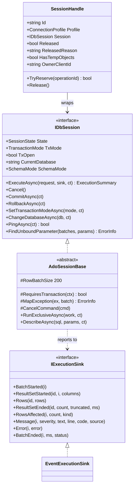
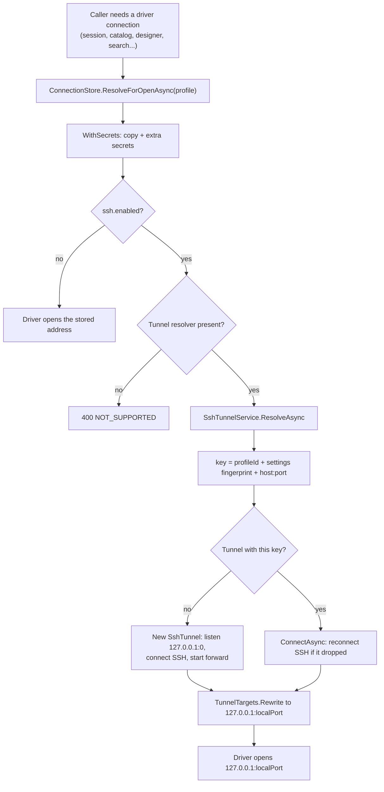
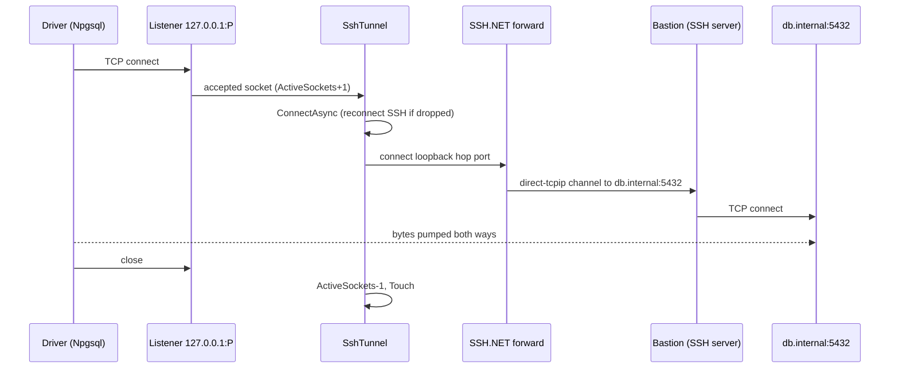
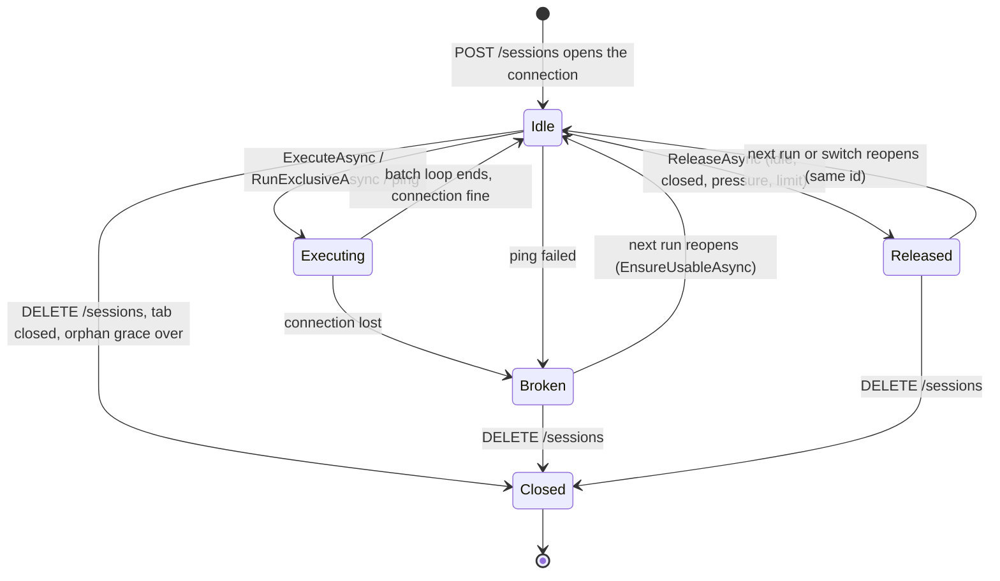
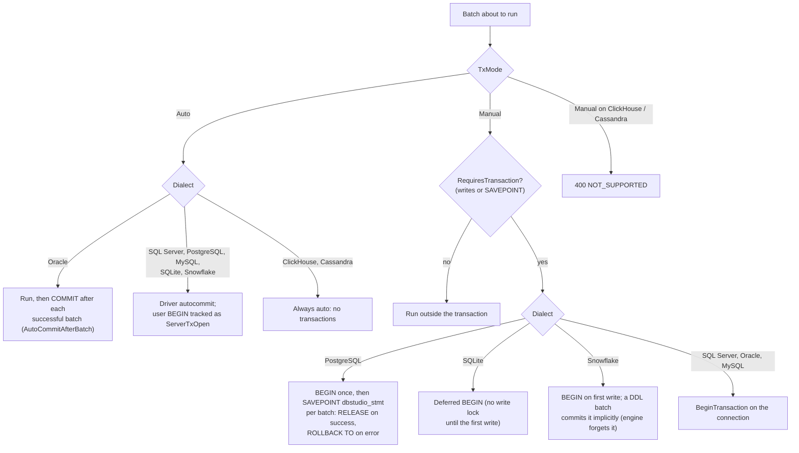
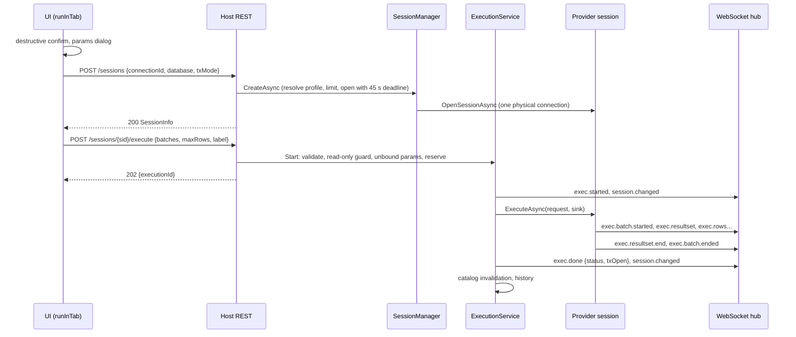
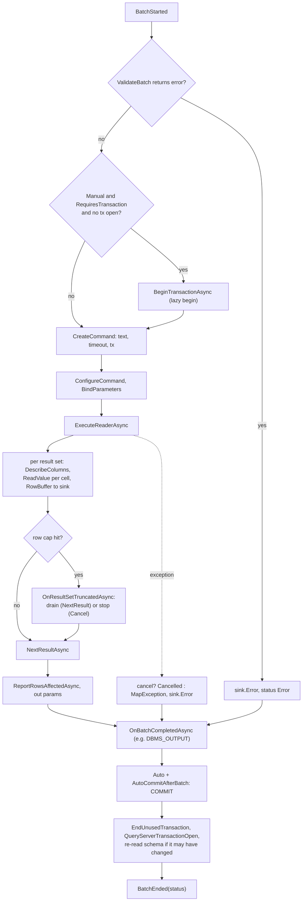
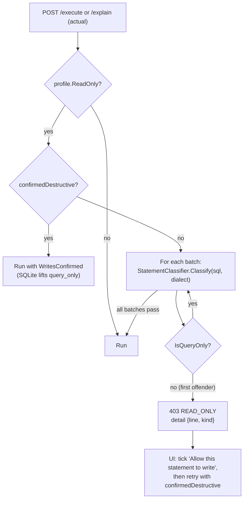

# 8. اتصال‌ها، نشست‌ها و اجرای SQL

> **سطح:** L2 کاربردی ← L3 ارشد | **بخش:** II | **کد خوانده‌شده در:** `08528ae` (Rowlit 1.6.3؛ تونل‌های SSH از کار 1.7.0 روی main)
> [English](../../en/part2/08-connections-sessions-execution.md) · قبلی: [7. ماژول‌های موتور، DI و قابلیت‌های کلیددار](07-engine-modules-and-di.md) · بعدی: [9. فراهم‌کننده‌های رابطه‌ای، یکی‌یکی](09-relational-providers.md)
>
> **در یک جمله:** یک نمایهٔ اتصال ذخیره‌شده از راه انبار اتصال‌ها و (در صورت نیاز) یک تونل SSH به یک اتصال اختصاصی پایگاه داده برای هر زبانهٔ ویرایشگر تبدیل می‌شود، و هر Ctrl+Enter از یک نگهبان فقط‌خواندنی، یک بررسی مشغول بودن و یک حلقهٔ اجرای مشترک می‌گذرد که سطرها را به‌صورت رویداد برمی‌گرداند.
>
> **در این فصل یاد می‌گیرید:**
> - نمایهٔ اتصال چیست، پنجرهٔ اتصال عمومی چطور با مشخصات فرم (form spec) رانده می‌شود و رمزها کجا می‌روند؛
> - تونل SSH چطور باز، به اشتراک گذاشته، تأیید و بسته می‌شود و کدام فراهم‌کننده‌ها می‌توانند از آن استفاده کنند؛
> - نشست در Rowlit چیست، چرا یک اتصال فیزیکی بدون استخر دارد و چطور آزاد، شکسته و دوباره باز می‌شود؛
> - تراکنش‌ها در هر گویش چطور رفتار می‌کنند و موتور از کجا می‌فهمد تراکنشی باز است؛
> - خط لولهٔ اجرا از `POST /execute` تا `exec.done`، شامل دسته‌بندی سطرها، سقف سطرها، لغو و خطاها؛
> - نگهبان فقط‌خواندنی، طبقه‌بند دستورها، تاریخچه، اجرای چندگانه، پارامترهای پرس‌وجو و describe.
>
> **پیش‌نیازها:** [3. معماری کلان](03-big-picture-architecture.md)، [5. میزبان موتور](05-engine-host-and-api.md)، [6. پروتکل WebSocket](06-websocket-protocol.md)؛ برای نظریه، [I-09 تراکنش‌ها و جداسازی](../part1/09-transactions-and-isolation.md).
>
> برچسب‌های نمودارها به انگلیسی نگه داشته شده‌اند تا در GitHub درست نمایش داده شوند.

---

## 1. ایده (مبتدی)

وقتی از یک کلاینت پایگاه داده استفاده می‌کنید، پیش از دیدن حتی یک سطر سه اتفاق می‌افتد. اول، کلاینت باید بداند کارساز *کجا*ست و *چطور* وارد شود: این یک **[نمایهٔ اتصال (connection profile)](../glossary.md#connection-profile)** ذخیره‌شده است (رکوردی نام‌دار با نشانی کارساز، کاربر، گزینه‌ها و ارجاعی به گذرواژه). دوم، کلاینت یک **[اتصال (connection)](../glossary.md#connection)** باز می‌کند (گفت‌وگویی زنده روی شبکه با کارساز که وضعیت خودش را دارد: پایگاه دادهٔ جاری، تراکنش باز، تنظیمات نشست). سوم، SQL شما را روی همان اتصال می‌فرستد و پاسخ کارساز را می‌خواند: سطرهای نتیجه، «3 rows affected»، هشدارها، خطاها.

Rowlit این کارها را میان رابط کاربری و موتور تقسیم می‌کند. رابط کاربری هرگز خودش با پایگاه داده حرف نمی‌زند. از موتور می‌خواهد یک **[نشست (session)](../glossary.md#session)** بسازد (واژهٔ Rowlit برای «اتصال خصوصی یک زبانهٔ ویرایشگر به کارساز») و سپس `POST /sessions/{id}/execute` را با دستورهایی که باید اجرا شوند می‌فرستد. موتور آن‌ها را روی اتصال همان زبانه اجرا می‌کند و نتیجه‌ها را به‌صورت رویدادهای کوچک WebSocket برمی‌گرداند، پس جدول نتیجه در حالی پر می‌شود که پرس‌وجو هنوز در حال اجراست. اگر اتصال **[فقط‌خواندنی (read-only)](../glossary.md#read-only-connection)** علامت خورده باشد، موتور هر چیزی را که داده را تغییر دهد رد می‌کند، مگر صریحاً تأییدش کنید. اگر کارساز پشت یک ماشین دروازه نشسته باشد، موتور می‌تواند از راه یک **[تونل SSH (SSH tunnel)](../glossary.md#ssh-tunnel)** به آن برسد (لوله‌ای رمزنگاری‌شده از میان یک کارساز SSH که یک درگاه محلی را به پایگاه داده هدایت می‌کند).

---

## 2. چگونه کار می‌کند (کاربردی)

### 2.1 نمایه‌های اتصال، مشخصات فرم و انبار اتصال‌ها

**نمایه.** ‏`ConnectionProfile` (`engine/src/DbStudio.Core/Models/CoreModels.cs:37-80`) یک `Id`، `Name`، `ProviderId` (یکی از چهارده شناسهٔ فهرست‌شده در `CoreModels.cs:41`: `sqlserver`، `oracle`، `sqlite`، `postgresql`، `mysql`، `mariadb`، `clickhouse`، `snowflake`، `cassandra`، `redis`، `mongodb`، `kafka`، `elasticsearch`، `linked`)، یک `Color`، یک `Folder`، پرچم `ReadOnly`، `SavePassword`، مُهرهای زمانی و کیسه‌ای آزاد به نام `Props` با کلیدهای فیلدهای فرم دارد (`CoreModels.cs:52`). توضیح بالای `Props` (`CoreModels.cs:46-51`) کلیدهای SSH مشترک میان همهٔ فراهم‌کننده‌های تونل‌پذیر را مستند می‌کند. خواننده‌های نوع‌دار `GetString`، `GetBool`، `GetInt` و `GetList` (`CoreModels.cs:58-79`) هم نوع‌های JSON و هم رشته‌ها را تحمل می‌کنند، چون مقدار ممکن است از رابط کاربری به شکل `"true"` یا `true` بیاید.

**مشخصات فرم.** هیچ فراهم‌کننده‌ای پنجرهٔ اتصال دست‌نوشته ندارد. هر فراهم‌کنندهٔ رابطه‌ای `IDbProvider.FormSpec` را عرضه می‌کند (`engine/src/DbStudio.Core/Providers/IDbProvider.cs:17`)، یک **[مشخصات فرم (form spec)](../glossary.md#form-spec)** (فهرستی از توصیف فیلدها که رابط کاربری به‌طور عمومی رسمشان می‌کند). یک `FormField` (`CoreModels.cs:89-101`) این‌ها را دارد: `Key`، `Label`، `Type` (`text | password | number | bool | select | file | list | note`، `CoreModels.cs:85`)، `Required`، `Placeholder`، `Default`، `Options`، `VisibleWhen` (فیلد را فقط وقتی نشان بده که فیلدهای دیگر مقدارهای مشخصی دارند، مثلاً `{ "auth": "sql" }`)، `FileFilter`، `Help` و، تازه همراه SSH، `Section` (فیلدهایی که بخش دارند در بلوک تاشوی خودشان رسم می‌شوند). پنجرهٔ `ui/src/components/ConnectionDialog/ConnectionDialog.tsx` فیلدهای قابل‌مشاهده را بر اساس بخش گروه می‌کند (`ConnectionDialog.tsx:45-55`) و اول بلوک اصلی و بعد هر بخش را، بسته مگر در حال استفاده باشد، رسم می‌کند (`ConnectionDialog.tsx:151-154`، `:367-381`).

**انبار.** ‏`ConnectionStore` (`engine/src/DbStudio.Core/Services/ConnectionStore.cs:19`) نمایه‌ها را در `connections.json` در پوشهٔ داده نگه می‌دارد. قاعده‌هایش:

- **رمزها هرگز به پرونده نمی‌رسند.** هر ویژگی‌ای که فیلد فرمش از نوع `password` باشد پیش از ذخیره حذف می‌شود (`StripSecrets`، `ConnectionStore.cs:331-335`، که از `Clone` صدا زده می‌شود، `:315-329`). رمز اصلی به‌صورت `password` منتقل و زیر شناسهٔ نمایه در **[انبار رمز (secret store)](../glossary.md#secret-store)** ذخیره می‌شود (`Create`، `:166`). فیلدهای دیگرِ نوع گذرواژه (‏`saslPassword` در Kafka، و `sshPassword` و `sshPassphrase` در SSH) زیر `<profileId>#<fieldKey>` به انبار رمز می‌روند (`SecretKey`، `:47`). برای این رمزهای اضافی، ویژگی غیرخالی مقدار ذخیره‌شده را جایگزین می‌کند، `null` در JSON آن را پاک می‌کند و ویژگی خالی یا غایب آن را نگه می‌دارد (`ExtraSecrets`، `:278-294`).
- **نمایش یک نمایه** مقدار `HasPassword` را از انبار رمز می‌گذارد و هرگز رمزی برنمی‌گرداند (`Present`، `:249-257`).
- **اعتبارسنجی** نام، فراهم‌کننده، هر فیلد لازم و قابل‌مشاهدهٔ غیرگذرواژه و تنظیمات SSH را بررسی می‌کند (`Validate`، `:233-244`؛ `VisibleFor`، `:246-247`؛ `ValidateTunnel`، `:145-150`). تونلی که فراهم‌کننده نمی‌تواند حملش کند هنگام ذخیره، همراه دلیل، رد می‌شود.
- **نوشتن‌ها اتمی‌اند** (`AtomicFile.WriteAllText`، `:356-360`)؛ پروندهٔ خراب به `connections.json.corrupt` کپی می‌شود و انبار به‌جای از کار افتادن خالی شروع می‌کند (`:347-351`).
- **معنای به‌روزرسانی گذرواژهٔ اصلی** (`Update`، `:171-205`): `null` نگهش می‌دارد، `""` پاکش می‌کند و هر مقدار دیگری جایگزینش؛ اگر `SavePassword` تغییر کند، رمز میان دیسک و حافظه جابه‌جا می‌شود.

**از نمایهٔ ذخیره‌شده تا نمایهٔ درایور.** دو متد نمایهٔ ذخیره‌شده را به چیزی تبدیل می‌کنند که درایور می‌تواند باز کند:

- ‏`WithSecrets(profile)` (`:74-97`) رونوشتی زمان‌اجرایی برمی‌گرداند که ویژگی‌های اضافی نوع گذرواژه از انبار رمز در آن برگردانده شده‌اند. مقدارهایی که از قبل در رونوشت هستند برنده‌اند (مثلاً عبارت عبوری که در پنجرهٔ آزمون تایپ شده).
- ‏`ResolveForOpenAsync(profile)` (`:115-121`) همان `WithSecrets` است به‌علاوهٔ، وقتی `ssh.enabled` روشن باشد، فراخوانی حل‌کنندهٔ تونل که نشانی کارساز را به سر محلی تونل بازنویسی می‌کند. ‏`ResolveForOpen` همزمان (`:127-131`) برای جاهای همزمان روی دست‌دهی SSH مسدود می‌شود، و `CurrentForOpen` (`:137-142`) نمایهٔ بازنویسی‌شده را فقط اگر تونلش از قبل باز باشد برمی‌گرداند (برای پاک کردن استخرها و پیام‌های تشخیصی که هرگز نباید هنگام تایپ تونلی باز کنند، `engine/src/DbStudio.Host/Endpoints/HistoryAndSqlEndpoints.cs:80-81`).

«هر مسیر کدی که اتصال درایوری باز می‌کند از این‌جا می‌گذرد» (`ConnectionStore.cs:112`) را یک آزمون تحمیل می‌کند: `engine/tests/DbStudio.Core.Tests/Tunnels/ConnectionOpenCallSitesTests.cs` کل کد منبع موتور را برای پرونده‌هایی می‌گردد که `WithSecrets(` یا `GetPassword(` را بدون `ResolveForOpen`/`CurrentForOpen` صدا می‌زنند و شکست می‌خورد مگر پرونده در فهرست مجاز کوتاهی همراه دلیل باشد. جاهای فراخوانی امروز شامل مدیر نشست‌ها، سرویس کاتالوگ، طراح، جست‌وجو، ورود داده، لاگ‌ها، پایگاه‌های دادهٔ پیوندی، materialize و گروه‌های نقطهٔ پایانی ClickHouse و Cassandra است (`// WP-SSH` را زیر `engine/src` جست‌وجو کنید).

**آزمودن یک اتصال.** ‏`POST /connections/test` (`engine/src/DbStudio.Host/Endpoints/ConnectionEndpoints.cs:52-80`) از راه `SourceRegistry` توزیع می‌شود، پس نمایه‌های رابطه‌ای و غیررابطه‌ای یکسان آزموده می‌شوند. برای نمایهٔ ذخیره‌شده رمزهای اضافی و در صورت درخواست گذرواژهٔ ذخیره‌شده را برمی‌گرداند (`:58-64`). به آزمون مهلتی برابر `connectTimeout + 15` ثانیه، محدود به ۵ تا ۳۰۰، می‌دهد (`:66`)، یا برای SSO مرورگری Snowflake دست‌کم ۱۳۵ ثانیه (`:68`). وقتی SSH روشن باشد کار را به `TunnelConnectionTest` می‌سپارد (`:71`، بخش 2.2).

**ویرایش و حذف.** ‏`PUT /connections/{id}` نمایه را به‌روز می‌کند، کاتالوگ نگه‌داشته را فراموش می‌کند و کلاینت منبع غیررابطه‌ای را می‌بندد؛ نشست‌های باز تا بسته شدن اتصالشان را نگه می‌دارند (`ConnectionEndpoints.cs:23-30`). ‏`DELETE /connections/{id}` تا وقتی یکی از نشست‌هایش تراکنش باز داشته باشد با `409 TX_OPEN` رد می‌کند مگر `force=true` (`SessionManager.EnsureNoOpenTransactions`، `engine/src/DbStudio.Core/Services/SessionManager.cs:331-340`)، سپس نشست‌ها، جریان‌ها، کلاینت‌های منبع، تونل‌های SSH، کاتالوگ، پالایه‌های ذخیره‌شده، نمودارها و پرس‌وجوهای ذخیره‌شدهٔ آن اتصال را می‌بندد (`ConnectionEndpoints.cs:33-49`).

**شکل 8.1 — قرارداد نشست: آنچه فراهم‌کننده پیاده می‌کند و آنچه موتور اضافه می‌کند.**

خود قرارداد در `IDbProvider.cs:47-133` است؛ `AdoSessionBase` در `engine/src/DbStudio.Core/Services/AdoSessionBase.cs:102`؛ `SessionHandle` و `SessionManager` در `SessionManager.cs:31-148` و `:154`؛ و `EventExecutionSink` در انتهای `ExecutionService.cs:235-309`.

### 2.2 تونل‌های SSH

**تونل SSH چیست.** بسیاری از پایگاه‌های دادهٔ تولیدی از یک لپ‌تاپ در دسترس نیستند. در شبکه‌ای خصوصی زندگی می‌کنند و تنها درشان یک ماشین سخت‌شده است، یک **[میزبان پرش یا بستیون (jump host / bastion)](../glossary.md#jump-host)** (کارسازی که کارش پذیرفتن ورود SSH از بیرون و رساندن آن به درون است). SSH می‌تواند **[هدایت درگاه محلی (local port forwarding)](../glossary.md#local-port-forwarding)** انجام دهد: کلاینت روی یک درگاه محلی گوش می‌دهد و هر بایتی که آن‌جا نوشته شود از میان اتصال رمزنگاری‌شدهٔ SSH حمل می‌شود؛ سپس کارساز SSH یک اتصال TCP به پایگاه دادهٔ واقعی باز می‌کند (کانال `direct-tcpip`) و بایت‌ها را جابه‌جا می‌کند. درایور پایگاه داده خیال می‌کند با `127.0.0.1:<port>` حرف می‌زند؛ در واقع از میان بستیون با `db.internal:5432` حرف می‌زند. این همان کاری است که `ssh -L 15432:db.internal:5432 user@bastion` در خط فرمان می‌کند، و Rowlit همین را درون فرایند با کتابخانهٔ مدیریت‌شدهٔ SSH.NET انجام می‌دهد (`engine/src/DbStudio.Core/DbStudio.Core.csproj:12-13`).

**بلوک فرم.** فراهم‌کننده بلوک SSH را با یک سطر اضافه می‌کند، `SshFormFields.Append(spec, help)` (`engine/src/DbStudio.Core/Services/Tunnels/SshFormFields.cs:48`)؛ برای نمونه PostgreSQL در `engine/src/DbStudio.Providers.PostgreSql/PostgreSqlProvider.cs:34`. فیلدها (`SshFormFields.cs:30-45`) همه در بخش `ssh`:

| کلید | برچسب | نوع | یادداشت |
|---|---|---|---|
| `ssh.enabled` | Use SSH tunnel | bool | پیش‌فرض false؛ متن راهنمای فراهم‌کننده زیر کلید می‌نشیند |
| `ssh.host` | SSH host | text | وقتی روشن است لازم است |
| `ssh.port` | SSH port | number | پیش‌فرض 22 (`DefaultPort`، `:21`) |
| `ssh.user` | SSH user | text | لازم |
| `ssh.auth` | SSH authentication | select | ‏`password` (پیش‌فرض) یا `key` |
| `sshPassword` | SSH password | password | فقط برای `password`؛ به انبار رمز می‌رود |
| `ssh.keyPath` | Private key file | file | فقط برای `key`؛ OpenSSH (ed25519، ECDSA، RSA) یا PEM؛ `.ppk` در PuTTY پشتیبانی نمی‌شود |
| `sshPassphrase` | Key passphrase | password | فقط برای `key`؛ وقتی کلید رمزنگاری نشده خالی است |
| `ssh.keepAlive` | Send keep-alives | bool | پیش‌فرض true؛ هر ۳۰ ثانیه |

چون `sshPassword` و `sshPassphrase` از نوع گذرواژه‌اند، انبار اتصال‌ها آن‌ها را از `connections.json` حذف و به‌عنوان رمزهای اضافی نگه می‌دارد، دقیقاً مثل هر فیلد گذرواژهٔ دیگر (`SshFormFields.cs:9-10`). فراهم‌کننده‌ای که نمی‌توان تونلش کرد به‌جای بلوک یک فیلد فقط‌خواندنی `note` نشان می‌دهد (`WithUnsupportedNote`، `SshFormFields.cs:54-55`؛ Kafka در `engine/src/DbStudio.Sources.Kafka/KafkaProvider.cs:27`).

**خواندن تنظیمات.** ‏`SshSettings.From(profile)` (`engine/src/DbStudio.Core/Services/Tunnels/SshSettings.cs:39-68`) اعتبارسنجی و عادی‌سازی می‌کند: میزبان و کاربر لازم‌اند، درگاه باید میان 1 و 65535 باشد، احراز هویت باید `password` یا `key` باشد، گیومه‌های دور مسیر کلید حذف می‌شوند («Copy as path» در ویندوز آن‌ها را اضافه می‌کند) و `~` ابتدایی به پوشهٔ نمایهٔ کاربر گسترش می‌یابد (`:54-56`). مهلت اتصال همان `connectTimeout` نمایه است، پیش‌فرض ۱۵ ثانیه و محدود به ۱ تا ۱۲۰ (`:67`). ‏`Label` به شکل `user@host` یا `user@host:port` است و همان چیزی است که رابط کاربری به‌صورت «via …» نشان می‌دهد (`:23`). ‏`Fingerprint` پیشوندی ۱۶ رقمی شانزده‌شانزدهی از SHA-256 روی همهٔ تنظیمات SSH **از جمله رمزها**ست (`:29-36`): تونل فقط تا وقتی تنظیماتی که با آن باز شده برقرارند دوباره استفاده می‌شود.

**پایگاه داده کجاست، برای هر فراهم‌کننده.** ‏`TunnelTargets.Target(profile)` (`engine/src/DbStudio.Core/Services/Tunnels/TunnelTargets.cs:30-47`) نشانی پایگاه داده را از کلیدهای فرم خود هر فراهم‌کننده می‌خواند و `Rewrite(profile, host, port)` (`:50-88`) رونوشتی برمی‌گرداند که به `127.0.0.1:<local port>` اشاره می‌کند (`LocalHost`، `:25`). تابع‌های خالص روی کلیدهای فرم یعنی هر فراهم‌کننده رشتهٔ اتصالش را مثل قبل می‌سازد. پیکربندی‌ای که یک درگاه هدایت‌شده نمی‌تواند حملش کند `400 NOT_SUPPORTED` با `detail.field = "ssh.enabled"` و `detail.hop = "ssh"` پرتاب می‌کند (`Unsupported`، `:27-28`).

| فراهم‌کننده | هدف از کجا خوانده می‌شود | بازنویسی | ردشده (دلیل در خطا) |
|---|---|---|---|
| PostgreSQL، MySQL، MariaDB | ‏`host`، `port` (5432 / 3306) | ‏`host`، `port` | چند میزبان (`a,b`)، مسیر سوکت Unix (`:108-115`) |
| SQL Server | ‏`server` (`host`، `host,port`، `tcp:host`) | ‏`server = "127.0.0.1,<port>"` | پروتکل‌های دیگر (`np:`)، نمونهٔ نام‌دار بدون درگاه (SQL Server Browser روی UDP 1434 را نمی‌توان هدایت کرد)، LocalDB (`:124-152`) |
| Oracle | ‏`host`، `port` (1521)، فقط نوع Basic | ‏`host`، `port` | نام مستعار TNS یا توصیف‌گر اتصال (`:154-160`) |
| ClickHouse | ‏`host` (می‌تواند URL باشد)، `port`، `protocol` | ‏`host`، `port` و **سنجاق `protocol`**، چون در غیر این صورت از درگاه استنباط می‌شود (8443 = https) (`:67-72`، `:162-177`) | — |
| Cassandra | یک نقطهٔ تماس، `port` (9042) | ‏`contactPoints`، `port`، حذف `host` | چند نقطهٔ تماس، بستهٔ امن Astra (`:179-190`) |
| Redis | ‏`host`، `port` (6379)، مستقل | ‏`host`، `port` | Cluster و Sentinel (نشانی گره‌ها را خودشان می‌دهند) (`:192-200`) |
| MongoDB | یک URI از نوع `mongodb://` با یک میزبان | بازنویسی URI و اجبار `directConnection=true` با حذف `replicaSet=` (`:203-214`) | ‏`mongodb+srv://`، چند میزبان (`:216-240`) |
| Elasticsearch | یک URL گره | بازنویسی URL (`:242-258`) | چند URL |
| Kafka | — | — | همیشه: کارگزارها نشانی‌های خودشان را اعلام می‌کنند (`:44`) |
| SQLite، Snowflake، linked و بقیه | — | — | در `Supported` نیستند (`:19-22`): SQLite پرونده‌ای محلی است و Snowflake یک سرویس ابری HTTPS (`ConnectionOpenCallSitesTests.cs` به آن اشاره می‌کند) |

**شکل 8.2 — از نمایهٔ ذخیره‌شده تا نمایه‌ای که درایور باز می‌کند.**

**سرویس تونل.** ‏`SshTunnelService` (`engine/src/DbStudio.Core/Services/Tunnels/SshTunnelService.cs:25`) تک‌نمونه‌ای است که در میزبان همراه پروندهٔ میزبان‌های شناخته‌شده‌اش، به‌عنوان تنها `ITunnelResolver` ثبت می‌شود (`engine/src/DbStudio.Host/Program.cs:99-104`؛ `engine/src/DbStudio.Core/Services/Tunnels/ITunnelResolver.cs:10-27`) و با `UseTunnels` به انبار اتصال‌ها وصل می‌شود. مدلش (`SshTunnelService.cs:12-24`):

- **یک تونل برای هر (اتصال، تنظیمات SSH، نقطهٔ پایانی پایگاه داده).** کلید `profileId|fingerprint|host:port` است (`:166`). ‏`ResolveAsync` (`:54-97`) کلید را جست‌وجو می‌کند؛ اگر نباشد دروازه‌ای می‌گیرد، یک `SshTunnel` تازه می‌سازد، وصلش می‌کند و نگهش می‌دارد؛ اگر باشد دوباره `ConnectAsync` را صدا می‌زند تا نشست SSH افتاده همین حالا دوباره وصل شود و فراخواننده به‌جای پایان مهلت گیج‌کنندهٔ درایور، خطای SSH را بگیرد (`:92-93`).
- **درگاه محلی ثابت.** سازندهٔ `SshTunnel` یک شنونده روی `127.0.0.1` و درگاه صفر (سیستم‌عامل درگاه آزادی انتخاب می‌کند) با backlog برابر ۱۲۸ می‌بندد و حلقهٔ پذیرش را شروع می‌کند (`:202-207`). درگاه در طول عمر تونل هرگز عوض نمی‌شود، پس استخرهای درایور و کلاینت‌های ماندگار (Redis، MongoDB) حتی وقتی نشست SSH بیفتد نشانی معتبری دارند: سوکت بعدی‌ای که پذیرفته شود آن را دوباره وصل می‌کند (`:17-18`؛ `ServeAsync` در `:296-329` اول `ConnectAsync` را صدا می‌زند).
- **دو گام درون فرایند.** ‏`ForwardedPortLocal` در SSH.NET روی درگاه loopback خودش گوش می‌دهد (`:241`)؛ هر سوکتی که روی شنوندهٔ Rowlit پذیرفته شود به آن درگاه وصل می‌شود و دو سوکت در هر دو جهت با بافر 80 KB پمپاژ می‌شوند (`PumpAsync`/`CopyAsync`، `:331-351`). شنوندهٔ اضافی برای این است که Rowlit درگاه پایدار را در اختیار داشته باشد و سوکت‌ها را بشمارد. کپی‌ای که عادی تمام شود سوی دیگر را نیمه‌بسته می‌کند؛ خطا هر دو را می‌بندد (`:338-351`).
- **اشتراک.** هر اتصال درایور یک نمایه از همان تونل استفاده می‌کند: نشست‌های زبانه، اتصال‌های استخری کاتالوگ، اتصال‌های طراح، کلاینت‌های منبع. تونل سوکت‌های فعال را می‌شمارد (`ActiveSockets`، `:215`).
- **بستن.** جاروکننده‌ای هر ۳۰ ثانیه اجرا می‌شود (`:45-46`). تونلی را که به اندازهٔ `IdleTimeout` (پیش‌فرض ۱۰ دقیقه، `DefaultIdleTimeout`، `:27`) هیچ سوکتی نداشته و تونل **جایگزین‌شده** را (نمایه اکنون تونل تازه‌تری دارد چون تنظیماتش ویرایش شده) به محض رفتن سوکت‌هایش می‌بندد (`SweepAsync`، `:141-155`). توضیح کد می‌گوید این با سیاست‌های منابع چطور همکاری می‌کند: وقتی [مدیر منابع (resource manager)](../glossary.md#resource-manager) استخرهای بیکار را پاک می‌کند، سوکت‌هایشان بسته می‌شوند و تونل هم به دنبالشان (`:19-21`). حذف یک اتصال تونل‌هایش را بی‌درنگ می‌بندد (`CloseAsync`، `:131-138`؛ `ConnectionEndpoints.cs:43`).
- **زنده‌نگه‌داشتن.** با `ssh.keepAlive` کلاینت SSH هر ۳۰ ثانیه یک keep-alive می‌فرستد (`KeepAliveInterval`، `:28`، اعمال در `:383`) تا دیوارهای آتش و دروازه‌های NAT بیکار تونل را نیندازند.

**احراز هویت.** ‏`SshConnector.ConnectAsync` (`:379-410`) یک `ConnectionInfo` از SSH.NET با مهلت و روش‌های `AuthMethods` می‌سازد (`:412-443`):

- **گذرواژه:** هر دو روش `password` و `keyboard-interactive` پیشنهاد می‌شوند و به هر پرسش keyboard-interactive با گذرواژه پاسخ داده می‌شود (`:436-442`)، چون بسیاری از کارسازها فقط شکل دوم را مجاز می‌دانند.
- **کلید خصوصی:** پرونده باید وجود داشته باشد؛ کلید رمزنگاری‌شده بدون عبارت عبور خطای «enter its passphrase» با `detail.field = sshPassphrase` می‌دهد؛ پروندهٔ `.ppk` در PuTTY از روی سطر اولش شناخته می‌شود و خطا توضیح می‌دهد چطور با PuTTYgen آن را به OpenSSH صادر کنید؛ هر شکست خواندن دیگر می‌گوید «wrong passphrase, or a format other than OpenSSH/PEM» (`:414-434`).

**کلیدهای میزبان: اعتماد در نخستین استفاده.** کارساز SSH هویتش را با یک کلید میزبان ثابت می‌کند. ‏`SshKnownHosts` (`engine/src/DbStudio.Core/Services/Tunnels/SshKnownHosts.cs`) **[اعتماد در نخستین استفاده (trust on first use)](../glossary.md#trust-on-first-use)** را در `ssh-known-hosts.json` در پوشهٔ داده پیاده می‌کند (`:20`): نخستین اتصال به `[host]:port` (`Key`، `:28`) الگوریتم کلید و **[اثر انگشت کلید میزبان (host key fingerprint)](../glossary.md#host-key-fingerprint)** SHA-256 آن را به خاطر می‌سپارد؛ اتصال بعدی‌ای که کلید دیگری نشان دهد رد می‌شود (`Check`، `:31-48`). گردانندهٔ `HostKeyReceived` در SSH.NET فقط برای `Changed` مقدار `CanTrust = false` را می‌گذارد (`SshTunnelService.cs:386-392`) و خطا هر دو اثر انگشت را نام می‌برد، هشدار می‌دهد این «can mean someone is intercepting the connection» و می‌گوید اگر کارساز دوباره نصب شده کدام پرونده را ویرایش کنید (`:404-407`). ‏`Forget` یک مدخل را حذف می‌کند (`SshKnownHosts.cs:55-63`)؛ تا جایی که کد خوانده‌شده نشان می‌دهد هیچ نقطهٔ پایانی RESTای هنوز آن را صدا نمی‌زند، پس حذف مدخل یعنی ویرایش پروندهٔ JSON، که همان چیزی است که پیام خطا می‌گوید.

**خطاها.** هر شکست در گام SSH به `503 SSH_TUNNEL` با `detail = { hop: "ssh", reason, via, field }` تبدیل می‌شود (`SshConnector.Error`، `:455-456`؛ کد در `ErrorCodes.SshTunnel`، `engine/src/DbStudio.Core/Services/ExecutionContracts.cs:59-60`). ‏`Map` (`:445-453`) دلیل‌ها را می‌دهد: `auth` (احراز هویت شکست خورد)، `unreachable` (خطای سوکت)، `timeout` (در مهلت اتصال پاسخی نیامد؛ کل انتظار مهلت به‌علاوهٔ ۵ ثانیه است، `:394`)، `hostKey`، `key` و `ssh` عمومی. وقتی خود کارساز SSH نتواند به پایگاه داده برسد، SSH.NET آن را روی هدایت گزارش می‌دهد؛ تونل آن را به‌صورت `LastForwardError` نگه می‌دارد (`:219-220`، `:242`، `:314`) و درایور فقط بسته شدن سوکتش را می‌بیند.

**آزمون اتصال از راه تونل.** ‏`TunnelConnectionTest.RunAsync` (`engine/src/DbStudio.Core/Services/Tunnels/TunnelConnectionTest.cs:14-49`) یک تونل **خصوصی و گذرا** باز می‌کند (`OpenEphemeralAsync`، `SshTunnelService.cs:113-129`: ذخیره نمی‌شود و با lease بسته می‌شود)، `TestAsync` فراهم‌کننده را روی نمایهٔ بازنویسی‌شده اجرا می‌کند و نتیجه را با `Hop` و `Via` برچسب می‌زند (`CoreModels.cs:107-109`): یک `EngineException` پیش از رسیدن به پایگاه داده `hop: "ssh"` است؛ آزمون شکست‌خوردهٔ پایگاه داده `hop: "db"` است، و اگر کارساز SSH خطای هدایت گزارش داده باشد جزئیات به «The SSH server user@bastion could not reach db:5432: …» تبدیل می‌شود (`TunnelConnectionTest.cs:36-38`). پنجره «SSH connection failed (via …)» یا «Connection failed behind the SSH tunnel (via …)» و در موفقیت «Connected in N ms via SSH user@bastion» را نشان می‌دهد (`ConnectionDialog.tsx:449-471`). چون تونل آزمون خصوصی است، آزمودن هرگز تونل مشترکی را که زبانه‌های باز از آن استفاده می‌کنند مختل نمی‌کند.

**شکل 8.3 — یک اتصال درایور از میان تونل.**

**یادداشت‌های امنیتی.** سر تونل فقط روی loopback گوش می‌دهد (`SshTunnelService.cs:203`)، مثل خود موتور؛ ماشین‌های دیگر نمی‌توانند از آن استفاده کنند. هر چیزی که با همان کاربر روی همان ماشین اجرا شود می‌تواند تا وقتی تونل باز است به آن درگاه وصل شود، دقیقاً مثل `ssh -L`؛ ورود به پایگاه داده همچنان لازم است. گذرواژه‌ها و عبارت‌های عبور SSH را انبار رمز رمزنگاری می‌کند و هرگز در `connections.json` نوشته نمی‌شوند. سنجاق کردن کلید میزبان در برابر کلید تغییریافته محافظت می‌کند، ولی همان نخستین اتصال به هر کلیدی که ببیند اعتماد می‌کند؛ اگر برایتان مهم است، اثر انگشت درون `ssh-known-hosts.json` را با آنچه مدیر سامانه منتشر می‌کند مقایسه کنید. [19. مدل امنیتی و رمزها](19-security-and-secrets.md) را ببینید.

### 2.3 نشست‌ها

**یک زبانه، یک نشست، یک اتصال فیزیکی.** نشست در Rowlit شیء سمت موتور پشت یک زبانهٔ ویرایشگر است (و پشت هر هدف یک اجرای چندگانه، هر زبانهٔ داده و غیره). ‏`SessionManager` «صاحب همهٔ نشست‌های زبانه‌هاست: برای هرکدام یک اتصال فیزیکی، ping بیکاری هر ۶۰ ثانیه، بازگشایی شفاف نشست‌های شکسته وقتی تراکنشی باز نبوده، rollback هنگام بستن» (`SessionManager.cs:150-153`). **[اتصال فیزیکی (physical connection)](../glossary.md#physical-connection)** یک سوکت واقعی به کارساز با وضعیت سمت کارساز خودش است. تصمیم D-1 طرح می‌گوید «یک اتصال فیزیکی برای هر زبانهٔ ویرایشگر، استخر خاموش؛ اتصال‌های کاتالوگ استخری جدا برای هر نمایه» (`docs/PLAN.md` §7) و `IDbProvider.OpenSessionAsync` آن را مستند می‌کند: «یک اتصال فیزیکی اختصاصی (بدون استخر) باز می‌کند که مال یک زبانهٔ ویرایشگر است» (`IDbProvider.cs:22-23`). بخش 3.1 دلیلش را توضیح می‌دهد.

**دستگیره.** فراهم‌کننده یک `IDbSession` برمی‌گرداند؛ مدیر آن را در یک **[دستگیرهٔ نشست (session handle)](../glossary.md#session-handle)** می‌پیچد (`SessionHandle`، `SessionManager.cs:31-148`) که حسابداری‌ای را اضافه می‌کند که فراهم‌کننده نباید نگرانش باشد:

- ‏`TryReserve(operationId)` / `Release()` — پرچم **[مشغول (busy)](../glossary.md#busy)** (یک مقایسه-و-جابه‌جایی `Interlocked`، `:84-103`). یک اجرا، یک خروجی، یک describe، ping بیکاری و یک آزادسازی منابع همه دستگیره را رزرو می‌کنند. ‏`IsRunning`، ping و آزادسازی را حساب نمی‌کند (`:123`).
- ‏`LastActivity` — پایان آخرین اجرا یا خروجی؛ ping بیکاری حساب نمی‌شود (`:56`، `:99`).
- ‏`Released`، `ReleasedReason` (`idle | closed | pressure | limit`)، `RememberedSchema` — اتصال نشست برای آزاد کردن منابع بسته شده ولی شناسه‌اش معتبر مانده است (`:63-78`).
- ‏`HasTempObjects` — نشست شیء موقتی ساخته، پس بازگشایی آن را از دست می‌داد (`:72`).
- ‏`TabId`، `Label` — زبانه و عنوان از `source` آخرین اجرا (`:111-112`) که در پیام‌هایی مثل «Console 1 (open transaction)» به کار می‌روند.
- ‏`OwnerClientId` و `Orphan` — کدام پنجرهٔ رابط کاربری صاحب نشست است و آیا آن پنجره هنوز WebSocket زنده دارد (`:115-120`).

‏`ToInfo()` (`:131-140`) شکل انتقال `SessionInfo` است (`:10-28`): شناسه‌ها، اطلاعات کارساز، پایگاه داده، `txMode`، `txOpen`، `state`، گویش، `executingSince`، زبانه و برچسب، `orphan`، `schema`، `searchPath`، `schemaMode`، `released`، `releasedReason`، `hasTempObjects`. ‏`WireState()` (`:143-147`) نشست آزادشده را `idle` (شناسه‌اش قابل استفاده است) و نشست بیکارِ رزروشده را `executing` گزارش می‌دهد.

**ساختن نشست.** ‏`POST /sessions` (`engine/src/DbStudio.Host/Endpoints/SessionEndpoints.cs:16-23`) متد `SessionManager.CreateAsync(connectionId, database, txMode, captureServerOutput, clientId)` را صدا می‌زند (`SessionManager.cs:210-247`):

1. نمایه را برای باز کردن حل کن (رمزها و تونل، `:213`).
2. از مدیر منابع بخواه جا باز کند (`NotifyBeforeConnectAsync`، `:218`؛ وقتی به `maxOpenConnections` با پیش‌فرض ۲۰ برسیم، این قلاب کم‌کاربردترین اتصال بیکار اخیر را آزاد می‌کند — `engine/src/DbStudio.Core/Services/ResourceManager.cs:40`، `:187`).
3. زیر یک semaphore برای هر نمایه، نشست‌های باز را بشمار؛ در `connections.maxSessionsPerProfile` یا بیشتر (پیش‌فرض ۸، `DefaultMaxSessionsPerProfile`، `:171`؛ صفر = نامحدود) خطای `429 SESSION_LIMIT` همراه توصیه پرتاب کن (`:226-231`).
4. نشست فراهم‌کننده را با یک مهلت باز کن: `OpenTimeout` برابر ۴۵ ثانیه است (`:250`) و `ConnectionGuard.BoundedAsync` آن را تحمیل می‌کند و اتصالی را که پس از مهلت باز شود dispose می‌کند (`:256-258`). کارسازی که سوکت را بپذیرد ولی هرگز پاسخ ندهد نمی‌تواند زبانه را روی «Loading…» نگه دارد.
5. دستگیره را همراه شناسهٔ کلاینت صاحبش (سرآیند `X-DbStudio-Client`، `engine/src/DbStudio.Host/Infrastructure/ClientIdentity.cs:11-15`) نگه دار و `LastUsedAt` نمایه را به‌روز کن (`:233-244`).

**ساخت تنبل در رابط کاربری.** رابط کاربری هنگام باز کردن زبانه نشستی باز نمی‌کند. ‏`useSessions.ensure(tabId, connectionId, database, txMode, schema)` (`ui/src/store/sessions.ts:161-206`) در نخستین کنشی که به نشست نیاز دارد اجرا می‌شود (یک اجرا، یک صفحهٔ داده، یک ذخیره). اگر زبانه از قبل نشست زنده‌ای روی همان اتصال داشته باشد دوباره استفاده می‌شود؛ تغییر پایگاه داده با `POST /sessions/{id}/database` فرستاده می‌شود و اگر فراهم‌کننده `NOT_SUPPORTED` گزارش دهد بی‌صدا عقب می‌نشیند. فراخوانی‌های هم‌زمان `ensure` برای یک زبانه یک promise در انتظار را شریک می‌شوند (`creating`، `:77`، `:178-179`) و `cancelPending` نشستی را که هنوز در حال باز شدن است قطع می‌کند (`:155-159`). نشست تازه‌ای که باید در شِمای به‌خاطرسپرده‌شده‌ای شروع کند بلافاصله پس از ساخت `POST /sessions/{id}/schema` را می‌گیرد (`:186-195`).

**ping بیکاری و نشست‌های شکسته.** یک زمان‌سنج به‌طور پیش‌فرض هر ۶۰ ثانیه ping می‌کند (`SessionManager.cs:202-203`). ‏`PingIdleAsync` (`:631-659`) اول یتیم‌ها را می‌بندد، سپس برای هر نشستی که آزاد یا رزرو نشده، بیکار است و دست‌کم ۳۰ ثانیه فعالیتی نداشته (`:641`)، آن را به‌عنوان `"ping"` رزرو می‌کند، ping فراهم‌کننده را با مهلت ۱۵ ثانیه اجرا می‌کند (`:643`) و اگر نشست `Broken` شده باشد `session.changed` را منتشر می‌کند. ‏ping پیش‌فرض `SELECT 1` است (`AdoSessionBase.PingSql`، `AdoSessionBase.cs:217`؛ Oracle بازنویسی‌اش می‌کند). ‏`AdoSessionBase.PingAsync` «مشغول» را «زنده» حساب می‌کند و در شکست اتصال یا هر `DbException` نشست را شکسته علامت می‌زند (`:866-882`).

**[نشست شکسته (broken session)](../glossary.md#broken-session)** نشستی است که اتصالش مرده است. اجرای بعدی `EnsureUsableAsync` را صدا می‌زند (`SessionManager.cs:568-599`): اتصال قدیمی را dispose می‌کند، اتصال تازه‌ای با همان پایگاه داده و حالت تراکنش باز می‌کند، آن را زیر همان شناسه جایگزین می‌کند و `session.changed` را منتشر می‌کند. اگر تراکنشی باز بوده (‏`TxOpen` یا `LostTransaction` که از لحظهٔ شکستن به خاطر سپرده شده، `IDbSession.cs:113`)، اتصال دوباره همچنان رخ می‌دهد ولی فراخوانی `409 SESSION_BROKEN` با «The connection was lost; the open transaction was rolled back by the server. The session has been reconnected.» پرتاب می‌کند (`:596-597`)؛ در غیر این صورت اجرا با هشدار «The connection was lost and has been reopened.» ادامه می‌یابد (`:598`).

**نشست‌های آزادشده.** **[نشست آزادشده (released session)](../glossary.md#released-session)** نشستی است که موتور عمداً برای صرفه‌جویی در منابع اتصالش را بسته است (`ReleaseAsync`، `:423-458`). سیاست خودکار مدیر منابع نشستی را فقط وقتی آزاد می‌کند که بیکار باشد، رزرو نشده باشد، تراکنش باز و شیء موقت نداشته باشد (`ResourceManager.IsReleasable`، `ResourceManager.cs:308-309`)، پس از `IdleSessionMinutes` (پیش‌فرض ۱۵، `:39`) یا زودتر زیر فشار حافظه؛ «بستن اتصال» / «بستن پایگاه داده» با دلیل `closed` آزاد می‌کنند. ‏`ReleaseAsync` پیش از بستن، پایگاه دادهٔ جاری، حالت تراکنش و (برای `SchemaMode.Session`) شِمای جاری را به خاطر می‌سپارد (`SessionManager.cs:435-437`). اجرای بعدی با پیامی اطلاعاتی مثل «Reconnected: the session had been closed after being idle.» به‌طور شفاف دوباره باز می‌کند (`ReopenedMessage`، `:479-485`؛ `ExecutionService.cs:158-161` برای نشست آزادشده شدت Info و برای نشست شکسته Warning را به کار می‌برد). فراخوانی‌های پایگاه داده، شِما، حالت تراکنش و اتصال دوباره اول بازگشایی می‌کنند (`ReopenIfReleasedAsync`، `:464-476`؛ در سراسر `SessionEndpoints.cs:39`، `:75`، `:85`، `:96`). بخش «Releasing a session» در `docs/resources.md` آنچه بازگشایی نمی‌تواند برگرداند را فهرست می‌کند (گزینه‌های `SET` نشست، متغیرها)، و به همین دلیل سیاست‌های خودکار هرگز به نشست‌هایی با تراکنش یا شیء موقت دست نمی‌زنند. جزئیات سیاست‌ها در [21. لاگ‌ها و فعالیت، منابع و حافظه](21-logs-activity-resources.md) است.

**یتیم‌ها.** هر پنجرهٔ رابط کاربری خود را با یک شناسهٔ کلاینت معرفی می‌کند که در فریم احراز هویت WebSocket و در هر فراخوانی REST فرستاده می‌شود. ‏`ClientPresence` (`engine/src/DbStudio.Core/Services/ClientPresence.cs:9-76`) سوکت‌های زندهٔ هر کلاینت را می‌شمارد؛ شناسه‌ها به حداکثر ۱۲۸ نویسهٔ ASCII چاپ‌پذیر عادی‌سازی می‌شوند (`:12`، `:23-33`). وقتی آخرین سوکت یک کلاینت بسته شود `ClientGone` را بالا می‌آورد (`:44-62`). مدیر نشست‌ها سپس به اندازهٔ `connections.orphanGraceSeconds` صبر می‌کند (پیش‌فرض ۹۰، `SessionManager.cs:174`؛ صفر = هرگز) و هر نشستی را که صاحبش بیش از این غایب بوده با rollback می‌بندد (`OnClientGone`، `:342-362`؛ `CloseOrphansAsync`، `:369-394`). **[نشست یتیم (orphan session)](../glossary.md#orphan-session)** از بارگذاری دوبارهٔ صفحه جان سالم به در می‌برد، چون رابط کاربری شناسهٔ کلاینتش را در `sessionStorage` نگه می‌دارد و نشست‌های خودش را دوباره به فرزندی می‌گیرد (`ui/src/store/sessions.ts:80-127`). هر فراخوانی RESTای که به نشستی دست بزند فراخواننده را صاحبش می‌کند (`SessionEndpoints.Touch`، `:138-143`).

**بستن.** ‏`DELETE /sessions/{sid}` با تراکنش باز به `force=true` نیاز دارد (وگرنه `409 TX_OPEN`، `SessionManager.cs:541-542`). ‏`CloseAsync` لغو می‌کند، dispose می‌کند (که rollback می‌کند)، نتیجه‌های نگه‌داشته را دور می‌ریزد و `session.changed` را با وضعیت `closed` منتشر می‌کند (`:538-555`). ‏`AdoSessionBase.DisposeAsync` پس از لغو تا ۱۰ ثانیه منتظر اجرای در حال انجام می‌ماند و سپس پیش از بستن اتصال هر تراکنش بازی را rollback می‌کند (`AdoSessionBase.cs:1437-1467`).

**شکل 8.4 — وضعیت‌های نشست (وضعیت فراهم‌کننده به‌علاوهٔ پرچم آزادسازی موتور).**

‏`Idle`، `Executing`، `Broken` و `Closed` همان `SessionState` هستند (`CoreModels.cs:22`)؛ `Released` وضعیت فراهم‌کننده نیست بلکه پرچم دستگیره است که روی سیم به‌صورت `released: true` با `state: idle` گزارش می‌شود.

**تعویض پایگاه داده و شِما.** ‏`POST /sessions/{sid}/database` (`SessionEndpoints.cs:35-51`) متد `ChangeDatabaseAsync` فراهم‌کننده را صدا می‌زند (`USE` در SQL Server، `ALTER SESSION SET CURRENT_SCHEMA` در Oracle، طبق `IDbSession.cs:67`). اتصال‌های PostgreSQL به یک پایگاه داده بسته‌اند، پس فراهم‌کننده `NotSupportedException` می‌دهد و طبق تصمیم D-PG6 (`docs/PLAN-PG.md`) نقطهٔ پایانی نشست را با `ReopenWithDatabaseAsync` در جا دوباره باز می‌کند (`SessionManager.cs:606-629`): همان شناسهٔ نشست، اتصال تازه، `409 TX_OPEN` با تراکنش باز، و اگر باز کردن تازه شکست بخورد اتصال جاری می‌ماند. شِمای پیش‌فرض سه حالت دارد (`SchemaMode`، `CoreModels.cs:25-30`): `None` (فراهم‌کننده‌های تک‌سطحی: انتخاب‌گر پایگاه داده خودش همان شِماست)، `ReadOnly` (SQL Server: شِمای پیش‌فرض ورود، بدون تغییر در هر نشست) و `Session` (‏`search_path` در PostgreSQL، `CURRENT_SCHEMA` در Oracle، `USE SCHEMA` در Snowflake). ‏`GET /sessions/{sid}/schema` آن را از کارساز می‌خواند و تا وقتی اجرایی در جریان است آخرین مقدار شناخته‌شده را برمی‌گرداند (`SessionEndpoints.cs:54-70`).

### 2.4 تراکنش‌ها در هر گویش

**دو حالت.** ‏`TransactionMode` یا `Auto` است یا `Manual` (`CoreModels.cs:23`). در **Auto**، autocommit درایور برقرار است: هر دستور جداگانه commit می‌شود. در **Manual**، موتور تراکنشی باز می‌کند و تا وقتی Commit یا Roll back را بزنید بازش نگه می‌دارد. قاعدهٔ `docs/PLAN.md` §2.3 این است: «موتور پیش از نخستین دستور پس از تعویض حالت یا پس از آخرین commit/rollback، `BeginTransaction()` را صدا می‌زند؛ هر فرمان `cmd.Transaction = tx` را می‌گیرد.» کد «نخستین دستور» را به یک **آغاز تنبل** پالایش کرده است (`AdoSessionBase.ExecuteBatchCoreAsync`، `AdoSessionBase.cs:1126-1132`): در حالت دستی تراکنش فقط پیش از دسته‌ای آغاز می‌شود که `RequiresTransaction` باشد (`:259-260`)، یعنی هر دسته‌ای جز پرس‌وجوهای خالص، دستورهای نشست (`SET`، `USE`، `PRAGMA`) و کنترل تراکنش — مگر دسته یک نقطهٔ ذخیره بگذارد. پس اجرایی که فقط SELECT است نه تراکنشی باز می‌کند و نه تا commit قفل خواندن نگه می‌دارد، و `BEGIN`/`COMMIT` تایپ‌شده به دست کاربر همان‌طور که تایپ شده اجرا می‌شود.

**موتور از کجا می‌فهمد تراکنشی باز است.** ‏`TxOpen` وقتی درست است که `Transaction` متعلق به موتور null نباشد یا `ServerTxOpen` تنظیم شده باشد (`AdoSessionBase.cs:146`، `:184`). ‏`ServerTxOpen` تراکنش‌هایی را پوشش می‌دهد که موتور آغاز نکرده (یک `BEGIN TRAN` تایپ‌شده به دست کاربر در حالت Auto). پس از هر دسته پایه از فراهم‌کننده `QueryServerTransactionOpenAsync` را می‌پرسد (`:1056-1064`)؛ SQL Server با `SELECT @@TRANCOUNT` پاسخ می‌دهد (`engine/src/DbStudio.Providers.SqlServer/SqlServerSession.cs:253-256`) و SQLite با `sqlite3_get_autocommit` (`engine/src/DbStudio.Providers.Sqlite/SqliteSession.cs:82`). این مقدار در `exec.done.txOpen` (`ExecutionService.cs:187`) و `session.changed` منتقل می‌شود و نشان تراکنش در انتظار نوار ابزار را می‌راند.

**تعویض حالت‌ها.** ‏`SetTransactionModeAsync` (`AdoSessionBase.cs:738-752`): Auto←Manual با دستور بعدی اثر می‌کند؛ Manual←Auto با تراکنش باز `TxOpenException` می‌دهد (`IDbProvider.cs:176`) که میزبان آن را به `409 TX_OPEN` نگاشت می‌کند. ‏Commit و Rollback درون بخش انحصاری نشست اجرا می‌شوند؛ شکست اتصال در میانهٔ آن‌ها تراکنش ازدست‌رفته را ثبت و نشست را شکسته علامت می‌زند (`:754-792`).

**تمیز کردن تراکنش‌های خالی.** اگر موتور برای دسته‌ای تراکنش آغاز کرده باشد که تنها دستور DML/DDL/SAVEPOINTش شکست خورده یا لغو شده و هیچ سطری را تغییر نداده، پایه آن تراکنش را rollback می‌کند تا زبانه بی‌دلیل تراکنش در انتظار نشان ندهد (`EndUnusedTransactionAsync`، `:1100-1116`).

**شکل 8.5 — قاعده‌های تراکنش در هر گویش.**

قاعده‌ها، همراه منبعشان:

- **Oracle** در درایور تمایز autocommit ندارد، پس در حالت Auto نشست پس از هر دستهٔ موفق commit می‌کند (`AutoCommitAfterBatch => true`، `engine/src/DbStudio.Providers.Oracle/OracleSession.cs:42`؛ پایه `CommitAfterBatchAsync` را در `AdoSessionBase.cs:1038-1049` صدا می‌زند). DDL در Oracle به‌هرحال ضمنی commit می‌شود.
- **PostgreSQL**، تصمیم D-PG3: «حالت تراکنش دستی برای هر دستور یک نقطهٔ ذخیره به کار می‌برد (`SAVEPOINT dbstudio_stmt` پیش از آن، `RELEASE` در موفقیت، `ROLLBACK TO` در خطا/لغو). تراکنش هرگز وارد حالت aborted با کد `25P02` نمی‌شود؛ کاربر کارهای قبلی را نگه می‌دارد و پیامی از موتور می‌بیند.» (`docs/PLAN-PG.md`؛ کد در `engine/src/DbStudio.Providers.PostgreSql/PgSession.cs:22`، `:30`، `:121`، `:312-321`). این همان الگوی **[نقطهٔ ذخیره برای هر دستور (savepoint per statement)](../glossary.md#savepoint-per-statement)** است. ‏`SET search_path` در PostgreSQL تراکنشی است، پس نشست پس از commit یا rollback شِما را دوباره می‌خواند (`SchemaIsTransactional => true`، `PgSession.cs:472`؛ `AdoSessionBase.cs:760`).
- **SQLite** تراکنشی *معوق (deferred)* آغاز می‌کند تا تا نخستین نوشتن قفل نوشتن نگیرد، که با فرایندهای دیگری که از پرونده استفاده می‌کنند مهربان‌تر است (`SqliteSession.cs:92-94`).
- **Snowflake** پیش از اجرای DDL تراکنش باز را commit می‌کند و DDL را در تراکنش خودش اجرا می‌کند؛ نشست پس از آن تراکنشش را فراموش می‌کند و به کاربر می‌گوید (`engine/src/DbStudio.Providers.Snowflake/SnowflakeSession.cs:23-25`، `:34`، `:146-148`). دسته‌ای که فقط DDL دارد تراکنش موتور را آغاز نمی‌کند (`:70-72`). Snowflake نقطهٔ ذخیره ندارد (پایهٔ آزمون انطباق `SupportsSavepoints => false` را می‌گذارد، `engine/tests/DbStudio.Providers.Snowflake.Tests/LiveTests.cs:63`).
- **ClickHouse** «تراکنش چنددستوری ندارد» — حالت Manual و `BeginTransactionAsync` خطای `400 NOT_SUPPORTED` می‌دهند (`engine/src/DbStudio.Providers.ClickHouse/ChSession.cs:32-33`، `:62-70`). **Cassandra** هم همین‌طور: نشست همیشه خودکار است، `BEGIN/COMMIT/ROLLBACK` با توضیح رد می‌شوند و `CommitAsync`/`RollbackAsync` بی‌اثرند (`engine/src/DbStudio.Providers.Cassandra/CqlSession.cs:22-23`، `:88-92`).
- **نقطه‌های ذخیره از جدول نتیجه.** ویرایشگر جدول داده تغییراتش را در `SAVEPOINT; DML; RELEASE` می‌پیچد. بیرون از تراکنش این کار پشت سر کاربر commit می‌کرد (‏`SAVEPOINT` در SQLite تراکنش خودش را باز می‌کند که `RELEASE` آن را commit می‌کند؛ SQL Server خطای Msg 628 می‌دهد؛ Oracle خودکار commit می‌کند)، پس `RequiresTransaction` برای نقطهٔ ذخیره هم true برمی‌گرداند (`AdoSessionBase.cs:250-258`، `HasSavepoint` در `engine/src/DbStudio.Core/Sql/StatementClassifier.cs:61`).

نظریهٔ تراکنش‌ها، سطح‌های جداسازی و نقطه‌های ذخیره در [I-09](../part1/09-transactions-and-isolation.md) آمده است.

### 2.5 خط لولهٔ اجرا

**درخواست.** رابط کاربری خودش ویرایشگر را به دستورها یا دسته‌ها می‌شکند (تصمیم D-2: «رابط کاربری صاحب شکستن دستورها/دسته‌هاست؛ موتور دسته‌هایی را که به او داده می‌شود اجرا می‌کند»، `docs/PLAN.md` §7؛ شکننده در [11. IntelliSense](11-intellisense.md) توصیف شده است). **[دسته (batch)](../glossary.md#batch)** «یک واحد فرستاده‌شده به کارساز است. ‏T-SQL: یک دستهٔ جداشده با GO. ‏Oracle/SQLite: یک دستور تنها» (`SqlBatch`، `engine/src/DbStudio.Core/Models/ExecutionModels.cs:19-20`) و `Line` و `Col` سندش را همراه دارد تا خطاها برگردانده شوند. **[دستور (statement)](../glossary.md#statement)** یک فرمان SQL است؛ **[اسکریپت (script)](../glossary.md#script)** کل متن ویرایشگر. ‏`POST /sessions/{sid}/execute` (`SessionEndpoints.cs:116-126`) این‌ها را می‌گیرد: `batches`، `maxRows` (پیش‌فرض `settings.results.maxRows` برابر ۱۰٬۰۰۰، `engine/src/DbStudio.Core/Services/SettingsService.cs:36`، `:295`)، `stopOnError` (پیش‌فرض true)، `label`، `confirmedDestructive`، `source { tabId, title }`، `params` و `skipHistory`، و با `202 { executionId, startedAt }` پاسخ می‌دهد.

**برچسب‌ها.** **[برچسب اجرا (execution label)](../glossary.md#execution-label)** می‌گوید اجرا چرا رخ داده: `statement`، `selection`، `script`، `filter`، `data`، `multi`، `explain` (`ExecLabels.All`، `engine/src/DbStudio.Core/Services/ExecutionService.cs:42-48`). برچسب ناشناخته به `statement` تبدیل می‌شود (`SessionEndpoints.cs:121`). برچسب‌ها در تاریخچه می‌مانند و به فراهم‌کننده‌ها اجازهٔ تطبیق می‌دهند (Cassandra دستورهای `data`/`filter` جدول نتیجه را به CQL بازنویسی می‌کند، `CqlSession.cs:24-26`).

**‏`ExecutionService.Start`** (`ExecutionService.cs:83-101`) هر چیزی را که می‌تواند شکست بخورد **به‌طور همزمان** انجام می‌دهد، تا پاسخ HTTP خطا را حمل کند:

1. نشست را پیدا کن (اگر ناشناخته باشد 404).
2. فرمان را اعتبارسنجی کن: دست‌کم یک دسته، `maxRows ≥ 0`، بدون دستهٔ خالی، موقعیت‌ها ≥ 1 (`Validate`، `:111-121`).
3. مقدار پارامترها را اعتبارسنجی کن (`ParamValues.Validate`، بخش 2.9).
4. حالت فقط‌خواندنی را تحمیل کن (`ReadOnlyGuard.Enforce`، بخش 2.6): `403 READ_ONLY`.
5. پارامترهای مقید را تحمیل کن: `400 VALIDATION` با «Missing value for parameter @id» همراه سطر و ستون (`EnforceBoundParameters`، `:134-138`).
6. دستگیره را با یک **[شناسهٔ اجرا (execution id)](../glossary.md#execution-id)** تازه (`x…`) رزرو کن؛ اگر از قبل رزرو شده باشد `409 SESSION_BUSY` (`:91-93`).
7. زمان شروع، زبانه و عنوان را ثبت کن؛ `RunAsync` را روی استخر نخ‌ها راه بینداز؛ task را تا پایانش در `_running` نگه دار (`:95-100`).

**‏`RunAsync`** (`:146-195`) نیمهٔ پس‌زمینه است:

1. یک مدخل انبار نتیجه آغاز کن و یک `EventExecutionSink` بساز (`:149-150`).
2. ‏`exec.started` و `session.changed` را منتشر کن (`:154-155`).
3. ‏`EnsureUsableAsync`: نشست آزادشده یا شکسته را با یک پیام اطلاعاتی یا هشدار دوباره باز کن (`:157-161`).
4. ‏`ExecuteRequest` فراهم‌کننده را بساز (`ExecutionModels.cs:10-17`) — شامل `WritesConfirmed` فقط وقتی نمایه فقط‌خواندنی است و کاربر تأیید کرده (`:163-164`) — و `IDbSession.ExecuteAsync` را صدا بزن.
5. استثناها به یک `exec.error` روی دستهٔ صفر با یک کد موتور (`SESSION_BUSY`، `SESSION_BROKEN`، `ENGINE_ERROR` یا کد `EngineException`) و یک خلاصهٔ خطا تبدیل می‌شوند (`:167-179`). خطاهای فراهم‌کننده درون یک دسته استثنا نیستند: از راه `sink.Error` می‌رسند (قرارداد در `IDbProvider.cs:97-102`).
6. همیشه: اجرای ذخیره‌شده را کامل علامت بزن و دستگیره را آزاد کن (`:180-184`).
7. ‏`exec.done` (وضعیت، میلی‌ثانیه‌های سپری‌شده، تعداد مجموعه‌های نتیجه، سطرهای اثرپذیرفته، `txOpen`، پارامترهای خروجی) و `session.changed` را منتشر کن (`:186-191`).
8. کاتالوگ را برای دسته‌های DDL موفق باطل کن و وقتی شیء موقتی ساخته شده `HasTempObjects` را بگذار (`InvalidateCatalog`، `:197-215`)؛ رابط کاربری سپس `catalog.changed` را دریافت می‌کند ([10. کاتالوگ و فراداده](10-catalog-and-metadata.md)).
9. تاریخچه را ثبت کن مگر `skipHistory` (`:194`، بخش 2.7).

**گیرنده.** **[گیرنده (sink)](../glossary.md#sink)** ناظری است که فراهم‌کننده به آن گزارش می‌دهد (`IExecutionSink`، `IDbProvider.cs:123-133`). ‏`EventExecutionSink` (`ExecutionService.cs:235-309`) با هر فراخوانی دو کار می‌کند: ستون‌ها و سطرهای مجموعهٔ نتیجه را در انبار نتیجه نگه می‌دارد (`store.Start`، `store.AddRows`، `store.End`) و رویداد WebSocket متناظر را منتشر می‌کند (`exec.batch.started`، `exec.resultset`، `exec.rows`، `exec.resultset.end`، `exec.affected`، `exec.message`، `exec.error`، `exec.batch.ended`، `exec.diagnostics`؛ نوع‌ها در `engine/src/DbStudio.Core/Services/Events.cs:25-54`). همچنین وضعیت هر دسته (برای باطل کردن کاتالوگ)، نخستین پیام خطا و کل سطرها (برای تاریخچه) را به خاطر می‌سپارد و خطاهای انتظار قفل (`SQLITE_BUSY`/`SQLITE_LOCKED`) را طوری بازنویسی می‌کند که نشست‌های نگه‌دارندهٔ قفل را نام ببرد، برای نمونه «Database is locked by another session: Console 1 (open transaction). Commit or roll back there, then run again.» (`DescribeError`، `:141-144`؛ `LockWait`، `engine/src/DbStudio.Core/Services/LockWait.cs:8-23`؛ `SessionManager.DescribeLockHolders`، `SessionManager.cs:295-313` که نگه‌دارنده‌ها را «from an earlier window» یا «in another window» توصیف می‌کند).

**شکل 8.6 — نخستین اجرای یک زبانه: ساخت نشست و سپس اجرا.**

**حلقهٔ مشترک: `AdoSessionBase`.** هفت فراهم‌کنندهٔ رابطه‌ای از هشت تا زیرکلاس `AdoSessionBase` هستند (`AdoSessionBase.cs:102`)، یعنی `IDbSession` مشترک روی یک `DbConnection` در **[ADO.NET](../glossary.md#ado-net)**؛ Cassandra واسط `IDbSession` را مستقیم روی درایورش پیاده می‌کند (`CqlSession.cs:30`). پایه «صاحب حلقهٔ اجراست: ماشین وضعیت Idle/Executing با بررسی مشغول بودن، تراکنش‌های دستی/خودکار، یک `ExecuteReader` برای هر دسته، مجموعه‌های نتیجه با برش MaxRows، دسته‌بندی سطرها به سوی گیرنده، سطرهای اثرپذیرفته، خطاها با سطرهای مطلق سند، StopOnError، لغو و زمان‌سنجی» (`:79-85`). فراهم‌کننده‌ها قلاب‌های protected را بازنویسی می‌کنند؛ ترتیبشان در `:86-94` مستند و در شکل 8.7 کشیده شده است.

‏`ExecuteAsync` (`:921-944`) وضعیت را با یک مقایسه-و-جابه‌جایی از Idle به Executing می‌برد (وگرنه `SessionBusyException`، `SessionBrokenException` یا `ObjectDisposedException`)، یک منبع لغو پیوندخورده می‌سازد و `RunExecutionAsync` را روی `Task.Run` اجرا می‌کند تا درایورهای همزمانی مثل `Microsoft.Data.Sqlite` هرگز فراخواننده را مسدود نکنند (`:97-99`). ‏`RunExecutionAsync` (`:946-1004`) گیرنده را در یک `CountingSink` می‌پیچد که مجموعه‌های نتیجه را شماره‌گذاری و سطرهای اثرپذیرفته را جمع می‌کند (`:1501-1529`)، `OnExecutionStartingAsync` را صدا می‌زند، روی دسته‌ها حلقه می‌زند — با ایستادن در لغو، در خطا وقتی `StopOnError` است، یا وقتی اتصال شکسته (`:961-975`) — `ExecutionSummary` را حساب می‌کند (`ExecutionModels.cs:41-42`)، `OnExecutionCompletedAsync` را صدا می‌زند و در `finally` وضعیت را به Idle یا Broken برمی‌گرداند و تراکنشی را که شکستن اتصال نابود کرده فراموش می‌کند (`:989-1003`).

**شکل 8.7 — ترتیب قلاب‌ها برای یک دسته در `AdoSessionBase`.**

وضعیت هر دسته یک `BatchContext` است (`:14-77`): اندیس، دسته، درخواست، گیرنده، گویش، توکن، فرمان، استثنا، وضعیت، تعداد مجموعه‌های نتیجه، `RecordsAffected`، یک `Classification` که به‌تأخیر محاسبه می‌شود، کیسهٔ آزاد `Items` برای قلاب‌های فراهم‌کننده، پارامترهای مقیدشده و پرچم‌های `CompletedDespiteCancel` و `BeganTransaction`.

**ستون‌ها و مقدارها.** ‏`DescribeColumns` (`:397-443`) در صورت وجود از `GetColumnSchema()` برای nullپذیری، اندازه، دقت، مقیاس، جدول پایه، شِمای پایه و پرچم کلید استفاده می‌کند و در غیر این صورت به نام و نوع بسنده می‌کند. هر ستون یک `Kind` از `ValueConverter.KindFor` می‌گیرد (`int | float | decimal | string | bool | date | time | datetime | datetimeoffset | guid | binary | json | xml | cursor | other`، `ExecutionModels.cs:22`) که به جدول نتیجه می‌گوید آن را چطور رسم کند. ‏`ReadValue` (`:447-448`) هر خانه را به یک **[مقدار انتقال (wire value)](../glossary.md#wire-value)** تبدیل می‌کند (بخش 3.5).

**دسته‌بندی سطرها.** سطرها دسته‌دسته به گیرنده می‌روند: در هر `RowBatchSize` سطر (۲۰۰، `:205`)، در هر `RowFlushInterval` (۵۰ میلی‌ثانیه، `:208`) یا وقتی حجم تخمینی به `RowBatchMaxBytes` برسد (۲۵۶ KB، `:211`)، هرکدام زودتر رخ دهد (`RowBuffer`، `:1475-1498`). پیام‌ها، شمارش سطرهای اثرپذیرفته و خطاها اول سطرهای در انتظار را تخلیه می‌کنند تا رابط کاربری آن‌ها را به ترتیب ببیند (`EmitMessageAsync` و هم‌خانواده‌ها، `:645-715`). این با قدم ۳ در `docs/PLAN.md` §1 می‌خواند («۲۰۰ سطر یا ۲۵۶ KB در هر فریم، تخلیه دست‌کم هر ۵۰ میلی‌ثانیه»).

**سطرهای اثرپذیرفته و پیام‌ها.** پس از بسته شدن خواننده، `ReportRowsAffectedAsync` (`:468-476`) مقدار `RecordsAffected` را فقط برای دسته‌هایی می‌فرستد که DML یا دستور ناشناخته دارند (بعضی درایورها برای DDL شمارش کهنه گزارش می‌دهند). SQL Server این را بازنویسی می‌کند و به‌جایش شمارش هر دستور را از `StatementCompleted` می‌فرستد. پیام‌های کارساز (‏`InfoMessage` در SQL Server، `DBMS_OUTPUT` در Oracle) با `MessageSource.Server` یا `DbmsOutput` و یادداشت‌های ساخته‌شده به دست موتور با `MessageSource.Engine` فرستاده می‌شوند (`CoreModels.cs:32`). پیام‌های تشخیصی کامپایل سمت کارساز (‏`ALL_ERRORS` در Oracle) به‌صورت `exec.diagnostics` از راه `IExecutionDiagnosticsSink` اختیاری منتقل می‌شوند (`ExecutionContracts.cs:11-14`). جزئیات فراهم‌کننده‌ها در [9. فراهم‌کننده‌های رابطه‌ای](09-relational-providers.md) است.

**خطاها.** ‏`MapException` (`:496-505`) استثنای درایور را به `ErrorInfo` تبدیل می‌کند (`ExecutionModels.cs:36-38`): `Code` همان SQLSTATE یا شمارهٔ خطای فراهم‌کننده به‌صورت رشته است ("207"، "ORA-00942"، "SQLITE_ERROR") و `Line` **نسبت به سند ویرایشگر مطلق** است. کمکی‌ها سطرهای نسبت به دستهٔ درایور را تبدیل می‌کنند (`ToDocumentLine`، `ToDocumentCol`، `:633-636`) یا به نخستین سطر کد دسته، با رد کردن سطرهای خالی و توضیح‌ها، برمی‌گردند (`FirstCodeLine`، `:639-643`).

### 2.6 نگهبان فقط‌خواندنی و طبقه‌بند دستورها

**چرا در موتور.** تصمیم D-13: «نگهبان دستورهای ویرانگر (بر پایهٔ طبقه‌بند) به‌طور پیش‌فرض روشن است و برای هر اتصال قابل دور زدن؛ اتصال‌های فقط‌خواندنی در موتور تحمیل می‌شوند، نه فقط در رابط کاربری.» (`docs/PLAN.md` §7). بررسی‌ای که فقط در رابط کاربری باشد با هر فراخوانندهٔ دیگری از API محلی دور زده می‌شد.

**نگهبان.** ‏`ReadOnlyGuard.Enforce(h, batches, confirmedDestructive)` (`engine/src/DbStudio.Core/Services/ReadOnlyGuard.cs:16-25`) وقتی نمایه فقط‌خواندنی نیست یا کاربر تأیید کرده بی‌درنگ برمی‌گردد؛ وگرنه هر دسته را طبقه‌بندی می‌کند و برای نخستین دسته‌ای که فقط پرس‌وجو نباشد `403 READ_ONLY` با `detail = { line, kind }` و پیامی مثل «The connection 'Prod' is read-only: DELETE is not allowed.» پرتاب می‌کند (`Refusal`، `:43-50`). همین نگهبان از explain در حالت واقعی محافظت می‌کند (`ExecutionService.Explain.cs:28`). خروجی‌های پرس‌وجو سخت‌گیرترند: `EnforceExportQuery` (`:31-41`) فقط یک پرس‌وجوی تنها را بدون امکان دور زدن می‌پذیرد و روی اتصال‌های فقط‌خواندنی `403 READ_ONLY` و در غیر این صورت `400 VALIDATION` پاسخ می‌دهد. وقتی کاربر روی نمایهٔ فقط‌خواندنی تأیید کرده باشد، `WritesConfirmed` به فراهم‌کننده می‌رسد و SQLite نگهبان `PRAGMA query_only` خود را برای همان اجرا برمی‌دارد (`ExecutionModels.cs:8-9`).

**شکل 8.8 — تصمیم نگهبان فقط‌خواندنی.**

**طبقه‌بند.** ‏`StatementClassifier` (`engine/src/DbStudio.Core/Sql/StatementClassifier.cs:79`) «عمداً اکتشافی است: به واژه‌های کلیدی آغازین و تعدادی نشانهٔ ساختاری نگاه می‌کند و هرگز تجزیهٔ کامل نمی‌کند» (`:74-78`). روی نشانه‌های `SqlTokenizer` (توضیح‌ها و فاصله‌ها رد می‌شوند؛ هرگز استثنا نمی‌دهد، `engine/src/DbStudio.Core/Sql/SqlTokenizer.cs:31-35`) و `SplitStatements` (`:318`) اجرا می‌شود. هر دستور یک **دسته‌بندی** می‌گیرد (`StatementClassifier.cs:5-22`):

| دسته‌بندی | نمونه‌ها |
|---|---|
| `Query` | ‏SELECT، WITH…SELECT، VALUES، EXPLAIN، PRAGMA فقط‌خواندنی |
| `Dml` | ‏INSERT، UPDATE، DELETE، MERGE، REPLACE |
| `Ddl` | ‏CREATE، ALTER، DROP، TRUNCATE، RENAME، COMMENT، ATTACH، DETACH، SELECT INTO |
| `Transaction` | ‏BEGIN TRAN، COMMIT، ROLLBACK، SAVEPOINT، RELEASE |
| `Session` | ‏SET، USE، DECLARE (T-SQL)، PRINT، WAITFOR، PRAGMA همراه مقدار |
| `Block` | بلوک بی‌نام PL/SQL، جریان کنترلی T-SQL |
| `Other` | ‏EXEC، CALL، GRANT، REVOKE، VACUUM، ANALYZE |

دسته‌ای **فقط پرس‌وجو** است که همهٔ دستورهایش Query، Session یا Transaction باشند **و هیچ واژهٔ کلیدی نوشتنی در هیچ جای دسته** بیرون از رشته‌ها، توضیح‌ها و نام‌های نقل‌قول‌شده ظاهر نشود (`IsQueryOnly`، `:56-57`). واژه‌های کلیدی نوشتنی در `:82-87` فهرست شده‌اند (INSERT، UPDATE، DELETE، MERGE، CREATE، ALTER، DROP، TRUNCATE، GRANT، REVOKE، DENY، EXEC، EXECUTE، CALL، UPSERT، ATTACH، DETACH، VACUUM، REINDEX، BACKUP، RESTORE، DBCC، BULK، KILL، RENAME، SHUTDOWN، RECONFIGURE). این هم `SELECT … ; DELETE …` در یک دستور را می‌گیرد و هم `WITH x AS (DELETE …)`. ‏`REPLACE` فقط به‌عنوان سرآغاز دستور حساب می‌شود چون نام تابعی رایج است (`:121-122`)؛ `SELECT INTO` در T-SQL و PostgreSQL نوشتن حساب می‌شود (`:123`). ‏`PRAGMA name = value` در SQLite و pragmaهای تابع‌مانند بیرون از یک فهرست فقط‌خواندنی `Other`اند (`ClassifyPragma`، `:567-578`؛ فهرست در `:89-94`).

سرآغازهای مخصوص هر گویش اول اجرا می‌شوند (MySQL، ClickHouse، Snowflake، CQL، DuckDB، `:141-150`). برای DuckDB، گویش پایگاه‌های دادهٔ پیوندی، پرس‌وجوهایی که با `FROM` شروع می‌شوند، `DESCRIBE`، `SUMMARIZE`، `SHOW` و `PIVOT` پرس‌وجو هستند، در حالی که `ATTACH`، `INSTALL`، `LOAD`، `COPY`، `EXPORT`، `IMPORT` و `CHECKPOINT` «به بیرون از نشست دست می‌برند و هرگز پرس‌وجو نیستند، پس نگهبان فقط‌خواندنی جلویشان را می‌گیرد» (`ClassifyDuckDb`، `:545-564`).

طبقه‌بند به چهار مصرف‌کننده خدمت می‌کند (`:75-77`): نگهبان فقط‌خواندنی، نوع دستور در سطرهای اثرپذیرفته، تاریخچه و **باطل کردن کاتالوگ**. برای DDL یک `DdlTarget(Action, ObjectType, Database, Schema, Name, Scope)` استخراج می‌کند (`:39`) با یک **[دامنهٔ DDL (DDL scope)](../glossary.md#ddl-scope)** از نوع `Object`، `Database` (فهرست شِماها یا پایگاه‌های الحاقی تغییر می‌کند) یا `Temporary` (بدون تغییر کاتالوگ) (`:25-33`). اشیای موقت از روی پیراینده‌های `TEMP`/`TEMPORARY`/`GLOBAL`، نام‌های `#` در T-SQL و شِمای `temp.` در SQLite (`:682-685`) و از `SELECT … INTO #t` (`:738`) تشخیص داده می‌شوند؛ همین است که `HasTempObjects` را تنظیم می‌کند (`ExecutionService.cs:208`).

**دستورهای ویرانگر در رابط کاربری.** **[دستور ویرانگر (destructive statement)](../glossary.md#destructive-statement)** یعنی «DELETE/UPDATE بدون WHERE، DROP، TRUNCATE» (`StatementClassification.IsDestructive`، `StatementClassifier.cs:43-47`). رابط کاربری این را پیش از فرستادن بررسی می‌کند (تنظیم `confirmDestructive` که به‌طور پیش‌فرض روشن است): `findDestructive` (`ui/src/lib/classify.ts:139`) یافته‌ها را بر اساس سطر فهرست می‌کند و بدنهٔ `CREATE PROCEDURE/TRIGGER/…` را که اکنون اجرا نمی‌شود کنار می‌گذارد، و `runInTab` با فهرست آن‌ها می‌پرسد «Run destructive statement?» (`ui/src/app/actions.ts:138-153`). روی اتصال فقط‌خواندنی موتور نگهبان است: رابط کاربری `READ_ONLY` را دریافت می‌کند و پنجرهٔ تأییدی نشان می‌دهد که دکمهٔ خطرش فقط پس از تیک زدن «Allow this statement to write to <name>» فعال می‌شود و تمرکز روی Cancel است (`askReadOnlyOverride`، `actions.ts:98-113`؛ تکرار در `:178-183`). ‏`confirmedDestructive` «فقط از یک تأیید صریح تنظیم می‌شود … هرگز به‌طور ضمنی» (`actions.ts:77-81`).

### 2.7 تاریخچه

**[تاریخچه (history)](../glossary.md#history)** گزارشی از هر اجراست که مال موتور است تا Electron و حالت مرورگر در آن شریک باشند (تصمیم D-9). ‏`HistoryService` (`engine/src/DbStudio.Core/Services/HistoryService.cs:33-37`) در `history.db` می‌نویسد، یک پایگاه دادهٔ SQLite که با `Pooling = false` (`:46-51`) در حالت WAL و با جدول `history` و نمایه‌ای روی `(connection_id, id)` باز می‌شود (`:66-83`). اگر ساخت SQLite دارای FTS5 باشد، یک نمایهٔ متن کامل `history_fts` اضافه می‌کند که سه تریگر همگامش نگه می‌دارند؛ وگرنه جست‌وجو به `LIKE` برمی‌گردد (`:84-104`). هر سطر برای یک اجرا اتصال، پایگاه داده، SQL، زمان شروع، مدت، وضعیت (`ok`، `error`، `cancelled`)، سطرهای اثرپذیرفته، سطرهای نتیجه، نخستین خطا، برچسب و `pinned` را نگه می‌دارد (`HistoryEntry`، `:9-21`).

‏`ExecutionService.RecordHistoryAsync` (`ExecutionService.cs:217-230`) چند دسته را با جداکنندهٔ گویش به هم می‌چسباند (`\nGO\n` برای T-SQL، `\n/\n` برای PL/SQL و در بقیه `;\n`، `:221`). اجراهای explain با برچسب `explain` ثبت می‌شوند (`ExecutionService.Explain.cs:119-120`). اجرایی با `skipHistory` (کاوش‌های describe رابط کاربری، پرس‌وجوهای `COUNT`) ثبت نمی‌شود (`ExecutionService.cs:17`، `:194`). سطح REST (`HistoryAndSqlEndpoints.cs:8-39`) از جست‌وجو با `connectionId`، `q` (هر واژه باید تطبیق یابد؛ با FTS5 تطبیق پیشوندی)، صفحه‌بندی با `before`، پالایه‌های `status=ok,error`، `from`، `to`، `pinned=true` (`ParseFilter`، `:42-52`)، سقفی محدود به ۱ تا ۵۰۰۰ (`HistoryService.cs:155`)، سنجاق کردن/برداشتن با یک `PUT` جزئی، حذف یکی و پاک کردن پشتیبانی می‌کند. **پاک کردن مدخل‌های [سنجاق‌شده (pinned)](../glossary.md#pinned) را نگه می‌دارد** (`DELETE FROM history WHERE pinned = 0`، `HistoryService.cs:246-247`). سمت رابط کاربری `ui/src/store/history.ts` (پالایه‌های `when`، `statuses`، اتصال‌ها، فقط سنجاق‌شده‌ها) و `ui/src/components/HistoryPanel/HistoryPanel.tsx` است.

### 2.8 اجرای چندگانه

**[اجرای چندگانه (multi-run)](../glossary.md#multi-run)** همان دسته‌ها را هم‌زمان روی چند اتصال اجرا می‌کند (`ui/src/app/multiRun.ts:1-3`). این فقط ترکیبی از قطعه‌های عادی در رابط کاربری است: هر هدف نشست خودش را زیر یک شناسهٔ زبانهٔ ساختگی `<multiTab>::<connectionId>` می‌گیرد (`targetTabId`، `:36`)، اجرای خودش را در استور نتیجه‌ها و مدخل تاریخچهٔ خودش را با برچسب `multi` (`runOne`، `:50-78`؛ نشست‌های هدف در حالت `auto` شروع می‌کنند، `:66`). نتیجه‌ها گروه‌بندی‌شده بر اساس اتصال در یک زبانهٔ نمای `multirun` نشان داده می‌شوند (`components/MultiRun/MultiRunView.tsx`). نگهبان ویرانگر یک بار برای همهٔ هدف‌ها می‌پرسد؛ هدف‌های فقط‌خواندنی «skipped (read-only)» فهرست می‌شوند و هرگز در آن‌ها نوشته نمی‌شود مگر کاربر «Allow writes on read-only targets: …» را تیک بزند (`planTargets`، `:80-110`). یک `SESSION_LIMIT` روی یک هدف پیشنهاد بستن نشست‌های بیکار همان اتصال را می‌دهد (`:76`).

### 2.9 پارامترهای پرس‌وجو

**[پارامتر پرس‌وجو (query parameter)](../glossary.md#query-parameter)** جای‌نگهداری در SQL است (`@id`، `:id`، `$1`، `?`) که مقدارش جدا از متن فرستاده می‌شود، پس کارساز هرگز دادهٔ کاربر را به‌عنوان SQL تجزیه نمی‌کند (دربارهٔ تزریق، [I-14 امنیت پایگاه داده](../part1/14-security.md) را ببینید).

**رابط کاربری.** پیش از فرستادن، `runInTab` تابع `resolveParams` را صدا می‌زند (`actions.ts:155-157`؛ `ui/src/components/ParamsDialog/ParamsDialog.tsx:157-180`). این تابع در صورت نیاز واژه‌کاو گویش را بار می‌کند، جای‌نگهدارها را تشخیص می‌دهد (`components/ParamsDialog/detect.ts:57`)، هر سطر را با آخرین مقداری که برای آن نام روی آن اتصال به کار رفته پر می‌کند (MRU دهتایی، ماندگار در `settings.ui.paramHistory`، `ui/src/store/params.ts:31-48`) و نوعی که از کاتالوگ استنباط یا از نام حدس زده شده، و پنجرهٔ Parameters را باز می‌کند مگر زبانه «Don't ask again» را انتخاب کرده باشد و همهٔ مقدارها به خاطر سپرده شده باشند.

**شکل انتقال.** ‏`QueryParam(Name, Kind, Value, Direction, Size)` (`engine/src/DbStudio.Core/Params/QueryParam.cs:17-29`): `Name` بدون پیشوند (`id` برای `@id`؛ نام عددی موضعی است)، `Kind` یکی از `int, string, decimal, float, bool, date, datetime, datetimeoffset, time, guid, binary, null, refcursor` (`:34-44`)، `Direction` یکی از `in | out | inout` (‏`refcursor` همیشه out است) و `Size` برای رشته‌ها و باینری‌های خروجی (پیش‌فرض ۴۰۰۰، `ParamBinder.cs:143`). ‏`ParamValues.Validate` (`:75-97`) نوع‌های ناشناخته، نام‌های تکراری و مقدارهای تجزیه‌ناپذیر را با `400 VALIDATION` که فیلد را نام می‌برد رد می‌کند. ‏`ToClr` (`:104-162`) مقدارهای JSON را تبدیل می‌کند: عددهای صحیح بیرون از بازهٔ `long` و decimalهایی که `System.Decimal` نمی‌تواند دقیق نگه دارد به یک **[decimal دقیق (exact decimal)](../glossary.md#exact-decimal)** تبدیل می‌شوند (`ExactDecimal`، `engine/src/DbStudio.Core/Params/ExactDecimal.cs:6-16`؛ حداکثر ۲۰٬۰۰۰ رقم تا نمایی نوشته‌شده نتواند منفجر شود) که هر فراهم‌کننده به نوع عدد بزرگ خودش مقید می‌کند؛ باینری base64 یا هگز `0x` را می‌پذیرد (`:165-175`).

**مقیدسازی.** **[مقیدکنندهٔ پارامتر (param binder)](../glossary.md#param-binder)** (`IParamBinder`، `engine/src/DbStudio.Core/Params/ParamBinder.cs:38-50`) یک سرویس کلیددار برای هر شناسهٔ فراهم‌کننده است که جای‌نگهدارها را پیدا و پارامترها را به یک فرمان مقید می‌کند. ‏`ParamBinderBase.Bind` (`:78-117`) جای‌نگهدارهای نام‌دار را با نام خالص و بی‌حساس به حروف مقید می‌کند؛ جای‌نگهدارهای بی‌نام `?` پارامترهای موضعی را به ترتیب و **در سراسر دسته‌های یک اجرا** مصرف می‌کنند (`ParamBindCursor`، `:29-32`)؛ پارامترهایی که دستوری به آن‌ها ارجاع نمی‌دهد کنار گذاشته می‌شوند، پس یک درخواست می‌تواند پارامترهای همهٔ دستورهایش را حمل کند. جزئیات هر گویش (بازنویسی همهٔ جای‌نگهدارها به `$n` در PostgreSQL، تصمیم D-PG4؛ بازنویسی `?` به `?n` در SQLite) در مقیدکنندهٔ هر فراهم‌کننده است ([9. فراهم‌کننده‌های رابطه‌ای](09-relational-providers.md)).

**پارامترهای بی‌مقدار.** برای گویش‌هایی که جای‌نگهدارهایشان ابهام ندارد (`RejectUnboundParameters`: SQLite و PostgreSQL، `SqliteSession.cs:61`، `PgSession.cs:62`)، جای‌نگهدار بدون مقدار کل اجرا را **پیش از اجرای هر چیز** با `400 VALIDATION` و «Missing value for parameter @x» همراه سطر و ستون سند شکست می‌دهد (`AdoSessionBase.FindUnboundParameter`، `:304-313`، که از `ExecutionService.EnforceBoundParameters` صدا زده می‌شود). T-SQL مستثناست، چون `@name` ممکن است پارامتر رویه یا نام آرگومان `EXEC` باشد (`:262-267`). مقدارهای out و inout در `exec.done.outParams` برمی‌گردند (`OutParamValue`، `QueryParam.cs:32`؛ `CollectOutputs`، `AdoSessionBase.cs:1296-1308`)؛ خروجی‌های REF CURSOR به‌صورت مجموعه‌های نتیجهٔ اضافی جاری می‌شوند.

### 2.10 ‏describe و ورودی explain

**[‏describe](../glossary.md#describe)** ستون‌هایی را که یک پرس‌وجو *تولید می‌کرد* بدون اجرایش برمی‌گرداند. ‏`POST /sessions/{sid}/describe` (`engine/src/DbStudio.Host/Endpoints/DescribeEndpoints.cs:14-18`) تابع `DescribeService.DescribeAsync` را صدا می‌زند (`engine/src/DbStudio.Core/Params/DescribeService.cs:22-92`) که فقط یک SELECT تنها را می‌پذیرد، در صورت نیاز نشست را دوباره باز می‌کند، رزروش می‌کند و `AdoSessionBase.DescribeAsync` را صدا می‌زند (`AdoSessionBase.cs:1367-1399`). این کار درون `RunExclusiveAsync` (`:1323-1360`) — بخش انحصاری نشست برای کارهای فراهم‌کننده غیر از اجراها — با `CommandBehavior.SchemaOnly | KeyInfo` (`:384`) و با مقید کردن هر جای‌نگهدار ناشناخته به NULL اجرا می‌شود. سرویس سپس تصمیم می‌گیرد نتیجه **ویرایش‌پذیر** است یا نه: دقیقاً یک جدول پایه، ستون‌های کلیدش حاضر، همهٔ ستون‌های کلید اصلی بنا بر کاتالوگ حاضر، و اتصال فقط‌خواندنی نباشد؛ وگرنه هشدارهایی مثل «Not editable: the result combines several tables.» برمی‌گرداند (`DescribeService.cs:49-90`). ‏describe به پیش‌نمایش ستون‌های طراح نما، تولید کد و ویرایش‌پذیری مجموعه‌های نتیجه خوراک می‌دهد.

**‏explain.** ‏`POST /sessions/{sid}/explain` تابع `ExecutionService.StartExplain` را شروع می‌کند (`ExecutionService.Explain.cs:18-41`): حالت را اعتبارسنجی می‌کند (`estimated` یا `actual`)، نگهبان فقط‌خواندنی را فقط در حالت واقعی اعمال می‌کند، به یک `AdoSessionBase` نیاز دارد، نشست را رزرو می‌کند و خوانندهٔ طرح فراهم‌کننده را به‌صورت یک اجرا با برچسب `explain` اجرا می‌کند (`exec.started … exec.plan, exec.done`). دستورهای تمیزکاری خواننده همیشه اجرا می‌شوند و تمیزکاری شکست‌خورده به هشدار «Could not restore the session after the plan» تبدیل می‌شود (`:67-72`). خواننده‌های طرح و نمای طرح در [15. ورود، خروج، طرح اجرا و نمودارهای ER](15-import-export-plans-er.md) پوشش داده شده‌اند.

### 2.11 سمت رابط کاربری

- **‏`ui/src/store/connections.ts`** فهرست نمایه‌ها و `touch` را نگه می‌دارد، و `dialectOf`/`getConnection` که همه‌جا به کار می‌روند.
- **‏`ui/src/store/sessions.ts`** نشست‌ها را بر اساس شناسه و `byTab` نگه می‌دارد؛ `ensure` (ساخت تنبل)، `commit`، `rollback`، `setTxMode`، `changeDatabase`، `changeSchema`، `reconnect`، `close`، `closeConnection`، `applyChanged` برای `session.changed`، `markReleased`، `applyDone` برای `exec.done`، `adopt` پس از بارگذاری دوباره، `orphans` و `foreign` (نشست‌هایی که پنجرهٔ زندهٔ دیگری از آن‌ها استفاده می‌کند و فقط‌خواندنی فهرست می‌شوند) (`:18-68`، `:120-127`). ‏`lastTxEnd` به مشترکان اجازه می‌دهد به یک commit یا rollback واکنش نشان دهند.
- **‏`runInTab` در `ui/src/app/actions.ts`** (`:115-194`) مسیر اجراست: یک کنسول «Edit:» ممکن است به‌جایش از راه طراح به‌طور اتمی اعمال شود (`:118-120`، `ui/src/designer/editRun.ts:42`)؛ اجرای دوم را تا وقتی یکی در جریان است رد کن (`:132-136`)؛ تأیید ویرانگر؛ پارامترها؛ `useResults.begin` با یک شناسهٔ محلی تا بخش نتیجه‌ها بی‌درنگ باز شود (`:159-166`)؛ `ensure`؛ `api.execute`؛ سپس `attach(localId, executionId)` تا رویدادهایی که از WebSocket می‌رسند اجرای خود را پیدا کنند ([6. پروتکل WebSocket](06-websocket-protocol.md)، [13. جدول نتیجه](13-results-grid-and-data-editing.md)). خطاها: `READ_ONLY` ← پنجرهٔ دور زدن و تکرار؛ `SESSION_LIMIT` ← اعلانی با پیشنهاد بستن نشست‌های بیکار و تکرار؛ `SESSION_BUSY` ← راهنما.
- **‏`ui/src/components/ConnectionDialog/`** مشخصات فرم، بخش SSH همراه خلاصهٔ «via user@host» در حالت بسته (`ConnectionDialog.tsx:367-381`، `ui/src/lib/sshTunnel.ts:7-16`) و نتیجه‌های آزمون همراه گام شکست‌خورده را رسم می‌کند. ‏`connectionHints.ts` خطاهای رایج درایور را به توصیه تبدیل می‌کند.
- **‏`ui/src/components/Toolbar/`** انتخاب‌گرهای اتصال، پایگاه داده و شِما، حالت تراکنش و نشان تراکنش در انتظار را نشان می‌دهد؛ **‏`ConnectionsPanel/`** اتصال‌ها و نشست‌های فعال را فهرست می‌کند؛ **‏`ParamsDialog/`**، **‏`MultiRun/`** و **‏`HistoryPanel/`** پنجره‌ها و پنل‌های بخش‌های 2.7 تا 2.9‌اند.

---

## 3. نگاه عمیق (ارشد)

### 3.1 چرا `Pooling=false` برای نشست‌ها و استخر برای کاتالوگ‌ها

**[استخر اتصال (connection pooling)](../glossary.md#connection-pooling)** اتصال‌های بسته‌شده را پشت صحنه باز نگه می‌دارد و به `Open()` بعدی با همان رشتهٔ اتصال تحویل می‌دهد. این برای کارسازهای وب ایده‌آل و برای یک زبانهٔ IDE نادرست است. اتصال یک زبانه وضعیتی دارد که کاربر ساخته و انتظار دارد بماند: گزینه‌های `SET`، جدول‌های `#temp`، تنظیمات `ALTER SESSION`، بافر `DBMS_OUTPUT`، پایگاه دادهٔ جاری پس از `USE`، `search_path`، یک تراکنش باز. PLAN §2.3: نشست‌ها «با استخر خاموش (`Pooling=false` برای SqlClient/ODP) باز می‌شوند تا وضعیت نشست … مال زبانه باشد». با استخر روشن، بستن زبانه اتصالی آلوده را به استخر برمی‌گرداند (درایورها بخشی از وضعیت را بازنشانی می‌کنند، نه همه را) و بازگشایی ممکن بود بی‌صدا روی اتصال فیزیکی دیگری بنشیند. پس هر فراهم‌کننده دو نوع رشتهٔ اتصال می‌سازد: `pooling: false` برای نشست‌ها و `pooling: true` برای خواننده‌های کاتالوگ (برای نمونه `engine/src/DbStudio.Providers.MySql/MySqlProvider.cs:42` و `:65` در برابر `MySqlCatalogReader.cs:32`؛ Oracle در `OracleProvider.cs:15`، `:37`؛ سازندهٔ PostgreSQL در `PgConnectionStrings.cs:40-69`؛ SQLite همیشه `Pooling = false`، `SqliteConnections.cs:59`). بارگذاری کاتالوگ «یک اتصال 'catalog' جدا و کوتاه‌عمر برای هر نمایهٔ اتصال (استخری) به کار می‌برد، هرگز نشست زبانه را، تا تازه‌سازی کاتالوگ هرگز پرس‌وجوی در حال اجرا را مسدود نکند و به دست آن مسدود نشود» (PLAN §2.3). این استخرها را `IDbProvider.ClearPooledConnections` وقتی اتصالی بسته شد یا فراداده‌اش بیکار ماند پاک می‌کند (`IDbProvider.cs:38-44`)، که به سوکت‌های تونل SSH هم اجازهٔ بسته شدن می‌دهد.

### 3.2 پرچم مشغول، هم‌روندی و دو سطح قفل

دو نگهبان مستقل وجود دارد و هر دو مهم‌اند.

1. **رزرو دستگیره** (`SessionHandle.TryReserve`، `SessionManager.cs:84-94`) یک `Interlocked.CompareExchange` روی یک int است. به `ExecutionService.Start` اجازه می‌دهد `409 SESSION_BUSY` را **به‌طور همزمان** در پاسخ HTTP بدهد، پیش از آن‌که هیچ task پس‌زمینه‌ای وجود داشته باشد. وضعیت فراهم‌کننده را هم دوباره بررسی می‌کند: اگر نشست از قبل `Executing` باشد (مثلاً describeای که از راه `RunExclusiveAsync` در جریان است)، رزرو برگردانده می‌شود. رزرو کار خود موتور روی نشست را هم پشت سر هم می‌کند: ping بیکاری (`"ping"`)، آزادسازی منابع (`"release"`)، بازگشایی (`"reopen"`) و describe (`"d…"`) همه رزرو می‌کنند، و به همین دلیل ping و آزادسازی هرگز با اجرای کاربر مسابقه نمی‌دهند.
2. **ماشین وضعیت فراهم‌کننده** (`AdoSessionBase._state`، مقایسه-و-جابه‌جایی Idle←Executing در `ExecuteAsync`، `EnterExclusive`، `PingAsync` و `RunExclusiveAsync`، `AdoSessionBase.cs:884-900`، `:921-931`، `:1323-1332`) از خود `DbConnection` محافظت می‌کند که ADO.NET اجازه نمی‌دهد دو فرمان هم‌زمان از آن استفاده کنند (`MultipleActiveResultSets=false` در SQL Server، PLAN §2.5). «مشغول» را از «شکسته» و «بسته» جدا می‌کند و فقط «اگر کسی در این میان نشست را شکسته علامت نزده باشد» به Idle برمی‌گردد (`ExitExclusive`، `:896-900`).

درون پایه، `_cancelLock` از جفت «فرمان جاری / منبع لغو» محافظت می‌کند (`:111-113`، `:904-917`، `:1138-1142`) تا لغوی که میان دو دسته برسد گم نشود: دستهٔ بعدی پیش از اجرا `_cancelRequested` را زیر همان قفل بررسی می‌کند. ‏`CreateAsync` از یک `SemaphoreSlim` برای هر نمایه استفاده می‌کند تا شمردن نشست‌ها و افزودن یکی در برابر ساخت‌های هم‌زمان اتمی باشد (`SessionManager.cs:220-243`) و `PingIdleAsync` از یک پرچم `Interlocked` تا دو تیک زمان‌سنج هرگز روی هم نیفتند (`:633`).

### 3.3 لغو، برای هر درایور

**[لغو (cancel)](../glossary.md#cancel)** یعنی `POST /sessions/{sid}/cancel` ← `ExecutionService.Cancel` (`ExecutionService.cs:103-109`) ← `IDbSession.Cancel()`. در `AdoSessionBase.Cancel` (`:904-917`) نشست `_cancelRequested` را تنظیم، توکن اجرا را لغو و `CancelCommand` را روی فرمان در جریان صدا می‌زند. «ایمن در برابر نخ‌ها، در حالت بیکار بی‌اثر» (`IDbProvider.cs:104`). آنچه واقعاً کارساز را متوقف می‌کند متفاوت است:

| Provider | `CancelCommand` | Recognised as cancel (`IsCancellationException`) |
|---|---|---|
| SQL Server | default `DbCommand.Cancel()`: SqlClient sends an **attention** packet (PLAN §2.3) | "Operation cancelled by user" (`SqlServerSession.cs:262`) |
| Oracle | default `OracleCommand.Cancel()` | ORA-01013 (`OracleSession.cs:324`) |
| PostgreSQL | cancels the running `NpgsqlBatch` if any, else the command (`PgSession.cs:419-428`); Npgsql sends a cancel request on a new connection | SQLSTATE 57014 (`PgSession.cs:414-417`) |
| SQLite | `sqlite3_interrupt` on the connection handle, plus cutting the command timeout to 1 s to break the driver's busy-retry loop (`SqliteSession.cs:63-73`) | SQLITE_INTERRUPT, or a lock wait the cancel cut short (`:76-79`) |
| MySQL/MariaDB | `KILL QUERY` on a side connection (MySqlConnector) (`MySqlSession.cs:22`, `:408`) | error 1317 and timeouts (`MySqlErrors.cs:26`, `MySqlSession.cs:404`) |
| ClickHouse | aborts the HTTP request and runs `KILL QUERY WHERE query_id = '…' SYNC` on a side connection (`ChSession.cs:20`, `:286-306`) | `ChSession.cs:280` |
| Snowflake | `command.Cancel()`, then after 3 s cancels by query id from a side connection if the statement still runs (`SnowflakeSession.cs:184-195`) | `SnowflakeErrors.IsCancellation` (`:181-182`) |
| Cassandra | cancels the token, which stops the driver's paging (`CqlSession.cs:137-144`); whether the coordinator stops a running statement is not verified | — |

(جدول به‌خاطر پهنایش بیرون از بلوک راست‌به‌چپ و به انگلیسی آمده است.) بخش دشوار **لغو دیرهنگام** است: لغوی که پس از تمام شدن دستور برسد. اگر پایه چنین دسته‌ای را Cancelled گزارش می‌کرد، کاربر خیال می‌کرد یک `UPDATE` که خودکار commit شده رخ نداده است. پس پایه `completed` را دنبال می‌کند (همهٔ نتیجه‌ها مصرف و خواننده بسته شده) و دستهٔ کامل‌شده را Ok همراه هشدار «Cancel arrived after the statement completed; its changes were committed.» یا «…are part of the open transaction» گزارش می‌دهد (`CompletedDespiteCancel`، `AdoSessionBase.cs:66-72`؛ `:1165-1166`، `:1190-1196`؛ `LateCancelMessage`، `:1087-1094`). به همین دلیل `NextResultAsync` **بدون** توکن صدا زده می‌شود: «توکن لغوشده باعث می‌شود NextResultAsync بدون پرسیدن از درایور استثنا بدهد، که دستوری را که اجرا شده (و خودکار commit شده) لغوشده برچسب می‌زد» (`:1153-1155`). وقتی دسته‌ای چنددستوری نیمه‌کاره قطع شود، دستورهای تمام‌شده اثرشان را نگه می‌دارند و `ReportCancelledAsync` می‌گوید چند سطر را تغییر داده‌اند و آیا این تغییرها commit شده‌اند یا در انتظارند (`:1231-1241`). PLAN §2.3 می‌افزاید: در حالت Manual لغو تراکنش را دست‌نخورده رها می‌کند («کاربر تصمیم می‌گیرد»)؛ در حالت Auto در SQL Server دستهٔ لغوشده را کارساز rollback می‌کند.

### 3.4 ‏`MaxRows`، برش و تخلیه

**[‏`MaxRows`](../glossary.md#maxrows)** سقف سطرها در هر مجموعهٔ نتیجه است (صفر = نامحدود، `ExecutionModels.cs:5`). ‏`ReadResultSetAsync` (`AdoSessionBase.cs:1251-1290`) با `ReadAsync` می‌خواند؛ وقتی `maxRows` سطر فرستاده و خواننده هنوز یکی بیشتر دارد، مجموعه را **[بریده (truncated)](../glossary.md#truncation)** علامت می‌زند (`:1270-1274`) و `OnResultSetTruncatedAsync` را صدا می‌زند. پاسخ پایه «با `NextResult()` ادامه بده» است — همان **[تخلیه (drain)](../glossary.md#drain)** — چون مجموعه‌های نتیجهٔ بعدی همان دسته باید همچنان خوانده شوند و SQL Server لازم دارد سطرهای باقی‌مانده از روی سیم خوانده شوند (`:450-456`). فراهم‌کننده می‌تواند پاسخ دهد «بایست»: پایه سپس فرمان را لغو می‌کند و **خطای لغو حاصل را می‌بلعد** (`SuppressErrors`، `:1157-1161`، `:1186-1189`). SQL Server و MySQL وقتی دسته یک پرس‌وجوی تنهاست می‌ایستند، چون چنین دسته‌ای مجموعهٔ نتیجهٔ دیگری نمی‌تواند بدهد (`SqlServerSession.cs:219-225`؛ `MySqlSession.cs:283`).

طرح گفته بود: «اگر مجموعهٔ بریده‌شده آخرین مجموعهٔ دسته باشد، موتور به‌جایش `Cancel()` را صدا می‌زند» (PLAN §2.4). کد برای هر فراهم‌کننده تصمیم می‌گیرد و «دستهٔ تک‌پرس‌وجویی» را محک قرار می‌دهد، چون نمی‌تواند از پیش بداند مجموعه‌ای آخرین است. ‏`exec.resultset.end` مقدار `truncated: true` را حمل می‌کند و انبار آن را ثبت می‌کند تا جدول نتیجه بتواند بگوید «نخستین ۱۰٬۰۰۰ سطر». برای گرفتن همهٔ سطرها، خروجی یک اجرای جاری‌شوندهٔ تازه را مستقیم به پرونده اجرا می‌کند (`POST /export`، تصمیم D-3).

### 3.5 مقدارهای انتقال

**[مقدار انتقال (wire value)](../glossary.md#wire-value)** شکل JSON یک خانه است. عددهای JSON مرورگر double از نوع IEEE هستند که عددهای صحیح بزرگ و decimalها را بی‌صدا خراب می‌کنند، پس `ValueConverter.ToWire` (`engine/src/DbStudio.Core/Services/ValueConverter.cs:41-99`) تصمیم D-4 را اعمال می‌کند («Decimal/NUMBER و int64 بزرگ به‌صورت رشته منتقل می‌شوند؛ تاریخ‌ها به‌صورت رشتهٔ ISO بدون تبدیل منطقهٔ زمانی؛ باینری/متن بلند با واکشی خانه در صورت درخواست بریده می‌شوند»):

- ‏`long`/`ulong` فقط در بازهٔ ±2^53 عدد می‌مانند (`MaxSafeInteger = 9_007_199_254_740_992`، `:31`، `:59-62`)؛ `decimal` و `BigInteger` همیشه رشته‌اند (`:70-73`).
- ‏`float` از راه کوتاه‌ترین متنش رفت‌وبرگشت می‌کند تا `0.1f` به‌صورت `0.1` فرستاده شود (`:65-67`)؛ NaN و بی‌نهایت‌ها رشته می‌شوند.
- تاریخ‌ها قالب‌های ثابتی بدون تبدیل منطقهٔ زمانی دارند (`:33-36`).
- ‏`byte[]` به `{"$bin": "<base64 of the first 8 KB>", "len": N}` تبدیل می‌شود (`BinaryValue`، `engine/src/DbStudio.Core/Services/WireValues.cs:10-25`؛ `MaxBinaryPreviewBytes = 8 * 1024`، `ValueConverter.cs:28`).
- رشته‌های بلندتر از ۳۲ هزار نویسهٔ UTF-16 به `{"$trunc": "<first 32 K>", "len": N}` تبدیل می‌شوند و هرگز یک جفت جانشین (surrogate pair) را نمی‌شکنند (`TruncatedValue`، `WireValues.cs:31-47`؛ `MaxStringChars`، `ValueConverter.cs:25`).
- ستون REF CURSOR در Oracle همان `{"$cursor": true}` است (`CursorValue`، `WireValues.cs:50-58`).

ترفند این است که `BinaryValue` و `TruncatedValue` مقدار **کامل** را در یک ویژگی `[JsonIgnore]` نگه می‌دارند (`WireValues.cs:21`، `:44`). ‏WebSocket پیش‌نمایش را می‌گیرد؛ انبار نتیجه مقدار کامل را نگه می‌دارد؛ `GET /executions/{xid}/resultsets/{rs}/cell?row&col` آن را بدون اجرای دوبارهٔ پرس‌وجو برمی‌گرداند (**[واکشی خانه (cell fetch)](../glossary.md#cell-fetch)**، `SessionEndpoints.cs:156-164`؛ `ValueConverter.FullValue`).

### 3.6 انبار نتیجه

**[انبار نتیجه (result store)](../glossary.md#result-store)** (`ResultStore`، `engine/src/DbStudio.Core/Services/ResultStore.cs:12`) «سطرهای (سقف‌دار) آخرین اجرای هر نشست را برای بازپخش سطرها، واکشی خانهٔ کامل و خروجی دوباره نگه می‌دارد» (`:6-11`). ‏`Begin` اجرای قبلی نشست را دور می‌ریزد (`:62-69`)؛ `ReleaseSession` هنگام بستن آزادش می‌کند (`:78-81`). ‏`AddRows` بایت‌ها را تخمین می‌زند (۳۲ برای هر سطر به‌علاوهٔ `EstimateSize` برای هر مقدار) و `Reserve` را صدا می‌زند که اجراهای **دیگرِ** کم‌کاربرد اخیر را بیرون می‌کند تا جمع در سقف جا شود (پیش‌فرض ۲۵۶ MB، `DefaultCapBytes`، `:14`؛ تنظیم از `resources.resultCacheMb`). اگر اجرای جاری به‌تنهایی از سقف بیشتر شود، ذخیرهٔ سطرها را متوقف می‌کند و مجموعه‌های نتیجه‌اش `Partial` می‌شوند — جدول نتیجه همچنان همهٔ سطرها را از WebSocket گرفته، ولی صفحه‌بندی، واکشی خانه و «خروجی سطرهای بارشده» به آنچه ذخیره شده محدود است (`:88-105`، `:154-167`). ‏`Trim` (`:43-59`) قلاب مدیر منابع است: اجراهای کامل‌شده‌ای را که مدتی خوانده نشده‌اند دور بریز (پیش‌فرض ۳۰ دقیقه، `ResourcePolicy.ResultCacheMinutes`، `ResourceManager.cs:34`) و زیر فشار به یک هدف کوچک کن. ‏`GET …/rows?offset&limit` از انبار صفحه‌بندی می‌کند (پیش‌فرض limit برابر ۱۰۰۰ و حداکثر ۱۰۰٬۰۰۰، `SessionEndpoints.cs:149-154`).

### 3.7 آزادشده در برابر شکسته، و آنچه بازگشایی برمی‌گرداند

هر دو وضعیت با همان شناسه روی یک اتصال تازه تمام می‌شوند، ولی در قصد و در آنچه به کاربر گفته می‌شود فرق دارند:

| | آزادشده | شکسته |
|---|---|---|
| علت | موتور عمداً بستش (بیکاری، بستن، فشار، سقف) | اتصال مُرد (شبکه، راه‌اندازی دوبارهٔ کارساز) |
| چه وقت مجاز است | بدون تراکنش، در حال اجرا نبودن، بدون شیء موقت (خودکار)؛ بستن صریح می‌تواند با rollback اجبار کند | هر زمان |
| روی سیم | ‏`released: true`، `releasedReason`، `state: idle` | ‏`state: broken` |
| اجرای بعدی | بی‌صدا با پیام اطلاعاتی دوباره باز می‌کند (`ExecutionService.cs:161`) | با هشدار دوباره باز می‌کند؛ اگر تراکنشی از دست رفته باشد `409 SESSION_BROKEN` |
| برمی‌گرداند | پایگاه داده، حالت تراکنش، شِمای پیش‌فرض (وقتی فرق کند) | پایگاه داده و حالت تراکنش |

بازگشایی نشست آزادشده (`ReopenReleasedAsync`، `SessionManager.cs:501-535`) نمایه را دوباره حل می‌کند — پس تونل SSH دوباره باز یا وصل می‌شود — با `Options` به‌خاطرسپرده‌شده باز می‌کند، اگر فراهم‌کننده هنگام باز کردن حالت تراکنش را نادیده گرفته باشد دوباره اعمالش می‌کند و فقط وقتی اتصال تازه روی شِمای دیگری شروع کرده باشد `ChangeSchemaAsync` را صدا می‌زند تا در غیر این صورت رفت‌وبرگشتی هدر نرود. شکست `409 SESSION_BROKEN` با «The session was closed to free resources and could not be reopened: …» است (`:513`). آنچه نمی‌شود برگرداند — گزینه‌های `SET`، متغیرها، جدول‌های موقت — دقیقاً همان دلیلی است که `IsReleasable` نشست‌هایی را که ممکن است این‌ها را داشته باشند رد می‌کند.

### 3.8 ‏`RunExclusiveAsync`: یک در برای کارهای غیر اجرایی

describe و explain به اتصال نشست نیاز دارند ولی اجرای عادی نیستند. ‏`RunExclusiveAsync` (`AdoSessionBase.cs:1310-1360`) به کار سطح فراهم‌کننده همان تضمین‌های یک اجرا را می‌دهد: مقایسه-و-جابه‌جایی وضعیت به Executing (تا در این مدت اجراها و commitها رد شوند)، یک توکن قابل‌لغو، رسیدن `Cancel` به «آخرین فرمانی که از راه scope ساخته شده» (`SessionScope.CreateCommand`، `:1414-1419`)، نسبت دادن تراکنش دستی باز به هر فرمان، کار روی استخر نخ‌ها و همان حسابداری اتصال شکسته در `finally`. ‏`EnterDirectMode` (`:378`) به SQL Server اجازه می‌دهد `FireInfoMessageEventOnUserErrors` را خاموش کند تا خطاهای درایور به‌جای پیام، استثنا شوند.

---

## 4. حالت‌های مرزی و محدودیت‌ها

**سقف‌ها و مهلت‌ها (همه از روی ثابت‌ها).**

| چه | مقدار | کجا |
|---|---|---|
| نشست در هر نمایه | ۸ (`connections.maxSessionsPerProfile`، صفر = نامحدود) | `SessionManager.cs:171` |
| مهلت باز کردن نشست | ۴۵ ثانیه | `SessionManager.cs:250` |
| ping بیکاری | هر ۶۰ ثانیه، نشست‌های بیکار ≥ ۳۰ ثانیه، مهلت ۱۵ ثانیه | `SessionManager.cs:202`، `:641`، `:643` |
| مهلت یتیم | ۹۰ ثانیه (`connections.orphanGraceSeconds`، صفر = همیشه) | `SessionManager.cs:174` |
| آزادسازی بیکار | ۱۵ دقیقه (زیر فشار کوتاه‌تر) | `ResourceManager.cs:39` |
| اتصال‌های باز | ۲۰ | `ResourceManager.cs:40` |
| سقف پیش‌فرض سطرها | ۱۰٬۰۰۰ (`results.maxRows`) | `SettingsService.cs:36` |
| فریم سطرها | ۲۰۰ سطر / ۵۰ میلی‌ثانیه / ۲۵۶ KB | `AdoSessionBase.cs:205-211` |
| مهلت فرمان | صفر = بی‌نهایت، ویژگی `commandTimeout` بازنویسی‌اش می‌کند | `AdoSessionBase.cs:191-202` |
| انتظار dispose برای اجرای در جریان | ۱۰ ثانیه | `AdoSessionBase.cs:1444` |
| سقف انبار نتیجه | ۲۵۶ MB | `ResultStore.cs:14` |
| پیش‌نمایش متن / باینری | ۳۲ هزار نویسه / ۸ KB | `ValueConverter.cs:25`، `:28` |
| decimal دقیق | ۲۰٬۰۰۰ رقم | `ExactDecimal.cs:16` |
| شناسهٔ کلاینت | ۱۲۸ نویسهٔ ASCII چاپ‌پذیر | `ClientPresence.cs:12` |
| مهلت آزمون اتصال | ‏`connectTimeout + 15` ثانیه، ۵ تا ۳۰۰ (SSO ≥ ۱۳۵) | `ConnectionEndpoints.cs:66-68` |
| مهلت اتصال SSH | ‏`connectTimeout` (۱۵) محدود به ۱ تا ۱۲۰، به‌علاوهٔ ۵ ثانیه برای کل | `SshSettings.cs:67`، `SshTunnelService.cs:394` |
| بستن تونل SSH بیکار | ۱۰ دقیقه، جارو هر ۳۰ ثانیه | `SshTunnelService.cs:27`، `:45` |
| keep-alive در SSH | ۳۰ ثانیه | `SshTunnelService.cs:28` |
| صفحهٔ تاریخچه | ۱ تا ۵۰۰۰ (پیش‌فرض ۲۰۰) | `HistoryService.cs:155` |

**کدهای خطایی که در این فصل می‌بینید** (`ErrorCodes`، `ExecutionContracts.cs:47-61`؛ پاکت خطا در [5. میزبان موتور](05-engine-host-and-api.md) توصیف شده است):

| کد | وضعیت | چه وقت |
|---|---|---|
| `VALIDATION` | 400 | بدنهٔ درخواست نادرست، دستهٔ خالی، مقدار پارامتر نادرست، نبود مقدار پارامتر، تنظیمات SSH نامعتبر |
| `NOT_SUPPORTED` | 400 | حالت دستی در ClickHouse/Cassandra، پارامتر روی فراهم‌کننده‌ای بدون مقیدکننده، تونلی که فراهم‌کننده نمی‌تواند حملش کند، explain/describe روی نشست غیر ADO |
| `READ_ONLY` | 403 | غیرپرس‌وجو روی اتصال فقط‌خواندنی بدون تأیید؛ هر خروجی‌ای که پرس‌وجوی تنها نباشد |
| `NOT_FOUND` | 404 | اتصال، نشست، مدخل تاریخچه، مجموعهٔ نتیجه، سطر یا ستون ناشناخته |
| `SESSION_BUSY` | 409 | نشست رزرو شده است (اجرای دیگر، خروجی، describe، بازگشایی) |
| `TX_OPEN` | 409 | ‏Manual←Auto، بستن، حذف اتصال یا تعویض پایگاه دادهٔ PostgreSQL با تراکنش باز |
| `SESSION_BROKEN` | 409 | اتصال دوباره شکست خورد، یا پس از آن‌که کارساز تراکنشی باز را rollback کرد موفق شد |
| `SESSION_LIMIT` | 429 | به سقف نشست هر نمایه رسیده‌ایم (لفظ رشته‌ای در `SessionManager.cs:229`، نه در `ErrorCodes`) |
| `SSH_TUNNEL` | 503 | گام SSH شکست خورد؛ `detail.hop = "ssh"`، `detail.reason` |
| `ENGINE_ERROR` | — | استثنایی پیش‌بینی‌نشده در حین اجرا که به‌صورت `exec.error` گزارش می‌شود |

**حالت‌های مرزی دانستنی.**

- اجرایی روی نشست آزادشده هزینهٔ اتصال دوباره (و اگر تونل افتاده باشد اتصال دوبارهٔ SSH) را درون اجرا می‌پردازد؛ پیام اطلاعاتی تأخیر را توضیح‌پذیر می‌کند.
- دسته‌ای که با تراکنش باز اتصالش را از دست بدهد در همان دسته با «your open transaction was rolled back by the server and its uncommitted changes are gone» خطا گزارش می‌شود (`AdoSessionBase.cs:1069-1076`).
- دو پنجرهٔ Rowlit می‌توانند از یک موتور استفاده کنند. نشستی که پنجرهٔ زندهٔ دیگری صاحب آن است «بیگانه» است: فقط‌خواندنی فهرست می‌شود و هرگز از این پنجره به فرزندی گرفته، بسته یا آزاد نمی‌شود (`ui/src/store/sessions.ts:120-127`).
- ویرایش یک نمایه نشست‌های باز را به تنظیمات تازه منتقل نمی‌کند (`ConnectionEndpoints.cs:27`)؛ بلوک SSH ویرایش‌شده در باز کردن بعدی تونل تازه‌ای باز می‌کند و تونل قدیمی تا بسته شدن سوکت‌هایش زنده می‌ماند.
- پیام‌های تشخیصی هنگام تایپ هرگز تونل SSH باز نمی‌کنند؛ برای اتصال تونل‌شده‌ای که تونلش بسته است به‌صورت آفلاین اجرا می‌شوند (`HistoryAndSqlEndpoints.cs:80-81`).
- طبقه‌بند اکتشافی است. نوشتنی مخصوص یک فروشنده که پشت واژهٔ کلیدی فهرست‌نشده‌ای درون فراخوانی یک رویه پنهان شده فقط به این دلیل گرفته می‌شود که `EXEC`/`CALL` خودشان واژهٔ کلیدی نوشتنی‌اند؛ پس اتصال فقط‌خواندنی فراخوانی رویه‌های فقط‌خواندنی را هم بدون تأیید رد می‌کند.
- ‏SSH: کلیدهای `.ppk` در PuTTY، Kafka، Redis Cluster/Sentinel، `mongodb+srv://`، نمونه‌های نام‌دار SQL Server بدون درگاه، نام‌های مستعار TNS در Oracle، چند میزبان یا نقطهٔ تماس، SQLite و Snowflake قابل تونل نیستند و پیام دلیلش را می‌گوید. فقط یک گام SSH پشتیبانی می‌شود (تا جایی که کد نشان می‌دهد، میزبان‌های پرش زنجیره‌ای نداریم) و نخستین کلید میزبان بدون پرسش مورد اعتماد قرار می‌گیرد.

---

## 5. چگونه آزموده می‌شود

- **مجموعهٔ انطباق** — ‏`engine/tests/DbStudio.Providers.Conformance/ProviderConformanceTests.cs` همان آزمون‌ها را روی هر فراهم‌کنندهٔ رابطه‌ای اجرا می‌کند: آزمون اتصال، باز کردن/dispose، جاری‌سازی ستون‌ها و سطرها، نوع decimal، چند دسته و مجموعهٔ نتیجه، `Execute_MaxRows_TruncatesAndContinues`، سطرهای اثرپذیرفته، سطرهای مطلق خطا در سند، `StopOnError`، `Execute_WhileBusy_Throws`، `Cancel_LongRunningQuery_ReturnsQuicklyAndSessionStaysUsable`، `Cancel_WhenIdle_IsNoOp`، commit و rollback دستی، الگوی نقطهٔ ذخیرهٔ جدول نتیجه بدون چیز باز، و `SwitchToAuto_WithOpenTransaction_Throws` (`:64-589`). پایه‌های آزمون فراهم‌کننده‌ها قابلیت‌ها را با `SupportsTransactions`، `SupportsSavepoints`، `SupportsCancel` خاموش می‌کنند (`ProviderFixture.cs:44-59`؛ ClickHouse و Cassandra مقدار `SupportsTransactions => false` و Snowflake مقدار `SupportsSavepoints => false` می‌گذارند). [23. آزمون و QA](23-testing-and-qa.md) را ببینید.
- **تونل‌های SSH** — ‏`engine/tests/DbStudio.Core.Tests/Tunnels/` یک کارساز SSH واقعی را درون فرایند آزمون اجرا می‌کند (`InProcessSshServer.cs`، با Microsoft.DevTunnels.Ssh، که ورود با گذرواژه و کلید عمومی را می‌پذیرد و `direct-tcpip` را هدایت می‌کند). ‏`SshTunnelServiceTests.cs` این‌ها را پوشش می‌دهد: حمل بایت‌ها و استفادهٔ دوباره از تونل؛ شمردن سوکت‌های هم‌زمان و بستن تونل‌های بیکار؛ اتصال دوبارهٔ نشست SSH افتاده روی همان درگاه محلی؛ باز شدن تونل تازه با تنظیمات ویرایش‌شده در حالی که قدیمی جارو می‌شود؛ گذرواژهٔ نادرست و کارساز غیرقابل‌دسترس به‌عنوان خطای گام SSH؛ رد کلید میزبان تغییریافته؛ کلیدهای PEM و OpenSSH رمزنگاری‌شده؛ بسته شدن lease آزمون گذرا؛ گزارش گام شکست‌خورده در آزمون؛ و نگه داشتن رمزهای SSH بیرون از پرونده در حالی که انبار از راه تونل حل می‌کند (`:64-291`). ‏`TunnelTargetsTests.cs` قاعده‌های هدف و بازنویسی هر فراهم‌کننده را پوشش می‌دهد و `ConnectionOpenCallSitesTests.cs` مراقب است هر باز کردن درایور نمایه را حل کند.
- **سرویس‌های موتور** — ‏`engine/tests/DbStudio.Core.Tests/ServiceTests.cs`، `B1/B1EngineTests.cs` (همراه `SessionDouble.cs`، یک `IDbSession` ساختگی)، `M15/M15ServiceTests.cs`، `Resources/ResourceManagerTests.cs` و `Resources/DeadConnectionTests.cs` مدیر نشست‌ها، یتیم‌ها، آزادسازی و بازگشایی، نگهبان فقط‌خواندنی، پیام‌های نگه‌دارندهٔ قفل و مهلت ۴۵ ثانیه‌ای باز کردن را پوشش می‌دهند. ‏`StatementClassifierTests.cs`، `ValueConverterTests.cs` و `Params/ExactDecimalTests.cs` طبقه‌بند، مقدارهای انتقال و decimalهای دقیق را پوشش می‌دهند.
- **رابط کاربری** — ‏`ui/src/app/actions.test.ts`، `run.test.ts`، `sessions.test.ts`، `multiRun.test.ts`، `editRun.test.ts`، `ui/src/components/ConnectionDialog/ConnectionDialog.test.tsx`، `connectionHints.test.ts`، `ui/src/components/ParamsDialog/*.test.ts*` (تشخیص جای‌نگهدار برای هر گویش) و `ui/src/components/Toolbar/Toolbar.test.tsx` زیر vitest با mockهای MSW اجرا می‌شوند.

---

## فصل‌های مرتبط

- [5. میزبان موتور: راه‌اندازی، REST API، خطاها](05-engine-host-and-api.md) — پاکت خطا و این‌که `EngineException` چطور به وضعیت تبدیل می‌شود.
- [6. پروتکل رویداد WebSocket](06-websocket-protocol.md) — ‏`exec.*` و `session.changed` چطور به رابط کاربری می‌رسند.
- [9. فراهم‌کننده‌های رابطه‌ای، یکی‌یکی](09-relational-providers.md) — بازنویسی‌های هر فراهم‌کننده روی قلاب‌هایی که این‌جا دیدید.
- [10. کاتالوگ و فراداده](10-catalog-and-metadata.md) — اتصال‌های کاتالوگ، `catalog.changed` پس از DDL.
- [13. جدول نتیجه و ویرایش داده](13-results-grid-and-data-editing.md) — رابط کاربری با سطرها چه می‌کند.
- [19. مدل امنیتی و رمزها](19-security-and-secrets.md) — انبارهای رمز، تحمیل فقط‌خواندنی، امنیت SSH.
- [21. لاگ‌ها و فعالیت، منابع و حافظه](21-logs-activity-resources.md) — سیاست‌های آزادسازی و سطح‌های فشار.
- بخش I: [I-09 تراکنش‌ها و جداسازی](../part1/09-transactions-and-isolation.md)، [I-14 امنیت پایگاه داده](../part1/14-security.md)، [I-17 مقایسهٔ گویش‌ها](../part1/17-dialect-comparison.md).

## واژه‌های واژه‌نامه در این فصل

[connection profile](../glossary.md#connection-profile) · [form spec](../glossary.md#form-spec) · [connection store](../glossary.md#connection-store) · [secret store](../glossary.md#secret-store) · [SSH tunnel](../glossary.md#ssh-tunnel) · [jump host / bastion](../glossary.md#jump-host) · [local port forwarding](../glossary.md#local-port-forwarding) · [known hosts](../glossary.md#known-hosts) · [host key fingerprint](../glossary.md#host-key-fingerprint) · [trust on first use](../glossary.md#trust-on-first-use) · [tunnel resolver](../glossary.md#tunnel-resolver) · [session](../glossary.md#session) · [session handle](../glossary.md#session-handle) · [physical connection](../glossary.md#physical-connection) · [connection pooling](../glossary.md#connection-pooling) · [transaction mode](../glossary.md#transaction-mode) · [TxOpen](../glossary.md#txopen) · [savepoint per statement](../glossary.md#savepoint-per-statement) · [lazy begin](../glossary.md#lazy-begin) · [schema mode](../glossary.md#schema-mode) · [busy](../glossary.md#busy) · [idle ping](../glossary.md#idle-ping) · [broken session](../glossary.md#broken-session) · [released session](../glossary.md#released-session) · [release reason](../glossary.md#release-reason) · [orphan session](../glossary.md#orphan-session) · [client presence](../glossary.md#client-presence) · [batch](../glossary.md#batch) · [statement](../glossary.md#statement) · [script](../glossary.md#script) · [execution id](../glossary.md#execution-id) · [execution label](../glossary.md#execution-label) · [sink](../glossary.md#sink) · [MaxRows](../glossary.md#maxrows) · [truncation](../glossary.md#truncation) · [drain](../glossary.md#drain) · [cancel / attention](../glossary.md#cancel) · [late cancel](../glossary.md#late-cancel) · [read-only connection](../glossary.md#read-only-connection) · [destructive statement](../glossary.md#destructive-statement) · [statement classifier](../glossary.md#statement-classifier) · [DDL scope](../glossary.md#ddl-scope) · [temp objects](../glossary.md#temp-objects) · [lock wait](../glossary.md#lock-wait) · [history](../glossary.md#history) · [pinned](../glossary.md#pinned) · [multi-run](../glossary.md#multi-run) · [query parameter](../glossary.md#query-parameter) · [bind](../glossary.md#bind) · [param binder](../glossary.md#param-binder) · [unbound parameter](../glossary.md#unbound-parameter) · [exact decimal](../glossary.md#exact-decimal) · [describe](../glossary.md#describe) · [wire value](../glossary.md#wire-value) · [result store](../glossary.md#result-store) · [cell fetch](../glossary.md#cell-fetch)

پیوندشده، با مالکیت در جای دیگر: [ADO.NET](../glossary.md#ado-net) (II-09)، [resource manager](../glossary.md#resource-manager) (II-21)، [connection](../glossary.md#connection) (I-01).

## پرونده‌ها

| مسیر | مسئولیت |
|---|---|
| `engine/src/DbStudio.Core/Models/CoreModels.cs` | ‏`ConnectionProfile`، `FormField`، `SessionOptions`، `TestConnectionResult`، شمارش‌های نشست/تراکنش، `SchemaMode` |
| `engine/src/DbStudio.Core/Models/ExecutionModels.cs` | ‏`ExecuteRequest`، `SqlBatch`، `ColumnInfo`، `ErrorInfo`، `ExecutionSummary` |
| `engine/src/DbStudio.Core/Providers/IDbProvider.cs` | ‏`IDbProvider`، `IDbSession`، `IExecutionSink`، `ICatalogReader`، استثناهای مشغولی/تراکنش |
| `engine/src/DbStudio.Core/Services/ConnectionStore.cs` | نمایه‌ها در `connections.json`، حذف رمزها، `WithSecrets`، `ResolveForOpen(Async)`، `CurrentForOpen` |
| `engine/src/DbStudio.Core/Services/Tunnels/*.cs` | ‏SSH: قرارداد حل‌کننده، بلوک فرم، تنظیمات، میزبان‌های شناخته‌شده، سرویس تونل، هدف‌های هر فراهم‌کننده، آزمون تونل |
| `engine/src/DbStudio.Core/Services/SessionManager.cs` | ‏`SessionHandle`، ساخت/سقف/مهلت باز کردن، ping، یتیم‌ها، آزادسازی/بازگشایی، بازگشایی شکسته، بازگشایی پایگاه داده، بستن |
| `engine/src/DbStudio.Core/Services/AdoSessionBase.cs` | حلقهٔ اجرای مشترک، قلاب‌ها، تراکنش‌ها، لغو، دسته‌بندی سطرها، describe، بخش انحصاری |
| `engine/src/DbStudio.Core/Services/ExecutionService.cs`، `ExecutionService.Explain.cs` | شروع/اعتبارسنجی/نگهبان/رزرو، اجرای پس‌زمینه، `EventExecutionSink`، باطل کردن کاتالوگ، تاریخچه، explain |
| `engine/src/DbStudio.Core/Services/ExecutionContracts.cs` | ‏`EngineException`، `ErrorCodes`، `SessionBrokenException`، گیرندهٔ پیام‌های تشخیصی |
| `engine/src/DbStudio.Core/Services/ReadOnlyGuard.cs`، `Sql/StatementClassifier.cs`، `Sql/SqlTokenizer.cs` | تحمیل فقط‌خواندنی، طبقه‌بندی، توکن‌سازی و شکستن |
| `engine/src/DbStudio.Core/Services/HistoryService.cs` | ‏`history.db`، جست‌وجوی FTS5، سنجاق، پاک کردن |
| `engine/src/DbStudio.Core/Services/ClientPresence.cs`، `LockWait.cs` | کلاینت‌های زندهٔ رابط کاربری؛ متن انتظار قفل |
| `engine/src/DbStudio.Core/Services/ValueConverter.cs`، `WireValues.cs`، `ResultStore.cs` | مقدارهای انتقال، پیش‌نمایش‌ها همراه مقدار کامل، انبار آخرین اجرا |
| `engine/src/DbStudio.Core/Params/*.cs` | ‏`QueryParam`، `ParamValues`، `ExactDecimal`، `IParamBinder`/`ParamBinderBase`، `DescribeService` |
| `engine/src/DbStudio.Host/Endpoints/ConnectionEndpoints.cs`، `SessionEndpoints.cs`، `HistoryAndSqlEndpoints.cs`، `DescribeEndpoints.cs` | سطح REST این فصل |
| `ui/src/store/sessions.ts`، `connections.ts`، `params.ts`، `history.ts` | وضعیت رابط کاربری برای نشست‌ها، نمایه‌ها، MRU پارامترها، پالایه‌های تاریخچه |
| `ui/src/app/actions.ts`، `multiRun.ts`، `ui/src/designer/editRun.ts` | مسیر اجرا، دور زدن فقط‌خواندنی، اجرای چندگانه، اعمال اتمی ویرایش |
| `ui/src/components/ConnectionDialog/`، `Toolbar/`، `ConnectionsPanel/`، `ParamsDialog/`، `MultiRun/`، `HistoryPanel/` | پنجره‌ها و پنل‌ها؛ کمکی‌های `ui/src/lib/sshTunnel.ts` و `ui/src/lib/classify.ts` |
| `engine/tests/DbStudio.Providers.Conformance/`، `engine/tests/DbStudio.Core.Tests/Tunnels/` | مجموعهٔ انطباق؛ آزمون‌های SSH با کارساز SSH درون فرایند |

