<div dir="rtl">

# 9. فراهم‌کننده‌های رابطه‌ای، یکی‌یکی

> **سطح:** L3 ارشد | **بخش:** II | **کد خوانده‌شده در:** `08528ae` (Rowlit 1.6.3)
> [English](../../en/part2/09-relational-providers.md) · قبلی: [8. اتصال‌ها، نشست‌ها و اجرای SQL](08-connections-sessions-execution.md) · بعدی: [10. کاتالوگ، حافظهٔ نهان فراداده و کاوشگر](10-catalog-and-metadata.md)
>
> **در یک جمله:** هشت خانوادهٔ موتور (SQL Server، Oracle، PostgreSQL، SQLite، MySQL/MariaDB، ClickHouse، Snowflake، Cassandra/ScyllaDB) به یک قرارداد منجمد، یعنی `IDbProvider` + `IDbSession` + `ICatalogReader`، وصل می‌شوند؛ هفت تای آن‌ها از راه کلاس پایهٔ مشترک ADO.NET یعنی `AdoSessionBase`، و هرکدام عادت‌های درایورش (پیام‌ها، تراکنش‌ها، لغو، موقعیت خطاها، نوع مقدارها، SQL کاتالوگ) را به همان رویدادها و مدل‌ها ترجمه می‌کند.
>
> **در این فصل یاد می‌گیرید:**
> - هر عضو قرارداد فراهم‌کننده و انتظار هسته از آن؛
> - ‏`AdoSessionBase` یک دسته را چطور اجرا می‌کند و فراهم‌کننده کدام قلاب‌ها را بازنویسی می‌کند؛
> - برای هر فراهم‌کننده: درایور، رشتهٔ اتصال، آنچه هنگام باز شدن نشست رخ می‌دهد، کار اجرا، پیام‌ها، تراکنش‌ها و لغو، SQL کاتالوگ، DDL، پیام‌های تشخیصی، طرح اجرا و پارامترها؛
> - هر فراهم‌کننده چه کاری نمی‌تواند و چرا؛
> - هشت فراهم‌کننده چطور با یک مجموعهٔ آزمون انطباق مشترک به یک استاندارد پایبند می‌مانند.
>
> **پیش‌نیازها:** [7. ماژول‌های موتور و DI](07-engine-modules-and-di.md)، [8. اتصال‌ها، نشست‌ها و اجرای SQL](08-connections-sessions-execution.md). مفید: [I-17 هشت گویش رابطه‌ای](../part1/17-dialect-comparison.md).
>
> برچسب‌های نمودارها به انگلیسی نگه داشته شده‌اند تا در GitHub درست نمایش داده شوند.

## 1. ایده (مبتدی)

هر پایگاه داده گویش خودش و کتابخانهٔ کلاینت خودش را دارد. SQL Server پیام‌ها را با `PRINT` چاپ می‌کند، Oracle آن‌ها را در بافری سمت کارساز پنهان می‌کند، PostgreSQL پس از یک خطا کل تراکنش را باطل می‌کند، ClickHouse با HTTP حرف می‌زند و Cassandra اصلاً تراکنش ندارد. یک IDE پایگاه داده باید این تفاوت‌ها را پشت یک شیوهٔ کار پنهان کند: SQL را می‌نویسید، Ctrl+Enter را می‌زنید، سطرها به جدول نتیجه جاری می‌شوند، پیام‌ها در بخش پیام‌ها ظاهر می‌شوند و خطاها به سطر درست اشاره می‌کنند.

Rowlit این کار را با یک **فراهم‌کننده (provider)** انجام می‌دهد: برای هر خانوادهٔ پایگاه داده یک پروژه که همان مجموعهٔ کوچک [واسط‌ها (interfaces)](../glossary.md#interface) را پیاده می‌کند (فهرستی از متدها که کلاس قول می‌دهد داشته باشد). بقیهٔ موتور فقط با همین واسط‌ها حرف می‌زند. بیشتر فراهم‌کننده‌ها روی [ADO.NET](../glossary.md#ado-net)، API استاندارد پایگاه دادهٔ ‎.NET (`DbConnection`، `DbCommand`، `DbDataReader`)، سوارند، پس کلاس پایه‌ای مشترک دارند که از قبل می‌داند یک دسته را چطور اجرا کند، سطرها را جاری کند، سقف بگذارد و خطاها را گزارش دهد؛ هر فراهم‌کننده فقط آنچه را که در موتورش فرق می‌کند بازنویسی می‌کند. این فصل اول قرارداد مشترک و کلاس پایه را توضیح می‌دهد و سپس هشت فراهم‌کننده را یکی‌یکی می‌پیماید.

## 2. چگونه کار می‌کند (کاربردی)

### 2.1 قرارداد، عضو به عضو

قرارداد در `engine/src/DbStudio.Core/Providers/IDbProvider.cs` است و «با بخش 2.2 در docs/PLAN.md منجمد شده: پیش از تغییر این پرونده طرح را تغییر دهید» (`IDbProvider.cs:5-8`). شکل 9.1 چهار واسط و پایهٔ مشترک را نشان می‌دهد. هر چه پس از M1 اضافه شد یا *افزودنی* بود (عضوهای پیش‌فرض واسط) یا *کنار* قرارداد (سرویس‌های کلیددار، واسط‌های نقش؛ فصل [7](07-engine-modules-and-di.md#31-four-ways-to-attach-a-capability-to-a-provider)).

**شکل 9.1 — قرارداد فراهم‌کنندهٔ رابطه‌ای.**

</div>

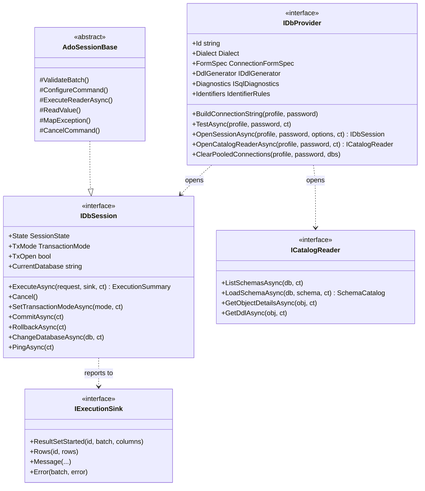

<div dir="rtl">

**‏`IDbProvider`** (`IDbProvider.cs:9-45`) یک تک‌نمونهٔ بی‌حالت است، یکی برای هر خانواده:

| عضو | انتظار هسته |
|---|---|
| ‏`Id`، `DisplayName`، `Dialect` | شناسه کلید هر رجیستری و سرویس کلیددار است (`"sqlserver"`، `"oracle"`، `"postgresql"`، `"sqlite"`، `"mysql"`، `"mariadb"`، `"clickhouse"`، `"snowflake"`، `"cassandra"`)؛ گویش توکن‌ساز، طبقه‌بند و زبان رابط کاربری را می‌راند (شمارش `Dialect`، `engine/src/DbStudio.Core/Models/CoreModels.cs:14`). |
| ‏`FormSpec` | فیلدهای پنجرهٔ اتصال عمومی: کلید، برچسب، نوع (`text`، `password`، `number`، `bool`، `select`، `file`، `list`، `note`)، `VisibleWhen`، `Section` (`CoreModels.cs:82-101`). فیلدهای نوع گذرواژه هرگز در نمایه ذخیره نمی‌شوند (فصل [8](08-connections-sessions-execution.md)). |
| ‏`BuildConnectionString` | رشتهٔ اتصال درایور از روی یک نمایه؛ برای موتورهایی که رشتهٔ اتصال ندارند (ClickHouse، Cassandra) توصیفی بدون گذرواژه برای عیب‌یابی. |
| ‏`TestAsync` | وصل شو، `ServerInfo` را بخوان، قطع کن؛ شکست‌ها در `TestConnectionResult` *برگردانده* می‌شوند، پرتاب نمی‌شوند (`IDataSourceProvider.cs:23`). |
| ‏`OpenSessionAsync` | «یک اتصال فیزیکی اختصاصی (بدون استخر) باز می‌کند که مال یک زبانهٔ ویرایشگر است» (`IDbProvider.cs:22-23`). |
| ‏`OpenCatalogReaderAsync` | «اتصالی کوتاه‌عمر فقط برای خواندن کاتالوگ/فراداده (استخر مجاز است)» (`IDbProvider.cs:25-29`). |
| ‏`DdlGenerator` | متن `CREATE TABLE` از روی فرادادهٔ کاتالوگ، برای موتورهایی که تعریف جدول را ذخیره نمی‌کنند (`IDbProvider.cs:162-166`). |
| ‏`Diagnostics` | بررسی‌های نحوی سمت کارساز هنگام تایپ، یا `null` (`IDbProvider.cs:33-34`، `:168-173`). |
| ‏`Identifiers` | نویسه‌های نقل‌قول، یکسان‌سازی حروف و واژه‌های رزرو (بخش 2.2). |
| ‏`ClearPooledConnections` | افزودنی: اتصال‌های بیکار استخری کاتالوگ یک نمایه را می‌بندد؛ پیش‌فرض کاری نمی‌کند (`IDbProvider.cs:38-44`). |

**‏`IDbSession`** (`IDbProvider.cs:47-120`) یک اتصال فیزیکی است که مال یک زبانه است. ماشین وضعیتش `Idle | Executing | Broken | Closed` است (`SessionState`، `CoreModels.cs:22`). متد کلیدی `ExecuteAsync(ExecuteRequest, IExecutionSink, CancellationToken)` است: هر دسته را به ترتیب اجرا کن، از راه گیرنده گزارش بده و وقتی بیکار نیستی `SessionBusyException` بده؛ «خطاهای فراهم‌کننده درون یک دسته از راه sink.Error گزارش می‌شوند (پرتاب نمی‌شوند)؛ فقط شکست‌های زیرساختی پرتاب می‌شوند» (`IDbProvider.cs:97-102`). درخواست دسته‌ها (`SqlBatch(Sql, Line, Col)` با موقعیت‌های ۱-مبنای سند)، `MaxRows` (صفر یعنی نامحدود)، `StopOnError`، `CaptureServerOutput`، برچسب اجرا، مقدارهای مقید و `WritesConfirmed` را حمل می‌کند (`engine/src/DbStudio.Core/Models/ExecutionModels.cs:5-20`). ‏`Cancel()` باید در برابر نخ‌ها ایمن و در حالت بیکار بی‌اثر باشد (`IDbProvider.cs:104-105`). عضوهای شِما (`SchemaMode`، `CurrentSchema`، `SearchPath`، `RefreshSchemaAsync`، `ChangeSchemaAsync`) و `LostTransaction` و `FindUnboundParameter` پیش‌فرض‌هایی افزودنی‌اند (`IDbProvider.cs:70-119`).

**‏`IExecutionSink`** (`IDbProvider.cs:122-133`) همان [ناظر (observer)](../glossary.md#observer)ی است که نشست به آن گزارش می‌دهد: `BatchStarted`، `ResultSetStarted(columns)`، `Rows`، `ResultSetEnded(rowCount, truncated)`، `RowsAffected`، `Message`، `Error`، `BatchEnded(status)`. سطرها از قبل [مقدار انتقال (wire value)](../glossary.md#wire-value)اند. خطاها `ErrorInfo(Code, Message, Line, Col, State, Detail, ProviderCode)` را حمل می‌کنند که در آن `Code` «شمارهٔ خطای فراهم‌کننده به‌صورت رشته ('207'، 'ORA-00942'، 'SQLITE_ERROR') یا یک کد موتور» است و `Line` «نسبت به سند ویرایشگر مطلق است (فراهم‌کننده batch.Line - 1 را اضافه می‌کند)» (`ExecutionModels.cs:36-38`). پیاده‌سازی موتور هر فراخوانی را به‌صورت یک رویداد WebSocket می‌فرستد (فصل [6](06-websocket-protocol.md)).

**‏`ICatalogReader`** (`IDbProvider.cs:135-160`) فراداده را روی اتصال خودش می‌خواند: پایگاه‌های داده، شِماها، شِمای پیش‌فرض، `LoadSchemaAsync` («همهٔ اشیا، ستون‌ها، کلیدها، کلیدهای خارجی (در هر دو جهت)، پارامترها، مترادف‌ها و عضوهای بسته‌های یک شِما»)، جزئیات شیء، DDL، خطاهای کامپایل Oracle، مترادف‌های عمومی Oracle و نوع‌های سیستمی SQL Server. این‌که نتیجه‌ها چطور نگه داشته می‌شوند موضوع فصل [10](10-catalog-and-metadata.md) است.

### 2.2 قاعده‌های شناسه و ویژگی‌های گویش

[قاعده‌های شناسه (identifier rules)](../glossary.md#identifier-rules) به رابط کاربری و موتور می‌گویند نام را چطور نقل‌قول کنند و کارساز با نام‌های بی‌گیومه چه می‌کند: `IdentifierRules(QuoteOpen, QuoteClose, CaseFolding, ReservedWords)` با یکسان‌سازی `"upper"`، `"lower"` یا `"preserve"` (`CoreModels.cs:113-118`). [یکسان‌سازی حروف (case folding)](../glossary.md#case-folding) کاری است که کارساز با نام بی‌گیومه می‌کند: Oracle نام `orders` را `ORDERS` می‌خواند و PostgreSQL نام `Orders` را `orders`.

| فراهم‌کننده | نقل‌قول | یکسان‌سازی | سطح پایگاه داده | شِمای جایگزین |
|---|---|---|---|---|
| SQL Server | `[` `]` | preserve | دارد | `dbo` |
| Oracle | `"` | upper | ندارد (شِما = «پایگاه داده») | — |
| PostgreSQL | `"` | lower | دارد | `public` |
| SQLite | `"` | preserve | ندارد (پرونده‌های الحاقی شِما هستند) | `main` |
| MySQL / MariaDB | `` ` `` | preserve | ندارد (پایگاه داده = شِما) | — |
| ClickHouse | `` ` `` | preserve | ندارد (پایگاه داده = شِما) | `default` |
| Snowflake | `"` | upper | دارد | `PUBLIC` |
| Cassandra | `"` | lower | ندارد (keyspace = شِما) | — |

منبع‌ها: `Identifiers` هر فراهم‌کننده (در بخش 3.x همان فراهم‌کننده ارجاع داده شده) و `DialectInfo` (`engine/src/DbStudio.Core/Models/DialectInfo.cs:8-63`). [اطلاعات گویش (dialect info)](../glossary.md#dialect-info) جدولی ایستا از ویژگی‌هاست که switchهای هسته به‌جای مقایسهٔ تک‌تک گویش‌ها آن را می‌خوانند: `HasDatabases` (SQL Server، PostgreSQL، Snowflake؛ `:11`)، `SchemaIsDatabase` (Oracle، MySQL، ClickHouse، CQL: «ListSchemasAsync پایگاه‌های داده را فهرست می‌کند و ChangeDatabaseAsync همان USE x است»؛ `:13-17`)، شِمای جایگزین (`:20-33`) و ویژگی‌های واژه‌کاو: توضیح‌های بلوکی تودرتو (`:36`)، شناسه‌های بک‌تیکی (`:39`)، توضیح سطری `#` (`:42`)، گریز بک‌اسلش در رشته‌ها (`:45`)، رشته‌های دلاری (`:48`) و توضیح `//` (`:51`). توضیح WP0 دلیل جای آن‌ها را می‌گوید: «تا گویش تازه هرگز توکن‌ساز را ویرایش نکند» (`:5-6`). فصل [I-17](../part1/17-dialect-comparison.md) در بخش I گویش‌ها را از دید کاربر مقایسه می‌کند.

<a id="23-the-shared-ado-base"></a>

### 2.3 پایهٔ مشترک ADO

‏`AdoSessionBase` (`engine/src/DbStudio.Core/Services/AdoSessionBase.cs`، حدود ۱۵۰۰ سطر) «پیاده‌سازی مشترک `IDbSession` روی یک `DbConnection` در ADO.NET» است. «صاحب حلقهٔ اجراست: ماشین وضعیت Idle/Executing با بررسی مشغول بودن، تراکنش‌های دستی/خودکار، یک `ExecuteReader` برای هر دسته، مجموعه‌های نتیجه با برش MaxRows، دسته‌بندی سطرها به سوی گیرنده، سطرهای اثرپذیرفته، خطاها با سطرهای مطلق سند، StopOnError، لغو و زمان‌سنجی» (`AdoSessionBase.cs:80-84`). هفت فراهم‌کننده از هشت تا از آن مشتق می‌شوند (SQL Server، Oracle، PostgreSQL، SQLite، MySQL، ClickHouse، Snowflake) و `FederatedSession` پایگاه‌های دادهٔ پیوندی هم (`engine/src/DbStudio.Federation/Provider/FederatedSession.cs:27`). Cassandra خودش `IDbSession` را پیاده می‌کند (بخش 3.8). شکل 9.2 یک اجرا را نشان می‌دهد.

**شکل 9.2 — ‏`AdoSessionBase` یک اجرا را چطور پیش می‌برد و فراهم‌کننده‌ها کجا قلاب می‌اندازند.**

</div>

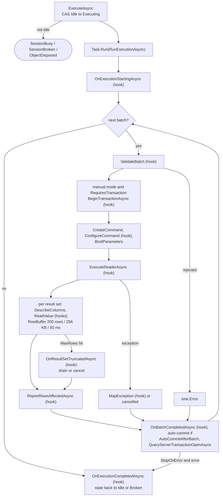

<div dir="rtl">

قطعه‌هایی که نویسندهٔ یک فراهم‌کننده باید بفهمد:

- **ماشین وضعیت.** ‏`ExecuteAsync` نشست را با یک `Interlocked.CompareExchange` از Idle به Executing می‌برد؛ نشستی که بیکار نیست `SessionBrokenException`، `ObjectDisposedException` یا `SessionBusyException` می‌دهد (`AdoSessionBase.cs:921-931`). کل اجرا درون `Task.Run` است، «تا درایورهای همزمان (Microsoft.Data.Sqlite) هرگز فراخواننده را مسدود نکنند» (`:98-99`، `:941`). وقتی اجرا تمام شد وضعیت به Idle برمی‌گردد، یا اگر اتصال شکسته باشد به Broken (`:1000-1002`).
- **حلقهٔ دسته‌ها.** برای هر دسته یک `BatchContext`؛ دستهٔ لغوشده اجرا را پایان می‌دهد و خطا فقط با `StopOnError` (`:961-975`). هر دسته کارش را میان `BatchStarted` … `BatchEnded` انجام می‌دهد (`:1011`، `:1082`).
- **تراکنش‌های تنبل.** در حالت دستی پایه تراکنش موتور را فقط وقتی آغاز می‌کند که `RequiresTransaction` بگوید دسته به آن نیاز دارد: «پرس‌وجوها و دستورهای نشست بیرون از تراکنش اجرا می‌شوند؛ BEGIN/COMMIT/ROLLBACK تایپ‌شده به دست کاربر مال کارساز است. ‏SAVEPOINT / SAVE TRANSACTION آن را آغاز می‌کند» (`:1126-1132`، `:259`). تراکنشی که برای یک دستور DML/DDL تنها آغاز شده و آن دستور شکست خورده یا لغو شده و چیزی را تغییر نداده دوباره rollback می‌شود، «تا نشست تراکنش در انتظاری گزارش نکند (و SQLite قفل‌هایش را آزاد کند)» (`:1096-1116`).
- **خواندن مجموعه‌های نتیجه.** برای هر مجموعهٔ نتیجه پایه `DescribeColumns` را صدا می‌زند و سپس سطرها را با `ReadValue` تا `MaxRows` می‌خواند؛ سطرها از یک `RowBuffer` خصوصی می‌گذرند که در هر `RowBatchSize` (۲۰۰) سطر، `RowBatchMaxBytes` (۲۵۶ KB) یا `RowFlushInterval` (۵۰ میلی‌ثانیه) تخلیه می‌شود (`:205-211`، `:1251-1290`، `:1475-1499`). وقتی به سقف رسید `truncated` را گزارش می‌دهد و از `OnResultSetTruncatedAsync` می‌پرسد ادامه دهد یا نه؛ فراهم‌کننده‌ای که false بگوید باعث می‌شود پایه به‌جای تخلیه فرمان را لغو کند (`:1270-1274`، `:1288`، `:1157-1161`).
- **اعتماد نکردن به توکن لغوشده.** ‏`NextResultAsync` *بدون* توکن صدا زده می‌شود: «توکن لغوشده باعث می‌شود NextResultAsync بدون پرسیدن از درایور استثنا بدهد، که دستوری را که اجرا شده (و خودکار commit شده) لغوشده برچسب می‌زد. ‏CancelCommand آنچه را هنوز در حال اجراست قطع می‌کند» (`:1153-1155`). دسته‌ای که با وجود درخواست لغو کامل شده Ok گزارش می‌شود، همراه هشداری که می‌گوید تغییراتش کجا رفته است (`:1051-1052`، `:1086-1094`).
- **خطاها.** هر استثنای درایور از راه `MapException(ex, batch)` به یک `ErrorInfo` تبدیل می‌شود؛ نگاشت فراهم‌کننده کدها و موقعیت‌های درایور را به سطرهای سند برمی‌گرداند (`:496`، `:1203-1211`). سطرها با `ToDocumentLine` / `ToDocumentCol` تبدیل می‌شوند (`:633-636`).
- **پس از دسته.** ‏`OnBatchCompletedAsync` (‏`ALL_ERRORS` در Oracle، تشخیص پایان تراکنش در MySQL…)، commit خودکار وقتی `AutoCommitAfterBatch` درست باشد (Oracle)، `QueryServerTransactionOpenAsync` برای دنبال کردن تراکنش‌های تایپ‌شده به دست کاربر (‏`@@TRANCOUNT` در SQL Server، `transaction_timestamp()` در PostgreSQL، `@@in_transaction` در MariaDB) و بازخوانی شِما وقتی `SchemaMayChange` (`:1024-1068`).
- **پیام‌ها ترتیبشان را نگه می‌دارند.** ‏`EmitMessageAsync` و هم‌خانواده‌هایش اول سطرهای در انتظار را تخلیه می‌کنند، پس یک `PRINT` میان دو `SELECT` میان سطرهای آن‌ها ظاهر می‌شود (`:96-97`، `:646-716`).
- **کار جانبی انحصاری.** ‏`RunExclusiveAsync` به قابلیت‌های دیگر اجازه می‌دهد زیر همان پرچم مشغولی روی اتصال نشست کار کنند (describe، کمکی‌های explain، `USE` در Snowflake)، پس هرگز با دسته‌ای در حال اجرا درهم نمی‌آمیزد (`:1323-1366`).

جدول قلاب‌ها را همراه پیش‌فرض‌ها و بازنویسی‌کننده‌هایشان فهرست می‌کند.

| قلاب (سطر) | پیش‌فرض | بازنویسی‌شده در (نمونه‌ها) |
|---|---|---|
| ‏`ValidateBatch` (`:234`) | پذیرش | Oracle (‏`Prepare`، بررسی متغیرهای مقید)، PostgreSQL (رد `COPY`)، MySQL (‏`LOAD DATA LOCAL`) |
| ‏`ConfigureCommand` (`:240`) | هیچ | SQL Server (‏`StatementCompleted`)، Oracle (‏`BindByName`، اندازهٔ واکشی)، ClickHouse (سقف سطر سمت کارساز) |
| ‏`ExecuteReaderAsync` (`:390`) | ‏`cmd.ExecuteReaderAsync` | PostgreSQL (‏`NpgsqlBatch`)، MySQL (‏`MySqlStatementReader`)، ClickHouse (‏`ChBatchReader`)، Snowflake (چنددستوری) |
| ‏`ReadValue` (`:447`) | ‏`ValueConverter` | همه، برای decimalهای دقیق، تاریخ‌ها و نوع‌های موتور |
| ‏`OnResultSetTruncatedAsync` (`:456`) | ادامه (تخلیه) | SQL Server، MySQL (لغو به‌جای تخلیه) |
| ‏`ReportRowsAffectedAsync` (`:468`) | ‏`RecordsAffected` یک بار | SQL Server (برای هر دستور)، PostgreSQL (برای هر batch command)، ClickHouse (‏`written_rows`) |
| ‏`MapException` (`:496`) | عمومی | همه |
| ‏`AutoCommitAfterBatch` (`:214`) | false | Oracle |
| ‏`QueryServerTransactionOpenAsync` (`:528`) | نامعلوم | SQL Server، PostgreSQL، SQLite، MySQL، Snowflake |
| ‏`CancelCommand` (`:594`) | ‏`command.Cancel()` | PostgreSQL (‏`NpgsqlBatch.Cancel`)، SQLite (وقفه + مهلت)، ClickHouse (قطع + `KILL QUERY`)، Snowflake (+ `SYSTEM$CANCEL_QUERY`) |
| ‏`ChangeDatabaseCoreAsync` (`:616`) | ‏`NotSupportedException` | SQL Server (‏`USE`)، Oracle (‏`CURRENT_SCHEMA`)، MySQL، ClickHouse |
| ‏`ParamBinder` / `RejectUnboundParameters` (`:267-270`) | هیچ / false | هر فراهم‌کننده‌ای که پارامتر دارد؛ PostgreSQL بی‌مقدارها را رد می‌کند |
| ‏`EnterDirectMode` (`:378`) | هیچ | SQL Server (خطاها به‌صورت استثنا) |

### 2.4 یک فراهم‌کننده چطور سیم‌کشی می‌شود

چهار فراهم‌کنندهٔ M1/M2 (SQL Server، Oracle، SQLite، PostgreSQL) مستقیم در `Program.cs:92-95` ثبت می‌شوند و نویسنده‌های اسکریپت، پایگاه‌های دادهٔ طراح، خواننده‌های طرح اجرا و مقیدکننده‌های پارامترشان در `Program.cs:129-146`. هرکدام از چهار فراهم‌کنندهٔ Batch 3 یک `IEngineModule` دارد که همین کار را از درون پروژهٔ خودش انجام می‌دهد (MySQL ‏`MySqlModule.cs:26-41`، ClickHouse ‏`ClickHouseModule.cs:25-38`، Snowflake ‏`SnowflakeModule.cs:41-57`، Cassandra ‏`CassandraModule.cs:20-29`). هر کلاس فراهم‌کننده `IObjectBrowserProvider` و `IDatabaseSearchProvider` را به‌عنوان واسط نقش پیاده می‌کند (`SqlServerProvider.cs:11`، `OracleProvider.cs:10`، `PostgreSqlProvider.cs:16`، `SqliteProvider.cs:11`، `MySqlProvider.cs:15` روی پایهٔ مشترک MySQL/MariaDB، `ClickHouseProvider.cs:14`، `SnowflakeProvider.cs:17`، `CassandraProvider.cs:14`). منبع‌های لاگ و فعالیت در `DbStudio.Logs` هستند و با شناسهٔ فراهم‌کننده کلیددار می‌شوند (فصل [21](21-logs-activity-resources.md)). فصل [7](07-engine-modules-and-di.md) سازوکار را توضیح می‌دهد و فصل [24](24-build-ci-release-contributing.md) فهرست بررسی افزودن فراهم‌کنندهٔ نهم است.

## 3. نگاه عمیق (ارشد): فراهم‌کننده‌ها یکی‌یکی

هر بخش همین ترتیب را دارد: پرونده‌ها و ثبت، درایور و اتصال، نشست (آنچه بازنویسی می‌کند)، کاتالوگ، DDL و قابلیت‌های کلیددار، خطاها و شناسه‌ها، و «آنچه نمی‌تواند انجام دهد». شکل‌ها نقشه‌های پرونده به مسئولیت‌اند؛ پیکان یعنی «استفاده می‌کند».

### 3.1 SQL Server

SQL Server نخستین فراهم‌کننده‌ای بود که Rowlit داشت و هنوز هم همان است که سطح کیفیت را تعیین می‌کند: رفتار SQL Server Management Studio (SSMS) مرجعی است که کد بارها به آن ارجاع می‌دهد. فراهم‌کننده در `engine/src/DbStudio.Providers.SqlServer` است و مستقیم در میزبان ثبت می‌شود، نه از راه یک ماژول موتور: `services.AddSingleton<IDbProvider, SqlServerProvider>()` (`engine/src/DbStudio.Host/Program.cs:92`)، و قابلیت‌های کلیدارش (نویسندهٔ اسکریپت، پایگاه دادهٔ طراح، خوانندهٔ طرح اجرا، مقیدکنندهٔ پارامتر) چند سطر بعد با شناسهٔ `"sqlserver"` اضافه می‌شوند (`engine/src/DbStudio.Host/Program.cs:130-139`).

**شکل 9.3 — فراهم‌کنندهٔ SQL Server: پرونده‌ها و کار هرکدام.**

</div>

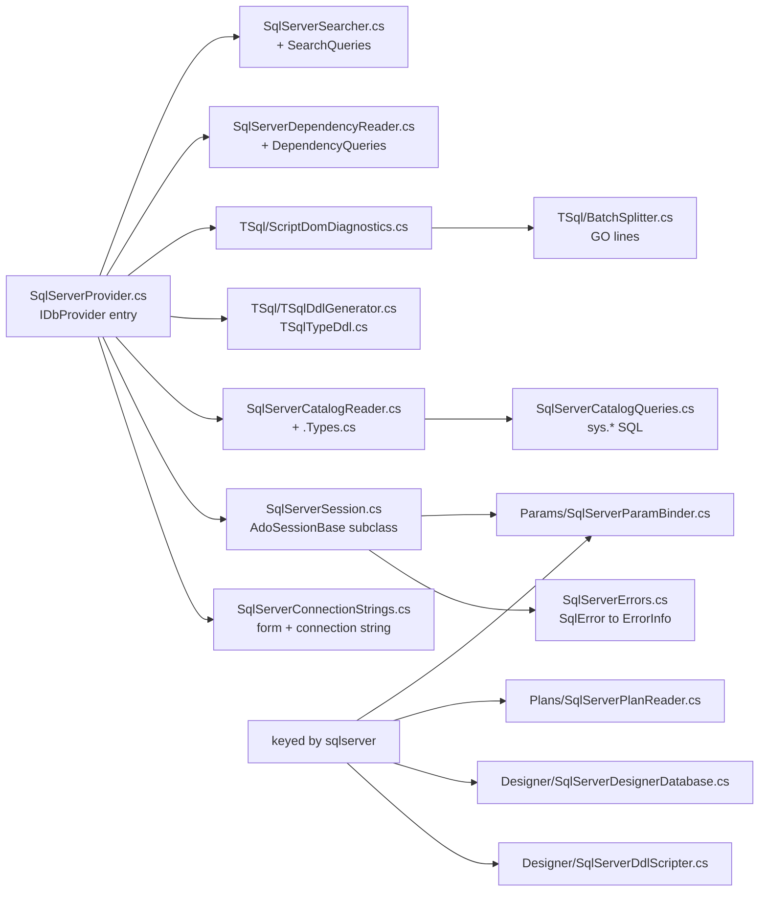

<div dir="rtl">

#### درایور و اتصال

[درایور (driver)](../glossary.md#driver) (کتابخانه‌ای که پروتکل شبکهٔ کارساز را حرف می‌زند) [Microsoft.Data.SqlClient](../glossary.md#microsoft-data-sqlclient) نسخهٔ 7.1.1 است، به‌علاوهٔ `Microsoft.SqlServer.TransactSql.ScriptDom` نسخهٔ 180.140.0 برای تجزیه (`engine/src/DbStudio.Providers.SqlServer/DbStudio.Providers.SqlServer.csproj:8-11`). csproj همچنین `System.Security.Cryptography.Pkcs` نسخهٔ 10.0.13 را سنجاق می‌کند، چون SqlClient 7.1.1 نسخه‌ای آسیب‌پذیر را با خود می‌آورد (توضیح `code-06`، سطر 9)؛ این همان ممیزی NuGet در عمل است ([فصل 19](19-security-and-secrets.md)).

پنجرهٔ اتصال را یک `ConnectionFormSpec` توصیف می‌کند (فرم عمومی‌ای که رابط کاربری رسم می‌کند، [فصل 8](08-connections-sessions-execution.md)): `server`، `auth` (`sql` یا `windows`)، `user`، `password`، `database`، `encrypt` (`optional` / `mandatory` / `strict`)، `trustServerCertificate` و `connectTimeout` (`engine/src/DbStudio.Providers.SqlServer/SqlServerConnectionStrings.cs:14-26`). در macOS و لینوکس گزینهٔ `windows` با برچسب «Integrated (Kerberos)» نمایش داده می‌شود (سطر 18) و README می‌گوید به بلیت Kerberos از `kinit` نیاز دارد (`README.md:130-132`). فراهم‌کننده فیلدهای تونل SSH را با `SshFormFields.Append(...)` به این فرم اضافه می‌کند، همراه این راهنما که نمونهٔ نام‌دار (named instance) به درگاهش نیاز دارد (`SqlServerProvider.cs:16`).

‏`SqlServerConnectionStrings.Build` نمایهٔ اتصال را با `SqlConnectionStringBuilder` به یک [رشتهٔ اتصال (connection string)](../glossary.md#connection-string) تبدیل می‌کند (متن `key=value;` که درایور می‌خواند) (`SqlServerConnectionStrings.cs:29-72`). تصمیم‌هایی که ارزش دانستن دارند:

- ‏`ApplicationName = "Rowlit"` (سطر 10)، تا DBA در `sys.dm_exec_sessions` نام Rowlit را ببیند.
- ‏`MultipleActiveResultSets = false` و `Pooling` را فراخواننده تعیین می‌کند (سطرهای 40-41). نشست‌ها `pooling: false` می‌فرستند (`SqlServerProvider.cs:36-37`)؛ اتصال‌های کاتالوگ، وابستگی‌ها و جست‌وجو `true` (سطرهای 81، 104، 119). این‌که چرا نشست بدون استخر است موضوع [استخر اتصال (connection pooling)](../glossary.md#connection-pooling) در فصل 8 است: هر `SET`، جدول موقت و تراکنش باید مال یک زبانه باشد.
- ‏`ConnectRetryInterval = 1` (سطر 46). توضیح کد دلیلش را می‌گوید: پیش‌فرض درایور اتصال اولِ شکست‌خورده را پس از ۱۰ ثانیه دوباره امتحان می‌کند، پس نام نادرست پایگاه داده ۱۱ ثانیه طول می‌کشید تا گزارش شود. ‏`TestAsync` یک قدم جلوتر می‌رود و `ConnectRetryCount = 0` می‌گذارد (`SqlServerProvider.cs:46`) تا «آزمون» بی‌درنگ پاسخ دهد.
- ‏`windows` یا `integrated` مقدار `IntegratedSecurity = true` را می‌گذارند؛ `sql` کاربر و گذرواژه را (سطرهای 52-67).

‏`OpenSessionAsync` مقدار `InitialCatalog` را با پایگاه داده‌ای که زبانه خواسته جایگزین می‌کند، اتصال را باز می‌کند، `@@VERSION`، `SERVERPROPERTY('ProductVersion')`، `@@SERVERNAME`، `SUSER_SNAME()` و `DB_NAME()` را در `ServerInfo` می‌خواند (`SqlServerProvider.cs:58-77`، پرس‌وجو در `SqlServerCatalogQueries.cs:26-27`) و می‌گذارد نشست شِمای پیش‌فرضش را بخواند (`InitializeSchemaAsync`، سطر 69). در هر شکستی پیش از خروج استثنا اتصال dispose می‌شود.

‏`ClearPooledConnections` رشتهٔ اتصال استخری را می‌سازد و `SqlConnection.ClearPool` را صدا می‌زند (`SqlServerProvider.cs:22-33`)؛ مدیر منابع وقتی اتصالی بسته شد یا فراداده‌اش بیکار ماند آن را صدا می‌زند (توضیح قرارداد در `engine/src/DbStudio.Core/Providers/IDbProvider.cs:38-44`).

**تونل‌های SSH.** خود فراهم‌کننده کار خاصی نمی‌کند: `ConnectionStore.ResolveForOpen` پیش از آن‌که فراهم‌کننده نمایه را ببیند آن را بازنویسی می‌کند (فصل 8). جزئیات مخصوص SQL Server در هسته‌اند: `TunnelTargets.SqlServer` شکل‌های `host`، `host,port`، `tcp:host` و `host\instance,port` را تجزیه می‌کند و نمونهٔ نام‌دار بدون درگاه («از راه SQL Server Browser روی UDP 1434 پیدا می‌شود که تونل SSH نمی‌تواند حملش کند»)، LocalDB و پروتکل‌های غیر TCP را رد می‌کند (`engine/src/DbStudio.Core/Services/Tunnels/TunnelTargets.cs:124-152`)، و بازنویسی `server = "127.0.0.1,<local port>"` را می‌نویسد (سطر 65).

#### نشست: چه چیزی را بازنویسی می‌کند

‏`SqlServerSession` از `AdoSessionBase` مشتق می‌شود ([بخش 2.3](#23-the-shared-ado-base)) و شیوهٔ مشاهدهٔ پیام‌ها، تعداد سطرها و لغو را تغییر می‌دهد. هر دسته‌ای که رابط کاربری می‌فرستد (یک بلوک جداشده با `GO`، تصمیم D-2 در `docs/PLAN.md:622`) به‌صورت یک `SqlCommand` اجرا می‌شود.

**پیام‌ها و خطاها از راه `InfoMessage`.** سازنده `FireInfoMessageEventOnUserErrors = true` را می‌گذارد و مشترک [`InfoMessage`](../glossary.md#infomessage) می‌شود (رویداد درایور که خروجی `PRINT` و پیام‌های کارساز را حمل می‌کند) (`SqlServerSession.cs:39-40`). با این پرچم، خطاهای با شدت ۱۱ و بالاتر درون یک دسته به‌جای استثنا به‌صورت رویداد می‌رسند و دسته مثل SSMS ادامه می‌دهد (`docs/PLAN.md:170`). ‏`OnInfoMessage` (`SqlServerSession.cs:325-358`) هر `SqlError` را دسته‌بندی می‌کند: شدت `>= 11` خطاست (`SqlServerErrors.cs:18`) که در زمینهٔ دسته شمرده و با `EmitError` فرستاده می‌شود؛ هر چیز کمتر (PRINT، `RAISERROR(...,10,...)`، «Changed database context») پیامی اطلاعاتی با سطر سند می‌شود. خطاهای ناشی از لغو خود Rowlit خطای دسته گزارش نمی‌شوند؛ وقتی کاربر لغو کرده، کد ثبت می‌کند که کارساز سیگنال attention را تأیید کرده است (سطرهای 344-347). پس از دسته، `OnBatchCompletedAsync` دستهٔ «Ok»ای را که خطای شمرده‌شده دارد به «Error» تبدیل می‌کند (سطرهای 234-235).

**شمارهٔ سطرها.** SQL Server سطر را نسبت به دسته گزارش می‌دهد، یا نسبت به رویه‌ای ذخیره‌شده که دسته صدا زده است. ‏`SqlServerErrors.DocumentLine` مقدار `batch.Line - 1` را اضافه می‌کند، ولی فقط وقتی خطا نام رویه ندارد یا خود دسته آن ماژول را می‌سازد؛ وگرنه سطر نامعلوم است و حذف می‌شود (`SqlServerErrors.cs:24-29`، `BatchDefinesModule` در 65-78). هر خطا یک سرآیند به سبک SSMS مثل `Msg 207, Level 16, State 1, Procedure p, Line 3` در `Detail` می‌گیرد (سطرهای 41-47). ‏`SqlException` پرتاب‌شده با چند خطا، شدیدترینشان را به‌عنوان پیام نگه می‌دارد و بقیه را فهرست می‌کند (سطرهای 50-63).

**سطرهای اثرپذیرفته برای هر دستور.** کلاس پایه `RecordsAffected` را یک بار برای هر دسته گزارش می‌کرد. SQL Server متد `ReportRowsAffectedAsync` را به کاری نکردن بازنویسی می‌کند (`SqlServerSession.cs:230`) و به‌جایش در `ConfigureCommand` به `SqlCommand.StatementCompleted` قلاب می‌اندازد (سطرهای 62-70). ‏`OnStatementCompleted` (سطرهای 364-375) نشانهٔ DONE مربوط به یک SELECT را نادیده می‌گیرد (عددش همان تعداد سطرهای مجموعهٔ نتیجه است) و وقتی دسته فراخوانی رویه یا جریان کنترلی ندارد، هر شمارش DML را با نوع دستورش برچسب می‌زند (`StatementKindFor`، سطرهای 378-385). پس `SET NOCOUNT ON` به‌طور طبیعی کار می‌کند: هیچ شمارش DONEای نمی‌رسد.

**نتیجه‌های ویرایش‌پذیر.** یک SELECT ساده به کلاینت نمی‌گوید هر ستون از کدام جدول آمده، پس جدول نتیجه نمی‌توانست نتیجه‌های کنسول را ویرایش کند. پیش از دسته‌ای که یک پرس‌وجوی بی‌پارامتر و بدون جدول موقت `#` است، نشست `sys.sp_describe_first_result_set` را با `@browse_information_mode = 1` صدا می‌زند (`SqlServerSession.cs:81-88`، `97-108`). این فراخوانی درون `TRY/CATCH` است و زیر `XACT_ABORT` (`@@OPTIONS & 16384`) انجام نمی‌شود، چون describe شکست‌خورده تراکنش کاربر را محکوم به شکست می‌کرد. پاسخ `Table`، `Schema` و `IsKey` ستون‌های مجموعهٔ نتیجهٔ اول را پر می‌کند، ولی نه برای ستون‌های پایگاه دادهٔ دیگر (سطرهای 139-151). توضیح کد می‌گوید چرا `CommandBehavior.KeyInfo` به کار نرفته: پوشش `SET NO_BROWSETABLE ON/OFF` آن هنگام لغو به نشست نشت می‌کند. برای نقطهٔ پایانی describe (که از `SchemaOnly | KeyInfo` استفاده *می‌کند*) متن یک خط‌شکن پایانی می‌گیرد تا یک `-- comment` آخر نتواند `SET FMTONLY OFF` درایور را ببلعد (`PrepareDescribeSql`، سطر 158)، و ستون‌های کلید پنهانی که SQL Server اضافه می‌کند بریده می‌شوند (سطرهای 167-183).

**مقدارها.** ‏`ReadValue` مقدارهای `decimal`/`numeric` را به‌صورت متن `SqlDecimal` می‌خواند، چون `decimal(38,x)` می‌تواند از `System.Decimal` بزرگ‌تر باشد؛ `money` عددی می‌ماند (`SqlServerSession.cs:201-203`). ستون‌های `date` به `DateOnly` تبدیل می‌شوند. نوع‌های CLR (`hierarchyid`، `geography`، `geometry`) به `Microsoft.SqlServer.Types` نیاز دارند که Rowlit همراه خود ندارد، پس در صورت خطای تبدیل یا بارگذاری، بایت‌های خام به‌صورت مقدار باینری انتقال فرستاده می‌شوند (سطرهای 207-216).

**تراکنش‌ها.** حالت دستی همان `BeginTransaction` کلاس پایه است. آنچه SQL Server اضافه می‌کند تشخیص `BEGIN TRAN` تایپ‌شده در حالت خودکار، یا `COMMIT` تایپ‌شده درون تراکنش دستی است: پس از هر دسته `SELECT @@TRANCOUNT` را می‌پرسد (`QueryServerTransactionOpenAsync`، سطرهای 253-259) و نشان نوار ابزار از کارساز پیروی می‌کند.

**لغو.** ‏`CancelCommand` پایه `SqlCommand.Cancel()` را صدا می‌زند (`AdoSessionBase.cs:594`) که سیگنال [attention](../glossary.md#attention) پروتکل TDS را می‌فرستد. دو جزئیات مخصوص SQL Server است. اول، چون خطاها به‌صورت پیام می‌رسند، «Operation cancelled by user» خواننده را با استثنا تمام نمی‌کند، پس وضعیت از روی تأییدی تعیین می‌شود که در `OnInfoMessage` گرفته شده: تأییدشده یعنی کارساز دسته را قطع کرده؛ بدون تأیید یعنی دسته پیش از رسیدن attention تمام شده، پس تغییراتش برقرار است و همان «Ok همراه هشدار» پایه حفظ می‌شود (سطرهای 236-245). دوم، وقتی یک دستهٔ تک‌پرس‌وجویی به `MaxRows` می‌رسد، `OnResultSetTruncatedAsync` مقدار `false` برمی‌گرداند و زمینه را «در حال توقف» علامت می‌زند، پس پایه به‌جای تخلیهٔ سطرها از روی سیم، فرمان را لغو می‌کند (سطرهای 219-227)؛ خطاهای لغو حاصل بلعیده می‌شوند.

**پایگاه داده و شِما.** ‏`ChangeDatabaseCoreAsync` دستور `USE [db]` را اجرا و سپس با `SELECT DB_NAME()` تأیید می‌کند؛ چون خطاهای بیرون از دسته هم به‌صورت `InfoMessage` می‌رسند، آن‌ها را در فهرستی موقت جمع می‌کند و اگر تعویض رخ نداده باشد اولی را در یک 422 `PROVIDER_ERROR` گزارش می‌دهد (`SqlServerSession.cs:292-315`). ‏`USE`ی که درون دسته تایپ شده پس از دسته از `SqlConnection.Database` برداشته می‌شود (سطرهای 246-248). شِمای پیش‌فرض `SchemaMode.ReadOnly` است (سطر 275): SQL Server شِمای ویژهٔ نشست ندارد، فقط شِمای پیش‌فرض ورود (login) در پایگاه دادهٔ جاری را دارد که با `SELECT SCHEMA_NAME()` خوانده و پس از دسته‌هایی شامل `USE`، `EXECUTE AS` یا `REVERT` دوباره خوانده می‌شود (سطرهای 277-290).

**حالت مستقیم.** کمکی‌های describe و explain استثنای واقعی می‌خواهند، نه پیام؛ پس `EnterDirectMode` پرچم `FireInfoMessageEventOnUserErrors` را خاموش می‌کند و یک شیء disposable برمی‌گرداند که دوباره روشنش می‌کند (سطرهای 50-60).

#### دسته‌ها و پیام‌های تشخیصی

رابط کاربری متن ویرایشگر را روی `GO` می‌شکند (فصل 11). موتور `TSql/BatchSplitter` خودش را فقط برای پیام‌های تشخیصی دارد (`BatchSplitter.cs:10-13`): یک سطر کامل مطابق `^\s*GO(?:\s+(?<n>\d+))?\s*(?:--.*)?$` را بیرون از رشته‌ها، شناسه‌های `[کروشه‌دار]` و توضیح‌های بلوکی تودرتو تشخیص می‌دهد، `GO N` را به‌عنوان تعداد تکرار ثبت می‌کند و سطر و جابه‌جایی شروع هر قطعه را نگه می‌دارد (سطرهای 16-97).

‏`ScriptDomDiagnostics` (نام موتور `scriptdom`) هر قطعه را با [ScriptDom](../glossary.md#scriptdom)، کتابخانهٔ تجزیه‌گر T-SQL مایکروسافت، تجزیه می‌کند. بالاترین کلاس `TSqlNNNParser` موجود در اسمبلی بارشده را با بازتاب برمی‌دارد، از `TSql160Parser` به بالا و فقط نوع‌هایی با سازندهٔ `(bool)` (`ScriptDomDiagnostics.cs:62-78`)، و آن را با `initialQuotedIdentifiers: true` می‌سازد (سطرهای 56-60). این همان متن طرح است، «اول `TSql170Parser` را با بازتاب امتحان کن» (`docs/PLAN.md:170`)، در شکلی کلی‌تر: بستهٔ ScriptDom جدیدتر بی‌تغییر کد به کار می‌رود. خطاهای تجزیه به سطرهای مطلق سند نگاشت می‌شوند (`batch.StartLine + e.Line - 1`) و ستون پایان، پایان نشانهٔ خطادار است (سطرهای 36-51، `TokenEnd` در 90-115). کدها به شکل `SQL<number>` درمی‌آیند. ScriptDom فقط نحو را بررسی می‌کند: جدول ناشناخته گزارش نمی‌شود (این به کارساز نیاز دارد).

#### کاتالوگ

‏`SqlServerCatalogReader` روی یک اتصال استخریِ کوتاه‌عمر اجرا می‌شود و با `USE [db]` روی همان اتصال پایگاه داده را عوض می‌کند؛ استخر هنگام برگرداندن اتصال پایگاه داده را بازنشانی می‌کند (`SqlServerCatalogReader.cs:9-12`، `UseAsync` در 291-295). همهٔ پرس‌وجوهای وابسته به شِما `@sid` می‌گیرند و در `SqlServerCatalogQueries` قرار دارند؛ توضیح کلاس می‌گوید آزمون‌های واحد هر رشته را با ScriptDom تجزیه می‌کنند (`SqlServerCatalogQueries.cs:3-6`). دو گزیده سبک کار را نشان می‌دهند.

</div>

```csharp
// engine/src/DbStudio.Providers.SqlServer/SqlServerCatalogQueries.cs:13-20
public const string SchemaFilter =
    "s.name NOT IN ('sys','INFORMATION_SCHEMA') AND ((s.name<>'guest' AND s.principal_id NOT IN (SELECT principal_id FROM sys.database_principals WHERE type='R')) " +
    "OR EXISTS (SELECT 1 FROM sys.objects xo WHERE xo.schema_id=s.schema_id AND xo.is_ms_shipped=0))";
public const string ObjectTypeList = "'U','V','P','PC','FN','IF','TF','FS','FT','SN','SO','TR'";
public const string Databases =
    "SELECT name FROM sys.databases WHERE state_desc='ONLINE' AND HAS_DBACCESS(name)=1 ORDER BY name";
```

<div dir="rtl">

پالایهٔ شِما نسخهٔ دقیق‌تری از نسخهٔ طرح است (`docs/PLAN.md:178`): شِماهای متعلق به نقش‌ها مثل `db_owner` پنهان می‌شوند **مگر این‌که شیئی در خود داشته باشند**، چون پایگاه‌های دادهٔ قدیمی اغلب جدول‌هایشان را در شِمایی نگه می‌دارند که با `AUTHORIZATION db_owner` ساخته شده است (توضیح سطرهای 9-12).

</div>

```csharp
// engine/src/DbStudio.Providers.SqlServer/SqlServerCatalogQueries.cs:62-76 (trimmed)
"SELECT fk.object_id AS fk_id, fk.name AS fk_name, ... po.name AS parent_table, pc.name AS parent_column, " +
"... ro.name AS ref_table, rc.name AS ref_column, fkc.constraint_column_id AS ordinal, fk.is_disabled, fk.is_not_trusted " +
"FROM sys.foreign_keys fk JOIN sys.foreign_key_columns fkc ON fkc.constraint_object_id=fk.object_id " +
"LEFT JOIN sys.objects po ON po.object_id=fk.parent_object_id ... " +
"WHERE po.schema_id=@sid OR ro.schema_id=@sid ORDER BY fk.object_id, fkc.constraint_column_id";
```

<div dir="rtl">

کلیدهای خارجی **در هر دو جهت** (خروجی و ورودی) خوانده می‌شوند تا تکمیل‌کنندهٔ JOIN در ویرایشگر جدول‌هایی را هم ببیند که به شِمای جاری اشاره می‌کنند. اتصال‌های `LEFT` به این دلیل‌اند که جدول ارجاع‌شده‌ای که ورود (login) نمی‌تواند ببیند نام‌های `NULL` می‌دهد و خواننده به‌جای ساختن یالی به نامی خالی آن را گزارش می‌کند (توضیح سطرهای 55-61).

جزئیات دیگر: بررسی نسخهٔ `IsSqlServer2005OrOlder` پرس‌وجوی نوع‌های کاربر را به نسخه‌ای بدون نوع‌های جدولی تغییر می‌دهد (`SqlServerCatalogReader.cs:81-82`، 391-392)؛ `ListSystemTypesAsync` نوع‌های درونی را برای پوشهٔ «System Data Types» کاوشگر برمی‌گرداند (`SqlServerCatalogReader.Types.cs:218`)؛ DDL نماها، رویه‌ها، تابع‌ها و تریگرها همان `sys.sql_modules.definition` ذخیره‌شده است (`SqlServerCatalogQueries.cs:177-178`)، با یک سطر توضیح وقتی ماژول رمزنگاری شده باشد، در حالی که جدول‌ها، مترادف‌ها و دنباله‌ها تولید می‌شوند (`SqlServerCatalogReader.cs:216-246`).

#### DDL، طراح، طرح اجرا، پارامترها، وابستگی‌ها، جست‌وجو

- **مولد DDL.** جدول‌های SQL Server تعریف ذخیره‌شده ندارند، پس `TSqlDdlGenerator` دستور `CREATE TABLE` را از یک `SqlServerTableDefinition` می‌نویسد (ستون‌ها با seed/increment هویت، ستون‌های محاسبه‌شده و ماندگار، collation، نمایه‌ها با `INCLUDE` و پالایه، کلیدهای خارجی با کنش‌های ارجاعی، checkها) (`TSql/TSqlDdlGenerator.cs:7-57`). ‏`TSqlTypeDdl` نوع‌های مستعار، CLR، جدولی و XML schema collection را می‌نویسد (`TSql/TSqlTypeDdl.cs:5-47`).
- **نویسندهٔ اسکریپت طراح** (`IDdlScripter`، کلیددار `"sqlserver"`). همهٔ دستورها در یک تراکنش اجرا می‌شوند؛ `CREATE TABLE` از قیدهای نام‌دار استفاده می‌کند (`PK_`، `DF_`، `UQ_`، `FK_`، `CK_`)؛ تغییرها `ADD`، `ALTER COLUMN` و `sp_rename` به کار می‌برند؛ قیدهای پیش‌فرض پیش از `ALTER`/`DROP COLUMN` حذف می‌شوند؛ توضیح‌ها extended propertyهای `MS_Description`اند (`Designer/SqlServerDdlScripter.cs:7-13`). دو قاعدهٔ سطح ارشد: SQL Server دستور `ALTER COLUMN` را روی ستونی که در نمایه، کلید، check یا ستون محاسبه‌شده به کار رفته نمی‌پذیرد (خطاهای 5074/4922)، پس نویسندهٔ اسکریپت وابسته‌های تغییرنیافته را پیرامون alter حذف و دوباره ایجاد می‌کند، جز در گسترش خالص `varchar`/`nvarchar`/`varbinary` که زیر نمایه مجاز است (سطرهای 224-230). تغییر identity مثل SSMS بازسازی کامل لازم دارد (جدول تازه، `SET IDENTITY_INSERT`، کپی، تغییر نام، ایجاد دوبارهٔ کلیدها، نمایه‌ها، تریگرها، مجوزها)؛ اگر وابسته‌ها نامعلوم باشند یا ذخیره‌سازی‌ای وجود داشته باشد که مدل نمی‌تواند نگه دارد (columnstore، پارتیشن‌بندی، فشرده‌سازی، CDC…) بازسازی با خطای اعتبارسنجی رد می‌شود (سطرهای 335-344). ‏`CREATE OR ALTER` برای نماها فقط از نسخهٔ 13.0.4001 (SQL Server 2016 SP1) به کار می‌رود (سطرهای 642-647).
- **پایگاه دادهٔ طراح** مدل جدول‌ها را از `sys.columns`، `sys.identity_columns`، `sys.computed_columns`، `sys.default_constraints`، `sys.indexes`، `sys.foreign_keys`، `sys.check_constraints` می‌خواند و تغییرها را در یک تراکنش روی اتصالی اختصاصی و بی‌استخر اعمال می‌کند، به‌طوری که خطاهای کارساز به‌صورت استثنا بالا بیایند (`Designer/SqlServerDesignerDatabase.cs:9-13`). جزئیات در [فصل 14](14-designers-and-ddl.md).
- **خوانندهٔ طرح اجرا.** طرح تخمینی = `SET SHOWPLAN_XML ON` (چیزی اجرا نمی‌شود)؛ طرح واقعی = `SET STATISTICS XML ON` (دستور اجرا می‌شود و مجموعه‌های نتیجهٔ showplan پایانی گرفته می‌شوند)؛ عنصرهای `RelOp` به گره‌های طرح با هزینه، گزاره‌ها، هشدارها و پیشنهادهای نمایهٔ گم‌شده تبدیل می‌شوند (`Plans/SqlServerPlanReader.cs:10-15`). [فصل 15](15-import-export-plans-er.md) را ببینید.
- **مقیدکنندهٔ پارامتر.** جای‌نگهدارهای `@name` که در همان دسته `DECLARE` نشده‌اند پارامتر می‌شوند و SqlClient دسته را از راه `sp_executesql` می‌فرستد؛ `?` موضعی رد می‌شود (`Params/SqlServerParamBinder.cs:11-16`).
- **خوانندهٔ وابستگی‌ها.** ‏`sys.sql_expression_dependencies` در هر دو جهت به‌علاوهٔ کلیدهای خارجی و تریگرها، با اتصال‌های ساده‌ای که روی SQL Server 2008 به بعد با سطح سازگاری 100 اجرا می‌شوند (`SqlServerDependencyQueries.cs:3-27`).
- **جست‌وجوگر** («جست‌وجو در پایگاه داده»): نام‌ها، ستون‌ها و بدنهٔ ماژول‌ها از `sys.objects`، `sys.columns`، `sys.sql_modules` با پیش‌پالایهٔ اختیاری `LIKE`؛ بدون `STRING_AGG` یا `CONCAT` تا روی 2005 به بعد اجرا شود (`SqlServerSearchQueries.cs:6-33`).
- **لاگ‌ها و فعالیت** SQL Server در `DbStudio.Logs` هستند (`SqlServerLogSource`، کلیددار `"sqlserver"` در `engine/src/DbStudio.Logs/LogsModule.cs:44`)؛ [فصل 21](21-logs-activity-resources.md) را ببینید.

#### خطاها و شناسه‌ها

‏`TestAsync` و نقطه‌های پایانی اتصال شکست‌ها را با `ToProviderError` نگاشت می‌کنند: کد `PROVIDER_ERROR`، شمارهٔ خطای SQL Server به‌عنوان `ProviderCode`، سرآیند SSMS به‌عنوان `Detail` و حذف پسوند پرسروصدای `(Parameter 'profile')` از خطاهای آرگومان (`SqlServerProvider.cs:146-156`). درون دسته، خطاها شمارهٔ SQL Server را به‌عنوان `Code` نگه می‌دارند (`SqlServerErrors.cs:31-38`). [قاعده‌های شناسه (identifier rules)](../glossary.md#identifier-rules): نقل‌قول با `[` `]`، حروف `"preserve"` و فهرست واژه‌های رزرو (`SqlServerProvider.cs:19`)؛ `DialectInfo` به T-SQL سطح پایگاه داده، توضیح‌های بلوکی تودرتو و شِمای جایگزین `dbo` می‌دهد (`engine/src/DbStudio.Core/Models/DialectInfo.cs:11,22,36`).

#### بسته‌بندی

SqlClient در ویندوز از یک [کتابخانهٔ بومی (native library)](../glossary.md#native-library) به نام [SNI](../glossary.md#sni) (SQL Server Network Interface) استفاده می‌کند. ساخت ویندوز موتور را به‌صورت تک‌پرونده‌ای خودکفا با `IncludeNativeLibrariesForSelfExtract` منتشر می‌کند، پس SNI و `e_sqlite3` خود SQLite درون exe بسته‌بندی و هنگام شروع [خودبازگشایی (self-extract)](../glossary.md#self-extract) می‌شوند (`scripts/build.ps1:67-77`، ریسک R2 در `docs/PLAN.md:608`). فصل 24 ساخت macOS را پوشش می‌دهد.

#### آنچه نمی‌تواند انجام دهد

پایهٔ آزمون SQL Server هیچ‌کدام از پرچم‌های `Supports*` مجموعهٔ انطباق را بازنویسی نمی‌کند (`engine/tests/DbStudio.Providers.SqlServer.Tests/SqlServerFixture.cs:109`)، پس تراکنش‌ها، نقطه‌های ذخیره، کلیدهای خارجی، identity، شمارش سطرهای DML و لغو همه آزموده می‌شوند. محدودیت‌ها از خود کد می‌آیند:

- احراز هویت Microsoft Entra (Azure AD) نیست: فقط `sql` و `windows`/`integrated` (`SqlServerConnectionStrings.cs:51-67`). طرح `entra-interactive` را برای M2 فهرست کرده بود (`docs/PLAN.md:170`)؛ در کد نیست.
- مقدار نوع‌های CLR (`geography`، `hierarchyid`…) به‌صورت بایت می‌رسد، نه متن (`SqlServerSession.cs:211-216`).
- پیام‌های تشخیصی ScriptDom فقط نحوی‌اند.
- شِمای پیش‌فرض ویژهٔ نشست وجود ندارد (`SchemaMode.ReadOnly`).
- از راه تونل SSH: نمونهٔ نام‌دار بدون درگاه، LocalDB و پروتکل‌های `np:`/`lpc:` ممکن نیست (`TunnelTargets.cs:124-152`).
- بازسازی identity برای جدول‌هایی با ویژگی‌های ذخیره‌سازی‌ای که مدل نگه نمی‌دارد رد می‌شود (نویسندهٔ اسکریپت بالا را ببینید).

### 3.2 Oracle

Oracle فراهم‌کننده‌ای است که بیشترین کار «ترجمه» را دارد: Oracle دسته ندارد، هر نشست را در یک تراکنش ضمنی نگه می‌دارد، خطاها را بدون جابه‌جایی (offset) گزارش می‌دهد و خروجی PL/SQL را در بافری سمت کارساز چاپ می‌کند. همهٔ این‌ها در `engine/src/DbStudio.Providers.Oracle` مدیریت می‌شوند. مثل SQL Server مستقیم در `Program.cs` ثبت می‌شود (سطر 93) و قابلیت‌های کلیدارش زیر `"oracle"` (سطرهای 131-140).

**شکل 9.4 — فراهم‌کنندهٔ Oracle: پرونده‌ها و کار هرکدام.**

</div>

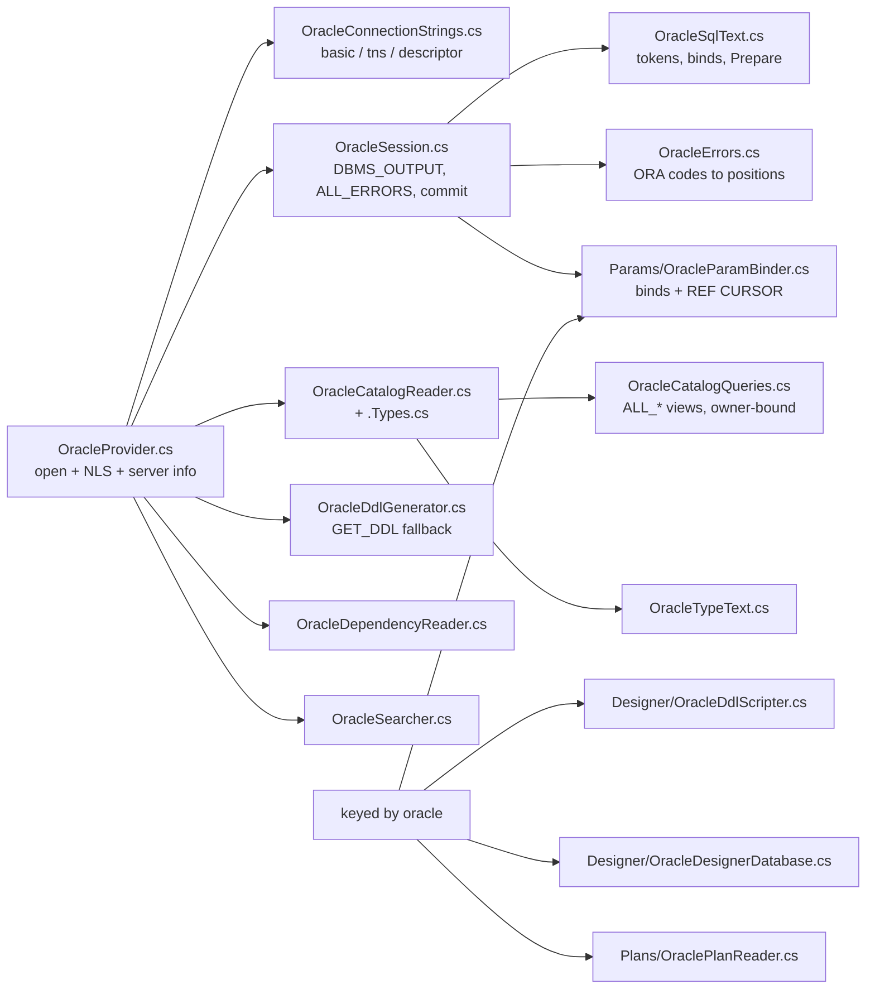

<div dir="rtl">

#### درایور و اتصال

درایور [ODP.NET](../glossary.md#odp-net) مدیریت‌شده است، بستهٔ `Oracle.ManagedDataAccess.Core` نسخهٔ 23.26.301 (`engine/src/DbStudio.Providers.Oracle/DbStudio.Providers.Oracle.csproj:8`). «مدیریت‌شده» یعنی ‎.NET خالص: Oracle Instant Client نصب نمی‌شود. همان سنجاق `Pkcs` مثل SQL Server این‌جا هم هست (سطر 10).

فرم سه نوع اتصال پیشنهاد می‌کند (`OracleConnectionStrings.cs:15-34`): **basic** (میزبان، درگاه 1521، نام سرویس یا SID)، **نام مستعار TNS** (که از راه `tnsnames.ora` در `TNS_ADMIN` حل می‌شود) و یک **توصیف‌گر اتصال (connect descriptor)** کامل. بعد کاربر، گذرواژه، یک نقش (`normal`، `SYSDBA`، `SYSOPER`) و `extraSchemas`، یعنی شِماهایی که کنار شِمای جاری از ابتدا بار می‌شوند. ‏`DataSource` برای حالت basic رشتهٔ `(DESCRIPTION=(ADDRESS=(PROTOCOL=TCP)(HOST=..)(PORT=..))(CONNECT_DATA=(SERVICE_NAME=..)))` را می‌سازد (سطرهای 37-69). ‏`Build` مقدار `Pooling`، `StatementCacheSize = 0` و مهلت اتصال را می‌گذارد و نقش را به `DBAPrivilege` نگاشت می‌کند (سطرهای 72-95). نام کاربر و گذرواژه‌ای که نویسه‌ای بیرون از `[A-Za-z0-9_$#]` داشته باشد برای کارساز در گیومهٔ دوتایی گذاشته می‌شود، مگر این‌که خودش گیومه داشته باشد (سطرهای 97-110)؛ جزئیاتی که گذرواژه‌هایی مثل `p@ss` را کارا می‌کند.

‏`OpenSessionAsync` (`OracleProvider.cs:101-131`) هر چیزی را که یک نشست Oracle هنگام شروع می‌گیرد نشان می‌دهد:

</div>

```csharp
// engine/src/DbStudio.Providers.Oracle/OracleProvider.cs:107-121 (trimmed)
await conn.OpenAsync(ct);
conn.ModuleName = "Rowlit";
conn.ClientInfo = "Rowlit session " + options.SessionId;
await ExecAsync(conn, $"ALTER SESSION SET NLS_DATE_FORMAT = {Literal(profile.GetString("nlsDateFormat") ?? DefaultNlsDateFormat)}", ct);
await ExecAsync(conn, $"ALTER SESSION SET NLS_TIMESTAMP_FORMAT = {...}", ct);
await ExecAsync(conn, $"ALTER SESSION SET NLS_TIMESTAMP_TZ_FORMAT = {...}", ct);
if (!string.IsNullOrWhiteSpace(options.Database))
    await ExecAsync(conn, "ALTER SESSION SET CURRENT_SCHEMA = " + OracleSqlText.Quote(schema), ct);
if (options.CaptureServerOutput)
    await ExecAsync(conn, "BEGIN DBMS_OUTPUT.ENABLE(NULL); END;", ct);
```

<div dir="rtl">

‏`ModuleName`/`ClientInfo` نشست‌های Rowlit را در `V$SESSION` نمایان می‌کنند. قالب‌های [NLS](../glossary.md#nls) (National Language Support) به‌طور پیش‌فرض `YYYY-MM-DD HH24:MI:SS`، `...SS.FF` و `...SS.FF TZH:TZM` هستند (سطرهای 52-54)؛ دو تای اول را می‌شود در هر نمایه بازنویسی کرد (`nlsDateFormat`، `nlsTimestampFormat`). «پایگاه دادهٔ» زبانه در Oracle همان شِمای جاری آن است، و به همین دلیل `options.Database` به `CURRENT_SCHEMA` تبدیل می‌شود (`DialectInfo.SchemaIsDatabase`، `engine/src/DbStudio.Core/Models/DialectInfo.cs:17`). ‏`ReadServerInfoAsync` بنر را از `V$VERSION` می‌خواند، اگر دیده نشود به `PRODUCT_COMPONENT_VERSION` و در نهایت به رشتهٔ نسخهٔ درایور برمی‌گردد، به‌علاوهٔ کاربر نشست، شِمای جاری، `DB_NAME` و `SERVER_HOST` (`OracleProvider.cs:154-185`).

**تونل‌های SSH.** فقط نوع اتصال basic را می‌توان تونل کرد، چون نام مستعار TNS یا توصیف‌گر می‌توانند نشانی‌های دیگری را نام ببرند (`TunnelTargets.cs:154-160`)؛ راهنمای فرم همین را می‌گوید (`OracleProvider.cs:59`).

#### نشست: هر دسته یک دستور

Oracle روی سیم مفهوم دسته ندارد، پس هر دسته از رابط کاربری یک دستور است (D-2). ‏`ValidateBatch` آن را با `OracleSqlText.Prepare` عادی‌سازی می‌کند (`OracleSession.cs:54-57`) که فاصله‌ها را می‌زداید، سطر پایانی `/` در SQL\*Plus را حذف می‌کند، نقطه‌ویرگول پایانی SQL ساده را برمی‌دارد (وگرنه ODP.NET خطای ORA-00911 می‌دهد) ولی برای PL/SQL نگهش می‌دارد، و `EXEC proc(...)` را به `BEGIN proc(...); END;` بازنویسی می‌کند (`OracleSqlText.cs:155-200`). جابه‌جایی متن اجراشده درون متن اصلی نگه داشته می‌شود، چون هر موقعیت خطا باید از راه آن برگردانده شود.

‏`ConfigureCommand` همیشه `BindByName = true` را می‌گذارد (طبق `docs/PLAN.md:172`)، به‌علاوهٔ متن آماده‌شده، `InitialLONGFetchSize`/`InitialLOBFetchSize` نامحدود و `FetchSize` برابر 1 MB در هر رفت‌وبرگشت (`OracleSession.cs:21`، `102-110`).

**[متغیرهای مقید (bind variables)](../glossary.md#bind-variable).** ‏`OracleSqlText.FindBindVariables` نمونه‌های `:name` و `:1` را بیرون از رشته‌ها، توضیح‌ها و شناسه‌های نقل‌قول‌شده پیدا می‌کند و بدنهٔ تریگرها را، که `:NEW`/`:OLD` در آن‌ها نام‌های همبستگی‌اند، نادیده می‌گیرد (`OracleSqlText.cs:122-139`). متغیر مقیدی که مقدار پارامتر نوع‌دار نداشته باشد دسته را از همان ابتدا با کد `BIND_VARS_UNSUPPORTED` شکست می‌دهد، روی اولین متغیر گم‌شده و با پیشنهاد «Run with parameters (Ctrl+Alt+P)» (`OracleSession.cs:60-71`). این نام کد یادگار M1 است، وقتی متغیرهای مقید اصلاً پشتیبانی نمی‌شدند (`docs/PLAN.md:172`)؛ از M1.5 به بعد `OracleParamBinder` مقدارهای نوع‌دار را با نام مقید می‌کند (`Params/OracleParamBinder.cs:10-17`).

**[REF CURSOR](../glossary.md#ref-cursor).** پارامتر `refcursor` به‌صورت خروجی `OracleDbType.RefCursor` مقید می‌شود. پس از اجرا، `OnParametersAvailableAsync` هر cursorی را که خواننده خودش برنگردانده به‌صورت یک مجموعهٔ نتیجهٔ اضافی جاری می‌کند (`OracleSession.cs:78-88`). ‏REF CURSORی که به‌صورت مقدار یک **ستون** ظاهر شود با نشانگر انتقال `{"$cursor":true}` فرستاده می‌شود (`CursorValue.Instance`، سطرهای 201 و 228)؛ باز نمی‌شود.

**[DBMS_OUTPUT](../glossary.md#dbms-output).** ‏`DBMS_OUTPUT.PUT_LINE` در بافری روی کارساز می‌نویسد؛ تا کلاینت نخواهد چیزی برایش فرستاده نمی‌شود. شکل 9.5 نشان می‌دهد Rowlit چطور می‌خواهد.

**شکل 9.5 — گرفتن `DBMS_OUTPUT` در Oracle پس از هر دسته.**

</div>

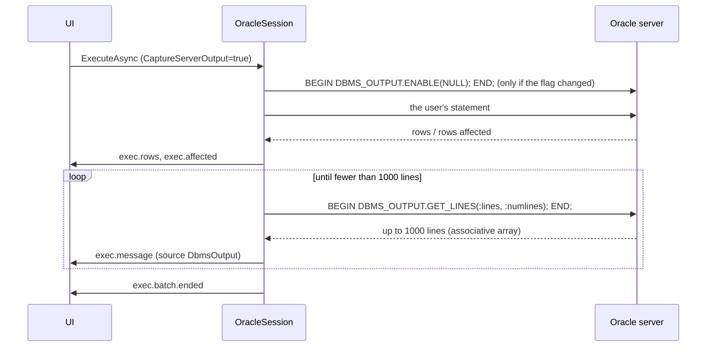

<div dir="rtl">

نشست به خاطر می‌سپارد خروجی روشن است یا نه؛ `OnExecutionStartingAsync` فقط وقتی `CaptureServerOutput` درخواست فرق کند `ENABLE(NULL)` یا `DISABLE` را می‌فرستد (`OracleSession.cs:46-52`). پس از هر دسته، `PumpDbmsOutputAsync` متغیر `:lines` را به‌صورت آرایهٔ انجمنی PL/SQL با ۱۰۰۰ عنصر `VARCHAR2` ۳۲۷۶۷ بایتی و `:numlines` را به‌صورت ورودی/خروجی مقید می‌کند و تا وقتی تکهٔ کامل برگردد حلقه می‌زند (سطرهای 406-433، ثابت‌ها در 23-24). هر سطر با `MessageSource.DbmsOutput` فرستاده می‌شود تا بخش پیام‌ها بتواند آن را جدا از پیام‌های کارساز نشان دهد. ‏`EmitMessageAsync` اول سطرهای در انتظار را تخلیه می‌کند تا ترتیب خروجی و سطرها حفظ شود (`AdoSessionBase.cs:96-100`).

**خطاهای کامپایل از [ALL_ERRORS](../glossary.md#all-errors).** ‏`CREATE PROCEDURE` همراه اشتباه در Oracle شکست نمی‌خورد؛ «با خطاهای کامپایل موفق می‌شود» (ORA-24344) و خطاها را در نمای `ALL_ERRORS` باقی می‌گذارد. پس از دسته، `OnBatchCompletedAsync` بررسی می‌کند آیا دستور یک واحد PL/SQL ساخته (`OracleSqlText.FindCreatedUnit` الگوی `CREATE [OR REPLACE] [EDITIONABLE] PROCEDURE/FUNCTION/PACKAGE [BODY]/TRIGGER/TYPE [BODY]/VIEW` را تشخیص می‌دهد) و آیا موفق شده یا 24344 داده است (`OracleSession.cs:307-321`). اگر چنین باشد، `ReportCompileErrorsAsync` پرس‌وجوی `SELECT line, position, text, attribute, type FROM all_errors WHERE owner=:owner AND name=:name AND type=:type ORDER BY sequence` را اجرا می‌کند (`OracleCatalogQueries.cs:156-157`) و برای هر سطر یک پیام خطا یا هشدار و یک پیام تشخیصی می‌فرستد (`OracleSession.cs:451-493`). موقعیت‌ها اصلاح لازم دارند: سطر 1 در `ALL_SOURCE` از واژهٔ کلیدی نوع شیء شروع می‌شود، چون `CREATE [OR REPLACE]` ذخیره نمی‌شود، پس `OracleErrors.MapCompileError` سطرها را نسبت به جابه‌جایی همان واژهٔ کلیدی نگاشت می‌کند (`OracleErrors.cs:128-139`). پیام‌های تشخیصی به‌صورت رویداد `exec.diagnostics` منتقل و به نشانگرهای Monaco تبدیل می‌شوند ([فصل 11](11-intellisense.md)). وضعیت دسته «Error» می‌شود، با پیام موتور «… was created with compilation errors» (سطرهای 486-492).

**حالت خودکار یعنی «commit پس از هر دسته».** Oracle همیشه درون یک تراکنش ضمنی است (DML تا `COMMIT` بدون commit می‌ماند). در حالت خودکار Rowlit، `AutoCommitAfterBatch => true` باعث می‌شود کلاس پایه پس از هر دستهٔ موفق commit کند (`OracleSession.cs:42`، `docs/PLAN.md:159`)؛ `CommitAfterBatchAsync` برای پرس‌وجوهای ساده این رفت‌وبرگشت را انجام نمی‌دهد (سطرهای 300-305). DDL در Oracle به‌هرحال ضمنی commit می‌شود؛ به همین دلیل طراح نمی‌تواند تغییرها را در یک تراکنش اعمال کند (پایین‌تر).

**موقعیت خطا بدون جابه‌جایی.** ODP.NET جابه‌جایی نویسه‌ای گزارش نمی‌دهد، پس `OracleErrors.Map` به ترتیبی ثابت حدس می‌زند (`OracleErrors.cs:72-110`): برای ORA-06550 (خطای کامپایل PL/SQL در بلوک بی‌نام) «line N, column M» را تجزیه می‌کند؛ برای خطای زمان اجرا درون بلوک آخرین قاب `ORA-06512: at line N` را به کار می‌برد؛ وگرنه دنبال نامی در گیومه (`"NO_SUCH_TABLE"`) یا «identifier 'X' must be declared» می‌گردد و اولین رخداد آن شناسه را در متن اجراشده پیدا می‌کند؛ اگر هیچ‌کدام نخورد، نخستین نشانهٔ دستور. وقتی متن بازنویسی شده (`EXEC`) موقعیت‌ها کنار گذاشته می‌شوند، چون شمارهٔ سطرها جور نمی‌شد. ‏`CleanMessage` پیوند `https://docs.oracle.com/error-help/...` نسخهٔ 23ai را هم به `Detail` جدا می‌کند (سطرهای 47-54). کدها به شکل `ORA-00942` نوشته می‌شوند (سطر 12).

**مقدارها.** ‏ODP.NET ستون `NUMBER(p,s)` را با نام نوع CLRی که به آن تبدیل می‌شود می‌نامد («Single» برای p ≤ 7، «Double» برای p ≤ 15)، که عددی دقیق را شبیه ممیز شناور نشان می‌داد. ‏`OdpTypes` این نام‌ها را به `NUMBER` و نوع decimal برمی‌گرداند و `ReadValue` آن‌ها را به‌صورت متن `OracleDecimal` می‌خواند (`OracleSession.cs:113-152`، `205-209`). ‏`TIMESTAMP(7..9)` و `TIMESTAMP WITH TIME ZONE` از `OracleTimeStamp`/`OracleTimeStampTZ` ساخته می‌شوند تا نانوثانیه‌ها حفظ شوند (سطرهای 210-221)، مقدارهای `VECTOR` در 23ai به شکل `[1,2.5,3]` چاپ می‌شوند (سطرهای 234-235، 278-295)، و ستون‌های شیء/مجموعه که ODP.NET نمی‌تواند بسازدشان (ORA-50071) به‌جای شکست پرس‌وجو جای‌نگهداری مثل `(SHOP.ADDRESS_T)` نشان می‌دهند (سطرهای 247-264).

**لغو.** ‏`OracleCommand.Cancel()` پایه یک break در TNS می‌فرستد؛ ORA-01013 نشانهٔ لغو است (`OracleSession.cs:324-325`). پایهٔ آزمون انطباق درسی از Docker Desktop را ثبت کرده است: وقتی هدایت درگاه دادهٔ خارج از باند را دور می‌ریزد، نشستی که در خواب است (`DBMS_SESSION.SLEEP`) break را فقط وقتی خوابش تمام شد می‌بیند، در حالی که دستوری در حال اجرا در چند میلی‌ثانیه متوقف می‌شود؛ پس آزمون لغو از یک شمارش ضرب دکارتی پرمصرف استفاده می‌کند (`engine/tests/DbStudio.Providers.Conformance/ProviderFixture.cs:62-74`).

**شِما.** ‏`SchemaMode.Session` (سطر 356): شِمای جاری «پایگاه دادهٔ» نشست است. ‏`ChangeDatabaseCoreAsync` دستور `ALTER SESSION SET CURRENT_SCHEMA` را اجرا می‌کند و اگر کاربر نامی بی‌گیومه را با حروف کوچک نوشته باشد، با ORA-01435 دوباره با حروف بزرگ امتحان می‌کند (سطرهای 335-350). ‏`ALTER SESSION SET CURRENT_SCHEMA` تایپ‌شده به دست کاربر پس از دسته تشخیص داده و شِما دوباره خوانده می‌شود (سطرهای 319-320).

#### کاتالوگ

همهٔ SQL کاتالوگ در `OracleCatalogQueries` است و کلاس **قاعدهٔ مقیدسازی مالک (owner-bind rule)** را اعلام می‌کند: هر پرس‌وجو روی یک نمای `ALL_*` یک مالک را مقید می‌کند (`:owner` یا ستون مالکِ همبسته) تا فرهنگ داده هرگز میان شِماها پویش نشود؛ آزمون‌های واحد این را تحمیل می‌کنند (`OracleCatalogQueries.cs:3-6`، دیکشنری `All` در 199-215، آزمون `OracleCatalogQueryTests.cs`). قاعده از جملهٔ طرح می‌آید، «هرگز `ALL_CONS_COLUMNS`/`ALL_TAB_COLUMNS` را بدون گزارهٔ OWNER پرس‌وجو نکن» (`docs/PLAN.md:192`)، چون نماهای فرهنگ داده بدون گزارهٔ مالک روی پایگاه‌های دادهٔ بزرگ بسیار کندند.

</div>

```csharp
// engine/src/DbStudio.Providers.Oracle/OracleCatalogQueries.cs:40-43
public const string Objects =
    "SELECT object_name, object_type, object_id, status, last_ddl_time FROM all_objects " +
    "WHERE owner=:owner AND object_type IN (" + ObjectTypeList + ") AND object_name NOT LIKE 'BIN$%' AND generated='N' " +
    "AND (object_type<>'TABLE' OR object_name NOT IN (SELECT mview_name FROM all_mviews WHERE owner=:owner))";
```

<div dir="rtl">

اشیای سطل بازیافت (`BIN$`)، اشیای ساخته‌شده به دست سیستم و جدول‌های نگه‌دارندهٔ نماهای مادی‌شده کنار گذاشته می‌شوند. تفاوت نسخه‌ها با گرفتن خطا و اجرای جایگزین مدیریت می‌شود: ORA-00904 روی `ORACLE_MAINTAINED` (11g) فهرست شِماها را به فهرستی سخت‌کدشده از حساب‌های نگه‌داری‌شده به دست Oracle تغییر می‌دهد (`OracleCatalogReader.cs:40-47`، `OracleCatalogQueries.cs:11-27`)؛ ORA-00904 روی `IDENTITY_COLUMN` (پیش از 12c) از پرس‌وجویی بدون آن استفاده می‌کند (سطرهای 72-80). Oracle سطح پایگاه داده ندارد: `ListDatabasesAsync` فهرستی خالی برمی‌گرداند (`OracleCatalogReader.cs:31`).

‏`LoadSchemaAsync` اشیا، توضیح جدول‌ها و ستون‌ها، ستون‌ها، پرچم‌های identity نوع `GENERATED ALWAYS` (تا جدول نتیجه هرگز در آن‌ها ننویسد)، قیدها، کلیدهای ارجاع‌شده (در فهرست‌های `IN` با حداکثر ۱۰۰۰ متغیر مقید، `OracleCatalogQueries.cs:71-76`)، رویه‌ها و عضوهای بسته از `ALL_PROCEDURES`، آرگومان‌ها از `ALL_ARGUMENTS`، مترادف‌های خصوصی و نوع‌های شیء/مجموعه را می‌خواند (`OracleCatalogReader.cs:57-117`). [مترادف‌ها (synonyms)](../glossary.md#synonym)ی متعلق به `PUBLIC` به‌تأخیر و یکی‌یکی، وقتی ویرایشگر به شناسهٔ ناشناخته‌ای برمی‌خورد، حل می‌شوند (`ResolvePublicSynonymAsync`، سطرهای 318-330)، چون بار کردن همهٔ مترادف‌های عمومی یعنی ده‌ها هزار سطر.

**DDL** همان `DBMS_METADATA.GET_DDL` پس از چهار تبدیل نشست است (`SQLTERMINATOR`، `PRETTY`، بدون ویژگی‌های segment، بدون storage) (`OracleCatalogQueries.cs:163-171`، `OracleCatalogReader.cs:281-296`). وقتی شکست بخورد (ORA-31603: پیدا نشد یا مجوز نیست)، خواننده به نماهای فرهنگ داده برمی‌گردد: `ALL_SOURCE` برای کد، `ALL_VIEWS` برای نماها و `OracleDdlGenerator` برای جدول‌ها (`OracleCatalogReader.cs:298-302`، `OracleDdlGenerator.cs:7-10`). ‏`GetCompileErrorsAsync` خطاهای کامپایل یک شیء موجود را برای کاوشگر می‌دهد (سطرهای 305-316).

#### طراح، طرح اجرا، وابستگی‌ها، جست‌وجو

- **نویسندهٔ اسکریپت طراح.** تراکنشی نیست: هر دستور DDL در Oracle commit می‌شود، پس اعمال تغییرها دستورها را به ترتیب اجرا می‌کند و در اولین خطا می‌ایستد. ‏`GENERATED ... AS IDENTITY`، `ADD`/`MODIFY`/`DROP COLUMN`، `RENAME`، قیدهای نام‌دار با `ON DELETE CASCADE / SET NULL` (‏`ON UPDATE` وجود ندارد و با هشدار نادیده گرفته می‌شود)، نمایه‌ها و `COMMENT ON` را می‌نویسد؛ نام‌ها به حروف بزرگ برگردانده می‌شوند مگر ترکیبی از بزرگ و کوچک باشند (`Designer/OracleDdlScripter.cs:8-14`). پایگاه دادهٔ طراح می‌گوید پرچم تراکنشی درخواست نمی‌تواند اعمال شود (`Designer/OracleDesignerDatabase.cs:10-14`).
- **خوانندهٔ طرح اجرا.** تخمینی: `EXPLAIN PLAN SET STATEMENT_ID = ... FOR`، خواندن ساخت‌یافتهٔ `PLAN_TABLE` به‌علاوهٔ متن `DBMS_XPLAN.DISPLAY` و سپس حذف سطرها. واقعی: دستور با `STATISTICS_LEVEL = ALL` و یک توضیح برچسب اجرا می‌شود، cursor آن در `V$SQL` پیدا می‌شود و درخت از `V$SQL_PLAN_STATISTICS_ALL` همراه `DBMS_XPLAN.DISPLAY_CURSOR(..., 'ALLSTATS LAST')` می‌آید. بدون دسترسی به نماهای `V$`، طرح تخمینی با یک هشدار برمی‌گردد (`Plans/OraclePlanReader.cs:11-17`).
- **خوانندهٔ وابستگی‌ها.** Oracle وابستگی‌های PL/SQL را خودش دنبال می‌کند، پس `ALL_DEPENDENCIES` مستقیم به کار می‌رود، به‌علاوهٔ کلیدهای خارجی و تریگرها؛ ارجاع به `SYS` و `PUBLIC` به‌عنوان نویز کنار گذاشته می‌شوند (`OracleDependencyReader.cs:8-12`، `OracleDependencyQueries.cs:3-7`).
- **جست‌وجوگر.** ‏`ALL_OBJECTS`، `ALL_TAB_COLUMNS`، `ALL_SOURCE` سطربه‌سطر، و `ALL_VIEWS`/`ALL_MVIEWS` که متن `LONG`شان در SQL مقایسه‌پذیر نیست و در موتور تطبیق داده می‌شود (`OracleSearchQueries.cs:6-11`).
- **لاگ‌ها و فعالیت**: ‏`OracleLogSource` در `DbStudio.Logs` (`LogsModule.cs:45`).

#### خطاها و شناسه‌ها

شکست‌های اتصال به `PROVIDER_ERROR` با شمارهٔ ORA به‌عنوان `ProviderCode` و `ORA-NNNNN` در `Detail` تبدیل می‌شوند (`OracleProvider.cs:187-192`). شناسه‌ها: نقل‌قول با `"` و [یکسان‌سازی حروف (case folding)](../glossary.md#case-folding) از نوع `"upper"` (`OracleProvider.cs:65`): ‏`orders` بی‌گیومه یعنی `ORDERS`. ‏`Diagnostics` برابر `null` است (سطرهای 62-63): تصمیم D-5 اعتبارسنجی سمت کارساز Oracle را به تعویق انداخت (`docs/PLAN.md:625`) و کد از آن زمان آن را اضافه نکرده است؛ ویرایشگرهای Oracle به بررسی‌های سمت کلاینت و `ALL_ERRORS` پس از `CREATE` متکی‌اند.

#### آنچه نمی‌تواند انجام دهد

پایهٔ آزمون Oracle هیچ پرچم `Supports*`ای را بازنویسی نمی‌کند (`engine/tests/DbStudio.Providers.Oracle.Tests/OracleFixture.cs:134`). از روی کد و پایهٔ آزمون:

- هر دسته یک دستور؛ دسته‌ای با دو مجموعهٔ نتیجه بدون `DBMS_SQL.RETURN_RESULT` ممکن نیست، پس آزمون انطباق چندمجموعه‌ای برای Oracle کنار گذاشته می‌شود (`ProviderFixture.cs:76-81`).
- پیام تشخیصی سمت کارساز هنگام تایپ وجود ندارد (`Diagnostics => null`).
- طراح نمی‌تواند به‌طور اتمی اعمال کند (DDL در Oracle commit می‌شود).
- **ستون‌های** REF CURSOR باز نمی‌شوند (فقط پارامترهای خروجی REF CURSOR).
- از راه SSH: فقط نوع اتصال basic.
- طرح واقعی به دسترسی به نماهای `V$` نیاز دارد؛ بدون آن طرح تخمینی همراه هشدار می‌گیرید.

### 3.3 PostgreSQL

PostgreSQL در M2 آمد و جدول تصمیم خودش را دارد: `docs/PLAN-PG.md` (D-PG1 تا D-PG11). فراهم‌کننده در `engine/src/DbStudio.Providers.PostgreSql` است و در `Program.cs` (سطر 95) همراه قابلیت‌های کلیددار زیر `"postgresql"` ثبت می‌شود (سطرهای 143-146). شناسه `postgresql` است و نشانهٔ انتقال گویش `pgsql` (D-PG1).

**شکل 9.6 — فراهم‌کنندهٔ PostgreSQL: پرونده‌ها و کار هرکدام.**

</div>

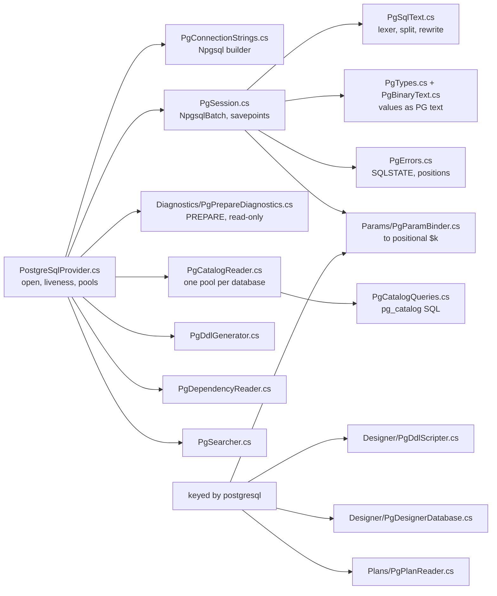

<div dir="rtl">

#### درایور و اتصال

درایور [Npgsql](../glossary.md#npgsql) نسخهٔ 9.0.5 است (`engine/src/DbStudio.Providers.PostgreSql/DbStudio.Providers.PostgreSql.csproj:15`) که به‌صورت `NpgsqlConnection` ساده و بدون `NpgsqlDataSource` به کار می‌رود (D-PG2). در سطح فرایند، `PgDriver.EnsureInitialized` یک بار `GlobalTypeMapper.EnableUnmappedTypes()` را صدا می‌زند تا enumها و rangeهای تعریف‌شده به دست کاربر که Npgsql نگاشتی برایشان ندارد به‌جای شکست دادن مجموعهٔ نتیجه، به‌صورت متن خوانده شوند (`PostgreSqlProvider.cs:178-190`).

فرم: میزبان، درگاه 5432، پایگاه داده، کاربر، گذرواژه، `sslMode` (disable تا verify-full)، `trustServerCertificate`، `searchPath`، `applicationName` (پیش‌فرض «Rowlit»)، مهلت اتصال و `options` آزاد کارساز (`PgConnectionStrings.cs:16-37`). سازنده (سطرهای 49-85) `IncludeErrorDetail = true`، `Multiplexing = false`، `KeepAlive = 30` و `Enlist = false` را می‌گذارد؛ «اعتماد به گواهی کارساز» حالت‌های `verify-ca`/`verify-full` را به `Require` پایین می‌آورد، چون Npgsql از نسخهٔ 8 به بعد در `Require` گواهی را اعتبارسنجی نمی‌کند (سطرهای 58-60)؛ `searchPath` نمایه به `SearchPath` اتصال تبدیل می‌شود (سطرهای 79-80). **نمایهٔ فقط‌خواندنی** گزینهٔ کارساز `-c default_transaction_read_only=on` را اضافه می‌کند (سطرهای 14 و 82)، پس اگر [نگهبان فقط‌خواندنی](08-connections-sessions-execution.md) موتور نوشتنی را جا بیندازد، خود کارساز آن را رد می‌کند. اتصال‌های PostgreSQL به یک پایگاه داده بسته‌اند، پس `Build` جایگزینی پایگاه داده را می‌پذیرد (سطر 45).

‏`OpenCatalogReaderAsync` یک بررسی زنده‌بودن اضافه می‌کند: Npgsql اتصال بیکار استخر را بدون آزمودن تحویل می‌دهد و پس از راه‌اندازی دوبارهٔ کارساز (Docker) نخستین پرس‌وجوی واقعی معطل می‌ماند. فراهم‌کننده `SELECT 1` را محدود به `LivenessTimeout` (۱۰ ثانیه) از راه `ConnectionGuard.BoundedAsync` اجرا می‌کند؛ اگر اتصال شکسته باشد استخرها را پاک می‌کند و یک بار دیگر امتحان می‌کند (`PostgreSqlProvider.cs:107-138`). ‏`ClearPooledConnections` برای هر پایگاه دادهٔ نگه‌داشته‌شده یک استخر (نام برنامهٔ «Rowlit catalog») به‌علاوهٔ استخر پیام‌های تشخیصی («Rowlit diagnostics») را پاک می‌کند (سطرهای 40-66).

**تونل‌های SSH.** فرم فیلدهای SSH را می‌گیرد (`PostgreSqlProvider.cs:34`)؛ `TunnelTargets.HostPort` فهرست میزبان‌های جداشده با ویرگول و مسیر سوکت Unix را رد می‌کند، چون یک درگاه TCP هدایت‌شده هیچ‌کدام را حمل نمی‌کند (`TunnelTargets.cs:108-115`). ‏PostgreSQL فراهم‌کننده‌ای است که آزمون تونل زنده دارد: `PgSshTunnelTests` کارساز PostgreSQL را از راه یک بستیون (bastion) واقعی OpenSSH از نمایهٔ `ssh` در compose اجرا می‌کند (`engine/tests/DbStudio.Providers.PostgreSql.Tests/PgSshTunnelTests.cs:8-13`).

#### نشست: هر دسته یک `NpgsqlBatch`

‏`PgSession` (`PgSession.cs:13-27`) مفصل‌ترین بازنویسی کلاس پایه است.

**دستورهای درون یک دسته.** دسته‌ای از رابط کاربری می‌تواند چند دستور داشته باشد (`SELECT 1; SELECT 2`). نشست آن را با قاعده‌های واژگانی خود PostgreSQL می‌شکند (`PgSqlText.Split`) که توکن‌ساز مشترک هسته همه‌شان را نمی‌شناسد: بدنه‌های دلاری `$$...$$` و `$tag$...$tag$`، رشته‌های `E'...'` با گریز بک‌اسلش، `U&'...'`، توضیح‌های بلوکی تودرتو، `[`/`]` به‌عنوان زیرنویس آرایه و `?` به‌عنوان عملگر jsonb (`PgSqlText.cs:29-36`). سپس **یک `NpgsqlBatch` با یک batch command برای هر دستور** می‌فرستد (`PgSession.cs:156-171`). همهٔ مجموعه‌های نتیجه به ترتیب برمی‌گردند و مثل `psql -c` دستورهای یک دسته در حالت خودکار یک تراکنش ضمنی مشترک دارند (سطر 18).

**پارامترهای موضعی.** پروتکل سیمی PostgreSQL فقط `$1, $2, ...` را می‌شناسد. تصمیم D-PG4: مقیدکننده هر جای‌نگهدار (`$n`، `:name`، `@name`) را به `$k` موضعی بازنویسی و `NpgsqlParameter`های بی‌نام را مقید می‌کند؛ `?` هرگز جای‌نگهدار نیست چون عملگر وجود کلید در jsonb است؛ رشته‌ها و nullها با `NpgsqlDbType.Unknown` مقید می‌شوند تا کارساز نوع را همان‌طور که برای یک لفظ نقل‌قول‌شده استنباط می‌کرد استنباط کند (`Params/PgParamBinder.cs:9-16`). چون هر batch command دستور جداگانه‌ای است، نشست سپس `$k`های سراسری هر دستور را به ترتیب نخستین ظهور به `$1..$m` **بازشماری** می‌کند (`Renumber`، سطرهای 213-235) و پارامترهای متناظر را کپی می‌کند (سطرهای 133-154). جای‌نگهدارهای بی‌مقدار از همان ابتدا رد می‌شوند (`RejectUnboundParameters => true`، سطر 62)، چون جای‌نگهدارهای PostgreSQL ابهامی ندارند.

یک ترفند دیگر: پارامتر `NULL` یا رشته‌ای در جایی که نوعی تعیین نمی‌کند (`SELECT $1`، `$1 IS NULL`) با SQLSTATE 42P18 «could not determine data type» شکست می‌خورد. چیزی اجرا نشده، پس نشست نوع آن پارامتر را `text` می‌گذارد و دسته را دوباره می‌فرستد، حداکثر ۱۶ بار، و فقط وقتی تکرار امن است: در autocommit بیرون از تراکنش کاربر، یا درون نقطهٔ ذخیرهٔ دستور که اول rollback می‌شود (سطرهای 173-181، `CanRetry` در 193-194، `TypeIndeterminateAsText` در 197-209).

**موقعیت خطا** از دو لایه برگردانده می‌شود: بازشماری هر دستور و بازنویسی جای‌نگهدارها (`MapServerPosition`، سطرهای 451-463). نتیجه سطر و ستونی در سند است، دقیقاً روی نشانه‌ای که کارساز به آن اشاره کرده. کد خطا [SQLSTATE](../glossary.md#sqlstate) است (کد خطای استاندارد پنج‌نویسه‌ای، مثلاً `42P01` برای جدول تعریف‌نشده) و `Detail` سطرهای DETAIL، HINT، CONTEXT، QUERY درونی و CONSTRAINT را به سبک psql کنار هم می‌گذارد (`PgErrors.cs:19-55`).

**[نقطهٔ ذخیره برای هر دستور (savepoint per statement)](../glossary.md#savepoint-per-statement) (D-PG3).** در PostgreSQL، شکست یک دستور درون تراکنش کل تراکنش را به حالت «aborted» می‌برد (SQLSTATE 25P02): هر دستور بعدی تا `ROLLBACK` شکست می‌خورد. این در یک کنسول آزاردهنده است. تصمیم D-PG3 (`docs/PLAN-PG.md:11`): در حالت دستی، هر دسته درون `SAVEPOINT dbstudio_stmt` اجرا می‌شود؛ در موفقیت آزاد (release) می‌شود و در خطا یا لغو نشست به آن rollback و سپس آزادش می‌کند، پس تراکنش با کارهای قبلی دست‌نخورده قابل استفاده می‌ماند و کاربر پیام موتور «Statement rolled back to its savepoint; the transaction stays open with the previous statements intact» را می‌گیرد (`PgSession.cs:30-32`، `117-124`، `305-325`). نقطهٔ ذخیره دور دسته‌هایی که دستورهای تراکنش خود کاربر را دارند گذاشته نمی‌شود، چون آزاد کردنش نقطه‌های ذخیره‌ای را هم که کاربر می‌سازد آزاد می‌کرد (سطر 119). خود تراکنش موتور به‌تأخیر شروع می‌شود: پرس‌وجوها و دستورهای نشست و تراکنش بدون آن اجرا می‌شوند و نخستین نوشتن یا `SAVEPOINT` آن را آغاز می‌کند (`RequiresTransaction`، سطرهای 76-82). نقطه‌های ذخیره به‌طور کلی در [فصل I-09](../part1/09-transactions-and-isolation.md) توضیح داده شده‌اند.

**تراکنش‌های تایپ‌شده به دست کاربر در حالت خودکار.** اگر کاربر `BEGIN` بنویسد، کارساز در بلوک تراکنش است در حالی که حالت Rowlit خودکار است. فقط دسته‌هایی با کنترل تراکنش، `CALL` یا `DO` می‌توانند این را تغییر دهند، پس فقط پس از آن‌ها نشست از کارساز می‌پرسد: `transaction_timestamp()` را دو بار می‌خواند؛ مقدار برابر یعنی بلوکی باز است، و بلوک aborted (25P02) هم باز به حساب می‌آید (`QueryServerTransactionOpenAsync`، سطرهای 383-405). توضیح کد می‌گوید چرا `statement_timestamp()` قابل استفاده نبود: در پروتکل گسترده (extended protocol) برای هر پیام تازه می‌شود. ‏`COMMIT`/`ROLLBACK`/`END` کاربر درون تراکنش دستی باعث می‌شود نشست شیء تراکنش خودش را فراموش کند (سطرهای 326-332).

**سطرهای اثرپذیرفته** برای هر دستور از هر `NpgsqlBatchCommand` گزارش می‌شوند (`INSERT`، `UPDATE`، `DELETE`، `MERGE`، `COPY`، `CREATE TABLE AS`) (سطرهای 273-292).

**اعلان‌ها (notices).** ‏`RAISE NOTICE`، `WARNING` و `INFO` از راه رویداد `Notice` در Npgsql می‌رسند و به پیام‌هایی با سطرهای DETAIL، HINT و CONTEXT تبدیل می‌شوند؛ وقتی دسته یک دستور دارد، موقعیت کارساز به سطر سند نگاشت می‌شود (`OnNotice`، سطرهای 562-575؛ نگاشت شدت در `PgErrors.cs:67-74`).

**دستورهای ردشده.** ‏`COPY ... FROM STDIN` / `TO STDOUT` به جریان داده‌ای از کلاینت نیاز دارند؛ درایور اتصال را در حالت COPY رها می‌کرد، پس `ValidateBatch` پیش از فرستادن، آن‌ها را با `NOT_SUPPORTED` رد می‌کند (`PgSession.cs:90-108`).

**نوع‌هایی که در نشست ساخته می‌شوند.** Npgsql فهرست نوع‌ها را یک بار برای هر رشتهٔ اتصال می‌خواند، پس نوعی که در نشست ساخته شود به‌صورت «(unsupported type ...)» خوانده می‌شد. پس از `CREATE/ALTER/DROP TYPE/DOMAIN/EXTENSION` موفق، نشست `ReloadTypesAsync` را صدا می‌زند (سطرهای 334-353؛ یافتهٔ ۷ دور QA در `docs/qa/round-postgresql.md`).

**مقدارها.** ‏`PgTypes` نام نوع‌ها را به نوع‌های انتقال نگاشت می‌کند و مقدارها را همان‌طور که خود PostgreSQL چاپ می‌کند نشان می‌دهد: آرایه‌ها به‌صورت لفظ آرایه، intervalها به شکل متنی PostgreSQL، `timestamptz` با `+00:00` (`PgTypes.cs:11-16`). برای مقدارهایی که نگاشت CLR نمی‌تواند بی‌اتلاف حمل کند، `PgBinaryText` مقدار **باینری** سیم را مستقیم به شکل متنی PostgreSQL رمزگشایی می‌کند: آرایه‌هایی با عنصر `NULL`، composite و record، عددهای فراتر از `decimal` و `NaN`/`±Infinity`، تاریخ‌های بی‌نهایت یا خارج از محدوده، ماسک inet، نشانی MAC و rangeها (`PgBinaryText.cs:11-18`). ‏`timetz` مثل کارساز چاپ می‌شود (`10:20:30+05`، نه `+05:00`) (`PgBinaryText.cs:191-192`). نوع‌های composite نام‌دار همچنان جای‌نگهداری نشان می‌دهند که می‌گوید مقدار را چطور ببینید (`"col"::text`، `PgTypes.cs:170`)؛ دور QA توضیح می‌دهد چرا این یکی می‌ماند (یافتهٔ ۱۳).

**لغو.** ‏`CancelCommand`، `NpgsqlBatch.Cancel()` را روی دستهٔ جاری صدا می‌زند و اگر نشد سراغ فرمان می‌رود (`PgSession.cs:419-428`)؛ Npgsql درخواست لغو خارج از باند PostgreSQL را می‌فرستد (این‌که Npgsql آن را چطور باز می‌کند جزئیات درونی درایور است و این‌جا بررسی نشده). SQLSTATE 57014 نشانهٔ لغو است (سطرهای 414-417). حالت‌های قطع اتصال (57P01 تا 57P03 و کلاس 08) نشست را شکسته علامت می‌زنند (سطرهای 430-432، `PgErrors.cs:77-78`).

**پایگاه داده و شِما.** ‏`ChangeDatabaseCoreAsync` استثنای `NotSupportedException` می‌دهد (سطرهای 551-552). تصمیم D-PG6: نقطهٔ پایانی در آن صورت **نشست را در جا** روی پایگاه دادهٔ تازه با همان شناسهٔ نشست دوباره باز می‌کند، و اگر تراکنشی باز باشد 409 `TX_OPEN` می‌دهد (`docs/PLAN-PG.md:14`؛ بازگشایی نشست در فصل 8). شِمای پیش‌فرض `SchemaMode.Session` است و با [`search_path`](../glossary.md#search-path) کار می‌کند، یعنی فهرست شِماهایی که PostgreSQL برای نام‌های بی‌پیشوند می‌گردد (سطر 469). ‏`ReadSchemaCoreAsync` مقدارهای `current_schema()`، `current_schemas(false)` و `search_path` آغازین را می‌خواند (سطرهای 482-490). ‏`ChangeSchemaCoreAsync` بررسی می‌کند شِما وجود دارد و سپس `SET search_path TO "<schema>", <the startup entries without a second copy>` را می‌فرستد؛ `null` دستور `RESET search_path` را می‌فرستد (سطرهای 492-528). چون `SET` در PostgreSQL تراکنشی است، `SchemaIsTransactional => true` باعث می‌شود پایه پس از commit و rollback شِما را دوباره بخواند (سطر 472). یک عبارت باقاعده تعیین می‌کند کدام دسته‌ها ممکن است شِما را تغییر داده باشند (`search_path`، `SET SCHEMA`، `set_config`، `RESET`، `DISCARD`، `ROLLBACK`، `SET ROLE`، `CALL`، `DO`…) (سطرهای 474-480).

#### پیام‌های تشخیصی با prepare

**شکل 9.7 — [پیام‌های تشخیصی با prepare (prepare diagnostics)](../glossary.md#prepare-diagnostics) در PostgreSQL برای یک دستور.**

</div>

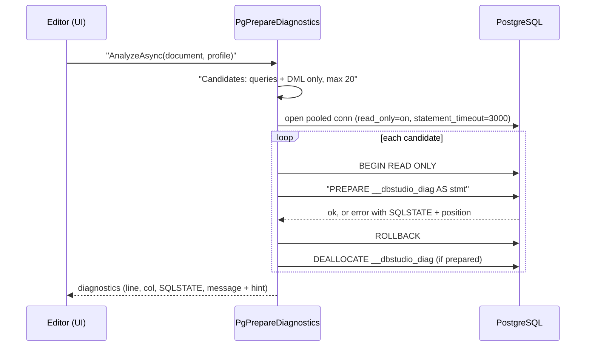

<div dir="rtl">

تصمیم D-PG5 (`docs/PLAN-PG.md:13`): ‏`PREPARE` یک دستور را تجزیه می‌کند، نام‌ها را حل می‌کند، نوع‌ها را بررسی می‌کند و طرح اجرایش را می‌سازد **بی‌آن‌که اجرایش کند**. ‏`PgPrepareDiagnostics` (نام موتور `pg-prepare`) از همین برای پیدا کردن «relation does not exist» یا خطاهای نوع هنگام تایپ کاربر استفاده می‌کند (`Diagnostics/PgPrepareDiagnostics.cs:8-15`). ایمنی لایه‌لایه است: فقط دستورهای تک‌تای `SELECT`/`VALUES`/`TABLE`/`INSERT`/`UPDATE`/`DELETE`/`MERGE` نامزدند (DDL، `DO`، `CALL`، `COPY`، `EXPLAIN`، `SET`/`SHOW`، کنترل تراکنش و `SELECT ... INTO` هرگز فرستاده نمی‌شوند) (سطرهای 44-56)؛ حداکثر ۲۰ دستور در هر فراخوانی (سطر 18)؛ اتصال استخری با `-c default_transaction_read_only=on -c statement_timeout=3000`، نام برنامهٔ «Rowlit diagnostics» و مهلت اتصال حداکثر ۱۰ ثانیه اجرا می‌شود (سطرهای 59-66)؛ هر `PREPARE` درون `BEGIN READ ONLY` است و همیشه rollback می‌شود (سطرهای 88-119). حالت‌های 42P18 و 42P08 (نوع پارامتر نامعین یا مبهم)، 25006 (فقط‌خواندنی) و 57014 (پایان مهلت) گزارش نمی‌شوند (سطر 23). موقعیت کارساز در خطا از راه بازنویسی جای‌نگهدارها به نشانه‌ای در سند نگاشت می‌شود (سطرهای 124-143). این پیام‌ها بهترین تلاش‌اند: اگر اتصال باز نشود، نتیجه خالی است و ویرایشگر بررسی‌های سمت کلاینتش را نگه می‌دارد (سطرهای 79-86).

#### کاتالوگ

‏`PgCatalogReader` **برای هر پایگاه داده یک اتصال استخری** نگه می‌دارد (نام برنامهٔ «Rowlit catalog») که به‌تأخیر باز می‌شود (`PgCatalogReader.cs:9-13`، `ConnectionFor` در 39-44). ‏`pg_catalog` و `information_schema` هرگز فهرست نمی‌شوند (D-PG9: رابط کاربری به‌جای آن یک JSON ثابت از پرکاربردترین نماهای سیستمی همراه دارد)، پارتیشن‌ها پشت والد پارتیشن‌شده‌شان پنهان‌اند و جدول‌های خارجی (foreign) و پارتیشن‌شده جدول به حساب می‌آیند. پرس‌وجوها `$1` موضعی را مقید می‌کنند (معمولاً oid یک شِما یا شیء) و ستون‌های `name` را به `text` تبدیل می‌کنند (`PgCatalogQueries.cs:3-7`)؛ PostgreSQL 12 به بعد فرض شده (`prokind`، `relispartition`، `attgenerated`).

</div>

```csharp
// engine/src/DbStudio.Providers.PostgreSql/PgCatalogQueries.cs:24-28
public const string Schemas =
    "SELECT n.oid, n.nspname::text, array_position(array_remove(current_schemas(true), 'pg_catalog'::name), n.nspname) - 1 AS sp, " +
    "((SELECT count(*) FROM pg_class c WHERE c.relnamespace = n.oid AND c.relkind IN ('r','p','v','m','f') AND NOT c.relispartition) " +
    "+ (SELECT count(*) FROM pg_proc p WHERE p.pronamespace = n.oid))::int AS object_count " +
    "FROM pg_namespace n WHERE n.nspname NOT LIKE 'pg\\_%' AND n.nspname <> 'information_schema' ORDER BY n.nspname";
```

<div dir="rtl">

هر شِما جایگاهش روی search path را همراه دارد و رابط کاربری از آن برای حل نام‌های بی‌پیشوند به همان ترتیبی که کارساز حل می‌کند استفاده می‌کند (D-PG7). روال‌هایی که مال یک افزونه‌اند (`pg_depend.deptype = 'e'`، مثلاً postgres_fdw یا PostGIS) یا سازندهٔ یک نوع range هستند (`deptype = 'i'`) یک گروه می‌گیرند و کاوشگر آن‌ها را در زیرپوشه‌ای بسته مثل «Extension postgres_fdw» نشان می‌دهد (`RoutineGroup`، سطرهای 84-93؛ یافتهٔ ۱۶ QA). نام‌های بی‌گیومه به حروف **کوچک** برگردانده می‌شوند (`IdentifierRules('"', '"', "lower", ...)`، `PostgreSqlProvider.cs:37`).

**DDL** از روی کاتالوگ ساخته می‌شود: جدول‌ها با ستون‌های identity/generated، قیدها از `pg_get_constraintdef`، کلیدهای پارتیشن، نمایه‌های غیرقیدی از `pg_get_indexdef`، تریگرها و `COMMENT ON`؛ نماها و نماهای مادی‌شده از `pg_get_viewdef`؛ تابع‌ها از `pg_get_functiondef` (`PgDdlGenerator.cs:52-56`، `PgCatalogQueries.cs:219`).

#### طراح، طرح اجرا، وابستگی‌ها، جست‌وجو

- **نویسندهٔ اسکریپت طراح.** DDL در PostgreSQL تراکنشی است و هیچ تغییری بازسازی جدول نمی‌خواهد. تغییرها به ترتیبی ثابت اجرا می‌شوند (تغییر نام‌ها، حذف‌ها، افزودن‌ها، نوع‌ها، nullپذیری، پیش‌فرض‌ها، identity، قیدها، نمایه‌ها، توضیح‌ها) و زیرفرمان‌های ستون/قید در یک `ALTER TABLE ... a, b, c` ترکیب می‌شوند تا جدول حداکثر یک بار بازنویسی شود (`Designer/PgDdlScripter.cs:7-14`).
- **خوانندهٔ طرح اجرا** (D-PG8). تخمینی: `EXPLAIN (FORMAT JSON, VERBOSE, COSTS)`؛ در PostgreSQL 16 به بعد دستوری با جای‌نگهدار و بدون مقدار از `GENERIC_PLAN true` استفاده می‌کند و کارسازهای قدیمی‌تر با مقدارهای `NULL` طرح می‌سازند. واقعی: `EXPLAIN (ANALYZE, BUFFERS, VERBOSE, COSTS, TIMING, FORMAT JSON)`؛ برای پرس‌وجوی فقط‌خواندنی دستور یک بار هم به‌طور عادی اجرا می‌شود تا سطرهایش تحویل شوند (هشداری می‌گوید دو بار اجرا شده)، و هر دستور دیگری فقط زیر `EXPLAIN ANALYZE` اجرا می‌شود و سطرهایش برگردانده نمی‌شوند (`Plans/PgPlanReader.cs:11-62`).
- **خوانندهٔ وابستگی‌ها.** نماها از راه `pg_rewrite` ← `pg_depend`؛ بدنهٔ روال‌های PL/pgSQL و SQL را `pg_depend` دنبال نمی‌کند (جز بدنه‌های `BEGIN ATOMIC`)، پس متنشان برای نام رابطه‌ها و روال‌های شناخته‌شده پویش می‌شود (`PgDependencyReader.cs:8-13`).
- **جست‌وجوگر** روی استخرهای هر پایگاه دادهٔ خوانندهٔ کاتالوگ اجرا می‌شود و پرس‌وجوهای داده‌اش در تراکنشی فقط‌خواندنی‌اند (`PgSearcher.cs:9-12`).
- **لاگ‌ها و فعالیت**: ‏`PgLogSource` در `DbStudio.Logs` (`LogsModule.cs:46`).

#### آنچه نمی‌تواند انجام دهد

پایهٔ آزمون PostgreSQL هیچ پرچم `Supports*`ای را بازنویسی نمی‌کند (`engine/tests/DbStudio.Providers.PostgreSql.Tests/PgFixture.cs:110`). از روی کد:

- تعویض پایگاه داده روی یک اتصال ممکن نیست: تغییر پایگاه داده نشست را دوباره باز می‌کند (D-PG6).
- ‏`COPY ... FROM STDIN / TO STDOUT` در کنسول نیست (`PgSession.cs:90-108`).
- ‏REF CURSOR یا مقیدسازی OUT نیست: مقدارهای OUT به‌صورت سطر نتیجه برمی‌گردند (`PgParamBinder.cs:15`، 182-183).
- نوع‌های composite نام‌دار به‌جای مقدار جای‌نگهدار نشان می‌دهند (محدودیت درایور، یافتهٔ ۱۳ QA).
- پیام‌های تشخیصی prepare فقط پرس‌وجوها و DML را پوشش می‌دهند، ۲۰ دستور در هر سند.
- از راه SSH: یک میزبان، بدون سوکت Unix.

### 3.4 SQLite

SQLite تنها موتور تعبیه‌شده است: کارسازی در کار نیست و «اتصال» یک دستگیرهٔ پرونده درون فرایند موتور است. این پرسش‌ها را تغییر می‌دهد: چیزی برای تونل کردن نیست، لغو باید فراخوانی کتابخانه‌ای را روی نخی دیگر قطع کند، و «قفل‌های کارساز» قفل‌های پرونده‌اند که برنامه‌های دیگر می‌توانند نگهشان دارند. فراهم‌کننده در `engine/src/DbStudio.Providers.Sqlite` است و در `Program.cs` (سطر 94) همراه قابلیت‌های کلیددار زیر `"sqlite"` ثبت می‌شود (سطرهای 132-141).

**شکل 9.8 — فراهم‌کنندهٔ SQLite: پرونده‌ها و کار هرکدام.**

</div>

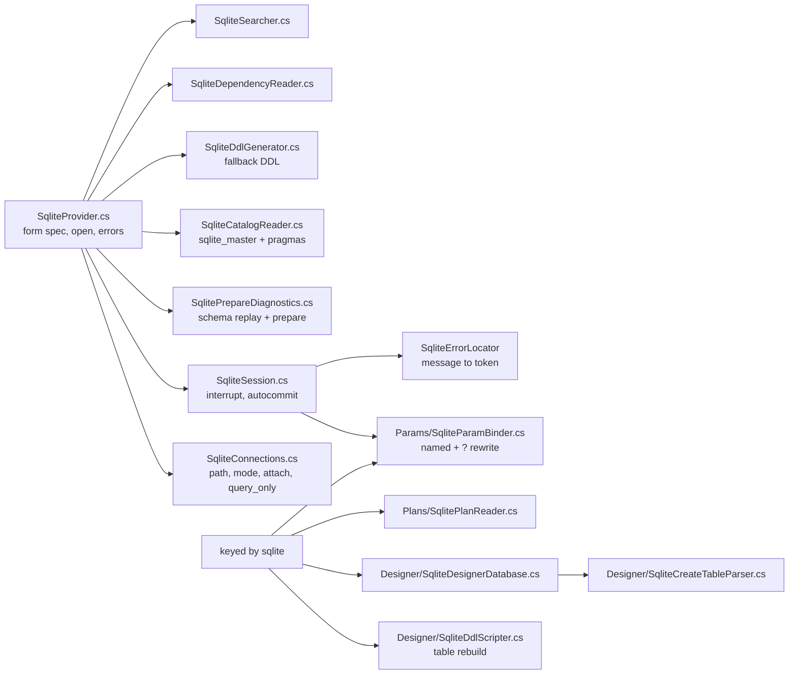

<div dir="rtl">

#### درایور و اتصال

درایور [Microsoft.Data.Sqlite](../glossary.md#microsoft-data-sqlite) نسخهٔ 10.0.13 است (`engine/src/DbStudio.Providers.Sqlite/DbStudio.Providers.Sqlite.csproj:8`)؛ کتابخانهٔ بومی `e_sqlite3` آن در ساخت تک‌پرونده‌ای ویندوز کنار SNI بسته‌بندی می‌شود (`scripts/build.ps1:67-68`).

فرم چهار فیلد دارد: `path` پایگاه داده (انتخاب‌گر پرونده، یا `:memory:` برای پایگاه داده‌ای خصوصی در حافظه)، `readOnly`، `createIfMissing` و `attach`، فهرستی از مدخل‌های `name=path` که به هر نشست و به کاوشگر الحاق می‌شوند (`SqliteProvider.cs:38-47`). فیلد SSH ندارد و `sqlite` در `TunnelTargets.Supported` نیست (`TunnelTargets.cs:19-22`): پروندهٔ محلی درگاهی برای هدایت ندارد.

‏`SqliteConnections.BuildConnectionString` (`SqliteConnections.cs:45-63`) مسیر را حل می‌کند (متغیرهای محیطی گسترش و مسیر مطلق می‌شود، سطرهای 11-15)، حالت باز کردن را برمی‌گزیند (`Memory`، `ReadOnly`، `ReadWriteCreate` یا `ReadWrite`)، کلیدهای خارجی را به‌طور پیش‌فرض روشن می‌کند (ویژگی `foreignKeys`، سطر 58)، `Pooling = false` می‌گذارد («یک اتصال فیزیکی برای هر زبانه؛ همچنین پرونده را پس از بستن قفل‌نشده نگه می‌دارد»، سطر 59) و `DefaultTimeout` را برابر مهلت busy قرار می‌دهد، به‌طور پیش‌فرض ۳۰ ثانیه و حداقل ۱ ثانیه، چون صفر برای درایور یعنی «تا ابد» (سطر 20).

‏`OpenAsync` (سطرهای 89-132) پیش از باز کردن اعتبارسنجی می‌کند: پوشه پروندهٔ پایگاه داده نیست، پروندهٔ فقط‌خواندنی یا بدون-ایجاد باید وجود داشته باشد، و ایجاد-در-صورت-نبود پرونده را می‌سازد ولی پوشه‌اش را نه، و این را صریح می‌گوید به‌جای «unable to open database file» درایور. پس از باز کردن، برای هر [پایگاه دادهٔ الحاقی (attached database)](../glossary.md#attached-database) (پروندهٔ پایگاه دادهٔ دیگری که روی همان اتصال با نام یک شِما باز می‌شود) دستور `ATTACH DATABASE $path AS "name"` را اجرا می‌کند (سطرهای 109-118).

**فقط‌خواندنی، به دو شکل.** نمایهٔ فقط‌خواندنی پرونده را برای اتصال‌های کاتالوگ، جست‌وجو و پیام‌های تشخیصی با `Mode=ReadOnly` باز می‌کند (درایور هر نوشتنی را رد می‌کند). **نشست زبانه** فرق دارد: خواندنی‌نوشتنی باز می‌شود و `PRAGMA query_only = ON` را روشن می‌کند (سطرهای 39-44، 84-86، 119-124). دلیلش گزینهٔ «Run with writes» برای دور زدن نگهبان فقط‌خواندنی است (فصل 8): `SqliteSession.OnExecutionStartingAsync` برای یک اجرا که درخواستش `WritesConfirmed` دارد `query_only` را برمی‌دارد و `OnExecutionCompletedAsync` آن را برمی‌گرداند (`SqliteSession.cs:34-49`). پرونده‌ای که با `Mode=ReadOnly` باز شده بود نمی‌توانست چنین کند.

‏`TestAsync` دستور `SELECT count(*) FROM sqlite_master` را هم اجرا می‌کند، پس پرونده‌ای که پایگاه داده نیست هنگام آزمون با «file is not a database» شکست می‌خورد (`SqliteProvider.cs:62-67`). ‏`ServerInfo` برابر `SQLite <sqlite_version()>` است، نام پرونده به‌عنوان کارساز و `main` به‌عنوان پایگاه داده (سطرهای 97-104).

#### نشست

‏Microsoft.Data.Sqlite در زیر همزمان (synchronous) است؛ کلاس پایه هر اجرا را روی نخی از استخر نخ‌ها اجرا می‌کند، پس نخ درخواست موتور هرگز مسدود نمی‌شود (`SqliteSession.cs:13-16`، `AdoSessionBase.cs:98-99`).

**لغو** بخش ظریف است. ‏`CancelCommand` تابع `sqlite3_interrupt` را روی دستگیرهٔ اتصال صدا می‌زند (از هر نخی امن است) **و** مهلت فرمان را به ۱ ثانیه کاهش می‌دهد (`SqliteSession.cs:63-73`). قدم دوم به‌خاطر حلقهٔ تکرار busy درایور است: وقتی فرایند دیگری قفلی نگه داشته، درایور دستور را تا `CommandTimeout` تکرار می‌کند و هر تکرار دستور را بازنشانی و وقفه را پاک می‌کند، پس وقفه به‌تنهایی گم می‌شود؛ درایور `CommandTimeout` را در هر تکرار دوباره می‌خواند، پس ۱ ثانیه باعث می‌شود با `SQLITE_BUSY` دست بکشد (`SqliteConnections.cs:25-33`). ‏`SQLITE_INTERRUPT` (9)، یا خطای قفل پس از درخواست لغو، به‌عنوان لغو گزارش می‌شود (`SqliteSession.cs:75-79`).

**تراکنش‌ها.** حالت دستی از `BEGIN` **معوق (deferred)** استفاده می‌کند (تا نخستین نوشتن قفل نوشتن گرفته نمی‌شود) که با فرایندهای دیگری که از پرونده استفاده می‌کنند مهربان‌تر است (سطرهای 92-94). ‏`BEGIN` تایپ‌شده به دست کاربر در هر حالتی با `sqlite3_get_autocommit` دنبال می‌شود که تا وقتی تراکنشی باز است صفر است (سطرهای 81-90).

**قفل‌ها.** ‏`SQLITE_BUSY` (5) و `SQLITE_LOCKED` (6) به پیام مشترک انتظار قفل در هسته و جزئیاتی نگاشت می‌شوند که می‌گوید اتصال چقدر منتظر ماند (مهلت busy آن) (`SqliteSession.cs:117-123`، `SqliteConnections.cs:17-23`).

**خطا بدون موقعیت.** SQLite جابه‌جایی گزارش نمی‌دهد، پس `SqliteErrorLocator.Locate` پیام را می‌خواند: `near "X": syntax error`، `no such table/column/function...: X`، `... already exists`، `ambiguous column name`، `has no column named`، `incomplete input` (پایان متن)، و نشانه را در دسته پیدا می‌کند (`SqliteSession.cs:147-186`). کدها نام کدهای نتیجهٔ اصلی‌اند (`SQLITE_ERROR`، `SQLITE_CONSTRAINT`…) و کد گسترده در `Detail` می‌آید (`SqliteConnections.cs:139-149`، `SqliteSession.cs:124-134`). ‏`SQLITE_NOTADB` (26) و `SQLITE_CORRUPT` (11) نشست را شکسته علامت می‌زنند (سطرهای 143-144).

**مقدارها.** بولی‌ها به‌صورت عدد صحیح ذخیره می‌شوند؛ ستونی که `BOOLEAN` اعلام شده با `true`/`false` فرستاده می‌شود (سطرهای 108-115). ‏`?` بی‌نامی که مقیدکننده به `@__p1` بازنویسی کرده باعث می‌شد ستون نتیجه «@__p1» نام بگیرد؛ نامش به «?» برگردانده می‌شود (سطرهای 96-106).

**پارامترها.** ‏`:x`، `@x`، `$x` نام‌دار و `?NNN` شماره‌دار با نام مقید می‌شوند؛ `?`های بی‌نام به `@__p1`، `@__p2` و… تبدیل می‌شوند (یک `?1` شماره‌دار با نخستین پارامتر نام‌دار در خانهٔ ۱ SQLite شریک می‌شد) و مقدارهای موضعی را به ترتیب مصرف می‌کنند. ‏decimalها وقتی دقیقاً نمایش‌پذیر باشند به‌صورت `REAL` و وگرنه `TEXT` مقید می‌شوند؛ تاریخ، زمان و GUID به‌صورت `TEXT` با قالب ISO (`Params/SqliteParamBinder.cs:12-19`).

**پایگاه داده.** SQLite پایگاه داده‌ای برای تعویض ندارد: `ChangeDatabaseCoreAsync` همان پیش‌فرض پایه است که `NotSupportedException` می‌دهد (`AdoSessionBase.cs:615-617`)؛ `CurrentDatabase` همیشه `main` است (`SqliteSession.cs:31`).

#### پیام‌های تشخیصی با prepare: آنچه کد واقعاً می‌کند

‏`SqlitePrepareDiagnostics` (نام موتور `sqlite-prepare`) هر دستور را با `sqlite3_prepare` کامپایل می‌کند که «syntax error» و «no such table» را بدون اجرا گزارش می‌دهد (`SqlitePrepareDiagnostics.cs:8-14`). طرح الگوریتم دیگری توصیف کرده بود: «موتور با prepare کردن پیشوندهای هر دستور جست‌وجوی دودویی می‌کند» (`docs/PLAN.md:174`). **کد پیشوندها را دوبخشی نمی‌کند.** سند را با `SqlTokenizer` هسته به دستورها تقسیم می‌کند، هر دستور را کامل prepare می‌کند و نشانهٔ خطا را با `SqliteErrorLocator` از روی پیام پیدا می‌کند (سطرهای 27-90). آنچه به‌جایش اضافه می‌کند ایمنی و زمینه است:

1. **هیچ چیز به پروندهٔ کاربر دست نمی‌زند.** یک پایگاه دادهٔ خصوصی `:memory:` ساخته می‌شود (سطر 34). شِمای پروندهٔ نمایه و پایگاه‌های الحاقی‌اش (جدول‌ها، نماها، نمایه‌ها، تریگرها) از روی `sqlite_master.sql` در آن **بازپخش** می‌شود و منبع فقط‌خواندنی باز می‌شود (`TryReplaySchema`، سطرهای 98-156؛ شِماهای الحاقی به‌صورت پایگاه‌های الحاقی درون حافظه دوباره ساخته و دستورهای `CREATE` با `QualifyCreate` پیشوندگذاری می‌شوند، 159-171).
2. **DDL درون سند روی رونوشت اجرا می‌شود**، پس دستور بعدی جدولی را که `CREATE TABLE` قبلی ساخته می‌بیند (سطرهای 49-53). ‏`ATTACH`/`DETACH` کنار گذاشته می‌شوند.
3. **بدون نمایه، بدون هشدار نادرست.** بدون شِما، پیام‌های «no such table/column/view/index/trigger» دور ریخته می‌شوند چون نویز بودند (سطرهای 66، 92-95).
4. حداکثر ۲۰۰۰ دستور در هر فراخوانی (سطر 17).

#### کاتالوگ

سطح پایگاه داده وجود ندارد؛ شِماها پایگاه‌های الحاقی‌اند که از `PRAGMA database_list` می‌آیند و `temp` کنار گذاشته می‌شود (`SqliteCatalogReader.cs:11-14`، 150-163). اشیا از `sqlite_master` می‌آیند، جدولی که متن `CREATE` هر شیء را نگه می‌دارد (سطرهای 184-185)؛ ستون‌های همهٔ جدول‌ها در یک پرس‌وجو از راه `pragma_table_xinfo` که ستون `hidden` آن ستون‌های پنهان جدول‌های مجازی و ستون‌های تولیدشده را علامت می‌زند:

</div>

```csharp
// engine/src/DbStudio.Providers.Sqlite/SqliteCatalogReader.cs:192-194
private const string ColumnsSelect =
    "SELECT m.name, p.cid, p.name, p.type, p.\"notnull\", p.dflt_value, p.pk, p.hidden FROM {0}.sqlite_master m " +
    "JOIN pragma_table_xinfo(m.name, $schema) p WHERE m.type IN ('table','view') AND m.name NOT LIKE 'sqlite\\_%' ESCAPE '\\'";
```

<div dir="rtl">

اگر یک نمای خراب (که به جدولی حذف‌شده ارجاع می‌دهد) این پرس‌وجوی یکجا را شکست دهد، خواننده به یک پرس‌وجو برای هر شیء برمی‌گردد (سطرهای 203-209). گزینه‌های جدول [`WITHOUT ROWID`](../glossary.md#without-rowid) و [`STRICT`](../glossary.md#strict) از متن `CREATE` ذخیره‌شده تجزیه می‌شوند (عبارت باقاعده در سطرهای 145-146). تخمین تعداد سطرها در صورت وجود از `sqlite_stat1` و وگرنه از `max(_rowid_)` استفاده می‌کند (سطرهای 398-408)، با بهره از [rowid](../glossary.md#rowid)، کلید پنهان ۶۴ بیتی جدول عادی SQLite. جدول‌های سایهٔ جدول‌های مجازی FTS و R-tree (`_data`، `_idx`، `_content`…) شناخته و از سر راه کنار گذاشته می‌شوند (سطر 419). DDL همان `sqlite_master.sql` ذخیره‌شده است؛ `SqliteDdlGenerator` فقط جایگزینی برای اشیایی است که SQL ذخیره‌شده ندارند (`SqliteDdlGenerator.cs:7-10`).

#### طراح، طرح اجرا، وابستگی‌ها، جست‌وجو، پایگاه دادهٔ نمونه

- **نویسندهٔ اسکریپت طراح.** ‏`ALTER TABLE` بومی فقط برای آنچه SQLite پشتیبانی می‌کند: `RENAME TO`، `RENAME COLUMN` (3.25 به بعد)، `ADD COLUMN` (بدون PK/UNIQUE، پیش‌فرض ثابت، افزوده در انتها)، `DROP COLUMN` (3.35 به بعد، بدون ارجاع) و نمایه‌ها. بقیه از بازسازی مستند جدول استفاده می‌کنند: خاموش کردن کلیدهای خارجی، جدول تازه، کپی، حذف، تغییر نام، ایجاد دوبارهٔ نمایه‌ها، تریگرها و نماهای وابسته، `PRAGMA foreign_key_check`، روشن کردن کلیدهای خارجی؛ همه درون یک تراکنش و PRAGMAها بیرون از آن (`Designer/SqliteDdlScripter.cs:8-14`، `Designer/SqliteDesignerDatabase.cs:10-15`). آنچه pragmaها گزارش نمی‌دهند (نام قیدها، متن CHECK، AUTOINCREMENT، COLLATE، عبارت‌های تولیدشده، WITHOUT ROWID، STRICT) از `CREATE TABLE` ذخیره‌شده تجزیه می‌شود (`Designer/SqliteCreateTableParser.cs:6-9`).
- **خوانندهٔ طرح اجرا.** سطرهای `EXPLAIN QUERY PLAN` (`id`، `parent`، `detail`) به درخت تبدیل می‌شوند؛ «واقعی» اول دستور را اجرا می‌کند، ولی SQLite آمار زمان اجرا ندارد، پس درخت همان است (`Plans/SqlitePlanReader.cs:9-12`).
- **خوانندهٔ وابستگی‌ها.** SQLite وابستگی نماها و تریگرها را ثبت نمی‌کند، پس `sqlite_master.sql` آن‌ها توکن‌سازی و شناسه‌ها با نام جدول‌ها و نماهای شِما تطبیق داده می‌شوند؛ کلیدهای خارجی از `PRAGMA foreign_key_list` می‌آیند (`SqliteDependencyReader.cs:10-14`).
- **جست‌وجوگر.** کاتالوگ کوچک است، پس نام‌ها و کد بدون پیش‌پالایهٔ SQL و روی اتصالی `query_only` در موتور تطبیق داده می‌شوند؛ `REGEXP` همان عبارت باقاعدهٔ ‎.NET است (`SqliteSearcher.cs:11-15`).
- **لاگ‌ها و فعالیت**: ندارد. ‏`LogsModule` منبعی برای SQLite ثبت نمی‌کند (`LogsModule.cs:44-49`)، پس زبانهٔ Logs فقط لاگ موتور را نشان می‌دهد.
- **پایگاه دادهٔ نمونه.** «Try the sample database» یک پایگاه دادهٔ SQLite قطعی به نام `shop` در `<data dir>/sample/shop.sqlite` می‌سازد (۲۴ کشور، ۳۰۰ مشتری، ۶۰ محصول، ۱۵۰۰ سفارش، به‌علاوهٔ یک نما، نمایه‌ها، checkها و تریگرها) و نمایه‌ای به نام «Sample: Shop» (`engine/src/DbStudio.Core/Sample/SampleDatabase.cs:12-21`). این یک قابلیت هسته است که از فراهم‌کنندهٔ SQLite استفاده می‌کند، نه بخشی از فراهم‌کننده.

#### آنچه نمی‌تواند انجام دهد

پایهٔ آزمون SQLite هیچ پرچم `Supports*`ای را بازنویسی نمی‌کند (`engine/tests/DbStudio.Providers.Sqlite.Tests/SqliteFixture.cs:10`). از روی کد:

- تونل SSH ندارد (پروندهٔ محلی) و تعویض پایگاه داده ندارد (فقط `main`؛ پرونده‌های دیگر الحاق می‌شوند).
- پیام کارساز وجود ندارد؛ سطرهای اثرپذیرفته از درایور می‌آیند.
- نمای لاگ‌ها یا فعالیت ندارد.
- آمار زمان اجرای طرح ندارد.
- موقعیت خطاهای زمان اجرا بهترین تلاش است (تجزیهٔ پیام، بدون جابه‌جایی از SQLite).
- بسیاری از تغییرهای جدول بازسازی کامل لازم دارند که طراح اسکریپتش را می‌نویسد ولی روی جدول‌های بزرگ زمان می‌برد.

### 3.5 MySQL و MariaDB

MySQL و MariaDB دو شاخه از یک خانواده‌اند: MariaDB به‌صورت انشعابی از MySQL آغاز شد و هنوز همان پروتکل سیمی را حرف می‌زند، پس یک درایور و یک گویش به هر دو خدمت می‌کند. Rowlit آن‌ها را به‌صورت **دو شناسهٔ فراهم‌کننده در یک بسته** عرضه می‌کند: `mysql` و `mariadb` دو کلاس کوچک روی یک پایهٔ مشترک‌اند و گونهٔ کارساز در هر اتصال دوباره تشخیص داده می‌شود. خوانندهٔ مبتدی می‌تواند این بخش را «کنسول MySQL چطور کار می‌کند» بخواند؛ خوانندهٔ ارشد جاهایی را پیدا می‌کند که MySQL و MariaDB رفتار متفاوت دارند و فراهم‌کننده چطور این را پنهان می‌کند.

**شکل 9.9 — بستهٔ MySQL / MariaDB: پرونده و مسئولیت.**

</div>

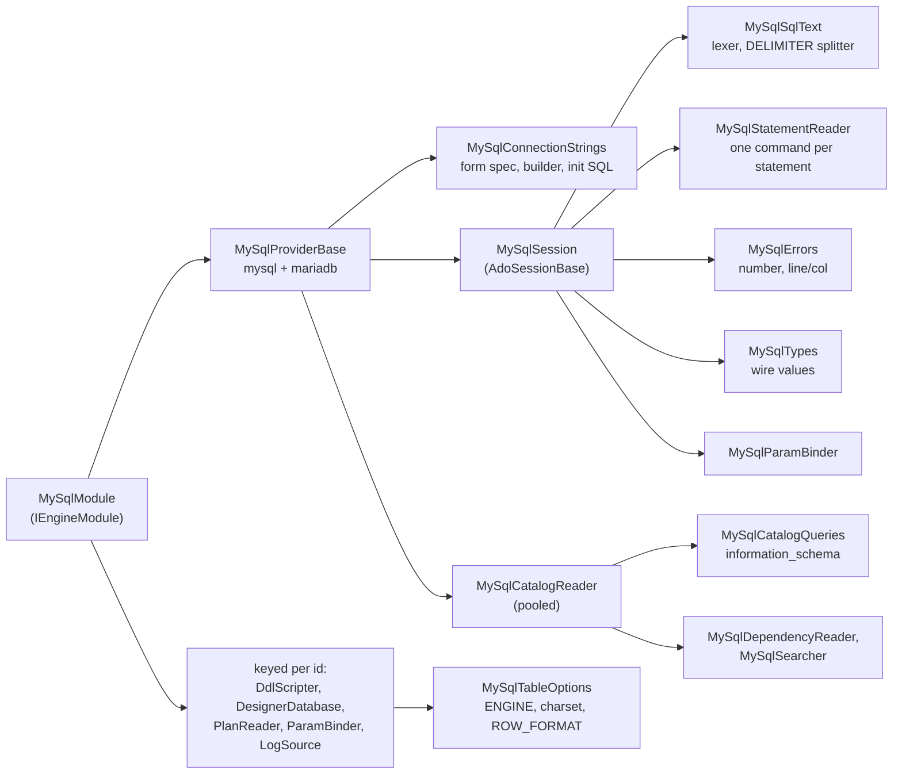

<div dir="rtl">

#### بسته و ثبت

پروژه به هسته، `DbStudio.Logs` و یک بستهٔ NuGet ارجاع می‌دهد: [MySqlConnector](../glossary.md#mysqlconnector) نسخهٔ 2.4.0 (یک درایور ADO.NET کاملاً ناهمزمان با مجوز MIT برای کارسازهای پروتکل MySQL) (`engine/src/DbStudio.Providers.MySql/DbStudio.Providers.MySql.csproj:21`). هیچ کتابخانهٔ بومی‌ای در کار نیست (`docs/wp-notes/WP-MY.md:524`).

‏`MySqlModule` [ماژول موتور (engine module)](../glossary.md#engine-module) این بسته است که مثل بقیه با بازتاب پیدا می‌شود ([فصل 7](07-engine-modules-and-di.md)). هر دو فراهم‌کننده را به‌صورت تک‌نمونه‌های `IDbProvider` ثبت می‌کند و بعد روی دو شناسه حلقه می‌زند و زیر هرکدام `IDdlScripter`، `IDesignerDatabase`، `IPlanReader`، `IParamBinder` کلیددار و یک `MySqlLogSource` ثبت می‌کند که هم `ILogSource` است و هم `IActivitySource` (`engine/src/DbStudio.Providers.MySql/MySqlModule.cs:24-41`). ‏`MapEndpoints` عمداً خالی است: «No MySQL-specific endpoints» (`MySqlModule.cs:43-46`)؛ همه‌چیز از مسیرهای رابطه‌ای مشترک می‌رود.

دو فراهم‌کننده فقط در `Id` و `DisplayName` فرق دارند (`engine/src/DbStudio.Providers.MySql/MySqlProvider.cs:104-115`). کلاس پایه ویژگی‌های مشترک را تعیین می‌کند: `Dialect.MySql` برای هر دو، `Diagnostics => null` (بررسی نحوی سمت کارساز ندارد) و `IdentifierRules('`', '`', "preserve", MySqlReservedWords.All)` (`MySqlProvider.cs:19-23`). چون گونه از کارساز خوانده می‌شود، «نمایهٔ 'mysql'ای که به کارساز MariaDB اشاره کند همچنان کار می‌کند» (`MySqlProvider.cs:11-14`).

#### رشته‌های اتصال و باز کردن نشست

‏`MySqlConnectionStrings.FormSpec` پنجرهٔ اتصال عمومی این خانواده است: میزبان، درگاه 3306، پایگاه داده، کاربر، گذرواژه، حالت SSL (none / preferred / required / verify CA / verify full)، پروندهٔ CA، *Allow public key retrieval*، مجموعه‌نویسه (پیش‌فرض `utf8mb4`)، مهلت اتصال (پیش‌فرض ۱۵ ثانیه)، فشرده‌سازی و *Session variables* (`engine/src/DbStudio.Providers.MySql/MySqlConnectionStrings.cs:10-37`). فراهم‌کننده بلوک مشترک SSH را با `SshFormFields.Append(...)` اضافه می‌کند (`MySqlProvider.cs:20`)، پس اتصال‌های MySQL و MariaDB می‌توانند از یک [تونل SSH (SSH tunnel)](../glossary.md#ssh-tunnel) بگذرند. تونل به یک میزبان TCP نیاز دارد: `TunnelTargets` فهرست میزبان‌های جداشده با ویرگول یا مسیر سوکت Unix را رد می‌کند و در غیر این صورت `host`/`port` را به هدایت محلی بازنویسی می‌کند (`engine/src/DbStudio.Core/Services/Tunnels/TunnelTargets.cs:36,56-63,108-115`). خود تونل در [فصل 8](08-connections-sessions-execution.md) توضیح داده شده است.

سازنده جایی است که بیشتر تصمیم‌های درایور زندگی می‌کنند:

</div>

```csharp
// engine/src/DbStudio.Providers.MySql/MySqlConnectionStrings.cs:55-77
var b = new MySqlConnectionStringBuilder
{
    Server = host, Port = (uint)port, Pooling = pooling,
    DefaultCommandTimeout = 0,
    AllowUserVariables = true,
    AllowLoadLocalInfile = false,
    UseAffectedRows = true,
    TreatTinyAsBoolean = false,
    ConvertZeroDateTime = true,
    GuidFormat = MySqlGuidFormat.None,
    // Cancel sends KILL QUERY on a side connection; give it a few seconds …
    CancellationTimeout = 5,
    IgnoreCommandTransaction = true,
    Keepalive = 30,
};
```

<div dir="rtl">

هر سطر دلیلی دارد. ‏`Pooling = false` برای نشست‌ها، چون «وضعیت نشست، USE، متغیرهای کاربر و تراکنش‌ها مال زبانه‌اند»؛ اتصال‌های کاتالوگ، طراح و جست‌وجو استخری‌اند (`MySqlConnectionStrings.cs:39-45`). ‏`AllowUserVariables` اجازه می‌دهد `@x` به‌عنوان متغیر کاربر به کارساز برسد، نه پارامتری گم‌شده. ‏`AllowLoadLocalInfile = false` یعنی کارساز هرگز نمی‌تواند از موتور بخواهد پرونده‌ای از کلاینت را بارگذاری کند. ‏`TreatTinyAsBoolean = false` نوع `TINYINT(1)` را عدد نگه می‌دارد. ‏`GuidFormat = None` انحرافی ثبت‌شده است: با `Char36` «هر ستون CHAR(36) به‌صورت Guid خوانده می‌شود و یک مقدار غیر GUID در آن کل مجموعهٔ نتیجه را شکست می‌دهد» (`docs/wp-notes/WP-MY.md:82-83`).

*Session variables* را `ParseServerVariables` تجزیه می‌کند: جفت‌های `name=value` که روی ویرگول‌های بیرون از گیومه و پرانتز جدا می‌شوند؛ نام‌ها باید شناسه باشند و مقدارها نمی‌توانند `;` داشته باشند (`MySqlConnectionStrings.cs:102-134`). این‌ها بلافاصله پس از باز شدن اتصال به‌صورت یک `SET SESSION …` اجرا می‌شوند؛ نمایهٔ فقط‌خواندنی روی اتصال‌های نشست `SET SESSION TRANSACTION READ ONLY` را اضافه می‌کند (`MySqlConnectionStrings.cs:137-144`). پس حالت فقط‌خواندنی دو بار تحمیل می‌شود: یک بار با [نگهبان فقط‌خواندنی (read-only guard)](../glossary.md#read-only-guard) هسته و یک بار با خود کارساز.

‏`OpenSessionAsync` یک اتصال بی‌استخر روی پایگاه دادهٔ زبانه باز می‌کند، آن دستورهای آغازین را اجرا می‌کند و سپس `SELECT VERSION(), @@version_comment, CURRENT_USER(), DATABASE(), CONNECTION_ID()` را در یک رفت‌وبرگشت می‌فرستد (`MySqlProvider.cs:62-78`، `engine/src/DbStudio.Providers.MySql/MySqlDb.cs:133-139`). ‏`MySqlFlavor.From` وقتی «MariaDB» در نسخه یا توضیح نسخه ظاهر شود MariaDB تشخیص می‌دهد و پیشوند پروتکل قدیمی `5.5.5-` در MariaDB را هم مدیریت می‌کند (`MySqlDb.cs:13-19`، `engine/src/DbStudio.Providers.MySql/MySqlSqlText.cs:500-509`). شیء گونه به پرسش‌های نسخه‌ای که بقیهٔ بسته می‌پرسد پاسخ می‌دهد: قیدهای CHECK (MySQL 8.0.16 به بعد، MariaDB 10.2 به بعد)، `EXPLAIN ANALYZE` (MySQL 8.0.18 به بعد)، جدول‌های استفادهٔ نما (MySQL 8.0.13 به بعد)، دنباله‌ها (MariaDB 10.3 به بعد) (`MySqlDb.cs:29-38`). ‏`ServerInfo.ProductVersion` پسوند `-MariaDB` می‌گیرد تا خواننده‌های وابسته به نسخه مثل خوانندهٔ طرح اجرا بتوانند گونه را تشخیص دهند (`MySqlProvider.cs:96-99`).

#### اجرای یک دسته: DELIMITER و خوانندهٔ دستورها

‏`MySqlSession` از `AdoSessionBase` مشتق می‌شود ([بخش 2.3](#23-the-shared-ado-base)) و قلاب‌هایی را که لازم دارد بازنویسی می‌کند. جالب‌ترینشان `ExecuteReaderAsync` است.

اسکریپت MySQL اغلب سطرهای [DELIMITER](../glossary.md#delimiter) دارد. ‏`DELIMITER $$` SQL نیست: فرمانی از کلاینت خط فرمان `mysql` است که پایان‌دهندهٔ دستور را عوض می‌کند تا بدنهٔ رویه‌ای ذخیره‌شده پر از `;` بتواند به‌صورت یک دستور فرستاده شود. کارساز این سطر را رد می‌کرد. پس `MySqlSqlText.Split` مثل کلاینت رفتار می‌کند: `DELIMITER xx` در ابتدای یک سطر پایان‌دهنده را عوض می‌کند و هیچ دستوری نمی‌سازد؛ با `;` پیش‌فرض، بدنهٔ برنامه‌های ذخیره‌شده (`CREATE … PROCEDURE | FUNCTION | TRIGGER | EVENT`، `BEGIN NOT ATOMIC`، بلوک‌های برچسب‌دار و `IF / CASE / LOOP / WHILE / REPEAT` سطح بالای MariaDB) یکپارچه می‌مانند؛ `\G` و `\g` هم دستور را پایان می‌دهند (`MySqlSqlText.cs:222-249,257-278,292-294,359-384`). قاعده‌های تودرتویی دقیق‌اند: `IF(` به‌عنوان تابع و `IF [NOT] EXISTS` بلوک باز نمی‌کنند و `END IF` همان چیزی را می‌بندد که نامش را می‌برد، نه یک سطح اضافی (`MySqlSqlText.cs:311-339`).

سپس هر دستور **به‌صورت فرمان جداگانهٔ خودش** فرستاده می‌شود. MySqlConnector می‌تواند متنی چنددستوری بفرستد، ولی مسیر `MySqlBatch` طرح کنار گذاشته شد: «MySqlConnector 2.4.0 مقدار `DbException.BatchCommand` را تنظیم نمی‌کند و `MySqlBatchCommand.RecordsAffected` صفر می‌ماند» (`docs/wp-notes/WP-MY.md:84-85`). (توضیح کلاس در `engine/src/DbStudio.Providers.MySql/MySqlSession.cs:15-17` هنوز از `MySqlBatch` نام می‌برد؛ کد زیر از آن استفاده نمی‌کند.) ‏`MySqlStatementReader` یک `DbDataReader` است که دستورهای یک دسته را می‌پیچد: وقتی مجموعه‌های نتیجهٔ یک دستور تمام شد، سطرهای اثرپذیرفته را ثبت می‌کند، یک قلاب پس-از-دستور را اجرا می‌کند و دستور بعدی را به‌تأخیر اجرا می‌کند (`engine/src/DbStudio.Providers.MySql/MySqlStatementReader.cs:8-13,47-67`). برای پایهٔ مشترک شبیه یک خواننده با مجموعه‌های نتیجهٔ زیاد است، پس جاری‌سازی، `MaxRows` و گیرنده بی‌تغییر کار می‌کنند. ‏`Index` آن همیشه دستوری را که در حال اجراست یا شکست خورده نام می‌برد، پس خطا به سطر درست نگاشت می‌شود.

</div>

```csharp
// engine/src/DbStudio.Providers.MySql/MySqlSession.cs:137-155
async Task<MySqlDataReader> Execute(int index, CancellationToken token)
{
    context.Items[IndexKey] = index;
    await ClearStaleDiagnosticsAsync(list[index], token).ConfigureAwait(false);
    MySqlCommand c;
    if (index == 0) c = cmd;
    else
    {
        c = (MySqlCommand)CreateCommand(list[index].SentText);
        foreach (MySqlParameter p in cmd.Parameters) c.Parameters.Add(p.Clone());
    }
    c.CommandText = list[index].SentText;
    _running = c;
    return await c.ExecuteReaderAsync(CommandBehavior.Default, token).ConfigureAwait(false);
}
```

<div dir="rtl">

دو حالت مرزی پیش از آن مدیریت می‌شوند: دسته‌ای که فقط توضیح یا سطرهای DELIMITER دارد به‌صورت `DO 0` فرستاده می‌شود، چون کارساز پاسخ «Query was empty» می‌داد (`MySqlSession.cs:117-123`)، و `LOAD DATA LOCAL INFILE` از همان ابتدا با `NOT_SUPPORTED` رد می‌شود (`MySqlSession.cs:91-105`).

#### پیام‌ها، هشدارها و خطاها

‏MySqlConnector 2.4.0 هرگز `InfoMessage` را بالا نمی‌آورد و تعداد هشدارها را در دسترس نمی‌گذارد، پس خواننده پس از **هر** دستور `SHOW WARNINGS` را اجرا می‌کند، «مثل MySQL Workbench» (`MySqlSession.cs:190-213`، `docs/wp-notes/WP-MY.md:86-88`). سطح‌ها به Error / Info (Note) / Warning نگاشت می‌شوند و نتیجه به‌صورت پیام‌های کارساز به گیرنده می‌رود. هزینه‌اش یک رفت‌وبرگشت اضافی برای هر دستور است، با یک اثر جانبی مستند: `ROW_COUNT()` و `FOUND_ROWS()` در دسته‌ای *بعدی* دربارهٔ `SHOW WARNINGS` حرف می‌زنند، نه دستور شما (`MySqlSession.cs:193-194`). یادداشت 1003 پس از `EXPLAIN` (پرس‌وجوی بازنویسی‌شدهٔ بهینه‌ساز) به‌عنوان نویز کنار گذاشته می‌شود (`MySqlSession.cs:219-220`).

MariaDB پیچش دیگری دارد: ناحیهٔ پیام‌های تشخیصی‌اش را فقط برای دستورهایی که از جدول استفاده می‌کنند پاک می‌کند، پس `SELECT 1` پس از دستوری شکست‌خورده خطای قدیمی را دوباره گزارش می‌داد. وقتی MariaDB پیام تشخیصی جا گذاشته باشد، نشست پیش از دستور بعدی یک `SELECT 1 FROM information_schema.ENGINES LIMIT 0` ارزان اجرا می‌کند، مگر خود آن دستور پیام‌های تشخیصی را بخواند (`SHOW`، `GET`، `DESCRIBE`) (`MySqlSession.cs:160-187`).

خطاها به `ErrorInfo` تبدیل می‌شوند با شمارهٔ خطای کارساز به‌عنوان کد (مثلاً `1146`)، `SQLSTATE …` در جزئیات و یک موقعیت در سند. ‏`MySqlErrors.Locate` موقعیت را از «near '…' at line N» (چهل نویسهٔ نخست متن نقل‌قول‌شده را در آن سطر می‌گردد)، از «at line N» یا از نامی در پیام‌های «Unknown column 'x'» / «Table 'x'» پیدا می‌کند (`engine/src/DbStudio.Providers.MySql/MySqlErrors.cs:44-99`). قطع اتصال با شماره‌های خطای 1053، 1152، 1153، 1927، 2006، 2013، 4031 یا یک خطای درونی سوکت/ورودی‌خروجی تشخیص داده می‌شود (`MySqlErrors.cs:16-24`)؛ `POST /connections/test` شکست‌خورده `PROVIDER_ERROR` می‌دهد و علت سوکت را به «Unable to connect» مبهم MySQL می‌افزاید (`MySqlErrors.cs:123-139`).

#### تراکنش‌ها

MySQL پیش و پس از DDL به‌طور ضمنی commit می‌کند، پس تراکنشی که «برایش آغاز شود بی‌درنگ پایان می‌یابد». بنابراین در حالت دستی نشست تراکنش موتور را فقط برای نوشتن‌ها یا `SAVEPOINT` آغاز می‌کند، هرگز برای پرس‌وجوها، DDL یا `LOCK/UNLOCK TABLES` (`MySqlSession.cs:73-83,356-357`). پس از دسته، `EndsTransaction` بررسی می‌کند آیا `COMMIT`/`ROLLBACK` کاربر، یک `START TRANSACTION` (که تراکنش قبلی را commit می‌کند) یا دستوری با commit ضمنی تراکنش موتور را پایان داده است؛ اگر DDL چنین کرده باشد، کنسول هشداری می‌گیرد که MySQL آن را commit کرد (`MySqlSession.cs:27-28,328-340,360-371`).

این‌که پس از دسته تراکنشی روی کارساز باز است یا نه در هر گونه جور دیگری پاسخ داده می‌شود: MariaDB دستور `SELECT @@in_transaction` را دارد؛ MySQL «معادل بدون مجوز ندارد»، پس دستورهای تراکنشی دسته تصمیم می‌گیرند (`MySqlSession.cs:373-402`). پیامدش شکافی شناخته‌شده است: در MySQL «رویه‌ای که درونش تراکنشی آغاز کند تشخیص داده نمی‌شود» (`docs/wp-notes/WP-MY.md:544-545`).

#### لغو با KILL QUERY

کارساز MySQL را نمی‌توان روی همان اتصالی که پرس‌وجو را اجرا می‌کند قطع کرد. ‏`Cancel()` در MySqlConnector یک **اتصال جانبی** باز می‌کند و [KILL QUERY](../glossary.md#kill-query) *connection-id* را می‌فرستد که دستور را متوقف ولی نشست را حفظ می‌کند (`MySqlSession.cs:407-412`). ‏`CancellationTimeout = 5` مدت انتظار درایور برای این کار را محدود می‌کند. خطای 1317 («Query execution was interrupted»)، 3024 (`max_execution_time`) و 1969 در MariaDB لغو به حساب می‌آیند (`MySqlErrors.cs:26-29`).

دو جزئیات نشان می‌دهند لغو چقدر دقت می‌خواهد. اول، `KILL QUERY` روی `SELECT SLEEP(60)` باعث می‌شود sleep به‌جای شکست مقدار 1 برگرداند؛ پس دستهٔ فقط‌خواندنی‌ای که پس از لغو «کامل شده» به‌صورت Cancelled گزارش می‌شود (`MySqlSession.cs:313-320`). دوم، وقتی یک پرس‌وجو به سقف سطرها می‌رسد، نشست سطرهای باقی‌مانده را تخلیه نمی‌کند: `OnResultSetTruncatedAsync` مقدار false برمی‌گرداند تا پایه به‌جایش کارساز را لغو کند (`MySqlSession.cs:283-290`).

#### نوع‌ها و مقدارهای انتقال

‏`MySqlTypes.KindFor` نوع گزارش‌شده را به یک [نوع خانه (cell kind)](../glossary.md#cell-kind) نگاشت می‌کند: مکانی و `VECTOR` ← binary، `BIT` ← string، `YEAR` ← int، `ENUM`/`SET` ← string، `JSON` ← json، `DATE` ← date، `TIME` ← time (`engine/src/DbStudio.Providers.MySql/MySqlTypes.cs:34-55`). سپس `ReadValue` قاعده‌های MySQL را اعمال می‌کند: `DECIMAL` با `GetMySqlDecimal` خوانده و به‌صورت متن دقیق فرستاده می‌شود (پس `DECIMAL(65,30)` سالم می‌ماند)؛ تاریخ صفر (`0000-00-00`) به NULL به‌علاوهٔ یک هشدار در هر دسته تبدیل می‌شود؛ `BIT(n)` رشتهٔ بیتی با صفرهای پیشرو می‌شود؛ هندسه پیشوند چهاربایتی SRID را از دست می‌دهد و به‌صورت باینری WKB فرستاده می‌شود؛ `TIME` همان‌طور که MySQL چاپ می‌کند چاپ می‌شود (`838:59:59`، `-01:02:03.5`) به‌جای `34.22:59:59` در ‎.NET (`MySqlTypes.cs:58-153`). عددهای صحیح بی‌علامت بزرگ از قاعدهٔ مشترک [مقدار انتقال (wire value)](../glossary.md#wire-value) پیروی می‌کنند (فراتر از 2^53 به‌صورت متن).

#### پارامترها

‏`MySqlParamBinder` سه سبک جای‌نگهدار را می‌پذیرد: `:name` (بازنویسی به `@name`)، `?` (بازنویسی به `@__p…`) و `@name` که **فقط اگر مقداری با آن نام داده شده باشد** مقید می‌شود و وگرنه متغیر کاربر می‌ماند (`engine/src/DbStudio.Providers.MySql/Params/MySqlParamBinder.cs:11-17`). مقدارها را MySqlConnector سمت کلاینت به‌صورت لفظ‌های گریزداده‌شده در متن جا می‌دهد. پارامترهای OUT و INOUT در `CALL` متغیر کاربرند: نشست پیش از دستور `SET @p = …` و پس از آن `SELECT @p` را اجرا می‌کند (`MySqlSession.cs:222-255`).

#### کاتالوگ روی information_schema

‏`MySqlCatalogReader` روی یک اتصال **استخری** با نام برنامهٔ «Rowlit catalog» اجرا می‌شود (`engine/src/DbStudio.Providers.MySql/MySqlCatalogReader.cs:30-46`). MySQL تک‌سطحی است (`DialectInfo.SchemaIsDatabase(Dialect.MySql)` درست است، `engine/src/DbStudio.Core/Models/DialectInfo.cs:17`): «پایگاه داده»ی MySQL نقش شِما را بازی می‌کند، `ListDatabasesAsync` چیزی برنمی‌گرداند و شِماهای کاوشگر همان پایگاه‌های دادهٔ کارسازند (`MySqlCatalogReader.cs:9-13,59-64`). هر پرس‌وجو یک ثابت در `MySqlCatalogQueries` است که با `@p0` (پایگاه داده) پالایش می‌شود و پایگاه‌های دادهٔ سیستمی را پنهان می‌کند:

</div>

```csharp
// engine/src/DbStudio.Providers.MySql/MySqlCatalogQueries.cs:10-22
public const string SystemSchemas = "'mysql','sys','performance_schema','information_schema'";
public const string Schemas =
    "SELECT s.SCHEMA_NAME, (SELECT COUNT(*) FROM information_schema.TABLES t WHERE t.TABLE_SCHEMA = s.SCHEMA_NAME) " +
    "FROM information_schema.SCHEMATA s WHERE s.SCHEMA_NAME NOT IN (" + SystemSchemas + ") ORDER BY s.SCHEMA_NAME";
public const string Columns =
    "SELECT TABLE_NAME, COLUMN_NAME, COLUMN_TYPE, IS_NULLABLE, COLUMN_KEY, EXTRA, COLUMN_COMMENT, ORDINAL_POSITION, " +
    "COLUMN_DEFAULT, DATA_TYPE, GENERATION_EXPRESSION, CHARACTER_SET_NAME, COLLATION_NAME " +
    "FROM information_schema.COLUMNS WHERE TABLE_SCHEMA = @p0 ORDER BY TABLE_NAME, ORDINAL_POSITION";
```

<div dir="rtl">

‏`LoadSchemaAsync` جدول‌ها، ستون‌ها، ستون‌های کلید، روال‌ها، پارامترها، تریگرها و رویدادها، و پایگاه‌های داده‌ای را که از راه کلید خارجی به این یکی ارجاع می‌دهند می‌خواند (`MySqlCatalogReader.cs:80-104`). رویدادها (events) که MySQL مثل کارهای cron زمان‌بندی‌شان می‌کند، به‌صورت اشیای `proc` با توضیح «event» ظاهر می‌شوند (`docs/wp-notes/WP-MY.md:50-52`)؛ کارسازی که جدول EVENTS را رد کند هیچ رویدادی نمی‌دهد (`MySqlCatalogReader.cs:97-103`). متن DDL از `SHOW CREATE TABLE | VIEW | PROCEDURE | FUNCTION | TRIGGER | EVENT | SEQUENCE` می‌آید (`docs/wp-notes/WP-MY.md:53`). جست‌وجو در پایگاه داده، وابستگی‌ها و فهرست اشیا از همان خوانندهٔ استخری استفاده می‌کنند (`MySqlProvider.cs:83-90`).

#### DDL، طراح و گزینه‌های جدول

‏`MySqlDdlScripter` دستور CREATE TABLE را با کلیدهای درون‌خطی، نمایه‌ها (DESC و طول پیشوند `col(10)`)، CHECK، FOREIGN KEY، `AUTO_INCREMENT`، ستون‌های تولیدشدهٔ VIRTUAL/STORED و توضیح‌ها می‌نویسد؛ یک ALTER اول `RENAME TABLE` را اجرا می‌کند، بعد `DROP FOREIGN KEY`ها، بعد یک `ALTER TABLE` با حذف‌ها، `CHANGE`/`MODIFY COLUMN` (با `FIRST`/`AFTER`)، افزودن‌ها، کلیدها، checkها و توضیح، و در پایان `ADD FOREIGN KEY`ها (`engine/src/DbStudio.Providers.MySql/Designer/MySqlDdlScripter.cs:7-16`). پرچم‌های قابلیت آن `TransactionalDdl: false` می‌گویند و هر اسکریپت این هشدار را دارد که «دستورهایی که پیش از شکست اجرا شدند اعمال‌شده باقی می‌مانند» (`MySqlDdlScripter.cs:21-22,61-63`). خود طراح موضوع [فصل 14](14-designers-and-ddl.md) است.

گزینه‌های جدول جایی‌اند که یادداشت WP کهنه است. یادداشت ENGINE، CHARSET و ROW_FORMAT را «حفظ‌شده در ALTERها ولی غیرقابل ویرایش» فهرست می‌کند (`docs/wp-notes/WP-MY.md:542-543`)، اما کد اکنون `MySqlTableOptions` را دارد (دور QA شمارهٔ ۱۰ در round-mysql): ENGINE، مجموعه‌نویسهٔ پیش‌فرض، collation، ROW_FORMAT و شروع AUTO_INCREMENT در `TableOptions.Extra` منتقل می‌شوند؛ `MySqlDesignerDatabase` آن‌ها را از `information_schema.TABLES` می‌خواند، مقدارها به‌صورت واژه‌های ساده اعتبارسنجی می‌شوند (بی‌گیومه نوشته می‌شوند) و یک ALTER فقط آنچه تغییر کرده را می‌نویسد، با هشدارهایی مثل «Changing the storage engine … rebuilds the table» و برای تغییر مجموعه‌نویسه «existing columns keep theirs» (`engine/src/DbStudio.Providers.MySql/Designer/MySqlTableOptions.cs:7-130`، `engine/src/DbStudio.Providers.MySql/Designer/MySqlDesignerDatabase.cs:148`). پارتیشن‌ها بیرون از مدل می‌مانند.

#### طرح اجرا

‏`MySqlPlanReader` دستور را بر اساس گونه برمی‌گزیند: طرح تخمینی `EXPLAIN FORMAT=JSON` است؛ طرح واقعی در MySQL 8.0.18 به بعد `EXPLAIN ANALYZE` (متن TREE)، در MariaDB `ANALYZE FORMAT=JSON` و در MySQL قدیمی‌تر همان JSON تخمینی همراه هشدار (`engine/src/DbStudio.Providers.MySql/Plans/MySqlPlanReader.cs:12-63`). هر دو شکل واقعی دستور را اجرا می‌کنند و سطرهایش را دور می‌ریزند، پس یک پرس‌وجوی فقط‌خواندنی **دو بار** اجرا می‌شود (یک بار برای سطرهایش، یک بار برای طرح) و به کاربر گفته می‌شود (`MySqlPlanReader.cs:21,41-46`). طرح‌های تخمینی بدون مقدار پارامتر NULL مقید می‌کنند که برای `col = :p` روی یک کلید باعث می‌شود MySQL پاسخ «Impossible WHERE» بدهد (`docs/wp-notes/WP-MY.md:91-92`). طرح‌ها در رابط کاربری در [فصل 15](15-import-export-plans-er.md) پوشش داده شده‌اند.

#### لاگ‌ها، فعالیت و جست‌وجو

‏`MySqlLogSource` کلیددار در `engine/src/DbStudio.Logs/Providers/MySql/MySqlLogSource.cs` است: لاگ خطا از `performance_schema.error_log` (MySQL 8.0.22 به بعد)، لاگ عمومی و کند وقتی `log_output` شامل TABLE باشد، وضعیت InnoDB، و نمای فعالیت از processlist و انتظارهای قفل با `KILL` / `KILL QUERY` (`docs/wp-notes/WP-MY.md:66-69`). [فصل 21](21-logs-activity-resources.md) را ببینید.

#### قاعده‌های شناسه و ویژگی‌های گویش

شناسه‌ها با بک‌تیک نقل‌قول می‌شوند و `MySqlSqlText.Quote` همیشه آن‌ها را نقل‌قول می‌کند («MySQL واژه‌های رزرو و قاعده‌های حروف زیادی دارد») (`MySqlSqlText.cs:476-477`). مقدار یکسان‌سازی `"preserve"` است؛ طرح گفته بود «insensitive»، «که مقداری نیست که هیچ خواننده‌ای بشناسد» (`docs/wp-notes/WP-MY.md:89-90`). ویژگی‌های واژه‌کاو هسته برای `Dialect.MySql` شناسه‌های بک‌تیکی، توضیح‌های سطری `#` و گریز بک‌اسلش درون رشته‌هاست (`DialectInfo.cs:39,42,45`).

همین ویژگی آخر جایی است که [NO_BACKSLASH_ESCAPES](../glossary.md#no-backslash-escapes) اهمیت پیدا می‌کند. در `sql_mode` پیش‌فرض MySQL، `'a\'b'` رشته‌ای است که گیومه‌ای در خود دارد؛ با `NO_BACKSLASH_ESCAPES` بک‌اسلش نویسه‌ای معمولی است. سازندهٔ لفظ موتور بک‌اسلش‌ها را دوتایی می‌کند «(گریز بک‌اسلش روشن است مگر NO_BACKSLASH_ESCAPES)» (`MySqlSqlText.cs:486-487`) و هر دو واژه‌کاو فرض می‌کنند گریزها روشن‌اند. هیچ جای فراهم‌کننده `sql_mode` نشست را نمی‌خواند؛ پس نشستی که با `NO_BACKSLASH_ESCAPES` (یا `ANSI_QUOTES`، نمونهٔ جای‌نگهدار *Session variables*) شروع شده با قاعده‌های پیش‌فرض واژه‌کاوی می‌شود. تا جایی که کد نشان می‌دهد هیچ آزمونی این ترکیب را پوشش نمی‌دهد (بررسی نشده). یادداشت WP-MY همین شکاف را برای `"…"` زیر `ANSI_QUOTES` ثبت کرده است (`docs/wp-notes/WP-MY.md:509-510`).

#### آنچه MySQL / MariaDB در Rowlit نمی‌توانند

- پیام تشخیصی نحوی کارساز پیش از اجرا ندارد (`Diagnostics => null`، `MySqlProvider.cs:22`).
- DDL تراکنشی نیست: اسکریپت طراحی که شکست بخورد دستورهای قبلی را اعمال‌شده باقی می‌گذارد.
- ‏`LOAD DATA LOCAL INFILE` رد می‌شود؛ از جادوگر ورود داده یا پرونده‌ای سمت کارساز استفاده کنید.
- وضعیت تراکنش در MySQL (نه MariaDB) از روی دستورهای تایپ‌شده استنباط می‌شود.
- هر دستور یک رفت‌وبرگشت اضافی `SHOW WARNINGS` هزینه دارد و `ROW_COUNT()` در دستهٔ بعدی تحریف می‌شود.
- نمایه‌های FULLTEXT، SPATIAL و تابعی نشان داده می‌شوند ولی ویرایش‌پذیر نیستند؛ پارتیشن‌ها مدل نمی‌شوند.
- لاگ خطای MariaDB فقط پرونده‌ای است، پس منبع لاگ خطا آن‌جا در دسترس نیست (`docs/wp-notes/WP-MY.md:547`).
- پایهٔ آزمون انطباق همهٔ پرچم‌های `Supports*` را روی مقدار پیش‌فرض `true` نگه می‌دارد: تراکنش‌ها، نقطه‌های ذخیره، کلیدهای خارجی، identity، شمارش DML و لغو همه آزموده می‌شوند (`engine/tests/DbStudio.Providers.MySql.Tests/MySqlFixture.cs:141-182`).

### 3.6 ClickHouse

ClickHouse یک پایگاه دادهٔ تحلیلی ستونی است ([فصل 15 بخش I](../part1/15-oltp-vs-olap-columnar.md)). برای Rowlit تفاوت‌های مهم در SQL نیستند، بلکه در **انتقال و معنا**یند: Rowlit از راه واسط HTTP با ClickHouse حرف می‌زند، هر دستور یک درخواست HTTP است، تراکنش چنددستوری وجود ندارد و `UPDATE`/`DELETE` *mutation*هایی در پس‌زمینه‌اند. فراهم‌کننده همچنان در قرارداد `IDbProvider` جا می‌شود و همچنان از `AdoSessionBase` مشتق می‌شود، که نشان می‌دهد آن پایه چقدر انعطاف‌پذیر است.

**شکل 9.10 — بستهٔ ClickHouse: پرونده و مسئولیت.**

</div>

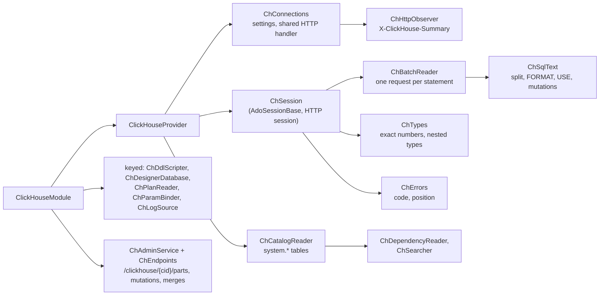

<div dir="rtl">

#### بسته و ثبت

درایور [ClickHouse.Driver](../glossary.md#clickhouse-driver) نسخهٔ 1.5.0 است، «کلاینت رسمی ClickHouse Inc.، MIT، یک DbConnection روی HTTP» (`engine/src/DbStudio.Providers.ClickHouse/DbStudio.Providers.ClickHouse.csproj:3,21`). ‏`ClickHouseModule` یک نمونهٔ فراهم‌کننده می‌سازد، آن را هم به‌عنوان خودش و هم به‌عنوان `IDbProvider` ثبت می‌کند، سرویس‌های کلیددار طراح، طرح اجرا، پارامتر و لاگ/فعالیت را زیر `"clickhouse"` اضافه می‌کند، `ChAdminService` را ثبت می‌کند و نقطه‌های پایانی ماژول را با `api.MapClickHouse()` نگاشت می‌کند (`engine/src/DbStudio.Providers.ClickHouse/ClickHouseModule.cs:21-41`). فراهم‌کننده ویژگی‌ای به نام `Handler` دارد، یک درز آزمون: یک `HttpMessageHandler` که جای کارساز را می‌گیرد (`engine/src/DbStudio.Providers.ClickHouse/ClickHouseProvider.cs:16-17`).

#### اتصال‌ها: HTTP، یک گردانندهٔ مشترک و یک ناظر

فرم میزبان، درگاه (8123 برای HTTP / 8443 برای HTTPS)، پروتکل، پایگاه داده (`default`)، کاربر (`default`)، گذرواژه، فشرده‌سازی، *Skip certificate validation* (فقط HTTPS)، مهلت اتصال (۱۵ ثانیه)، مهلت نشست (۳۶۰۰ ثانیه)، *Settings* آزاد کارساز و مهلت فرمان را دارد (`engine/src/DbStudio.Providers.ClickHouse/ChConnections.cs:19-48`). نشانی چسبانده‌شده‌ای مثل `https://abc.clickhouse.cloud:8443` به‌عنوان میزبان پذیرفته می‌شود (`ChConnections.cs:59-77`). پروتکل انتخاب نمایه است یا از درگاه 8443/443 استنباط می‌شود (`ChConnections.cs:51-57`). همین استنباط دلیل آن است که کد تونل SSH پیش از بازنویسی درگاه، پروتکل را سنجاق می‌کند: «در غیر این صورت از درگاه استنباط می‌شود (8443 = https) که اکنون یک درگاه محلی تصادفی است» (`TunnelTargets.cs:67-72`).

موتور به‌جای این‌که بگذارد درایور `HttpClient` بسازد، `HttpClient` خودش را به درایور می‌دهد. یک `SocketsHttpHandler` برای هر (سیاست گواهی، مهلت اتصال) در تمام عمر فرایند مشترک است، با مهلت بیکاری ۳۰ ثانیه، عمر اتصال ۵ دقیقه و حداکثر ۶۴ اتصال برای هر کارساز (`ChConnections.cs:154-175`). هر اتصال آن را در یک `ChHttpObserver` می‌پیچد، یک `DelegatingHandler` که سرآیند پاسخ `X-ClickHouse-Summary` را برای هر `query_id` ثبت می‌کند (محدود به ۲۵۶ مدخل) (`ChConnections.cs:240-268`). این سرآیند تنها منبع قابل‌اعتماد «سطرهای نوشته‌شده» است: یادداشت WP می‌گوید `QueryStats` درایور «روی HTTP null می‌ماند» (`docs/wp-notes/WP-CH.md:95-97`). مهلت درخواست بی‌نهایت است، چون پرس‌وجوهای تحلیلی ممکن است طولانی شوند (`ChConnections.cs:177-183`).

‏`Settings(...)` تنظیمات درایور را می‌سازد و دو تصمیم دانستنی دارد:

</div>

```csharp
// engine/src/DbStudio.Providers.ClickHouse/ChConnections.cs:128-141
// The driver's JSON/variant modes send settings that servers before 24.10 reject (UNKNOWN_SETTING):
// JSON columns are read as text instead.
JsonReadMode = JsonReadMode.None,
JsonWriteMode = JsonWriteMode.None,
ApplicationInfo = new Dictionary<string, string> { ["Rowlit"] = "1" },
};
foreach (var (k, v) in ParseSettings(profile.GetString("settings"))) settings.CustomSettings[k] = v;
if (sessionId is not null)
{
    var timeout = Math.Clamp(profile.GetInt("sessionTimeout", DefaultSessionTimeout), 1, 86_400);
    settings.CustomSettings["session_timeout"] = timeout.ToString(CultureInfo.InvariantCulture);
}
// A read-only query is cancelled on the server as soon as its HTTP connection closes (cancel, row cap).
settings.CustomSettings.TryAdd("cancel_http_readonly_queries_on_client_close", "1");
```

<div dir="rtl">

#### نشست‌ها نشست‌های HTTP‌اند

HTTP بی‌حالت است، ولی کنسول به حالت نیاز دارد: مقدارهای `SET` و جدول‌های موقت باید میان دستورها باقی بمانند. ClickHouse این را با یک [نشست HTTP (HTTP session)](../glossary.md#http-session) حل می‌کند: هر درخواستی که `session_id` یکسانی دارد وضعیت سمت کارساز را به اشتراک می‌گذارد و کارساز درخواست‌های یک نشست را پشت سر هم اجرا می‌کند. ‏`OpenSessionAsync` شناسهٔ نشست `"rowlit-" + Guid` را می‌سازد (`ClickHouseProvider.cs:48-63`). کاتالوگ، طراح، مرورگر اشیا و جست‌وجو از درخواست‌های **بی‌نشست** روی استخر مشترک استفاده می‌کنند (`ClickHouseProvider.cs:9-13,65-72`). ‏`BuildConnectionString` توصیفی بدون گذرواژه مثل `http://default@host:8123/default` را برای عیب‌یابی برمی‌گرداند، چون رشتهٔ اتصال واقعی‌ای در کار نیست (`ChConnections.cs:146-147`).

واسط HTTP در هر درخواست دقیقاً یک دستور می‌پذیرد («Multi-statements are not allowed»)، پس `ChSqlText.Split` دسته را با توکن‌ساز مشترک روی نقطه‌ویرگول‌های عمق صفر می‌بُرد و `ChBatchReader` هر دستور را به‌صورت فرمانی جداگانه با `query_id` خودش، به‌تأخیر و هم‌زمان با خواندن مجموعه‌های نتیجه به دست پایه، اجرا می‌کند (`engine/src/DbStudio.Providers.ClickHouse/ChSqlText.cs:20-66`، `engine/src/DbStudio.Providers.ClickHouse/ChBatchReader.cs:11-17`). شکننده سه عادت ClickHouse را می‌شناسد:

- ‏`INSERT INTO t FORMAT CSV <data>` باقی دسته را، با نقطه‌ویرگول‌هایش، دادهٔ درون‌خطی خود نگه می‌دارد (`ChSqlText.cs:45-52`).
- ‏`FORMAT JSONEachRow` پایانی (یا هرکدام از حدود ۶۰ قالب خروجی) روی یک پرس‌وجو **حذف** می‌شود، چون درایور قالب سیمی خودش را می‌خواهد و قالب کاربر «پاسخ را ناخوانا می‌کرد»؛ کنسول پیامی اطلاعاتی می‌گیرد که قالب نادیده گرفته شد (`ChSqlText.cs:56-62,68-80`، `engine/src/DbStudio.Providers.ClickHouse/ChSession.cs:238-240`).
- ‏`USE db` ثبت می‌شود؛ چون درایور پایگاه داده را با هر درخواست می‌فرستد، نشست پس از آن `ChangeDatabase` را صدا می‌زند (`ChSession.cs:139-148`، `docs/wp-notes/WP-CH.md:98-99`).

فرمان هر دستور سقف سطرها را هم سمت کارساز تنظیم می‌کند. برای یک `SELECT`/`WITH` تنها با سقف، نشست `max_result_rows = cap + 1` و `result_overflow_mode = 'break'` را می‌فرستد تا ClickHouse به‌جای جاری کردن میلیون‌ها سطر که جدول نتیجه دور می‌ریخت، تولید سطر را متوقف کند (`ChSession.cs:103-120`). مهلت فرمان به `max_execution_time` تبدیل می‌شود (`ChSession.cs:109-110`). اگر درخواستی نشست HTTP را هنوز قفل‌شده به دست دستوری در حال کشته شدن ببیند (خطای 373)، تا ۲۰ بار با مکث‌های ۱۰۰ میلی‌ثانیه‌ای دوباره امتحان می‌شود (`ChSession.cs:122-137`).

#### بدون تراکنش، و این‌که «سطرهای اثرپذیرفته» یعنی چه

ClickHouse تراکنش چنددستوری ندارد. نشست با `TxMode = Auto` ساخته می‌شود، `TxOpen` همیشه false است و رفتن به حالت دستی `400 NOT_SUPPORTED` با «every statement is applied on its own. Use auto-commit mode.» می‌دهد (`ChSession.cs:32-33,48,61-74`). رابط کاربری کلید تراکنش را برای این گویش پنهان می‌کند (`docs/wp-notes/WP-CS.md:11`).

سطرهای اثرپذیرفته فقط جایی گزارش می‌شوند که ClickHouse بتواند بگوید: یک `INSERT` مقدار `written_rows` را از خلاصهٔ پاسخ گزارش می‌دهد (`ChSession.cs:217-224`). ‏`ALTER TABLE … UPDATE/DELETE` و `DELETE` سبک [mutation](../glossary.md#mutation)اند: بی‌درنگ پذیرفته و در پس‌زمینه بازنویسی می‌شوند. پس از چنین دسته‌ای، نشست جدیدترین سطر `system.mutations` آن جدول را می‌خواند و «submitted (n part(s) to rewrite); ClickHouse applies it in the background»، «finished» یا «is failing: …» را چاپ می‌کند (`ChSession.cs:242-276`). به همین دلیل پایهٔ آزمون انطباق `ReportsDmlRowCounts => false` می‌گذارد (`engine/tests/DbStudio.Providers.ClickHouse.Tests/ChFixture.cs:119-122`).

#### لغو: قطع درخواست به‌علاوهٔ KILL QUERY

قطع درخواست HTTP کافی نیست: «کارساز اجرای پرس‌وجو را ادامه می‌دهد (و نشست HTTP را قفل نگه می‌دارد)» (`docs/wp-notes/WP-CH.md:100-102`). پس `CancelCommand` دو کار می‌کند. درخواست جاری را قطع می‌کند و در لغو به دست کاربر، `KILL QUERY WHERE query_id = '…' SYNC` را روی یک **اتصال جانبی بیرون از نشست HTTP** که به‌تأخیر باز می‌شود، با نگهبانی یک semaphore و مهلت ۱۰ ثانیه، آغاز می‌کند (`ChSession.cs:285-315`). شناسهٔ پرس‌وجو پیش از قرار گرفتن در متن SQL به‌صورت GUID تجزیه می‌شود، پس هیچ چیزِ تحت کنترل کاربر به آن دستور نمی‌رسد (`ChSession.cs:300`). برای توقف ناشی از سقف سطرها در پرس‌وجوی فقط‌خواندنی kill لازم نیست: `cancel_http_readonly_queries_on_client_close = 1` با بسته شدن اتصال کارساز را متوقف می‌کند (`ChSession.cs:291`). ‏`OnBatchCompletedAsync` تا ۱۰ ثانیه منتظر kill می‌ماند و شکست را به‌صورت هشدار گزارش می‌دهد (`ChSession.cs:229-236`). ‏`IsConnectionBroken` همیشه false می‌گوید: سوکت ماندگاری نیست که بشکند (`ChSession.cs:319`).

#### عددهای دقیق و نوع‌های تودرتو

‏`ChTypes` پیش از تعیین نوع، `Nullable(…)`، `LowCardinality(…)` و `SimpleAggregateFunction(f, T)` را باز می‌کند (`engine/src/DbStudio.Providers.ClickHouse/ChTypes.cs:28-43`). قاعده‌های مقدار عددهای بزرگ را دقیق نگه می‌دارند: `ClickHouseDecimal` و `BigInteger` (‏Int128، UInt256…) با `ToString` خودشان تبدیل می‌شوند، هرگز از راه `double` (`ChTypes.cs:166-170`). ‏`Array`، `Map`، `Tuple`، `Nested` و نوع‌های جغرافیایی به متن JSON فشرده‌ای تبدیل می‌شوند که در آن عددهای صحیح بزرگ و decimalها به‌صورت **عدد JSON خام** با همهٔ رقم‌ها نوشته می‌شوند، عنصرهای `Date` و `DateTime` بر اساس نوع ستون از هم جدا می‌شوند (درایور هر دو را `DateTime` تحویل می‌دهد) و متن غیر ASCII خوانا می‌ماند (مقدارهای فارسی به `\uXXXX` گریز داده نمی‌شوند) (`ChTypes.cs:158-161,178-240`). ‏`FixedString` نویسه‌های NUL پایانی‌اش را از دست می‌دهد (`ChTypes.cs:154-157`).

#### پارامترها

ClickHouse پارامترهای پرس‌وجوی واقعی سمت کارساز دارد که به شکل `{name:Type}` نوشته می‌شوند. ‏`ChParamBinder` آن‌ها را با نوع اعلام‌شده مقید می‌کند و قراردادهای کنسول `:name` و `@name` را به `{name:Type}` با نوعی برگرفته از مقدار بازنویسی می‌کند (int ← Int64، decimal ← `Decimal(38, s)`، date ← Date، datetime ← `DateTime64(6)`، null ← `Nullable(String)`). ‏`?` هرگز جای‌نگهدار نیست، چون عملگر سه‌تایی است (`engine/src/DbStudio.Providers.ClickHouse/Params/ChParamBinder.cs:18-24`). جای‌نگهدارهای بی‌مقدار از ابتدا رد نمی‌شوند تا تعریف نمای پارامتری `CREATE VIEW … {p:Type}` قابل اجرا باشد (`ChSession.cs:80-81`).

#### کاتالوگ روی جدول‌های سیستمی

ClickHouse مثل MySQL تک‌سطحی است: شِماهای کاوشگر پایگاه‌های داده‌ای از `system.databases` هستند منهای `system` و دو املای `INFORMATION_SCHEMA` (`engine/src/DbStudio.Providers.ClickHouse/ChCatalogReader.cs:13,17-22`). جدول‌های هر موتوری `table`اند، `View` همان `view`، `MaterializedView` همان `mview`، dictionaryها اشیای `type` با توضیح «Dictionary …»، تابع‌های تعریف‌شده به دست کاربر در SQL (که در ClickHouse سراسری‌اند) اشیای `func` در پایگاه دادهٔ پیش‌فرض اتصال، و جدول‌های ذخیره‌سازی `.inner*` نماهای مادی‌شده پنهان می‌شوند (`ChCatalogReader.cs:71-78`). هر مقدار یک پارامتر نوع‌دار `{p:String}` است:

</div>

```sql
-- engine/src/DbStudio.Providers.ClickHouse/ChCatalogReader.cs:24-29
SELECT name, engine, comment, primary_key, sorting_key, partition_key, sampling_key, engine_full
FROM system.tables
WHERE database = {db:String} AND NOT is_temporary AND NOT startsWith(name, '.inner')
ORDER BY name
```

<div dir="rtl">

کلید اصلی‌ای که به مدل مشترک گزارش می‌شود همان `PRIMARY KEY` جدول است (پیشوندی از `ORDER BY`)؛ «ClickHouse کلید خارجی و افزایش خودکار ندارد» (`ChCatalogReader.cs:76-77`)، پس پایهٔ آزمون `SupportsForeignKeys` و `SupportsIdentity` را خاموش می‌کند (`ChFixture.cs:119-122`).

#### طراح MergeTree

یک جدول ClickHouse همان‌قدر با عبارت موتورش تعریف می‌شود که با ستون‌هایش. جدول [MergeTree](../glossary.md#mergetree) به `ORDER BY` نیاز دارد و می‌تواند `PARTITION BY`، `PRIMARY KEY`، `SAMPLE BY`، `TTL` و `SETTINGS` داشته باشد. ‏`ChEngineOptions` این‌ها را در `TableOptions.Extra` حمل می‌کند، جایگاهی در هسته که برای همین فراهم‌کننده اضافه شد (R3-1) و بعد MySQL و Snowflake هم از آن استفاده کردند (`engine/src/DbStudio.Providers.ClickHouse/Designer/ChDdlScripter.cs:6-40`، `docs/wp-notes/WP-CH.md:7`). ‏`ChDesignerDatabase` آن‌ها را از `system.tables` پر می‌کند (`engine/src/DbStudio.Providers.ClickHouse/Designer/ChDesignerDatabase.cs:128,140`). نویسندهٔ اسکریپت ستون‌ها را می‌سازد (`Nullable(T)` برای ستون‌های nullپذیر، DEFAULT / MATERIALIZED / ALIAS، توضیح‌ها)، نمایه‌های skip (به‌طور پیش‌فرض `INDEX n expr TYPE minmax GRANULARITY 1`)، قیدهای CHECK و عبارت‌های موتور را؛ ALTER از تغییر ستون، `MATERIALIZE INDEX` برای دادهٔ موجود، `MODIFY ORDER BY` (فقط ستون‌های تازه)، `MODIFY TTL` و `MODIFY SETTING` پشتیبانی می‌کند؛ و هشدار می‌دهد که ClickHouse کلید خارجی، قید یکتایی یا افزایش خودکار ندارد (`ChDdlScripter.cs:42-49`). اعمال یک `CREATE TABLE t (…)` خالی، `ENGINE = MergeTree ORDER BY tuple()` را اضافه می‌کند (`docs/wp-notes/WP-CH.md:119-120`).

#### طرح اجرا، لاگ پرس‌وجو و نماهای مدیریتی

‏`ChPlanReader` درخواست `EXPLAIN json = 1, indexes = 1, description = 1` می‌دهد. با `indexes = 1` گره‌های `ReadFromMergeTree` نشان می‌دهند کلید اصلی، هرس پارتیشن‌ها و نمایه‌های skip چقدر partها و granuleهای خوانده‌شده را کم کرده‌اند؛ برای پرس‌وجوها `EXPLAIN PIPELINE` به‌صورت متن به ریشه پیوست می‌شود (`engine/src/DbStudio.Providers.ClickHouse/Plans/ChPlanReader.cs:12-39`). طرح واقعی دستور را عادی اجرا می‌کند و سپس شمارنده‌های خود کارساز را از `system.query_log` برای آخرین شناسهٔ پرس‌وجوی غیر EXPLAIN نشست اضافه می‌کند؛ وقتی لاگ هنوز تخلیه نشده، هشداری می‌گوید فقط تخمین نشان داده شده است (`ChPlanReader.cs:22-23,62-67`، `ChSession.cs:163-168`).

نقطه‌های پایانی ماژول زیر `/clickhouse/{cid}` آنچه را گردانندهٔ ClickHouse زیر نظر دارد در دسترس می‌گذارند: partها و پارتیشن‌های یک جدول از `system.parts` (تا ۲۰٬۰۰۰ سطر)، mutationها از `system.mutations` با `KILL MUTATION`، mergeهای در حال اجرا از `system.merges`، `OPTIMIZE` و `DROP/DETACH PARTITION` (`engine/src/DbStudio.Providers.ClickHouse/Endpoints/ChEndpoints.cs:36-76,218-224`). کنش‌های نوشتنی روی اتصال‌های فقط‌خواندنی `403 READ_ONLY` می‌دهند (`ChEndpoints.cs:98`) و هر فراخوانی نمایه را از راه `ConnectionStore.ResolveForOpenAsync` حل می‌کند، پس از تونل SSH هم می‌گذرند (`ChEndpoints.cs:83`). ‏`ChLogSource` لاگ‌های `query_log`، `text_log`، `part_log`، شمارنده‌های خطا و فعالیت را می‌دهد (`engine/src/DbStudio.Logs/Providers/ClickHouse/ChLogSource.cs:165-171`).

#### خطاها و شناسه‌ها

‏`ChErrors.Map` شمارهٔ خطای کارساز را به‌عنوان کد به کار می‌برد (`"60"` برای UNKNOWN_TABLE)، پیشوند «Code: N. DB::Exception:» و پسوند «(version …)» را حذف می‌کند، فهرست «Expected one of: …» خطاهای نحوی را به جزئیات می‌برد و «failed at position N» (بایت، از ۱، در دستور فرستاده‌شده) را به سطر و ستون سند نگاشت می‌کند (`engine/src/DbStudio.Providers.ClickHouse/ChErrors.cs:11-21`). شناسه‌ها به حروف حساس‌اند (`"preserve"`) و با بک‌تیک نقل‌قول می‌شوند (`ClickHouseProvider.cs:26-27`)؛ رابط کاربری هنگام قالب‌بندی نام تابع‌هایی مثل `arrayJoin` و نوع‌هایی مثل `UInt32` را با همان حروف نگه می‌دارد، چون کارساز `ARRAYJOIN` را رد می‌کند (`docs/wp-notes/WP-CH.md:136-140`).

#### آنچه ClickHouse در Rowlit نمی‌تواند

- تراکنش دستی، نقطهٔ ذخیره، کلید خارجی یا ستون identity ندارد (پرچم‌های پایهٔ آزمون، `ChFixture.cs:119-122`).
- برای UPDATE/DELETE (mutationها) تعداد سطر ندارد؛ شمارش INSERT فقط از خلاصهٔ HTTP می‌آید.
- پیام تشخیصی نحوی کارساز پیش از اجرا ندارد (`Diagnostics => null`، `ClickHouseProvider.cs:24`).
- عبارت `FORMAT` کاربر روی پرس‌وجو نادیده گرفته می‌شود؛ برای قالب‌های دیگر از Export استفاده کنید.
- ستون‌های JSON به‌صورت متن خوانده می‌شوند (حالت‌های JSON درایور برای کارسازهای پیش از 24.10 خاموش‌اند).
- در 24.8 نمای پارامتری درون یک زیرپرس‌وجوی scalar با ACCESS_DENIED شکست می‌خورد (اشکال کارساز، `docs/wp-notes/WP-CH.md:105`).

### 3.7 Snowflake

Snowflake یک انبار دادهٔ ابری است: ذخیره‌سازی و پردازش جدا هستند و پردازش به شکل [انبارها (warehouses)](../glossary.md#warehouse) می‌آید (خوشه‌هایی که تا وقتی روشن‌اند هزینه می‌پردازید). سه پیامد فراهم‌کننده را شکل می‌دهند. هر ورود یک نشست کارساز با انبار، [نقش (role)](../glossary.md#role-snowflake)، پایگاه داده و شِمای جاری است که کاربر مدام عوضشان می‌کند. مرور نباید انباری را بیدار کند، چون هزینه دارد. و چهار راه ورود وجود دارد. Snowflake مثل PostgreSQL دوسطحی است (پایگاه داده ← شِما) (`DialectInfo.cs:11`).

**شکل 9.11 — بستهٔ Snowflake: پرونده و مسئولیت.**

</div>

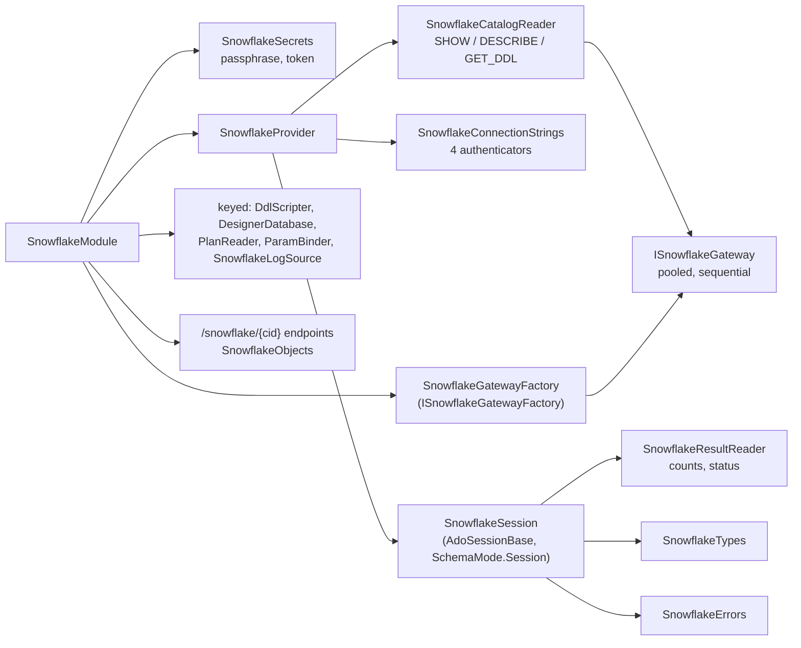

<div dir="rtl">

#### بسته، درایور و کتابخانه‌های بومی

درایور [Snowflake.Data](../glossary.md#snowflake-data) نسخهٔ 6.4.0 است (`engine/src/DbStudio.Providers.Snowflake/DbStudio.Providers.Snowflake.csproj:22`). ‏WP-SF از نسخهٔ برنامه‌ریزی‌شدهٔ 4.8.0 جلوتر رفت، چون 5.0 وابستگی log4net را حذف کرد و 6.x هدف net10.0 دارد، SDKهای ذخیره‌سازی‌اش را ارتقا داده و تکرار JWT و رفتار لغو را درست کرده است؛ ممیزی NuGet پاک است (`docs/wp-notes/WP-SF.md:45-51`). درایور دو [کتابخانهٔ بومی](../glossary.md#native-library) با خود می‌آورد: `sf_mini_core` (یک کاوشگر سنجش از دور که درایور بارش می‌کند و بدون آن هم زنده می‌ماند) و `Mono.Unix` (بررسی مجوز پرونده‌ها در macOS/لینوکس). در ویندوز `sf_mini_core.dll` درون موتور تک‌پرونده‌ای بسته‌بندی و هنگام شروع استخراج می‌شود؛ در macOS، `libsf_mini_core.dylib` و `libMono.Unix.dylib` کنار apphost می‌نشینند و همراه برنامه امضا می‌شوند (`DbStudio.Providers.Snowflake.csproj:3-5`، `docs/wp-notes/WP-SF.md:81-99`). کل درایور حدود 5.9 MiB به موتور منتشرشده اضافه می‌کند (`docs/wp-notes/WP-SF.md:73-75`). بسته‌بندی ساخت در [فصل 24](24-build-ci-release-contributing.md) آمده است.

تنظیمات سراسری درایور یک بار در `SnowflakeDriver.EnsureInitialized` اعمال می‌شوند: یک **مدیر اعتبارنامه درون حافظه**، تا توکن‌های SSO مرورگر و MFA «در حافظه بمانند: چیزی در انبار اعتبارنامهٔ کاربر یا پوشهٔ خانه نوشته نمی‌شود» (`engine/src/DbStudio.Providers.Snowflake/Gateway/SnowflakeGateway.cs:10-20`). سنجش از دور کلاینت در هر رشتهٔ اتصال با `CLIENT_TELEMETRY_ENABLED=false` خاموش است (`engine/src/DbStudio.Providers.Snowflake/SnowflakeConnectionStrings.cs:175-176`).

#### ثبت و مسئلهٔ رمزها

‏`SnowflakeModule` کلاس `SnowflakeSecrets`، کارخانهٔ دروازه، فراهم‌کننده (به‌عنوان خودش و `IDbProvider`)، سرویس‌های کلیددار طراح، طرح اجرا، پارامتر و لاگ و نقطه‌های پایانی ماژول را ثبت می‌کند (`engine/src/DbStudio.Providers.Snowflake/SnowflakeModule.cs:41-57`). ‏`SnowflakeSecrets` به این دلیل وجود دارد که نمایهٔ Snowflake فیلدهای اضافی از نوع گذرواژه دارد (`privateKeyPassphrase`، `token`) که انبار اتصال‌ها هنگام ذخیرهٔ نمایه حذفشان می‌کند (`docs/PLAN-M2.md` D12). سرویس‌های مشترک آن‌ها را با `ConnectionStore.WithSecrets` برمی‌گردانند؛ نقطه‌های پایانی ماژول نمایهٔ ذخیره‌شده را خودشان می‌خوانند، پس `SnowflakeSecrets.Hydrate` ویژگی‌های غایب را هنگام فراخوانی از انبار رمز پر می‌کند (`engine/src/DbStudio.Providers.Snowflake/SnowflakeSecrets.cs:6-39`). جست‌وجو یک lambda روی `sp.GetService<ConnectionStore>()` است، چون «ConnectionStore به رجیستری فراهم‌کننده‌ها وابسته است که به ما وابسته است»: وابستگی از راه سازنده یک چرخه می‌شد (`SnowflakeModule.cs:43-44`).

#### چهار احرازکننده

‏`SnowflakeAuth` چهار مقدار `authenticator=` را نام می‌برد: `snowflake` (گذرواژه)، `snowflake_jwt` (جفت‌کلید)، `externalbrowser` (SSO مرورگر) و `oauth` (`SnowflakeConnectionStrings.cs:9-15`). فرم از راه `VisibleWhen` فقط فیلدهای روش انتخاب‌شده را نشان می‌دهد (`SnowflakeConnectionStrings.cs:32-63`). ‏`Build` فیلدهای لازم هر روش را اعتبارسنجی می‌کند و هر جا درایور ویژگی `SecureString` دارد رمزها را بیرون از رشتهٔ اتصال نگه می‌دارد: گذرواژه و توکن OAuth به‌صورت `conn.Password` / `conn.Token` منتقل می‌شوند؛ فقط عبارت عبور کلید که چنین ویژگی‌ای ندارد در رشته نوشته می‌شود و در هر نسخهٔ چاپی پوشانده می‌شود (`SnowflakeConnectionStrings.cs:108-187`، `SnowflakeGateway.cs:23-39`). ‏SSO مرورگر `client_store_temporary_credential=true` را اضافه می‌کند تا با `ALLOW_ID_TOKEN = TRUE` روی حساب، یک رفت‌وبرگشت مرورگر برای کل عمر موتور کافی باشد (`SnowflakeConnectionStrings.cs:142-148`). نام‌ها در `db`، `schema`، `warehouse` و `role` همان‌طور که تایپ شده‌اند نوشته می‌شوند، چون خود درایور `"…"` را نقل‌قول شناسه می‌داند؛ نامی که `;` داشته باشد رد می‌شود با این توصیه که پس از اتصال `USE` شود (`SnowflakeConnectionStrings.cs:189-201`).

اتصال‌های Snowflake نمی‌توانند از تونل SSH استفاده کنند: `snowflake` در `TunnelTargets.Supported` نیست و مشخصات فرم فراهم‌کننده بلوک SSH را اضافه نمی‌کند (`TunnelTargets.cs:19-22,45`، `engine/src/DbStudio.Providers.Snowflake/SnowflakeProvider.cs:35`). گشت SSH، Snowflake را زیر «Not available» فهرست کرده است (`docs/qa/ssh-tunnel-walkthrough.md:39`). کد دلیلی نمی‌آورد؛ احتمالاً نقطه‌های پایانی HTTPS درایور (میزبان‌های ورود، پرس‌وجو و stage) را نمی‌توان با یک درگاه هدایت‌شده حمل کرد (بررسی نشده).

#### دو نوع اتصال: نشست‌ها و دروازه‌ها

نشست‌های زبانه از اتصال‌های اختصاصی بی‌استخر استفاده می‌کنند (`poolingEnabled=false`)، چون «USE، متغیرها، یک تراکنش باز» مال زبانه‌اند؛ کاتالوگ، مرورگر اشیا، جست‌وجو، خواندن‌های طراح و نقطه‌های پایانی ماژول از اتصال‌های استخری [دروازه (gateway)](../glossary.md#gateway) استفاده می‌کنند (`SnowflakeProvider.cs:11-16`، `SnowflakeConnectionStrings.cs:17-22,174`). ‏`ISnowflakeGateway` درزی کوچک است (`QueryAsync`، `ExecuteAsync`) روی یک `SnowflakeDbConnection` استخری که دستورها را پشت یک `SemaphoreSlim` یکی‌یکی اجرا می‌کند (`SnowflakeGateway.cs:60-116`). آزمون‌ها آن را با `SnowflakeGatewayFake` جایگزین می‌کنند که پایه‌های JSON ضبط‌شده را بازپخش می‌کند، پس تقریباً همهٔ آزمون‌های Snowflake بدون حساب کاربری اجرا می‌شوند. ‏`ClearPooledConnections` استخر درایور را برای رشتهٔ اتصال استخری نمایه پاک می‌کند (`SnowflakeProvider.cs:44-59`).

‏`OpenSessionAsync` یک قدم ظریف دارد. رشتهٔ اتصال فقط می‌تواند نام پایگاه دادهٔ بی‌گیومه و تبدیل‌شده به حروف بزرگ را حمل کند، پس وقتی زبانه پایگاه داده‌ای غیر از پایگاه دادهٔ نمایه می‌خواهد (مثلاً `MyDb`، نامی حساس به حروف که کاوشگر فهرست کرده)، نشست وارد می‌شود و سپس `USE DATABASE` را اجرا می‌کند و اول املای ذخیره‌شده را امتحان می‌کند (`SnowflakeProvider.cs:77-103`، `engine/src/DbStudio.Providers.Snowflake/SnowflakeSession.cs:219-242`).

#### اجرا: درخواست‌های چنددستوری و نتیجه‌های حسابداری

کنسول معمولاً در هر دسته یک دستور می‌فرستد، ولی دسته‌ای با چند دستور به‌صورت یک **درخواست چنددستوری** فرستاده می‌شود: نشست پارامتر `MULTI_STATEMENT_COUNT = 0` را اضافه می‌کند و درایور هر نتیجه را به ترتیب برمی‌گرداند (`SnowflakeSession.cs:79-96`). سپس `SnowflakeResultReader` عادت‌های نتیجه‌دهی Snowflake را تمیز می‌کند: DML یک مجموعهٔ نتیجهٔ حسابداری برمی‌گرداند («number of rows inserted») که به‌جای جدول، سطرهای اثرپذیرفته می‌شود؛ DDL، `USE` و `GRANT` یک نتیجهٔ تک‌ستونی `status` برمی‌گردانند («Table T successfully created.») که پیامی اطلاعاتی می‌شود (`engine/src/DbStudio.Providers.Snowflake/SnowflakeResultReader.cs:11-13`، `SnowflakeSession.cs:114-135`). پس از هر دسته نشست پایگاه دادهٔ دنبال‌شده به دست درایور را هم می‌خواند و [شناسهٔ پرس‌وجو (query id)](../glossary.md#query-id)ی آخرین دستور را به خاطر می‌سپارد که خوانندهٔ طرح اجرا و پیوند تاریخچه لازمش دارند (`SnowflakeSession.cs:98-106,137-144`).

#### تراکنش‌ها بدون نقطهٔ ذخیره

حالت خودکار همان autocommit است. در حالت دستی تراکنش موتور (`BEGIN`) با نخستین نوشتن آغاز می‌شود؛ دسته‌های فقط DDL آن را آغاز نمی‌کنند، چون Snowflake هر DDL را در تراکنش خودش اجرا می‌کند (`SnowflakeSession.cs:70-77`). وقتی DDL در حالی اجرا شود که تراکنش موتور باز است، Snowflake اول آن تراکنش را commit می‌کند؛ نشست تراکنشش را فراموش می‌کند و هشدار «the earlier changes are committed» می‌دهد (`SnowflakeSession.cs:33-34,146-153`). ‏`BEGIN`/`COMMIT` تایپ‌شده به دست کاربر، یک `CALL` یا یک بلوک اسکریپتی پس از اجرا با `SELECT CURRENT_TRANSACTION()` بررسی می‌شود (`SnowflakeSession.cs:166-179`). Snowflake نقطهٔ ذخیره ندارد، پس پایهٔ آزمون زنده `SupportsSavepoints => false` می‌گذارد و آزمون‌های نقطهٔ ذخیرهٔ ویرایش جدول نتیجه کنار گذاشته می‌شوند (`engine/tests/DbStudio.Providers.Snowflake.Tests/LiveTests.cs:56-63`، `engine/tests/DbStudio.Providers.Conformance/ProviderFixture.cs:46-47`).

#### لغو

‏`CancelCommand` اول `Cancel()` درایور را صدا می‌زند که درخواست جاری را قطع می‌کند. چون «دستوری که روی کارساز به اجرا ادامه می‌دهد (یک کار فرزند ناهمزمان، یک قطع گیرکرده)» ممکن است از آن جان سالم به در ببرد، یک جایگزین زمان‌بندی می‌کند: پس از ۳ ثانیه، اگر همان فرمان هنوز در حال اجرا باشد، `SELECT SYSTEM$CANCEL_QUERY('<query id>')` را روی یک اتصال دروازهٔ جانبی اجرا می‌کند (`SnowflakeSession.cs:184-203`).

#### تعویض انبار، نقش، پایگاه داده و شِما

‏`SnowflakeSession` حالت `SchemaMode.Session` را گزارش می‌دهد: `CURRENT_SCHEMA()` را دنبال می‌کند و می‌تواند آن را با `USE SCHEMA` عوض کند (`SnowflakeSession.cs:246-286`). یک عبارت باقاعده تعیین می‌کند کدام دسته‌ها ممکن است شِما را تغییر دهند (`USE`، `CREATE … SCHEMA|DATABASE`، `CALL`، `EXECUTE`، `BEGIN`)، تا پایه فقط در صورت نیاز دوباره بخواند (`SnowflakeSession.cs:250-257`). ماژول دو مسیر نشست اضافه می‌کند: `GET /snowflake/sessions/{sid}/context` انبار، نقش، پایگاه داده، شِما، نقش‌های ثانویه و شناسهٔ نشست کارساز را برمی‌گرداند، و `POST /snowflake/sessions/{sid}/use {kind, name}` روی نشست زبانه `USE WAREHOUSE | ROLE | DATABASE | SCHEMA` را اجرا و سپس `session.changed` را منتشر می‌کند (`SnowflakeModule.cs:123-135`، `SnowflakeSession.cs:288-335`، `engine/src/DbStudio.Core/Services/SessionManager.cs:401-404`). هر دو از راه `RunExclusiveAsync` اجرا می‌شوند، کمکی پایه که نشستی بیکار را Executing علامت می‌زند و کار جانبی را روی اتصال خودش اجرا می‌کند، پس یک `USE` هرگز با دسته‌ای در حال اجرا درهم نمی‌آمیزد (`AdoSessionBase.cs:1323-1327`، [بخش 2.3](#23-the-shared-ado-base)). هر کنسول زمینهٔ خودش را دارد (`docs/qa/snowflake-walkthrough.md:47`).

#### مرور کاتالوگ بدون بیدار کردن انبار

این تصمیم کلیدی طراحی این فراهم‌کننده است. نماهای information schema به انبار روشن نیاز دارند، پس خوانندهٔ کاتالوگ فقط از فرمان‌های `SHOW` و `DESCRIBE` و `GET_DDL` استفاده می‌کند که در لایهٔ cloud services خود Snowflake اجرا می‌شوند: «مرور هرگز انباری را از سر نمی‌گیرد (بدون اعتبار مصرفی)» (`engine/src/DbStudio.Providers.Snowflake/SnowflakeCatalogReader.cs:11-19`). نام‌ها همیشه کامل نقل‌قول می‌شوند، پس یک اتصال می‌تواند همهٔ پایگاه‌های داده را مرور کند:

</div>

```csharp
// engine/src/DbStudio.Providers.Snowflake/SnowflakeSql.cs:99-109
public const string ShowDatabases = "SHOW DATABASES";
public static string ShowSchemas(string database) => $"SHOW SCHEMAS IN DATABASE {AlwaysQuote(database)}";
public static string ShowTables(string? database, string schema) => $"SHOW TABLES IN SCHEMA {SchemaPath(database, schema)}";
public static string ShowColumns(string? database, string schema) => $"SHOW COLUMNS IN SCHEMA {SchemaPath(database, schema)}";
public static string ShowPrimaryKeys(string? database, string schema) => $"SHOW PRIMARY KEYS IN SCHEMA {SchemaPath(database, schema)}";
public static string ShowImportedKeys(string? database, string schema) => $"SHOW IMPORTED KEYS IN SCHEMA {SchemaPath(database, schema)}";
public static string ShowProcedures(string? database, string schema) => $"SHOW USER PROCEDURES IN SCHEMA {SchemaPath(database, schema)}";
public static string ShowFunctions(string? database, string schema) => $"SHOW USER FUNCTIONS IN SCHEMA {SchemaPath(database, schema)}";
public static string ShowSequences(string? database, string schema) => $"SHOW SEQUENCES IN SCHEMA {SchemaPath(database, schema)}";
```

<div dir="rtl">

نگاشت این است: جدول‌های هر نوع (transient، temporary، dynamic، external، hybrid، Iceberg) ← `table`، نماها ← `view`، نماهای مادی‌شده ← `mview`، رویه‌ها ← `proc`، تابع‌ها ← `func` / `tablefunc`، دنباله‌ها ← `sequence`؛ `INFORMATION_SCHEMA` پنهان است (`SnowflakeCatalogReader.cs:15-19,84-92`). ‏`SHOW`ی که نقش اجازهٔ اجرایش را ندارد به‌جای شکست دادن کل شِما مجموعه‌ای خالی برمی‌گرداند (`SnowflakeCatalogReader.cs:98-113`). نام پایگاه‌های داده با دقت حل می‌شوند: نامی که با صورت حروف‌بزرگش فرق دارد میان پایگاه‌های داده‌ی فهرست‌شده جست‌وجو می‌شود، پس هم `sales_raw` (ذخیره‌شده با حروف کوچک) و هم `shop` (تایپ‌شده، که به `SHOP` تبدیل می‌شود) کار می‌کنند (`SnowflakeCatalogReader.cs:60-74`). DDL از [GET_DDL](../glossary.md#get-ddl) می‌آید و برای روال‌های قابل‌سربارگذاری، نوع آرگومان‌ها هم اضافه می‌شود (`SnowflakeSql.cs:123-131`).

‏stageها، streamها، taskها، pipeها، قالب‌های پرونده، dynamic tableها و alertها اشیای کاوشگر نیستند؛ نقطهٔ پایانی `/snowflake/{cid}/objects` ماژول آن‌ها را با `SHOW <KIND> IN SCHEMA` فهرست می‌کند، DDLشان را برمی‌گرداند و کنش‌های `ALTER TASK … RESUME|SUSPEND`، `EXECUTE TASK`، توقف/ادامهٔ dynamic table و `ALTER PIPE … REFRESH` را اجرا می‌کند (`engine/src/DbStudio.Providers.Snowflake/Module/SnowflakeObjects.cs:31-43,207-223`). ‏`/warehouses` انبارها را فهرست می‌کند و می‌تواند `RESUME IF SUSPENDED` یا `SUSPEND`شان کند؛ هر دو نوشتن روی اتصال‌های فقط‌خواندنی با `403 READ_ONLY` رد می‌شوند و اتصالی که باز نشود `503 SOURCE_UNAVAILABLE` می‌دهد (`SnowflakeModule.cs:63-76,145-159,180-183`، `SnowflakeObjects.cs:84-85`).

#### طرح اجرا، آمار عملگرها و تاریخچهٔ پرس‌وجو

طرح تخمینی `EXPLAIN USING JSON` است، «در لایهٔ cloud services کامپایل می‌شود، چیزی اجرا نمی‌شود، انباری لازم نیست»؛ جای‌نگهدارهای بی‌مقدار با مقیدسازی NULL توضیح داده می‌شوند (`engine/src/DbStudio.Providers.Snowflake/Plans/SnowflakePlanReader.cs:11-50`). طرح واقعی دستور را عادی اجرا می‌کند و سپس `GET_QUERY_OPERATOR_STATS('<query id>')` را روی همان نشست می‌خواند: درخت عملگرها، سطرهای خروجی، سهم هر عملگر از زمان اجرا، هرس، spill و آمار شبکه (`SnowflakePlanReader.cs:55-71`، `docs/wp-notes/WP-SF.md:65-66`). تاریخچهٔ پرس‌وجو از `SnowflakeLogSource` می‌آید که `INFORMATION_SCHEMA.QUERY_HISTORY` را می‌خواند (هفت روز آخر، حداکثر ۱۰٬۰۰۰ سطر) و بار انبار، تاریخچهٔ ورود و نمای فعالیتی را هم می‌دهد که Kill آن `SYSTEM$CANCEL_QUERY` است (`engine/src/DbStudio.Logs/Providers/Snowflake/SnowflakeLogSource.cs:20,77`، `docs/qa/snowflake-walkthrough.md:61`). برخلاف کاتالوگ، این تابع‌های جدولی INFORMATION_SCHEMA به انبار و پایگاه دادهٔ جاری نیاز دارند؛ بدون آن‌ها منبع‌ها همراه راه‌حل، غیرقابل‌دسترس فهرست می‌شوند (`docs/wp-notes/WP-SF.md:186-187`).

#### نوع‌ها، پارامترها، خطاها و شناسه‌ها

‏`NUMBER(p, 0)` برای هر دقتی نوع int است (عدد صحیح پیش‌فرض Snowflake `NUMBER(38,0)` است؛ مقدارهای فراتر از ±2^53 به‌صورت رشتهٔ دقیق منتقل می‌شوند)، `NUMBER(p, s>0)` و `DECFLOAT` اعشاری‌اند، `TIMESTAMP_NTZ` همان datetime است، `TIMESTAMP_LTZ/TZ` datetime offset، و `VARIANT`، `OBJECT`، `ARRAY`، `MAP`، نوع‌های جغرافیایی و `VECTOR` به JSON تبدیل می‌شوند (`engine/src/DbStudio.Providers.Snowflake/SnowflakeTypes.cs:10-20`، `docs/wp-notes/WP-SF.md:52-53`). ‏`SnowflakeParamBinder` نمونه‌های `:name`، `:1` و `?` را می‌شناسد و هرگز `$1` (ستون پروندهٔ stage‌شده)، `@stage` یا مسیر VARIANT به شکل `v:name` را؛ جای‌نگهدارهای مقیدشده به متغیرهای عددی `:1 … :n` تبدیل می‌شوند، بی‌مقدارها همان‌طور که تایپ شده‌اند می‌مانند (متغیرهای Snowflake Scripting) و مقیدسازی OUT وجود ندارد (`engine/src/DbStudio.Providers.Snowflake/Params/SnowflakeParamBinder.cs:12-18`). خطاها کد فروشنده را با صفرهای پیشرو، همان‌طور که Snowflake چاپ می‌کند (`001003`)، پیام را بدون پوشش درایور، موقعیت را از «line N at position P» (P از صفر) و شناسهٔ پرس‌وجو را در جزئیات به کار می‌برند (`engine/src/DbStudio.Providers.Snowflake/SnowflakeErrors.cs:11-68`). شناسه‌ها با `"` نقل‌قول و به حروف بزرگ برگردانده می‌شوند (`SnowflakeProvider.cs:38`).

#### آنچه Snowflake در Rowlit نمی‌تواند

- نقطهٔ ذخیره ندارد؛ DDL تراکنش باز را commit می‌کند؛ DDL طراح تراکنشی نیست و در اولین خطا می‌ایستد.
- تونل SSH ندارد.
- ‏`SHOW COLUMNS IN SCHEMA` حداکثر ۱۰٬۰۰۰ سطر برمی‌گرداند، پس شِماهای خیلی پهن ناقص بار می‌شوند؛ سربارگذاری‌های روال‌ها در یک مدخل کاتالوگ ادغام می‌شوند (`docs/wp-notes/WP-SF.md:184-185`).
- تاریخچهٔ پرس‌وجو، بار انبار و تاریخچهٔ ورود به انبار و پایگاه دادهٔ جاری نیاز دارند.
- طراح فقط می‌تواند ستون‌ها را پهن‌تر کند (`SET DATA TYPE`)، یک نمایهٔ خوشه‌ای را به `CLUSTER BY` نگاشت می‌کند و بقیهٔ نمایه‌ها، checkها و ستون‌های محاسبه‌شده را با هشدار نادیده می‌گیرد (`engine/src/DbStudio.Providers.Snowflake/Designer/SnowflakeDdlScripter.cs:7-19`).
- پیام تشخیصی نحوی کارساز پیش از اجرا ندارد (`Diagnostics => null`، `SnowflakeProvider.cs:37`).
- عمق تأیید: یادداشت WP می‌گوید هیچ حساب زنده‌ای در دسترس نبود و همهٔ پاسخ‌های کارساز پایه‌هایی ضبط‌شده یا دست‌نوشته بودند (`docs/wp-notes/WP-SF.md:181-183`). مجموعهٔ آزمون زنده وجود دارد (`LiveTests.cs`) ولی فقط با متغیرهای `DBSTUDIO_SF_*` اجرا می‌شود؛ این فصل اجرای زنده‌ای ندیده است (بررسی نشده).

### 3.8 Cassandra و ScyllaDB

Cassandra یک پایگاه دادهٔ NoSQL ستون‌پهن است ([فصل 16 بخش I](../part1/16-nosql-families.md)) و ScyllaDB پیاده‌سازی دوبارهٔ سازگار آن. رابطه‌ای نیست: نه join دارد، نه کلید خارجی، نه تراکنش چنددستوری. با این حال Rowlit با آن به‌عنوان **فراهم‌کنندهٔ رابطه‌ای** رفتار می‌کند، چون CQL شبیه SQL است، داده به‌صورت سطر و ستون برمی‌گردد و کنسول، کاوشگر و جدول نتیجه دقیقاً همان چیزی است که کاربر Cassandra می‌خواهد. طرح WP-CS این تصمیم را D3 می‌نامد (`engine/src/DbStudio.Providers.Cassandra/CassandraProvider.cs:9-13`). بهایش این است که این فراهم‌کننده `IDbSession` را **مستقیم روی درایور، بدون ADO.NET و بدون `AdoSessionBase`** پیاده می‌کند، پس حلقهٔ اجرایی را که هفت فراهم‌کنندهٔ دیگر به ارث می‌برند دوباره پیاده می‌کند.

**شکل 9.12 — بستهٔ Cassandra: پرونده و مسئولیت.**

</div>

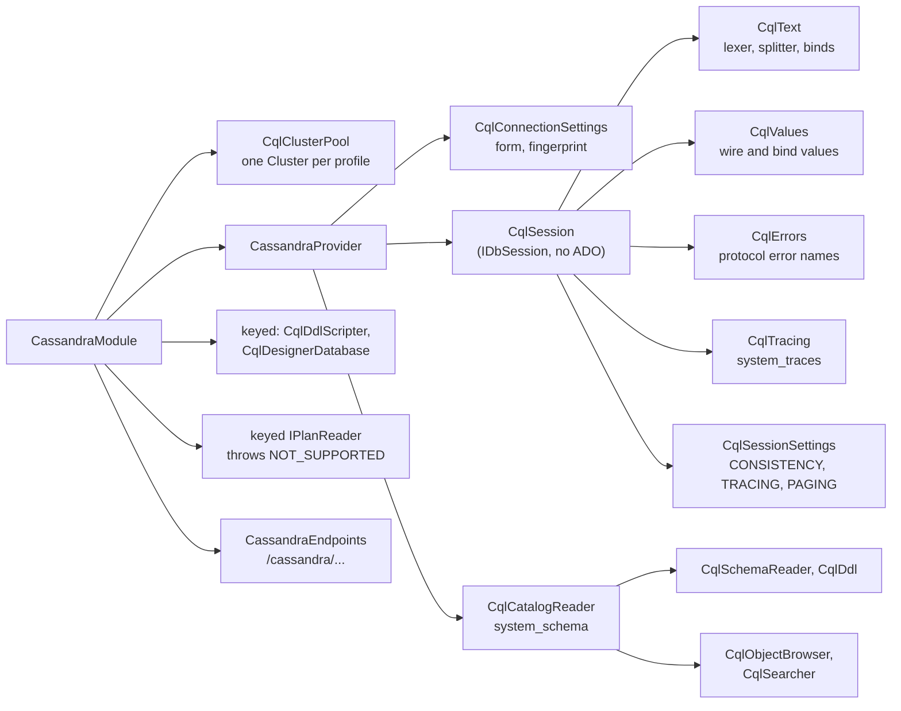

<div dir="rtl">

#### بسته و ثبت

درایور [CassandraCSharpDriver](../glossary.md#cassandracsharpdriver) نسخهٔ 3.22.1 است (درایور C# شرکت DataStax)؛ پروژه `Newtonsoft.Json` نسخهٔ 13.0.3 را هم سنجاق می‌کند، چون درایور به نسخهٔ آسیب‌پذیر 9.0.1 وابسته است (ممیزی NuGet) (`engine/src/DbStudio.Providers.Cassandra/DbStudio.Providers.Cassandra.csproj:21-23`). ‏`CassandraModule` استخر خوشه‌ها، فراهم‌کننده، سرویس‌های کلیددار طراح، نقطه‌های پایانی ماژول و یک ثبت غیرعادی را ثبت می‌کند: یک `IPlanReader` کلیددار که کارخانه‌اش `400 NOT_SUPPORTED` با «Cassandra has no EXPLAIN. Turn on tracing …» **پرتاب می‌کند**. نقطهٔ پایانی مشترک explain خوانندهٔ کلیددار را حل می‌کند، پس «بدون تغییر در هسته» با پیام همین فراهم‌کننده پاسخ می‌دهد (`engine/src/DbStudio.Providers.Cassandra/CassandraModule.cs:18-29`، `docs/wp-notes/WP-CS.md:46-49`). ‏`IParamBinder` کلیدداری نیست (نشست خودش مقید می‌کند) و منبع لاگ یا فعالیتی هم نیست.

#### تنظیمات اتصال و استخر خوشه‌ها

CQL رشتهٔ اتصال ندارد. ‏`CqlConnectionSettings` نمایه را تجزیه می‌کند: نقطه‌های تماس (یک یا چند گره، `host:port` پذیرفته است)، درگاه 9042، مرکز دادهٔ محلی، keyspace، کاربر/گذرواژه، SSL با پروندهٔ CA اختیاری و *Skip certificate verification*، [سطح سازگاری (consistency level)](../glossary.md#consistency-level) پیش‌فرض `LOCAL_QUORUM`، سازگاری سریالی `SERIAL`، اندازهٔ صفحه ۱۰۰۰ (حداکثر ۱۰٬۰۰۰)، مهلت اتصال ۱۰ ثانیه، مهلت درخواست ۳۰ ثانیه، بستهٔ اتصال امن DataStax Astra و *Show system keyspaces* (`engine/src/DbStudio.Providers.Cassandra/CqlConnectionSettings.cs:16-115`). ‏`BuildConnectionString` توصیفی بدون گذرواژه مثل `cql://localhost:9042;keyspace=shop;consistency=LOCAL_QUORUM` برمی‌گرداند (`CqlConnectionSettings.cs:161-172`).

‏`Cluster` درایور گران است: اتصال کنترلی، فهرست گره‌ها و فرادادهٔ شِما را نگه می‌دارد. پس `CqlClusterPool` **برای هر نمایه یک خوشه** نگه می‌دارد، با کلیدی از شناسهٔ نمایه به‌علاوهٔ یک *اثر انگشت* SHA-256 از همهٔ مقدارهای سطح اتصال و گذرواژه؛ تغییر یک تنظیم یا گذرواژه کلید تازه و خوشهٔ تازه می‌دهد (`engine/src/DbStudio.Providers.Cassandra/CqlClusterPool.cs:10-16,79-116`، `CqlConnectionSettings.cs:146-159`). استفاده‌کنندگان یک `Lease` با شمارش ارجاع می‌گیرند. هر کنسول `ISession` **مخصوص خودش** را روی خوشهٔ مشترک می‌گیرد تا `USE ks` در همان زبانه بماند؛ کاتالوگ، طراح و جست‌وجو یک نشست بدون keyspace مشترک دارند که هرگز `USE` اجرا نمی‌کند (`CqlClusterPool.cs:53-76`). یک زمان‌سنج هر دقیقه جارو می‌کند و خوشه‌هایی را که ۵ دقیقه استفاده نشده‌اند خاموش می‌کند (`CqlClusterPool.cs:21,27,196-203`). سازنده نام برنامهٔ «Rowlit»، مهلت‌های سوکت و پرس‌وجو، پیش‌فرض‌های سازگاری و اندازهٔ صفحه، و سیاست اتصال دوبارهٔ نمایی از ۱ تا ۶۰ ثانیه را تنظیم می‌کند (`CqlClusterPool.cs:119-157`). شکست در گرفتن خوشه به خطای موتور تبدیل می‌شود: نبود میزبان قابل‌دسترس ← `503 PROVIDER_ERROR`، اعتبارنامهٔ بد ← `401 PROVIDER_ERROR` (`CassandraProvider.cs:103-117`).

تونل‌های SSH فقط با یک نقطهٔ تماس کار می‌کنند: راهنمای SSH فرم می‌گوید «درایور فقط با همان گره حرف می‌زند» و `TunnelTargets` چند نقطهٔ تماس یا یک بستهٔ Astra را رد می‌کند و سپس `contactPoints` را به هدایت محلی بازنویسی می‌کند (`CassandraProvider.cs:25`، `TunnelTargets.cs:73-77,179-190`).

‏`ReadServerInfoAsync` جدول `system.local` را می‌خواند و محصول‌ها را از هم جدا می‌کند: DataStax Enterprise با `dse_version`، ScyllaDB با موفقیت `SELECT version FROM system.versions` (`CassandraProvider.cs:129-158`). تشخیص ScyllaDB روی یک ScyllaDB زنده آزموده نشده است (`docs/wp-notes/WP-CS.md:200-201`).

#### نشست: حلقهٔ اجرای خودش

‏`CqlSession` ماشین وضعیت را خودش پیاده می‌کند: `Enter()` با `Interlocked.CompareExchange` از Idle به Executing می‌رود و در غیر این صورت `SessionBusyException` یا `SessionBrokenException` می‌دهد؛ `ExecuteAsync` کار را با یک توکن لغو پیوندخورده روی استخر نخ‌ها اجرا می‌کند (`engine/src/DbStudio.Providers.Cassandra/CqlSession.cs:124-162`). ‏`CqlText` دسته‌ها را به دستورهای CQL می‌شکند: توضیح‌های `--`، `//` و `/* */`، بدنهٔ تابع‌های `$$…$$` و `BEGIN [UNLOGGED|COUNTER] BATCH … APPLY BATCH` که یکپارچه می‌ماند (`engine/src/DbStudio.Providers.Cassandra/CqlText.cs:34-39`). دستور شکست‌خورده دسته‌اش را پایان می‌دهد؛ قطع اتصال نشست را Broken علامت می‌زند (`CqlSession.cs:208-240`).

سطرها به‌جای خوانندهٔ داده با **صفحه‌بندی** درایور واکشی می‌شوند. دستور، سازگاری، سازگاری سریالی و اندازهٔ صفحهٔ کنسول، `SetAutoPage(false)` و در صورت فعال بودن tracing را می‌گیرد؛ حلقه یک صفحه می‌خواند، سطرهایش را جاری می‌کند و با [وضعیت صفحه‌بندی (paging state)](../glossary.md#paging-state) همان صفحه تا سقف سطرها یا آخرین صفحه ادامه می‌دهد (`CqlSession.cs:446-540`):

</div>

```csharp
// engine/src/DbStudio.Providers.Cassandra/CqlSession.cs:451-456,510-521
stmt.SetConsistencyLevel(Settings.Consistency);
stmt.SetSerialConsistencyLevel(Settings.SerialConsistency);
stmt.SetPageSize(pageSize);
stmt.SetAutoPage(false);
if (tracing) stmt.EnableTracing();
// …
var state = rs.PagingState;
if (state is null) break;
// …
run.Token.ThrowIfCancellationRequested();
stmt.SetPagingState(state);
rs = await _session.ExecuteAsync(stmt).WaitAsync(run.Token).ConfigureAwait(false);
```

<div dir="rtl">

سطرها در فریم‌های ۲۰۰تایی به گیرنده می‌روند، همان اندازه‌ای که `AdoSessionBase` به کار می‌برد، ولی با `ResultWriter` خود نشست نوشته می‌شوند (`CqlSession.cs:976-980`، `engine/src/DbStudio.Core/Services/AdoSessionBase.cs:204-205`). اندازهٔ صفحه در هر رفت‌وبرگشت (به‌طور پیش‌فرض ۱۰۰۰) و اندازهٔ فریم به رابط کاربری (۲۰۰) مستقل از هم‌اند (`docs/wp-notes/WP-CS.md:106`). هشدارهای کارساز به پیام تبدیل می‌شوند، نبود توافق شِما پس از DDL هشدار می‌شود، و برای تراکنش سبکی که اعمال نشده راهنمایی می‌آید که به `[applied]` نگاه کنید (`CqlSession.cs:300-306,535-537,555-559`).

#### فرمان‌های cqlsh در کنسول

کاربران از [cqlsh](../glossary.md#cqlsh)، پوستهٔ Cassandra، می‌آیند و فرمان‌هایش را بی‌اختیار تایپ می‌کنند. نشست پیش از CQL به آن‌ها رسیدگی می‌کند: `CONSISTENCY [level]`، `SERIAL CONSISTENCY [level]`، `TRACING ON|OFF`، `PAGING ON|OFF|n`، `SHOW VERSION|HOST|SESSION <id>`؛ `COPY` با پیشنهاد استفاده از Export پاسخ NOT_SUPPORTED می‌دهد؛ `SOURCE`، `CAPTURE`، `EXPAND` و مانند آن‌ها با اعلام نادیده گرفته شدن تأیید می‌شوند (`CqlSession.cs:246-294`). تنظیمات در `CqlSessionSettings` نگه داشته می‌شوند، یکی برای هر کنسول و ایمن در برابر نخ‌ها؛ `PAGING OFF` یعنی اندازهٔ صفحهٔ حداکثر ۱۰٬۰۰۰ و `PAGING ON` به اندازهٔ نمایه برمی‌گردد (`engine/src/DbStudio.Providers.Cassandra/CqlSessionSettings.cs:5-57`، `CqlSession.cs:266-278`). ‏`DESCRIBE` روی کارساز اجرا می‌شود (Cassandra 4.0 به بعد)؛ در کارسازهای قدیمی‌تر که این قابلیتی از cqlsh است، نشست `DESCRIBE KEYSPACES | TABLES | KEYSPACE | TABLE | TYPE | MATERIALIZED VIEW` را از روی فرادادهٔ شِما و DDL تولیدشده شبیه‌سازی می‌کند (`CqlSession.cs:372-429`).

#### بدون تراکنش، بدون EXPLAIN: به‌جایش tracing

‏`SetTransactionModeAsync(Manual)` و دستورهای `BEGIN` (جز `BEGIN BATCH`)، `START`، `COMMIT`، `ROLLBACK`، `SAVEPOINT` با یک درس کوتاه `400 NOT_SUPPORTED` می‌دهند: «هر دستور جداگانه اعمال (و ماندگار) می‌شود. برای نوشتن اتمی از BEGIN BATCH … APPLY BATCH (اتمی در هر پارتیشن) و برای مقایسه-و-تنظیم از تراکنش‌های سبک استفاده کنید» (`CqlSession.cs:32-35,88-92,288-290`).

آنچه جای EXPLAIN را می‌گیرد [tracing](../glossary.md#tracing-cql) است. با `TRACING ON` هر دستور از هماهنگ‌کننده (coordinator) می‌خواهد کارش را در `system_traces` ثبت کند؛ نشست سپس رد را واکشی می‌کند و آن را به‌صورت یک مجموعهٔ نتیجهٔ اضافی و یک پیام نشان می‌دهد (شکل 9.13).

**شکل 9.13 — ‏tracing یک دستور CQL.**

</div>

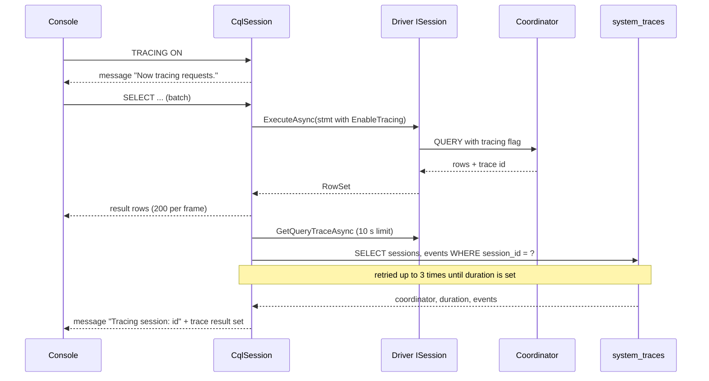

<div dir="rtl">

‏`CqlTracing.ReadAsync` دوباره امتحان می‌کند چون «هماهنگ‌کننده آن را (هنوز) ننوشته»: تا تعداد تلاش داده‌شده و با مکث‌های فزاینده، تا `duration` مقدار بگیرد (`engine/src/DbStudio.Providers.Cassandra/CqlTracing.cs:12-37`). نشست ۵۰ خلاصهٔ رد آخر را برای نمای ردها نگه می‌دارد (`CqlSession.cs:42,561-588`) و ماژول آن‌ها را زیر `/cassandra/sessions/{sid}/traces` و `/cassandra/{cid}/traces/{traceId}` سرو می‌کند (`engine/src/DbStudio.Providers.Cassandra/Endpoints/CassandraEndpoints.cs:70-77`).

#### لغو

‏`Cancel()` توکن پیوندخورده را لغو می‌کند (`CqlSession.cs:137-144`). هر await روی درایور از `WaitAsync(run.Token)` استفاده می‌کند، پس حلقهٔ صفحه‌بندی بی‌درنگ می‌ایستد؛ WP-CS زمان لغو را زیر ۲ ثانیه اندازه گرفته است (`docs/wp-notes/WP-CS.md:40-41`). ولی پروتکل CQL پیام لغو ندارد، پس درخواستی که فرستاده شده روی هماهنگ‌کننده به اجرا ادامه می‌دهد؛ هشدار صادقانه همین را می‌گوید: «A write that already reached the coordinator may still be applied.» (`CqlSession.cs:220-225`). پایهٔ آزمون `SupportsCancel` را روی پیش‌فرض `true` نگه می‌دارد، چون آنچه آزمون می‌سنجد (کنسول به‌سرعت دوباره آزاد می‌شود) درست است (`engine/tests/DbStudio.Providers.Cassandra.Tests/CassandraBackend.cs:133-147`).

#### پارامترها

نشانگرهای مقیدسازی `?`، `:name` و `@name` ساخته‌شده به دست رابط کاربری‌اند (که به `?` بازنویسی می‌شود) (`CqlText.cs:31-32`). نشست دستور را prepare می‌کند (برای هر keyspace و متن نگه داشته می‌شود و بالای ۵۰۰ مدخل پاک می‌شود)، هر مقدار را به نوع CQL نشانگر تبدیل و مقید می‌کند؛ مجموعه‌ها، tupleها، UDTها، vectorها و decimalهایی با رقم‌هایی بیش از `System.Decimal` به‌جایش به‌صورت لفظ CQL در متن جا داده می‌شوند، چون درایور برای مقیدسازی‌شان به نگاشت CLR نیاز دارد (`CqlSession.cs:607-682`). نبود مقدار با `VALIDATION` «Missing value for parameter :name» شکست می‌خورد (`CqlSession.cs:620-628`).

#### مقدارها

‏`CqlValues` نوع uuid/timeuuid را به guid، timestamp را به datetime offset با UTC، date/time/duration/inet را به متن، varint و decimal را دقیق، blob را به باینری و مجموعه‌ها، tupleها، [UDTها](../glossary.md#udt) و vectorها را به متن JSON نگاشت می‌کند. مقدارهای UDT به‌صورت بایت خام می‌رسند چون درایور نگاشت CLR برایشان ندارد؛ `CqlValues.Decode` قالب باینری CQL را با فرادادهٔ نوع ستون می‌خواند (`engine/src/DbStudio.Providers.Cassandra/CqlValues.cs:16-21`).

#### کاتالوگ روی system_schema

[keyspaceها](../glossary.md#keyspace) سطح شِما هستند (تک‌سطحی، `DialectInfo.cs:17`)؛ keyspaceهای سیستمی فقط با *Show system keyspaces* فهرست می‌شوند (`engine/src/DbStudio.Providers.Cassandra/CqlCatalogReader.cs:60-68`). اشیا جدول‌ها، نماهای مادی‌شده (`mview`)، UDTها (`type`) و تابع‌ها/تجمیع‌ها (`func`) هستند. چون مدل عمومی جایی برای نقش‌های کلید در Cassandra ندارد، ستون‌ها آن‌ها را در توضیح حمل می‌کنند: «partition key»، «partition key (1 of 2)»، «clustering key ASC|DESC»، «static»؛ `IsPk` ستون‌های پارتیشن و خوشه‌بندی را علامت می‌زند (`CqlCatalogReader.cs:7-12`). خواندن‌ها پرس‌وجوهای سادهٔ `system_schema` برای هر keyspace‌اند (`engine/src/DbStudio.Providers.Cassandra/CqlSchema.cs:144-211`)، برای نمونه:

</div>

```sql
-- engine/src/DbStudio.Providers.Cassandra/CqlSchema.cs:147,160
SELECT * FROM system_schema.columns WHERE keyspace_name = ?
SELECT * FROM system_schema.tables WHERE keyspace_name = ?
```

<div dir="rtl">

نماها، نوع‌ها، تابع‌ها، تجمیع‌ها، نمایه‌ها و تریگرها از `TryRowsAsync` استفاده می‌کنند که کارسازهای بدون آن جدول‌ها را تحمل می‌کند (`CqlSchema.cs:174-211`). ‏DDL در 4.0 به بعد از `DESCRIBE` کارساز می‌آید و در غیر این صورت `CqlDdl` تولیدش می‌کند (`docs/wp-notes/WP-CS.md:66`). جست‌وجو در پایگاه داده نام‌ها، ستون‌ها (از جمله فیلدهای UDT)، بدنهٔ UDFها و تعریف نماها را می‌گردد، ولی نه دادهٔ جدول‌ها را، چون «CQL نمی‌تواند ستون‌های غیرکلیدی را بدون نمایه پالایش کند» (`docs/qa/cassandra-walkthrough.md:43`).

#### ویرایش با کلید اصلی در جدول نتیجه

جدول داده SQL عمومی تولید می‌کند (`LIMIT n OFFSET m`، `ORDER BY`، `UPDATE … WHERE`) و CQL چیز کمی از آن را می‌پذیرد. نشست به‌جای تغییر مولد SQL رابط کاربری، دستورهایی را که برچسبشان `data` یا `filter` است تطبیق می‌دهد (`CqlSession.cs:25-27`، `docs/wp-notes/WP-CS.md:50-58`):

- ‏`LIMIT n OFFSET m` به صفحه‌ای با اندازهٔ n تبدیل می‌شود که از وضعیت صفحه‌بندیِ نگه‌داشته‌شدهٔ offset m ادامه می‌یابد، پس صفحه‌های پشت‌سرهم یک رفت‌وبرگشت هزینه دارند (وضعیت‌ها تا ۶۴ تا نگه داشته می‌شوند) (`CqlSession.cs:458-469,524-531`).
- ‏`ORDER BY` حذف می‌شود، پالایه‌ها `ALLOW FILTERING` می‌گیرند، جست‌وجوهای کلیدی OR‌شده به یک پرس‌وجو برای هر گزینه شکسته و ادغام می‌شوند، و مقدارهای متمایز در موتور روی حداکثر ۱۰۰٬۰۰۰ سطر شمرده می‌شوند (`CqlSession.cs:43,781-905`).
- یک INSERT عبارت `IF NOT EXISTS` می‌گیرد (کلید تکراری به `409 AlreadyExists` تبدیل می‌شود) و در صورت تنظیم TTL درج کنسول، `USING TTL` (`CqlSession.cs:908-930`).
- ‏UPDATE/DELETE شرط‌های کلید اصلی را در `WHERE` نگه می‌دارند و شرط‌های «verify unchanged» روی ستون‌های دیگر را به یک [تراکنش سبک (lightweight transaction)](../glossary.md#lightweight-transaction) `IF …` منتقل می‌کنند؛ یک UPDATE ساده `IF EXISTS` می‌گیرد تا «هرگز سطری را که کس دیگری در این میان حذف کرده زنده نکند»؛ نتیجهٔ اعمال‌نشده صفر سطر گزارش می‌دهد که جدول نتیجه آن را تعارض نشان می‌دهد (`CqlSession.cs:932-974`).

سمت جدول نتیجهٔ این کار، از جمله ثبت بدون تراکنش، در [فصل 13](13-results-grid-and-data-editing.md) آمده است.

#### طراح، نمای خوشه و خطاها

‏`CqlDdlScripter` تا وقتی طراح پنل‌های CQL بگیرد، مفهوم‌های CQL را روی مدل عمومی جدول نگاشت می‌کند: ستون‌های کلید اصلی به ترتیب؛ قید یکتایی به نام `partition_key` برای کلید پارتیشن؛ نمایه‌ای به نام `clustering_order` برای ترتیب خوشه‌بندی؛ توضیح ستون `static` برای STATIC؛ قیدهای check به‌عنوان گزینه‌های جدول (`default_time_to_live`، `compaction`). کلید اصلی تغییریافته، جدول تغییرنام‌یافته یا نوع ستون تغییریافته قابل alter نیستند و با توضیح در اعتبارسنجی شکست می‌خورند (`engine/src/DbStudio.Providers.Cassandra/Designer/CqlDdlScripter.cs:7-22`). نقطهٔ پایانی `/cassandra/{cid}/cluster` ماژول گره‌ها و مرکزهای داده را از `system.local` و جدول‌های peers همراه توافق شِما نشان می‌دهد، `/clients` کلاینت‌های وصل‌شده را (Cassandra 4.0 به بعد) و `/keyspaces/{ks}/tables/{name}` کلیدها و اطلاعات ذخیره‌سازی یک جدول را (`CassandraEndpoints.cs:33-104`، `docs/wp-notes/WP-CS.md:77-79`). خطاها از نام خطاهای پروتکل بومی که cqlsh نشان می‌دهد استفاده می‌کنند (`SyntaxError`، `Invalid`، `Unavailable`، `ReadTimeout`، …) و شمارهٔ پروتکل کد فراهم‌کننده است؛ شکست‌های سازگاری سطح و تعداد replicaها را در جزئیات دارند («Consistency LOCAL_QUORUM needs 2 replica(s), 1 alive») (`engine/src/DbStudio.Providers.Cassandra/CqlErrors.cs:10-56`). شناسه‌ها با `"` نقل‌قول و به حروف کوچک برگردانده می‌شوند (`CassandraProvider.cs:28`).

#### آنچه Cassandra در Rowlit نمی‌تواند

- تراکنش، نقطهٔ ذخیره یا EXPLAIN ندارد (به‌جایش tracing)؛ کلید خارجی و identity ندارد (`CassandraBackend.cs:145-147`).
- لغو کنسول را آزاد می‌کند ولی نمی‌تواند درخواستی را که به هماهنگ‌کننده رسیده متوقف کند.
- ‏`COPY`، جست‌وجوی داده، منبع لاگ یا فعالیت و پیام تشخیصی نحوی کارساز ندارد.
- طراح: تغییر کلید اصلی، نوع ستون یا نام جدول ممکن نیست؛ DDL تراکنشی نیست.
- درایور 3.22 با Cassandra 5 حداکثر پروتکل بومی v4 را مذاکره می‌کند (`docs/wp-notes/WP-CS.md:107`).
- آزمون‌های Cassandra از مجموعهٔ انطباق مشترک مشتق نمی‌شوند؛ `CassandraIntegrationTests` زیرمجموعهٔ قابل‌اعمال را دوباره پیاده می‌کند (`docs/wp-notes/WP-CS.md:92-100`).

## 4. حالت‌های مرزی و محدودیت‌ها

ماتریس زیر بخش‌های 3.1 تا 3.8 را خلاصه می‌کند. «پیام تشخیصی کارساز» یعنی بررسی هنگام تایپ (`IDbProvider.Diagnostics`)؛ «پایه» می‌گوید نشست از `AdoSessionBase` مشتق می‌شود یا نه.

</div>

| Provider id | Driver | Base | Transactions | Savepoints | Cancel mechanism | Statements per batch | Server diagnostics | Plans (estimated / actual) | Designer DDL atomic | Placeholders | SSH tunnel |
|---|---|---|---|---|---|---|---|---|---|---|---|
| `sqlserver` | Microsoft.Data.SqlClient 7.1.1 | yes | yes | yes | TDS attention (`SqlCommand.Cancel`) | `GO` batch as one `SqlCommand` | ScriptDom (syntax) | `SHOWPLAN_XML` / `STATISTICS XML` | yes | `@name` | yes (TCP, port needed for a named instance) |
| `oracle` | ODP.NET managed 23.26.301 | yes | implicit; auto = commit after batch | yes | TNS break (`OracleCommand.Cancel`) | one statement | none (`ALL_ERRORS` after `CREATE`) | `EXPLAIN PLAN` / `V$SQL_PLAN_STATISTICS_ALL` | no | `:name`, `:1`, REF CURSOR out | basic type only |
| `postgresql` | Npgsql 9.0.5 | yes | yes, savepoint per statement (D-PG3) | yes | cancel request (`NpgsqlBatch.Cancel`) | split into one `NpgsqlBatch` | `pg-prepare` (queries + DML) | `EXPLAIN (FORMAT JSON)` / `EXPLAIN ANALYZE` | yes | `$n`, `:name`, `@name` → `$k` | yes (one host) |
| `sqlite` | Microsoft.Data.Sqlite 10.0.13 | yes | yes (deferred `BEGIN`) | yes | `sqlite3_interrupt` + 1 s timeout | several | `sqlite-prepare` (schema replay) | `EXPLAIN QUERY PLAN` (no runtime stats) | yes (rebuild in a transaction) | `:x`, `@x`, `$x`, `?NNN`, `?` | no |
| `mysql`, `mariadb` | MySqlConnector 2.4.0 | yes | yes (DDL commits implicitly) | yes | `KILL QUERY` on a side connection | `DELIMITER`-aware split, one command each | none | `EXPLAIN FORMAT=JSON` / `EXPLAIN ANALYZE` or `ANALYZE FORMAT=JSON` | no | `:name`, `?`, `@name` | yes (one host) |
| `clickhouse` | ClickHouse.Driver 1.5.0 (HTTP) | yes | no | no | abort + `KILL QUERY … SYNC` | one HTTP request each | none | `EXPLAIN json=1, indexes=1` / + `system.query_log` | no | `{name:Type}`, `:name`, `@name` | yes |
| `snowflake` | Snowflake.Data 6.4.0 | yes | yes (DDL commits an open one) | no | driver cancel + `SYSTEM$CANCEL_QUERY` after 3 s | multi-statement request | none | `EXPLAIN USING JSON` / `GET_QUERY_OPERATOR_STATS` | no | `:name`, `:1`, `?` | no |
| `cassandra` | CassandraCSharpDriver 3.22.1 | no (own `IDbSession`) | no | no | token cancel; a sent request keeps running | CQL splitter, `BEGIN BATCH` kept whole | none | `NOT_SUPPORTED` (use tracing) | no | `?`, `:name`, `@name` | one contact point |

<div dir="rtl">

جدول بالا به‌خاطر پهنایش بیرون از بلوک راست‌به‌چپ و با سرستون‌های انگلیسی آمده است تا در GitHub به‌هم نریزد. محدودیت‌هایی که از مرز فراهم‌کننده‌ها می‌گذرند:

- **برای هر زبانه یک اتصال فیزیکی، بدون استخر.** هر نشست اتصالی اختصاصی است (`IDbProvider.cs:22-23`)؛ سقف نشست‌های هر نمایه و آزادسازی نشست‌های بیکار در فصل [8](08-connections-sessions-execution.md) و فصل [21](21-logs-activity-resources.md) آمده‌اند.
- **موقعیت‌ها جایی که درایور چیزی نمی‌دهد بهترین تلاش‌اند.** Oracle، SQLite و MySQL خطاها را با تجزیهٔ پیام پیدا می‌کنند (بخش‌های 3.2، 3.4، 3.5). حدس نادرست به‌جای هیچ‌جا، به نخستین نشانهٔ دستور اشاره می‌کند.
- **پنج خانواده پیام تشخیصی کارساز ندارند.** فقط SQL Server، PostgreSQL و SQLite واسط `ISqlDiagnostics` را پیاده می‌کنند؛ بقیه به پیام‌های تشخیصی نرم رابط کاربری متکی‌اند (فصل [11](11-intellisense.md)).
- **کدهای خطا.** درون یک اجرا، خطاها کد خود فراهم‌کننده را در `exec.error` نگه می‌دارند (`207`، `ORA-00942`، `42P01`، `SQLITE_ERROR`، `1146`، `60`، `001003`، `SyntaxError`)؛ در فراخوانی‌های REST (آزمون اتصال، کاتالوگ) شکست‌های درایور به `PROVIDER_ERROR` با `detail.providerCode` تبدیل می‌شوند و اتصال‌های مرده به `SERVER_UNREACHABLE` (فصل [5](05-engine-host-and-api.md#212-the-error-envelope-and-error-codes)).
- **قرارداد منجمد است.** به قابلیتی که موتوری ندارد با `400 NOT_SUPPORTED` از `ProviderFeatures` یا از خود فراهم‌کننده پاسخ داده می‌شود، هرگز با متدی که وجود ندارد (فصل [7](07-engine-modules-and-di.md)).

<a id="5-how-it-is-tested"></a>

## 5. چگونه آزموده می‌شود

- **مجموعهٔ آزمون انطباق مشترک.** ‏`engine/tests/DbStudio.Providers.Conformance/ProviderConformanceTests.cs` یک کلاس انتزاعی xUnit است که هر پروژهٔ آزمون رابطه‌ای با پایهٔ آزمون (fixture) خودش از آن مشتق می‌شود (برای نمونه `engine/tests/DbStudio.Providers.SqlServer.Tests/SqlServerConformanceTests.cs:6`، `engine/tests/DbStudio.Providers.Oracle.Tests/OracleConformanceTests.cs:6`، `engine/tests/DbStudio.Providers.PostgreSql.Tests/PgFixture.cs:149`، `engine/tests/DbStudio.Providers.Sqlite.Tests/SqliteFixture.cs:71`، `engine/tests/DbStudio.Providers.MySql.Tests/MySqlFixture.cs:185`، `engine/tests/DbStudio.Providers.ClickHouse.Tests/ChIntegrationTests.cs:24`، `engine/tests/DbStudio.Providers.Snowflake.Tests/LiveTests.cs:90`). آزمون‌هایش این‌ها را پوشش می‌دهند: آزمون اتصال (موفق و ناموفق)، باز و dispose کردن نشست، جاری‌سازی ستون‌ها و سطرها، نوع decimal، چند دسته و چند مجموعهٔ نتیجه در یک دسته، برش `MaxRows`، سطرهای اثرپذیرفته، سطرهای مطلق خطا در سند، `StopOnError`، نشست مشغول، لغو یک پرس‌وجوی طولانی و لغو در حالت بیکار، commit و rollback دستی، نقطه‌های ذخیرهٔ ویرایش، رفتن به حالت خودکار با تراکنش باز، کاتالوگ `shop` (شِماها، جدول‌ها، ستون‌ها، کلیدها، کلیدهای خارجی، نماها، جزئیات، DDL) و خروجی.
- **پرچم‌های پایهٔ آزمون می‌گویند موتور چه نمی‌تواند.** ‏`ProviderFixture` پرچم‌های `SupportsTransactions`، `SupportsSavepoints`، `SupportsForeignKeys`، `SupportsIdentity`، `ReportsDmlRowCounts` و `SupportsCancel` را دارد که همه به‌طور پیش‌فرض `true`اند (`engine/tests/DbStudio.Providers.Conformance/ProviderFixture.cs:44-59`). فقط سه پایهٔ آزمون چیزی را بازنویسی می‌کنند: ClickHouse (تراکنش‌ها، کلیدهای خارجی، identity، شمارش DML؛ `ChFixture.cs:119-122`)، Snowflake (نقطه‌های ذخیره؛ `LiveTests.cs:63`) و پایهٔ Cassandra (تراکنش‌ها، کلیدهای خارجی، identity؛ `CassandraBackend.cs:145-147`).
- **انطباق طراح.** ‏`engine/tests/DbStudio.Providers.Conformance/M15/M15ConformanceTests.cs` با `DesignerCases` و پرونده‌های golden مشترک که برای هر فراهم‌کننده مشتق می‌شود (`SqlServerM15Tests.cs:446`، `OracleM15Tests.cs:320`، `PgM15Tests.cs:271`، `MySqlM15Tests.cs:252`، `SqliteDesignerTests.cs:571`).
- **کارسازهای واقعی.** مجموعه‌های آزمون یکپارچگی روی کارسازهای `shop` در Docker از `engine/tests/docker/compose.yml` یا Testcontainers اجرا می‌شوند و وقتی Docker نیست یا `DBSTUDIO_IT=0` است کنار گذاشته (نه شکست‌خورده) می‌شوند؛ SQLite همیشه روی پرونده اجرا می‌شود. PostgreSQL یک بستیون SSH واقعی را هم می‌آزماید (`PgSshTunnelTests.cs:8-13`).
- **موتورهای بدون کارساز آزمایشگاهی.** آزمون‌های Snowflake روی `SnowflakeGatewayFake` با JSON ضبط‌شده اجرا می‌شوند؛ مجموعهٔ زنده به متغیرهای `DBSTUDIO_SF_*` نیاز دارد (بخش 3.7). Cassandra زیرمجموعهٔ قابل‌اعمال انطباق را در `CassandraIntegrationTests` دوباره پیاده می‌کند (`docs/wp-notes/WP-CS.md:92-100`).
- **بررسی متن پرس‌وجوها.** رشته‌های کاتالوگ SQL Server در آزمون‌های واحد با ScriptDom تجزیه می‌شوند (`SqlServerCatalogQueries.cs:3-6`)؛ قاعدهٔ مقیدسازی مالک Oracle را `OracleCatalogQueryTests.cs` تحمیل می‌کند.
- **گشت‌های QA.** ‏`docs/qa/*-walkthrough.md` برای هر موتور و گزارش‌های `round-*.md` (یافته‌هایی که بالاتر ارجاع داده شدند، مثلاً `docs/qa/round-postgresql.md`). فصل [23](23-testing-and-qa.md) کل راهبرد آزمون را پوشش می‌دهد.

## فصل‌های مرتبط

- [7. ماژول‌های موتور و DI](07-engine-modules-and-di.md) — فراهم‌کننده‌ها و قابلیت‌های کلیدارشان چطور ثبت می‌شوند.
- [8. اتصال‌ها، نشست‌ها و اجرای SQL](08-connections-sessions-execution.md) — هسته پیرامون `ExecuteAsync` چه می‌کند.
- [10. کاتالوگ و فراداده](10-catalog-and-metadata.md) — نتیجه‌های `ICatalogReader` چطور نگه داشته و نشان داده می‌شوند.
- [11. IntelliSense](11-intellisense.md) — شکستن دستورها در سمت کلاینت، پیام‌های تشخیصی نرم و نشانگرهای پیام‌های تشخیصی کارساز.
- [14. طراح‌ها و DDL](14-designers-and-ddl.md) و [15. ورود، خروج، طرح اجرا و ER](15-import-export-plans-er.md).
- [16. پایگاه‌های دادهٔ پیوندی](16-linked-databases-federation.md) — نهمین `IDbProvider`، یعنی `linked`.
- بخش I: [I-08 پردازش پرس‌وجو](../part1/08-query-processing.md)، [I-09 تراکنش‌ها](../part1/09-transactions-and-isolation.md)، [I-15 OLAP و ستونی](../part1/15-oltp-vs-olap-columnar.md)، [I-16 خانواده‌های NoSQL](../part1/16-nosql-families.md)، [I-17 گویش‌ها](../part1/17-dialect-comparison.md).

## واژه‌های واژه‌نامه در این فصل

[ADO.NET](../glossary.md#ado-net) · [interface](../glossary.md#interface) · [observer](../glossary.md#observer) · [identifier rules](../glossary.md#identifier-rules) · [case folding](../glossary.md#case-folding) · [dialect info](../glossary.md#dialect-info) · [driver](../glossary.md#driver) · [connection string](../glossary.md#connection-string) · [connection pooling](../glossary.md#connection-pooling) · [Microsoft.Data.SqlClient](../glossary.md#microsoft-data-sqlclient) · [InfoMessage](../glossary.md#infomessage) · [attention](../glossary.md#attention) · [ScriptDom](../glossary.md#scriptdom) · [native library](../glossary.md#native-library) · [SNI](../glossary.md#sni) · [self-extract](../glossary.md#self-extract) · [ODP.NET](../glossary.md#odp-net) · [NLS](../glossary.md#nls) · [bind variable](../glossary.md#bind-variable) · [REF CURSOR](../glossary.md#ref-cursor) · [DBMS_OUTPUT](../glossary.md#dbms-output) · [ALL_ERRORS](../glossary.md#all-errors) · [synonym](../glossary.md#synonym) · [Npgsql](../glossary.md#npgsql) · [SQLSTATE](../glossary.md#sqlstate) · [savepoint per statement](../glossary.md#savepoint-per-statement) · [search_path](../glossary.md#search-path) · [prepare diagnostics](../glossary.md#prepare-diagnostics) · [Microsoft.Data.Sqlite](../glossary.md#microsoft-data-sqlite) · [attached database](../glossary.md#attached-database) · [rowid](../glossary.md#rowid) · [WITHOUT ROWID](../glossary.md#without-rowid) · [STRICT](../glossary.md#strict) · [MySqlConnector](../glossary.md#mysqlconnector) · [DELIMITER](../glossary.md#delimiter) · [KILL QUERY](../glossary.md#kill-query) · [NO_BACKSLASH_ESCAPES](../glossary.md#no-backslash-escapes) · [ClickHouse.Driver](../glossary.md#clickhouse-driver) · [HTTP session](../glossary.md#http-session) · [mutation](../glossary.md#mutation) · [MergeTree](../glossary.md#mergetree) · [Snowflake.Data](../glossary.md#snowflake-data) · [warehouse](../glossary.md#warehouse) · [role (Snowflake)](../glossary.md#role-snowflake) · [gateway](../glossary.md#gateway) · [query id](../glossary.md#query-id) · [GET_DDL](../glossary.md#get-ddl) · [CassandraCSharpDriver](../glossary.md#cassandracsharpdriver) · [consistency level](../glossary.md#consistency-level) · [paging state](../glossary.md#paging-state) · [cqlsh](../glossary.md#cqlsh) · [tracing (CQL)](../glossary.md#tracing-cql) · [UDT](../glossary.md#udt) · [keyspace](../glossary.md#keyspace) · [lightweight transaction](../glossary.md#lightweight-transaction)

## پرونده‌ها

| مسیر | مسئولیت |
|---|---|
| `engine/src/DbStudio.Core/Providers/IDbProvider.cs` | قرارداد رابطه‌ای منجمد |
| `engine/src/DbStudio.Core/Models/{CoreModels,ExecutionModels,DialectInfo}.cs` | نمایه‌ها، مشخصات فرم، قاعده‌های شناسه، درخواست‌ها، خطاها، ویژگی‌های گویش |
| `engine/src/DbStudio.Core/Services/AdoSessionBase.cs` | حلقهٔ اجرای مشترک ADO.NET و قلاب‌هایش |
| `engine/src/DbStudio.Core/Services/Tunnels/TunnelTargets.cs` | بازنویسی میزبان/درگاه هر فراهم‌کننده برای تونل‌های SSH |
| `engine/src/DbStudio.Providers.SqlServer/` | ‏`SqlServerProvider`، `SqlServerSession`، `SqlServerCatalogQueries`، `TSql/*` (ScriptDom، شکنندهٔ `GO`، DDL)، `Designer/`، `Plans/`، `Params/` |
| `engine/src/DbStudio.Providers.Oracle/` | ‏`OracleProvider`، `OracleSession` (DBMS_OUTPUT، ALL_ERRORS)، `OracleSqlText`، `OracleErrors`، `OracleCatalogQueries` |
| `engine/src/DbStudio.Providers.PostgreSql/` | ‏`PostgreSqlProvider`، `PgSession` (NpgsqlBatch، نقطه‌های ذخیره)، `PgSqlText`، `PgBinaryText`، `Diagnostics/PgPrepareDiagnostics` |
| `engine/src/DbStudio.Providers.Sqlite/` | ‏`SqliteProvider`، `SqliteConnections`، `SqliteSession`، `SqlitePrepareDiagnostics`، `Designer/SqliteDdlScripter` (بازسازی) |
| `engine/src/DbStudio.Providers.MySql/` | ‏`MySqlModule`، `MySqlProvider` (دو شناسه)، `MySqlSession`، `MySqlStatementReader`، `MySqlSqlText` (DELIMITER) |
| `engine/src/DbStudio.Providers.ClickHouse/` | ‏`ClickHouseModule`، `ChConnections` (گردانندهٔ HTTP)، `ChSession`، `ChBatchReader`، `ChTypes`، `Endpoints/ChEndpoints` |
| `engine/src/DbStudio.Providers.Snowflake/` | ‏`SnowflakeModule`، `SnowflakeConnectionStrings` (چهار احرازکننده)، `SnowflakeSession`، `SnowflakeCatalogReader` (فقط SHOW)، `Gateway/` |
| `engine/src/DbStudio.Providers.Cassandra/` | ‏`CassandraModule`، `CqlClusterPool`، `CqlSession` (حلقهٔ خودش، فرمان‌های cqlsh)، `CqlTracing`، `CqlCatalogReader` |
| `engine/tests/DbStudio.Providers.Conformance/` | ‏`ProviderConformanceTests`، پرچم‌های `ProviderFixture`، `ShopSchema`، موردهای طراح در `M15/` |
| `docs/PLAN.md` §2.2–2.6، `docs/PLAN-PG.md`، `docs/wp-notes/WP-{MY,CH,SF,CS}.md` | تصمیم‌هایی که در این فصل نقل شده‌اند |

</div>
