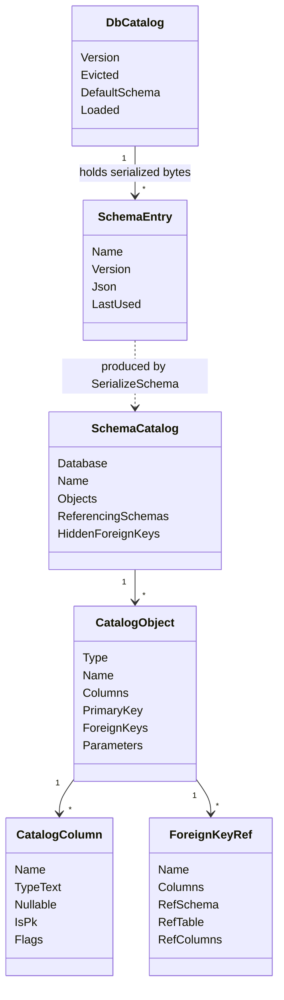
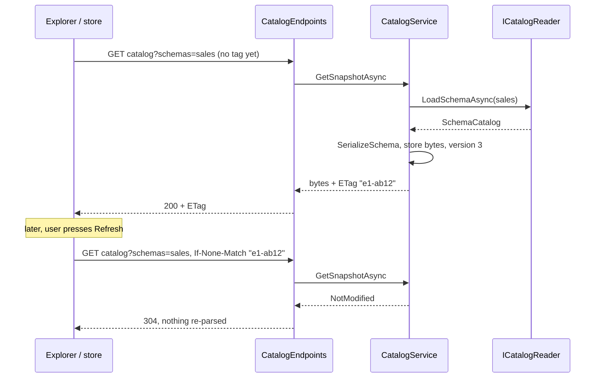
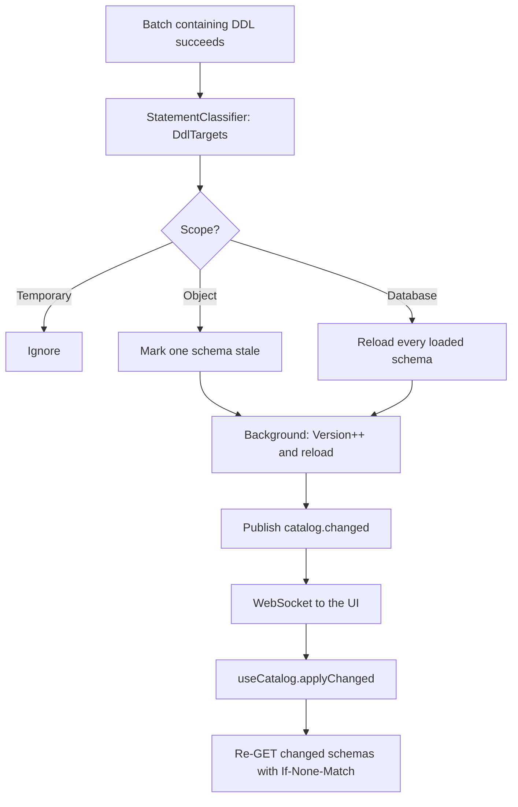
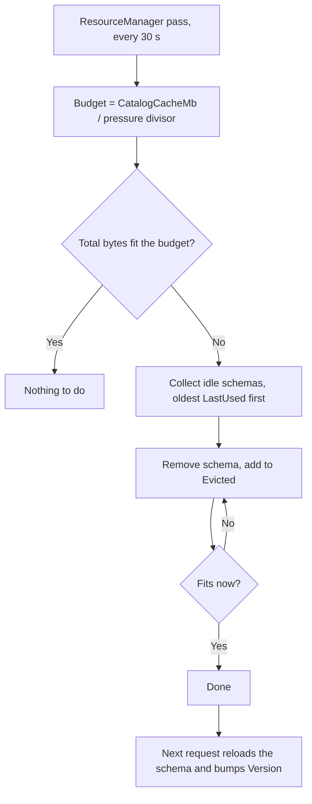

# 10. کاتالوگ، حافظه نهان فراداده و اکسپلورر

<div dir="rtl">

> **سطح:** L2 حرفه‌ای ← L3 ارشد | **بخش:** II | **کد خوانده‌شده در:** `a61f3d1` (Rowlit 1.6.3؛ این درخت نمودارهای نتیجه و تاریخچه محلی را هم دارد که `docs/release-notes/v1.7.0.md` اعلام کرده است)
> **زبان:** فارسی | [English](../../en/part2/10-catalog-and-metadata.md) | قبلی: [09. فراهم‌کننده‌های رابطه‌ای](./09-relational-providers.md) | بعدی: [11. IntelliSense](./11-intellisense.md)
> برچسب‌های نمودارها به انگلیسی نگه داشته شده‌اند تا در GitHub درست نمایش داده شوند.
> **در یک جمله:** موتور ساختار پایگاه داده را یک بار می‌خواند، آن را به‌شکل نمای لحظه‌ای (snapshot) فشرده و نسخه‌دار نگه می‌دارد، و رابط کاربری همان را به‌صورت درخت اکسپلورر، تب Objects، فهرست وابستگی‌ها و جست‌وجو نشان می‌دهد.
> **یاد می‌گیرید:**
> - «کاتالوگ» چیست و یک snapshot چه چیزی دارد؛
> - `CatalogService` چطور طرحواره‌ها را تنبل بارگذاری می‌کند، ETag می‌زند و `304 Not Modified` می‌دهد؛
> - با اجرای `CREATE TABLE` چه بر سر حافظه نهان می‌آید و اتصال مرده چطور شناسایی می‌شود؛
> - استور رابط، درخت اکسپلورر، فیلتر، تب Objects، «Find in database»، پرس‌وجوهای ذخیره‌شده و رنگ دامنه روی همین داده‌ها چطور ساخته شده‌اند؛
> - اعدادی که این‌ها را محدود می‌کنند، هر کدام با خط منبع.
> **پیش‌نیازها:** [03. معماری در یک نگاه](./03-big-picture-architecture.md)، [08. اتصال‌ها، نشست‌ها و اجرای SQL](./08-connections-sessions-execution.md). پس‌زمینه از بخش I: [I-17 مقایسه گویش‌ها](../part1/17-dialect-comparison.md) (کاتالوگ سیستمی هر موتور کجاست).

## 1. ایده (مبتدی)

هر پایگاه داده خودش را توصیف می‌کند. جدا از داده‌های شما، سرور جدول‌هایی دارد که جدول‌ها، ستون‌ها، کلیدها، viewها و رویه‌های خودش را فهرست می‌کنند. این خودتوصیفی را **[کاتالوگ (catalog)](../glossary.md#catalog)** یا فراداده (metadata) می‌گویند. در PostgreSQL از `pg_catalog` و `information_schema` خوانده می‌شود، در SQL Server از `sys.*`، در Oracle از viewهای `ALL_*` و در SQLite از `sqlite_master`. یک IDE پایگاه داده بیشتر از هر چیز نمایشگر خوبی برای همین کاتالوگ است: درخت سمت چپ، تکمیل خودکار در ویرایشگر، نمودار ER و صفحه «طراحی جدول» همه از آن شروع می‌شوند.

پرسیدن کاتالوگ از سرور در مقایسه با یک ضربه کلید کند است. یک نمونه بزرگ SQL Server یا Oracle ده‌ها هزار شیء دارد و هر پرسش چند رفت‌وبرگشت شبکه‌ای هزینه دارد. برای همین Rowlit سه کار می‌کند. کاتالوگ را **تنبل (lazy)** و طرحواره به طرحواره بارگذاری می‌کند، فقط وقتی آن بخش درخت را باز کنید. آنچه را بارگذاری کرده در یک **حافظه نهان (cache)** فشرده در موتور نگه می‌دارد تا پنجره یا پرس‌وجوی بعدی دوباره سراغ سرور نرود. و هر تکه را با یک نسخه برچسب می‌زند تا رابط بگوید «نسخه ۷ را دارم، فقط اگر عوض شده بفرست» و موتور با یک `304 Not Modified` خالی جواب بدهد.

وقتی خودتان ساختار را عوض می‌کنید (`CREATE TABLE`، `ALTER`، `DROP`) موتور متوجه می‌شود، طرحواره‌ی تأثیرپذیرفته را دور می‌اندازد، در پس‌زمینه دوباره می‌خواند و رویداد `catalog.changed` را می‌فرستد. اکسپلورر هم فقط همان گره را تازه می‌کند، بی‌آنکه چیزی جمع شود. این فصل همین چرخه را از جدول‌های سیستمی سرور تا پیکسل‌های درخت دنبال می‌کند و بعد به همسایه‌هایی می‌رسد که از همین داده استفاده می‌کنند: تب Objects، وابستگی‌ها، «Find in database»، پرس‌وجوهای ذخیره‌شده و برچسب رنگی.

## 2. چطور کار می‌کند (حرفه‌ای)

### 2.1 یک snapshot چه دارد

`ICatalogReader` فراهم‌کننده رکوردهای غنی C# برمی‌گرداند (`engine/src/DbStudio.Core/Models/CatalogModels.cs`). یک **طرحواره (schema)** یک `SchemaCatalog(Database, Name, Objects)` است (`CatalogModels.cs:17`) و هر شیء یک `CatalogObject` با نشانه نوع از `ObjectTypes` (`CatalogModels.cs:9-11`): `table`، `view`، `mview`، `proc`، `func`، `tablefunc`، `synonym`، `sequence`، `package`، `type`، `trigger`.

جدول `Columns` (به‌شکل `CatalogColumn(Name, TypeText, Nullable, IsPk, Flags, Comment)`)، `PrimaryKey` و `ForeignKeys` خروجی دارد. بیت‌های `Flags` در `CatalogModels.cs:75` توضیح داده شده‌اند: `1` هویت/افزایش خودکار، `2` محاسباتی، `4` پنهان، `8` هرگز با DML نوشته نمی‌شود (هویت `GENERATED ALWAYS` در Oracle). رویه‌ها `Parameters` دارند، synonymها `Target`، بسته‌های Oracle `Members`، اشیای Oracle `Status` (`VALID`/`INVALID`)، اشیای نوع `Kind` و `BaseType`، و رویه‌های PostgreSQL که متعلق به یک extension‌اند `Group`. طرحواره همچنین `ReferencingSchemas` (طرحواره‌های دیگری که جدول‌هایشان به این‌جا اشاره می‌کنند) و `HiddenForeignKeys` (کلیدهایی که چون کاربر جدول مرجع را نمی‌بیند کنار گذاشته شده‌اند) را گزارش می‌دهد (`CatalogModels.cs:17-24`).

**شکل ۱۰.۱ — مدل کاتالوگ و جایی که حافظه نهان آن را نگه می‌دارد.**

</div>



<div dir="rtl">

گراف شیء فراهم‌کننده چیزی نیست که حافظه نهان نگه می‌دارد. بلافاصله پس از برگشتن `LoadSchemaAsync`، `CatalogService` آن را یک بار با `CatalogWire.SerializeSchema` سریالایز می‌کند و فقط بایت‌ها را ذخیره می‌کند (`CatalogService.cs:327`، `SchemaEntry(Name, Version, Json, ObjectCount)` در `CatalogService.cs:86`). این تصمیم D-10 در `docs/PLAN.md` است (خط 630): «JSON فشرده‌ی آرایه‌محور کاتالوگ ... تا snapshotهای ۱۰۰ هزار ستونی زیر حدود ۱۰ مگابایت بمانند».

قالب سیمی (`CatalogWire.cs:8-13`) اعضای خالی را حذف می‌کند و ستون‌ها را به‌شکل تاپل می‌نویسد:

| کلید | معنی |
|---|---|
| `t`، `n` | نشانه نوع شیء، نام |
| `cm` | توضیح (فقط وقتی خالی نباشد) |
| `c` | ستون‌ها: `[name, type, nullable 0/1, isPk 0/1, flags, comment-or-null]` |
| `pk` | نام ستون‌های کلید اصلی |
| `fk` | کلیدهای خارجی: `{n, cols, rs, rt, rcols, dis?, nt?}` (`dis` غیرفعال، `nt` غیرمطمئن: SQL Server) |
| `p` | پارامترهای رویه: `[name, type, direction, hasDefault]` |
| `target`، `members` | هدف synonym، اعضای package |
| `st`، `k`، `bt`، `g` | وضعیت Oracle، نوع type، متن پایه type، گروه extension |

نمونه‌ای توضیحی از یک snapshot با یک طرحواره، دقیقاً در قالبی که `ComposeSnapshot` و `WriteObject` می‌نویسند (دستی و از روی کد ساخته شده، نه گرفته‌شده از سرور):

</div>

```json
{
  "connectionId": "c_shop", "dialect": "pgsql", "database": "shop",
  "defaultSchema": "public", "version": 3,
  "databases": ["postgres", "shop"], "searchPath": ["public"],
  "schemas": [ { "name": "public", "version": 3, "objects": [
    { "t": "table", "n": "orders",
      "c": [["id","bigint",0,1,1,null], ["customer_id","bigint",0,0,0,null], ["total","numeric(12,2)",1,0,0,null]],
      "pk": ["id"],
      "fk": [{ "n": "orders_customer_id_fkey", "cols": ["customer_id"], "rs": "public", "rt": "customers", "rcols": ["id"] }] }
  ] } ]
}
```

<div dir="rtl">

`ComposeSnapshot` (`CatalogWire.cs:46-74`) هیچ شیئی را دوباره سریالایز نمی‌کند: سرآیند را می‌نویسد و بایت‌های ذخیره‌شده هر طرحواره را با `WriteRawValue` در آن می‌چسباند. پاسخ برای سه طرحواره چند کپی رشته است، نه یک گذر JSON روی هزاران ستون.

### 2.2 چیدمان حافظه نهان و بارگذاری تنبل

`CatalogService` یک singleton است (`CatalogService.cs:41`). یک `ConcurrentDictionary<string, ConnectionCatalog>` با کلید شناسه اتصال دارد (`CatalogService.cs:47`). زیر هر اتصال پایگاه‌های داده هستند و زیر هر پایگاه داده طرحواره‌های بارگذاری‌شده (`CatalogService.cs:65-90`):

- `ConnectionCatalog` یک `Gate` (`SemaphoreSlim(1,1)`)، `LastUsed`، دیکشنری `Databases`، فهرست پایگاه‌های داده‌ی ذخیره‌شده و پایگاه داده جاری را دارد.
- `DbCatalog` یک `Version` (عدد صحیح)، `DefaultSchema`، `SchemaList`، `Loaded` (نام طرحواره ← `SchemaEntry`) و `Evicted` (نام‌هایی که برای صرفه‌جویی در حافظه کنار گذاشته شده‌اند) دارد.
- `SchemaEntry` بایت‌های سریالایزشده و مهر `LastUsed` را دارد.

کلید پایگاه داده همان نام پایگاه داده است اگر گویش سطح پایگاه داده داشته باشد (`DialectInfo.HasDatabases`: SQL Server، PostgreSQL و ...) و رشته‌ی خالی برای موتورهای بدون آن (Oracle، SQLite) (`CatalogService.cs:39`، `DbAsync` در `CatalogService.cs:189-208`).

سه پرسش بارگذاری تنبل را پیش می‌برند و هر کدام endpoint خودش را دارد: *چه پایگاه‌های داده‌ای هست* (`GetDatabasesAsync`)، *چه طرحواره‌هایی در یک پایگاه داده هست* (`GetSchemasAsync`، که به رابط می‌گوید کدام‌ها از قبل `Loaded` هستند) و *اشیای این طرحواره‌ها را بده* (`GetSnapshotAsync`، با `?schemas=a,b`، و اگر نامی نیاید طرحواره پیش‌فرض) (`CatalogService.cs:220-313`، `CatalogEndpoints.cs:23-41`). فقط پرسش سوم جزئیات شیء را می‌خواند و **فقط طرحواره‌های درخواست‌شده** را.

### 2.3 نسخه‌ها، ETag و `304`

`GetSnapshotAsync` هر طرحواره‌ی درخواست‌شده‌ی غایب را بارگذاری می‌کند و بعد ETag حساب می‌کند (`CatalogService.cs:332-338`): یک SHA-256 از `connectionId | database | db.Version | name:version هر طرحواره‌ی درخواست‌شده`، بریده‌شده به ۸ بایت هگز و با پیشوند یک **epoch** تصادفی که هنگام شروع موتور انتخاب می‌شود (`_epoch`، `CatalogService.cs:48`). اگر هدر `If-None-Match` درخواست جور باشد (`ETagMatches` مقدار `*`، برچسب ضعیف `W/` و فهرست جداشده با کاما را می‌پذیرد، `CatalogService.cs:340-349`)، سرویس بدون ساختن JSON `NotModified` برمی‌گرداند و endpoint با `Cache-Control: no-cache` پاسخ `304` می‌دهد (`CatalogEndpoints.cs:32-41`).

epoch مهم است: پس از راه‌اندازی مجدد موتور همه نسخه‌ها از ۱ شروع می‌شوند، پس بدون epoch تازه یک برچسب قدیمی اجرای قبل می‌توانست با حافظه نهان دیگری جور شود. با آن، اولین درخواست بعد از راه‌اندازی مجدد همیشه یک `200` کامل می‌گیرد.

**شکل ۱۰.۲ — باز کردن گره یک طرحواره در اکسپلورر.**

</div>



<div dir="rtl">

### 2.4 ابطال حافظه نهان پس از DDL

`ExecutionService` هر batch موفق را با `StatementClassifier` دسته‌بندی می‌کند و اگر دستوری DDL باشد `CatalogService.InvalidateAfterDdl` را صدا می‌زند (`ExecutionService.cs:200-211`؛ طراح هم پس از اعمال همین کار را می‌کند، `DesignerService.cs:179-197`). `DdlScope` (`StatementClassifier.cs:25-33`) می‌گوید آسیب تا کجا می‌رسد: `Object` (یک شیء در یک طرحواره)، `Database` (`CREATE SCHEMA`، `DROP USER`، `ATTACH`: فهرست طرحواره‌ها عوض می‌شود) یا `Temporary` (نادیده گرفته می‌شود).

`InvalidateAfterDdl` هدف‌های موقت را کنار می‌گذارد و یک کار پس‌زمینه شروع می‌کند (`CatalogService.cs:429-444`). `InvalidateCoreAsync` (`CatalogService.cs:446-505`) برای هر پایگاه داده حساب می‌کند کدام طرحواره‌های بارگذاری‌شده باید دوباره خوانده شوند: طرحواره‌ی نام‌برده در دستور، وگرنه طرحواره جاری نشست (Oracle، MySQL، ClickHouse، Cassandra که طرحواره همان پایگاه داده است)، `main` برای SQLite و در غیر این صورت طرحواره پیش‌فرض. طرحواره‌ای که هرگز بارگذاری نشده رد می‌شود؛ چیزی در حافظه نهان نیست که غلط باشد. بعد `ReloadAsync` مقدار `db.Version` را بالا می‌برد، هر طرحواره را حذف و دوباره بارگذاری می‌کند و برای هر پایگاه داده `CatalogChangedEvent(connectionId, database, schemas, version)` منتشر می‌شود (`CatalogService.cs:404-422`، `Events.cs:83`).

**شکل ۱۰.۳ — از `CREATE TABLE` تا اکسپلورر تازه‌شده.**

</div>



<div dir="rtl">

تازه‌سازی دستی هم همین مسیر را می‌رود. `POST /connections/{id}/catalog/refresh` به `RefreshAsync` می‌رسد که فهرست پایگاه‌های داده و طرحواره پیش‌فرض ذخیره‌شده را پاک می‌کند، طرحواره‌های نام‌برده (یا همه‌ی بارگذاری‌شده‌ها) را دوباره می‌خواند و آن هم `catalog.changed` منتشر می‌کند (`CatalogService.cs:377-402`، `CatalogEndpoints.cs:71-72`).

### 2.5 مهلت‌ها (deadline) و اتصال‌های مرده

سرور می‌تواند بی‌هیچ reset ناپدید شود (Docker دوباره راه افتاده، NAT نگاشت را انداخته) و درایور چند دقیقه روی یک سوکت بماند. کاتالوگ هرگز به این اعتماد نمی‌کند که درایور خودش متوجه شود. `ConnectionGuard.BoundedAsync` هر عملیات را با مهلت اجرا می‌کند: توکن را لغو می‌کند و فراخواننده **منتظر ماندن را متوقف می‌کند** حتی اگر درایور توکن را نادیده بگیرد (`ConnectionGuard.cs:31-56`). مهلت‌ها در `CatalogTimeouts` هستند: **۱۵ ثانیه** `Probe` (بررسی زنده بودن هنگام باز شدن reader)، **۳۰ ثانیه** `Quick` (فهرست پایگاه‌ها و طرحواره‌ها)، **۵ دقیقه** `Load` (snapshotها، جزئیات شیء، DDL) (`CatalogService.cs:29-32`).

`WithReaderAsync` هر فراخوان کاتالوگ را می‌پوشاند (`CatalogService.cs:138-159`). اگر تلاش مهلتش را از دست بدهد یا با خطای اتصال شکسته تمام شود (`IsBrokenConnection`: خطای سوکت، timeout، پایان جریان و در صورت لزوم یک `IOException` ساده، `ConnectionGuard.cs:83-93`)، `ClearPooledConnections` فراهم‌کننده را صدا می‌زند و عملیات را **یک بار دیگر** روی اتصال‌های تازه اجرا می‌کند. شکست دوم به `503 SERVER_UNREACHABLE` («Server not reachable: ...»، `ConnectionGuard.cs:105-106`) تبدیل می‌شود. لغو کاربر هرگز دوباره تلاش نمی‌شود (`CatalogService.cs:151`).

### 2.6 حافظه: یک دروازه برای هر اتصال، بودجه LRU و نسخه‌های بازنشسته

`Gate` هر اتصال فراخوان‌های کاتالوگ آن اتصال را پشت‌سرهم می‌کند، پس دو بازکردن هم‌زمان یک طرحواره را دو بار بارگذاری نمی‌کنند. حافظه نهان بودجه بایتی دارد: `ResourceManager` در هر گذر سیاست `Trim(budget, minIdle)` را با `CatalogCacheMb` (پیش‌فرض **128**، `ResourceManager.cs:32`) تقسیم بر ۱، ۲ یا ۴ برای سطوح فشار حافظه عادی، بالا و بحرانی صدا می‌زند، با آستانه بیکاری ۱۰ دقیقه، ۲ دقیقه یا ۰ (`ResourceManager.cs:269-270`). `Trim` مقدار `Json.Length` هر طرحواره‌ی بارگذاری‌شده را جمع می‌زند، نامزدهای به‌قدر کافی بیکار را برمی‌دارد، بر اساس `LastUsed` مرتب می‌کند و کهنه‌ترین را تا جا شدن بیرون می‌اندازد؛ اتصال‌هایی که دروازه‌شان مشغول است رد می‌شوند (`CatalogService.cs:581-623`). نام‌های بیرون‌افتاده به `db.Evicted` می‌روند.

**شکل ۱۰.۴ — بیرون‌اندازی (eviction).**

</div>



<div dir="rtl">

وقتی طرحواره‌ی بیرون‌افتاده دوباره خواسته شود، سرویس آن را از `Evicted` برمی‌دارد و **`db.Version` را بالا می‌برد** (`CatalogService.cs:289-291`). این عمدی است: بارگذاری مجدد ممکن است با چیزی که رابط نگه داشته فرق کند، پس ETag باید عوض شود. همین منطق پشت `_retiredVersions` است (`CatalogService.cs:52`): وقتی حافظه نهان یک پایگاه داده کامل فراموش می‌شود (`Forget`، `ForgetDatabase`، «Close database») آخرین نسخه‌اش به خاطر سپرده می‌شود و `DbCatalog` بعدی از `last + 1` شروع می‌کند (`CatalogService.cs:204`، `Retire` در `CatalogService.cs:516-517`). شماره نسخه هیچ‌وقت دوباره استفاده نمی‌شود، پس ETag کهنه نمی‌تواند با محتوای تازه جور شود.

### 2.7 سطح REST

| مسیر (زیر `/api/connections/{id}/catalog`) | خروجی | منبع |
|---|---|---|
| `GET /databases` | نام پایگاه‌های داده + جاری | `CatalogEndpoints.cs:23-27` |
| `GET /schemas?database=` | طرحواره‌ها با `loaded`، تعداد شیء و `searchPathIndex` در PostgreSQL | `CatalogEndpoints.cs:29-30` |
| `GET ?database=&schemas=a,b` | JSON snapshot یا `304` | `CatalogEndpoints.cs:32-41` |
| `GET /object`، `/ddl`، `/errors` | جزئیات شیء، DDL ذخیره‌شده، خطاهای کامپایل Oracle | `CatalogEndpoints.cs:43-53` |
| `GET /systemtypes` | نوع‌های داخلی (فقط SQL Server؛ جاهای دیگر خالی) | `CatalogEndpoints.cs:55-57` |
| `GET /synonym?name=` | یک synonym عمومی Oracle در لحظه، یا 404 | `CatalogEndpoints.cs:59-69` |
| `POST /refresh` | بارگذاری مجدد و بالا بردن نسخه | `CatalogEndpoints.cs:71-72` |
| `GET /objects`، `/dependencies` | فهرست تب Objects، گراف وابستگی | `ObjectsEndpoints.cs:24-41` |

جزئیات، DDL، خطاهای کامپایل و فهرست وابستگی‌ها از حافظه نهان snapshot رد می‌شوند: `ReadAsync` یک reader کوتاه‌عمر باز می‌کند، یک فراخوان را با همان مهلت و تلاش دوباره اجرا می‌کند (`CatalogService.cs:352-357`). نگهبان نوع ناشناخته (`KnownTypes`) برای نشانه‌ای که در `ObjectTypes` نیست `400 VALIDATION` می‌دهد (`CatalogEndpoints.cs:79-85`). خطاها در پوشش استاندارد می‌آیند که در [05. میزبان موتور و API](./05-engine-host-and-api.md) آمده است.

### 2.8 حافظه نهان رابط: `store/catalog.ts`

`useCatalog` (`ui/src/store/catalog.ts:188`) یک [استور Zustand](../glossary.md#zustand-store) با دو نقشه است: `conns` (برای هر اتصال: فهرست پایگاه‌های داده و وضعیت آن) و `dbs` (برای هر `connectionId` + پایگاه داده، کلید با `dbKey` ساخته می‌شود، `catalog.ts:62`). یک `DbCatalog` (`catalog.ts:23-49`) فهرست طرحواره‌ها، `loaded` (نام طرحواره ← `CatalogSchema` پارس‌شده)، `schemaStatus` هر طرحواره (`idle | loading | ready | error`)، `etags` هر طرحواره، گویش، طرحواره پیش‌فرض، `searchPath` و یک **`snapshot`** ادغام‌شده از همه‌ی طرحواره‌های بارگذاری‌شده را نگه می‌دارد (`buildSnapshot`، `catalog.ts:72-88`). این شیء ادغام‌شده تا وقتی طرحواره‌ای عوض نشود هویت ثابت دارد، پس IntelliSense (فصل [11](./11-intellisense.md)) نمایه‌اش را فقط وقتی داده واقعاً عوض شده بازسازی می‌کند.

رفتارهایی که در اکسپلورر می‌بینید از چند پرچم می‌آیند:

- **بارگذاری اول در برابر اعتبارسنجی مجدد.** فهرست یا طرحواره‌ای که الان نمایش داده می‌شود هرگز با spinner عوض نمی‌شود. `loadSchema` مقدار `shown` را می‌بیند و اگر درست باشد `revalidating[schema]` را می‌گذارد و اشیای قدیمی را نگه می‌دارد تا پاسخ جایگزین شود؛ `304` هیچ چیز را عوض نمی‌کند (`catalog.ts:378-421`). فقط بارگذاری اول «Loading objects...» نشان می‌دهد.
- **بارگذاری‌های کند قابل لغو هستند.** `track()` یک زمان‌سنج راه می‌اندازد؛ بعد از `SLOW_LOAD_MS` = **۱۵٬۰۰۰ ms** ردیف می‌گوید «Still connecting...» یا «Still loading objects...» و دکمه Cancel می‌دهد که درخواست را با `AbortController` قطع می‌کند (`catalog.ts:52`، `catalog.ts:172-185`، `cancelLoad` در `catalog.ts:306-313`).
- **درخواست‌های بدون تکرار.** `once(key, fn)` برای هر کلید یک promise در حال اجرا را به اشتراک می‌گذارد (`catalog.ts:163-170`).
- **حافظه ETag.** پس از بارگذاری یک طرحواره‌ی تنها استور ETag پاسخ را در `etags[schema]` نگه می‌دارد؛ بارگذاری مجدد اجباری (`loadSchema(..., force)`) آن را پس می‌فرستد (`catalog.ts:399-403`).
- **علامت‌های «بسته».** «Close connection» و «Close database» ([فصل 21](./21-logs-activity-resources.md)) حافظه نهان را فراموش می‌کنند و `closed[...]` را می‌گذارند؛ هیچ چیز نباید کاتالوگ بسته را خودبه‌خود دوباره بارگذاری کند (بارگذاری تنبل اکسپلورر، تب‌های Data، IntelliSense، `catalog.changed`). فقط یک کنش صریح کاربر `reopen` را صدا می‌زند (`catalog.ts:99-110`، `isCatalogClosed` در `catalog.ts:141`، `applyChanged` موارد بسته را رد می‌کند در `catalog.ts:459`).
- **واکنش به موتور.** `applyChanged(ev)` ورودی‌های حافظه نهان `ev.connectionId`/`ev.database` را پیدا می‌کند (SQLite مقدار `null` می‌فرستد ولی رابط آن را با کلید `main` نگه می‌دارد؛ در `cachedEntries` هندل می‌شود، `catalog.ts:237-245`) و فهرست طرحواره و هر طرحواره‌ی بارگذاری‌شده‌ی تغییرکرده را با `force` دوباره می‌خواند. سوکت در `app/boot.ts:129` وصل می‌شود. `revalidate()` همین جریان است که رابط پس از ذخیره یک شیء آغاز می‌کند (`catalog.ts:438-455`).
- **LRU سمت رابط.** `evict({ budgetBytes, minIdleMs, inUse })` کل ورودی‌های پایگاه داده را بر اساس برآورد تقریبی اندازه برمی‌دارد (`estimateCatalogBytes`، `catalog.ts:154-161`)، هیچ‌وقت ورودی در حال استفاده یا در حال بارگذاری را؛ سیاستی که آن را صدا می‌زند در [فصل 21](./21-logs-activity-resources.md) آمده است.
- **پایگاه‌های داده‌ی دیگر سرور.** کنسول T-SQL یا Snowflake می‌تواند `Other.dbo.Orders` را تکمیل کند. `foreignCatalogInputs` پایگاه‌های داده‌ی دیگر را به ورودی IntelliSense تبدیل می‌کند و `requestForeignCatalog` فهرست طرحواره یا یک طرحواره را پس از ۸۰ ms ادغام درخواست‌ها در پس‌زمینه بارگذاری می‌کند (`FOREIGN_REQUEST_DELAY_MS`، `catalog.ts:574-596`).

`store/consoleSchema.ts` (۴۵ خط) به پرسشی محدودتر جواب می‌دهد: نوار ابزار، انتخابگر طرحواره و IntelliSense برای یک تب کنسول از کدام طرحواره‌ی پیش‌فرض استفاده می‌کنند؟ طرحواره‌ی انتخاب‌شده‌ی تب، طرحواره‌ای که سرور برای نشست گزارش کرده، حالت (`none | ReadOnly | Session` از `lib/schemaScope.ts`) و پیش‌فرض کاتالوگ را ترکیب می‌کند؛ بنابراین «طرحواره‌ی فقط‌ویرایشگر» در SQL Server با `search_path` واقعی PostgreSQL فرق دارد.

`preloadCatalog(connectionId, database)` (`ui/src/app/actions.ts:389-397`) فراخوان معمول «گرم کردن» است. منابع غیررابطه‌ای را رد می‌کند، اتصال بسته را **دوباره باز می‌کند** (هر فراخواننده کنش کاربر است: اتصال، تعویض پایگاه داده، باز کردن تب)، فهرست پایگاه‌های داده را بارگذاری می‌کند و بعد `ensureDefault` را که طرحواره پیش‌فرض و فهرست طرحواره‌ها را می‌گیرد تا IntelliSense بتواند طرحواره‌های دیگر را پیشنهاد دهد و وقتی `schema.` تایپ می‌کنید یکی را تنبل بارگذاری کند.

### 2.9 درخت اکسپلورر

اکسپلورر یک تابع خالص از state به ردیف‌ها به‌علاوه‌ی یک فهرست مجازی‌شده‌ی نازک است. `buildTree(input)` (`ui/src/components/Explorer/tree.ts:191`) اتصال‌ها، نقشه‌های `conns`/`dbs`، مجموعه شناسه گره‌های باز، متن فیلتر، chipهای نوع، پرس‌وجوهای ذخیره‌شده و نوع‌های سیستمی را می‌گیرد و یک `TreeRow[]` مسطح برمی‌گرداند. گره‌ها شناسه رشته‌ای پایدار دارند که `nodeId` می‌سازد (`tree.ts:60-79`): `c:<conn>`، `d:<conn>:<db>`، `s:<conn>:<db>:<schema>`، `f:...:<type>` برای پوشه نوع، `o:...:<name>` برای شیء، `sq:<conn>:<id>` برای پرس‌وجوی ذخیره‌شده. شناسه‌ها کلید React و وضعیت گسترش ماندگار هستند (کلید `localStorage` به نام `dbstudio.explorer.expanded.v1`، `explorerStore.ts:7`).

گام‌های `buildFull`:

1. اتصال‌ها می‌توانند در **پوشه**‌های نام‌دار باشند؛ پوشه‌ها الفبایی و اتصال‌ها بر اساس نام مرتب می‌شوند (`tree.ts:211-231`).
2. اتصال رابطه‌ای بازشده تا آماده شدن فهرست پایگاه‌های داده `Connecting...` نشان می‌دهد، یا خطا با Retry. فراهم‌کننده‌ی بی‌سطح پایگاه داده (Oracle) یا `main` تنهای SQLite مستقیم به طرحواره‌ها می‌رود (`tree.ts:237-269`). اتصال‌های غیررابطه‌ای به **ماژول منبع** خودشان واگذار می‌شوند (`addSourceChildren`، `tree.ts:97-108`؛ فصل‌های [17](./17-sources-redis-mongo.md) و [18](./18-sources-kafka-elasticsearch.md)).
3. طرحواره‌ها با پیش‌فرض اول مرتب می‌شوند. پایگاه داده‌ای با دقیقاً یک طرحواره آن سطح را پنهان می‌کند (`singleSchema`، `tree.ts:164-167`). SQL Server گروه فقط‌خواندنی **System Data Types** را اضافه می‌کند (`addSystemTypes`، `tree.ts:303-339`).
4. زیر طرحواره، اشیا به ترتیب ثابتی (`OBJECT_TYPE_ORDER`) بر اساس نوع گروه می‌شوند. رویه‌هایی که کاتالوگ به‌ازای هر overload فهرست می‌کند (PostgreSQL، رویه‌های شماره‌دار SQL Server) یک بار به‌ازای هر نام می‌آیند (`groupObjects`، `tree.ts:176-189`). پوشه Types وقتی دو یا بیشتر kind دارد به زیرپوشه‌های هر kind می‌شکند (`addTypeObjects`، `tree.ts:378-405`) و رویه‌های متعلق به یک extension در یک زیرپوشه‌ی جمع‌شده می‌روند (`addRoutineObjects`، `tree.ts:412-435`). هر طرحواره وقتی پرس‌وجوهای ذخیره‌شده بارگذاری شده باشند یک پوشه **Queries** هم دارد (`addQueries`، `tree.ts:438-454`).
5. جدول یا view به ستون‌هایش باز می‌شود و ستون‌های پنهان (`flags & 4`) را رد می‌کند؛ ردیف ستون نوع و `not null` را نشان می‌دهد و نشانگر `pk`/`fk` دارد (`tree.ts:469-493`).

**chipهای نوع** (Tables، Views، Procs، Funcs، Other) انواع نمایش‌داده‌شده را محدود می‌کنند. `Other` شامل sequenceها، synonymها، typeها، triggerها و پوشه‌های Queries است. یک مجموعه chip سراسری برای همه‌ی اتصال‌ها اعمال می‌شود، با امکان بازنویسی برای هر اتصال (`explorerStore.ts:10-60`، `CHIP_TYPES` در `tree.ts:111-117`).

**محرک بارگذاری تنبل** یک effect در React است، نه سازنده‌ی درخت. `useLazyLoads` (`Explorer.tsx:44-93`) شناسه‌های باز را می‌پیماید و برای هر گره بازِ داده‌ناقص `loadDatabases`، `loadSchemas` یا `loadSchema` را صدا می‌زند. هیچ‌وقت خطا را خودش دوباره تلاش نمی‌کند و کاتالوگ‌های بسته را رد می‌کند. به همین دلیل سازنده خالص و آزمون‌پذیر می‌ماند (`tree.test.ts`).

**فیلتر.** وقتی در کادر فیلتر متنی باشد، `buildFiltered` درخت را با فهرستی مسطح از اشیای جورشده و نیاکانشان، همه باز، جایگزین می‌کند (`tree.ts:516-626`). تطبیق از `fuzzyMatchLower` (`ui/src/lib/fuzzy.ts:39`) استفاده می‌کند، تطبیق‌دهنده‌ی «speed-search»: تطبیق دقیق امتیاز ۱۰۰۰ می‌گیرد، پیشوند ۹۰۰ منهای طول، برخورد پیوسته روی آغاز کلمه ۸۰۰ منهای طول و فاصله، و بعد زیردنباله‌ی حریصانه‌ای که آغاز کلمه‌ها (زیرخط، نقطه، فاصله، خط تیره، اسلش، کوهان camelCase) و ادامه‌های پیوسته را پاداش می‌دهد. موقعیت‌ها برمی‌گردند تا ردیف حروف جورشده را هایلایت کند. فقط طرحواره‌های **بارگذاری‌شده** جست‌وجو می‌شوند: برای هر طرحواره‌ی بارگذاری‌نشده درخت ردیف «Load schema X to search it» نشان می‌دهد (حداکثر ۴ تا، بعد «N more schemas are not loaded») و هر اتصال حداکثر **۵۰۰** نتیجه («N more - refine the filter») (`MAX_HITS_PER_CONNECTION`، `MAX_LOAD_HINTS`، `tree.ts:512-513`). کلید «also match columns» نام ستون‌ها را هم به متن جست‌وجو می‌افزاید.

**پنجره‌بندی (windowing).** فهرست فقط ردیف‌های دیدنی را رسم می‌کند: ارتفاع ردیف `ROW_H = 24` به‌علاوه ۱۰ ردیف اضافه بالا و پایین (`Explorer.tsx:38`، `Explorer.tsx:285-286`). پیمایش با صفحه‌کلید (جهت‌ها، Home/End، PageUp/PageDown، چپ/راست برای جمع و باز کردن، Enter، Delete، کلید منوی زمینه) و reveal-in-tree همه روی آرایه‌ی مسطح کار می‌کنند (`Explorer.tsx:324-350`). مجموعه‌ی بازشده ماندگار است (۵۰۰ شناسه‌ی آخر، `explorerStore.ts:141`).

**منوها و فعال‌سازی.** `contextMenuIdOf(row)` شناسه منو را برمی‌گزیند (`explorer.table`، `explorer.view`، `explorer.routine`، `explorer.type`، `explorer.container`، `explorer.queries`، `explorer.savedQuery`، برای پایگاه‌های داده‌ی پیوندی `explorer.link` ...) (`Explorer.tsx:149-167`). محتوای منو از مدل منوی مرکزی می‌آید؛ فراهم‌کننده‌ها با `extendContextMenu` گزینه اضافه می‌کنند ([فصل 20](./20-ui-architecture.md)). دوبار کلیک یا Enter `activateRow` را اجرا می‌کند: جدول‌ها و viewها تب Data را باز می‌کنند، اشیای دیگر جزئیاتشان را، رویه‌ها در صورت روشن بودن «Open procedures and functions in edit mode» ویرایشگرشان را، و ظرف‌ها تب Objects را نشان می‌دهند (`Explorer.tsx:173-199`).

### 2.10 تب Objects و جزئیات شیء

**تب Objects** به سبک Navicat است: فهرستی از اشیای گره انتخاب‌شده، با تعداد ردیف، اندازه و تاریخ‌ها هرجا که سرور داشته باشد. سمت موتور `IObjectBrowserProvider.OpenObjectListReaderAsync` است که `ObjectListItem(Type, Schema, Name, RowCount, SizeBytes, Modified, Created, Comment)` برمی‌گرداند (`engine/src/DbStudio.Core/Providers/IDependencyReader.cs:35-47`) و `GET /catalog/objects` آن را سرو می‌کند (`ObjectsEndpoints.cs:24-31`). مدل رابط (`ObjectList/model.ts`) نه گروه تعریف می‌کند (جدول‌ها، viewها، رویه‌ها، توابع، packageها، triggerها، sequenceها، synonymها، typeها)، فیلتر زنده‌ای که در آن **هر کلمه‌ی جداشده با فاصله باید** در `schema.name` یا توضیح بیاید (`filterObjects`، `model.ts:58-66`) و مرتب‌سازی حساس به locale با null در انتها در هر دو جهت (`model.ts:68-90`). پرس‌وجوهای ذخیره‌شده‌ی دامنه گروه دهمی به نام `queries` می‌سازند. تب را می‌توان دائمی و اول سنجاق کرد (`pinned: true` روی `ViewTab`، [فصل 20](./20-ui-architecture.md)).

**تب شیء** (`ObjectTab.tsx`) یک جدول، view یا رویه را نشان می‌دهد: DDL، ستون‌ها، نمایه‌ها، کلیدهای خارجی، referenced-by، پارامترها و وابستگی‌ها. داده‌هایش از `GET /catalog/object` می‌آید (`ObjectDetails`، `CatalogModels.cs:94-108`: ستون‌ها با پیش‌فرض و ترتیب، نمایه‌ها با نوع و یکتایی، `ReferencedBy`، نام triggerها، برآورد تعداد ردیف، تاریخ ایجاد/تغییر) و `GET /catalog/ddl` که `DdlResult` آن می‌گوید متن را Rowlit *تولید* کرده (`generated`) یا سرور *ذخیره* کرده (`stored`). فرمانی مثل «Show dependencies» بخشی را با `requestObjectSection(tabId, section)` می‌خواهد (`ObjectTab/sectionRequests.ts:31-33`)؛ شناسه بخش‌ها `ddl | columns | indexes | fks | refs | params | deps | overview | members | usedby` است. «Find in database» از همین کانال استفاده می‌کند تا مکان‌نما را روی خط جورشده‌ی DDL ببرد و رخدادی را بر می‌گزیند که خطش به خط گزارش‌شده نزدیک‌تر است (`findReveal`، `sectionRequests.ts:39-53`).

**وابستگی‌ها.** `IDependencyReader.GetDependenciesAsync` یک `DependencyGraph(Root, Uses, UsedBy)` یک‌سطحی برمی‌گرداند (`IDependencyReader.cs:26-32`). هر `ObjectDependency` یک kind (`fk`، `uses`، `usedBy`، `trigger`) و جزئیات اختیاری مثل `FK_Orders_Customers: CustomerId -> Id` دارد (`DependencyGraphs.FkDetail`). موتورهایی که ارجاع‌های بدنه را ردیابی نمی‌کنند راه‌حل مبتنی بر tokenizer دارند: `ReferencedNames` متن رویه را lex می‌کند، رشته‌ها و توضیح‌ها را نادیده می‌گیرد و جفت‌های `(qualifier, name)` برمی‌گرداند که فراهم‌کننده با اشیای واقعی تطبیق می‌دهد (`IDependencyReader.cs:108-126`). `DependencyGraphs.Build` خود ریشه و تکراری‌ها را حذف می‌کند و کلیدهای خارجی، بعد ارجاع‌های دیگر، بعد triggerها را مرتب می‌کند (`IDependencyReader.cs:62-101`). رابط آن‌ها را گروه می‌کند (`Dependencies/model.ts`): کلیدهای خارجی، جدول‌ها، viewها، رویه‌ها و توابع، triggerها، سایر اشیا.

**اشیای نوع** (aliasهای SQL Server و typeهای جدولی، enum/domain/composite/range در PostgreSQL، typeهای object/VARRAY/nested در Oracle) `Kind` را در فیلد سیمی `k` و یک `TypeDetails` اختیاری با ویژگی‌ها، آیتم‌های نام‌دار و کاربردها دارند (`CatalogModels.cs:44-47`، `111-127`). `lib/typeKinds.ts` kindها را به برچسب جمع برای زیرپوشه‌های اکسپلورر («User-Defined Table Types»، «Enums») نگاشت می‌کند.

### 2.11 Find in database

Ctrl+Shift+F پنجره‌ای باز می‌کند که می‌تواند نام‌ها، ستون‌ها، کد (بدنه view، رویه و trigger) و اختیاری داده‌ی جدول‌ها را روی یک یا چند اتصال جست‌وجو کند. این یک **stream** است نه فهرست REST: رابط `POST /streams` با `kind: "db.search"`، `connectionId: "engine"` و درخواست جست‌وجو در `params` می‌فرستد؛ نتیجه‌ها، پیشرفت و خطاها به‌شکل آیتم‌های `stream.data` می‌رسند و `DELETE /streams/{id}` لغو می‌کند (`engine/src/DbStudio.Core/Search/SearchModule.cs:10-30`؛ سازوکار stream در [فصل 06](./06-websocket-protocol.md)). رابط برای هر مالک (پنجره گفتگو یا یک تب Search) یک اجرا را در `searchStore.ts` نگه می‌دارد و می‌تواند جست‌وجوی در حال اجرا را به تب بدهد («Open in tab»).

نکته‌ی طراحی جالب تقسیم کار است (`SearchContracts.cs:6-9`). فراهم‌کننده‌ها (`IDatabaseSearcher`) فقط **نامزدها را** از کاتالوگ سیستمی‌شان می‌خوانند، با پیش‌فیلتر `LIKE` وقتی عبارت اجازه دهد. تطبیق دقیق (حساس به حروف، کلمه کامل، regex)، snippetها، سقف‌ها و پیشرفت **یک بار** در `DatabaseSearchService` انجام می‌شود تا هر گویش یکسان رفتار کند. تطبیق‌دهنده یک regex کامپایل‌شده‌ی .NET برای همه‌ی حالت‌هاست (عبارت تحت‌اللفظی با `Regex.Escape` می‌آید؛ کلمه کامل از lookaroundهایی استفاده می‌کند که برای عبارت‌هایی مثل `@id` هم کار می‌کنند) با **۲۵۰ ms** مهلت تطبیق تا الگوی بدخیم نتواند اجرا را قفل کند (`SearchMatcher.cs:13-37`).

| محدودیت | مقدار | منبع |
|---|---|---|
| اتصال‌های موازی | 4 | `DatabaseSearchService.cs:22` |
| خطوط کد جورشده‌ی ارسالی برای هر شیء | 20 (بقیه یک نتیجه «more») | `DatabaseSearchService.cs:24` |
| جدول‌های خوانده‌شده برای هر طرحواره در جست‌وجوی داده | 500 | `DatabaseSearchService.cs:26` |
| مهلت هر جدول در جست‌وجوی داده | 60 s | `DatabaseSearchService.cs:27` |
| نتیجه‌ها پیش از توقف (پیش‌فرض / بیشینه) | 2 000 / 20 000 | `SearchRequest.cs:16-17` |
| ردیف‌های خوانده‌شده برای هر جدول (پیش‌فرض) | 20 | `SearchRequest.cs:18` |
| هدف در هر درخواست | 64 | `SearchRequest.cs:19` |
| طول عبارت | 500 نویسه | `SearchMatcher.cs:13` |

قاعده‌هایی که باید به خاطر بسپارید: وقتی هدفی پایگاه داده نام نبرده، پایگاه‌های سیستمی `master`، `model`، `msdb` و `tempdb` رد می‌شوند (`DatabaseSearchService.cs:29`، `158`)؛ جست‌وجوی داده فقط در طرحواره یا جدول‌های انتخاب‌شده اجرا می‌شود و در غیر این صورت یک آیتم اعلان این را می‌گوید (`DatabaseSearchService.cs:166-168`)؛ regex و جست‌وجوی داده با هم ترکیب نمی‌شوند (یک اعلان در هر اجرا)؛ اتصالی که فراهم‌کننده‌اش قابل‌جست‌وجو نیست (مثلاً Redis، MongoDB یا Kafka) پیش از باز شدن stream با `400 VALIDATION` رد می‌شود (`DatabaseSearchService.cs:55-66`). یک بخش شکست‌خورده (یک طرحواره، یک جدول) به آیتم خطا تبدیل می‌شود و جست‌وجو ادامه می‌یابد.

### 2.12 پرس‌وجوهای ذخیره‌شده، نوع‌های سیستمی، رنگ دامنه

**پرس‌وجوهای ذخیره‌شده.** پرس‌وجوی ذخیره‌شده به یک اتصال، پایگاه داده و طرحواره تعلق دارد (`SavedQuery`، `engine/src/DbStudio.Core/Queries/SavedQueryStore.cs:12-21`). `SavedQueryStore` فایل `queries.json` را در پوشه‌ی داده می‌نویسد، نخ‌ایمن و اتمی، و فایل خراب را با پسوند `.corrupt` نگه می‌دارد. سقف‌ها: ۱۰٬۰۰۰ پرس‌وجو، نام ۲۰۰ نویسه، توضیح ۲٬۰۰۰، SQL برابر ۴٬۰۰۰٬۰۰۰ و نام در هر دامنه بدون توجه به حروف یکتاست (`SavedQueryStore.cs:39-43`). `QueriesModule` مسیرهای `GET/POST /connections/{cid}/queries`، `PUT/DELETE .../{id}` و `POST .../{id}/duplicate` را می‌نگارد (`QueriesModule.cs:25-65`).

در رابط، `useSavedQueries` پرس‌وجوهای یک اتصال را یک بار، اولین باری که اکسپلورر آن اتصال را باز می‌کند، بارگذاری می‌کند (`ensure`، `store/savedQueries.ts:50`) و با ایجاد/ویرایش/حذف هماهنگ نگه می‌دارد. **Save query to schema** (`Mod+Alt+S`) کنسول را به پرس‌وجو می‌بندد (`ConsoleTab.savedQuery`)؛ از آن پس **Ctrl+S** (`file.save`) به `saveBoundQuery` می‌رود که متن ویرایشگر را با `PUT` پس می‌نویسد (`components/SavedQueries/actions.ts:162-183`). اگر پرس‌وجو در این میان حذف شده باشد، یک toast «Save to schema...» پیشنهاد می‌دهد و پیوند رها می‌شود؛ اگر کنسول حالا به اتصال دیگری اشاره کند، ذخیره با توضیح رد می‌شود. تغییر نام، عنوان کنسول‌های بسته‌شده را به‌روز می‌کند مگر خودتان تب را تغییر نام داده باشید (`applyRename`). تاریخچه محلی یک کنسول بسته‌شده با شناسه‌ی پرس‌وجو کلید می‌خورد (فصل [12](./12-editor-and-formatter.md)).

**نوع‌های سیستمی.** گروه «System Data Types» در SQL Server هنگام اولین بازشدن از `GET /catalog/systemtypes` در `useSystemTypes` بارگذاری می‌شود (`store/systemTypes.ts:20-40`)؛ بارگذاری ناموفق با `reload` تکرار می‌شود. ردیف‌ها بر اساس دسته گروه می‌شوند و فقط‌خواندنی‌اند (`SystemTypeInfo`، `CatalogModels.cs:130`).

**رنگ دامنه.** می‌توانید پایگاه داده یا طرحواره را با رنگ برچسب بزنید تا یک طرحواره‌ی production در یک نگاه شناخته شود. برچسب‌ها در نقشه‌ی آزاد `settings.ui.scopeColors` به‌شکل `"<connectionId>\u0001<database>\u0001<schema>"` ← رنگ پالت ذخیره می‌شوند؛ برچسب پایگاه داده بخش طرحواره‌ی خالی دارد و طرحواره‌ای که رنگ خودش را ندارد از پایگاه داده‌اش به ارث می‌برد (`ui/src/lib/scopeColors.ts:1-39`). چون نقشه بخشی از تنظیمات سمت موتور است، هر پنجره و هر راه‌اندازی مجدد آن را می‌بیند. رنگ هیچ‌وقت تنها نشانه نیست: tooltipها و برچسب‌های ARIA می‌گویند «Schema colour: Green» (`scopeColors.ts:74-78`).

## 3. کاوش عمیق (ارشد)

> **کاوش عمیق (L3): چرا بایت، چرا epoch، چرا دروازه**
>
> *بایت‌ها را نگه دارید، نه شیءها را.* حافظه نهان هیچ‌وقت گراف `CatalogObject` نگه نمی‌دارد. سریالایز یک بار در هر بارگذاری طرحواره و روی همان نخی که بارگذاری کرده انجام می‌شود؛ هر درخواست بعدی همان `byte[]` را دوباره به کار می‌برد. این سه خاصیت را هم‌زمان می‌دهد: هزینه حافظه دقیقاً `Json.Length` است (پس بودجه LRU در `Trim` دقیق است نه برآورد)، snapshot بدون لمس اشیا ساخته می‌شود و بار رابط خودِ ورودی حافظه نهان است. بهایش این است که موتور نمی‌تواند پرسشی مثل «کدام جدول‌ها به X ارجاع می‌دهند» را بی‌پارس از حافظه نهان جواب بدهد؛ برای همین وابستگی‌ها و `ReferencedBy` از راه `ReadAsync` به سرور می‌روند.
>
> *نسخه‌ی هر طرحواره درون نسخه‌ی هر پایگاه داده.* ETag مقدار `db.Version` را با `Version` خود هر طرحواره‌ی درخواست‌شده ترکیب می‌کند. بارگذاری مجدد `db.Version` را بالا می‌برد و طرحواره‌های بارگذاری‌شده را با آن مهر می‌زند. رابط برای هر طرحواره یک برچسب نگه می‌دارد (`etags[schema]`، فقط وقتی دقیقاً یک طرحواره خواسته شده، `catalog.ts:214`)، به همین دلیل تازه‌سازی اجباریِ تک‌طرحواره ارزان است و گرفتن چند طرحواره همیشه بدنه‌ی کامل می‌دهد: برچسب ترکیبی را که رابط نمی‌تواند نام ببرد شناسایی نمی‌کند.
>
> *چرا دروازه و نه حافظه نهان بدون قفل.* `Gate` (`SemaphoreSlim(1,1)`) در طول فراخوان‌های await‌شده‌ی درایور نگه داشته می‌شود. سنگین به نظر می‌رسد اما دو ضمانت می‌دهد که رابط به آن‌ها تکیه دارد: وقتی دو پنجره هم‌زمان طرحواره‌ای را باز می‌کنند آن طرحواره **یک بار** بارگذاری می‌شود، و `RefreshAsync` و بارگذاری مجدد پس‌زمینه‌ی DDL نمی‌توانند با خواندن snapshot درهم بروند. `Trim` از `Gate.Wait(0)` استفاده می‌کند: اتصال مشغول را رد می‌کند به جای اینکه پشت یک بارگذاری پنج‌دقیقه‌ای منتظر بماند (`CatalogService.cs:588`، `608`).
>
> *معنای تلاش دوباره.* `WithReaderAsync` **کل** عملیات را دوباره اجرا می‌کند، پس `RefreshAsync` و `InvalidateCoreAsync` اینکه *چه چیزی بارگذاری شود* را پیش از بلوک قابل‌تکرار تصمیم می‌گیرند: تلاش شکست‌خورده طرحواره‌ها را از حافظه نهان برمی‌دارد و تلاش دوم اگر هدف‌هایش را از حافظه نهان کوچک‌شده دوباره حساب می‌کرد بی‌صدا طرحواره‌های کمتری را بارگذاری می‌کرد (`CatalogService.cs:384`، `481`). کامنت‌های کد این را صریح می‌گویند؛ خطایی است که دوباره ساختنش آسان است.
>
> *کار رهاشده.* `BoundedAsync` نمی‌تواند درایوری را که توکن را نادیده می‌گیرد لغو کند، پس اجازه می‌دهد کار رهاشده تا آخر برود و استثنایش را *مشاهده* می‌کند (`Abandon`، `ConnectionGuard.cs:65-75`) و در صورت نیاز نتیجه‌ای را که دیر می‌رسد dispose می‌کند (`discardLate`) تا اتصالی که بعد از مهلت باز می‌شود نشت نکند. leaseهای reader هم به همین دلیل پس از باز شدن پرچم `_disposed` را می‌بینند (`CatalogService.cs:105-117`).
>
> *محدودیت‌های صادقانه.* حافظه نهان انقضای زمانی ندارد: طرح، اعتبارسنجی مجدد ۱۵ دقیقه‌ای با `modify_date` را کار milestone 2 فهرست کرده بود و کد چنین چیزی ندارد (`docs/PLAN.md:218`). تغییرهایی که *کلاینت‌های دیگر* می‌دهند (IDE دیگر، اسکریپت استقرار) فقط پس از Refresh یا پس از اینکه DDL خودتان آن طرحواره را لمس کند ظاهر می‌شوند.

## 4. موارد لبه‌ای و محدودیت‌ها

| موضوع | واقعیت | منبع |
|---|---|---|
| مهلت فراخوان‌های کاتالوگ | probe ۱۵ s، quick ۳۰ s، load ۵ min | `CatalogService.cs:31` |
| تلاش دوباره روی اتصال شکسته | دقیقاً یک بار، بعد `503 SERVER_UNREACHABLE` | `CatalogService.cs:141-157` |
| بودجه حافظه نهان موتور | `CatalogCacheMb` = 128؛ تقسیم بر ۱/۲/۴ برای فشار عادی/بالا/بحرانی | `ResourceManager.cs:32`، `269` |
| آستانه بیکاری برای بیرون‌اندازی | ۱۰ min / ۲ min / ۰ بر اساس سطح فشار | `ResourceManager.cs:270` |
| آستانه «Still connecting» در رابط | ۱۵ s | `store/catalog.ts:52` |
| ادغام درخواست‌های foreign catalog | ۸۰ ms | `store/catalog.ts:574` |
| ارتفاع ردیف اکسپلورر / ردیف اضافه | ۲۴ px / ۱۰ ردیف | `Explorer.tsx:38`، `285-286` |
| سقف نتیجه‌های فیلتر برای هر اتصال | ۵۰۰، راهنمای بارگذاری ۴ | `tree.ts:512-513` |
| پرس‌وجوهای ذخیره‌شده | ۱۰٬۰۰۰، نام ۲۰۰، توضیح ۲٬۰۰۰، SQL برابر ۴٬۰۰۰٬۰۰۰ | `SavedQueryStore.cs:39-43` |
| نتیجه‌های Find in database | پیش‌فرض ۲٬۰۰۰، بیشینه ۲۰٬۰۰۰ | `SearchRequest.cs:16-17` |
| کلید پایگاه داده SQLite | موتور `null` می‌فرستد، رابط زیر `main` نگه می‌دارد | `catalogChanged.test.ts`، `catalog.ts:237-245` |
| طرحواره‌ی حذف‌شده هنگام بارگذاری مجدد | 404 به‌عنوان «بارگذاری‌شده» گزارش می‌شود تا رابط آن را دور بیندازد | `CatalogService.cs:416-419` |
| کلیدهای خارجی که کاربر نمی‌بیند | در `HiddenForeignKeys` / `fkHidden` سیمی شمرده و به‌عنوان هشدار لاگ می‌شوند | `CatalogService.cs:324-326` |
| synonymهای عمومی Oracle | هرگز یکجا بارگذاری نمی‌شوند؛ تک‌به‌تک با `/synonym` حل می‌شوند | `docs/PLAN.md:609`، `CatalogEndpoints.cs:59-69` |
| کدهای خطا | `SERVER_UNREACHABLE` (503)، `VALIDATION` (400)، `NOT_FOUND` (404) | `ConnectionGuard.cs:106`، `CatalogEndpoints.cs:62-64` |

## 5. چطور آزموده می‌شود

- **موتور.** `CatalogWireTests.cs` قالب فشرده را قفل می‌کند؛ `ServiceTests.cs` و `M15/M15ServiceTests.cs` `CatalogService` را با فراهم‌کننده‌های جعلی می‌آزمایند؛ `Resources/DeadConnectionTests.cs` و `ResourceManagerTests.cs` مهلت‌ها، تلاش دوباره و `Trim` را پوشش می‌دهند. هر فراهم‌کننده آزمون پرس‌وجوی کاتالوگ دارد (`SqlServer.Tests/CatalogQueryTests.cs`، `TypeCatalogTests.cs`، `Oracle.Tests/OracleCatalogQueryTests.cs`، `Snowflake.Tests/CatalogTests.cs`، `PostgreSql.Tests/PgPartitionCatalogTests.cs`) و مجموعه conformance مشترک بارگذاری کاتالوگ را روی همه‌ی فراهم‌کننده‌ها اجرا می‌کند ([فصل 23](./23-testing-and-qa.md)). جست‌وجو `Search/SearchUnitTests.cs`، `SearchSqliteTests.cs` و یک فایل آزمون برای هر فراهم‌کننده دارد (`PgSearchTests.cs`، `SqlServerSearchTests.cs`، `OracleSearchTests.cs`). پرس‌وجوهای ذخیره‌شده: `Queries/SavedQueryStoreTests.cs`، `SavedQueryEndpointTests.cs`.
- **رابط.** `store/catalog.test.ts`، `catalogSlow.test.ts` (بارگذاری کند و Cancel)، `foreignCatalog.test.ts`، `app/catalogChanged.test.ts`؛ `components/Explorer/tree.test.ts` (سازنده‌ی خالص)، `queriesTree.test.ts`، `routineGroups.test.ts`، `typesTree.test.ts`، `Explorer.test.tsx`، `closeConnection.test.tsx`؛ `ObjectList/model.test.ts`، `home.test.tsx`؛ `SavedQueries/savedQueries.test.tsx`؛ `Search/model.test.ts`، `SearchDialog.test.tsx`؛ `ScopeColor/scopeColor.test.tsx`. همه با پیکربندی vitest مبتنی بر jsdom و موتور ساختگی MSW اجرا می‌شوند.

## فصل‌های مرتبط

- [05. میزبان موتور و API](./05-engine-host-and-api.md) - پوشش خطا، middleware، اینکه `IEngineModule` چطور `SearchModule` و `QueriesModule` را پیدا می‌کند.
- [06. پروتکل رویداد WebSocket](./06-websocket-protocol.md) - `catalog.changed`، streamها (`db.search`).
- [08. اتصال‌ها، نشست‌ها و اجرای SQL](./08-connections-sessions-execution.md) - دسته‌بند که ابطال را آغاز می‌کند.
- [11. IntelliSense](./11-intellisense.md) - `snapshot` ادغام‌شده را مصرف می‌کند.
- [14. طراح‌ها، DDL و ویرایش شیء](./14-designers-and-ddl.md) - DDL را اعمال و کاتالوگ را اعتبارسنجی مجدد می‌کند.
- [15. درون‌ریزی، برون‌ریزی، طرح اجرا و ER](./15-import-export-plans-er.md) - نمودار ER همین snapshot را می‌خواند.
- [21. لاگ‌ها، فعالیت، منابع و حافظه](./21-logs-activity-resources.md) - سیاستی که حافظه نهان را کوچک می‌کند.
- بخش I: [I-17 مقایسه گویش‌ها](../part1/17-dialect-comparison.md)، [I-07 نمایه‌ها](../part1/07-indexes.md) (فهرست نمایه‌ها در جزئیات شیء).

## اصطلاحات واژه‌نامه که در این فصل آمده‌اند

[catalog](../glossary.md#catalog)، [snapshot](../glossary.md#snapshot)، [metadata](../glossary.md#metadata)، [ETag](../glossary.md#etag)، [conditional request](../glossary.md#conditional-request)، [cache invalidation](../glossary.md#cache-invalidation)، [LRU cache](../glossary.md#lru-cache)، [catalog version](../glossary.md#catalog-version)، [lazy loading](../glossary.md#lazy-loading)، [fuzzy filter](../glossary.md#fuzzy-filter)، [dependency](../glossary.md#dependency)، [foreign catalog](../glossary.md#foreign-catalog)، [search path](../glossary.md#search-path)، [default schema](../glossary.md#default-schema)، [scope colour](../glossary.md#scope-colour)، [saved query](../glossary.md#saved-query)، [system type](../glossary.md#system-type)، [explorer node](../glossary.md#explorer-node)، [Objects tab](../glossary.md#objects-tab)، [deadline](../glossary.md#timeout-deadline)، [connection guard](../glossary.md#connection-guard)، [find in database](../glossary.md#find-in-database).

## فایل‌ها

| مسیر | مسئولیت |
|---|---|
| `engine/src/DbStudio.Core/Models/CatalogModels.cs` | رکوردهای کاتالوگ: طرحواره، شیء، ستون، کلید، جزئیات |
| `engine/src/DbStudio.Core/Catalog/CatalogService.cs` | حافظه نهان، بارگذاری تنبل، ETag، ابطال، `Trim` از نوع LRU |
| `engine/src/DbStudio.Core/Catalog/CatalogWire.cs` | سریالایزر JSON فشرده و سازنده snapshot |
| `engine/src/DbStudio.Core/Services/ConnectionGuard.cs` | مهلت‌ها، تشخیص اتصال شکسته، 503 |
| `engine/src/DbStudio.Core/Providers/IDependencyReader.cs` | قراردادهای گراف وابستگی و فهرست تب Objects |
| `engine/src/DbStudio.Core/Search/*` | Find in database: سرویس، تطبیق‌دهنده، کمک‌های SQL، ماژول stream |
| `engine/src/DbStudio.Core/Queries/*` | ذخیره‌گاه و مسیرهای پرس‌وجوی ذخیره‌شده |
| `engine/src/DbStudio.Host/Endpoints/CatalogEndpoints.cs`، `ObjectsEndpoints.cs` | سطح HTTP |
| `ui/src/store/catalog.ts`، `consoleSchema.ts`، `systemTypes.ts`، `savedQueries.ts` | حافظه‌های نهان رابط |
| `ui/src/components/Explorer/*` | سازنده درخت، استور اکسپلورر، فهرست مجازی |
| `ui/src/components/ObjectList/*`، `ObjectTab/*`، `Dependencies/*` | تب Objects، تب شیء، فهرست وابستگی |
| `ui/src/components/Search/*`، `SavedQueries/*`، `ScopeColor/*` | رابط جست‌وجو، پرس‌وجوهای ذخیره‌شده، پنجره رنگ |
| `ui/src/lib/fuzzy.ts`، `scopeColors.ts`، `schemaScope.ts`، `typeKinds.ts` | کمک‌های خالص |

</div>
