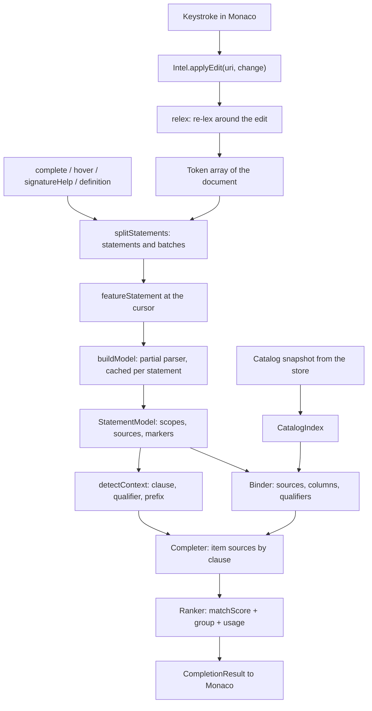
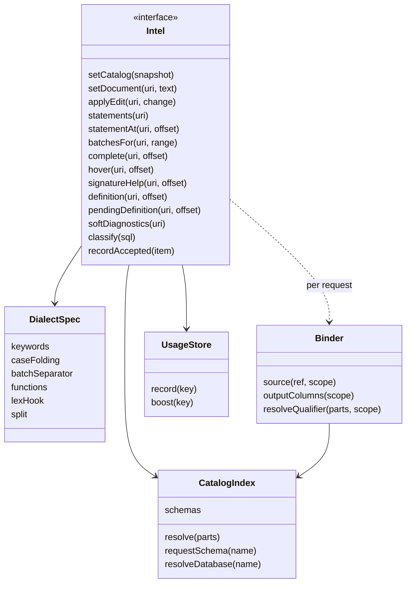
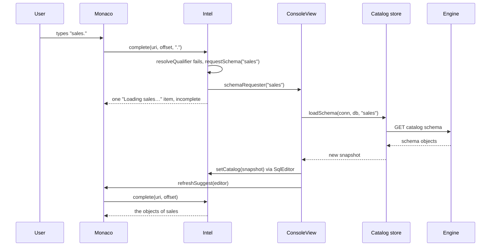
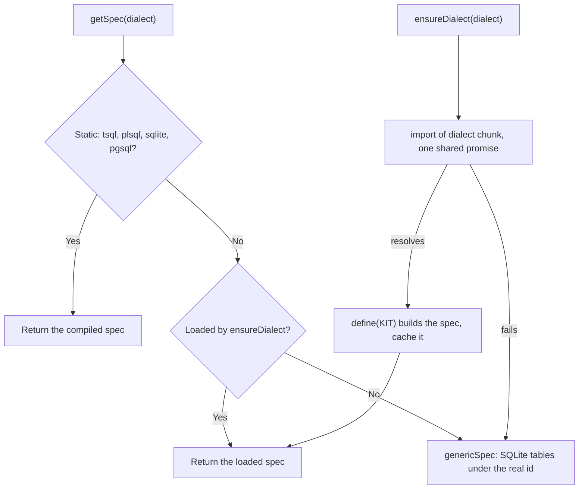

# 11. IntelliSense (sql-intel)

<div dir="rtl">

> **سطح:** L3 ارشد (بخش‌های ۱ و ۲ از سطح L2 خواندنی است) | **بخش:** II | **کد خوانده‌شده در:** `b638b7b` (مجموعه قابلیت‌های Rowlit 1.6.3؛ `version.json` در این درخت 1.7.0 است)
> **زبان:** فارسی | [English](../../en/part2/11-intellisense.md) | قبلی: [10. کاتالوگ، حافظه نهان فراداده و اکسپلورر](./10-catalog-and-metadata.md) | بعدی: [12. ویرایشگر، قالب‌بند، snippetها و تاریخچه محلی](./12-editor-and-formatter.md)
> برچسب‌های نمودارها به انگلیسی نگه داشته شده‌اند تا در GitHub درست نمایش داده شوند.
> **در یک جمله:** `ui/src/intel` یک سرویس زبان خالص TypeScript است که متن کنسول و نمای لحظه‌ای کاتالوگِ نهان‌شده را به فهرست پیشنهادها، راهنمای امضا، کارت hover، مقصد «رفتن به تعریف»، مرز دستورها و هشدارهای فوری تبدیل می‌کند، بی‌آنکه هنگام تایپ از پایگاه داده چیزی بپرسد.
> **یاد می‌گیرید:**
> - زنجیره‌ی یک ضربه‌ی کلید تا فهرست پیشنهاد: lexer، تفکیک‌کننده‌ی دستورها، پارسر جزئی، نمایه‌ی کاتالوگ، binder، زمینه‌ی مکان‌نما، تکمیل‌کننده و رتبه‌بند؛
> - چرا پارسر «جزئی» و خطاپذیر است و مدل دستور چه چیزهایی را ثبت می‌کند؛
> - نام‌ها در هر گویش چطور حل می‌شوند (تبدیل حروف، search path، مترادف‌ها، پایگاه‌های داده‌ی دیگر، مترادف‌های PUBLIC در Oracle)؛
> - پیشنهادها چطور رتبه می‌گیرند، استفاده‌ی شما چطور به خاطر سپرده می‌شود و اسکیمایی که هنوز بار نشده چطور به شکل «Loading Sales…» ظاهر می‌شود؛
> - فرق تشخیص‌های soft (که همین‌جا محاسبه می‌شوند) با تشخیص‌های سرور (که موتور محاسبه می‌کند)؛
> - نُه گویش چطور در یک موتور جا می‌شوند، پنج‌تایشان تنبل‌بار، و همه‌ی این‌ها چطور به Monaco وصل می‌شوند.
> **پیش‌نیازها:** [10. کاتالوگ، حافظه نهان فراداده و اکسپلورر](./10-catalog-and-metadata.md) (نمای لحظه‌ای‌ای که این فصل مصرف می‌کند)، [08. اتصال‌ها، نشست‌ها و اجرای SQL](./08-connections-sessions-execution.md) («اجرای یک batch» یعنی چه). پیش‌زمینه از بخش I: [I-08 خط لوله‌ی پرس‌وجو و بهینه‌ساز](../part1/08-query-processing.md) (parser و binder در یک DBMS واقعی)، [I-17 مقایسه گویش‌ها](../part1/17-dialect-comparison.md) (نقل‌قول شناسه، تبدیل حروف، جداکننده‌های دسته).

## 1. ایده (مبتدی)

وقتی در کنسول `SELECT c.` می‌نویسید، فهرستی از ستون‌های جدولِ پشت `c` باز می‌شود. وقتی `JOIN` می‌نویسید، Rowlit جدول‌هایی را پیشنهاد می‌کند که با جدول‌های فعلی شما کلید خارجی (foreign key) دارند، همراه با یک شرط `ON` آماده. وقتی ماوس را روی نام جدولی نگه می‌دارید، کارتی ستون‌ها و کلیدهایش را نشان می‌دهد. وقتی روی یک نام F12 می‌زنید، Rowlit همان شیء را باز می‌کند. و وقتی `DELETE FROM orders` را بدون `WHERE` می‌نویسید، پیش از اینکه چیزی اجرا شود یک خط زرد موج‌دار ظاهر می‌شود. به این خانواده از قابلیت‌ها **[IntelliSense](../glossary.md#intellisense)** می‌گویند (از روی نام قابلیت Visual Studio) یا به‌طور کلی‌تر **[سرویس زبان (language service)](../glossary.md#language-service)**: نرم‌افزاری که زبانی را آن‌قدر می‌فهمد که هنگام ویرایش به شما کمک کند.

سرویس زبان Rowlit در پوشه‌ی `ui/src/intel` برنامه‌ی React زندگی می‌کند و از سرور پایگاه داده نمی‌پرسد منظورتان چیست. پرسیدن برای هر ضربه‌ی کلید یک رفت‌وبرگشت شبکه هزینه دارد، و دستوری که نیمه‌کاره است اصلاً SQL معتبر نیست که سرور بتواند تجزیه‌اش کند. به‌جای آن، موتور یک بار توصیفی نهان‌شده از پایگاه داده را برای رابط کاربری می‌فرستد ([نمای لحظه‌ای کاتالوگ](../glossary.md#snapshot) در فصل [10](./10-catalog-and-metadata.md)) و سرویس زبان متن شما را می‌خواند، ساختارش را با وجود ناقص بودن حدس می‌زند و نام‌ها را با همان نمای لحظه‌ای تطبیق می‌دهد. همه‌ی آنچه در این فصل می‌آید درون پنجره و با TypeScript ساده اجرا می‌شود، بدون DOM و بدون import از Monaco؛ ویرایشگر فقط یکی از مشتریان آن است.

## 2. چطور کار می‌کند (حرفه‌ای)

### 2.1 هدف‌ها و محل اجرا

طرح سه هدف برای پوشه‌ی intel تعیین کرد (`docs/PLAN.md` §4.1):

- **اجرا در renderer، بدون شبکه، روی نمای لحظه‌ای نهان‌شده.** متن طرح می‌گوید تأخیر هر ضربه‌ی کلید باید کمتر از ۵ میلی‌ثانیه باشد و یک رفت‌وبرگشت تا موتور، حتی روی localhost، ۲ تا ۱۰ میلی‌ثانیه به‌علاوه‌ی هزینه‌ی JSON اضافه می‌کند. بودجه‌ی اعلام‌شده: تکمیل در حداکثر ۵ میلی‌ثانیه روی اسکریپت ۳۰۰ خطی با کاتالوگ ۵٬۰۰۰ جدولی، و ساخت نمایه در حداکثر ۱۵۰ میلی‌ثانیه برای ۱۰۰٬۰۰۰ ستون.
- **بدون وضعیت تغییرپذیر مشترک با React**، تا کتابخانه بعدها بتواند فقط با عوض کردن لایه‌ی انتقال به یک Web Worker برود (تصمیم D-11 در طرح). تا جایی که کد نشان می‌دهد این انتقال انجام نشده است: هیچ فایلی در `ui/src/intel` worker نمی‌سازد و `SqlEditor` این API را هم‌زمان (synchronous) صدا می‌زند (`ui/src/editor/SqlEditor.tsx:216`).
- **بدون DOM، بدون React، بدون Monaco.** نخستین خط ماژول عمومی همین را می‌گوید (`ui/src/intel/index.ts:1`) و پیکربندی آزمون این پوشه را در محیط ساده‌ی Node اجرا می‌کند (`ui/vitest.intel.config.ts`).

تنها چیزی که intel سراغش نمی‌رود خطاهای نحوی قطعی است؛ آن‌ها از موتور می‌آیند (بخش 2.12).

### 2.2 خط لوله

هر ویرایشگر با `createIntel(dialect, options)` یک شیء `Intel` می‌سازد (`index.ts:548-550`). این شیء برای هر URI سند یک رکورد کوچک نگه می‌دارد: متن، آرایه‌ی توکن‌ها، ابتدای خط‌ها، نتیجه‌ی تفکیک، حافظه‌ی نهانی از مدل‌های دستور و حافظه‌ی نهانی از تشخیص‌ها (`index.ts:95-103`). پاسخ‌ها تنبل ساخته می‌شوند: یک ویرایش فقط توکن‌ها را به‌روز می‌کند و نتیجه‌ی تفکیک و تشخیص‌ها را دور می‌ریزد؛ درخواست بعدی هر چه لازم دارد از نو می‌سازد.

**شکل ۱۱.۱ — از یک ضربه‌ی کلید تا فهرست پیشنهاد.**

</div>



<div dir="rtl">

شکل ۱۱.۱ را از بالا بخوانیم:

1. **ویرایش.** `applyEdit` تغییر را در متن ذخیره‌شده جا می‌دهد، ابتدای خط‌ها را دوباره حساب می‌کند و `relex` را با توکن‌های قبلی صدا می‌زند (`index.ts:182-192`). درخواستی برای URI ناآشنا یک سند خالی می‌سازد (`index.ts:196-203`)؛ تغییری که Monaco آن را به شکل چند ویرایش گزارش کند به‌صورت یک `setDocument` کامل فرستاده می‌شود (`SqlEditor.tsx:295-303`).
2. **تفکیک.** در درخواست بعدی، `splitOf` تفکیک‌کننده‌ی گویش را روی توکن‌ها اجرا می‌کند و مدل‌های نهان‌شده‌ی دستورهایی را که دیگر وجود ندارند دور می‌ریزد (`index.ts:208-216`).
3. **انتخاب دستور.** `featureStatement` دستورِ دور مکان‌نما را پیدا می‌کند، یا اگر مکان‌نما در فضای خالی انتهای دستور قبلی باشد و میانشان `;`، خط خالی یا خط `GO`/`/` نباشد، همان دستور قبلی را (`index.ts:313-330`).
4. **تجزیه.** `model` مدل دستور (`StatementModel`) را از توکن‌های معنادار آن دستور می‌سازد (بدون توضیح، فاصله و جداکننده‌ی دسته) و آن را زیر کلید `start + NUL + text` نهان می‌کند (`index.ts:123-125`، `218-231`).
5. **پاسخ.** `complete` اول چند راه خروج را بررسی می‌کند (مکان‌نما درون توضیح یا رشته است، یا درون بدنه‌ی `$$` در Snowflake که آن را جداگانه به‌عنوان یک سند کامل می‌کند)، سپس یک `Binder` می‌سازد، زمینه‌ی مکان‌نما را تشخیص می‌دهد و تکمیل‌کننده را با منبع خودِ گویش، منبع‌های پکیج‌ها و منبع‌های اضافه‌ی ویرایشگر اجرا می‌کند (`index.ts:463-477`).

**شکل ۱۱.۲ — نمای بیرونی `Intel` و اجزای پشت آن.**

</div>



<div dir="rtl">

رابط کامل در `index.ts:36-82` است. علاوه بر اعضای شکل ۱۱.۲ چند قلاب دارد که میزبان پرشان می‌کند: `setSchemaRequester` و `setDatabaseRequester` (وقتی به یک اسکیما یا پایگاه داده‌ی دیگر نیاز است صدا زده می‌شوند)، `setPublicSynonymResolver` (برای Oracle)، `setForeignCatalogs` (برای T-SQL، پایگاه‌های داده‌ی دیگرِ همان سرور)، `setExtraCompletionSources` (snippetها و قالب‌های postfix) و `onDidChange` (کاتالوگ به‌صورت ناهم‌زمان عوض شد). گزینه‌های پیش‌فرض در `index.ts:84-93` هستند: کلیدواژه‌ها با حروف بزرگ، شناسه‌ها همان‌طور که کاتالوگ می‌نویسد، نام اشیا فقط بیرون از اسکیمای پیش‌فرض با اسکیما، نام ستون‌ها فقط وقتی مبهم‌اند با نام جدول، یک خط خالی دستور را تمام می‌کند (به‌جز SQLite و PostgreSQL، `index.ts:141`)، نام مستعار از حروف اول کلمه‌ها، و حداکثر ۳٬۰۰۰ پیشنهاد ستون پیش از آنکه `FROM` وجود داشته باشد.

### 2.3 Lexer

**[تحلیلگر لغوی (lexer)](../glossary.md#lexer)** (یا tokenizer) متن را به **[توکن‌ها (token)](../glossary.md#token)** می‌بُرد: کلمه، رشته، عدد، عملگر. Rowlit برای همه‌ی گویش‌ها یک موتور lexer دارد که با جدول‌هایی از **[مشخصه‌ی گویش (dialect spec)](../glossary.md#dialect-spec)** هدایت می‌شود (شیء `DialectSpec` که کلیدواژه‌ها، قواعد نقل‌قول، تبدیل حروف، توابع و قلاب‌های یک گویش را نگه می‌دارد؛ `ui/src/intel/lexer/lexer.ts:1-4`). هر توکن نوع، متن، offsetهای مطلق `[start, end)`، شماره‌ی خط و ستون از یک، نسخه‌ای با حروف بزرگ برای تطبیق کلیدواژه، و پرچم `unterminated` برای رشته، توضیح یا شناسه‌ی نقل‌قول‌داری که هرگز بسته نشده را ثبت می‌کند (`ui/src/intel/types.ts:6-25`). انواع توکن این‌هاست: `ident`، `quotedIdent`، `keyword` (فقط واژه‌های رزرو؛ واژه‌های وابسته به زمینه `ident` می‌مانند)، `string`، `number`، `param`، `op`، `punct` (`( ) , . ;`)، `comment`، `batchSep`، `ws`، `eof`، و `meta` برای خط فرمانِ کلاینت مثل `\dt` در psql.

آنچه lexer در هر گویش می‌شناسد، با خطی که آن را پیاده می‌کند:

| ساختار | گویش‌ها | منبع |
|---|---|---|
| توضیح تودرتوی `/* /* */ */` | T-SQL، PostgreSQL | `lexer.ts:176` |
| `GO [n]` تنها در یک خط به توکن `batchSep` تبدیل می‌شود | T-SQL | `lexer.ts:543-558` |
| `/` تنها در یک خط به توکن `batchSep` تبدیل می‌شود | Oracle | `lexer.ts:416-424` |
| شناسه‌های `[x]`؛ `` `x` `` | T-SQL و SQLite؛ SQLite | `lexer.ts:461-470` |
| نقل‌قول `q'[...]'`، پارامترهای `:bind` و `&subst`، `%ROWTYPE` به‌عنوان عملگر | Oracle | `lexer.ts:436-453`، `501-519`، `569-577` |
| `E'...'`، `U&'...'`، `$1`، بدنه‌های `$tag$...$tag$`، خط‌های meta با `\`، عددهای `0x1F`/`1_000` | PostgreSQL | `lexer.ts:299-380` |
| `@var`، `@@fn`، `#temp`، `##temp`، `$ACTION` | T-SQL | `lexer.ts:494-500`، `528-530` |

**ویژگی‌های lexer برای گویش‌های تازه‌تر.** چهار گویش اولیه (T-SQL، PL/SQL، SQLite، PostgreSQL) قواعد سخت‌کدشده‌ی بالا را نگه می‌دارند. پنج گویش بعدی (MySQL، ClickHouse، Snowflake، CQL، DuckDB) قواعدشان را به‌صورت داده در `LexTraits` اعلام می‌کنند: شناسه با backtick، توضیح با `#`، توضیح با `//`، escape با بک‌اسلش، نقل‌قول دلاری، پیشوندهای پارامتر مثل `:` `@` `?`، پارامترهای `$1`، پارامترهای `{name:Type}` در ClickHouse، لیترال‌های هگز و پیشوندهای رشته (`ui/src/intel/dialect/spec.ts:39-63`). `lexer/traits.ts` هر مجموعه از این ویژگی‌ها را به یک **[قلاب lexer (lexer hook)](../glossary.md#lexer-hook)** تبدیل می‌کند (`traitLexer`، `traits.ts:24-121`) که lexer آن را پس از بررسی توضیح‌ها و پیش از هر چیز دیگری صدا می‌زند (`lexer.ts:411-415`). یادداشت بسته‌ی کاری دلیل این شکل را می‌گوید: قلاب به‌جای کد درون‌خطی، حدود ۰٫۵ کیلوبایت دیگر از بار اولیه کم کرد (`docs/wp-notes/wp0.md`، انحراف ۴). یک جزئیات دانستنی: در Snowflake، `//` وقتی کلمه‌ی پیش از آن به دونقطه ختم شود یا با `@` شروع شود توضیح نیست، پس `PUT file:///tmp/a.csv @~` آدرسش را نگه می‌دارد (`traits.ts:16-21`).

**سه شیوه‌ی اجرا.** `tokenize(text, spec)` یک سند کامل را تحلیل می‌کند و همیشه با توکن `eof` تمام می‌شود (`lexer.ts:603-611`). `lexLine(line, spec, state)` یک خط را برای رنگ‌آمیزی نحوی Monaco تحلیل می‌کند و یک وضعیت پایانی به شکل رشته‌ای کوتاه برمی‌گرداند (`c<depth>` درون توضیح بلوکی، `s` درون رشته، `d<tag>` درون بدنه‌ی دلاری و مانند این‌ها: `lexer.ts:35-39`، `621-638`) تا رنگ‌آمیز بتواند ساختار چندخطی را در خط بعد ادامه دهد. شیوه‌ی سوم، `relex`، حالت افزایشی است که بند بعدی توضیح می‌دهد.

**[تحلیل لغوی افزایشی (incremental lexing)](../glossary.md#incremental-lexing).** `relex(prev, newText, change, spec)` فقط اطراف ویرایش را دوباره تحلیل می‌کند (`lexer.ts:684-732`). توکن‌های قدیمیِ پیش از ویرایش را نگه می‌دارد، از ابتدای خطِ حاوی ویرایش دوباره شروع می‌کند (چون `GO` و `/` فقط در ابتدای خط شناخته می‌شوند) و جلو می‌رود. به محض اینکه پس از ناحیه‌ی ویرایش‌شده توکنی تولید کند که با یک توکن قدیمیِ جابه‌جاشده به اندازه‌ی تفاوت طول ویرایش برابر باشد (همان نوع، متن، آغاز و پایان)، دو جریان «همگام» شده‌اند و بقیه‌ی توکن‌های قدیمی با offsetهای جابه‌جاشده و شماره‌ی خط تازه‌حساب‌شده کپی می‌شوند. پس یک ویرایش یک‌نویسه‌ای در اسکریپتی ۱۰٬۰۰۰ خطی معمولاً فقط چند توکن هزینه دارد. ویرایشی که یک رشته یا توضیح را باز کند معنای همه‌ی متن بعد از خودش را عوض می‌کند، پس lexer تا جایی جلو می‌رود که دو جریان دوباره به هم برسند، و این می‌تواند انتهای سند باشد.

> طرح گفته بود «lexer در هر تغییر کل سند را توکن‌بندی می‌کند (اسکریپت ۱ مگابایتی در حدود ۱۵ میلی‌ثانیه)» (`docs/PLAN.md` §4.3). کد بیش از این می‌کند: تحلیل را افزایشی انجام می‌دهد (`lexer.ts:679-732`) و `applyEdit` برای هر تغییر تکی همیشه همین مسیر را می‌رود.

### 2.4 تفکیک‌کننده: دستورها و دسته‌ها

**[تفکیک‌کننده‌ی دستورها (splitter)](../glossary.md#splitter)** تعیین می‌کند یک دستور کجا تمام می‌شود و بعدی کجا شروع می‌شود. همین تصمیم Ctrl+Enter (اجرای دستور زیر مکان‌نما)، دستوری که پارسر مدل می‌کند و آنچه «اجرای اسکریپت» می‌فرستد را تعیین می‌کند. `splitStatements` اندیس توکن‌های معنادار را جمع می‌کند و بر اساس گویش تصمیم می‌گیرد (`ui/src/intel/split/splitter.ts:63-80`). هر دستور متن و offsetها، نوعش (بخش 2.5)، اینکه بلوک PL/SQL است یا نه، یک اندیس دسته و سه پرچم اختیاری دارد: `execText` (آنچه به‌جای متن فرستاده می‌شود)، `skipOnRun` و `missingSlash` (`types.ts:33-54`).

- **T-SQL** (`splitter.ts:166-263`). خط‌های `GO [n]` *دسته‌ها (batch)* را می‌بندند؛ `GO 5` دسته را پنج بار تکرار می‌کند (`splitter.ts:186-191`، و `batchesFor` آن را `repeat` بار در فهرست می‌گذارد، `index.ts:283-292`). درون یک دسته، دستور با یکی از این‌ها تمام می‌شود: `;` بیرون از پرانتز و `BEGIN ... END`/`CASE ... END`؛ یک خط خالی وقتی `blankLineSplitsStatements` روشن است؛ یا یک کلیدواژه‌ی آغاز دستور در ابتدای خط که پس از یک دستور کامل بیاید. «کامل» مجموعه‌ای از قاعده‌های تجربی در `canSplitTsql` است: نه پس از عملگر، ویرگول، `(` یا `.`؛ نه پس از واژه‌ای ناقص مثل `FROM` یا `AND`؛ نه درون `IF`/`WHILE`ای که بدنه‌اش هنوز نیامده؛ نه `SELECT`ِ یک `INSERT ... SELECT`؛ نه DML اصلی پس از فهرست `WITH`؛ نه `SET`ِ یک `UPDATE` (`splitter.ts:250-263`). `CREATE PROCEDURE/FUNCTION/TRIGGER/VIEW` تا انتهای دسته ادامه دارد (`splitter.ts:211-213`).
- **Oracle** (`splitter.ts:269-440`). بلوک PL/SQL با `DECLARE`، `BEGIN`، یک `<<label>>` یا `CREATE [OR REPLACE ...] PROCEDURE|FUNCTION|PACKAGE|TYPE BODY|TRIGGER|...` شروع می‌شود و با خطی از `/` تمام می‌شود؛ اگر چنین خطی نباشد، یک `END;` در عمق صفر که پس از آن خط خالی یا انتهای متن بیاید آن را می‌بندد و `missingSlash` را تنظیم می‌کند. زیربرنامه‌های محلی درون بخش `DECLARE` دنبال می‌شوند تا `END;`شان بلوک را نبندد. ساختار `WITH FUNCTION ... SELECT` نسخه‌ی 12c یک دستور است. خط‌های SQL\*Plus (`SHOW`، `SPOOL`، `SET SERVEROUTPUT ON`...) دستورهایی با `skipOnRun` می‌شوند و `EXEC p(1)` در `execText` به `BEGIN p(1); END;` بازنویسی می‌شود (`splitter.ts:310-333`).
- **SQLite و PostgreSQL** (`splitter.ts:453-523`). یک `;` بیرون از پرانتز و `CASE ... END` دستور را تمام می‌کند؛ SQLite ساختار `CREATE TRIGGER ... BEGIN ... END` را یکپارچه نگه می‌دارد و PostgreSQL ساختار `BEGIN ATOMIC ... END` را. بدنه‌های دلاری یک توکن رشته‌ی واحدند، پس `CREATE FUNCTION ... AS $$ ...; ... $$;` هرگز شکسته نمی‌شود. خط `\` در psql دستوری جداگانه با `skipOnRun` است.
- **گویش‌های تنبل‌بار** تفکیک‌کننده‌ی خودشان را از راه `DialectSpec.split` می‌آورند، وگرنه تفکیک‌کننده‌ی نقطه‌ویرگولی را می‌گیرند (`splitter.ts:72-77`). تفکیک‌کننده‌ی MySQL خط‌های `DELIMITER` و بدنه‌ی روال‌های مرکب بدون delimiter را مدیریت می‌کند (`ui/src/intel/split/mysql.ts:1-17`)؛ CQL ساختار `BEGIN BATCH ... APPLY BATCH` را یکپارچه نگه می‌دارد (`split/cql.ts`)؛ Snowflake فایل خودش را دارد (`split/snowflake.ts`).

`statementAt(uri, offset)` همان پرسشِ هدف اجراست: «کدام دستور زیر مکان‌نماست؟» (`index.ts:237-254`). پاسخ: دستوری که offset را در بر می‌گیرد؛ وگرنه دستور قبلی، وقتی میانشان فقط فاصله‌ی انتهایی، توضیح و `;` باشد و خط خالی نباشد (`gapIsTrailing`، `index.ts:257-261`)؛ وگرنه دستور بعدی، وقتی `runNextStatementOnBlank` روشن باشد و فقط فضای خالی آن‌ها را جدا کند. `batchesFor` نتیجه‌ی تفکیک را به فهرست دسته‌های `{ sql, line, col }` تبدیل می‌کند که موتور اجرا می‌کند: T-SQL دسته‌های GO را می‌فرستد، گویش‌های دیگر دستورها را، و دستورهای `skipOnRun` و خالی را کنار می‌گذارد و در صورت وجود از `execText` استفاده می‌کند (`index.ts:269-300`). یک انتخاب (selection) جداگانه توکن‌بندی و تفکیک می‌شود و در آن تفکیک با خط خالی خاموش است (`index.ts:271-277`). فصل [12](./12-editor-and-formatter.md) نشان می‌دهد `run-target.ts` چطور میان انتخاب، دستور و اسکریپت یکی را برمی‌گزیند.

### 2.5 دسته‌بندی دستورها و محافظ دستورهای مخرب

`classifyTokens` به هر دستور یک نوع می‌دهد: `select`، `insert`، `update`، `delete`، `merge`، `truncate`، `drop`، `create`، `alter`، `exec`، `block`، `declare`، `set`، `use`، `tx`، `grant`، `pragma`، `explain`، `other`، `empty`، به‌علاوه‌ی انواع کلاینتی `sqlplus` و `psql` (`types.ts:28-31`، `split/classify.ts:37-83`). فهرست `WITH` ابتدای دستور را رد می‌کند تا فعل اصلی را پیدا کند و پیش از قاعده‌های مشترک به گویش تنبل‌بار فرصت می‌دهد از راه `DialectSpec.classify` پاسخ دهد. چهار نوع پسوند `:destructive` می‌گیرند: `UPDATE` یا `DELETE` بدون `WHERE` در عمق صفر پرانتز، `TRUNCATE` و `DROP` (`classify.ts:55-59`). `Intel.classify(sql)` یک متن کامل را تفکیک می‌کند و نخستین نوع مخربی را که بیابد، وگرنه نخستین نوع را، برمی‌گرداند (`index.ts:302-308`). رابط کاربری از آن برای تأیید «این دستور سطرهای زیادی را عوض می‌کند» و برچسب‌های تاریخچه استفاده می‌کند؛ موتور برای اتصال‌های فقط‌خواندنی بررسی سمت سرور خودش را دارد (فصل [08](./08-connections-sessions-execution.md)).

### 2.6 پارسر جزئی و مدل دستور

پارسرِ یک DBMS واقعی `SELECT c. FROM customers c` را رد می‌کند چون SQL معتبر نیست. تکمیل خودکار باید دقیقاً روی همین متن کار کند. پس Rowlit از یک **[پارسر جزئی (partial parser)](../glossary.md#partial-parser)** استفاده می‌کند که نمونه‌ای از **[تجزیه‌ی خطاپذیر (error-tolerant parsing)](../glossary.md#error-tolerant-parsing)** است (تجزیه‌ای که با ورودی نامعتبر هم ادامه می‌دهد و بهترین ساختار ممکن را برمی‌گرداند): یک «پارسر ساختار» دست‌نوشته‌ی بازگشتی-نزولی (recursive descent) که به گفته‌ی خود فایل فقط آنچه را تکمیل و تشخیص‌ها لازم دارند می‌فهمد، بقیه را توکن به توکن رد می‌کند، روی ورودی بد هرگز استثنا پرتاب نمی‌کند و همیشه جلو می‌رود (`ui/src/intel/parse/partial-parser.ts:1-2`). دو تضمین این را درست نگه می‌دارد. `parseStatementList` هر بار که پارسر یک دستور هیچ توکنی مصرف نکند یک توکن جلو می‌رود (`partial-parser.ts:325-327`). و `buildModel` کل تجزیه را در یک `try/catch` می‌پیچد که هر چه تا آن لحظه ساخته شده را نگه می‌دارد (`partial-parser.ts:2296-2306`).

خروجی یک **[مدل دستور (statement model)](../glossary.md#statement-model)** است (`ui/src/intel/parse/statement-model.ts`):

- درختی از **[حوزه‌ها (scope)](../glossary.md#statement-scope)** (هر حوزه یک سطح پرس‌وجوست، مثل SELECT اصلی، یک زیرپرس‌وجو یا بدنه‌ی یک CTE): `select`، `insert`، `update`، `delete`، `merge`، `cte`، `subquery`، `exists`، `values`، `plsqlBlock`، `other` (`statement-model.ts:15-17`). هر حوزه یک بازه‌ی محتوا، یک والد، حوزه‌های فرزند، یک حوزه‌ی اختیاری `outer` که زیرپرس‌وجوی همبسته یا `LATERAL`/`APPLY` منبع‌هایش را می‌بیند، و `sources`، `ctes`، `projections`، `joins`، `targetTable`، فهرست ستون‌های insert، متغیرهای محلی و **نشانه‌ها**ی خودش را دارد (`statement-model.ts:135-163`)؛
- **ارجاع‌های جدول** (`TableRef`): نوع (`table`، `subquery`، `cte`، `function`، `tempTable`، `tableVar`، `values`...)، بخش‌های نام، نام مستعار و بازه‌ها، یک زیرحوزه برای جدول‌های مشتق‌شده، نام‌های مستعار ستون، پرچم `remote` برای `@dblink` در Oracle و نام‌های چهاربخشی T-SQL، و `isTarget` برای مقصد DML (`statement-model.ts:64-86`)؛
- **زنجیره‌های شناسه** (`c.Name`، `dbo.fnTax(`) که هنگام پیمایش عبارت‌ها برای hover و تشخیص‌ها ثبت می‌شوند (`statement-model.ts:133`)؛
- جدول‌هایی که یک دستور **می‌سازد** (`CREATE TABLE`، `SELECT ... INTO #t`، `DECLARE @t TABLE`) و متغیرهایی که در سطح بالا **اعلان** می‌کند، تا دستورهای بعدی سند بتوانند آن‌ها را تکمیل کنند (`statement-model.ts:178-190`).

**[نشانه‌ی بند (clause marker)](../glossary.md#clause-marker)** یادداشت پارسر است که می‌گوید «از این offset به بعد، مکان‌نما در بند X است»: `{ pos, clause, data? }` (`statement-model.ts:46`). انواع بند شامل `select`، `from`، `join`، `on`، `where`، `groupBy`، `orderBy`، `into`، `insertColumns`، `values`، `set`، `with`، `cteColumns`، `using`، `returning`، `exec`، `execArgs`، `declare`، `ddl`، `cast`، `expr` و `use` است (`statement-model.ts:4-13`). داده‌ی نشانه جزئیات اضافه می‌کند: جدولی که یک `ON` به آن تعلق دارد (`joinRef`)، اینکه `INTO` از نوع `SELECT ... INTO` است یا نه، اینکه یک موقعیت DDL چه انتظاری دارد (`newName`، `objectName`، `columnOf`، `dataType`...)، و زیرموقعیت `ON CONFLICT` در PostgreSQL (`statement-model.ts:29-44`).

دستوری روی نمونه‌ی `shop` را در نظر بگیرید که مکان‌نما در `|` است:

</div>

```sql
SELECT c.|, o.total
FROM customers c
JOIN orders o ON o.customer_id = c.id
WHERE o.status <> 'cancelled'
```

<div dir="rtl">

پارسر یک حوزه‌ی `select` می‌سازد. پس از `SELECT` یک نشانه‌ی `select` می‌گذارد، دو projection ثبت می‌کند، پس از `FROM` نشانه‌ی `from` می‌گذارد و منبع `customers` را با نام مستعار `c` ثبت می‌کند، نشانه‌ی `join` می‌گذارد، `orders o` را ثبت می‌کند، نشانه‌ی `on` را با `joinRef = orders o` می‌گذارد (`partial-parser.ts:885-897`) و سپس نشانه‌ی `where`. عبارت‌ها با `scanExpr` پیمایش می‌شوند که زنجیره‌ها را ثبت می‌کند و وقتی به `(SELECT` برسد یک حوزه‌ی فرزند باز می‌کند (`partial-parser.ts:213-276`). متن پس از مکان‌نما هم جزو مدل است؛ به همین دلیل `SELECT | FROM t` می‌تواند ستون‌های `t` را پیشنهاد کند، با اینکه `FROM` بعداً می‌آید.

دانش گویش‌ها هم در پارسر هست: در T-SQL ساختارهای `BEGIN TRY/CATCH`، `IF/WHILE`، `DECLARE @t TABLE` و `OUTPUT`؛ در PL/SQL بلوک‌ها، cursorها، `FOR r IN c LOOP` و `%ROWTYPE`؛ در PostgreSQL CTEهای تغییردهنده‌ی داده، `DISTINCT ON`، `FILTER (WHERE ...)` و `WITH ORDINALITY`؛ بلوک‌های Snowflake Scripting؛ `BEGIN BATCH` در CQL. فهرست متدها در `partial-parser.ts:319-2290` به همین دلیل بلند است: هر کدام یکی از این ساختارها را مدیریت می‌کند.

### 2.7 نمایه‌ی کاتالوگ و binder

**[نمایه‌ی کاتالوگ (catalog index)](../glossary.md#catalog-index)**، یعنی کلاس `CatalogIndex` (`ui/src/intel/catalog/index.ts:148`)، نمای لحظه‌ای کاتالوگِ فصل [10](./10-catalog-and-metadata.md) را در نگاشت‌های جست‌وجو می‌پیچد:

- **کلیدها و تبدیل حروف.** `keyOfCatalog(name)` کلید نامی است که ذخیره شده (فقط در گویش‌های حساس‌نبودن به حروف، با حروف بزرگ)؛ `keyOf(name, quoted)` کلید نامی است که در SQL نوشته شده: نام‌های بدون نقل‌قول را در Oracle و Snowflake به حروف بزرگ و در PostgreSQL و CQL به حروف کوچک تبدیل می‌کند و در بقیه بدون حساسیت به حروف مقایسه می‌کند (`index.ts:206-213`، `spec.ts:103-107`). این همان قاعده‌ی [تبدیل حروف (case folding)](../glossary.md#case-folding) گویش است در یک تابع.
- **افزایشی برای هر اسکیما.** `setSnapshot` مدخل اسکیمایی را که `version` و تعداد اشیایش تغییر نکرده نگه می‌دارد و فقط بقیه را از نو می‌سازد؛ اتصال یا پایگاه داده‌ی دیگر همه چیز را پاک می‌کند (`index.ts:217-260`). پس از هر تغییر، `rebuildGlobal` نگاشت نام‌ها در همه‌ی اسکیماها و **گراف کلیدهای خارجی** را در هر دو جهت (`fksOut`، `fksIn`) از نو می‌سازد؛ پیشنهادهای join روی همین گراف راه می‌روند (`index.ts:281-309`).
- **اشیای داخلی.** Oracle جدول `DUAL` و پکیج‌های همراه (`DBMS_OUTPUT` و بقیه) را به‌عنوان اشیای داخلی می‌گیرد (`index.ts:194-197`). فایل JSON `systemCatalog` یک گویش اسکیماهای داخلی‌ای اضافه می‌کند که پس از اسکیماهای بارشده بررسی می‌شوند: PostgreSQL ۳۷ نمای `pg_catalog` و ۱۲ نمای `information_schema` همراه دارد (تصمیم D-PG9: یک JSON ایستا از حدود ۳۰ نمای سیستمیِ پرکاربرد همراه رابط کاربری فرستاده می‌شود)، و MySQL، ClickHouse، Snowflake و CQL هم نمونه‌ی خودشان را دارند (`ui/src/intel/dialect/data/*-system.json`).
- **search path در PostgreSQL** (D-PG7). نام بدون اسکیما به ترتیب `search_path`، سپس در `pg_catalog`، سپس در هر اسکیمای بارشده حل می‌شود؛ اگر چیزی پیدا نشود، اسکیماهای هنوز بارنشده‌ی search path درخواست می‌شوند (`index.ts:409-424`).
- **مترادف‌ها (synonym)** بی‌صدا تا هشت گام دنبال می‌شوند (`followSynonym`، `index.ts:476-488`). مترادف‌های PUBLIC در Oracle به‌صورت تنبل و برای هر نام فقط یک بار از راه حل‌کننده‌ی میزبان حل می‌شوند (`requestPublicSynonym`، `index.ts:521-537`).
- **پایگاه‌های داده‌ی دیگرِ همان سرور** (نام‌های سه‌بخشی `Other.dbo.Orders` در T-SQL و Snowflake، و `USE Other`). نمایه برای هر پایگاه داده‌ی بیگانه یک `CatalogIndex` فرزند نگه می‌دارد که میزبان از راه `setForeignCatalogs` تغذیه‌اش می‌کند (`index.ts:682-703`). `resolveDatabase` پاسخ می‌دهد که یک نام پایگاه داده‌ی خودِ کنسول است، پایگاه داده‌ی دیگری است (و در نخستین استفاده فهرست اسکیماهایش را درخواست می‌کند) یا ناشناخته (`index.ts:608-623`). پس از `USE Other`، تابع `indexAt` باعث می‌شود بقیه‌ی اسکریپت با کاتالوگ Other تکمیل شود (`ui/src/intel/index.ts:379-385`، `catalog/index.ts:637-647`).
- **درخواست‌دهنده‌ها.** وقتی چیزی به اسکیمایی نیاز دارد که فهرست شده ولی بار نشده، `requestSchema` برای هر نام یک بار میزبان را صدا می‌زند (`index.ts:548-559`). در کنسول میزبان `ConsoleView` است که در صورت نیاز اول فهرست اسکیماها و سپس خود اسکیما را از راه استور کاتالوگ بار می‌کند (`ui/src/components/layout/ConsoleView.tsx:195-214`).

**[binder](../glossary.md#binder)** (`ui/src/intel/catalog/binder.ts`) مدل دستور را به نمایه وصل می‌کند. نامش از مرحله‌ی binder در خط لوله‌ی پرس‌وجوی یک پایگاه داده آمده ([I-08](../part1/08-query-processing.md)) که آن هم نام‌های پرس‌وجوی تجزیه‌شده را به اشیای کاتالوگ نگاشت می‌کند، اما این یکی سهل‌گیر و تنبل است:

- `source(ref, scope)` یک `TableRef` را به `ResolvedSource` تبدیل می‌کند که یک برچسب (نام مستعار، وگرنه آخرین بخش نام)، یک رشته‌ی نمایشی و تابع تنبل `columns()` دارد. ترتیب بررسی: زیرپرس‌وجو یا `VALUES` ← ستون‌های خروجی‌اش؛ متغیر جدولی؛ `#temp`؛ CTEای که از این حوزه دیده می‌شود؛ جدولی که پیش‌تر در همین اسکریپت ساخته شده؛ یک شیء کاتالوگ (با دنبال کردن مترادف‌ها)؛ مترادف PUBLIC در Oracle؛ یک تابع داخلی مجموعه‌برگردان مثل `generate_series(...) AS g(n)`؛ وگرنه «حل‌نشده» (`binder.ts:87-155`).
- `outputColumns(scope)` حساب می‌کند یک زیرپرس‌وجو یا CTE چه چیزی برمی‌گرداند: `*` و `t.*` را باز می‌کند و نام‌های خروجیِ بدون نقل‌قول را در Oracle و PostgreSQL تبدیل حروف می‌کند؛ یک محافظ بازگشت، CTEهای بازگشتی را مدیریت می‌کند (`binder.ts:228-259`) و محاسبه‌ی ستون‌ها در عمق تودرتوی ۱۲ متوقف می‌شود (`binder.ts:81-85`).
- `resolveQualifier(parts, scope)` به این پرسش پاسخ می‌دهد: «`a.` اینجا چیست؟». پاسخ می‌تواند یک منبع باشد، یک رکورد (متغیر `%ROWTYPE`، رکورد cursor، یک CTE، یک جدول موقت، `EXCLUDED` در PostgreSQL، `inserted`/`deleted` درون `OUTPUT` در T-SQL)، یک پکیج، یک سکوئنس، یک اسکیما، یک پایگاه داده یا یک شیء (`binder.ts:320-389`).
- `DocSymbols` جدول‌ها و متغیرهایی را که دستورهای قبلی تعریف کرده‌اند حمل می‌کند؛ `Intel.symbols` آن‌ها را فقط با پیمایش دستورهایی جمع می‌کند که `CREATE`، `DECLARE` یا `INTO` دارند (`ui/src/intel/index.ts:332-355`). متغیرهای T-SQL فقط درون همان دسته‌ی GO دیده می‌شوند.

### 2.8 زمینه‌ی مکان‌نما

**[زمینه‌ی مکان‌نما (cursor context)](../glossary.md#cursor-context)** توصیف این است که مکان‌نما کجای دستور قرار دارد. `detectContext(model, offset, spec, text)` جمله‌ی «offset ۷ در این دستور» را به توصیفی تبدیل می‌کند که تکمیل‌کننده بتواند بر اساسش کار کند (`ui/src/intel/context/context.ts:84-257`). توکنی را که در حال تایپ است پیدا می‌کند (**پیشوند**، همراه با نقل‌قول بازکننده در صورت وجود، `context.ts:92-116`)، روی یک زنجیره‌ی نقطه‌دار به عقب می‌رود تا **قیدکننده (qualifier)** را بسازد (`c.`، `dbo.Customers.`، `db..` در T-SQL، `context.ts:118-137`)، عمیق‌ترین حوزه‌ای را که آغاز زنجیره را در بر می‌گیرد (`scopeAt`، `partial-parser.ts:2309-2323`) و آخرین نشانه‌ی پیش از آن را برمی‌دارد که **بند** را تعیین می‌کند. سپس چند پرچم حساب می‌کند: آیا در آغاز دستور است؛ آیا پس از یک عملوند (شناسه، لیترال، `)`) است یا انتظار یک عبارت می‌رود؛ آیا یک منبع جدول کامل پیش از مکان‌نما آمده (`afterSource`) یا کلمه‌ی در حال تایپ نام مستعار است (`aliasTyping`)؛ سمت چپ یا راست `=` در فهرست `SET`؛ فراخوانی تابعِ دربرگیرنده و شماره‌ی آرگومان (`findCall`، `context.ts:269-311`)؛ جدول مربوط به `ON` جاری. دو موقعیت نوع داده بند را بازنویسی می‌کنند: در PostgreSQL ‏`expr::|` و `CAST(expr AS |`، و در T-SQL ‏`CAST/TRY_CAST/PARSE(... AS |` و نخستین آرگومان `CONVERT(` (`context.ts:228-246`). `CursorContext` حاصل ۲۶ فیلد دارد (`context.ts:21-57`)؛ طرح اولیه ۱۳ فیلد داشت (`docs/PLAN.md` §4.5).

### 2.9 تکمیل و رتبه‌بندی

**[تکمیل‌کننده (completer)](../glossary.md#completer)** **[آیتم‌های تکمیل (completion item)](../glossary.md#completion-item)** را می‌سازد (هر آیتم یک ردیف از فهرست پیشنهاد است: برچسب، نوع، متنی که درج می‌شود، کلید مرتب‌سازی). نقطه‌ی ورودش، `complete(ctx, env)`، منبع آیتم‌ها را انتخاب می‌کند (`ui/src/intel/complete/completer.ts:328-368`):

1. با قیدکننده: `qualifierItems` (ستون‌های یک منبع، اشیای یک اسکیما، اسکیماهای یک پایگاه داده، اعضای یک پکیج، `NEXTVAL`/`CURRVAL` یک سکوئنس)؛
2. پیشوندی که در T-SQL یا MySQL با `@` شروع شود: متغیرها و متغیرهای سراسری؛
3. در آغاز دستور: کلیدواژه‌های آغازین، snippetهای گویش و، وقتی چیزی تایپ شد، جدول‌هایی که `SELECT * FROM table` درج می‌کنند (به سبک DataGrip، `completer.ts:400-428`)؛
4. واژه‌ای که دنباله‌روهای اعلام‌شده دارد (`keywordFollowers`؛ مثلاً پس از `CONSISTENCY` در CQL سطح‌ها، `completer.ts:377-396`)؛
5. در غیر این صورت `clauseItems`، یک switch بر اساس بند (از `completer.ts:459` به بعد).

موارد اصلی بندها:

| بند | چه پیشنهاد می‌شود | منبع |
|---|---|---|
| `select` | ستون‌های منبع‌های حوزه، نام‌های مستعار، `*` و `c.*`، آیتم‌های «همه‌ی ستون‌های…»، توابع، کلیدواژه‌های select، متغیرها، پکیج‌ها، سکوئنس‌ها؛ پس از یک عملوند: `FROM`، `AS`، `OVER`... | `completer.ts:472-496` |
| `select` وقتی هنوز `FROM` نیست | ستون‌های همه‌ی جدول‌های اسکیمای پیش‌فرض، تا `maxColumnsWithoutFrom`؛ اگر دستور در مکان‌نما تمام شود، پذیرفتن یکی `col FROM table` را به‌صورت snippet درج می‌کند | `completer.ts:762-789` |
| `from`، `join`، `update`، `delete`، `into`، `using` | CTEها، جدول‌ها/نماها/مترادف‌های اسکیمای پیش‌فرض، جدول‌های موقت، اسکیماها و پایگاه‌های داده (۸ تای اول بالاتر از جدول‌ها، `TOP_CONTAINERS`)، اشیای اسکیماهای دیگر پس از تایپ پیشوند، نماهای `pg_catalog` در PostgreSQL، توابع جدولی؛ پس از یک منبع کامل: کلیدواژه‌های بعدی | `completer.ts:497-520`، `806-882`، `126` |
| `join` | اول جدول‌هایی که با کلید خارجی به یک منبع قبلی وصل‌اند ([پیشنهاد join بر پایه‌ی کلید خارجی](../glossary.md#fk-join-suggestion))، هر کدام همچنین به شکل snippet ‏`orders o ON o.customer_id = c.id` با نام مستعار ساخته‌شده | `completer.ts:915-951` |
| `on` | شرط‌های کامل کلید خارجی میان جدول join‌شده و هر منبع قبلی (کلیدهای مرکب با `AND` به هم وصل می‌شوند)، سپس ستون‌ها | `completer.ts:953-975` |
| `where`، `having`، `groupBy`، `orderBy`، `limit`، `returning` | ستون‌ها، نام‌های مستعار، نام‌های مستعار projection در `ORDER BY`، توابع، چند کلیدواژه، متغیرها | `completer.ts:534-554` |
| `set` سمت چپ `=` | فقط ستون‌های قابل‌نوشتنِ مقصد | `completer.ts:555-566` |

دو قابلیت کم‌صداتر درون همین منبع‌ها نشسته‌اند. **[استنتاج معکوس (backward inference)](../glossary.md#backward-inference)**: در `SELECT name, price FROM |` جدول‌هایی که همه‌ی ستون‌های بدون قیدِ تایپ‌شده را دارند ۲۵ امتیاز ارتباط (relevance) اضافه می‌گیرند (`completer.ts:793-804`، `825`). **نقل‌قول و حروف**: `formatIdent` نامی را که گویش نمی‌تواند بدون نقل‌قول بنویسد (حروف مختلط در PostgreSQL و Oracle، فاصله، واژه‌ی رزرو) داخل نقل‌قول می‌گذارد، نقل‌قول بازکننده‌ای را که کاربر خودش تایپ کرده دوباره استفاده می‌کند و اگر نقل‌قول بسته‌کننده از قبل پس از مکان‌نما باشد آن را تکرار نمی‌کند؛ `formatObjectName` بر اساس `qualifyObjects` نام اسکیما را جلوی نام شیء می‌گذارد (`ui/src/intel/complete/format.ts:14-23`، `60-77`).

**منبع‌های اضافه.** پس از آیتم‌های داخلی، تکمیل‌کننده آیتم‌های سه نوع منبع اضافه را به همین ترتیب می‌افزاید (`ui/src/intel/index.ts:475`): `DialectSpec.complete` خودِ گویش (DuckDB از آن برای توابع جدولی در `FROM` استفاده می‌کند، `ui/src/intel/dialect/duckdb.ts:108-127`)؛ منبع‌های سراسری‌ای که یک پکیج قابلیت برای هر گویش با `registerCompletionSource` ثبت می‌کند (`index.ts:105-121`؛ پکیج links یکی برای نام‌های چندبخشیِ اعضای کل-پایگاه‌داده ثبت می‌کند، `ui/src/components/Links/intel/wideNames.ts:1-7`، فصل [16](./16-linked-databases-federation.md) را ببینید)؛ و منبع‌های ویرایشگر، یعنی کتابخانه‌ی snippet و **[قالب‌های postfix (postfix completion)](../glossary.md#postfix-completion)** (`SqlEditor.tsx:233`). قالب postfix عبارت `customers.sel` در آغاز دستور را به `SELECT * FROM customers` تبدیل می‌کند و فقط وقتی پیشنهاد می‌شود که قیدکننده به یک جدول یا نما حل شود (`ui/src/intel/complete/postfix.ts:19-69`). یک snippet اضافه با همان برچسب جای snippet داخلی را می‌گیرد، پس snippetهای کاربر برنده‌اند (`completer.ts:360-365`).

**[رتبه‌بند (ranker)](../glossary.md#ranker).** امتیاز هر آیتم برابر `group * 1000 + matchScore + usageBoost + relevance` است، منهای ۲۰ برای تابع منسوخ (`completer.ts:94`). **گروه** جدول بندهای بالا را رمزگذاری می‌کند (ستون‌ها در فهرست select گروه ۱۰، snippetهای کلید خارجی در join گروه ۱۰ و غیره). **[امتیاز تطبیق (match score)](../glossary.md#match-score)** (`matchScore`) پیشوند تایپ‌شده را با برچسب مقایسه می‌کند (`ui/src/intel/complete/ranker.ts:85-116`):

| تطبیق | امتیاز | مثال |
|---|---|---|
| دقیق (حساس به حروف) | ۱۰۰ | `id` ← `id` |
| دقیق بدون توجه به حروف | ۹۶ | `ID` ← `id` |
| پیشوند بدون توجه به حروف | ۹۰ منهای جریمه‌ی طول تا ۵ | `cust` ← `customers` |
| بخش‌های زیرخط‌دار یا آغاز کلمه‌ها روی مرزهای `_`/camelCase | ۷۰ (اگر کلمه‌ی اول جا بیفتد ۶۲) | `cid` ← `CustomerId`، `o_d` ← `order_date` |
| زیررشته | ۵۰ | `omer` ← `customers` |
| زیردنباله، پیشوند ۳ نویسه یا بیشتر | ۲۰ تا ۳۰ | `csr` ← `customers` |
| بدون تطبیق | −۱ (آیتم حذف می‌شود مگر اجباری باشد) | |

نتیجه بر اساس امتیاز و سپس برچسب کوتاه‌تر مرتب می‌شود (`completer.ts:366`) و `sortTextFor` امتیاز را به‌صورت هفت رقم با نگه داشتن دو رقم اعشار می‌نویسد تا Monaco ترتیب Rowlit را حفظ کند (`ranker.ts:119-122`). فهرست حداکثر ۲٬۵۰۰ آیتم دارد؛ فهرستی که به سقف برسد ناقص (incomplete) علامت می‌خورد تا Monaco با پیشوند بلندتر دوباره بپرسد (`completer.ts:34`، `92`، `367`).

**حافظه‌ی استفاده ([MRU](../glossary.md#mru)).** `UsageStore` هر بار که آیتمی را بپذیرید مقدار `2^((now − epoch) / halfLife)` را به کلید آن آیتم اضافه می‌کند، با نیمه‌عمر ۱۴ روز؛ پس عدد ذخیره‌شده بسامدی است که با گذر زمان کم‌رنگ می‌شود، بی‌آنکه زمان‌ها ذخیره شوند؛ `boost` آن را به ۰ تا ۱۵ امتیاز تبدیل می‌کند (`ranker.ts:124-157`). استور حداکثر ۲٬۰۰۰ کلید نگه می‌دارد و به ۱٬۵۰۰ کلیدِ قوی‌تر کوتاهش می‌کند. کلیدها شکلی مثل `obj:dbo.Customers`، `col:Customers.Name`، `kw:WHERE` و `join:dbo.Orders` دارند. وقتی Monaco فرمان پذیرش را اجرا می‌کند، ویرایشگر کلید را ثبت می‌کند (`SqlEditor.tsx:280-285`) و `ConsoleView` پس از ۱٫۵ ثانیه مکث رکورد را برای هر اتصال زیر `settings.ui.completionUsage` ذخیره می‌کند (`ConsoleView.tsx:215-222`).

**تکمیل با اسکیمایی که هنوز در حال بار شدن است.** explorer اسکیماها را تنبل بار می‌کند (فصل [10](./10-catalog-and-metadata.md))، پس کاربر اغلب پیش از بار شدن `sales` عبارت `sales.` را تایپ می‌کند. شکل ۱۱.۳ نشان می‌دهد چه می‌شود.

**شکل ۱۱.۳ — تکمیل با بار شدنِ در انتظار یک اسکیما.**

</div>



<div dir="rtl">

ردیف «Loading» یک آیتم واقعی است که با هر چه تایپ شده تطبیق می‌خورد، چیز تازه‌ای درج نمی‌کند و نتیجه را ناقص علامت می‌زند (`loadingItem`، `completer.ts:219-225`؛ `qualifierItems`، `completer.ts:1260-1266`). provider تکمیل به خاطر می‌سپارد که ردیف بارگذاری نشان داده شده (`ui/src/editor/monaco-setup.ts:164`)؛ وقتی کاتالوگ بعدی برسد، `SqlEditor` نشست پیشنهادِ باز را درجا دوباره اجرا می‌کند (`SqlEditor.tsx:418-428`، `refreshSuggest` در `ui/src/editor/suggestKey.ts:69-77`). همین الگو برای پایگاه داده‌ی دیگری از همان سرور («Loading Other…»، `completer.ts:1288-1298`) و برای کنسول پس از `USE Other` (`completer.ts:344-348`) هم به کار می‌رود.

### 2.10 راهنمای امضا و hover

**[راهنمای امضا (signature help)](../glossary.md#signature-help)** کادر کوچکی است که هنگام تایپ آرگومان‌های یک تابع، پارامترهایش را نشان می‌دهد. `Intel.signatureHelp` فراخوانیِ دربرگیرنده را از راه زمینه‌ی مکان‌نما یا با عقب رفتن از مکان‌نما پیدا می‌کند (`ui/src/intel/index.ts:514-528`). `signature.ts` اول روال‌های کاربر و اعضای پکیج‌ها را فهرست می‌کند، چون بر توابع داخلی هم‌نام سایه می‌اندازند، و در غیر این صورت به کاتالوگ توابع گویش برمی‌گردد (`ui/src/intel/signature/signature.ts:15-58`). پارامتر فعال برابر تعداد ویرگول‌های عمق صفر پیش از مکان‌نماست، یا در نشانه‌گذاری نام‌دار Oracle ‏(`p_total => |`) پارامتری که همین نام را دارد؛ وقتی چند overload باشد نخستین overloadی را برمی‌گزیند که این تعداد آرگومان را بپذیرد و پارامتر متغیر `...` بقیه را جذب می‌کند. `EXEC proc a, b` در T-SQL بدون پرانتز از راه نشانه‌ی `execArgs` کار می‌کند (`context.ts:214-226`). کاتالوگ توابع برای هر گویش یک فایل JSON است؛ در این commit: ۳۱۱ تابع برای T-SQL، ۳۵۶ تابع به‌علاوه‌ی ۱۸ پکیج برای Oracle، ۱۵۰ برای SQLite، ۳۸۳ برای PostgreSQL، ۳۴۳ برای MySQL، ۵۷۰ برای ClickHouse، ۲۲۹ برای Snowflake، ۱۲۹ برای CQL و ۴۸۹ برای DuckDB (`ui/src/intel/dialect/data/*-functions.json`).

**[Hover](../glossary.md#hover).** `symbolAt` **[نماد (symbol)](../glossary.md#symbol)** زیر ماوس را پیدا می‌کند، یعنی اینکه آن چیزِ نام‌دار چیست: تعریف یا استفاده‌ی یک نام مستعار، یک جدول، یک ستون (با قید یا یافته در یکی از منبع‌های دیدنی)، یک CTE، یک متغیر، یک جدول موقت، یک تابع، عضوی از یک پکیج، یک اسکیما، یک پایگاه داده، یک عملگر، یا `seq.NEXTVAL` (`ui/src/intel/hover/symbol.ts:10-22`، `31-146`). `hoverFor` برایش Markdown می‌نویسد: یک شیء `schema.name (table)`، توضیحش، جدول ستون‌ها با نشان‌های PK/FK/identity برای ۲۵ ستون اول، امضای یک روال، اعضای یک پکیج و برای شیء Oracle با وضعیت `INVALID` یک هشدار نشان می‌دهد؛ یک ستون نوع، nullable بودن و نشان‌هایی مثل `[FK → dbo.Countries.Id]` را نشان می‌دهد (`ui/src/intel/hover/hover.ts:10-110`). Monaco آن را با `isTrusted: false` نمایش می‌دهد، پس پیوندها و فرمان‌های درون توضیحات کاتالوگ اجرا نمی‌شوند (`monaco-setup.ts:237`).

### 2.11 رفتن به تعریف و تعریف در انتظار

**[رفتن به تعریف (go to definition)](../glossary.md#go-to-definition)** (F12 یا Ctrl+کلیک) دوباره از `symbolAt` استفاده می‌کند. `definitionFor` برای چیزهایی که در همین سند تعریف شده‌اند (نام مستعار، نام CTE، متغیر `DECLARE`‌شده، دستورِ سازنده‌ی یک جدول موقت، projection یک CTE) یک بازه‌ی `local` برمی‌گرداند و برای اشیای کاتالوگ یک ارجاع `object`، همراه با نام ستون اگر نماد یک ستون بوده باشد (`ui/src/intel/definition/definition.ts:9-32`). اشیای داخلی مقصدی ندارند. ویرایشگر ارجاع شیء را برای جدول، نما و مترادف به شکل Data tab و برای بقیه به شکل تعریف شیء باز می‌کند؛ Alt+F12 همیشه DDL را باز می‌کند (`ui/src/editor/registry.ts:13-16`، `SqlEditor.tsx:352-357`).

اگر نام در اسکیمایی باشد که بار نشده، `definition` چیزی پیدا نمی‌کند. **[تعریف در انتظار (pending definition)](../glossary.md#pending-definition)** یا `pendingDefinition` به فراخواننده می‌گوید این نتیجه نهایی است یا چیزی در راه است: اسکیمای پیش‌فرض، یک اسکیمای بارنشده‌ی search path (PostgreSQL)، یک مترادف PUBLIC در انتظار (Oracle)، فهرست اسکیماها یا یک اسکیمای پایگاه داده‌ی دیگر (T-SQL)، یا اسکیمای فهرست‌شده‌ای از همین پایگاه داده. هر تکه‌ی گمشده به‌عنوان اثر جانبی از میزبان درخواست می‌شود، پس صدا زدن دوباره‌اش در آینده همان روش «پرس‌وجوی دوره‌ای» فراخواننده است (`ui/src/intel/definition/pending.ts:24-71`). `resolveDefinition` در ویرایشگر یک حلقه است: `definition` را امتحان می‌کند؛ اگر خالی بود `pendingDefinition` را می‌پرسد؛ اگر چیزی در انتظار است یک بار «Loading Sales…» نشان می‌دهد و تا تغییر بعدی کاتالوگ یا `onDidChange` صبر می‌کند؛ پس از `DEFINITION_WAIT_MS` برابر ۱۵٬۰۰۰ میلی‌ثانیه دست می‌کشد (`ui/src/editor/definition-nav.ts:10-74`). پایان مهلت، یا اسکیمایی که رسید ولی نام در آن نبود، از راه `definitionMissing` گزارش می‌شود (`monaco-setup.ts:252-254`).

### 2.12 تشخیص‌ها: soft و سرور

**[تشخیص (diagnostic)](../glossary.md#diagnostic)** (مشکلی که در متن پیدا شده، با یک بازه، یک شدت و یک کد) در ویرایشگر به یک [نشانگر (marker)](../glossary.md#marker) تبدیل می‌شود، یعنی خط موج‌دار همراه پیام. Rowlit سه مالک نشانگر دارد (`ui/src/editor/markers-core.ts:6`)؛ این فصل صاحب دو تای اول است و فصل [12](./12-editor-and-formatter.md) سومی را (خطاهای آخرین اجرا) توضیح می‌دهد.

**[تشخیص‌های soft (soft diagnostics)](../glossary.md#soft-diagnostics)** را intel در هر تغییر و با debounce برابر ۲۵۰ میلی‌ثانیه حساب می‌کند (`SqlEditor.tsx:77-79`) و تا ویرایش بعدی یا تغییر کاتالوگ برای هر سند نهان نگه می‌دارد (`ui/src/intel/index.ts:530-545`، `144-145`). عمداً محتاط‌اند: هشدار «ناشناخته» فقط وقتی داده می‌شود که اسکیمایی که باید نام را در بر داشته باشد بار شده باشد، پس کاتالوگ نیمه‌بارشده هرگز هشدار کاذب نمی‌سازد (`schemaLoaded`، `ui/src/intel/diagnostics/soft-diagnostics.ts:36-55`).

| کد | شدت | معنا | منبع |
|---|---|---|---|
| `unterminated` | error | رشته، توضیح یا شناسه‌ی نقل‌قول‌داری که بسته نشده | `soft-diagnostics.ts:15-19` |
| `paren` | error | `)` نامتوازن یا `(` بسته‌نشده درون یک دستور | `soft-diagnostics.ts:20-32` |
| `psql`، `sqlplus` | warning | فرمان کلاینت که در اجرا رد می‌شود | `soft-diagnostics.ts:61-65` |
| `missing-slash` | info | بلوک PL/SQL که با خط `/` تمام نشده | `soft-diagnostics.ts:66-69` |
| `unknown-database` | warning | ‏`USE x` یا `x.dbo.t` در T-SQL نام پایگاه داده‌ای را می‌برد که سرور فهرست نکرده | `soft-diagnostics.ts:71-85` |
| `duplicate-alias` | warning | یک نام مستعار دو بار در یک حوزه | `soft-diagnostics.ts:87-98` |
| `unknown-table` | warning | جدولی در `FROM`/`JOIN`/مقصد پیدا نشد (اسکیما بار شده، مترادف یا جدول موقت نیست) | `soft-diagnostics.ts:100-114` |
| `insert-count` | warning | طول فهرست ستون‌های `INSERT` با نخستین سطر `VALUES` فرق دارد | `soft-diagnostics.ts:116-119` |
| `no-where` | warning | `DELETE` یا `UPDATE` سطح بالا بدون `WHERE` | `soft-diagnostics.ts:121-124` |
| `unknown-alias` | warning | ‏`x.col` در حالی که `x` نه منبع است نه اسکیما نه متغیر نه پکیج | `soft-diagnostics.ts:137-141` |
| `unknown-column` | warning | ‏`c.col` در حالی که `c` حل می‌شود ولی چنین ستونی ندارد (ستون‌های شبه و سیستمی مستثنا) | `soft-diagnostics.ts:144-157` |
| `ambiguous-column` | info | ستونی بدون قید در دو منبع یا بیشتر وجود دارد | `soft-diagnostics.ts:160-173` |
| `unknown-type` | info | تبدیل `::name` در PostgreSQL به نوعی که نه داخلی است نه در کاتالوگ | `soft-diagnostics.ts:189-207` |

برای `unknown-table` و `unknown-column` ویرایشگر یک quick fix از نوع «Did you mean …?» پیشنهاد می‌کند: نزدیک‌ترین نام شناخته‌شده با فاصله‌ی حداکثر حدود یک ویرایش برای هر چهار نویسه (فاصله‌ی optimal string alignment)، و هرگز یک تغییر صرفاً در حروف بزرگ و کوچک (`markers-core.ts:43-126`).

**[تشخیص‌های سرور (server diagnostics)](../glossary.md#server-diagnostics)** از موتور و از راه `POST /sql/diagnostics` می‌آیند. این endpoint فراهم‌کننده‌ی گویش (یا اتصال کنسول) را انتخاب می‌کند و `ISqlDiagnostics.AnalyzeAsync` آن را صدا می‌زند؛ موقعیت‌ها از یک شروع می‌شوند و نسبت به کل سند مطلق‌اند (`engine/src/DbStudio.Core/Providers/IDbProvider.cs:168-173`، `engine/src/DbStudio.Host/Endpoints/HistoryAndSqlEndpoints.cs:63-87`). سه فراهم‌کننده آن را پیاده کرده‌اند: SQL Server با ScriptDom (`scriptdom`)، PostgreSQL با prepare سمت سرور (`pg-prepare`) و SQLite با `Prepare` (`sqlite-prepare`)؛ بقیه `null` برمی‌گردانند و endpoint پاسخ `NOT_SUPPORTED` می‌دهد (فایل‌های `*Provider.cs`، `Diagnostics => null`). تشخیص‌ها هرگز تونل SSH باز نمی‌کنند: از تونل باز استفاده می‌کنند یا بدون شبکه کار می‌کنند (`HistoryAndSqlEndpoints.cs:80-81`). ویرایشگر درخواست‌ها را با ۴۰۰ میلی‌ثانیه debounce می‌کند و `LatestRequest` هر پاسخی را که از آخرین درخواست قدیمی‌تر باشد یا پس از تغییر مدل برسد دور می‌ریزد (`SqlEditor.tsx:63`، `84-93`؛ `markers-core.ts:129-147`). خطاهای کامپایل Oracle که پس از اجرای یک `CREATE` پیدا می‌شوند در قالب رویداد `exec.diagnostics` می‌رسند و نشانگرهای مالک سوم می‌شوند.

### 2.13 گویش‌های تنبل‌بار

نُه گویش موتور را به اشتراک می‌گذارند: `tsql`، `plsql`، `sqlite` و `pgsql` **ایستا** هستند و در bundle اولیه کامپایل شده‌اند؛ `mysql`، `clickhouse`، `snowflake`، `cql` و `duckdb` **[گویش‌های تنبل‌بار (lazy dialect)](../glossary.md#lazy-dialect)** هستند و هر کدام تکه‌ی (chunk) جداگانه‌ای است که در نخستین استفاده بار می‌شود (`ui/src/intel/dialect/registry.ts:16-23`). دلیلش بودجه‌ی bundle است: تصمیم D10 در `docs/PLAN-M2.md` اجازه می‌دهد تکه‌ی اولیه حداکثر ۱۲۰ کیلوبایت نسبت به پایه رشد کند، و هر کاتالوگ توابع ده‌ها کیلوبایت است (یادداشت CQL تکه‌ی تنبل خودش را ۱۱٫۶ کیلوبایت فشرده اندازه گرفت، `docs/wp-notes/WP-CS-intel.md`).

**شکل ۱۱.۴ — `getSpec` چطور یک گویش را حل می‌کند.**

</div>



<div dir="rtl">

`getSpec` هم‌زمان است و هرگز شکست نمی‌خورد (`ui/src/intel/dialect/index.ts:18-26`). تا وقتی مشخصه‌ی یک گویش تنبل‌بار بار نشده، با **[جانشین عمومی (generic stand-in)](../glossary.md#generic-stand-in)** پاسخ می‌دهد: مشخصه‌ی SQLite که زیر شناسه‌ی واقعی گویش کپی شده، تا کدی که بر اساس `'mysql'` تصمیم می‌گیرد همچنان `'mysql'` ببیند (`ui/src/intel/dialect/generic.ts:1-15`). `ensureDialect` واردسازی را یک بار شروع می‌کند، promise را میان فراخواننده‌ها تقسیم می‌کند و اگر تکه بار نشود به مشخصه‌ی عمومی resolve می‌شود، پس هیچ چیز معلق نمی‌ماند (`registry.ts:43-68`). `SqlEditor` پیش از ساختن مدل Monaco و `Intel` منتظر آن می‌ماند (`SqlEditor.tsx:49-59`، `212`) و باز کردن یک اتصال بارگذاری را زودتر شروع می‌کند (`registry.ts:1-6`). کاربرهای هم‌زمان مثل قالب‌بند هر چه `getSpec` در آن لحظه بدهد همان را می‌گیرند.

**قاعده‌ی منع import.** ماژول یک گویش تنبل‌بار تابع `define(kit)` را export می‌کند و `buildSpec` و توابع کمکی واژه‌ها را از kit می‌گیرد؛ تفکیک‌کننده‌اش یک `SplitKit` و قواعد قالب‌بندش یک `FormatKit` دریافت می‌کند. این ماژول نباید کد زمان اجرا از پوسته import کند، چون به گفته‌ی کد، حتی یک import از این نوع باعث می‌شود bundler تکه‌های مشترک intel و splitter را دوباره تقسیم کند و طبق اندازه‌گیری حدود ۳ کیلوبایت فشرده به بار اولیه اضافه شود (`spec.ts:68-72`، `docs/wp-notes/wp0.md` §2 «Lazy dialects (D7)»). مشخصه‌ی DuckDB، گویش پایگاه‌های داده‌ی پیوندی، این الگو را نشان می‌دهد: پایه‌ی ANSI مخصوص تکه‌های تنبل را پخش می‌کند، یک قلاب lexer برای پارامترهای `$name` اضافه می‌کند، دسته‌بندی خودش را دارد (پرس‌وجوهای FROM-first، `SUMMARIZE` و `PIVOT` از نوع `select` حساب می‌شوند) و یک منبع تکمیل برای توابع جدولی (`duckdb.ts:1-186`).

### 2.14 اتصال به Monaco

`monaco-setup.ts` برای هر گویش یک بار یک زبان Monaco با شناسه‌ی `dbstudio-<dialect>` ثبت می‌کند (`ui/src/editor/monaco-setup.ts:19-31`، `98-120`) همراه با این providerها؛ هر کدام ویرایشگرِ صاحب مدل را از روی URI در رجیستری binding پیدا می‌کند، چون ممکن است چند ویرایشگر هم‌زمان mount شده باشند (`ui/src/editor/registry.ts:1-70`):

- **توکن‌ها.** یک tokens provider که از راه `tokenizeLine` تابع `lexLine` را صدا می‌زند، پس رنگ‌آمیزی و تجزیه از یک lexer استفاده می‌کنند (`monaco-setup.ts:121-129`، `ui/src/editor/tokens-core.ts:9-43`). برای هر خط `getSpec` را صدا می‌زند، پس گویش تنبل‌بار به محض رسیدن تکه‌اش از رنگ‌آمیزی عمومی به رنگ‌آمیزی واقعی می‌رود.
- **تکمیل** با **[نویسه‌های آغازگر (trigger character)](../glossary.md#trigger-character)** (نویسه‌هایی که خودشان فهرست را باز می‌کنند): `. ( , @ : # [ "` و فاصله (`monaco-setup.ts:43`). فاصله فقط پس از `FROM`، `JOIN`، `UPDATE`، `INTO`، `EXEC`، `EXECUTE`، `CALL`، `ON`، `USING`، `APPLY`، `LATERAL`، `RETURNING` یا `CONFLICT` فهرست را باز می‌کند (`monaco-setup.ts:46`، `140-143`). provider offsetها را به بازه‌های Monaco تبدیل می‌کند، پرچم «Loading» را نگه می‌دارد و `incomplete` را منتقل می‌کند (`monaco-setup.ts:131-167`). Ctrl+J از همین provider فقط snippetها را می‌خواهد (`monaco-setup.ts:145-153`).
- **راهنمای امضا** روی `(` و `,` (`monaco-setup.ts:207-228`)، **hover** (`230-239`) و **تعریف** (از `241` به بعد).
- **گزینه‌های ویرایشگر** که رتبه‌بندی را به Rowlit می‌سپارند: `quickSuggestionsDelay: 0`، `wordBasedSuggestions: 'off'`، `localityBonus: false`، `shareSuggestSelections: false`، `insertMode: 'replace'` (`SqlEditor.tsx:250-258`).

سه فایل کوچک ویرایشگر فقط به خاطر رفتار Monaco وجود دارند. `suggest-guard.ts` (**[محافظ پیشنهاد (suggest guard)](../glossary.md#suggest-guard)**) یک باگ بازورود (re-entrancy) در `SuggestModel._onNewContext` نسخه‌ی 0.57 از Monaco را وصله می‌کند که هنگام تایپ با فهرست باز استثنا پرتاب می‌کند؛ وصله فقط `TypeError`ای را می‌بلعد که وقتی مدل تکمیل در میانه‌ی فراخوانی ناپدید شده پرتاب شود (`ui/src/editor/suggest-guard.ts:1-55`). `suggestKey.ts` جای Ctrl+Space (و Ctrl+I) را می‌گیرد، چون کلید خود Monaco وقتی ویجت «Loading…» یا «No suggestions.» نشان می‌دهد هیچ کاری نمی‌کند (`suggestKey.ts:1-63`). `suggestMetrics.ts` اندازه‌ی قلم و ارتفاع ردیف فهرست را از قلم ویرایشگر به دست می‌آورد: ویرایشگر ۱۴ پیکسلی متن ۱۳ پیکسلی و ردیف ۲۴ پیکسلی می‌گیرد (`ui/src/editor/suggestMetrics.ts:12-16`). راهنمای پارامتر «3 parameters · Ctrl+Alt+P to edit» پس از خط اول یک دستور هم از توکن‌های intel استفاده می‌کند (`ui/src/editor/param-hint.ts:11-67`، `SqlEditor.tsx:130-159`).

## 3. کاوش عمیق (ارشد)

> **کاوش عمیق (L3): چرا پارسر جزئی و نه یک گرامر کامل**
>
> پارسرِ مبتنی بر گرامر (تولیدشده از گرامرهای ANTLR، یا یک پارسر کامل دست‌نوشته برای هر گویش) برای SQL معتبر درخت دقیق می‌دهد. intel به چیز دیگری نیاز دارد: پاسخی به‌دردبخور برای SQL *نامعتبر*، چون دستور هنگام تایپ همیشه خراب است. بازیابی از خطا در پارسرهای کامل دشوار و وابسته به گویش است، و نُه گویش با افزونه‌های رویه‌ای (T-SQL، PL/SQL، PL/pgSQL، Snowflake Scripting، روال‌های MySQL، batchهای CQL) یعنی نُه گرامر بزرگ در bundle مرورگر. طرح «یک پارسر ساختار بازگشتی-نزولی دست‌نوشته که فقط آنچه را تکمیل لازم دارد می‌فهمد» را برگزید (`docs/PLAN.md` §4.6). هزینه در `partial-parser.ts` پیداست: حدود ۲٬۳۰۰ خط مورد خاص برای گویش‌ها. سودش این است که هر چه را نفهمد به «رد کردن یک توکن» تنزل می‌دهد، نه به «بی‌پاسخی»، و خطاهای نحوی قطعی از پارسرهای واقعی سرور (ScriptDom، `PREPARE`) می‌آیند که بنا به تعریف درست‌اند.
>
> **خطاپذیری در عمل.** سه سازوکار پارسر را زنده نگه می‌دارد. هر حلقه یک محافظ پیشرفت دارد (`partial-parser.ts:325-327`). پیمایش عبارت‌ها روی مجموعه‌ی ثابتی از واژه‌ها که نمی‌توانند جزو عبارت باشند (`ELSE`، `END`، `THEN`، آغاز یک دستور T-SQL) و روی `;` یا `)` در عمق صفر می‌ایستد (`partial-parser.ts:213-228`). و آخرین خط دفاع `try/catch`ِ `buildModel` است: باگ پارسر مدل را کوتاه می‌کند، نه تکمیل را از کار بیندازد (`partial-parser.ts:2298-2302`). حوزه‌ها تا وقتی پارسر پایانشان را نبیند پایان `Infinity` دارند، پس زیرپرس‌وجوی بسته‌نشده همچنان مکان‌نما را «در بر» می‌گیرد (`partial-parser.ts:99-116`).
>
> **مرزهای تحلیل لغوی افزایشی.** `relex` از ابتدای خطِ ویرایش‌شده دوباره شروع می‌کند، نه از خود ویرایش، چون دو نوع توکن به آنچه پیش از آن‌ها در خط آمده وابسته‌اند: `GO` و `/` در Oracle فقط در ابتدای خط جداکننده‌اند و lexer مقدار `atLineStart` را دنبال می‌کند (`lexer.ts:90-91`، `692-702`). همگام‌سازی دوباره نوع، متن و هر دو offset جابه‌جاشده را مقایسه می‌کند، پس توکنی که فقط ظاهرش یکسان است ولی اکنون جزو یک رشته‌ی باز است هرگز دوباره استفاده نمی‌شود. سقفی هم در کار نیست: تایپ یک نقل‌قول بازکننده در اوایل یک اسکریپت بلند تا انتها را دوباره تحلیل می‌کند، چون معنای همه‌ی توکن‌های بعدی عوض شده است.
>
> **کلید حافظه‌ی نهان مدل و محدودیتش.** مدل‌ها زیر `start + NUL + text` نهان می‌شوند (`index.ts:123-125`). ویرایش درون یک دستور فقط همان دستور را دوباره تجزیه می‌کند، ولی ویرایشی که طول یک دستورِ قبلی را عوض کند `start` همه‌ی دستورهای بعدی را جابه‌جا می‌کند، پس مدل آن‌ها در نخستین درخواستی که به آن‌ها نیاز داشته باشد از نو ساخته می‌شود. تکمیل و hover دستور زیر مکان‌نما را به‌علاوه‌ی دستورهای قبلی‌ای که می‌توانند جدول یا متغیر تعریف کنند مدل می‌کنند (آن‌هایی که `CREATE`، `DECLARE` یا `INTO` دارند، `index.ts:349-355`)؛ تشخیص‌های soft همه‌ی دستورها را مدل می‌کنند، پس این هزینه در تشخیص‌های اسکریپت‌های خیلی بلند دیده می‌شود. طرح کلید `(start, end, textHash)` را پیشنهاد کرده بود (`docs/PLAN.md` §4.3)؛ کد از خودِ متن استفاده می‌کند.
>
> **رتبه‌بندی به‌صورت حساب صحیح.** گروه‌ها در ۱٬۰۰۰ ضرب می‌شوند تا امتیاز تطبیق (حداکثر ۱۰۰)، استفاده (حداکثر ۱۵) و ارتباط (کلید خارجی +۲۰، جدول استنتاج‌شده +۲۵، ظرف‌ها ۲۰ تا ۲۴) فقط بتوانند ترتیب *درون* یک گروه را عوض کنند. `sortText` در طرح پنج رقم داشت؛ کد دو رقم اعشار نگه می‌دارد و تا هفت رقم پر می‌کند (`ranker.ts:118-122`)، و همین است که اجازه می‌دهد مقدارهای ارتباطی مثل `(300 − ordinal) / 3` برای ستون‌های با قید (`completer.ts:1278`) ستون‌ها را به ترتیب جدول نگه دارند.
>
> **چرا بعضی گویش‌ها نام را این‌قدر متفاوت حل می‌کنند.** Oracle و Snowflake نام‌های بدون نقل‌قول را به حروف بزرگ، PostgreSQL و CQL به حروف کوچک تبدیل می‌کنند و بقیه بدون حساسیت به حروف مقایسه می‌کنند (`spec.ts:128-134`، `dialect/*.ts`). همه‌ی دلیل اینکه `keyOf` و `keyOfCatalog` دو تابع جدا هستند همین است: یکی آنچه کاربر نوشته را عادی می‌کند و دیگری آنچه سرور ذخیره کرده. جدولی که در PostgreSQL به شکل `"Customers"` ساخته شده باید برای همیشه داخل نقل‌قول نوشته شود، و `needsQuoting` همین را می‌گوید (`format.ts:17`).

## 4. موارد لبه‌ای و محدودیت‌ها

| موضوع | واقعیت | منبع |
|---|---|---|
| اندازه‌ی فهرست تکمیل | حداکثر ۲٬۵۰۰ آیتم؛ فهرستِ به سقف رسیده ناقص است | `completer.ts:34`، `92` |
| ستون‌ها پیش از `FROM` | حداکثر `maxColumnsWithoutFrom` برابر ۳٬۰۰۰ | `index.ts:92`، `completer.ts:773` |
| اسکیماها/پایگاه‌های داده بالاتر از جدول‌ها | ۸ تای اول (`TOP_CONTAINERS`) | `completer.ts:126` |
| حافظه‌ی استفاده | نیمه‌عمر ۱۴ روز؛ ۲٬۰۰۰ کلید، کوتاه‌شده به ۱٬۵۰۰؛ امتیاز ۰ تا ۱۵ | `ranker.ts:124-157` |
| ماندگاری استفاده | برای هر اتصال در `settings.ui.completionUsage`، ۱٫۵ ثانیه پس از آخرین پذیرش | `ConsoleView.tsx:215-222` |
| فهرست ستون‌ها در hover | ۲۵ ستون اول، سپس «… and N more» | `hover.ts:10`، `31` |
| زنجیره‌ی مترادف | تا ۸ گام دنبال می‌شود | `catalog/index.ts:478` |
| عمق حوزه‌ی همبسته / تودرتویی ستون‌ها | ۸ سطح بیرونی؛ ۱۲ محاسبه‌ی تودرتوی ستون | `binder.ts:199`، `82` |
| انتظار رفتن به تعریف | ۱۵٬۰۰۰ میلی‌ثانیه، سپس «پیدا نشد» | `definition-nav.ts:11` |
| debounce تشخیص‌های soft / سرور | ۲۵۰ / ۴۰۰ میلی‌ثانیه | `SqlEditor.tsx:79`، `63` |
| debounce راهنمای پارامتر | ۱۵۰ میلی‌ثانیه | `SqlEditor.tsx:158` |
| در دسترس بودن تشخیص سرور | فقط SQL Server، PostgreSQL، SQLite؛ بقیه `NOT_SUPPORTED` | `HistoryAndSqlEndpoints.cs:83-84` |
| درون توضیح یا رشته | تکمیلی در کار نیست، حتی بلافاصله پس از توضیح `--` یا رشته‌ی بسته‌نشده؛ استثنا بدنه‌ی SQL ‏`$$` در Snowflake است که به‌عنوان سندی جداگانه تکمیل می‌شود | `index.ts:391-409`، `415-455` |
| بدنه‌های `$$` در Snowflake | فقط برای روال‌های زبان SQL و `EXECUTE IMMEDIATE` تکمیل می‌شوند؛ بدنه‌های JavaScript، Python، Java و Scala مات می‌مانند | `index.ts:411-433` |
| متغیرهای T-SQL | فقط درون همان دسته‌ی GO دیده می‌شوند | `index.ts:342-344` |
| نام‌های دوردست | ‏`@dblink` در Oracle و نام‌های چهاربخشی T-SQL هرگز حل نمی‌شوند | `partial-parser.ts:967-972`، `binder.ts:98` |
| گویش تنبل‌بار بار نشود | مشخصه‌ی عمومی SQLite زیر شناسه‌ی واقعی؛ چیزی معلق نمی‌ماند | `registry.ts:54-64` |
| Markdown کارت hover | به‌صورت نامطمئن (untrusted) نمایش داده می‌شود | `monaco-setup.ts:237` |

## 5. چطور آزموده می‌شود

- **مجموعه آزمون intel.** `ui/src/intel/__tests__/` حدود ۶۰۰ مورد آزمون دارد (در این commit ۵۹۵ خط `it`/`test`) در فایل‌هایی بر اساس موضوع: `lexer.test.ts`، `splitter.test.ts`، `parser.test.ts`، `features.test.ts`، `types.test.ts`، `pending-definition.test.ts`، `schemas-databases.test.ts`، `cross-database.test.ts`، `tsql-completion.test.ts`، یک فایل برای هر گویش تنبل‌بار (`mysql`، `clickhouse`، `snowflake`، `cql`، `duckdb`) و `pgsql.test.ts`، به‌علاوه‌ی `plan-4.14.test.ts` که ۵۴ مورد جدول آزمون طرح را رمزگذاری می‌کند (`docs/PLAN.md` §4.14؛ در آن جدول `|` مکان‌نماست و «بالا» یعنی نخستین آیتم‌ها در ترتیب رتبه).
- **fixtureها.** هر گویش یک نمای لحظه‌ای کاتالوگ `shop` در `__tests__/fixtures/shop-<dialect>.json` دارد که بازتاب پایگاه‌های داده‌ی نمونه‌ی Docker است، و `helpers.ts` توابع `intelFor`، `withCursor` (نشانه‌ی `|`)، `complete`، `labels`، `find` و `indexOf` را فراهم می‌کند (`__tests__/helpers.ts:34-75`).
- **چسب ویرایشگر.** `ui/src/editor/*.test.ts` بخش‌های بدون Monaco را پوشش می‌دهد: `suggest-guard.test.ts`، `suggestKey.test.ts`، `suggest-metrics.test.ts`، `definition-nav.test.ts` (حلقه‌ی انتظار با یک تغییر کاتالوگ ساختگی)، `editor-core.test.ts`، `run-popups.test.ts`.
- **اجرا.** `npm run test:intel` از `vitest.intel.config.ts` استفاده می‌کند: آزمون‌های `intel`، `editor`، `format` و `snippets` در محیط Node با thread pool و بدون jsdom (`ui/package.json:13`، `ui/vitest.intel.config.ts`). CI آن را روی Windows اجرا می‌کند (فصل [23](./23-testing-and-qa.md)).
- **زمین بازی (playground).** `ui/src/editor/dev/EditorPlayground.tsx` (همراه `playground.html`) ویرایشگر را روی fixtureها برای بررسی دستی mount می‌کند؛ یادداشت‌های بسته‌های کاری تورهای هر گویش را در آن شرح می‌دهند.
- **تشخیص‌های سرور.** آزمون دود (smoke) موتور یک اسکریپت خراب SQLite را به `/sql/diagnostics` می‌فرستد و `engine: "sqlite-prepare"` و خط نخستین خطا را بررسی می‌کند (`engine/tests/smoke/smoke.mjs:208-209`).

## فصل‌های مرتبط

- [10. کاتالوگ، حافظه نهان فراداده و اکسپلورر](./10-catalog-and-metadata.md) - نمای لحظه‌ای، `schemaNames`، بار شدن تنبل اسکیماها و `catalog.changed`.
- [12. ویرایشگر، قالب‌بند، snippetها و تاریخچه محلی](./12-editor-and-formatter.md) - `SqlEditor`، هدف‌های اجرا، مالکان نشانگر، قالب‌بندی که lexer و تفکیک‌کننده را به اشتراک می‌گذارد، snippetها.
- [08. اتصال‌ها، نشست‌ها و اجرای SQL](./08-connections-sessions-execution.md) - دسته‌هایی که `batchesFor` می‌سازد چه سرنوشتی دارند؛ بررسی‌های فقط‌خواندنی و مخرب در موتور.
- [09. فراهم‌کننده‌های رابطه‌ای یکی‌یکی](./09-relational-providers.md) - پیاده‌سازی‌های `ISqlDiagnostics` و پرس‌وجوهای کاتالوگ هر گویش.
- [16. پایگاه‌های داده‌ی پیوندی و فدراسیون](./16-linked-databases-federation.md) - گویش DuckDB و منبع تکمیل اعضای کل-پایگاه‌داده.
- [20. معماری رابط کاربری](./20-ui-architecture.md) - تکه‌های تنبل و بودجه‌ی bundle؛ رجیستری فرمان پشت Ctrl+Space و F12.
- بخش I: [I-08 خط لوله‌ی پرس‌وجو و بهینه‌ساز](../part1/08-query-processing.md) (parser و binder)، [I-17 مقایسه گویش‌ها](../part1/17-dialect-comparison.md) (نقل‌قول شناسه، تبدیل حروف، `GO`، `/`، `DELIMITER`).

## اصطلاحات واژه‌نامه که در این فصل آمده‌اند

[IntelliSense](../glossary.md#intellisense)، [سرویس زبان](../glossary.md#language-service)، [آیتم تکمیل](../glossary.md#completion-item)، [lexer](../glossary.md#lexer)، [توکن](../glossary.md#token)، [قلاب lexer / ویژگی‌های lexer](../glossary.md#lexer-hook)، [تحلیل لغوی افزایشی](../glossary.md#incremental-lexing)، [تفکیک‌کننده‌ی دستورها](../glossary.md#splitter)، [پارسر جزئی](../glossary.md#partial-parser)، [مدل دستور](../glossary.md#statement-model)، [حوزه (مدل دستور)](../glossary.md#statement-scope)، [نشانه‌ی بند](../glossary.md#clause-marker)، [نمایه‌ی کاتالوگ](../glossary.md#catalog-index)، [binder](../glossary.md#binder)، [نماد](../glossary.md#symbol)، [زمینه‌ی مکان‌نما](../glossary.md#cursor-context)، [تکمیل‌کننده](../glossary.md#completer)، [رتبه‌بند](../glossary.md#ranker)، [امتیاز تطبیق](../glossary.md#match-score)، [MRU / استور استفاده](../glossary.md#mru)، [استنتاج معکوس](../glossary.md#backward-inference)، [پیشنهاد join بر پایه‌ی کلید خارجی](../glossary.md#fk-join-suggestion)، [نویسه‌ی آغازگر](../glossary.md#trigger-character)، [راهنمای امضا](../glossary.md#signature-help)، [hover](../glossary.md#hover)، [رفتن به تعریف](../glossary.md#go-to-definition)، [تعریف در انتظار](../glossary.md#pending-definition)، [تشخیص](../glossary.md#diagnostic)، [تشخیص‌های soft](../glossary.md#soft-diagnostics)، [تشخیص‌های سرور](../glossary.md#server-diagnostics)، [مشخصه‌ی گویش](../glossary.md#dialect-spec)، [گویش تنبل‌بار](../glossary.md#lazy-dialect)، [جانشین عمومی](../glossary.md#generic-stand-in)، [محافظ پیشنهاد](../glossary.md#suggest-guard)، [تجزیه‌ی خطاپذیر](../glossary.md#error-tolerant-parsing). اصطلاحات بازاستفاده‌شده: [کاتالوگ](../glossary.md#catalog)، [نمای لحظه‌ای](../glossary.md#snapshot)، [گویش](../glossary.md#dialect)، [تبدیل حروف](../glossary.md#case-folding)، [نقل‌قول شناسه](../glossary.md#quoting)، [جداکننده‌ی دسته](../glossary.md#batch-separator)، [مسیر جست‌وجو](../glossary.md#search-path)، [کاتالوگ بیگانه](../glossary.md#foreign-catalog)، [نشانگر](../glossary.md#marker)، [Monaco](../glossary.md#monaco)، [تکمیل پسوندی](../glossary.md#postfix-completion)، [قطعه‌کد (snippet)](../glossary.md#snippet)، [بارگذاری تنبل / شکستن کد](../glossary.md#code-splitting)، [بودجه‌ی bundle](../glossary.md#bundle-budget).

## فایل‌ها

| مسیر | مسئولیت |
|---|---|
| `ui/src/intel/index.ts`، `types.ts` | نمای بیرونی `Intel`، حافظه‌ی نهان سند، نوع‌های عمومی |
| `ui/src/intel/lexer/lexer.ts`، `lexer/traits.ts` | lexer آگاه از گویش، حالت خطی، تحلیل افزایشی؛ قلاب lexer مبتنی بر ویژگی‌ها |
| `ui/src/intel/split/splitter.ts`، `split/{mysql,cql,snowflake}.ts`، `split/classify.ts` | دستورها و دسته‌ها برای هر گویش؛ نوع دستورها و پرچم مخرب بودن |
| `ui/src/intel/parse/partial-parser.ts`، `parse/statement-model.ts` | پارسر ساختار خطاپذیر و مدل آن |
| `ui/src/intel/catalog/index.ts`، `catalog/binder.ts` | نگاشت‌های جست‌وجوی کاتالوگ، گراف کلید خارجی، پایگاه‌های داده‌ی بیگانه؛ پیوند نام‌ها |
| `ui/src/intel/context/context.ts` | زمینه‌ی مکان‌نما و تشخیص فراخوانی تابع |
| `ui/src/intel/complete/{completer,ranker,format,postfix}.ts` | منبع‌های تکمیل، امتیازدهی و MRU، نقل‌قول و حروف، قالب‌های postfix |
| `ui/src/intel/signature/signature.ts`، `hover/{hover,symbol}.ts`، `definition/{definition,pending}.ts` | راهنمای امضا، hover، رفتن به تعریف، تعریف در انتظار |
| `ui/src/intel/diagnostics/soft-diagnostics.ts` | تشخیص‌های soft |
| `ui/src/intel/dialect/*.ts`، `dialect/data/*.json` | مشخصه‌های گویش، رجیستری تنبل‌بار، جانشین عمومی، کاتالوگ‌های تابع و سیستمی |
| `ui/src/intel/__tests__/**` | مجموعه آزمون و fixtureهای `shop` برای هر گویش |
| `ui/src/editor/monaco-setup.ts`، `registry.ts`، `tokens-core.ts` | زبان‌ها و providerهای Monaco، bindingهای هر مدل، رنگ‌آمیزی |
| `ui/src/editor/definition-nav.ts`، `suggest-guard.ts`، `suggestKey.ts`، `suggestMetrics.ts`، `param-hint.ts`، `markers-core.ts` | حلقه‌ی انتظار تعریف، راه‌حل‌های دور زدن Monaco، اندازه‌های فهرست پیشنهاد، راهنمای پارامتر، تبدیل نشانگرها |
| `engine/src/DbStudio.Host/Endpoints/HistoryAndSqlEndpoints.cs`، `engine/src/DbStudio.Core/Providers/IDbProvider.cs` | ‏`POST /sql/diagnostics` و قرارداد `ISqlDiagnostics` |

</div>
