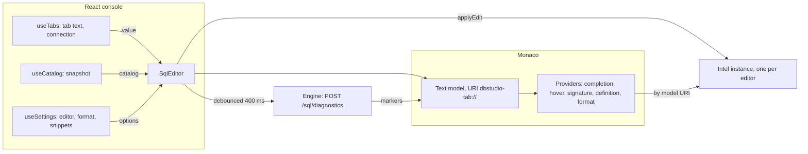
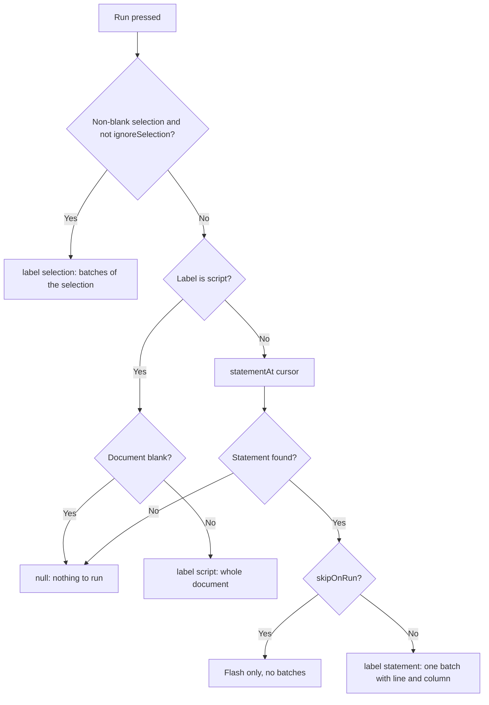
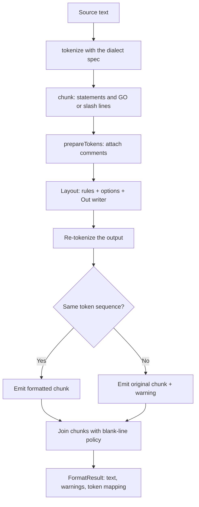

# 12. ویرایشگر، قالب‌بند، snippetها و تاریخچه محلی

> **سطح:** L2 حرفه‌ای ← L3 ارشد | **بخش:** II | **کد خوانده‌شده در:** `a61f3d1` (Rowlit 1.6.3؛ تاریخچه محلی که `docs/release-notes/v1.7.0.md` اعلام کرده در این درخت هست)
> **زبان:** فارسی | [English](../../en/part2/12-editor-and-formatter.md) | قبلی: [11. IntelliSense](./11-intellisense.md) | بعدی: [13. گرید نتایج و ویرایش داده](./13-results-grid-and-data-editing.md)
> برچسب‌های نمودارها به انگلیسی نگه داشته شده‌اند تا در GitHub درست نمایش داده شوند.
> **در یک جمله:** کنسول یک ویرایشگر Monaco است که به موتور IntelliSense، یک قالب‌بند توکن‌محور که ثابت می‌کند معنای SQL را عوض نکرده، کتابخانه‌ای از snippetها و خط زمانی خصوصی هر متنِ اجراشده وصل شده است.
> **یاد می‌گیرید:**
> - `SqlEditor` چطور Monaco را سوار می‌کند، keymap شما را در آن می‌بندد و تصمیم می‌گیرد «Run» یعنی چه (`run-target.ts`)؛
> - تشخیص‌های soft، سرور و اجرا چطور به marker تبدیل می‌شوند؛
> - قالب‌بند چطور توکن‌ها را می‌چیند و چرا بررسی برابری توکن آن را ایمن می‌کند؛
> - snippetها، قالب‌های postfix و انتخابگر Ctrl+J چطور کار می‌کنند؛
> - تاریخچه محلی چطور snapshot می‌گیرد، ذخیره و بازیابی می‌کند.
> **پیش‌نیازها:** [02. تور برنامه](./02-tour-of-the-app.md)، [11. IntelliSense](./11-intellisense.md)، [08. اتصال‌ها، نشست‌ها و اجرای SQL](./08-connections-sessions-execution.md).

## 1. ایده (مبتدی)

کنسول SQL شبیه یک کادر متن است، اما دور متن کارهای زیادی انجام می‌شود. کلمه‌ها بر اساس نقششان رنگ می‌گیرند (کلیدواژه، جدول، رشته). هنگام تایپ فهرست پیشنهاد باز می‌شود. خط‌های قرمز اشتباه‌ها را نشان می‌دهند. Ctrl+Enter فقط دستورِ زیر مکان‌نما را اجرا می‌کند، نه کل فایل را. یک دکمه SQL درهم را به چیدمان استاندارد درمی‌آورد. و اگر پرس‌وجویی را اشتباهی پاک کنید می‌توانید به گذشته برگردید.

Rowlit ویرایشگر متن را از صفر نمی‌نویسد. **[Monaco](../glossary.md#monaco)**، ویرایشگر Visual Studio Code، را جاسازی می‌کند و SQL را به آن یاد می‌دهد. کد خود Rowlit چهار چیزی را اضافه می‌کند که Monaco ندارد: شناخت پایگاه داده‌ی شما (فصل [11](./11-intellisense.md))، یک **[قالب‌بند (formatter)](../glossary.md#formatter)** SQL، کتابخانه‌ای از **[snippetها](../glossary.md#snippet)** و **[تاریخچه محلی](../glossary.md#local-history)**. قاعده‌ای که همه را شکل می‌دهد یکی است: **چیزی را که کاربر نوشته بدون اثبات ناتغییر ماندن معنا تغییر نده، و هرگز متنش را از دست نده.**

## 2. چطور کار می‌کند (حرفه‌ای)

### 2.1 Monaco در Rowlit

`SqlEditor` (`ui/src/editor/SqlEditor.tsx`) یک کامپوننت React است که قرارداد `SqlEditor.types.ts` را پیاده می‌کند. چند ویرایشگر هم‌زمان وجود دارند (یکی برای هر کنسول، به‌علاوه‌ی پیش‌نمایش‌های طراح)، پس فایل در ابتدایش قاعده‌ای را اعلام می‌کند: هر میان‌بر یک action مخصوص همان ویرایشگر است (`addAction`)، ثبت‌های سراسری Monaco فقط یک بار انجام می‌شود (`ensureMonacoSetup`) و providerهای زبان IntelliSense ویرایشگر درست را از راه URI مدل پیدا می‌کنند (`registry.ts`).

**شکل ۱۲.۱ — ویرایشگر، IntelliSense و استورها.**

هنگام mount (`SqlEditor.tsx:211-403`) کامپوننت:

1. اگر گویش از گونه‌ی تنبل‌بارگذاری‌شده باشد منتظر spec آن می‌ماند (`ensureDialect`، [فصل 11](./11-intellisense.md))؛
2. یک نمونه‌ی `Intel` برای گویش می‌سازد و کاتالوگ، تاریخچه استفاده، حل‌کننده‌ی synonym عمومی (Oracle) و برای T-SQL درخواست‌دهنده‌ی پایگاه داده و کاتالوگ پایگاه‌های داده‌ی دیگر را به آن می‌دهد؛
3. یک مدل Monaco با URI به شکل `dbstudio-tab://tab/<tabId>.sql` و شناسه زبان گویش می‌سازد (`LANGUAGE_IDS`، `monaco-setup.ts:19-31`: `dbstudio-tsql`، `dbstudio-plsql`، `dbstudio-sqlite`، `dbstudio-pgsql`، `dbstudio-mysql`، `dbstudio-clickhouse`، `dbstudio-snowflake`، `dbstudio-cql`، `dbstudio-duckdb`)؛
4. ویرایشگر را با گزینه‌های مشترک همه‌ی نمونه‌های Monaco برنامه (`baseMonacoOptions`، `monacoOptions.ts:13-25`: DOM روشن به جای shadow root تا متغیرهای پوسته کار کنند، پشته فونت کد برنامه، اسکرول‌بار باریک) به‌علاوه‌ی گزینه‌های خودش می‌سازد: بدون minimap، `quickSuggestionsDelay: 0`، `wordBasedSuggestions: 'off'`، تأخیر hover برابر ۳۵۰ ms، بدون رنگ‌آمیزی جفت پرانتز (`SqlEditor.tsx:235-264`)؛
5. هر تغییر محتوای Monaco را به `intel.applyEdit` (یک تغییر) یا `setDocument` (چند تغییر) می‌دهد که lexer افزایشی را همگام نگه می‌دارد.

دو ورودی کپی یک‌طرفه‌اند. متن تب از راه `props.value` وارد می‌شود؛ اگر با مدل فرق داشته باشد کامپوننت آن را با `pushEditOperations` و یک پرچم محافظ اعمال می‌کند تا تغییر دوباره بازتاب نشود (`SqlEditor.tsx:407-416`). کاتالوگ از راه `props.catalog` می‌آید؛ کاتالوگ تازه تشخیص‌های soft را تازه می‌کند و اگر ردیف «Loading <schema>...» روی صفحه باشد فهرست پیشنهاد را دوباره می‌سازد (`SqlEditor.tsx:418-428`).

**پوسته‌های کد و اندازه فونت.** Monaco دو پوسته‌ی ثبت‌شده دارد، `dbstudio-light` و `dbstudio-dark` (`THEME_IDS`)؛ ۲۲ پوسته‌ی کد فصل [20](./20-ui-architecture.md) رنگ‌هایشان را در زمان اجرا از راه `theme/monacoTheme.ts` بازنویسی می‌کنند. اندازه فونت زنده با `settings.editor.fontSize` می‌چرخد و Ctrl + چرخ ماوس (Cmd + چرخ در macOS) آن را یک پیکسل تغییر می‌دهد، محدود به ۹ تا ۳۲؛ یک `WheelStepper` برای هر گام ۶۰ پیکسل حرکت چرخ جمع می‌کند تا ترک‌پد نپرد (`editor/fontZoom.ts:1-50`). بزرگنمایی کل پنجره و گرید نتایج تحت تأثیر نیستند.

### 2.2 کلیدها: فرمان‌ها به actionهای Monaco تبدیل می‌شوند

Rowlit اجازه می‌دهد میان‌برها را عوض کنید ([فصل 20](./20-ui-architecture.md))، اما Monaco کلید یک action را هنگام افزودنش تثبیت می‌کند و بعداً نمی‌توان تغییرش داد. `bindCommandActions` (`editor/keyActions.ts:96-121`) این را حل می‌کند: برای هر فرمان رجیستری که action ویرایشگر دارد (Run statement، Run script، Format selection، Insert snippet، هر دو Explain، Trigger suggest، Local history، Open definition DDL)، میان‌برهای *فعلی* فرمان را با `shortcutToMonaco` به کد کلید Monaco تبدیل و action را ثبت می‌کند؛ وقتی keymap عوض شود action را dispose و با کلیدهای جدید دوباره اضافه می‌کند. میان‌بری که Monaco نتواند بیان کند (chord بیش از دو ضربه، کلید ناشناخته) بی‌صدا کنار گذاشته می‌شود. همه‌چیز اینجا مستقل از فریم‌ورک است: فضای نام Monaco به تابع داده می‌شود و آزمون‌ها ویرایشگر جعلی به کار می‌برند.

نیمه‌ی دیگر این است که چه کسی در فشردن کلید برنده است. dispatcher سراسری ([فصل 20](./20-ui-architecture.md)) در فاز capture گوش می‌دهد، اما فهرست `EDITOR_OWNED_KEYS` (Ctrl+Enter، F5، Ctrl+F، Ctrl+Z ...) تا وقتی ویرایشگر focus دارد به Monaco سپرده می‌شود. همین فایل عمداً Ctrl+L / Ctrl+Shift+L (Explain)، Ctrl+P (go to object) و Ctrl+J (snippetها) را مالک نمی‌شود (`dispatcher.ts:14-22`). وقتی کاربر فرمانی را از کلید مالکیت‌شده کنار بزند `isEditorOwned` کلید را آزاد می‌کند.

Escape فقط وقتی اجرای در حال انجام را لغو می‌کند که هیچ چیز دیگری آن را نخواهد: precondition این action ابزارک suggest، راهنمای پارامتر، find، حالت snippet، چند مکان‌نما، کادر rename و موارد دیگر را فهرست می‌کند (`SqlEditor.tsx:36`).

### 2.3 «Run» چه چیزی را اجرا می‌کند: `run-target.ts`

پرکاربردترین تابع ویرایشگر ۳۰ خط است (`ui/src/editor/run-target.ts:20-45`). `resolveRunTarget` با برچسب اجرا، آفست مکان‌نما و انتخاب تصمیم می‌گیرد:

**شکل ۱۲.۲ — انتخاب متنی که اجرا می‌شود.**

مرزهای دستور از splitter مربوط به IntelliSense می‌آیند (`intel.statementAt`، `batchesFor`) که `;`، `GO`، `DELIMITER`، `/` و `$$` را برای هر گویش می‌شناسد و اختیاری یک خط خالی را جداکننده می‌گیرد (`settings.editor.blankLineSplitsStatements`). هر batch **خط و ستون** آغازش را دارد؛ به همین ترتیب خطایی در «خط ۲ دستور» به خط درست سند تبدیل می‌شود. `ignoreSelection` برای یک مورد هست: Ctrl+S در کنسول «Edit:» کل سند را ذخیره می‌کند حتی اگر انتخابی داشته باشید ([فصل 14](./14-designers-and-ddl.md)). پس از محاسبه‌ی هدف، ویرایشگر محدوده را ۶۵۰ ms چشمک می‌زند (`flash`، `SqlEditor.tsx:106-114`) و فهرست suggest و راهنمای پارامتر را می‌بندد (`dismissEditorPopups`) تا Enter بعدی پیشنهادی را نپذیرد.

قابلیتی کوچک و مرتبط: وقتی دستور زیر مکان‌نما bind parameter دارد، بعد از خط اول آن یک راهنمای کمرنگ مثل «2 parameters · Ctrl+Alt+P to edit» نشان داده می‌شود (`param-hint.ts`، `SqlEditor.tsx:130-160`، با debounce برابر ۱۵۰ ms).

### 2.4 Markerها: سه مالک

«Marker»های Monaco همان خط‌های موج‌دارند. Rowlit سه مالک مستقل نگه می‌دارد تا یک منبع هرگز منبع دیگر را پاک نکند (`editor/markers-core.ts:6`):

| مالک | منبع | زمان |
|---|---|---|
| `dbstudio-semantic` | تشخیص‌های soft از `intel.softDiagnostics` (جدول ناشناخته، ستون مبهم ...) | ۲۵۰ ms پس از هر تغییر و هنگام تغییر کاتالوگ |
| `dbstudio-syntax` | تشخیص‌های سرور: `POST /sql/diagnostics` (ScriptDom برای T-SQL، `Prepare` برای SQLite و PostgreSQL) | debounce برابر ۴۰۰ ms با `LatestRequest`؛ اگر نسخه‌ی مدل جلو رفته باشد نتیجه دور ریخته می‌شود |
| `dbstudio-external` | تشخیص‌های آخرین اجرا (`exec.diagnostics`، `props.externalDiagnostics`) نگاشت‌شده به خط‌های سند | وقتی اجرا تمام می‌شود |

`softMarkers` و `serverMarkers` تبدیل‌های خالص‌اند (`markers-core.ts:15-41`)؛ بازه‌ی خالی به کلمه‌ی همان موقعیت یا یک نویسه گسترش می‌یابد. قالب‌بند مالک چهارمی دارد، `dbstudio.format`، برای هشدارهای «statement left unformatted» (`actions.ts:12`). `suggestIdentifier` با فاصله‌ی بهینه‌ی string alignment و حداکثر حدود یک ویرایش در هر چهار نویسه «منظورتان `Customers` بود؟» را پیشنهاد می‌دهد (`markers-core.ts:43-80`).

### 2.5 اشیای پشت مکان‌نما

`editor/object-uri.ts` URIهای ساختگی `dbstudio-object://<connection>/<db>/<schema>/<type>/<name>[?column=&owner=]` می‌سازد تا «go to definition» در Monaco بتواند به شیء کاتالوگ که فایل نیست اشاره کند. F12 یا Ctrl+click **داده‌ی** جدول را باز می‌کند؛ Alt+F12 («Open definition (DDL)») تب شیء را (`object-uri.ts:40-46`). متن hover چنین پیوندی می‌گوید کدام کلید چه می‌کند.

### 2.6 قالب‌بند

`ui/src/format` TypeScript ساده است، بدون React، Monaco یا DOM، و روی lexer مربوط به IntelliSense ساخته شده. API عمومی‌اش در `format/index.ts` است: `formatSql(text, dialect, options)`، `formatRange` و `mapOffset`.

**شکل ۱۲.۳ — خط لوله‌ی قالب‌بند برای یک سند.**

1. **تکه‌بندی (chunking)** (`chunksOf`، `index.ts:64-111`). سند به تکه‌های سطح بالا بریده می‌شود: یک دستور با `;` پایانی و توضیح‌های هم‌خط، یا یک خط جداکننده (`GO`، `/`، `DELIMITER ...` در MySQL). T-SQL خاص است: دستورها `;` نمی‌خواهند و چیدمان کلیدواژه‌ها را سر خط می‌گذارد، پس شکستن دوباره‌ی خروجی ممکن است فرق کند. بنابراین یک batch کامل `GO` یک تکه است و چیدمان دستورها را درون آن پیدا می‌کند (`batchChunks`، `index.ts:50-62`).
2. **توضیح‌ها** (`format/comments.ts`). هر توضیح با یکی از سه نقش به همسایه‌ای وصل می‌شود: *trailing* (هم‌خط با توکن قبلی)، *inline* (بین دو توکن یک خط) یا *leading* (خط جدا). متن توضیح هرگز تغییر نمی‌کند، جز اینکه خط‌های ادامه‌ی توضیح بلوکی چندخطی به اندازه‌ی جابه‌جایی خط اول جابه‌جا می‌شوند.
3. **چیدمان (layout)** (`format/layout.ts`، حدود ۲٬۰۰۰ خط). یک گذر چپ‌به‌راست با نزول بازگشتی روی بلوک‌ها (`BEGIN...END`، `IF`، `LOOP`، packageها، triggerها)، دستورها (کلیدواژه‌های بند، فهرست‌ها، JOIN، AND/OR)، پرانتزها و CASE. جدول‌های هر گویش در `format/rules/` هستند (`FormatRules`: کلمه‌های آغاز دستور، کلمه‌هایی که دستور بعدشان نمی‌تواند تمام شود، کلیدواژه‌های شبیه تابع، بندهای شرط، بندهای اضافی مثل `PREWHERE`/`SETTINGS` در ClickHouse). برای هر نُه گویش فایل rules هست: `tsql`، `plsql`، `sqlite`، `pgsql`، `mysql`، `clickhouse`، `snowflake`، `cql`، `duckdb`. چهار تای اول جدول ایستا در `layout.ts` هستند؛ بقیه از کارخانه‌ی `formatRules` در spec گویش می‌آیند (و در غیر این صورت به جدول SQLite برمی‌گردند) (`layout.ts:30-47`). خروجی از `Out` می‌گذرد، نویسنده‌ی خطی که هرگز فاصله‌ی انتهای خط نمی‌گذارد، ستون دیداری را برای تصمیم عرض خط دنبال می‌کند و شکست خط را تنبل مادی می‌کند تا توضیح معلق در تورفتگی درست بنشیند (`format/out.ts`).
4. **بررسی ایمنی** (`layout`، `index.ts:295-302`). تکه‌ی خروجی دوباره lex و با توکن‌های ورودی مقایسه می‌شود (`sameTokens`): کلیدواژه‌ها، شناسه‌ها، عملگرها و جداکننده‌های batch با متن بزرگ‌شده مقایسه می‌شوند (فقط حروف بزرگ/کوچک می‌توانند فرق کنند)، توضیح‌ها با متن به‌جز تورفتگی توضیح بلوکی، و بقیه دقیقاً. `;` می‌تواند جلوی توضیح‌هایی که درست قبلش هستند برود. اگر چیزی فرق کند، یا تکه رشته/توضیح/شناسه‌ی نقل‌قول‌شده‌ی ناتمام داشته باشد، **متن اصلی خارج می‌شود** و هشداری مثل «Statement at line 7 left unformatted: layout check failed» برمی‌گردد.
5. **همگام‌سازی دوباره** (`resyncPoint`، `index.ts:240-263`). یک دستور خراب نباید بقیه‌ی سند را بی‌قالب بگذارد؛ پس قالب‌بند دنبال نقطه‌ی برش می‌گردد (بعد از `;`، یا پیش از کلیدواژه‌ی دستور در ستون ۱ خارج از پرانتز) و آنچه را بعدش می‌آید قالب می‌زند. هرگز درون بدنه‌ی رویه نمی‌برد (`tokenContext` بدنه‌ی `CREATE PROCEDURE/FUNCTION/TRIGGER/PACKAGE`، `ALTER` همان‌ها در T-SQL و تودرتویی `BEGIN/CASE/END` را دنبال می‌کند).
6. **بدنه‌های PostgreSQL.** بدنه‌ی `$$ ... $$` برای lexer یک توکن رشته‌ای است، پس بی‌دست‌خوردگی از بررسی توکن رد می‌شود و عیناً می‌ماند (تصمیم D-PG10 در `docs/PLAN-PG.md`، `rules/pgsql.ts:1`). فقط سرآیند `CREATE FUNCTION` هر ویژگی را در یک خط می‌گیرد.
7. **مکان‌نما و خودتوان‌بودن (idempotency).** `mapOffset` موقعیتی در متن قدیم را از راه جدول توکن‌به‌توکن (تنبل، در اولین استفاده محاسبه می‌شود) به متن جدید نگاشت می‌کند، پس مکان‌نما روی همان توکن می‌ماند. تصمیم‌های چیدمان فقط به دنباله‌ی توکن‌ها، جای توضیح‌ها و تعداد خط‌های خالی بستگی دارند، که قالب‌زدن را idempotent می‌کند (`layout.ts:5-9`).

**گزینه‌ها** همان `FormatOptions` در `settings.format` هستند که `resolveFormatOptions` اعتبارسنجی و محدودشان می‌کند (`format/options.ts`):

| گزینه | پیش‌فرض | بازه / مقدارها |
|---|---|---|
| `keywordCase`، `identifierCase`، `functionCase`، `datatypeCase` | `upper`، `asIs`، `upper`، `upper` | `upper`، `lower`، `asIs` |
| `indent` / `useTabs` | 4 / false | 1-8 |
| `commaStyle` | `trailing` | `trailing`، `leading` |
| `lineWidth` | 120 | 40-400 |
| `clauseKeywordsOnOwnLine`، `andOrOnNewLine`، `alignAliases` | true، true، false | boolean |
| `blankLineBetweenStatements` / `maxConsecutiveBlankLines` | 1 / 1 | 0-3 / 0-5 |
| `formatDdlOnOpen` | true | boolean |

حالت حروف شناسه تنها گزینه‌ای است که به نام‌ها دست می‌زند و پیش‌فرضش `asIs` است: نام‌ها هیچ‌وقت عوض نمی‌شوند مگر بخواهید. در ویرایشگر، قالب‌بند به‌صورت provider خود Monaco برای **Format Document** (`monaco-setup.ts:175-205`؛ Monaco نتیجه را به ویرایش‌های کمینه diff می‌کند و مکان‌نما سر جایش می‌ماند) و actionهای `editor/actions.ts` (`formatDocument`، `formatSelection` با undo stop دور ویرایش) ظاهر می‌شود. میان‌برها: Shift+Alt+F و Ctrl+Alt+L برای سند، Ctrl+K Ctrl+F برای انتخاب یا دستور زیر مکان‌نما. Ctrl+Alt+L یک key handler است نه keybinding Monaco، پس AltGr+L («ł» در صفحه‌کلید لهستانی) هنوز حرفش را تایپ می‌کند (`SqlEditor.tsx:366-381`).

**DDL قالب‌خورده.** پنل DDL تب شیء کلید «Formatted» دارد که `useFormattedDdl` پشتیبانش است (`editor/formatted-ddl.ts`): DDL ذخیره‌شده را با همین موتور قالب می‌زند (پیش‌فرض روشن، `formatDdlOnOpen`) و تعداد دستورهایی را که دست‌نخورده ماندند نشان می‌دهد.

**آزمون برابری برای T-SQL.** `engine/tests/DbStudio.Core.Tests/FormatterParity/FormatterParityTests.cs` از بررسی توکن فراتر می‌رود: برای هر جفت fixture زیر `ui/src/format/__tests__/fixtures/tsql/` ورودی و خروجی قالب‌خورده را با ScriptDom مایکروسافت پارس می‌کند و جریان توکن یکسان (بدون توجه به فاصله، توضیح و حروف کلیدواژه) و درخت پارس یکسان می‌خواهد. قالب‌بند TypeScript است، اثبات C#.

### 2.7 snippetها

snippet یک نام، یک پیشوند، یک فیلتر گویش اختیاری و بدنه‌ای در نحو snippet Monaco است (`$1`، `${1:default}`، `$0`، `\$` برای دلار تحت‌اللفظی). کتابخانه‌ی داخلی در `ui/src/snippets/data/<dialect>.ts` است و برای هر گویش به‌صورت تنبل بارگذاری می‌شود (`ensureBuiltins`)؛ تقریباً ۱۰۰ snippet برای هر گویش (شمارش ورودی‌های `s(...)`: tsql 116، plsql 107، pgsql 120، mysql 98، snowflake 107، clickhouse 100، duckdb 98، sqlite 67، cql 64) در پنج دسته: Query، DML، DDL، Programmability، DBA.

از سه راه ظاهر می‌شوند (`snippets/index.ts`):

- **تکمیل در آغاز دستور**، با رتبه‌ی پایین‌تر از تطبیق دقیق کلیدواژه (`snippetSource`، پایه‌ی امتیاز ۸۰۰۰).
- **انتخابگر Ctrl+J** (`snippet.insert`): `openSnippetPicker` پرچم `binding.snippetPicker` را می‌گذارد و suggest را راه می‌اندازد تا provider فقط snippetها را برگرداند؛ وقتی چیزی تایپ نشده بر اساس دسته گروه می‌شوند و در غیر این صورت بر اساس تطبیق پیشوند، نام، دسته و توضیح رتبه می‌گیرند (`snippetPickerItems`).
- **قالب‌های postfix** (`Customers.sel`) که `intel/complete/postfix` می‌دهد.

snippetهای کاربر در `settings.snippets` ذخیره می‌شوند (فهرست با patch کامل جایگزین می‌شود). `snippetsFor` آن‌ها را روی داخلی‌ها می‌گذارد: snippet کاربر با همان پیشوند، نمونه‌ی داخلی را جایگزین می‌کند. `validateSnippet` نام، پیشوندی از حروف، ارقام و `_ . -` که با حرف شروع شود، پیشوند یکتا، بدنه‌ی ناخالی و `${...}`های متوازن می‌خواهد (فرار با بک‌اسلش پیش از `$`، `}` یا `\` است). `snippetPreview` آنچه Monaco درج می‌کند را نشان می‌دهد (پیش‌فرض‌ها پر، mirrorها حل‌شده). ویرایشگر آن **Settings → Snippets** است (`components/SnippetsSettings`)، یک tab view با ویرایشگر بدنه‌ی Monaco و پیش‌نمایش رنگی.

### 2.8 تاریخچه محلی

تاریخچه محلی تور ایمنی DataGrip است. هر کنسول یک خط زمانی خصوصی و فشرده از متنش دارد.

**چه چیزی snapshot می‌زند** (`components/LocalHistory/capture.ts`، یک بار از ماژول فرمان‌ها راه می‌افتد). `startLocalHistoryCapture` در استورها مشترک می‌شود و هرگز ویرایشگر را لمس نمی‌کند:

- کنسولی ظاهر می‌شود (فایل یا پرس‌وجوی ذخیره‌شده باز شده، workspace بازیابی شده) - snapshot پایه، دلیل `auto`؛
- متن ذخیره‌شده عوض می‌شود (Save، Save as، Save query، کنسول «Edit:» که در پایگاه داده ذخیره شد) - دلیل `save`؛
- کنسولی بسته می‌شود - دلیل `close` با آخرین متن؛
- اجرای تازه‌ای در کنسول آغاز می‌شود - دلیل `run`؛
- متن تغییر کرده و دو دقیقه گذشته - دلیل `auto`، حداکثر یکی در هر `AUTO_INTERVAL_MS` = ۲ دقیقه (`capture.ts:15`)؛ وقتی صفحه پنهان شود زمان‌سنج‌های منتظر flush می‌شوند.

متن خالی، متن بیش از ۵٬۰۰۰٬۰۰۰ نویسه و متن مشابه آخرین snapshot همان کلید در سمت کلاینت دور ریخته می‌شود و موتور هم متن مشابه را دوباره رد می‌کند. Settings → Editor → «Keep local history» کل ماجرا را خاموش می‌کند (`settings.ui.localHistory`) و مدت نگهداری را به روز تعیین می‌کند (۱ تا ۳۶۵، پیش‌فرض ۳۰) (`LocalHistory/settings.ts`).

**تاریخچه‌ی چه کسی؟** هویت کنسول عوض می‌شود: کنسول موقت بعداً در فایل ذخیره می‌شود، فایل بعد از راه‌اندازی مجدد در تب تازه باز می‌شود، پرس‌وجو تغییر نام می‌دهد. پس `keys.ts` به هر تب یک *کلید اصلی* و نام‌های مستعار می‌دهد: `q:<savedQueryId>`، `o:<connection>|<db>|<schema>|<type>|<name>` برای کنسول «Edit:» با F4، `f:<file path>` و در غیر این صورت `t:<tabId>` (`keys.ts:12-37`). snapshotهای تازه به کلید اصلی می‌روند؛ نمای تاریخچه اجتماع کلید اصلی، `t:<tabId>` و کلید فایل را فهرست می‌کند، پس کنسولی که بعداً ذخیره شد تاریخچه‌ی پیشینش را نگه می‌دارد.

**سمت موتور.** `LocalHistoryService` (`engine/src/DbStudio.Core/LocalHistory/LocalHistoryService.cs`) snapshotها را در SQLite می‌ریزد، فایل `local-history.db` کنار `history.db` (حالت WAL)، جدول `snapshots(id, key, at, reason, label, title, size, hash, bytes, data)`. متن با gzip فشرده می‌شود (`CompressionLevel.Fastest`)؛ `hash` همان SHA-256 متن است. `AddAsync` اگر هش با آخرین snapshot کلید برابر باشد رد می‌کند (و اگر برچسبی داده شده باشد همان را برچسب می‌زند)، وگرنه درج می‌کند و کلید را به ۲۰۰ snapshot بدون برچسب (`DefaultPerKey`) می‌برد. پاکسازی سن (پیش‌فرض ۳۰ روز) و سقف اندازه‌ی کل (`DefaultMaxBytes` = ۲۰ مگابایت) را اعمال می‌کند، یک بار هنگام اولین بازشدن پایگاه داده در یک اجرای موتور و یک بار در هر نشست رابط پس از اولین snapshot ذخیره‌شده با روزهای نگهداری کاربر اجرا می‌شود. **snapshot برچسب‌دار هرگز پاک یا کوتاه نمی‌شود**: برچسب یعنی «این را نگه دار» (خلاصه‌ی کلاس، `LocalHistoryService.cs:41-50`).

| مسیر | کاربرد |
|---|---|
| `POST /local-history` | افزودن `{key, text, reason, label?, title?}` ← `{id, added}` |
| `GET /local-history?key=&key=&limit=&before=` | فهرست (تا ۸ کلید، جدیدترین اول، بدون متن؛ limit تا ۵۰۰) |
| `GET /local-history/{id}` | یک snapshot با متنش |
| `PATCH /local-history/{id}` | گذاشتن یا پاک کردن برچسب (حداکثر ۲۰۰ نویسه) |
| `DELETE /local-history/{id}`، `DELETE /local-history?key=` | حذف یکی، یا پاک کردن کلیدها |
| `POST /local-history/prune` | `{days?, maxBytes?, perKey?}` |

(کلیدها در query string یا بدنه می‌روند نه مسیر، چون مسیر فایل اسلش دارد: `LocalHistoryModule.cs:11-20`.)

**نما.** **Ctrl+Alt+H** (فرمان `editor.localHistory`، همچنین در منوی Edit، منوهای زمینه‌ی ویرایشگر و تب، و پالت) تب `LocalHistoryView` تنبل را برای هر کنسول باز می‌کند: خط زمانی سمت چپ گروه‌شده بر اساس روز با دلیل، زمان و تغییر اندازه نسبت به snapshot قبلی، یک diff کنار‌به‌کنار Monaco با **متن فعلی ویرایشگر** سمت راست، و Restore، Copy، Label و Delete. **Restore ابتدا متنی را که جایگزین می‌کند ذخیره می‌کند** (دلیل `restore`، `LocalHistoryView.tsx:100-106`) پس خود restore هم از همان فهرست برگشت‌پذیر است.

## 3. کاوش عمیق (ارشد)

> **کاوش عمیق (L3): چرا قالب‌بند توکن را وارسی می‌کند و به خودش اعتماد نمی‌کند**
>
> قالب‌بندی که ۹۹٪ درست است بدتر از هیچ است، چون آن ۱٪ بی‌صدا یک پرس‌وجو را عوض می‌کند. پاسخ Rowlit این است که موتور چیدمان را *تولیدکننده‌ی پیشنهاد غیرقابل‌اعتماد* بداند و پشتش یک وارسی‌گر کوچک و ساده بگذارد. وارسی‌گر ساده است چون تعریف برابری‌اش ساده است: دنباله‌ی توکن، با این اجازه که فقط حروف کلمه‌ها و جای `;` نسبت به توضیح‌ها فرق کند. هر چه چیدمان قانوناً می‌تواند عوض کند (فاصله، شکست خط، تورفتگی) توکن نیست. این قیدهای عجیب را هم توضیح می‌دهد: چرا batchهای T-SQL یک تکه‌اند (برداشت splitter از آغاز دستور به سر خط‌ها بستگی دارد که چیدمان آن‌ها را عوض می‌کند)، چرا بدنه‌های `$$` رایگان رد می‌شوند (یک توکن رشته‌ای) و چرا توضیح‌ها با موقعیت دوباره وصل می‌شوند نه اینکه دوباره جاری شوند.
>
> هزینه‌ی طراحی این است که *شکست محلی و دیدنی است*: تکه‌ای که بررسی را رد کند همان‌طور که کاربر تایپ کرده می‌ماند و با marker هشدار علامت می‌خورد، پس یک ساختار غریب نمی‌تواند فایل را خراب کند. بهای پرداخت‌شده پوشش است: ساختاری که موتور چیدمان نتواند پارس کند (`problem` تنظیم شده) به حالت بدون تغییر برمی‌گردد و کاربر به جای دستور نیمه‌قالب‌خورده «left unformatted» می‌بیند.
>
> **چرا provider قالب‌بندی Monaco و نه فقط `executeEdits`.** `registerDocumentFormattingEditProvider` یک ویرایش تمام‌بازه برمی‌گرداند؛ Monaco آن را با مدل diff می‌کند و ویرایش‌های کمینه اعمال می‌کند، که مکان‌نما، تاشوها و decorationها را سر جایشان نگه می‌دارد. مسیر نوار ابزار (`actions.ts`) در عوض خودش بازه را جایگزین می‌کند و مکان‌نما را با `mapOffset` برمی‌گرداند؛ هر دو مسیر همان markerهای `dbstudio.format` را می‌نویسند، با شنونده‌ی محتوای کوتاه‌عمر تا تایپ بعدی هرگز علامت نخورد (`monaco-setup.ts:181-192`).
>
> **چرا تاریخچه محلی در موتور است.** رندرر می‌توانست snapshotها را در IndexedDB نگه دارد، اما موتور بین همه‌ی پنجره‌ها مشترک است و از reload جان به در می‌برد، پس یک `local-history.db` هم به پنجره‌های جداشده و هم به رندرر راه‌اندازی‌شده‌ی مجدد خدمت می‌کند. همچنین به موتور اجازه می‌دهد سقف اندازه را روی دیسک ماشین اعمال کند حتی اگر رابط دیگر هرگز اجرا نشود. کار رندرر فقط *چه وقت* snapshot گرفتن است؛ موتور تصمیم می‌گیرد *آیا* (هش) و *تا کی نگه دارد*.

## 4. موارد لبه‌ای و محدودیت‌ها

| موضوع | واقعیت | منبع |
|---|---|---|
| Run با انتخاب | انتخاب بر دستور و اسکریپت می‌چربد | `run-target.ts:24-29` |
| دستور با `skipOnRun` | چشمک می‌زند، چیزی فرستاده نمی‌شود | `run-target.ts:38` |
| debounce تشخیص soft / سرور | ۲۵۰ ms / ۴۰۰ ms | `SqlEditor.tsx:79`، `63` |
| اندازه فونت ویرایشگر | ۹-۳۲ px، هر ۶۰ px چرخ یک px | `fontZoom.ts:15-30` |
| قالب‌بند: رشته یا توضیح ناتمام | تکه عیناً + هشدار | `format/index.ts:297` |
| محدودیت گزینه‌های قالب‌بند | indent 1-8، عرض 40-400 | `format/options.ts:47-52` |
| فاصله‌ی auto در تاریخچه محلی | ۲ دقیقه | `capture.ts:15` |
| تاریخچه محلی برای هر کلید / سن / اندازه | ۲۰۰ / ۳۰ روز / ۲۰ MB (برچسب‌دار هرگز حذف نمی‌شود) | `LocalHistoryService.cs:53-60` |
| سقف متن تاریخچه محلی | ۵٬۰۰۰٬۰۰۰ نویسه | `LocalHistoryService.cs:56` |
| کلید در هر درخواست فهرست | ۸ | `LocalHistoryModule.cs:58` |
| کدهای خطا | `VALIDATION` برای کلید/متن/دلیل/برچسب بد، `NOT_FOUND` برای snapshot ناشناخته | `LocalHistoryService.cs`، `LocalHistoryModule.cs:46` |

## 5. چطور آزموده می‌شود

- **ویرایشگر.** `editor/keyActions.test.ts` (تبدیل کلید و ثبت دوباره بدون Monaco)، `editor-core.test.ts`، `fontZoom.test.ts`، `suggest-guard.test.ts`، `suggestKey.test.ts`، `definition-nav.test.ts`، `run-popups.test.ts`. حل‌کننده‌ی run-target خالص است و بدون Monaco آزموده می‌شود.
- **قالب‌بند.** `format/__tests__/format.test.ts`، `fixtures.test.ts` (جفت ورودی/خروجی مورد انتظار برای هر گویش در `fixtures/`)، `mysql.test.ts`، `cql-format.test.ts`؛ آزمون برابری C# بالا؛ آزمون‌های `intel` در پیکربندی node مربوط به vitest اجرا می‌شوند (`npm run test:intel`).
- **snippetها.** `snippets/snippets.test.ts`، `library.test.ts` (هر snippet داخلی معتبر است)، `live.test.ts` (snippetهای علامت‌خورده با `run` در job یکپارچه‌سازی روی سرور واقعی همان‌طور که درج شده‌اند اجرا می‌شوند).
- **تاریخچه محلی.** موتور: `LocalHistory/LocalHistoryServiceTests.cs`، `LocalHistoryEndpointTests.cs`. رابط: `components/LocalHistory/__tests__/`.

## فصل‌های مرتبط

- [11. IntelliSense](./11-intellisense.md) - lexer، splitter و completer که ویرایشگر و قالب‌بند به اشتراک می‌گذارند.
- [14. طراح‌ها، DDL و ویرایش شیء](./14-designers-and-ddl.md) - کنسول‌های «Edit:» با F4 که از `ignoreSelection` و کلید تاریخچه‌ی `o:` استفاده می‌کنند.
- [13. گرید نتایج و ویرایش داده](./13-results-grid-and-data-editing.md) - ردیف‌های اجرا کجا می‌روند.
- [20. معماری رابط کاربری](./20-ui-architecture.md) - رجیستری فرمان، dispatcher و keymap پشت میان‌برها؛ پوسته‌ها.
- بخش I: [I-17 مقایسه گویش‌ها](../part1/17-dialect-comparison.md) - جداکننده‌های batch و delimiterهایی که splitter مدیریت می‌کند.

## اصطلاحات واژه‌نامه که در این فصل آمده‌اند

[Monaco](../glossary.md#monaco)، [language id](../glossary.md#language-id)، [model (Monaco)](../glossary.md#monaco-model)، [marker](../glossary.md#marker)، [decoration](../glossary.md#decoration)، [Monaco action](../glossary.md#monaco-action)، [run target](../glossary.md#run-target)، [formatter](../glossary.md#formatter)، [layout rule](../glossary.md#layout-rule)، [token-equality check](../glossary.md#token-equality-check)، [format options](../glossary.md#format-options)، [snippet](../glossary.md#snippet)، [snippet placeholder](../glossary.md#snippet-placeholder)، [postfix completion](../glossary.md#postfix-completion)، [font zoom](../glossary.md#font-zoom)، [formatted DDL](../glossary.md#formatted-ddl)، [local history](../glossary.md#local-history)، [snapshot (local history)](../glossary.md#local-history-snapshot).

## فایل‌ها

| مسیر | مسئولیت |
|---|---|
| `ui/src/editor/SqlEditor.tsx`، `SqlEditor.types.ts` | کامپوننت و قرارداد آن |
| `ui/src/editor/monaco-setup.ts`، `monacoOptions.ts`، `config.ts` | ثبت Monaco، گزینه‌های مشترک، پیکربندی سراسری ویرایشگر |
| `ui/src/editor/run-target.ts`، `actions.ts`، `keyActions.ts` | تصمیم اجرا، actionهای قالب‌بند/snippet/explain، اتصال keymap |
| `ui/src/editor/markers-core.ts`، `object-uri.ts`، `fontZoom.ts`، `formatted-ddl.ts` | markerها، URIهای شیء، بزرگنمایی فونت، DDL قالب‌خورده |
| `ui/src/format/*` | قالب‌بند: تکه‌بندی، چیدمان، نویسنده، توضیح‌ها، گزینه‌ها، قواعد هر گویش |
| `ui/src/snippets/*`، `components/SnippetsSettings/*` | کتابخانه‌ی snippet، تطبیق، ویرایشگر تنظیمات |
| `ui/src/components/LocalHistory/*` | گرفتن snapshot، کلیدها، نما، diff |
| `engine/src/DbStudio.Core/LocalHistory/*` | ذخیره‌گاه snapshot و مسیرها |
| `engine/tests/DbStudio.Core.Tests/FormatterParity/*` | برابری ScriptDom قالب‌بند T-SQL |

