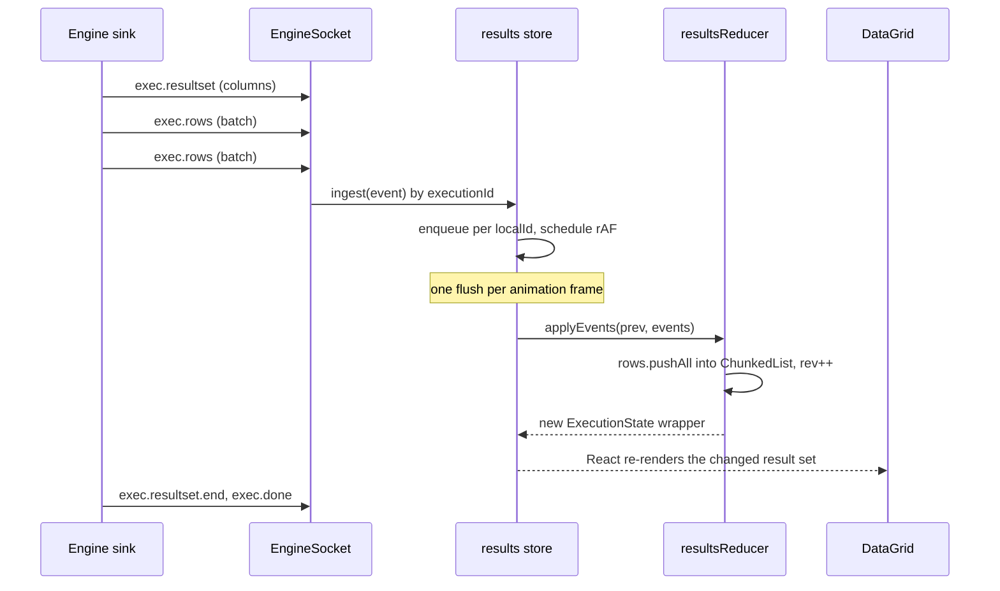
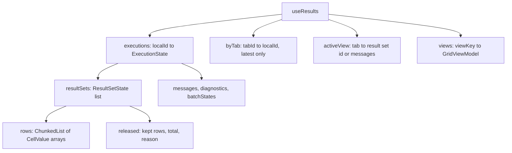
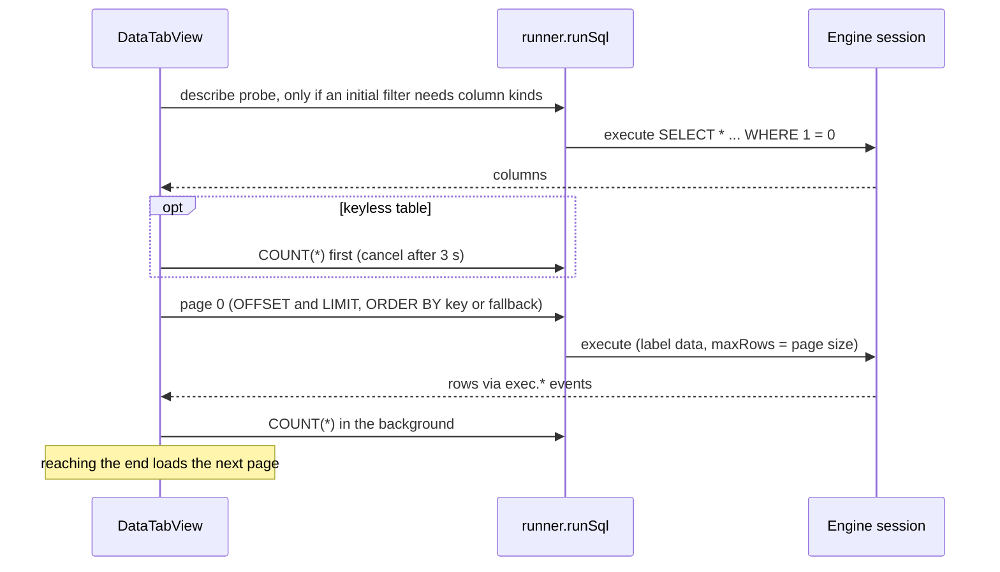
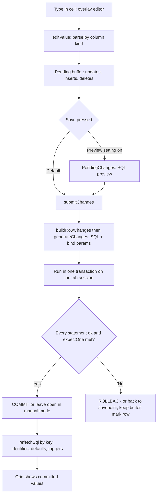
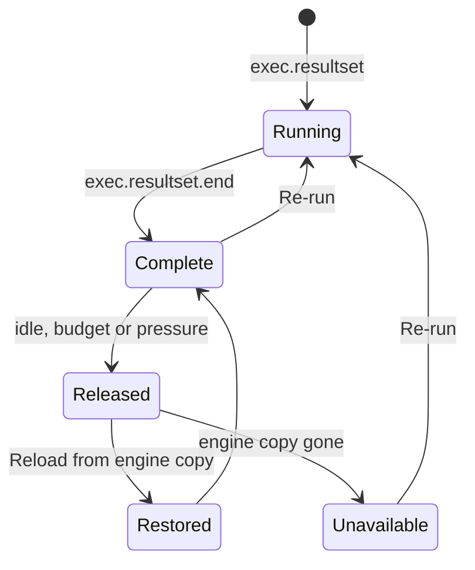
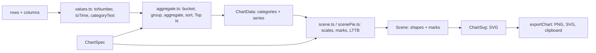

# 13. گرید نتایج، نمودارها و ویرایش داده

> **سطح:** L2 حرفه‌ای ← L3 ارشد | **بخش:** II | **کد خوانده‌شده در:** `a61f3d1` (Rowlit 1.6.3؛ نمودارهای نتیجه که `docs/release-notes/v1.7.0.md` اعلام کرده در این درخت هست)
> **زبان:** فارسی | [English](../../en/part2/13-results-grid-and-data-editing.md) | قبلی: [12. ویرایشگر و قالب‌بند](./12-editor-and-formatter.md) | بعدی: [14. طراح‌ها، DDL و ویرایش شیء](./14-designers-and-ddl.md)
> برچسب‌های نمودارها به انگلیسی نگه داشته شده‌اند تا در GitHub درست نمایش داده شوند.
> **در یک جمله:** سطرها از موتور به یک لیست قطعه‌ای در حافظه جاری می‌شوند، گرید canvas فقط آنچه دیده می‌شود را می‌کشد، و همان داده را می‌توان فیلتر، نمودار، برون‌ریزی و با SQL پارامتری‌شده‌ی تولیدی ویرایش کرد.
> **یاد می‌گیرید:**
> - مسیر یک سطر از `exec.rows` تا سلول رنگ‌شده، و چرا یک فریم واحد کار است؛
> - گرید با اعداد بزرگ، داده‌ی دودویی، متن بلند و متن راست‌به‌چپ چه می‌کند؛
> - فیلترها، فیلتر سریع، نوار تجمیع و record view چطور کار می‌کنند؛
> - تب‌های Data چطور جدول را صفحه‌بندی می‌کنند و ویرایش‌ها چطور با بررسی خوش‌بینانه به `UPDATE`، `INSERT` و `DELETE` تبدیل می‌شوند؛
> - کلید Grid | Chart چطور از همان سطرها نمودار می‌سازد.
> **پیش‌نیازها:** [08. اتصال‌ها، نشست‌ها و اجرای SQL](./08-connections-sessions-execution.md)، [06. پروتکل WebSocket](./06-websocket-protocol.md)، [12. ویرایشگر](./12-editor-and-formatter.md).

## 1. ایده (مبتدی)

بعد از اجرای `SELECT * FROM orders` موتور ممکن است ده هزار سطر بفرستد، یا ده میلیون اگر بخواهید. مرورگر نمی‌تواند ده هزار ردیف جدول HTML را روان نشان دهد و نباید میلیون‌ها نسخه از داده را در state ریکت نگه دارد. Rowlit چهار کار می‌کند. **جاری می‌کند (stream)**: سطرها در دسته‌های کوچک از WebSocket می‌رسند و صفحه هر فریم (حدود هر ۱۶ ms) یک بار به‌روز می‌شود، نه به‌ازای هر پیام. **فشرده ذخیره می‌کند**: سطرها در لیستی قطعه‌ای که فقط append می‌شود می‌روند. **روی canvas می‌کشد**: گرید فقط سلول‌های دیدنی را رنگ می‌کند. و نسخه‌ی خود موتور از آخرین نتیجه (با سقف ۲۵۶ مگابایت) را نگه می‌دارد تا مقدار کامل یک سلول، یک برون‌ریزی یا «reload» نیازی به اجرای دوباره‌ی پرس‌وجو نداشته باشد.

گرید ویرایشگر هم هست. اگر نتیجه از یک جدول باشد و کلیدش را داشته باشد می‌توانید در سلول تایپ کنید، سطر اضافه یا حذف کنید؛ Rowlit SQL را می‌نویسد، در یک تراکنش اجرا می‌کند و سطرهای تأثیرپذیرفته را دوباره می‌خواند. و از Rowlit 1.7 کلیدی بالای گرید همان سطرها را به نمودار میله‌ای، خطی یا دایره‌ای تبدیل می‌کند.

## 2. چطور کار می‌کند (حرفه‌ای)

### 2.1 مسیر یک سطر

**شکل ۱۳.۱ — جاری شدن سطرها در گرید.**

سمت موتور سطرها را دسته می‌کند (طرح می‌گوید ۲۰۰ سطر یا ۲۵۶ KB در هر فریم و flush دست‌کم هر ۵۰ ms: `docs/PLAN.md:58`؛ سازوکار در [فصل 08](./08-connections-sessions-execution.md)). در رابط، `engineSocket.onAny` هر رویداد `exec.*` را به `useResults.ingest` می‌دهد (`app/boot.ts:111-113`). رویدادها ممکن است پیش از پاسخ `POST /execute` برسند؛ پس `ingest` رویدادهای شناسه‌ی اجرای ناشناخته را در نقشه‌ی `orphans` نگه می‌دارد (بعد از ۳۰ ثانیه دور ریخته می‌شود) و `attach` پس از شناخته شدن شناسه آن‌ها را بازپخش می‌کند (`store/results.ts:105-119`، `86-97`). رویدادهای شناخته‌شده برای هر شناسه محلی صف می‌شوند و یکجا اعمال می‌گردند: `schedule()` یک animation frame می‌خواهد و `flush()` برای هر اجرای صف‌شده `applyEvents` را صدا می‌زند (`results.ts:48-63`، `121-140`).

`applyEvents` (`store/resultsReducer.ts:122-275`) تابعی خالص است. آرایه‌های پوشاننده را حداکثر یک بار در هر فراخوان کپی می‌کند. برای `exec.rows` کار `rs.rows.pushAll(ev.rows)`، `rowCount = rows.length` و `rev++` را می‌کند؛ سطرهای موجود هرگز کپی نمی‌شوند. `exec.error`، `exec.message` و `exec.affected` به **پیام** تبدیل می‌شوند؛ `exec.done` وضعیت را می‌گذارد، result setهایی را که پایان صریح نگرفتند (لغو) می‌بندد، پارامترهای OUT را به یک result set اضافه با یک ستون برای هر پارامتر تبدیل می‌کند و خط خلاصه‌ی «Completed in 12 ms · 1 result set» را اضافه می‌کند. انواع state عبارت‌اند از `ExecutionState` (وضعیت `starting | running | ok | error | cancelled`، `batches`، `params`، `resultSets`، `messages`، `diagnostics`، `txOpen`) و `ResultSetState` (`columns`، `rows`، `rowCount`، `truncated`، `done`، `rev`، `released`).

**`ChunkedList`** (`lib/chunked.ts`) ساختار داده‌ای است که این را ارزان می‌کند: لیست فقط‌افزودنی ذخیره‌شده در قطعه‌های ثابت ۲٬۰۴۸ تایی (`SHIFT = 11`). `push` هرگز عناصر قدیمی را کپی نمی‌کند، `get(i)` دو جست‌وجوی آرایه است و React فقط یک شیء پوشاننده‌ی کوچک تازه می‌بیند. نتیجه می‌تواند به میلیون‌ها سطر برسد در حالی که هزینه‌ی هر فریم یک `pushAll` و یک کپی پوشاننده است. `rev` اجازه می‌دهد نماهای memo‌شده فقط وقتی واقعاً سطر اضافه شده دوباره محاسبه شوند.

**شکل ۱۳.۲ — آنچه استور نتایج نگه می‌دارد.**

برای هر تب فقط آخرین اجرا نگه داشته می‌شود: `begin()` قبلی و نماهای گریدش را حذف می‌کند (`results.ts:71-84`). هر result set با `viewKey(localId, rsId)` آدرس‌دهی می‌شود؛ مرتب‌سازی، فیلتر و انتخاب گرید (`GridViewModel`) و همچنین بافر ویرایش به همین کلید آویزان‌اند.

### 2.2 مقدارها و نوع سلول

نوع مقدار سیمی `CellValue` است (`api/types.ts:352-357`): `null`، بولی، عدد، رشته، `{ $bin, len }` برای دودویی، `{ $trunc, len }` برای متنی که موتور کوتاهش کرده و `{ $cursor: true }`. اعشاری‌ها و اعداد صحیح فراتر از 2^53 به‌صورت **رشته** می‌رسند و تاریخ‌ها رشته‌ی ISO بدون تبدیل منطقه‌ی زمانی (تصمیم D-4، `docs/PLAN.md:624`). هر ستون هم یک `ColumnKind` دارد (`api/types.ts:335-337`): `int | float | decimal | string | bool | date | time | datetime | datetimeoffset | guid | binary | json | xml | cursor | other`. گرید تراز، قالب و ویرایشگرها را از kind انتخاب می‌کند، هرگز با حدس از روی مقدار.

سلول کوتاه‌شده پیشوندش را نشان می‌دهد؛ **cell viewer** (`Grid/CellViewer.tsx`) مقدار کامل را با `GET /executions/{xid}/resultsets/{rs}/cell?row=&col=` می‌گیرد (`SessionEndpoints.cs:156-164`) که نسخه‌ی ذخیره‌شده‌ی موتور را می‌خواند. همین نسخه پشتوانه‌ی صفحه‌بندی سطر (`GET .../rows?offset=&limit=` با سقف ۱۰۰٬۰۰۰) و «برون‌ریزی سطرهای بارگذاری‌شده» است ([فصل 15](./15-import-export-plans-er.md)). ذخیره‌گاه `ResultStore` است: آخرین اجرای هر نشست، سقف ۲۵۶ مگابایت با بیرون‌اندازی LRU (`ResultStore.cs:14`)، انقضای ۳۰ دقیقه ([فصل 21](./21-logs-activity-resources.md)).

### 2.3 رسم: `DataGrid.tsx`

گرید `@glideapps/glide-data-grid` است، یک کامپوننت canvas، پیچیده در `components/Grid/DataGrid.tsx` (حدود ۱٬۰۰۰ خط) و تنبل بارگذاری می‌شود (`LazyDataGrid`، در پایان boot پیش‌بارگذاری می‌شود، `boot.ts:268`). ارتفاع ردیف ۲۸ px (۲۴ در تراکم فشرده) و سرستون ۲۸ px (`DataGrid.tsx:176-178`). `getCellContent(col, row)` (`DataGrid.tsx:314`) سلول را فقط برای پنجره‌ی دیدنی و در لحظه می‌سازد، پس هزینه به تعداد سطر بستگی ندارد. سلول Text، Boolean یا سفارشی برمی‌گرداند، `NULL` را کم‌رنگ نشان می‌دهد و برای ویرایش‌های ذخیره‌نشده پس‌زمینه را رنگ می‌کند (`cellColors.ts`: ویرایش‌شده، درج‌شده، حذف‌شده، ردیف خطا، از توکن‌های CSS حل می‌شوند تا پوسته‌ها اعمال شوند).

جزئیاتی که راحت از دست می‌روند:

- **نقطه‌چین به جای برش.** `drawCellText` (`Grid/drawText.ts`) متن را با canvas اندازه می‌گیرد و وقتی جا نشود نسخه‌ی کوتاه‌شده را می‌کشد که برای هر (فونت، عرض، متن) cache می‌شود.
- **داده‌ی راست‌به‌چپ.** برای مقدارهای فارسی، عربی یا عبری گرید `ctx.direction = 'rtl'` می‌گذارد، سلول را راست‌چین می‌کند و می‌گذارد الگوریتم bidi مرورگر دنباله‌های مخلوط فارسی/لاتین/عدد را ترتیب دهد، تا نقطه‌چین سمت چپ بیفتد. جهت با قاعده‌ی اولین نویسه‌ی قوی یونیکد (UAX #9 P2/P3) در `lib/bidi.ts` تعیین می‌شود: ارقام و علائم نگارشی رد می‌شوند، پس `12 سفارش` راست‌به‌چپ و `Order #12 سفارش` چپ‌به‌راست است. پویش در اولین نویسه‌ی قوی می‌ایستد و برای هر مقدار cache می‌شود.
- **عرض ستون‌ها** با فونت خود گرید روی نمونه‌ای از سطرها و سرستون اندازه گرفته می‌شود؛ ستون‌های تاریخ، زمان و GUID همیشه مقدار قالب‌خورده‌ی کاملشان را جا می‌دهند؛ عرض اضافه تا سقفی به ستون‌های بریده می‌رسد (`columnWidth.ts`).
- **اسکرول بی‌پایان برای تب‌های Data**: `onVisibleRegionChanged` وقتی آخرین سطرها دیده شوند `onReachEnd` را صدا می‌زند (`DataGrid.tsx:1033-1038`).
- **کنترل‌گر (controller).** فرمان‌های صفحه‌کلید از راه `GridController` (`Grid/controller.ts`) روی گرید focus‌دار عمل می‌کنند، یک دستگیره‌ی امری که هر گرید با کلید ثبت می‌کند: `openFilter`، `quickFilterCell`، `submit`، `undo`، `redo`، `setNull`، `insertRow`، `deleteRows`، `revertAll`، `toggleRecordView`، `loadMore`، `copyAs`، `exportAs`، `openExport`، `focus` ... `when` و `run` یک فرمان از `activeGridController()` می‌پرسند. همان ترفند رجیستری ویرایشگر: کامپوننت‌ها state را دارند و فرمان‌ها آن‌ها را با کلید پیدا می‌کنند.

### 2.4 فیلترها، فیلتر سریع، مرتب‌سازی

فیلتر یک درخت است: گروه‌های AND/OR (با نفی اختیاری) روی شرط‌هایی که هر کدام **ستونی را با نام** می‌گیرند (پس فیلتر ذخیره‌شده به هر نتیجه با همان ستون‌ها می‌خورد) با عملگر نوع‌دار (`filter/model.ts`): `eq, neq, lt, lte, gt, gte, between, contains, notContains, startsWith, endsWith, in, notIn, isNull, isNotNull, isTrue, isFalse, isEmpty, regex, before, after, onDate, last, next`.

دو موتور همان درخت را ارزیابی می‌کنند:

- **فیلتر کلاینت** (`filter/evaluate.ts`، `computeView`): روی سطرهای بارگذاری‌شده در مرورگر، فوری، و همه کار از جمله `regex` را می‌کند.
- **فیلتر سرور** (`filter/sql.ts`): درخت را به `WHERE` *پارامتری* گویش کامپایل می‌کند (مقدارها bind parameter‌اند، شناسه‌ها از `quoteIdent` می‌گذرند). برای تب Data جای پرس‌وجوی صفحه می‌نشیند؛ برای نتیجه‌ی کنسول، `ResultsPane/serverFilter.ts` `SELECT` مبدأ را بازنویسی می‌کند (`filter/rewrite.ts`) و به‌صورت اجرای تازه‌ی تب اجرا می‌کند («Apply on server»). بخش regex را نمی‌توان فرو برد؛ به‌صورت باقی‌مانده‌ی فقط‌کلاینتی می‌ماند (`ServerFilterState.clientOnly`).

**فیلتر سریع** (`Grid/quickFilter.ts`) زیرمنوی «Filter» منوی زمینه‌ی سلول است: عملگرهایی که نوع ستون و null بودن پیشنهاد می‌دهد (`name is NULL`، `status = 'open'`، `created on 2025-03-01`، `total after ...`). **نوار فیلتر** (`components/FilterBar`) درخت را ویرایش می‌کند؛ فیلترهای ذخیره‌شده در موتور هستند (`FilterStore`، `/filters`، با کلید اتصال و امضای ستون‌ها) و فیلترهای اخیر در `localStorage` (`store/filters.ts`، ۵ مورد).

### 2.5 ابزارهای انتخاب: نوار تجمیع، record view، کپی

- **نوار تجمیع** (`Grid/aggregate.ts`): برای سلول‌های انتخاب‌شده Count، Sum، Avg، Min، Max روی سلول‌های عددی و «distinct N» برای متن را مانند نوار وضعیت SSMS نشان می‌دهد. اعشاری‌ها دقیقاً با `BigInt` جمع می‌شوند تا جمع تطبیقی منحرف نشود.
- **Record view** (`components/RecordView`): سطر انتخاب‌شده به‌صورت فرم عمودی، با پشتیبانی ویرایش، پیوندهای کلید خارجی («باز کردن سطر مرجع»، «سطرهای ارجاع‌دهنده به این») و همان تنظیم متن null.
- **کپی و برون‌ریزی**: `lib/serialize.ts` مقدار `CopyFormat` = `tsv | csv | json | markdown | sql-insert` را پیاده می‌کند؛ سلول‌های کوتاه‌شده ابتدا کامل گرفته می‌شوند (`resolvePartialValues`) و SQL INSERT از کپی مقداری که هنوز کوتاه است سر باز می‌زند. `Grid/xlsx.ts` در مرورگر `.xlsx` تایپ‌دار می‌نویسد؛ موتور نویسنده‌ی خودش را دارد ([فصل 15](./15-import-export-plans-er.md)).

### 2.6 نتایج کجا می‌نشینند: پنل نتایج

`ResultsPane` اجرای کنسول فعال را نشان می‌دهد: یک تب برای هر result set به‌علاوه‌ی پنل **Messages**. جایش تنظیم است نه ثابت چیدمان: پایین، راست، چپ یا «در یک تب» (تب `results` تا بتواند در گروه شکافته بنشیند)، در `settings.ui.resultsLayout` ذخیره می‌شود و برای کنسول‌های «Edit:» با F4 جای جدا دارد (`ResultsPane/dock.ts:1-60`). اجرا پنل را باز می‌کند مگر «Open results automatically» خاموش باشد؛ خطا همیشه باز می‌کند. وقتی اولین result set ظاهر شود focus به آن می‌رود، یا وقتی اجرا با خطا و بدون داده تمام شود به Messages (`results.ts:131-137`).

### 2.7 تب‌های Data: صفحه‌بندی یک جدول کامل

دوبار کلیک روی جدول **تب Data** را باز می‌کند (`components/DataTab`، تب `view` ثبت‌شده با نام `data`). هویتش `dataTabKey` است با جداکننده‌های نویسه‌ی کنترلی و هم‌ارزسازی حروف فقط جایی که سرور هم‌ارز می‌کند (SQL Server و SQLite حساس به حروف نیستند؛ `"Orders"` و `orders` در PostgreSQL دو جدول‌اند) (`DataTab/open.ts:44-59`).

**شکل ۱۳.۳ — باز کردن و صفحه‌بندی تب Data.**

واقعیت‌های کد:

- **هر تب یک نشست.** تب Data مالک یک نشست موتور است؛ probe، صفحه‌ها، `COUNT`، فهرست مقدارهای متمایز و ثبت ویرایش‌ها یکی‌یکی در زنجیره‌ی `exclusive` اجرا می‌شوند (`DataTabView.tsx:4`، `158`). وقتی سقف نشست برای هر اتصال (پیش‌فرض ۸) پر شود، باز کردن جدول دیگر به جای `SESSION_LIMIT`، نشست *بیکار* کم‌استفاده‌ترین تب Data را آزاد می‌کند (حالت auto، بدون تراکنش باز، بدون ویرایش معلق، در حال اجرا نبودن) (`DataTab/sessionLimit.ts:26-56`).
- **`runSql`** (`DataTab/runner.ts:49-157`) یک دستور را روی نشست اجرا و نتیجه را از WebSocket جمع می‌کند. پیش از post مشترک می‌شود، رویدادها را بعد با شناسه اجرا تطبیق می‌دهد، اگر سوکت قطع شود `ENGINE_DISCONNECTED` گزارش می‌کند و مهلت ایمنی ۱۵ دقیقه دارد. دستورهای داده برچسب `data` دارند و probeهای داخلی `skipHistory: true` تا تاریخچه‌ی پرس‌وجو پر نشود.
- **اندازه‌ی صفحه** `settings.grid.pageSize` است، پیش‌فرض **۱٬۰۰۰** (`DataTabView.tsx:66`، `store/settings.ts:22`). صفحه‌ها `selectPageSql` هستند (`data/sqlgen.ts:466`): `ORDER BY` کلید اصلی، با `OFFSET/FETCH` یا `LIMIT/OFFSET` بر اساس گویش؛ مرتب‌سازی و فیلتر در تب‌های Data سمت سرور است.
- **جدول‌های بی‌کلید.** بدون کلید، صفحه‌بندی با `OFFSET` ممکن است سطر تکراری یا جاافتاده بدهد. `sqlgen.ts` آن را صریحاً مدیریت می‌کند: SQLite با `rowid` صفحه‌بندی می‌کند؛ Oracle با `ROWID` (به‌صورت آخرین ستون پنهان انتخاب می‌شود و برای ویرایش هویت سطر است)؛ بقیه به مرتب‌سازی تا ۸ ستون مرتب‌پذیر برمی‌گردند (`noKeyOrder`)، اما فقط وقتی تعداد سطرها معلوم و حداکثر ۵۰۰٬۰۰۰ باشد (`keylessOrder`، `NO_KEY_ORDER_MAX_ROWS`، `sqlgen.ts:127-159`)، چون وگرنه هر صفحه یک مرتب‌سازی کامل است. شمارش جدول بی‌کلید *پیش از* صفحه‌ی اول انجام می‌شود، پس از ۳ ثانیه لغو می‌شود (`PRE_COUNT_TIMEOUT_MS`، `DataTabView.tsx:102`) و در پس‌زمینه دوباره تلاش می‌شود. نمایه‌ی یکتا هم می‌تواند کلید ترتیب باشد (`uniqueOrderKey`).
- **قابلیت ویرایش** یک بار برای هر جدول با `tableEditability` تعیین می‌شود (`Grid/editability.ts:59-74`): اتصال فقط‌خواندنی، view، دیکشنری ClickHouse یا جدول بدون هیچ کلید فقط‌خواندنی است و نشانک دلیلش را می‌گوید («No primary key: read-only»).

### 2.8 ویرایش داده

ویرایش‌ها هنگام تایپ روی پایگاه داده اعمال نمی‌شوند. در یک **بافر ویرایش** برای هر کلید گرید جمع می‌شوند (`store/edits.ts`): `Pending = { updates: row → column → value, inserts: [], deletes: row → true }`، به‌علاوه‌ی `committed` (آنچه ذخیره‌های قبلی عوض کرده‌اند و روی سطرهای پایه نشان داده می‌شود)، پشته undo/redo تا ۲۰۰ snapshot (`UNDO_LIMIT`) و وضعیت ثبت در حال اجرا. چون `Pending` شیء تغییرناپذیر است، undo یعنی «snapshot قبلی را به کار ببر».

**شکل ۱۳.۴ — از مقدار تایپ‌شده تا گرید تازه‌شده.**

1. **ویرایشگر روکش (overlay).** glide ویرایشگرش را در عنصر سراسری `#portal` بیرون از DOM گرید باز می‌کند. `Grid/overlayEditor.ts` آن را بخشی از گرید می‌گیرد: Ctrl+S درون آن با `data-command-scope="gridEditor"` به فرمان submit گرید می‌رسد و `commitOpenEditor()` مقدار نیمه‌تایپ‌شده را مثل Enter پیش از submit یا پنجره‌ی گفتگو ثبت می‌کند.
2. **کدام سلول‌ها قابل‌ویرایش‌اند** (`editability.ts`): فقط ستون‌های پایه‌ی جدول. ستون‌های محاسباتی (`flags & 2`) و هویت‌های `GENERATED ALWAYS` در Oracle (`flags & 8`) هرگز نوشته نمی‌شوند؛ ستون‌های کلید ClickHouse روی سطر جدید قابل‌تنظیم‌اند اما قابل‌تغییر نیستند (`updateLocked`، سرور `ALTER TABLE ... UPDATE` روی ستون کلید مرتب‌سازی را رد می‌کند). نتیجه‌ی کنسول فقط وقتی قابل‌ویرایش است که یک `SELECT` تکی از یک جدول باشد و همه‌ی ستون‌های کلید را داشته باشد؛ وگرنه نشانک دلیل را می‌گوید («Results of a JOIN are not editable»، «Add the key column id to edit»). برای جدول‌های بی‌کلید Oracle و SQLite، `SELECT t.*, ROWID` (یا `*, rowid`) سطر را قابل‌شناسایی می‌کند.
3. **تولید SQL** (`data/sqlgen.ts`). `generateChange` برای هر تغییر یک دستور می‌سازد. هر مقدار **bind parameter** است (`ParamBuilder`؛ PostgreSQL از `$1, $2` بومی استفاده می‌کند) و شناسه‌ها از `quoteIdent` می‌گذرند. در هر گویش:
   - `UPDATE` فقط ستون‌های تغییرکرده را می‌گذارد. ClickHouse `UPDATE` ندارد و `ALTER TABLE ... UPDATE ... SETTINGS mutations_sync = 1` می‌فرستد؛ mutation تعداد سطر گزارش نمی‌کند پس تعارض آنجا قابل‌تشخیص نیست (`sqlgen.ts:290-295`).
   - `INSERT` ستون‌های هویت خالی را حذف می‌کند. SQL Server کلید جدید را از راه متغیر جدولی برمی‌گرداند (`DECLARE @ins TABLE ... OUTPUT INSERTED.k INTO @ins; SELECT * FROM @ins`) چون `OUTPUT` ساده روی جدول‌های دارای trigger رد می‌شود (Msg 334)؛ Oracle از `RETURNING ... INTO :out1`؛ PostgreSQL از `RETURNING`؛ MySQL `LAST_INSERT_ID()` را می‌خواند؛ SQLite نسخه 3.35 به بالا `RETURNING` و قدیمی‌تر `last_insert_rowid()`.
   - Oracle `''` را NULL ذخیره می‌کند، پس مقدار قدیمی `''` با `IS NULL` مقایسه می‌شود (`isNullValue`).
4. **Verify unchanged** (`grid.verifyUnchanged`، همرسانی خوش‌بینانه). وقتی روشن باشد `WHERE` یک `UPDATE`/`DELETE` علاوه بر کلید می‌خواهد هر ستون ویرایش‌شده هنوز مقدار قدیمی را داشته باشد (`AND col = :old`). ستون‌هایی که با `=` قابل‌مقایسه نیستند رد می‌شوند: LOBهای Oracle، `text/ntext/image/xml` در T-SQL، `json` در PostgreSQL و اعداد تقریبی (`NOT_COMPARABLE_TYPE`، `sqlgen.ts:54-58`). `expectOne` باعث می‌شود به‌روزرسانی‌ای که **۰ سطر** را لمس کند *تعارض* شمرده شود: «سطر را شخص دیگری عوض یا حذف کرده».
5. **مدیریت تراکنش** (`PendingChanges/submit.ts:81-186`):
   - نشست در حالت **auto**: برای ثبت به manual می‌رود، در موفقیت commit، در شکست rollback کامل و برگشت به auto؛
   - نشست در حالت **manual** با تراکنش باز: ممکن است کار commit‌نشده‌ی خودتان در آن باشد، پس ابتدا savepoint (`dbs_edit`) گذاشته می‌شود و شکست فقط تا آن برمی‌گردد؛
   - حالت manual بدون تراکنش باز: ثبت مثل auto مالک تراکنش می‌شود اما commit نمی‌کند؛ سطرهای ذخیره‌شده در تراکنش باز منتظر Commit شما می‌مانند (`savedInTx`)؛ rollback بعدی آن تراکنش بنری با Re-run نشان می‌دهد چون گرید هنوز مقدارهایی را نشان می‌دهد که پایگاه داده دیگر ندارد؛
   - ClickHouse و Cassandra تراکنش چنددستوری ندارند: دستورها یکی‌یکی اجرا می‌شوند و پیام خطا فهرست می‌کند چه چیزی اعمال‌شده ماند (`NO_TRANSACTIONS`).
6. **خواندن دوباره (refetch).** پس از موفقیت سطرهای تأثیرپذیرفته با کلید دوباره خوانده می‌شوند (`refetchSql`) تا مقدار هویت، پیش‌فرض‌ها و اثر triggerها ظاهر شوند؛ سطرهای حذف‌شده پنهان و سطرهای درج‌شده ضمیمه می‌شوند.
7. **کار ذخیره‌نشده محافظت می‌شود.** `app/pendingGrids.ts` گریدهای دارای ویرایش معلق را برای «Close connection»، «Close database» و «Disconnect all» فهرست می‌کند (Save / Discard / Cancel) و quit guard آن‌ها را به پوسته‌ی دسکتاپ گزارش می‌دهد ([فصل 20](./20-ui-architecture.md)). دستورهای یک ذخیره با برچسب `data` اجرا و با همین برچسب در تاریخچه‌ی پرس‌وجو ثبت می‌شوند؛ فقط probeهای داخلی، شمارش‌ها و savepointها تاریخچه را رد می‌کنند.

### 2.9 نتایج آزادشده (released)

نتایج حافظه‌ی زیادی می‌خورند. `app/resources.ts` سطرها را در **پس‌زمینه** آزاد می‌کند: نتیجه‌ی تمام‌شده‌ی کنسول که دیده نمی‌شود و ویرایش ذخیره‌نشده ندارد فقط `RELEASE_KEEP_ROWS` = **۱٬۰۰۰** سطر اولش را نگه می‌دارد، وقتی به مدت `releaseResultsMinutes` (پیش‌فرض ۱۰) دیده نشده، یا کل سطرها از `resultRowBudget` (پیش‌فرض ۵۰۰٬۰۰۰، ابتدا کم‌دیده‌ترین) بیشتر شود، یا زیر فشار حافظه (`resources.ts:19`، `66-110`؛ پیش‌فرض‌ها در `store/settings.ts:24-27`). `releaseRows` لیست قطعه‌ای را با کوچک‌تری جایگزین و `released = { kept, total, at, reason }` را ثبت می‌کند (`results.ts:164-180`).

**شکل ۱۳.۵ — حالت‌های یک result set.**

گرید بنر نشان می‌دهد (`ReleasedBanner`): «Results released to save memory - showing the first 1 000 of 52 000 rows» با **Reload** (`reloadReleased`: سطرها را با `GET /rows` از نسخه‌ی ذخیره‌شده‌ی موتور برمی‌گرداند، هیچ پرس‌وجویی اجرا نمی‌شود) و **Re-run**. اگر نسخه‌ی موتور هم بیرون افتاده باشد `Reload` مجموعه را `unavailable` علامت می‌زند و فقط Re-run کمک می‌کند. گریدهایی که ویرایش معلق یا ذخیره‌شده‌اما-commit‌نشده دارند هرگز آزاد نمی‌شوند چون اندیس سطرهایشان باید معتبر بماند.

### 2.10 نمودارها (قابلیت Rowlit 1.7 در این درخت)

هر result set و هر تب Data در نوار ابزارش کلید **Grid | Chart | هر دو** دارد (`Charts/ChartToggle.tsx`). این کلید تنها بخش مشتاقانه (eager) است: ماژول نمودار یک chunk تنبل است که اولین بار با فشردن Chart بارگذاری می‌شود (`lazy(() => import('./ChartPanel'))`)، پس نمودار چیزی به bundle اولیه اضافه نمی‌کند. حالت هر نتیجه در یک استور کوچک است (`chartMode.ts`: `grid | chart | both`، با همان `viewKey`). پالت فرمان «Toggle chart view of the results» و «Export chart...» را دارد (`Charts/commands.ts`).

**شکل ۱۳.۶ — خط لوله‌ی نمودار.**

- **مشخصات (spec).** `ChartSpec` (`Charts/types.ts`) ستون‌ها را با **نام** می‌گیرد تا با تغییر ترتیب select باقی بماند: `type` (`bar, hbar, stacked, line, area, scatter, pie, donut, kpi`)، `x`، تا ۸ سری `y` هر کدام با تجمیع (`sum, avg, count, min, max, none`)، ستون `group` اختیاری، `bucket` زمانی (`auto, none, hour, day, week, month, year`)، `sort`، `topN`، `labels`، `legend`، `log`.
- **مقدارها.** مقدارهای سیمی شل‌اند، پس هر خواننده کامل است (`values.ts`): `toNumber` عدد و رشته‌ی عددی را می‌پذیرد (اعشاری‌ها رشته می‌رسند) و برای بقیه `null` برمی‌گرداند؛ `toTime` متن ISO را زمان دیواری می‌خواند و روی محور UTC می‌گذارد تا bucketها با منطقه‌ی زمانی ماشین جابه‌جا نشوند؛ سلول‌های کوتاه‌شده و دودویی به برچسب دسته‌ای مثل `(binary 16 B)` تبدیل می‌شوند. کلاس ستون‌ها: عدد، زمان، دسته، سایر.
- **تجمیع** یک گذر روی سطرهاست (`aggregate.ts`)، خطی در سطر ضرب‌در سری. bucket خودکار واحد را از بازه‌ی زمانی می‌گیرد: تا ۲ روز ساعت، تا ۹۲ روز روز، تا ۲۰۰ روز هفته، تا ۳٬۶۵۰ روز ماه، بیشتر از آن سال (`autoBucket`)؛ هفته‌ها از دوشنبه شروع می‌شوند. بیش از ۱۲ مقدار گروه، ۱۲ سری بزرگ‌تر را نگه می‌دارد (`MAX_SERIES`) و در یادداشتی می‌گوید.
- **پیشنهاد** (`suggest.ts`): تا ۲٬۰۰۰ سطر را می‌نگرد. یک سطر ← اعداد KPI؛ تاریخ به‌علاوه‌ی اعداد ← خطی (نقطه‌های خام اگر حداکثر ۳۰۰ لحظه‌ی یکتا، وگرنه جمع هر bucket)؛ دسته به‌علاوه‌ی عدد ← میله‌ای (۲۰ تای اول نزولی اگر بیش از ۲۵ دسته)؛ دو عدد ← پراکنش. ستون‌های عددی شبیه شناسه (`isKey`، `...id`) به‌عنوان سنجه انتخاب نمی‌شوند.
- **جاری شدن.** پنل `rev` را می‌گیرد؛ `useDeferredValue(rev)` وقتی پرس‌وجوی در حال اجرا سطر اضافه می‌کند ورودی را پاسخگو نگه می‌دارد و یادداشتی «rows are still loading» می‌گوید. نمودارها همه‌ی سطرهای بارگذاری‌شده را می‌خوانند، نه نمای مرتب یا فیلترشده‌ی گرید را.
- **رسم.** `buildScene` تابعی خالص از داده، spec و اندازه است؛ SVG دست‌ساز است (`ChartSvg`)، بدون کتابخانه‌ی نمودار. خط و ناحیه با **LTTB** (Largest-Triangle-Three-Buckets؛ در هر سطل نقطه‌ای را برمی‌دارد که با همسایه‌ها بزرگ‌ترین مثلث را بسازد و شکل دیداری را حفظ کند) به حدود دو نقطه در هر پیکسل کاهش می‌یابند؛ نشانه‌های بیش از ۲٬۰۰۰ دیگر تک‌تک focusپذیر نیستند (`MARK_CAP`، `SPARSE_MARKS`)؛ یادداشت وضعیت می‌گوید چند نقطه کم شده.
- **حافظه‌ی تنظیمات.** spec برای هر پرس‌وجو به خاطر سپرده می‌شود: `hashQuery` همان FNV-1a روی SQL با فاصله‌های نرمال‌شده است، زیر `rowlit.chart.v1.<hash>` در `localStorage`، حداکثر ۲۰۰ مورد و هر دسترسی محافظت‌شده. تنظیمات ذخیره‌شده پیش از استفاده با ستون‌های فعلی پاک‌سازی می‌شوند (`sanitizeSpec`). کلید تب Data برابر `data <connection> <db> <schema>.<table>` است.
- **برون‌ریزی.** `serializeSvg` SVG را کلون می‌کند، هر `var(--...)` را به رنگ محاسبه‌شده حل می‌کند و پس‌زمینه‌ی هم‌رنگ پنل را پیشوند می‌زند؛ PNG با canvas در 2x کشیده می‌شود؛ کپی تصویر را روی clipboard می‌گذارد؛ ذخیره از `getPlatform().saveFile` می‌گذرد. رنگ سری‌ها برای هر پوسته تنظیم شده (`chartTokens.test.ts` تباین را بررسی می‌کند).

## 3. کاوش عمیق (ارشد)

> **کاوش عمیق (L3): چرا فریم واحد کار است**
>
> نتیجه‌ی ۱۰۰٬۰۰۰ سطری به‌صورت صدها فریم `exec.rows` می‌رسد. اگر هر فریم state ریکت را می‌گذاشت، React صدها بار رندر می‌کرد. استور در عوض یک صف `Map` ساده بیرون React نگه می‌دارد، روی `requestAnimationFrame` ادغام می‌کند و در هر فریم یک `set()` می‌زند. `applyEvents` هزینه‌ی یک فریم را از تعداد سطرهای موجود مستقل می‌کند چون `ChunkedList` در جا اضافه می‌کند و فقط هویت پوشاننده عوض می‌شود. ناوردایی که این را ایمن می‌کند: `ResultSetState` *مخزن مشترک قابل‌تغییر به‌علاوه‌ی یک نسخه* (`rev`) است؛ مصرف‌کنندگان باید `rows` را فقط‌افزودنی بدانند و memoشان را به `rev` ببندند. `releaseRows` و `restoreRows` تنها جاهایی هستند که لیست را پس از اتمام جایگزین یا گسترش می‌دهند و `rev` را بالا می‌برند.
>
> **چرا ویرایش‌ها SQL را در کلاینت تولید می‌کنند.** `ExecutionService` موتور می‌توانست «سطر ۵ را x = 7 کن» بپذیرد، اما رابط از قبل جدول هدف، کلید، kind ستون‌ها و قواعد قابلیت ویرایش را می‌داند و تولید دستورها کنار بافر باعث می‌شود پیش‌نمایش («SQL preview») و اجرا یکی باشند: پیش‌نمایش دقیقاً دستورهایی را نشان می‌دهد که `submitChanges` اجرا می‌کند. اختیار ایمنی با موتور می‌ماند: اتصال‌های فقط‌خواندنی آنجا رد می‌شوند (`403 READ_ONLY`) رابط هر چه بگوید، و هر دستور ویرایش فقط به این دلیل با `confirmedDestructive: true` فرستاده می‌شود که کاربر صریحاً Save زده است.
>
> **جدول تصمیم savepoint** در `submit.ts` اثباتی کوچک بر پاک نکردن کار دیگران است: ثبت در حالت auto می‌تواند همه‌چیز را rollback کند (خودش تراکنش را باز کرده)؛ ثبت manual با تراکنش باز نباید (دستورهای خود کاربر در آن است) پس فقط savepoint از آن‌ها محافظت می‌کند؛ SQL Server حتی `SAVE TRANSACTION` را بیرون از تراکنش رد می‌کند، به همین دلیل «manual بدون تراکنش باز» شاخه‌ی خودش را دارد.
>
> **نمودارها عمداً بدون وابستگی‌اند.** صحنه داده است (شکل‌ها و نشانه‌ها با موقعیت)، برون‌ریزی‌های SVG و PNG از همان منطق صحنه می‌خورند و هر گام تابعی خالص است که بدون DOM آزمون می‌شود (`scene.test.ts`، `aggregate.test.ts`). هزینه این است که نوع نمودار تازه کد است نه پیکربندی؛ سود، chunk تنبل کوچک، برون‌ریزی قطعی در هر پوسته و رفتار صفحه‌کلید/ARIA است که در اختیار پروژه است.

## 4. موارد لبه‌ای و محدودیت‌ها

| موضوع | واقعیت | منبع |
|---|---|---|
| اندازه‌ی قطعه‌ی سطرهای نتیجه | ۲٬۰۴۸ | `lib/chunked.ts:5-6` |
| رویدادهای یتیم برای اجرای ناشناخته | ۳۰ s | `store/results.ts:118` |
| اندازه‌ی صفحه (تب Data) | ۱٬۰۰۰ پیش‌فرض (`settings.grid.pageSize`) | `DataTabView.tsx:66` |
| ترتیب جدول بی‌کلید | حداکثر ۸ ستون، فقط تا ۵۰۰٬۰۰۰ سطر | `sqlgen.ts:127-132` |
| مهلت پیش‌شمارش بی‌کلید | ۳ s | `DataTabView.tsx:102` |
| عمق undo ویرایش | ۲۰۰ | `store/edits.ts:65` |
| سطرهای نگه‌داشته‌شده‌ی آزادشده | ۱٬۰۰۰ | `app/resources.ts:19` |
| سقف ResultStore | ۲۵۶ MB، LRU | `ResultStore.cs:14` |
| سقف صفحه‌ی سطرها در هر درخواست | ۱۰۰٬۰۰۰ | `SessionEndpoints.cs:152` |
| سقف سری نمودار | ۱۲ گروه؛ ۸ سری Y | `aggregate.ts:7`، `Charts/settings.ts:48` |
| حافظه‌ی تنظیمات نمودار | ۲۰۰ پرس‌وجو | `Charts/settings.ts:8` |
| کدهای خطای دیده‌شده | `READ_ONLY` (403)، `SESSION_LIMIT`، `NOT_FOUND` (cell/rows نتیجه‌ی منقضی) | `Middleware.cs`، `sessionLimit.ts`، `resources.ts:164` |
| گویش‌های بدون تراکنش برای ویرایش | ClickHouse، Cassandra | `PendingChanges/submit.ts:67` |

یادداشتی درباره‌ی سرآیند کهنه: `data/sqlgen.ts:1-2` هنوز می‌گوید «برای T-SQL، Oracle، SQLite و PostgreSQL» اما کد زیر آن MySQL و ClickHouse را هم مدیریت می‌کند. کد برنده است.

## 5. چطور آزموده می‌شود

- `store/resultsReducer.test.ts` (کاهش رویداد)، `edits.test.ts`، `lib/lib.test.ts`، `serialize.test.ts`، `bidi.test.ts`، `typeKinds.test.ts`.
- تولید SQL برای هر گویش: `components/DataTab/sqlgen.test.ts`، `sqlgen.pgsql.test.ts`، `sqlgen.plsql.test.ts`، `sqlgen.sqlite.test.ts`، `sqlgen.mysql.test.ts`، `sqlgen.clickhouse.test.ts`.
- رفتار تب Data: `DataTab.test.tsx`، `dataTabKeyless.test.tsx`، `dataTabOracleRowid.test.tsx`، `dataTabSqliteRowid.test.tsx`، `dataTabSlowLoad.test.tsx`، `openSessionLimit.test.tsx`، `runner.test.ts`.
- نمودارها: `Charts/aggregate.test.ts`، `scene.test.ts`، `lttb.test.ts`، `scale.test.ts`، `suggest.test.ts`، `settings.test.ts`، `charts.test.tsx`، `resultsChart.test.tsx`، `dataTabChart.test.tsx`، `chartTokens.test.ts`.
- موتور: `ExportWriterTests.cs`، `ExportScopeTests.cs` برای صفحه‌بندی نتیجه‌ی ذخیره‌شده و برون‌ریزی.

## فصل‌های مرتبط

- [06. پروتکل WebSocket](./06-websocket-protocol.md) - رویدادهای `exec.*`؛ [08](./08-connections-sessions-execution.md) - sinkها، دسته‌بندی، `ResultStore`.
- [10. کاتالوگ و فراداده](./10-catalog-and-metadata.md) - snapshot که قابلیت ویرایش را تعیین می‌کند.
- [14. طراح‌ها و DDL](./14-designers-and-ddl.md)، [15. درون‌ریزی، برون‌ریزی، طرح اجرا، ER](./15-import-export-plans-er.md) - برون‌ریزی از گرید.
- [21. لاگ‌ها، فعالیت، منابع و حافظه](./21-logs-activity-resources.md) - سیاست پشت نتایج آزادشده.
- بخش I: [I-09 تراکنش‌ها و ایزولیشن](../part1/09-transactions-and-isolation.md) (منطق savepoint)، [I-07 نمایه‌ها](../part1/07-indexes.md) (چرا صفحه‌بندی `OFFSET` کلید ترتیب پایدار می‌خواهد).

## اصطلاحات واژه‌نامه که در این فصل آمده‌اند

[canvas grid](../glossary.md#canvas-grid)، [virtualisation](../glossary.md#virtualisation)، [chunked list](../glossary.md#chunked-list)، [animation-frame batching](../glossary.md#animation-frame-batching)، [cell kind](../glossary.md#cell-kind)، [wire value](../glossary.md#wire-value)، [bidi / RTL text](../glossary.md#bidi-rtl-text)، [grid controller](../glossary.md#grid-controller)، [quick filter](../glossary.md#quick-filter)، [server filter vs client filter](../glossary.md#server-vs-client-filter)، [saved filter](../glossary.md#saved-filter)، [aggregate strip](../glossary.md#aggregate-strip)، [record view](../glossary.md#record-view)، [cell viewer](../glossary.md#cell-viewer)، [Data tab](../glossary.md#data-tab)، [paging](../glossary.md#paging)، [keyless table](../glossary.md#keyless-table)، [rowid](../glossary.md#rowid)، [pending change](../glossary.md#pending-change)، [overlay editor](../glossary.md#overlay-editor)، [verify unchanged](../glossary.md#verify-unchanged)، [released results](../glossary.md#released-results)، [reload vs re-run](../glossary.md#reload-vs-re-run)، [result chart](../glossary.md#result-chart)، [LTTB](../glossary.md#lttb)، [optimistic concurrency](../glossary.md#optimistic-concurrency).

## فایل‌ها

| مسیر | مسئولیت |
|---|---|
| `ui/src/store/results.ts`، `resultsReducer.ts`، `lib/chunked.ts` | استور جاری، reducer خالص، لیست قطعه‌ای |
| `ui/src/components/Grid/*` | گرید canvas، کنترل‌گر، رسم، قابلیت ویرایش، تجمیع، xlsx |
| `ui/src/components/ResultsPane/*` | پنل نتایج، dock، بنر آزادشده، فیلتر سرور |
| `ui/src/components/DataTab/*` | نمای تب Data، runner صفحه‌بندی، سقف نشست |
| `ui/src/store/edits.ts`، `data/sqlgen.ts`، `components/PendingChanges/*` | بافر ویرایش، تولید SQL، ثبت |
| `ui/src/filter/*`، `components/FilterBar/*`، `store/filters.ts` | مدل فیلتر، ارزیابی، SQL، رابط |
| `ui/src/components/RecordView/*`، `lib/serialize.ts`، `lib/bidi.ts` | record view، قالب‌های کپی، bidi |
| `ui/src/components/Charts/*` | نمودارهای نتیجه |
| `ui/src/app/resources.ts`، `pendingGrids.ts` | سیاست آزادسازی، محافظ ویرایش ذخیره‌نشده |
| `engine/src/DbStudio.Core/Services/ResultStore.cs`، `Host/Endpoints/SessionEndpoints.cs` | نسخه‌ی ذخیره‌شده، مسیرهای `rows` و `cell` |

