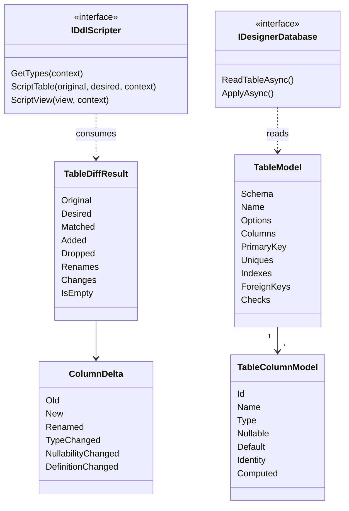

# 14. طراح‌ها، DDL و ویرایش شیء

<div dir="rtl">

> **سطح:** L2 حرفه‌ای ← L3 ارشد | **بخش:** II | **کد خوانده‌شده در:** `a61f3d1` (Rowlit 1.6.3)
> **زبان:** فارسی | [English](../../en/part2/14-designers-and-ddl.md) | قبلی: [13. گرید نتایج و ویرایش داده](./13-results-grid-and-data-editing.md) | بعدی: [15. درون‌ریزی، برون‌ریزی، طرح اجرا و ER](./15-import-export-plans-er.md)
> برچسب‌های نمودارها به انگلیسی نگه داشته شده‌اند تا در GitHub درست نمایش داده شوند.
> **در یک جمله:** مدل یک جدول را در فرم ویرایش می‌کنید، موتور آن را با مدل ذخیره‌شده diff می‌کند و هر فراهم‌کننده diff را به اسکریپت DDL تبدیل می‌کند؛ اسکریپت را می‌توانید بخوانید، ویرایش کنید و جایی که پایگاه داده اجازه دهد در یک تراکنش اعمال کنید.
> **یاد می‌گیرید:**
> - `TableModel` و `TableDiff` مشترک همه‌ی فراهم‌کننده‌ها و «scripter» چیست؛
> - مسیر باز کردن طراح ← مدل ← اسکریپت ← پیش‌نمایش ← اعمال، و اینکه اعمال چطور ایمن شکست می‌خورد؛
> - هر فراهم‌کننده چه چیزی را درجا تغییر می‌دهد و چه چیزی را نمی‌تواند؛
> - کنسول‌های «Edit:» با F4، Compare with server، پنجره‌ی Execute routine و تولید کد چطور کار می‌کنند.
> **پیش‌نیازها:** [10. کاتالوگ و فراداده](./10-catalog-and-metadata.md)، [09. فراهم‌کننده‌های رابطه‌ای](./09-relational-providers.md)، [07. ماژول‌های موتور و DI](./07-engine-modules-and-di.md). بخش I: [I-05 مدل‌سازی و نرمال‌سازی](../part1/05-modelling-and-normalisation.md) (قیدها، cascade)، [I-09 تراکنش‌ها](../part1/09-transactions-and-isolation.md) (چرا بعضی DDLها تراکنشی‌اند).

## 1. ایده (مبتدی)

برای تغییر جدول می‌توانید `ALTER TABLE` را با دست بنویسید، اما واژه‌های دقیق در هر پایگاه داده فرق دارد و بعضی تغییرها اصلاً درجا ممکن نیستند. SQL Server نمی‌تواند به ستون موجود `IDENTITY` بدهد؛ SQLite نمی‌تواند یک قید را حذف کند. **طراح (designer)** این را پنهان می‌کند. جدول را به‌صورت جدول ستون‌ها و چند پنل (کلیدها، نمایه‌ها، checkها) می‌بینید. جدول را عوض می‌کنید. Rowlit آنچه دارید را با آنچه در پایگاه داده هست مقایسه و اسکریپت را می‌نویسد.

سه ایده این قابلیت را نگه می‌دارند. اول، اسکریپت **پیش از** اجرا به‌صورت متن ساده نشان داده می‌شود که می‌توانید ویرایش کنید. دوم، اجرا **جایی که پایگاه داده اجازه دهد اتمی** است: PostgreSQL، SQL Server و SQLite DDL را در تراکنش اجرا می‌کنند، پس اسکریپت شکست‌خورده چیزی بر جا نمی‌گذارد؛ Oracle، MySQL، Snowflake، ClickHouse و Cassandra هر دستور را جدا commit می‌کنند و Rowlit این را می‌گوید. سوم، همین ماشین به رویه‌ها، viewها، triggerها و typeها هم از راه **کنسول‌های ویرایش** (F4)، diff **Compare with server** و پنجره‌ای که رویه را با پارامترهای نوع‌دار **اجرا** می‌کند خدمت می‌کند. کنارشان **تولیدکننده‌ی کد** است که جدول را به C#، Go، TypeScript، Java، Python، SQL یا JSON تبدیل می‌کند.

## 2. چطور کار می‌کند (حرفه‌ای)

### 2.1 مدل مشترک

همه‌چیز در `engine/src/DbStudio.Core/Designer/TableModel.cs` بیان می‌شود:

- `TableModel`: `Schema`، `Name`، `Comment`، `Options`، `Columns`، `PrimaryKey`، `Uniques`، `Indexes`، `ForeignKeys`، `Checks`. رکوردهایی با پیش‌فرض لیست، تا بدنه‌ی JSON ناقص هم به مدل قابل‌استفاده deserialize شود (`TableModel.cs:6-21`).
- `TableColumnModel`: `Id` (را رابط می‌دهد؛ برای ستون موجود همان نام اصلی، پس **تغییر نام هویتش را نگه می‌دارد**)، `Name`، `Type` (متن کامل با اندازه، `nvarchar(100)`)، `Nullable`، `Default` (عبارت SQL)، `DefaultName` (قید SQL Server)، `Identity` (`Seed`، `Increment`، `Always`)، `Computed` (`Expression`، `Persisted`)، `Collation`، `Comment`، `Autoincrement` (SQLite) (`TableModel.cs:35-53`).
- `TableOptions`: `WithoutRowid`، `Strict` (SQLite)، `Tablespace` و `Extra`، دیکشنری نام ← متن برای گزینه‌های فراهم‌کننده (ClickHouse: `engine`، `orderBy`، `partitionBy`، `primaryKey`، `sampleBy`، `ttl`، `settings`) (`TableModel.cs:23-33`).
- قیدها: `PrimaryKeyModel` (با `Clustered`)، `UniqueModel`، `IndexModel` (ستون‌ها با `Desc`، `Unique`، `Clustered`، `Include`، `Filter`)، `ForeignKeyModel` (جدول و ستون‌های مرجع، `OnDelete`، `OnUpdate`)، `CheckModel`. کنش‌های ارجاعی رشته‌های نرمال‌شده‌اند: `NO ACTION`، `CASCADE`، `SET NULL`، `SET DEFAULT`، `RESTRICT` (`ReferentialActions`).

`DesignerValidation.ValidateTable` پیش از اینکه هر فراهم‌کننده‌ای آن را ببیند آنچه هیچ پایگاه داده‌ای نمی‌پذیرد را رد می‌کند: بی‌نام بودن، نبود ستون، نام ستون تکراری، نبود نوع (جز محاسباتی)، دو ستون هویت، قیدی که ستون ناشناخته را نام ببرد، نمایه‌ی خالی، دو نمایه‌ی clustered، کلید خارجی با تعداد ستون متفاوت از ستون مرجع، کنش ناشناخته (`DesignerValidation.cs:6-56`). تخلف‌ها `ArgumentException` می‌اندازند که `DesignerService` آن را به `400 VALIDATION` با نام فیلد تبدیل می‌کند (`DesignerService.cs:48-55`).

**شکل ۱۴.۱ — مدل و diff.**

</div>



<div dir="rtl">

### 2.2 `TableDiff`: تطبیق، نه حدس

`TableDiff.Compute(original, desired)` (`TableDiff.cs:91`) تابعی خالص است. بدون `original` ایجاد است: هر ستون، کلید و نمایه‌ی مطلوب «افزوده‌شده» است. در غیر این صورت:

1. **ستون‌ها اول با id و بعد با نام تطبیق داده می‌شوند.** ستون مطلوبی که `Id` آن با نام ستونی اصلی برابر است همان ستون است، هر نام تازه‌ای که داشته باشد. تغییر نام (`Id = "phone"`، `Name = "mobile"`) به این ترتیب بی‌ابهام تشخیص داده می‌شود. ستونی که id آن با هیچ‌چیز نخورد جدید است؛ ستون بی‌id با نام تطبیق می‌یابد (`TableDiff.cs:119-155`). اصلی‌های بی‌جفت حذف‌شده‌اند.
2. هر جفت تطبیق‌یافته به `ColumnDelta` با بولی‌های `Renamed`، `TypeChanged`، `NullabilityChanged`، `DefaultChanged`، `IdentityChanged`، `ComputedChanged`، `CollationChanged`، `CommentChanged`، `AutoincrementChanged` تبدیل می‌شود (`TableDiff.cs:22-39`).
3. **قیدها و نمایه‌ها پس از اعمال تغییر نام ستون‌ها بر اساس ساختار (و نام) تطبیق می‌یابند.** قید *تغییرکرده* یعنی حذف به‌علاوه‌ی افزودن؛ «alter constraint» وجود ندارد (`TableDiff.cs:176-200`). تغییر نام‌ها در `Renames` حمل می‌شوند تا کلید اصلی روی ستون تغییرنام‌یافته حذف‌شده به نظر نیاید.
4. هر تفاوت یک `TableChange(Kind, Target, Detail)` هم می‌شود (`columnAdded`، `columnTypeChanged`، `primaryKeyDropped`، `indexAdded` ...) که رابط در خلاصه‌ی تغییرها فهرست می‌کند. `IsEmpty` برابر `!IsCreate && Changes.Count == 0` است.

### 2.3 Scripterها و designer databaseها

`IDdlScripter` **خالص** است: `ScriptTable(original, desired, context)` یک `TableScript` برمی‌گرداند (دستورها با kind و هشدار اختیاری، `RebuildRequired`، `Transactional`، هشدارها، تغییرها). `IDesignerDatabase` سمت I/O است: مدل‌ها را می‌خواند و اسکریپت را روی **اتصال کوتاه‌عمر مخصوص خودش** اعمال می‌کند، هرگز روی نشست تب یا اتصال کاتالوگ (`DesignerContracts.cs:1-49`). هر دو singleton کلیددار DI با شناسه فراهم‌کننده‌اند ([فصل 07](./07-engine-modules-and-di.md)). `DdlScriptContext` نسخه‌ی سرور (برای تشخیص قابلیت)، طرحواره پیش‌فرض و برای موتورهایی که بازسازی می‌کنند اشیای وابسته را حمل می‌کند.

آنچه هر scripter درباره‌ی خودش می‌گوید (سرآیند کلاس‌ها):

| فراهم‌کننده | DDL تراکنشی | نکته‌ها |
|---|---|---|
| PostgreSQL | بله | هیچ تغییری بازسازی نمی‌خواهد؛ alterها به ترتیب تغییر نام، حذف، افزودن، نوع، nullability، پیش‌فرض، هویت، قیدها، نمایه‌ها، توضیح‌ها اجرا می‌شوند و زیردستورهای ستون/قید در یک `ALTER TABLE` ترکیب می‌شوند (`PgDdlScripter.cs:7-14`) |
| SQL Server | بله (یک تراکنش) | قیدهای نام‌دار؛ پیش از تغییر/حذف ستون قید پیش‌فرض را حذف می‌کند (اگر نامش ناشناخته باشد از `sys.default_constraints` پیدا می‌کند)؛ **وقتی هویت عوض شود جدول را بازسازی می‌کند** (جدول جدید، `SET IDENTITY_INSERT`، کپی، حذف، تغییر نام)؛ توضیح‌ها extended property از نوع `MS_Description` هستند (`SqlServerDdlScripter.cs:7-12`) |
| SQLite | بله | `ALTER` بومی فقط برای `RENAME TO`، `RENAME COLUMN` (3.25+)، `ADD COLUMN` (بدون PK/UNIQUE، پیش‌فرض ثابت) و `DROP COLUMN` (3.35+)؛ بقیه بازسازی مستند است: کلیدهای خارجی خاموش، جدول جدید، کپی، حذف، تغییر نام، ساخت دوباره‌ی نمایه‌ها، triggerها و viewهای وابسته، `PRAGMA foreign_key_check`، کلیدهای خارجی روشن (`SqliteDdlScripter.cs:8-13`) |
| Oracle | خیر (هر DDL commit می‌شود) | هویت با `GENERATED ... AS IDENTITY`؛ کنش‌های `ON UPDATE` پشتیبانی نمی‌شوند و با هشدار نادیده گرفته می‌شوند؛ **افزودن هویت به ستون موجود رد می‌شود** (ORA-30673) با خطای اعتبارسنجی (`OracleDdlScripter.cs:200-208`) |
| MySQL / MariaDB | خیر | ابتدا `RENAME TABLE`، `DROP FOREIGN KEY` به‌صورت دستور جدا، یک `ALTER TABLE` با `CHANGE`/`MODIFY` و `FIRST`/`AFTER` برای ترتیب؛ نمایه‌های `FULLTEXT`، `SPATIAL` و تابعی در مدل نیستند و دست‌نخورده می‌مانند (`MySqlDdlScripter.cs:7-15`) |
| ClickHouse | خیر | `ENGINE`، `ORDER BY`، `PARTITION BY`، `TTL` و `SETTINGS` از `TableOptions.Extra` می‌آیند؛ جدول بدون آن‌ها MergeTree پیش‌فرض مرتب‌شده با کلید اصلی می‌گیرد (`ChDdlScripter.cs:6-14`) |
| Snowflake | خیر | هویت به `IDENTITY(start, increment)` تبدیل می‌شود؛ نمایه‌ی clustered کلید خوشه‌بندی `CLUSTER BY` می‌شود؛ نمایه‌های دیگر، قیدهای check و ستون‌های محاسباتی وجود ندارند و هشدار می‌دهند؛ `SET DATA TYPE` فقط گسترش (`SnowflakeDdlScripter.cs:7-19`) |
| Cassandra (CQL) | خیر | کلید پارتیشن = ستون‌های اول کلید اصلی، قید یکتای `partition_key` آن‌ها را فهرست می‌کند؛ نمایه‌ای به نام `clustering_order` ترتیب را می‌دهد؛ توضیح ستون `static` ستون static را علامت می‌زند؛ قیدهای check گزینه‌های جدول‌اند (`CqlDdlScripter.cs:7-20`) |

ردیف Cassandra هزینه‌ی یک مدل مشترک را نشان می‌دهد: ویژگی بیگانه با پایگاه‌های رابطه‌ای تا زمان پنل مخصوص CQL با قراردادهایی روی فیلدهای موجود کدگذاری می‌شود. `DesignerFeatures` (`TableModel.cs:133-147`) به رابط می‌گوید برای هر فراهم‌کننده چه چیزی را فعال کند: هویت، محاسباتی، نمایه‌های clustered/included/filtered، `OnUpdateAction`، توضیح‌ها، تغییر نام، حذف ستون، `WithoutRowid`، `Strict`، `TransactionalDdl`، `Autoincrement`، طرحواره‌ها.

بعضی تغییرها بی‌صدا انجام دادنشان خطرناک است. بازسازی هویت در SQL Server **اشیای وابسته** را از راه designer database می‌خواند (`DependentObject`: triggerها، کلیدهای خارجی ورودی جدول‌های دیگر، مجوزها) تا اسکریپت بتواند دوباره بسازدشان، و وقتی بازسازی چیزی را که مدل نمی‌تواند نگه دارد از دست می‌داد، **بازسازی را رد می‌کند**: نمایه‌های columnstore، XML، مکانی یا full-text، پارتیشن‌بندی، filegroup، فشرده‌سازی، change tracking، CDC (`DependentTypes.UnsupportedStorage`، `TableModel.cs:196-216`). به‌جای آن خطای اعتبارسنجی با نام علت برمی‌گرداند.

### 2.4 endpointها و اعمال

`DesignerEndpoints` (`Host/Endpoints/DesignerEndpoints.cs:11-45`) زیر `/connections/{id}/designer`:

| مسیر | کار |
|---|---|
| `GET /types` | نوع‌های داده‌ی فراهم‌کننده و `DesignerFeatures` |
| `GET /table`، `GET /view` | خواندن مدل ذخیره‌شده یا بدنه‌ی view |
| `POST /table/script` | `{database, original, desired}` ← `TableScript` (چیزی اجرا نمی‌شود) |
| `POST /view/script` | `{name, originalName, body, options}` ← `DdlScript` |
| `POST /apply` | `{database, statements, transactional, schema}` ← `{ok, executed, elapsedMs}` |

`DesignerService.ApplyAsync` (`DesignerService.cs:93-139`): حداقل یک دستور غیرخالی می‌خواهد؛ اتصال‌های فقط‌خواندنی را با `403 READ_ONLY` («DDL is not allowed») رد می‌کند؛ از `ApplyAsync` فراهم‌کننده اجرا می‌کند؛ و سپس **همیشه** (در `finally`، حتی پس از شکست جزئی غیرتراکنشی، چون آنچه اجرا شد کاتالوگ را عوض کرده) کاتالوگ را باطل می‌کند و تلاش را در تاریخچه‌ی پرس‌وجو با برچسب `designer` ثبت می‌کند، به‌صورت یک اسکریپت قابل‌اجرای دوباره که به شیوه‌ی کنسول گویش جدا شده (T-SQL با `GO`، PL/SQL با `/`، در غیر این صورت `;`) (`DesignerService.cs:141-177`). خطای قفل با همان متن «locked by another session: Console 1 (open transaction)» که اجراها می‌دهند بازنویسی می‌شود، از راه `LockWait` و `SessionManager.DescribeLockHolders` (`DesignerService.cs:114-121`).

اجرای واقعی `DdlApplyRunner.RunAsync` است (`DdlApplyRunner.cs:38-118`). حالت تراکنشی تراکنش را شروع می‌کند (شکست شروع می‌گوید «Nothing was changed»)، دستورهای کنترل تراکنش در اسکریپت دست‌ویرایش‌شده را رد می‌کند (`DdlText.IsTransactionControl`: `BEGIN`، `COMMIT`، `END` ...) چون runner مالک تراکنش است، هر دستور را با `CommandTimeout` پیش‌فرض 0 اجرا می‌کند (بازسازی جدول بزرگ مجاز است طولانی باشد؛ SQLite مهلت busy خودش را می‌دهد) و در اولین خطا rollback و `DdlFailedException` (`409 DDL_FAILED`) با `{failedIndex, executed, rolledBack, providerError}` می‌اندازد. پیام می‌گوید «Statement 2 failed: <error>. All changes were rolled back.» یا در حالت غیرتراکنشی «... 1 statement(s) had already run and were committed.» حتی commit هم می‌تواند در SQLite شکست بخورد وقتی کنسولی هنوز می‌خواند؛ آن هم rollback می‌شود.

**شکل ۱۴.۲ — طراحی یک جدول.**

</div>

```mermaid
sequenceDiagram
    participant U as TableDesigner
    participant API as designer API
    participant DB as IDesignerDatabase
    participant SC as IDdlScripter
    U->>API: GET /table (existing table)
    API->>DB: ReadTableAsync
    DB-->>U: TableModel (original)
    Note over U: user edits the grid; desired model changes
    U->>API: POST /table/script (original, desired), debounced 250 ms
    API->>SC: ScriptTable with TableDiff
    SC-->>U: statements, warnings, changes
    Note over U: preview text, may be edited by hand
    U->>API: POST /apply (statements, transactional)
    API->>DB: ApplyAsync (own connection, one transaction)
    DB-->>API: ok or DDL_FAILED
    API-->>U: result
    API->>API: invalidate catalog, write history
```

<div dir="rtl">

### 2.5 رابط طراح

`ui/src/designer` نیمه‌ی رابط است. طراح جدول (`table/TableDesigner.tsx`) یک تب `view` است که state آن (`schema`، `name`، `desired`، `original`، پیش‌نمایش دست‌ویرایش‌شده) در workspace ذخیره می‌شود، پس طراحی ناتمام از راه‌اندازی مجدد جان به در می‌برد. از این‌ها ساخته شده:

- `ColumnGrid.tsx` - گرید ستون‌های قابل‌ویرایش با فرمان‌های صفحه‌کلید در scope `designer` (`designer.grid.*`، `keyHandler: 'host'`).
- `ConstraintsPanel.tsx` - کلیدها، یکتاها، نمایه‌ها، کلیدهای خارجی، checkها.
- `optionsPanels.ts` - یک رجیستری: فراهم‌کننده با `registerDesignerOptionsPanel(providerId, component)` پنلی تنبل ثبت می‌کند (engine/order/TTL در ClickHouse، گزینه‌های جدول MySQL)؛ طراح آن را بالای گرید رندر می‌کند و پنل `TableOptions.extra` را ویرایش می‌کند.
- `model.ts` - کمک‌های سمت رابط؛ `withIds` به هر ستون id می‌دهد (نام اصلی).

اسکریپت با **debounce برابر ۲۵۰ ms** (`TableDesigner.tsx:183`) و `AbortController` درخواست می‌شود، پس تایپیست سریع فقط آخرین مدل را می‌فرستد. اگر کاربر متن پیش‌نمایش را دستی ویرایش کند طراح به `handEdited` می‌رود و تولید مجدد را متوقف می‌کند. `DdlPreview` متن را با `scriptToText` (`designer/ddl.ts`) نشان می‌دهد: دستورها بر اساس گویش خاتمه می‌یابند (T-SQL با `GO` بین batchها، Oracle با `/` بعد از بلوک‌های PL/SQL، در غیر این صورت `;`)، هشدارها به‌صورت توضیح `-- ⚠`. هنگام Apply، `splitForApply` متن را با splitter مربوط به IntelliSense دوباره می‌شکند چون پیش‌نمایش دست‌ویرایش‌شده باید به‌صورت دستورهای جدا به موتور برگردد. پیش از اعمال، `confirmSummary.ts` خلاصه‌ای به زبان ساده از تغییرهای مخرب (ستون حذف‌شده، تغییر نوع) برای تأیید می‌سازد؛ پس از موفقیت طراح مدل را دوباره می‌خواند (`withIds` دوباره)، «Altered orders - 3 statements in 41 ms» نشان می‌دهد و کاتالوگ را اعتبارسنجی مجدد می‌کند.

طراح view (`view/ViewDesigner.tsx`) بدنه‌ی `SELECT` را با پرچم‌های schema-binding، check-option و force ویرایش می‌کند، ستون‌های نتیجه را با `POST /sessions/{sid}/describe` پیش‌نمایش می‌دهد (`DescribeService`: `CommandBehavior.SchemaOnly`، فقط یک `SELECT` تکی، روی نشست تب بدون اجرا) و نامی را که با شیء دیگر برخورد کند رد می‌کند (`nameConflict.ts`). SQLite `CREATE OR ALTER` ندارد، پس `ScriptView` `DROP` + `CREATE` تولید می‌کند و triggerهای `INSTEAD OF` را دوباره می‌سازد.

**ویزارد رویه** (`proc/ProcWizard.tsx`، `templates.ts`) رویه، تابع، package و trigger را از قالب‌های هر گویش می‌سازد؛ کنسول ویرایش را باز می‌کند و خودش چیزی اعمال نمی‌کند.

### 2.6 F4 و کنسول‌های ویرایش

فشردن F4 روی شیء `editObject` را اجرا می‌کند (`designer/open.ts:156-170`): جدول طراح جدول را باز می‌کند، view طراح view را، و رویه، تابع، تابع جدولی، package، trigger، type و view مادی‌شده یک **کنسول ویرایش** باز می‌کنند: تب کنسول معمولی با نام `Edit: name` که متنش DDL ذخیره‌شده است و `rewriteForEdit` (`designer/rewrite.ts`) آن را به شکل **قابل‌اجرای دوباره** بازنویسی کرده:

- T-SQL: `CREATE PROCEDURE/FUNCTION/VIEW/TRIGGER` به `CREATE OR ALTER` تبدیل می‌شود (SQL Server 2016 SP1 = 13.0.4001 لازم است؛ سرورهای قدیمی‌تر `ALTER` می‌گیرند، `supportsCreateOrAlter`)؛
- Oracle: `CREATE [EDITIONABLE] ...` به `CREATE OR REPLACE` با `/` بعد از بلوک‌ها؛
- PostgreSQL: تابع، رویه، view، trigger به `CREATE OR REPLACE` (triggerها PostgreSQL 14 می‌خواهند وگرنه `DROP TRIGGER IF EXISTS` پیشوند می‌شود؛ view مادی‌شده `DROP MATERIALIZED VIEW IF EXISTS` می‌گیرد؛ type از نوع enum همان‌طور که هست باز می‌شود با یادداشتی برای `ALTER TYPE ... ADD VALUE`)؛
- SQLite: viewها و triggerها `DROP ... IF EXISTS` پیشوند می‌گیرند.

تب یک رکورد `ConsoleEdit` (`connectionId`، `database`، `ref`، `dialect`، `serverDdl`، `savedText`، `isNew`) را همراه workspace نگه می‌دارد، پس پس از راه‌اندازی مجدد هم درست ذخیره می‌کند و هم Compare را پیشنهاد می‌دهد. `designer/store.ts` آن را در حافظه بازتاب می‌دهد.

**Ctrl+S در کنسول ویرایش شیء را در پایگاه داده ذخیره می‌کند**، نه در فایل (`saveEditToDatabase`، `app/actions.ts:616-665`): viewها و triggerهای SQLite **اعمال اتمی** می‌گیرند (`runEditTab`: متن ویرایشگر به دستورها شکسته می‌شود، `DROP ... IF EXISTS` اگر نبود اضافه می‌شود و با `transactional: true` به `POST /designer/apply` می‌رود، پس `CREATE` ناموفق نمی‌تواند شیء را حذف‌شده بر جا بگذارد؛ هنگام اجرا دکمه Stop غیرفعال است، تا ۳۰ ثانیه انتظار قفل)؛ بقیه **کل اسکریپت** را (هرگز فقط انتخاب، `ignoreSelection`) روی نشست تب، بی‌سروصدا، اجرا می‌کنند و toast «Saved procedure X» یا خطایی با اشاره به خط می‌دهند. طرحواره‌ی شیء در کاتالوگ درجا اعتبارسنجی مجدد می‌شود و `serverDdl` به‌عنوان مبنای تازه به‌روز می‌شود. ذخیره در فایل `.sql` همچنان Save as است. شیء جدید ویزارد نامش را از اسکریپت می‌گیرد؛ ذخیره نام موجود را رد می‌کند و جایگزین نمی‌کند. **Run** در کنسول ویرایش رویه یا تابع اسکریپت را اجرا نمی‌کند: Execute routine را باز می‌کند (`ExecuteRoutine/intercept.ts`) و منوی Run «Run script» را نگه می‌دارد.

**Compare with server** (`CompareDialog.tsx`) یک `DiffEditor` از Monaco است: تعریف فعلی سرور از شیء، با همان بازنویسی، سمت چپ و متن تب سمت راست. اگر سرور در دسترس نباشد به DDL بارگذاری‌شده هنگام باز شدن تب برمی‌گردد و می‌گوید. تاریخچه محلی ([فصل 12](./12-editor-and-formatter.md)) به کنسول ویرایش کلید `o:<connection>|<db>|<schema>|<type>|<name>` می‌دهد، پس خط زمانی دنبال شیء می‌رود نه تب.

### 2.7 Execute routine

«Execute procedure or function...» (منوی اکسپلورر، پالت، یا Run در کنسول ویرایش) پنجره‌ای (`ExecuteRoutine/ExecuteRoutineDialog.tsx`) با ورودی‌های نوع‌دار برای هر پارامتر باز می‌کند (پیش‌فرض، NULL، مقدار). `routineSql.ts` فراخوانی را می‌سازد، با **مقدارها همیشه به‌صورت bind parameter** و فقط نام‌ها، placeholderها، `NULL` و `DEFAULT` در متن:

- SQL Server: `DECLARE @return_value int, @Total money; EXEC @return_value = [dbo].[proc] @Id = @Id, @Total = @Total OUTPUT; SELECT @return_value AS [Return value], @Total AS [Total];` (آرگومان OUTPUT در متغیر بازنویسی می‌شود و یک `SELECT` پایانی همه‌ی خروجی‌ها را برمی‌گرداند، پس تغییر موتور لازم نبود)؛ تابع‌ها `SELECT [dbo].[fn](@a, DEFAULT)`؛ تابع‌های جدولی `SELECT * FROM`.
- Oracle: `BEGIN SHOP.PKG.PROC(P_ID => :p_id, P_CUR => :p_cur); END;` با OUT و REF CURSOR به‌صورت out bind؛ تابع `BEGIN :result := SHOP.FN(...); END;`.
- PostgreSQL: `CALL public.proc($1::bigint, ...)` موقعیتی و بعد از پیش‌فرض نام‌دار؛ تابع‌ها از راه `SELECT`.

نتیجه به‌صورت تب `routine.run` باز می‌شود (`runModel.ts`) که اجرا را به **خروجی‌ها** (پارامترهای OUT/IN OUT و مقدار برگشتی، به‌صورت کارت کلید/مقدار؛ reducer آن‌ها را هنگام `exec.done` به‌صورت result set یک‌سطری اضافه می‌کند) و result setهای معمولی به‌صورت تب تقسیم می‌کند. SQLite رویه ندارد، پس فرمان برایش پنهان است.

### 2.8 تولید کد

`ui/src/codegen` TypeScript خالص است (`index.ts`): `generate(input, options)` فایل‌ها را برمی‌گرداند. مدل ورودی (`model.ts`) از snapshot کاتالوگ، جزئیات `GET /catalog/object` یا نتیجه‌ی توصیف‌شده‌ی پرس‌وجو می‌آید (`fromCatalog.ts`، `CgTable`، `CgRoutine`، `CgColumn` با هویت، محاسباتی، برچسب‌های enum، پایه‌ی domain). زبان‌ها و flavorها (`options.ts`): C# (Dapper، EF Core، ADO.NET، فقط مدل)، Go، TypeScript (شامل flavor **Prisma schema**، فقط PostgreSQL: `generatePrisma` از `lang/typescript.ts` صدا زده می‌شود، زبان جداگانه نیست)، Java، Python، SQL، JSON. نگاشت نوع از یک جدول JSON برای هر گویش می‌آید (`codegen/types/*.json`). `naming.ts` شناسه‌ها را به کلمه می‌شکند (`ORDER_LINES`، `orderLines`، `HTMLParser2`)، به `pascal | camel | snake | asIs` تبدیل می‌کند، نام جدول را مفرد می‌کند (`Customers` ← `Customer`، با فهرست استثنا) و کلمه‌های رزرو را برای هر زبان هدف escape می‌کند. گزینه‌ها در `settings.ui.codegen` ماندگارند. `CodegenPanel` فایل‌ها را در Monaco با Copy و «open as file» نشان می‌دهد. برای رویه‌ی SQL Server با شکل نتیجه‌ی ناشناخته می‌تواند از راه `sys.dm_exec_describe_first_result_set_for_object` بی‌اجرای رویه از سرور بپرسد (`describeProc.ts`).

## 3. کاوش عمیق (ارشد)

> **کاوش عمیق (L3): diff به‌اندازه‌ی قاعده‌ی تطبیقش خوب است**
>
> بخش سخت diff طرحواره، تغییر نام است. فقط از دو snapshot، تغییر نام از «ستون a را حذف کن، ستون b را اضافه کن» تفکیک‌پذیر نیست. ابزارها یا با شباهت حدس می‌زنند یا از کاربر می‌پرسند. Rowlit از هر دو دوری می‌کند با یک **id پایدار که رابط حمل می‌کند**: id نام اصلی است، هنگام خواندن مدل گذاشته می‌شود و با ویرایش عوض نمی‌شود؛ diff اول با آن تطبیق می‌دهد. این تغییر نام را به واقعیت تبدیل می‌کند و دلیل وجود `TableColumnModel.Id` است. بهایش این است که id در state کلاینت زندگی می‌کند: هر چیزی که مدل `desired` بدون id بسازد (اسکریپت، آزمون، «create foreign key» در نمودار ER) به تطبیق با نام برمی‌گردد که در آن تغییر نام شبیه حذف و افزودن است. پنجره‌ی FK در نمودار ER (فصل 15) فقط قید می‌افزاید پس تأثیری نمی‌بیند؛ قابلیت آینده‌ی «import desired model» باید id بدهد.
>
> **چرا scripterهای خالص.** `IDdlScripter` مدل می‌گیرد و بدون لمس اتصال دستور برمی‌گرداند. همین باعث می‌شود scripter در آزمون واحد روی fixtureها اجرا شود (`Providers.Conformance/M15/DesignerCases.cs` موارد مشترک را برای هر فراهم‌کننده اجرا می‌کند)، `POST /table/script` با هر ضربه کلید بی‌خطر صدا زده شود و همه‌ی دانش گویش در متنی قابل‌بازبینی بماند. رابط I/O جداست چون *اعمال کردن* معنای تراکنشی می‌خواهد که در هر موتور فرق دارد: PostgreSQL، SQL Server و SQLite همه را می‌پوشانند؛ Oracle و MySQL برای هر دستور commit می‌کنند، پس runner در اولین خطا می‌ایستد و `executed` را گزارش می‌کند.
>
> **چرا اعمال اتصال خودش را دارد.** DDL روی نشست تب به تراکنش باز آن تب می‌پیوندد و در SQL Server قفل تغییر طرحواره‌ی پشت خواندن commit‌نشده‌ی کسی اعمال را معلق می‌کرد. اتصال کوتاه‌عمر اختصاصی مرز تراکنش تمیز به اعمال می‌دهد و اجازه می‌دهد `DesignerService` هنگام شکست روی قفل، نشست‌های مسدودکننده‌ی کنسول‌های دیگر را نام ببرد.
>
> **تاریخچه به‌عنوان ردپای ممیزی.** هر اعمال تلاش‌شده (موفق یا ناموفق) با برچسب `designer` ثبت می‌شود، به شکلی که از History دوباره اجرا شود. درخواست‌هایی که پیش از اجرا رد می‌شوند (اعتبارسنجی، فقط‌خواندنی) ثبت نمی‌شوند؛ مرزی عمدی بین «چیزی روی پایگاه داده امتحان شد» و «درخواست بدشکل بود».

## 4. موارد لبه‌ای و محدودیت‌ها

| موضوع | واقعیت | منبع |
|---|---|---|
| debounce پیش‌نمایش اسکریپت | ۲۵۰ ms | `TableDesigner.tsx:183` |
| انتظار قفل در اعمال اتمی کنسول ویرایش | تا ۳۰ s | `designer/store.ts:12` |
| `CommandTimeout` اعمال طراح | 0 (بی‌حد) مگر فراهم‌کننده تنظیم کند | `DdlApplyRunner.cs:25-28` |
| جزئیات `DDL_FAILED` (409) | `failedIndex`، `executed`، `rolledBack`، `providerError` | `DesignerContracts.cs:52-62` |
| اتصال فقط‌خواندنی | `403 READ_ONLY` برای apply | `DesignerService.cs:98-99` |
| شکست‌های اعتبارسنجی | `400 VALIDATION`، فیلد `desired` یا `body` | `DesignerService.cs:52-54`، `78-80` |
| هویت روی ستون موجود Oracle | رد می‌شود | `OracleDdlScripter.cs:204-208` |
| بازسازی هویت SQL Server با ذخیره‌سازی پشتیبانی‌نشده | رد می‌شود، علت نام برده می‌شود | `TableModel.cs:196-216` |
| تغییر ترتیب ستون در SQL Server | درجا ممکن نیست؛ هشدار | `SqlServerDdlScripter.cs:84` |
| `SET DATA TYPE` در Snowflake | فقط گسترش | `SnowflakeDdlScripter.cs:17-18` |
| به‌روزرسانی ستون کلید در ClickHouse | در گرید داده قفل است | [فصل 13](./13-results-grid-and-data-editing.md) |

## 5. چطور آزموده می‌شود

- موتور: `M15/TableDiffTests.cs` (تطبیق و فهرست تغییر)، آزمون‌های طراح هر فراهم‌کننده (`Sqlite.Tests/M15/SqliteDesignerTests.cs`، `ClickHouse.Tests/M15/ChDesignerTests.cs`، `ChDesignerApplyTests.cs`، `Snowflake.Tests/DesignerTests.cs`) و conformance مشترک `Providers.Conformance/M15/DesignerCases.cs`؛ `Core.Tests/M15/M15ServiceTests.cs` `DesignerService` را پوشش می‌دهد.
- رابط: `designer/__tests__/designer.test.ts`، `pgsql.test.ts`، `compareDiff.test.ts`، `ColumnGrid.test.tsx`، `table/tableDesignerUx.test.tsx`، `view/nameConflict.test.ts`، `proc/wizardRun.test.ts`، `proc/templates.mysql.test.ts`، `app/editRun.test.ts` و `editRunRestore.test.ts` (اعمال اتمی، تب‌های بازیابی‌شده)، `app/objectActions.test.ts`؛ `ExecuteRoutine/routineSql.test.ts`، `runModel.test.ts`، `ExecuteRoutine.test.tsx`؛ `codegen/__tests__` و پروژه‌ی smoke به زبان C# در `engine/tests/Codegen.Smoke`.

## فصل‌های مرتبط

- [09. فراهم‌کننده‌های رابطه‌ای](./09-relational-providers.md) - هر فراهم‌کننده چطور کاتالوگش را می‌خواند و scripter ثبت می‌کند.
- [10. کاتالوگ و فراداده](./10-catalog-and-metadata.md) - snapshot و `catalog.changed` پس از apply.
- [12. ویرایشگر](./12-editor-and-formatter.md) - کنسول‌های ویرایش کنسول‌اند؛ `ignoreSelection`؛ کلیدهای تاریخچه محلی.
- [15. درون‌ریزی، برون‌ریزی، طرح اجرا و ER](./15-import-export-plans-er.md) - پنجره‌ی کلید خارجی نمودار ER از `scriptTable` و `applyDdl` استفاده می‌کند.
- بخش I: [I-05 مدل‌سازی و نرمال‌سازی](../part1/05-modelling-and-normalisation.md)، [I-09 تراکنش‌ها](../part1/09-transactions-and-isolation.md)، [I-17 مقایسه گویش‌ها](../part1/17-dialect-comparison.md).

## اصطلاحات واژه‌نامه که در این فصل آمده‌اند

[designer](../glossary.md#designer)، [table model](../glossary.md#table-model)، [table diff](../glossary.md#table-diff)، [DDL scripter](../glossary.md#ddl-scripter)، [designer database](../glossary.md#designer-database)، [DDL apply runner](../glossary.md#ddl-apply-runner)، [DDL preview](../glossary.md#ddl-preview)، [compare with server](../glossary.md#compare-with-server)، [edit console](../glossary.md#edit-console)، [execute routine dialog](../glossary.md#execute-routine-dialog)، [OUT parameter](../glossary.md#out-parameter)، [describe](../glossary.md#describe)، [code generation](../glossary.md#code-generation)، [naming convention](../glossary.md#naming-convention)، [Prisma schema](../glossary.md#prisma-schema)، [procedure wizard](../glossary.md#procedure-wizard).

## فایل‌ها

| مسیر | مسئولیت |
|---|---|
| `engine/src/DbStudio.Core/Designer/TableModel.cs`، `TableDiff.cs`، `DesignerValidation.cs`، `ViewText.cs` | مدل، diff، اعتبارسنجی، استخراج بدنه‌ی view |
| `engine/src/DbStudio.Core/Designer/DesignerContracts.cs`، `DesignerService.cs`، `DdlApplyRunner.cs` | رابط‌های scripter و پایگاه داده، هماهنگی، runner تراکنشی |
| `engine/src/DbStudio.Providers.*/Designer/*` | scripterها و designer databaseهای هر فراهم‌کننده |
| `engine/src/DbStudio.Core/Params/DescribeService.cs` | توصیف ستون‌های پرس‌وجو بی‌اجرا |
| `engine/src/DbStudio.Host/Endpoints/DesignerEndpoints.cs` | مسیرهای HTTP |
| `ui/src/designer/*` | طراح‌های جدول/view/رویه، پیش‌نمایش، بازنویسی، نشست‌های ویرایش و اعمال اتمی |
| `ui/src/components/ExecuteRoutine/*`، `CodegenPanel/*`، `ui/src/codegen/*` | اجرای رویه، تولید کد |

</div>
