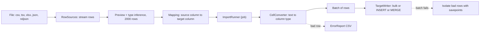
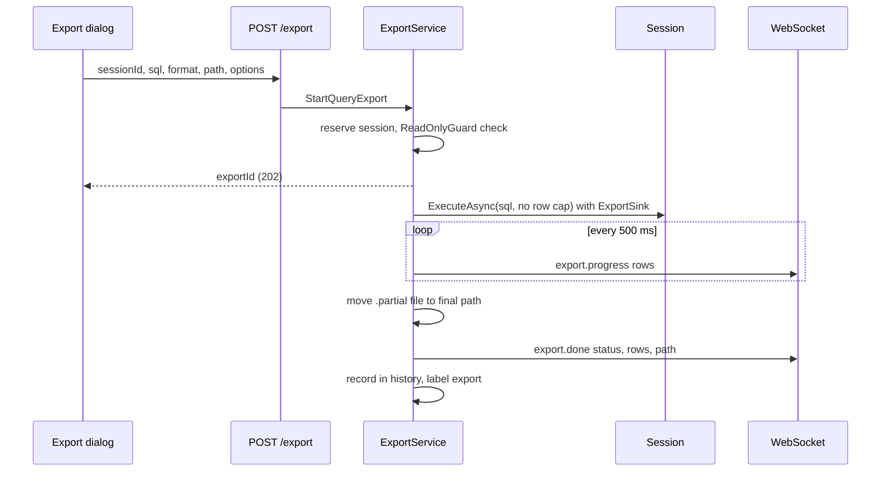
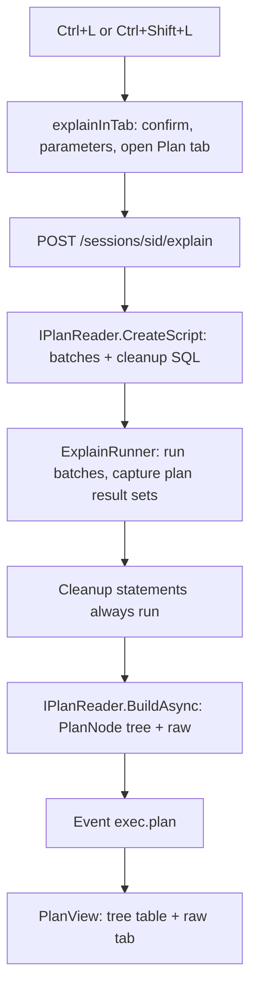
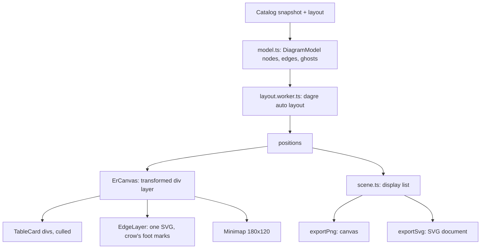

# 15. درون‌ریزی، برون‌ریزی، طرح اجرا و نمودار ER

> **سطح:** L2 حرفه‌ای | **بخش:** II | **کد خوانده‌شده در:** `a61f3d1` (Rowlit 1.6.3)
> **زبان:** فارسی | [English](../../en/part2/15-import-export-plans-er.md) | قبلی: [14. طراح‌ها، DDL و ویرایش شیء](./14-designers-and-ddl.md) | بعدی: [16. پایگاه‌های داده‌ی پیوندی و فدراسیون](./16-linked-databases-federation.md)
> برچسب‌های نمودارها به انگلیسی نگه داشته شده‌اند تا در GitHub درست نمایش داده شوند.
> **در یک جمله:** چهار ابزار که ساختار و داده را از مرز پایگاه داده عبور می‌دهند: ویزاردی که فایل را در جدول بار می‌کند، برون‌ریزی که نتیجه را در فایل می‌نویسد، نمایشگری که توضیح می‌دهد پرس‌وجو چطور اجرا شد، و نموداری که رابطه‌ی جدول‌ها را می‌کشد.
> **یاد می‌گیرید:**
> - خط لوله‌ی درون‌ریزی: پیش‌نمایش، استنتاج نوع، نگاشت، بارگذاری انبوه برای هر گویش، گزارش خطا؛
> - scopeهای برون‌ریزی، شش نویسنده، و اینکه کِی موتور و کِی مرورگر فایل را می‌نویسد؛
> - یک `EXPLAIN` چطور برای هفت فراهم‌کننده به یک درخت `PlanNode` نرمال‌شده تبدیل می‌شود؛
> - نمودار ER چطور صدها جدول را بدون قفل کردن رابط می‌چیند.
> **پیش‌نیازها:** [08. اتصال‌ها، نشست‌ها و اجرای SQL](./08-connections-sessions-execution.md)، [10. کاتالوگ و فراداده](./10-catalog-and-metadata.md)، [13. گرید نتایج](./13-results-grid-and-data-editing.md). بخش I: [I-08 خط لوله‌ی پرس‌وجو و بهینه‌ساز](../part1/08-query-processing.md) (خواندن آنچه نمایشگر طرح اجرا نشان می‌دهد)، [I-02 مدل رابطه‌ای](../part1/02-relational-model.md) (کلیدها و نشانه‌گذاری ER).

## 1. ایده (مبتدی)

داده به اندازه‌ی پایگاه داده در فایل‌ها هم زندگی می‌کند: CSV حسابدار، JSON برداشتی از یک API، Excel همکار. **ویزارد درون‌ریزی (Import Wizard)** چنین فایلی را می‌خواند، نوع هر ستون را حدس می‌زند، اجازه می‌دهد ستون‌ها را به جدولی (تازه یا موجود) نگاشت کنید و سطرها را بار می‌کند و آن‌هایی را که شکست می‌خورند در گزارشی جمع می‌کند. عکسش **برون‌ریزی (export)** است: نتیجه یا یک جدول کامل را به CSV، JSON، Excel، Markdown یا دستورهای `INSERT` در SQL بنویسید.

**طرح اجرا (execution plan)** به «چرا این پرس‌وجو کند است؟» جواب می‌دهد و گام‌هایی را که پایگاه داده برگزیده نشان می‌دهد: کدام نمایه، کدام روش join، چند سطر انتظار داشت و چند سطر گرفت. هر موتور طرح را با قالب خودش چاپ می‌کند (XML، JSON، متن)؛ Rowlit همه را به یک درخت تبدیل می‌کند که یکسان نشان دهد. **نمودار ER** (موجودیت-رابطه) جدول‌ها را کارت و کلیدهای خارجی را خط می‌کشد تا شکل یک طرحواره را در یک نگاه ببینید؛ Rowlit اجازه می‌دهد با کشیدن خط بین ستون‌ها کلید خارجی تازه بسازید.

## 2. چطور کار می‌کند (حرفه‌ای)

### 2.1 درون‌ریزی: خط لوله

**شکل ۱۵.۱ — خط لوله‌ی درون‌ریزی.**

بک‌اند مجموعه‌ی (assembly) جدایی به نام `DbStudio.Import` است (ماژولی که مثل بقیه با reflection پیدا می‌شود، [فصل 07](./07-engine-modules-and-di.md)). `ImportModule` شش مسیر دارد (`ImportModule.cs:11-62`):

| مسیر | کاربرد |
|---|---|
| `POST /import/preview` | فایل را با **مسیر** می‌خواند، نوع ستون‌ها را استنتاج می‌کند، صفحه‌ای از سطرها برمی‌گرداند |
| `GET /connections/{cid}/import/capabilities` | این اتصال درون‌ریزی را می‌پذیرد؟ کدام حالت‌ها، روش بارگذاری انبوه، اندازه‌ی batch، طول شناسه، نوع‌های SQL |
| `POST /connections/{cid}/import/table-info` | آیا جدول هدف هست، ستون‌ها و کلیدهایش |
| `POST /connections/{cid}/import/ddl` | پیش‌نمایش `CREATE TABLE` برای ستون‌های جدید |
| `POST /connections/{cid}/import/start` | شروع job: `202 { jobId }` |
| `GET /import/errors/{jobId}` | گزارش خطا به‌صورت `text/csv` |

خود موتور فایل را می‌خواند: درخواست‌ها مسیر دارند نه محتوا. (در نسخه‌ی مرورگر مسیر نیست؛ رابط مسیر تایپ‌شده‌ی کاربر را می‌فرستد. `Platform.hasFileSystem`، [فصل 20](./20-ui-architecture.md).)

**منبع‌های سطر (row sources)** (`Parsing/RowSources.cs`، `JsonRowSource.cs`، `XlsxRowSource.cs`) سطرها را از CSV/TSV (جداکننده، نقل‌قول، escape، تشخیص کدگذاری با BOM و نمونه، ردیف سرستون، سطرهای ردشده)، `.xlsx` (انتخاب sheet؛ مستقیم از آرشیو zip با خوانشگر XML جاری، بدون کتابخانه‌ی صفحه‌گسترده) و JSON یا NDJSON (مسیر JSON به آرایه، NDJSON خط‌به‌خط) جاری می‌کنند. `SourceOptions` همچنین trim، توکن‌های null (پیش‌فرض `""`، `NULL`، `null`)، قالب‌های تاریخ، جداکننده‌های اعشار و هزارگان و `NormalizeDigits` (پیش‌فرض true، پس ارقام فارسی و عربی-هندی به‌عنوان عدد خوانده می‌شوند) را نگه می‌دارد. `.xls` قدیمی فقط شناخته می‌شود تا توضیح دهد چرا خوانده نمی‌شود (`files.ts:isLegacyExcel`).

**استنتاج.** پیش‌نمایش تا `InferenceSampleRows` = **۲٬۰۰۰** سطر نمونه می‌گیرد (`ImportService.cs:16`) و یک profiler برای هر ستون kind را از `Kinds` برمی‌گزیند: `empty, bool, int, bigint, decimal, float, date, datetime, time, guid, text, binary, json, other`، با طول، دقت و مقیاس. پیش‌نمایش درباره‌ی **تاریخ‌های فارسی (جلالی)** هم هشدار می‌دهد: ستونی که شبیه `1403/05/12` باشد علامت می‌خورد چون «به‌عنوان سال میلادی خوانده می‌شد» و پیشنهاد متن یا تبدیل ابتدا می‌شود (`ImportService.cs:108-111`). این جزئیاتی است که فقط چون مخاطب راست‌به‌چپ می‌خواند وجود دارد.

**گویش‌های درون‌ریزی.** `ImportDialect` (`Run/ImportDialect.cs`) تفاوت‌های هر موتور را پنهان می‌کند: نقل‌قول و تبدیل حروف شناسه، نگاشت kind استنتاج‌شده به نوع ستون، `CREATE TABLE`، savepointها، سطر در هر دستور و روش بارگذاری:

| گویش | حالت‌ها | روش بارگذاری | batch پیش‌فرض | تراکنشی |
|---|---|---|---|---|
| SQL Server | append، truncateInsert، upsert، updateOnly | `SqlBulkCopy` | 5 000 | بله |
| PostgreSQL | همان چهار | `COPY` (متنی) | 5 000 | بله |
| MySQL / MariaDB | همان چهار | `INSERT` چندسطری دسته‌ای | 1 000 | بله |
| Oracle | همان چهار | array binding | 1 000 | بله |
| SQLite | همان چهار | `INSERT` چندسطری دسته‌ای | 1 000 | بله |
| Snowflake | همان چهار | `INSERT` چندسطری دسته‌ای | 1 000 | بله |
| ClickHouse | append، truncateInsert | درج انبوه بومی | 10 000 | خیر |
| Cassandra | پشتیبانی نمی‌شود (`Importing files into Cassandra is not supported yet.`) | | | |

(`ImportDialect.cs:220-527`؛ `ImportService.cs:130-148`.) upsert در هر گویش به `MERGE`، `ON CONFLICT` یا `ON DUPLICATE KEY` نگاشت می‌شود. مسیرهای انبوه فقط برای `append` و `truncateInsert` در SQL Server، PostgreSQL و ClickHouse به کار می‌روند (`TargetWriter.UsesBulk`، `TargetWriter.cs:23`)؛ بقیه دستورهای چندسطری پارامتری استفاده می‌کنند. SQL Server با ستون‌های هویت `SET IDENTITY_INSERT ON` می‌گیرد؛ PostgreSQL هویت را override می‌کند (`ImportRunner.cs:162-165`).

**اجرا** (`Run/ImportRunner.cs:29-369`) درون یک **job** رخ می‌دهد (`JobManager`، [فصل 05](./05-engine-host-and-api.md)؛ `ImportService.Start` شناسه‌ی job را برمی‌گرداند، پیشرفت به‌صورت `job.progress` و نتیجه به‌صورت `job.done` می‌رسد). گام‌ها:

1. اعتبارسنجی: حالت پشتیبانی‌شده با گویش، ستون‌های نگاشت‌شده موجود (یا هنگام ایجاد، نوع ستون از نگاشت یا استنتاج)، هیچ ستونی دوبار نگاشت نشده، `keyColumns` برای `upsert`/`updateOnly` موجود.
2. باز کردن یک **اتصال اختصاصی** (`ImportConnections.OpenAsync`)، نه نشست کنسول.
3. اختیاری `CREATE TABLE` (`createdTable`، `ddl` در خلاصه)، `SET IDENTITY_INSERT`، شروع یک تراکنش (`transaction: true` و گویش تراکنشی باشد)، truncate برای `truncateInsert`.
4. جاری کردن سطرها. هر مقدار هدف از یک ستون مبدأ، یک ثابت یا یک عبارت می‌آید؛ `CellConverter` متن را به kind ستون تبدیل می‌کند؛ `NULL` در ستون ناتهی، متن بلندتر از ستون (جز Oracle) یا مقدار غیرقابل‌پارس **سطر** را بد می‌کند. سطر بد در گزارش خطا نوشته می‌شود و با `onError: "skip"` رد می‌شود؛ با پیش‌فرض `stop` درون‌ریزی را پایان می‌دهد. `maxErrors` پیش‌فرض **۱٬۰۰۰** است.
5. سطرها در batchهایی به اندازه‌ی `batchSize` می‌روند. اگر batchی شکست بخورد، نویسنده با savepointها **سطرهای بد را جدا می‌کند** و خوب‌ها را نگه می‌دارد، مگر در گویش‌های بدون savepoint که batch به یک دستور اتمی محدود است (`ImportRunner.cs:102-103`).
6. پیشرفت حداکثر هر ۲۵۰ ms با نرخ هموارشده‌ی نمایی گزارش می‌شود (`ImportProgress`: فاز، سطر خوانده‌شده، نوشته‌شده، ردشده، خطاها، سطر در ثانیه، بایت‌ها). لغو job (در صورت تراکنشی بودن) rollback می‌کند و گزارش می‌دهد.
7. خلاصه (`ImportSummary`) نتیجه، شمارش‌ها، `Committed`/`RolledBack`، DDL، ۵۰ نمونه‌ی اول خطا و وجود گزارش خطا را می‌گوید. `ErrorReport` یک CSV با ستون‌های `row,column,error,<source columns>` را **همزمان با رخ دادن خطا** می‌نویسد، با UTF-8 و BOM تا Excel متن فارسی را درست نشان دهد؛ گزارش‌های قدیمی پس از ۷ روز پاک می‌شوند.

**رابط ویزارد** (`components/ImportWizard`) تب تنبل `ImportWizardView` با شش گام است (`wizardState.ts:9-27`): **Source** (انتخاب یا رها کردن فایل)، **Format** (جداکننده، سرستون، sheet، مسیر JSON، کدگذاری، توکن‌های null؛ شبکه‌ی پیش‌نمایش با `offset` صفحه‌بندی می‌شود)، **Target** (جدول موجود یا تازه از راه `table-info`)، **Columns** (تطبیق خودکار با نام؛ برای هر ستون مبدأ، ثابت یا عبارت؛ نوع ستون‌های تازه با پیش‌نمایش زنده‌ی DDL)، **Options** (حالت، ستون‌های کلید، سیاست خطا، اندازه‌ی batch، تراکنش)، **Run** (لاگ زنده، پیشرفت، خلاصه، دانلود CSV خطا). `fileDrop.ts` اکسپلورر را هدف رها کردن می‌کند: فایل داده روی جدول در آن درون‌ریزی می‌کند، روی طرحواره، پایگاه داده یا اتصال جدول تازه می‌سازد، فایل `.sql` در کنسول باز می‌شود. job ممکن است پیش از رسیدن `202` تمام شود، پس `jobs.ts` رویدادهای `job.done` اخیر (۵۰ تا) را به خاطر می‌سپارد و `waitForImportJob` اول آن‌ها را نگاه می‌کند. فایل‌های اخیر در `localStorage` می‌مانند (۶ مورد، هر دسترسی محافظت‌شده).

### 2.2 برون‌ریزی

**شکل ۱۵.۲ — برون‌ریزی یک پرس‌وجو به فایل.**

برون‌ریزی job از `JobManager` **نیست**؛ رویدادهای خودش را دارد: `export.progress` و `export.done` (`ExportService.cs:76-130`، `Events`). پنجره (`components/Export`) پنج **scope** پیشنهاد می‌دهد (`Export/types.ts:11-13`):

| scope | فایل کجا نوشته می‌شود | چه چیزی دارد |
|---|---|---|
| `loaded` | موتور (نسخه‌ی ذخیره‌شده) یا مرورگر | سطرهای فعلی گرید (پس از فیلتر کلاینت/ویرایش) |
| `selection` | مرورگر | بلوک انتخاب‌شده |
| `filtered` | موتور، پرس‌وجوی تازه | جدول یا پرس‌وجو با فیلتر سرور، **بدون سقف سطر** |
| `all` | موتور، پرس‌وجوی تازه | کل جدول |
| `rerun` | موتور، پرس‌وجوی تازه | دستور کنسول دوباره، بدون سقف سطر |

`runExport` (`Export/run.ts:44-107`) مسیر را برمی‌گزیند:

- `filtered | all | rerun`: `source.serverQuery(scope)` SQL و پارامترها را می‌دهد؛ `runServerExport` در `POST /export` ارسال می‌کند و `export.progress`/`export.done` را دنبال می‌کند. پیش از post مشترک رویدادها می‌شود و شناسه را بعداً تطبیق می‌دهد، پس برون‌ریزی کوچکی که پیش از پاسخ تمام شود از دست نمی‌رود؛ اگر سوکت قطع شود «Connection to the engine was lost» گزارش می‌دهد؛ لغو `api.cancel(sessionId)` را صدا می‌زند و اگر موتور ساکت بماند پس از ۸ ثانیه لغو را گزارش می‌کند (`CANCEL_GRACE_MS`).
- `loaded` از نتیجه‌ی بدون‌تغییر کنسول: `POST /executions/{xid}/resultsets/{rs}/export` موتور را وادار می‌کند **نسخه‌ی ذخیره‌شده‌اش** را بنویسد (مقدارهای کامل، همه‌ی سطرهای ذخیره‌شده).
- در غیر این صورت سطرهایی که گرید نگه دارد در مرورگر رندر می‌شوند (`clientRender.ts`: ابتدا مقدارهای کامل سلول‌های کوتاه‌شده را می‌گیرد؛ تا وقتی چیزی کوتاه است SQL INSERT را رد می‌کند) و با `Platform.saveFile` یا `writeTextFile` ذخیره می‌شوند.

در موتور، `ExportService.StartQueryExport` **فقط یک پرس‌وجو** می‌پذیرد (`ReadOnlyGuard.EnforceExportQuery`: تغییر داده روی اتصال فقط‌خواندنی `403 READ_ONLY`، دستورهای دیگر `400 VALIDATION`)، نشست را رزرو می‌کند (اگر مشغول باشد `409 SESSION_BUSY`) و SQL را از مسیر معمول نشست بدون سقف سطر اجرا می‌کند، پس سازگارسازی‌های فراهم‌کننده همچنان اعمال می‌شود (Cassandra `ORDER BY` را حذف و `ALLOW FILTERING` اضافه می‌کند). فقط **اولین result set** نوشته می‌شود. فایل به‌صورت `path + ".partial"` نوشته و فقط در موفقیت به جایش منتقل می‌شود؛ شکست یا لغو آن را پاک می‌کند، پس فایل نیمه هرگز کامل به نظر نمی‌رسد. برون‌ریزی با برچسب `export` در تاریخچه‌ی پرس‌وجو ثبت می‌شود.

**نویسنده‌ها** (`ResultWriters.cs`): `ExportFormats` = `csv, tsv, json, sql-insert, markdown, xlsx`. `ExportOptions`: `Delimiter`، `Header`، `NullAs`، `TableName`، `Bom`، `DateFormat`، `SheetName`، `TargetDialect` (SQL INSERT می‌تواند گویشی غیر از گویش اتصال را هدف بگیرد). `XlsxResultWriter` سلول‌های تایپ‌دار می‌نویسد؛ مرورگر `Grid/xlsx.ts` خودش را دارد. پنجره آخرین قالب، سرستون، جداکننده، BOM، متن null، الگوی تاریخ و پوشه را در `localStorage` به خاطر می‌سپارد (`rowlit.export.v1`). همان گزینه‌ها نویسنده‌ی کلاینت و موتور را هدایت می‌کنند، پس هر scope همان فایل را تولید می‌کند.

### 2.3 طرح‌های اجرا

**شکل ۱۵.۳ — از EXPLAIN تا درخت.**

دو حالت (`ExplainModes`): **estimated** (چیزی اجرا نمی‌شود، حدس بهینه‌ساز) و **actual** (دستور اجرا می‌شود و تعداد سطر و زمان‌بندی واقعی جمع می‌شود). رابط از کنسول شروع می‌کند (`Ctrl+L` / `Ctrl+Shift+L`)، `explainInTab` در `PlanView/explain.ts`:

- دستورهای دارای bind parameter ابتدا مقدار می‌پرسند.
- **حالت actual دستور را اجرا می‌کند.** روی اتصال قابل‌نوشتن، اگر پرس‌وجو نباشد (با دسته‌بند intel نه regex: `WITH ... DELETE` پرس‌وجو نیست) تأیید خطرناک «Run the statement to get the actual plan?» با دکمه‌ی **Run and explain** می‌آید؛ روی اتصال فقط‌خواندنی موتور با `READ_ONLY` رد می‌کند و override مسلح صریح کنسول پیشنهاد می‌شود. `confirmedDestructive` هرگز ضمنی فرستاده نمی‌شود.
- SQLite آمار واقعی ندارد: «actual» آنجا طرح تخمینی به‌علاوه‌ی اجرای عادی دستور است.
- اجرای actual سطرهایش را هم نشان می‌دهد: در PostgreSQL و MySQL پرس‌وجو دو بار اجرا می‌شود («The query ran twice: once for its rows and once under EXPLAIN ANALYZE for the plan»).

`POST /sessions/{sid}/explain` (`PlansEndpoints.cs`) پاسخ `202 { executionId }` می‌دهد و نتیجه به‌صورت رویدادهای `exec.*` به‌علاوه‌ی **`exec.plan`** می‌رسد (`ExecPlanEvent(ExecutionId, Dialect, Mode, Root, Raw, RawFormat, Warnings)`). `ExplainRunner` (`Core/Plans/ExplainRunner.cs:14-136`) batchهای reader را از **مسیر اجرای عادی** (برچسب `explain`) اجرا می‌کند، پس result setهای actual معمول جاری می‌شوند؛ `ExplainSink` result setهای طرح را به جای انتشار ضبط می‌کند، دیدنی‌ها را از ۰ شماره‌گذاری مجدد می‌کند و batch دیدنی را به batch 0 می‌نگارد. `CleanupSql` reader (مثلاً `SET SHOWPLAN_XML OFF`) در `finally` حتی پس از خطا یا لغو اجرا می‌شود.

هر فراهم‌کننده یک `IPlanReader` (DI کلیددار با شناسه‌ی فراهم‌کننده) با `CreateScript` و `BuildAsync` می‌دهد:

| فراهم‌کننده | تخمینی | واقعی | خام |
|---|---|---|---|
| SQL Server | `SET SHOWPLAN_XML ON` | `SET STATISTICS XML ON` (سطرها عادی جاری می‌شوند؛ showplan پایانی ضبط می‌شود) | xml |
| PostgreSQL | `EXPLAIN (FORMAT JSON, VERBOSE, COSTS)` | `EXPLAIN (ANALYZE, BUFFERS, VERBOSE, COSTS, TIMING, FORMAT JSON)` | json |
| Oracle | `EXPLAIN PLAN ... FOR`، خواندن `PLAN_TABLE`، سطرها پس از آن حذف می‌شوند؛ `DBMS_XPLAN.DISPLAY` | `V$SQL_PLAN_STATISTICS_ALL` + `DISPLAY_CURSOR(..., 'ALLSTATS LAST')` | text |
| MySQL / MariaDB | `EXPLAIN FORMAT=JSON` | `EXPLAIN ANALYZE` (8.0.18+)، MariaDB `ANALYZE FORMAT=JSON`، MySQL قدیمی فقط تخمینی (با هشدار) | json / text |
| SQLite | سطرهای `EXPLAIN QUERY PLAN` (id، parent، detail) | تخمینی + اجرای عادی | text |
| ClickHouse | `EXPLAIN json = 1, indexes = 1, description = 1` (+ `EXPLAIN PIPELINE` متنی برای پرس‌وجوها) | دستور عادی اجرا می‌شود | json |
| Snowflake | `EXPLAIN USING JSON` | دستور عادی اجرا می‌شود، سپس `GET_QUERY_OPERATOR_STATS` درخت عملگر اجراشده با سطر خروجی، سهم زمان، pruning و spilling را می‌دهد | json |

(از سرآیند کلاس‌های `Plans/*PlanReader.cs`؛ Cassandra `EXPLAIN` ندارد، `hasExplain` فرمان را پنهان می‌کند.) همه `PlanResult(Root, Raw, RawFormat, Warnings)` برمی‌گردانند که `Root` یک `PlanNode` است: `Id`، `Op`، `LogicalOp`، `Object`، `EstRows`، `ActualRows`، `Cost` (هزینه‌ی زیردرخت به واحد فراهم‌کننده، null وقتی ناشناخته مثل SQLite)، `CostPct`، `Predicate`، `Warnings`، `Props` (جفت‌های کلید/مقدار مخصوص فراهم‌کننده) و `Children`. `PlanTree.ComputeCostPercentages` مقدار `CostPct = (هزینه‌ی خود گره / هزینه‌ی ریشه) x 100` را می‌گذارد که هزینه‌ی خود گره، هزینه‌ی زیردرخت منهای هزینه‌ی فرزندانش و هرگز منفی نیست.

**نمایشگر** (`PlanView.tsx`) یک *جدول درختی* است نه گراف: Operation (تورفته)، Object، Est. rows، Actual rows، Cost %، با تب **Tree** و تب **Raw** (XML/JSON/متن خود فراهم‌کننده) و «Copy plan». `planRows` (`PlanView/model.ts`) درخت را عمق‌اول مسطح می‌کند و برای هر گره **heat** را از سهم هزینه‌ی خودش می‌گیرد: ۳ برای تک‌گره‌ی گران‌ترین یا حداقل ۵۰٪، ۲ برای حداقل ۲۵٪، ۱ برای حداقل ۱۰٪؛ و پرچم `estimateOff` وقتی سطر واقعی ۱۰ برابر یا بیشتر با تخمین فرق کند (نشان `≠`). این پرچم نشانه‌ی عملی آمار کهنه است ([I-07 نمایه‌ها](../part1/07-indexes.md) آمار را پوشش می‌دهد، [I-08](../part1/08-query-processing.md) بهینه‌ساز را).

### 2.4 نمودارهای ER

یکی را از گره طرحواره، با جدول‌های انتخاب‌شده یا «جدول‌های مرتبط» (جدول به‌علاوه‌ی هر جدول با یک گام کلید خارجی) باز کنید: `Ctrl+Alt+E` (`er.open`)، `er.openRelated`، `er.openSelected` (`ErDiagram/commands.ts`).

**سمت موتور.** فقط چیدمان‌ها ذخیره می‌شوند. `DiagramStore` فایل `diagrams.json` را در پوشه‌ی داده می‌نویسد (همان ضمانت‌های ذخیره‌گاه فیلتر: نخ‌ایمن، اتمی، فایل خراب با پسوند `.corrupt`). برای هر (اتصال، کلید scope) یک چیدمان: `ScopeKey` برابر `db|schema` یا `db|t:a,b` با نام جدول‌های مرتب است، یکسان با `layoutScopeKey` در `ui/src/api/er.ts` (`DiagramStore.cs:55-66`). `DiagramLayout` موقعیت‌ها (`schema.table` ← `[x, y]`)، جدول‌های پنهان، zoom، pan، نام چیدمان خودکار `Auto` (`layered-lr`، `layered-tb`، `grid`)، کارت‌های افزوده و سنجاق‌شده و شیء مات `Options` را نگه می‌دارد. مسیرها: `GET/PUT/DELETE /connections/{cid}/er/layouts[/{id}]` (`DiagramEndpoints.cs`). سقف‌ها: ۲٬۰۰۰ چیدمان، ۲۰٬۰۰۰ جدول در هر چیدمان، zoom بین 0.05 تا 4 (`DiagramStore.cs:35-48`). **خود داده‌ی نمودار snapshot کاتالوگ** [فصل 10](./10-catalog-and-metadata.md) است: `refBy` طرحواره‌هایی را نام می‌برد که به این‌جا اشاره می‌کنند تا نمودار بتواند یک گام همسایه بارگذاری کند؛ `fkHidden` کلیدهایی را می‌شمارد که کاربر نمی‌بیند.

**سمت رابط** (`ui/src/components/ErDiagram`):

**شکل ۱۵.۴ — لایه‌های رندرکننده‌ی ER.**

- **مدل.** `model.ts` از طرحواره‌های بارگذاری‌شده گره‌ها (جدول و view) و یال‌ها (کلید خارجی) می‌سازد. کلیدی که هدفش در نمودار نیست **کارت شبح (ghost)** (فقط نام) اضافه می‌کند تا خط انتها داشته باشد؛ «Add to diagram» آن را کارت واقعی می‌کند. کلیدهای غیرفعال SQL Server (`NOCHECK`) نقطه‌چین کشیده می‌شوند؛ رابطه‌های اختیاری (ستون‌های کلید خارجی nullable) حلقه‌ی «صفر یا یک» نشانه‌گذاری crow's foot را می‌گیرند (`EdgeLayer.tsx`، راهنمای `DetailsPane`).
- **چیدمان خودکار** (`layout.ts`) از `@dagrejs/dagre` استفاده می‌کند (جهت رتبه چپ‌راست یا بالا‌پایین، `RANKSEP` 80، `NODESEP` 30) برای هر مؤلفه‌ی همبند؛ مؤلفه‌ها کاشی‌کاری می‌شوند؛ بالای **۳۰۰ جدول** (`CLUSTER_THRESHOLD`) جدول‌ها اول بر اساس طرحواره خوشه می‌شوند و هر خوشه جدا چیده می‌شود؛ مؤلفه‌ی بیش از ۱۲۰ گره رتبه‌گذار سریع‌تر longest-path را به کار می‌برد. ورودی مرتب است، پس ورودی یکسان چیدمان یکسان می‌دهد. در یک **Web Worker** اجرا می‌شود (`layout.worker.ts`، یک worker مشترک، درخواست‌ها به ترتیب جواب داده می‌شوند، پیام پیشرفت برمی‌گردد)؛ اگر Worker نباشد یا شروع نشود (CSP، آزمون‌ها) `layoutRunner.ts` همان `computeLayout` را از راه import تنبل روی نخ اصلی اجرا می‌کند. کارت‌های سنجاق‌شده موقعیتشان را نگه می‌دارند.
- **رندر.** کارت‌ها `div`هایی با موقعیت مطلق درون **یک لایه‌ی دارای transform در CSS** هستند؛ خط‌های رابطه **یک SVG** در همان لایه با `non-scaling-stroke`. pan و zoom مستقیم transform لایه را می‌نویسند، بدون رندر React در هر فریم (`ErCanvas.tsx:1-10`). **Culling** فقط کارت‌ها و یال‌های درون viewport با نیم‌صفحه حاشیه را رندر می‌کند و وقتی viewport از آن ناحیه خارج شود یا سطح جزئیات عوض شود دوباره رندر می‌کند. **سطح جزئیات (LOD)**: زیر zoom برابر 0.2 کارت‌ها جعبه‌های رنگی‌اند، زیر 0.45 فقط سرکارت، وگرنه کامل (`viewport.ts:11-22`)؛ zoom بین 0.1 تا 3 است. نمودار مصنوعی ۵۰۰ جدولی (`synthetic.ts`، فرمان توسعه‌ی `er.devSynthetic`) آزمون کارایی است.
- **تعامل.** چرخ ماوس در محل مکان‌نما zoom می‌کند، کشیدن pan می‌کند، Shift+کشیدن چندانتخابی می‌کند، کارت‌ها کشیده می‌شوند (موقعیت‌ها پس از تأخیر ۲۵۰ ms ذخیره می‌شوند)، کشیدن از دستگیره‌ی یک ستون به ستون دیگر **کلید خارجی** پیشنهاد می‌دهد: `fkDialog.tsx` نام، جفت ستون‌ها و کنش‌ها را برای هر گویش پیشنهاد می‌دهد (جدول `ACTIONS`: SQLite و ClickHouse فقط `NO ACTION`، Oracle بدون `ON UPDATE`)، `TableModel` جدید را می‌سازد و **`scriptTable` + `applyDdl` طراح** را اجرا می‌کند، پس DDL همان است که طراح جدول تولید می‌کرد ([فصل 14](./14-designers-and-ddl.md)); در موفقیت طرحواره دوباره بارگذاری و یال ظاهر می‌شود. کلیدها فرمان‌هایی در scope به نام `er-canvas` هستند (جهت‌ها جابه‌جا می‌کنند، Tab/Shift+Tab روی کارت‌ها می‌گردد، Delete از نمودار برمی‌دارد، Shift+F10 منوی کارت را باز می‌کند).
- **برون‌ریزی.** `scene.ts` یک فهرست نمایش مسطح (مستطیل، متن، مسیر، دایره) از **کل** نمودار می‌سازد، از روی مدل نه DOM، با رنگ‌های پوسته‌ی فعلی. `exportPng.ts` آن را روی canvas در 2x می‌کشد و مقیاس را می‌کاهد تا نقشه‌بیتی در 16٬۰۰۰ px در هر ضلع و 200 میلیون پیکسل بماند (`exportScale`)؛ `exportSvg.ts` SVG ساده (بدون `foreignObject`) با stylesheet جاسازی‌شده می‌نویسد. هر دو از یک صحنه می‌آیند، پس تصویرها یکسان‌اند.

یک اصلاح برای یادداشت‌های برنامه‌ریزی: قابلیتی به نام «رابطه‌ی مصنوعی» برای ورودهای محدود SQL Server وجود ندارد. `synthetic.ts` *داده‌ی آزمون* برای آزمون کارایی تولید می‌کند. آنچه برای کلیدهای پنهان وجود دارد شمارش `HiddenForeignKeys` و کارت‌های شبح است.

## 3. کاوش عمیق (ارشد)

> **کاوش عمیق (L3): سه تصمیم که عجیب‌اند و نیستند**
>
> *برون‌ریزی job نیست.* jobهای `JobManager` با شناسه‌ی job لغو می‌شوند و بدون نشست زنده‌اند. برون‌ریزی **نشست** می‌خواهد (SQL کاربر را روی آن با وضعیت تراکنش و قواعد فقط‌خواندنی‌اش اجرا می‌کند)، آن را در طول کار رزرو می‌کند و با `cancel` خود نشست لغو می‌کند. استفاده‌ی دوباره از `POST /sessions/{id}/cancel` یعنی سازوکار لغو دومی لازم نبود. بهایش جفت رویداد اختصاصی و رقص سمت کلاینت (`serverExport.ts`) برای مشترک شدن پیش از post است. درون‌ریزی برعکس است: اتصال اختصاصی خودش را دارد و بدون تب هم زنده می‌ماند، پس *job* است.
>
> *plan reader یک اسکریپت است نه پارسر.* `CreateScript` batchهایی برمی‌گرداند که **مسیر اجرای عادی** اجرا می‌کند، به‌علاوه‌ی SQL پاک‌سازی. به همین دلیل طرح actual می‌تواند سطرهای واقعی را به گرید جاری کند در حالی که طرح در کنار ضبط می‌شود، و چرا `SET STATISTICS XML OFF` حتی وقتی دستور شکست بخورد تضمین است. reader هرگز مالک اتصال نیست. هزینه‌اش لایه‌ی `ExplainSink` است که result setها را شماره‌گذاری مجدد می‌کند تا batch دیدنی همیشه batch 0 باشد.
>
> *چیدمان در worker، رندر در DOM.* canvas ۵۰۰ کارت را سریع‌تر می‌کشید، اما کارت‌ها متنی دارند که کاربر انتخاب می‌کند و پیوندهایی برای focus صفحه‌کلید و صفحه‌خوان. Rowlit کارت‌های DOM را نگه می‌دارد و بهایش را با culling و سطح جزئیات می‌دهد. dagre بخش سنگین CPU است و تابعی خالص از گره‌ها و یال‌های مرتب است، دقیقاً آنچه worker می‌خواهد (پیام ورودی، نتیجه‌ی خروجی، بدون state مشترک). بازگشت به نخ اصلی هست چون workerها زیر CSP سخت ممکن است بارگذاری نشوند.

## 4. موارد لبه‌ای و محدودیت‌ها

| موضوع | واقعیت | منبع |
|---|---|---|
| نمونه‌ی استنتاج | ۲٬۰۰۰ سطر | `ImportService.cs:16` |
| حداکثر خطا در درون‌ریزی (حالت skip) | ۱٬۰۰۰ پیش‌فرض | `ImportRunner.cs:106` |
| نگهداری گزارش خطا | ۷ روز | `ImportRunner.cs:113` |
| تنظیم پیشرفت job | ۲۵۰ ms در runner | `ImportRunner.cs:128` |
| درون‌ریزی به Cassandra | رد می‌شود | `ImportService.cs:130-133` |
| هدف فقط‌خواندنی | `canImport = false` با دلیل | `ImportService.cs:142-147` |
| فاصله‌ی پیشرفت برون‌ریزی | ۵۰۰ ms | `ExportService.cs:200` |
| مهلت لغو برون‌ریزی در رابط | ۸ s | `Export/serverExport.ts:31` |
| خطاهای برون‌ریزی | `400 VALIDATION` (مسیر، قالب، sql)، `403 READ_ONLY`، `409 SESSION_BUSY` | `ExportService.cs:70-100` |
| خوشه‌بندی چیدمان خودکار ER | بالای ۳۰۰ جدول | `layout.ts:CLUSTER_THRESHOLD` |
| zoom ER (رابط) / (ذخیره‌شده) | 0.1-3 / 0.05-4 | `viewport.ts:9-10`، `DiagramStore.cs:47-48` |
| سقف PNG در ER | 16٬۰۰۰ px در هر ضلع، 200 میلیون پیکسل | `exportPng.ts:6-8` |
| آستانه‌های heat طرح | ۱۰٪، ۲۵٪، ۵۰٪ | `PlanView/model.ts` |
| `estimateOff` | تفاوت ۱۰ برابر | `PlanView/model.ts` |

## 5. چطور آزموده می‌شود

- درون‌ریزی: `DbStudio.Import.Tests` (`ParserTests`، `InferenceTests`، `DialectTests`، `SqliteImportTests`، `PreviewPagingTests`، `EndpointTests` و `DockerImportTests` وابسته به Docker برای گویش‌های سروری). رابط: `ImportWizard/ImportWizard.test.tsx`، `model.test.ts`، `api.test.ts`، `fileDrop.test.ts`، `jobs.test.ts`، `hints.test.ts`.
- برون‌ریزی: `ExportWriterTests.cs`، `ExportScopeTests.cs`، `Providers.Conformance/ExportHarness.cs`؛ رابط `components/Export/__tests__`.
- طرح‌ها: آزمون‌های طرح هر فراهم‌کننده (مثلاً `Cassandra.Tests`، `ClickHouse.Tests`، `Snowflake.Tests/PlanLogModuleTests.cs`)، `Core.Tests/M15/M15ServiceTests.cs`؛ رابط `PlanView/PlanView.test.tsx`، `PlanView.pgsql.test.tsx`، `explain.test.ts` و fixtureها.
- ER: `Core.Tests/Diagrams/DiagramStoreTests.cs`؛ رابط `ErDiagram/__tests__`؛ راهنمای دستی `docs/qa/er-walkthrough.md`.

## فصل‌های مرتبط

- [05. میزبان موتور و API](./05-engine-host-and-api.md) - jobها؛ [06. پروتکل WebSocket](./06-websocket-protocol.md) - `job.*`، `export.*`، `exec.plan`.
- [08. اتصال‌ها، نشست‌ها و اجرای SQL](./08-connections-sessions-execution.md) - `ReadOnlyGuard`، مسیر اجرایی که طرح‌ها دوباره به کار می‌برند.
- [10. کاتالوگ و فراداده](./10-catalog-and-metadata.md) - snapshot که نمودار می‌کشد؛ [14. طراح‌ها و DDL](./14-designers-and-ddl.md) - موتور پنجره‌ی FK.
- [13. گرید نتایج](./13-results-grid-and-data-editing.md) - برون‌ریزی از گرید.
- [16. پایگاه‌های داده‌ی پیوندی و فدراسیون](./16-linked-databases-federation.md) - طرح پرس‌وجوهای پیوندی.
- بخش I: [I-08 خط لوله‌ی پرس‌وجو و بهینه‌ساز](../part1/08-query-processing.md)، [I-07 نمایه‌ها](../part1/07-indexes.md).

## اصطلاحات واژه‌نامه که در این فصل آمده‌اند

[import wizard](../glossary.md#import-wizard)، [row source](../glossary.md#row-source)، [mapping](../glossary.md#mapping)، [upsert](../glossary.md#upsert)، [bulk load](../glossary.md#bulk-load)، [error report](../glossary.md#error-report)، [import dialect](../glossary.md#import-dialect)، [export scope](../glossary.md#export-scope)، [result writer](../glossary.md#result-writer)، [XLSX](../glossary.md#xlsx)، [plan reader](../glossary.md#plan-reader)، [plan node](../glossary.md#plan-node)، [estimated vs actual plan](../glossary.md#estimated-vs-actual-plan)، [ER diagram](../glossary.md#er-diagram)، [layout engine (dagre)](../glossary.md#layout-engine-dagre)، [Web Worker](../glossary.md#web-worker)، [level of detail (LOD)](../glossary.md#level-of-detail)، [culling](../glossary.md#culling)، [minimap](../glossary.md#minimap)، [ghost card](../glossary.md#ghost-card).

## فایل‌ها

| مسیر | مسئولیت |
|---|---|
| `engine/src/DbStudio.Import/**` | مسیرها، منبع‌های سطر، استنتاج، runner، گویش‌ها، نویسنده، گزارش خطا |
| `engine/src/DbStudio.Core/Export/*` | سرویس برون‌ریزی، شش نویسنده، قالب تاریخ |
| `engine/src/DbStudio.Core/Plans/*`، `Providers.*/Plans/*` | مدل‌های طرح، runner، readerهای هر فراهم‌کننده |
| `engine/src/DbStudio.Core/Diagrams/*`، `Host/Endpoints/DiagramEndpoints.cs` | ذخیره‌گاه چیدمان و مسیرها |
| `ui/src/components/ImportWizard/*`، `Export/*`، `PlanView/*`، `ErDiagram/*`، `ui/src/api/er.ts` | چهار رابط |

