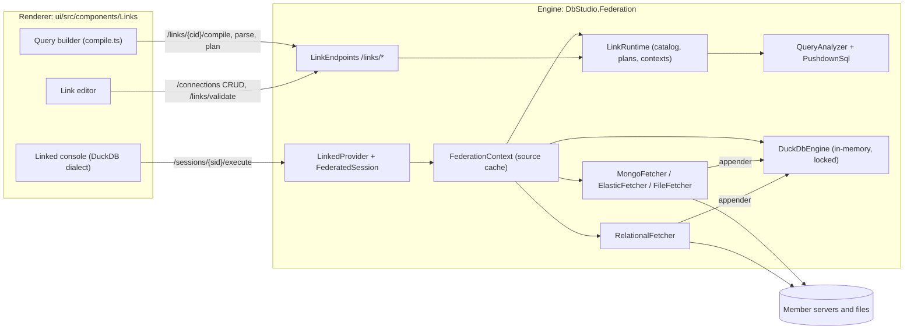
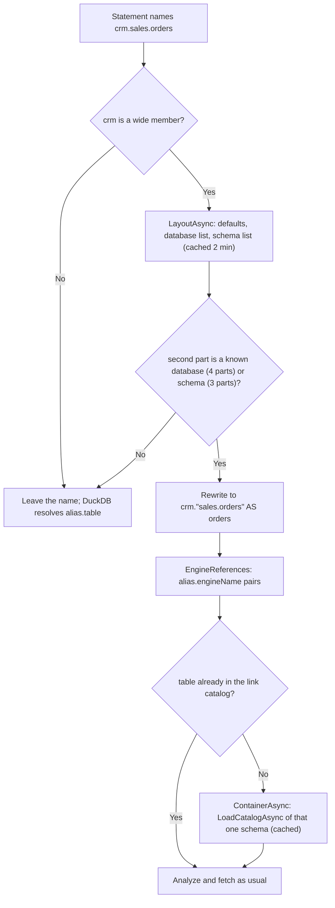
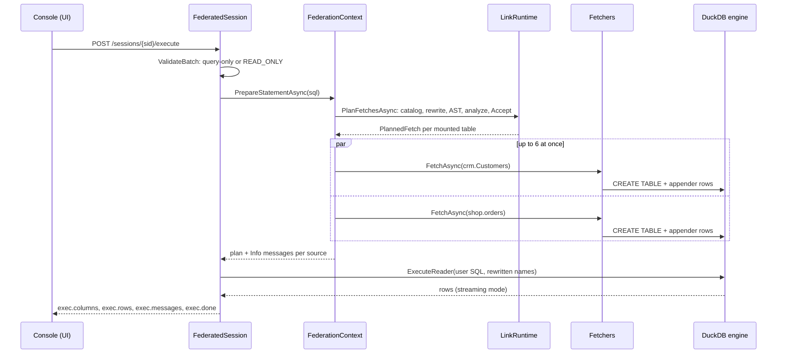
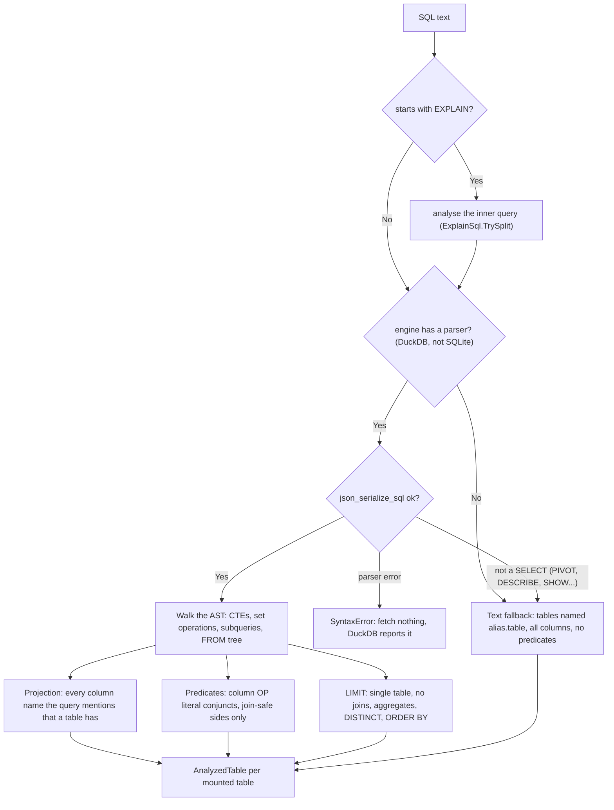
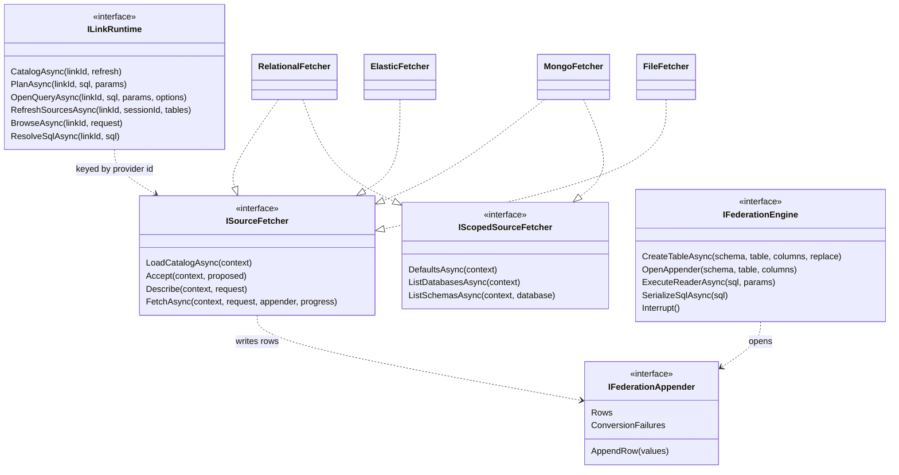
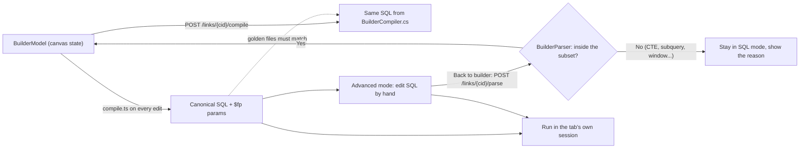

# 16. پایگاه‌های داده‌ی پیوندی و فدراسیون (DuckDB)

<div dir="rtl">

> **سطح:** L3 ارشد (بخش ۱ و ۲.۱ تا ۲.۴ در سطح L2 هم خواندنی‌اند) | **بخش:** II | **کد خوانده‌شده در:** `b638b7b` (مجموعه قابلیت‌های Rowlit 1.6.3؛ `version.json` در این درخت 1.7.0 را نشان می‌دهد که عضوها را از تونل SSH هم عبور می‌دهد)
> **زبان:** فارسی | [English](../../en/part2/16-linked-databases-federation.md) | قبلی: [15. درون‌ریزی، برون‌ریزی، طرح اجرا و نمودار ER](./15-import-export-plans-er.md) | بعدی: [17. منابع I: Redis و MongoDB](./17-sources-redis-mongo.md)
> برچسب‌های نمودارها به انگلیسی نگه داشته شده‌اند تا در GitHub درست نمایش داده شوند.
> **در یک جمله:** پایگاه داده‌ی پیوندی یک اتصال ذخیره‌شده است که جدول‌های چند اتصال دیگر را زیر نام‌های مستعار کوتاه سوار می‌کند تا یک دستور SQL در DuckDB بتواند جدولی از SQL Server را با جدولی از PostgreSQL ‏join کند، در حالی که Rowlit فقط ستون‌ها و سطرهایی را می‌آورد که همان دستور لازم دارد.
> **یاد می‌گیرید:**
> - پیوند (link)، عضو، نام مستعار، جدول سوارشده و دامنه (scope) چیست و پیوند چطور مثل یک پروفایل اتصال معمولی ذخیره می‌شود؛
> - عضوهای «کل اسکیما»، «کل پایگاه داده» و «کل اتصال» (1.6.3) جدول‌هایشان را چطور نام‌گذاری می‌کنند (`crm.sales.orders`، `crm.shop.dbo.orders`) و چطور آن‌ها را تنبل (lazy) بار می‌کنند؛
> - مسیر یک پرس‌وجوی فدره: تحلیل درخت نحوی DuckDB، فروراندن تصویر، گزاره‌ها و حد سطرها برای گویش هر منبع، واکشی موازی به یک DuckDB درون‌حافظه‌ای و سپس اجرای SQL کاربر بدون تغییر؛
> - چرا فروراندن فقط یک بهینه‌سازی است و تحلیل‌گر چطور در join بیرونی، collationها و سقف سطرها درست می‌ماند؛
> - طرح فروراندن، `EXPLAIN` روی یک پیوند و همه‌ی هشدارهای طرح؛
> - سازنده‌ی بصری پرس‌وجو با دو کامپایلر که باید SQL بایت‌به‌بایت یکسان بسازند، نماهای پیوندی، مادی‌سازی (materialize) و اسکریپت‌های پیوند بومی.
> **پیش‌نیازها:** [08. اتصال‌ها، نشست‌ها و اجرای SQL](./08-connections-sessions-execution.md) (نشست‌ها، `AdoSessionBase`، نگهبان فقط‌خواندنی)، [10. کاتالوگ و فراداده](./10-catalog-and-metadata.md). بخش I: [I-08 خط لوله‌ی پرس‌وجو و بهینه‌ساز](../part1/08-query-processing.md) (فروراندن گزاره، هرس تصویر، EXPLAIN)، [I-12 همانندسازی، پارتیشن‌بندی و شاردینگ](../part1/12-backup-replication-ha.md) (فدراسیون در برابر شاردینگ)، [I-17 مقایسه‌ی گویش‌ها](../part1/17-dialect-comparison.md) (نقل‌قول شناسه‌ها، `TOP` / `FETCH FIRST` / `LIMIT`).

## 1. ایده (مبتدی)

شرکت‌ها به‌ندرت همه‌ی داده‌شان را در یک پایگاه داده نگه می‌دارند. ممکن است مشتری‌ها در CRM روی SQL Server باشند، سفارش‌ها در فروشگاهی روی PostgreSQL، محصولات در MySQL و لاگ کلیک‌ها در Elasticsearch. آن وقت پرسشی مثل «جمع پرداختی هر مشتری» به داده‌ی دو سرور نیاز دارد. پاسخ‌های کلاسیک دو تا هستند: یا داده را اول به یک جا کپی کنیم (کار ETL، انبار داده)، یا کاری کنیم که یک سرور به سرور دیگر دسترسی داشته باشد (linked server در SQL Server، foreign data wrapper در PostgreSQL). هر دو به دسترسی مدیر و برنامه‌ریزی نیاز دارند.

Rowlit پاسخ سومی را روی دسکتاپ اضافه می‌کند. شما یک **[پایگاه داده‌ی پیوندی (linked database)](../glossary.md#linked-database)** یا به اختصار «پیوند» می‌سازید: اتصالی ذخیره‌شده که به هیچ سروری اشاره نمی‌کند و به‌جایش فهرستی از **[عضوها (members)](../glossary.md#link-member)** دارد. هر عضو یکی از اتصال‌های موجود شما (یا چند فایل محلی) است که زیر یک **[نام مستعار (alias)](../glossary.md#member-alias)** کوتاه مثل `crm` یا `shop` سوار شده است. در کنسول پیوند می‌نویسید `SELECT … FROM crm.customers c JOIN shop.orders o ON o.customer_id = c.id`. Rowlit می‌فهمد هر منبع باید چه چیزی بدهد، دقیقاً همان را از هر سرور می‌خواهد، پاسخ‌ها را در یک موتور تحلیلی توکار به نام **[DuckDB](../glossary.md#duckdb)** بار می‌کند و دستور شما را همان‌جا اجرا می‌کند. این **[فدراسیون (federation)](../glossary.md#federation)** است: یک [پرس‌وجوی فدره (federated query)](../glossary.md#federated-query) روی چند پایگاه داده‌ی مستقل، بدون جابه‌جا کردن دائمی آن‌ها (بخش I در [I-12](../part1/12-backup-replication-ha.md) آن را با شاردینگ مقایسه می‌کند).

دو قاعده همه‌چیز این فصل را شکل می‌دهد. اول، پیوند **فقط‌خواندنی** است: هرگز در یک عضو نمی‌نویسد. دوم، فرستادن فیلترها به سرورها (**[فروراندن (push-down)](../glossary.md#push-down)**) یک *بهینه‌سازی* است: DuckDB همیشه کل پرس‌وجو را دوباره اعمال می‌کند، پس فیلتری که تحلیل‌گر درباره‌اش مطمئن نیست اصلاً فرستاده نمی‌شود و پاسخ درست می‌ماند. دور این هسته، Rowlit یک سازنده‌ی پرس‌وجوی کشیدن‌ورهاکردنی، نماهای پیوندی ذخیره‌شده، کار «مادی‌سازی» که نتیجه را در یک جدول واقعی می‌نویسد، و اسکریپت‌هایی برای ساختن پیوند بومی روی سرور (وقتی پیوند دائمی لازم است) فراهم می‌کند.

یک نکته‌ی واژگانی: در این فصل «پیوند» به معنای link است؛ برای اینکه با join اشتباه نشود، join را به همان صورت لاتین می‌نویسیم.

## 2. چطور کار می‌کند (حرفه‌ای)

**شکل ۱۶.۱ — اجزای متحرک پایگاه‌های داده‌ی پیوندی.**

</div>



<div dir="rtl">

شکل ۱۶.۱ تقسیم کار را نشان می‌دهد. رابط کاربری هرگز با سرور یک عضو حرف نمی‌زند: پیوند را از راه API معمولی اتصال‌ها ذخیره می‌کند، SQL را از راه API معمولی نشست‌ها اجرا می‌کند و کاتالوگ، طرح‌ها و خدمات سازنده را از مسیرهای `/links` می‌خواهد. هر کاری که به یک عضو دست می‌زند در اسمبلی موتور `DbStudio.Federation` انجام می‌شود که یک ماژول عادی موتور است (`FederationModule`، که مثل هر `IEngineModule` دیگری کشف می‌شود؛ [07. ماژول‌های موتور](./07-engine-modules-and-di.md) را ببینید). متد `ConfigureServices` آن کارخانه‌ی DuckDB، runtime، فراهم‌کننده‌ی `linked`، یک متصل‌کننده‌ی پارامتر DuckDB و برای هر نوع منبع یک واکشنده‌ی کلیددار ثبت می‌کند (`engine/src/DbStudio.Federation/FederationModule.cs:21-41`) و `MapEndpoints` گروه `/links` را نگاشت می‌کند (`FederationModule.cs:43-54`).

### 2.1 پیوند یک اتصال است

پیوند به شکل یک `ConnectionProfile` معمولی ذخیره می‌شود که `providerId` آن `"linked"` است (`Contracts/LinkModels.cs:16`). میزبان، گذرواژه و رشته‌ی اتصال ندارد (`Provider/LinkedProvider.cs:25-30`)؛ تعریفش در چهار کلید از `props` پروفایل زندگی می‌کند: `members`، `relations`، `options` و `linkVersion` (`LinkModels.cs:29-39`). ویرایشگر آن را مثل هر اتصال دیگری از راه `/connections` ذخیره می‌کند (`ui/src/components/Links/editor/save.ts:1`)، در پوشه‌ی «Linked databases» اکسپلورر (`LinkModels.cs:19`). چون پیوند یک اتصال است، هر چیزی که روی اتصال‌ها کار می‌کند روی پیوند هم کار می‌کند: اکسپلورر، Ctrl+P، کنسول‌ها، پرس‌وجوهای ذخیره‌شده، تاریخچه.

**[تعریف پیوند (link definition)](../glossary.md#link-definition)** (`LinkDefinition`، `LinkModels.cs:83-143`) این بخش‌ها را دارد:

| بخش | معنا | منبع |
|---|---|---|
| `Members` | منبع‌ها (پایین‌تر) | `LinkModels.cs:146-207` |
| `Relations` | [رابطه‌های مجازی (virtual relations)](../glossary.md#virtual-relation) یا «کلیدهای خارجی مجازی» که کاربر بین جدول‌های سوارشده‌ی عضوهای مختلف تعریف می‌کند؛ اکسپلورر و پیشنهاد join از آن‌ها استفاده می‌کنند | `LinkModels.cs:248-256` |
| `Options` | بازنویسی تنظیمات `links.*` برای همین پیوند: سقف سطر، مهلت واکشی، حافظه نهان منبع، موتور اجباری | `LinkModels.cs:259-272` |
| `Version` | از زمانی که عضوها دامنه دارند `2` است؛ پروفایل نسخه‌ی ۱ هنگام خواندن مهاجرت داده می‌شود | `LinkModels.cs:86`، `125-129` |

هر **عضو** (`LinkMember`) یک نام مستعار، یک نوع (`connection` یا `files`)، شناسه‌ی اتصال، یک پایگاه داده و اسکیمای اختیاری، یک **[دامنه (scope)](../glossary.md#link-scope)** و فهرستی از **[جدول‌های سوارشده (mounted tables)](../glossary.md#mounted-table)** دارد (`LinkModels.cs:146-207`). هر جدول سوارشده `Name` منبع، یک نام اختیاری درون پیوند به نام `As` و گزینه‌های واکشنده مثل جداکننده‌ی CSV یا اندازه‌ی نمونه‌ی MongoDB را دارد (`LinkModels.cs:210-235`). در SQL، جدول سوارشده `alias.table` است: نام مستعار یک اسکیمای DuckDB می‌شود و نام پیوندی جدولِ آن، پس SQL کاربر روی موتور *بدون تغییر* اجرا می‌شود (`Contracts/IFederationEngine.cs:52-56`).

قاعده‌های نام مستعار سخت‌گیرانه‌اند، چون نام مستعار در هر دستوری یک شناسه است: حروف کوچک، رقم و `_`، شروع با حرف یا `_`، حداکثر ۶۳ نویسه، نه یک واژه‌ی رزروشده‌ی PostgreSQL (DuckDB از گرامر PostgreSQL استفاده می‌کند) و نه یکی از کاتالوگ‌های خود DuckDB یعنی `main`، `temp`، `system`، `memory`، `information_schema`، `pg_catalog`، و نه `views` که پوشه‌ی نماهای پیوندی است (`Contracts/LinkSql.cs:16`، `43`، `49-60`). ویرایشگر یک نسخه‌ی slug از نام اتصال را پیشنهاد می‌کند (`LinkSql.cs:71`).

متد `TestAsync` فراهم‌کننده در واقع یک اعتبارسنجی همراه با کاوش است (`LinkedProvider.cs:32-57`). `LinkRuntime.ValidateAsync` (`Runtime/LinkRuntime.cs:255-365`) نام‌های مستعار (نامعتبر، تکراری، رزروشده)، عضوها (اتصال گم‌شده، فراهم‌کننده‌ی پشتیبانی‌نشده، عضوی که خودش پیوند است)، دامنه‌ها، نام جدول‌ها و رابطه‌ها را بررسی می‌کند و با `probe` به هر عضو هم وصل می‌شود و جدول‌هایش را پیدا می‌کند. مشکل‌ها کدهایی از `LinkProblemCodes` دارند (`Contracts/LinkApi.cs:44-56`): `empty`، `aliasInvalid`، `aliasDuplicate`، `aliasReserved`، `memberMissing`، `memberUnsupported`، `memberLinked`، `memberUnreachable`، `tableInvalid`، `tableDuplicate`، `tableMissing`، `noTables`، `relationInvalid`، `scopeInvalid` و هشدار `scopeNarrowed`. فقط خطاها نتیجه را از `Ok` بیرون می‌برند (`LinkRuntime.cs:364`).

رازهای عضوها هرگز از موتور بیرون نمی‌روند. `ResolveMember` یک `SourceContext` می‌سازد که یک کپی زمان اجرا از پروفایل عضو و گذرواژه‌اش از انبار رازها را دارد (`LinkRuntime.cs:91-136`، `Contracts/ISourceFetcher.cs:82-108`)؛ در این درخت پروفایل از `ConnectionStore.ResolveForOpen` هم می‌گذرد، پس عضوی که تونل SSH دارد از همان تونل واکشی می‌شود (`LinkRuntime.cs:118`).

### 2.2 دامنه‌ها: از چند جدول تا یک سرور کامل

تا 1.6.2 هر عضو یا فهرست صریحی از جدول‌ها را سوار می‌کرد یا «همه‌ی جدول‌های» یک اسکیما را. نسخه‌ی 1.6.3 این را به چهار **دامنه** تبدیل کرد (`LinkModels.cs:64-74`؛ یادداشت انتشار `docs/release-notes/v1.6.3.md:4-9`):

| دامنه | چه چیزی سوار می‌شود | نام‌ها در SQL |
|---|---|---|
| `tables` | فهرست صریح `Tables` از یک اسکیما | `alias.table` |
| `schema` | همه‌ی جدول‌ها و نماهای یک اسکیما (همان `allTables` قدیم) | `alias.table` |
| `database` | همه‌ی اسکیماهای یک پایگاه داده | `alias.schema.table`؛ اسکیمای پیش‌فرض با `alias.table` هم |
| `connection` | همه‌ی پایگاه‌های داده‌ی اتصال | `alias.database.schema.table`؛ پایگاه پیش‌فرض با `alias.schema.table` و اسکیمای پیش‌فرضش با `alias.table` هم |

معنای «پایگاه داده» و «اتصال» به فراهم‌کننده بستگی دارد. `MemberScopes` (`Runtime/LinkNames.cs:17-43`) فراهم‌کننده‌ها را در سه شکل دسته‌بندی می‌کند:

| شکل فراهم‌کننده | فراهم‌کننده‌ها | سطح‌های `database` | سطح‌های `connection` |
|---|---|---|---|
| پایگاه داده بالای اسکیما | `sqlserver`، `postgresql`، `snowflake` (`LinkNames.cs:22`) | `[schema]` | `[database, schema]` |
| یک پایگاه داده، چند اسکیما | `oracle` (اسکیماها همان کاربرها هستند)، `sqlite` (main و فایل‌های attach‌شده) (`LinkNames.cs:27`) | `[schema]` | `[schema]` |
| اسکیما همان پایگاه داده است | `mysql`، `mariadb`، `clickhouse`، `cassandra`، `mongodb` (`LinkNames.cs:25`) | ندارد (مثل `schema`) | `[schema]` |
| چیزی برای پوشش ندارد | `elasticsearch` و هر چیز دیگر | ندارد | ندارد |

قاعده‌ها در `MemberScopes.Levels` هستند (`LinkNames.cs:30-36`) و آزمون `Levels_per_provider` در `engine/tests/DbStudio.Federation.Tests/Wide/WideMemberTests.cs:52-65` آن‌ها را میخکوب می‌کند. وقتی دامنه‌ی `connection` چیزی بیشتر از یک اسکیما را نمی‌پوشاند، اعتبارسنجی هشدار `scopeNarrowed` می‌دهد (`LinkNames.cs:39-42`). عضوهای فایلی فقط `tables` می‌توانند داشته باشند (`LinkRuntime.cs:288-289`). پیوندهای نسخه‌ی ۱ هنگام خواندن مهاجرت داده می‌شوند: `allTables: true` به `schema` تبدیل می‌شود و بقیه به `tables`، و `AllTables` همچنان دنبال دامنه می‌رود تا نسخه‌ی قدیمی‌تر برنامه که یک پیوند نسخه‌ی ۲ را می‌خواند هنوز اسکیمای عضو را سوار کند (`LinkModels.cs:119-129`، `199-203`).

دامنه‌ی `database` یا `connection` را **[پهن (wide)](../glossary.md#wide-member)** می‌گوییم (`LinkModels.cs:73`، `196`). عضوهای پهن دلیل این‌اند که فدراسیون مجبور شد نام‌های چندبخشی را یاد بگیرد. DuckDB حداکثر سه بخش نام را می‌پذیرد (`catalog.schema.table`) و در پیوند، نام مستعار عضو خودش *همان* اسکیمای DuckDB است. پس `crm.sales.orders` نمی‌تواند یک نام واقعی DuckDB باشد. Rowlit این را با یک **[نام موتوری (engine name)](../glossary.md#engine-name)** حل می‌کند: بخش‌های زیر نام مستعار با نقطه به یک نام جدول تبدیل می‌شوند، `crm."sales.orders"`، و پایگاه داده و اسکیمای پیش‌فرض حذف می‌شوند (`LinkNames.cs:104-118`). `LinkNames.Rewrite` (`LinkNames.cs:213-289`) دستور را توکن‌به‌توکن، پیش از تحلیل یا اجرا، بازنویسی می‌کند:

| شما می‌نویسید | موتور اجرا می‌کند | قاعده |
|---|---|---|
| `FROM crm.sales.orders` | `FROM crm."sales.orders" AS orders` | جایگاه جدولی که نام مستعار ندارد `AS <table>` می‌گیرد تا `orders.amount` همچنان کار کند (`LinkNames.cs:269-274`) |
| `FROM crm.dbo.customers` | `FROM crm.customers` | اسکیمای پیش‌فرض حذف می‌شود |
| `FROM ms.Staging.dbo.orders` | `FROM ms."Staging.dbo.orders" AS orders` | کل اتصال، پایگاه داده‌ی دیگر |
| `SELECT crm.sales.orders.amount` | `SELECT orders.amount` | ستونی که با نام کامل آمده از نام مستعار ضمنی استفاده می‌کند (`LinkNames.cs:261-265`) |

توکن‌ساز رشته‌ها، توضیح‌ها و متن نقل‌قول‌شده را دست نمی‌زند، و نامی که بخش دومش یک اسکیما یا پایگاه داده‌ی شناخته‌شده نیست دست‌نخورده می‌ماند تا DuckDB به‌طور عادی گزارشش کند (`LinkNames.cs:141-149`). این حالت‌ها همان ادعاهای آزمون‌های `Three_and_four_part_names_become_engine_tables` و `Columns_qualified_with_the_full_name_use_the_implicit_alias` هستند (`WideMemberTests.cs:106-131`).

عضوهای پهن **تنبل** هم هستند. سروری با هزاران جدول نباید هنگام باز شدن پیوند هزاران خواندن کاتالوگ هزینه داشته باشد. برای همین کاتالوگ پیوند فقط *ظرف پیش‌فرض* عضو را نگه می‌دارد (پایگاه داده و اسکیمای پیش‌فرض اتصال)؛ هر ظرف دیگری اولین باری بار می‌شود که یک پرس‌وجو، سازنده یا IntelliSense نامش را بیاورد (`LinkModels.cs:59-62`، `Runtime/WideMembers.cs:8-13`). `IScopedSourceFetcher`، یعنی [واکشنده‌ی دامنه‌دار (scoped source fetcher)](../glossary.md#scoped-source-fetcher) (`ISourceFetcher.cs:58-68`)، سه فراخوانی ارزان را اضافه می‌کند که این کار را ممکن می‌کنند: پیش‌فرض‌های اتصال، پایگاه‌های داده‌اش و اسکیماهای یک پایگاه داده، فقط نام‌ها. واکشنده‌ی رابطه‌ای پایگاه‌های داده‌ی سیستمی (`master`، `tempdb`، `template0`، `SNOWFLAKE`…) و اسکیماهای سیستمی (`information_schema`، `pg_catalog`، `sys`، اسکیماهای نقش `db_*` در SQL Server…) را از این فهرست‌ها حذف می‌کند (`Fetchers/RelationalFetcher.cs:24-39`).

در رابط کاربری، `editor/scopes.ts` تعیین می‌کند ویرایشگر برای هر فراهم‌کننده کدام دامنه‌ها را پیشنهاد کند (MongoDB ‏`database` و `connection`، Elasticsearch ‏`connection`، فراهم‌کننده‌های رابطه‌ای هر چهار تا؛ `ui/src/components/Links/editor/scopes.ts:11`، `34-37`)، عضو «کل پایگاه داده» نام پایگاه داده‌اش را کجا نگه دارد (`databaseScopeField`، `scopes.ts:26-31`) و راهنمای یک‌خطی نام‌گذاری زیر انتخابگر چه باشد («Query as crm.schema.table; crm.table for the default schema»، `scopes.ts:58-73`). اکسپلورر روی گره‌های پایگاه داده و اسکیما فرمان‌های **Link database…** و **Link schema…** را اضافه می‌کند (`ui/src/components/Links/materialize/commands.tsx:52-63`)؛ `materialize/linkScope.ts` گره را به یک عضو پهن تبدیل می‌کند و با `scopeCovers` بررسی می‌کند که آیا عضو موجودی از قبل آن را می‌پوشاند (`linkScope.ts:1-2`، `scopes.ts:76-93`).

**شکل ۱۶.۲ — نام چندبخشی یک عضو پهن چطور به جدول می‌رسد.**

</div>



<div dir="rtl">

`ResolveSqlCoreAsync` (`WideMembers.cs:213-228`) شکل ۱۶.۲ را پیاده می‌کند: پیدا می‌کند متن نام کدام نام‌های مستعار پهن را آورده (`LinkNames.NamedAliases`، `LinkNames.cs:177-191`)، فقط چیدمان (layout) همان‌ها را بار می‌کند، بازنویسی می‌کند، ارجاع‌های موتوری را فهرست می‌کند (`LinkNames.cs:194-210`) و کاتالوگ را با جدول‌هایی که لازم‌اند گسترش می‌دهد (`WideMembers.cs:231-251`). پایگاه داده‌ای که در فهرست چیدمان نیامده (به خاطر مجوزها) باز هم به شکل `alias.database.schema.table` امتحان می‌شود (`WideMembers.cs:171-176`). هر بارگذاری برای هر کلید و هر TTL فقط یک بار اجرا می‌شود حتی اگر چند فراخوان منتظر باشند، و بودجه‌ی ۶۰ ثانیه‌ای خودش را دارد؛ پس انصراف یک فراخوان خواندنی را که فراخوان دیگری منتظرش است لغو نمی‌کند (`WideMembers.cs:23`، `37-63`).

### 2.3 کاتالوگ پیوند

`LinkRuntime.CatalogAsync` (`LinkRuntime.cs:184-206`) **[کاتالوگ پیوند (link catalog)](../glossary.md#link-catalog)** یعنی یک `LinkCatalog` برمی‌گرداند: برای هر عضو یک `LinkCatalogSchema` با جدول‌ها، هشدارها، خطا، دامنه، سطح‌ها و مسیر پیش‌فرض (`Contracts/ILinkRuntime.cs:87-103`). این کاتالوگ برای هر پیوند به مدت `CatalogTtl` یعنی ۲ دقیقه در حافظه نهان می‌ماند (`LinkRuntime.cs:31`). کلید این حافظه نهان یک **[اثر انگشت (fingerprint)](../glossary.md#link-fingerprint)** است: props سریال‌شده‌ی پروفایل (`LinkRuntime.cs:188`)؛ پس ویرایش پیوند ورودی را بلافاصله باطل می‌کند، حتی درون همان دو دقیقه. یک semaphore برای هر پیوند باعث می‌شود اولین فراخوان‌های هم‌زمان یک بارگذاری مشترک داشته باشند (`LinkRuntime.cs:191-205`، با بررسی دوباره پس از انتظار).

عضوها به‌صورت موازی بار می‌شوند (`LinkRuntime.cs:215-221`). هر کدام ۶۰ ثانیه وقت دارد (`LinkRuntime.cs:232`)؛ عضوی که شکست بخورد کاتالوگ را خراب نمی‌کند: با `Error` پرشده و بدون جدول ظاهر می‌شود (`LinkRuntime.cs:241-246`). پرس‌وجویی که نام یک عضو شکست‌خورده را بیاورد به‌جای پیام «table does not exist» در DuckDB یک `SOURCE_UNAVAILABLE` روشن می‌گیرد که نام مستعار را می‌گوید (`LinkRuntime.cs:402-414`).

واکشنده‌ی رابطه‌ای کاتالوگ عضو را از خواننده‌ی کاتالوگ خود فراهم‌کننده می‌سازد، همان `LoadSchemaAsync` که اکسپلورر استفاده می‌کند ([10. کاتالوگ](./10-catalog-and-metadata.md)): جدول‌ها، نماها و نماهای مادی‌شده، ستون‌ها با یک **[نوع (kind)](../glossary.md#cell-kind)** از نگاشت نوع، کلید اصلی و فقط آن کلیدهای خارجی هم‌منبعی که مقصدشان در همان عضو سوار شده است (`RelationalFetcher.cs:82-151`). برای Cassandra کلید پارتیشن را هم در گزینه‌های جدول ثبت می‌کند، چون فروراندن به آن نیاز دارد (`RelationalFetcher.cs:138-146`).

اکسپلورر، Ctrl+P، زبانه‌ی Objects و IntelliSense پیوند را از راه `LinkCatalogReader` «مثل هر پایگاه داده‌ای» می‌بینند (`Provider/LinkCatalogReader.cs:11-18`): بدون سطح پایگاه داده، اسکیماها همان نام‌های مستعار عضوها (اولی پیش‌فرض است)، اشیا همان جدول‌های سوارشده، نوع ستون‌ها همان‌طور که DuckDB نگه می‌دارد با نوع منبع در توضیح ستون، و رابطه‌های مجازی به شکل کلید خارجی. رابط کاربری کاتالوگ‌های پیوند را در یک استور تنبل Zustand به نام `store/links.ts` نگه می‌دارد که وقتی runtime موتور در دسترس نیست، به کاتالوگی برمی‌گردد که از کاتالوگ اکسپلورر خود پیوند بازسازی شده است (`ui/src/store/links.ts:1-4`، `20-21`). تا جایی که کد نشان می‌دهد، درخت اکسپلورر فقط ظرف پیش‌فرض یک عضو پهن را فهرست می‌کند؛ فهرست جدول‌های سازنده و IntelliSense سطح‌های دیگر را هنگام نیاز مرور می‌کنند (`POST /links/{cid}/browse`؛ `ui/src/components/Links/builder/TableList.tsx:111-123`، `ui/src/components/Links/intel/wideNames.ts:1-7`).

### 2.4 یک پرس‌وجوی فدره، از ابتدا تا انتها

باز کردن کنسول روی یک پیوند `LinkedProvider.OpenSessionAsync` را صدا می‌زند (`LinkedProvider.cs:59-77`). این متد یک **[زمینه‌ی فدراسیون (federation context)](../glossary.md#federation-context)** باز می‌کند: یک موتور درون‌حافظه‌ای با یک اسکیما برای هر نام مستعار عضو و محدودیت‌های نشست، که زیر شناسه‌ی نشست ثبت می‌شود تا «Refresh sources» و مادی‌سازی به حافظه نهان آن دسترسی داشته باشند (`LinkRuntime.cs:165-176`). شیء نشست، یعنی [نشست فدره (federated session)](../glossary.md#federated-session)، `FederatedSession` است، زیرکلاسی از `AdoSessionBase` مشترک (`Provider/FederatedSession.cs:27`)؛ پس جریان‌دهی، سقف سطرها، لغو و پیام‌ها مثل هر کنسول دیگری رفتار می‌کنند ([08](./08-connections-sessions-execution.md)).

این دستور را روی پیوندی با یک عضو SQL Server به نام `crm` (پایگاه داده‌ی `shop`، دامنه‌ی `database`) و یک عضو PostgreSQL به نام `shop` (اسکیمای `public`، دامنه‌ی `tables`) در نظر بگیرید:

</div>

```sql
SELECT c.Name, count(*) AS orders, sum(o.total) AS total
FROM crm.Customers c
JOIN shop.orders o ON o.customer_id = c.Id
WHERE o.total > 50 AND c.Name LIKE 'A%'
GROUP BY c.Name
ORDER BY total DESC;
```

<div dir="rtl">

**شکل ۱۶.۳ — یک پرس‌وجوی فدره از Run تا سطرها.**

</div>



<div dir="rtl">

گام‌به‌گام (شکل ۱۶.۳):

1. **بررسی فقط‌خواندنی.** `ValidateBatch` هر دسته‌ای را که فقط از پرس‌وجو (و دستورهای نشست) ساخته نشده باشد با `READ_ONLY` رد می‌کند، حتی اگر کاربر جای دیگری نوشتن را تأیید کرده باشد (`FederatedSession.cs:48-55`؛ مستندات `FederatedSession.cs:14-26`). تراکنش وجود ندارد: حالت دستی خطا می‌دهد، commit و rollback کاری نمی‌کنند و تغییر پایگاه داده رد می‌شود (`FederatedSession.cs:115-125`). رابط کاربری دکمه‌ی Tx و دکمه‌ی Explain را برای `linked` پنهان می‌کند (`ui/src/lib/providerLevels.ts:16-17`، `20-26`).
2. **آماده‌سازی.** `ExecuteReaderAsync` حالت جریانی DuckDB.NET را روشن می‌کند و `PrepareStatementAsync` را صدا می‌زند (`FederatedSession.cs:57-64`). آماده‌سازی‌ها در هر زمینه با یک semaphore پشت سر هم اجرا می‌شوند (`Runtime/FederationContext.cs:53`، `103`).
3. **برنامه‌ریزی واکشی‌ها.** `PlanFetchesAsync` کاتالوگ را بار می‌کند، نام‌های پهن را حل می‌کند (۲.۲)، دستور را به درخت نحوی DuckDB سریال می‌کند و برای هر جدول سوارشده یک [درخواست واکشی (fetch request)](../glossary.md#fetch-request) پذیرفته‌شده (`FetchRequest`) می‌سازد (`LinkRuntime.cs:376-397`، `399-481`). بخش‌های ۲.۵ و ۲.۶ این گام را شرح می‌دهند.
4. **واکشی موازی.** حداکثر `MaxParallelFetches` یعنی ۶ منبع هم‌زمان واکشی می‌شوند (`LinkRuntime.cs:28`، `FederationContext.cs:112`). هر واکشی جدول موتور را دقیقاً با ستون‌های درخواستی می‌سازد (یا از نو می‌سازد)، یک **[appender](../glossary.md#appender)** باز می‌کند و می‌گذارد واکشنده سطرها را در آن بریزد (`FederationContext.cs:202-222`). اگر یک منبع شکست بخورد، بقیه بلافاصله لغو می‌شوند، چون پرس‌وجو بدون آن اجرا نمی‌شود، و اولین شکست واقعی گزارش می‌شود نه لغوهایی که خودش باعث شده است (`FederationContext.cs:120-141`).
5. **پیام‌ها.** برای هر منبع یک خط Info، مثلاً `crm.Customers: 2 rows from SQL Server in 120 ms.`، و سپس هشدارهای طرح (`FederationContext.cs:226-230`، `163-167`).
6. **اجرا.** نشست دستور کاربر را روی موتور اجرا می‌کند. متن فرمان فقط وقتی تغییر می‌کند که نام‌های پهن بازنویسی شده باشند (`FederatedSession.cs:63-64`). DuckDB.NET هم‌گام (synchronous) اجرا می‌کند، پس فراخوانی روی یک نخ کارگر انجام می‌شود و `Cancel` از بیرون قطعش می‌کند (`FederatedSession.cs:77-82`).
7. **یک بار تلاش دوباره.** اگر DuckDB ستونی را گزارش کند که تصویر از قلم انداخته، زمینه جدول‌های کامل را واکشی می‌کند و دستور دوباره اجرا می‌شود (`FederatedSession.cs:69-74`؛ همین در `OpenQueryAsync`، `LinkRuntime.cs:545-549`). این تور ایمنی پشت تصویر محافظه‌کارانه‌ی بخش ۲.۵ است.
8. **مقدارها.** ستون‌ها و سلول‌های نتیجه از `ResultValues` می‌گذرند؛ خواننده‌ی DuckDB ستون `DECIMAL(38,2)` را فقط «DECIMAL» می‌نامد، پس دقت و مقیاس از جدول schema خوانده می‌شوند، وگرنه `120.50` به شکل `120.5` چاپ می‌شد (`Runtime/ResultValues.cs:31-34`؛ یافته‌ی L-3 در `docs/qa/round-links.md`).

**[حافظه نهان منبع (source cache)](../glossary.md#source-cache).** وقتی `cacheSources` روشن است (پیش‌فرض، `engine/src/DbStudio.Core/Services/SettingsService.cs:99-100`)، جدول‌های واکشی‌شده برای دستورهای بعدی نشست در موتور زمینه می‌مانند. یک کپی نهان دوباره استفاده می‌شود وقتی همه‌ی ستون‌های لازم را داشته باشد، هیچ گزاره‌ای نداشته باشد که درخواست جدید ندارد (پس ابرمجموعه‌ای از سطرها را نگه می‌دارد) و به شکل متفاوتی بریده نشده باشد (`FederationContext.cs:241-252`). وقتی قابل استفاده‌ی دوباره نیست، درخواست جدید تا ستون‌هایی که کپی قبلی داشت گسترده می‌شود، تا رفت‌وبرگشت بین دو پرس‌وجو باعث واکشی‌های پشت سر هم نشود (`FederationContext.cs:192-200`). کپی دوباره‌استفاده‌شده پیام `… rows from the session cache.` را چاپ می‌کند و طرح هشدار `cached` می‌دهد (`FederationContext.cs:184-190`، `149-151`). فرمان **[Refresh sources](../glossary.md#refresh-sources)** (`links.refreshSources`، `ui/src/components/Links/commands.ts:165`) مسیر `POST /links/{cid}/refresh-sources` را صدا می‌زند که کاتالوگ پیوند را فراموش می‌کند و جدول‌های نهان یک نشست یا همه‌ی نشست‌های پیوند را دور می‌ریزد (`LinkRuntime.cs:569-577`، `FederationContext.cs:61-82`). وقتی مدیر منابع یک نشست پیوندی بیکار را آزاد می‌کند، فقط کپی‌های واکشی‌شده از دست می‌روند: اجرای بعدی دوباره واکشی می‌کند (`FederatedSession.cs:24`؛ [21. لاگ‌ها، فعالیت و منابع](./21-logs-activity-resources.md) را ببینید).

### 2.5 تحلیل‌گر پرس‌وجو

**[تحلیل‌گر پرس‌وجو (query analyzer)](../glossary.md#query-analyzer)** برای هر جدول سوارشده تصمیم می‌گیرد کدام ستون‌ها واکشی شوند، کدام گزاره‌ها را منبع می‌تواند ارزیابی کند و آیا می‌توان یک `LIMIT` فرستاد. خودش SQL را تجزیه نمی‌کند؛ از DuckDB می‌پرسد: `SELECT json_serialize_sql(CAST($sql AS VARCHAR))` **[درخت نحوی انتزاعی (AST)](../glossary.md#ast)** تجزیه‌گر را به شکل JSON برمی‌گرداند (`Diagnostics/DuckDbProbe.cs:55-71`؛ cast لازم است چون تابع چند overload دارد، `DuckDbProbe.cs:58-59`). سپس `QueryAnalyzer.Analyze` روی این JSON راه می‌رود (`Pushdown/QueryAnalyzer.cs:79-97`). استفاده از تجزیه‌گر خود DuckDB یعنی تحلیل‌گر و موتور هرگز درباره‌ی معنای SQL اختلاف نظر پیدا نمی‌کنند.

**شکل ۱۶.۴ — درخت تصمیم تحلیل‌گر.**

</div>



<div dir="rtl">

آنچه پیمایشگر بیرون می‌کشد (مستندات `QueryAnalyzer.cs:61-76`، پیمایش `QueryAnalyzer.cs:169-221`):

- **تصویر (projection)** که همیشه فرورانده می‌شود. پیمایشگر همه‌ی ارجاع‌های ستون را در کل درخت جمع می‌کند و هر نام را محافظه‌کارانه به هر رخداد جدولی نسبت می‌دهد که ستونی با آن نام دارد (`QueryAnalyzer.cs:226-268`). واکشی یک ستون اضافه بی‌ضرر است؛ جا انداختن یکی پرس‌وجو را می‌شکند (و تلاش دوباره‌ی ۲.۴ را فعال می‌کند). `SELECT *`، `t.*`، `COLUMNS(…)`، `NATURAL JOIN` و نام مستعار خالی جدول که به شکل struct سطر به کار رفته جدول را «همه‌ی ستون‌ها» علامت می‌زنند. پرس‌وجویی که به هیچ ستونی از یک جدول نیاز ندارد (`COUNT(*)`) اولین ستون کلید اصلی، وگرنه اولین ستون را واکشی می‌کند، چون جدول موتور نمی‌تواند صفر ستون داشته باشد (`QueryAnalyzer.cs:203-204`؛ قرارداد `ISourceFetcher.cs:163-167`).
- **گزاره‌ها** ([گزاره‌های فرورانده](../glossary.md#pushdown-predicate)). فقط عطف‌هایی (conjuncts) به شکل `column OP literal`: `=`، `<>`، `<`، `>`، `<=`، `>=`، `IN (literals)`، `BETWEEN`، `LIKE` و `IS NOT NULL`، با مقدار لفظی در هر سمت (عملگر برعکس می‌شود، `QueryAnalyzer.cs:603-688`). هرگز `IS NULL`، `OR`، `NOT`، تابع یا cast روی ستون، پارامتر، یا ستون در هر دو سمت (`ISourceFetcher.cs:197-202`). `NOT LIKE`، `ILIKE` و `LIKE … ESCAPE` فرورانده نمی‌شوند، و الگویی که بک‌اسلش دارد هم همین‌طور، چون قاعده‌های escape در هر منبع فرق دارد (`QueryAnalyzer.cs:664-687`).
- **سازگاری نوع.** `Compatible` (`QueryAnalyzer.cs:903-942`) هر مقدار لفظی را رد می‌کند که مقایسه‌اش ممکن است روی منبع سطرهای *کمتری* از آنچه DuckDB نگه می‌دارد نگه دارد. رشته‌ها فقط برای `=`، `IN` و `LIKE` فرورانده می‌شوند: یک collation حساس‌نبودن به حروف یا پرکننده روی منبع ابرمجموعه‌ای می‌دهد که موتور فیلترش می‌کند، اما `<>` یا یک بازه ممکن است سطرهایی را بیندازد که مقایسه‌ی دودویی DuckDB نگه می‌دارد. بولی‌ها فقط `=`. تاریخ‌ها و timestampها مقدار لفظی تاریخ، timestamp یا متن ISO را می‌پذیرند، هرگز `LIKE` یا `<>`. guidها `=` و `IN`. برای `datetimeoffset` هیچ حالتی وجود ندارد، پس ستون `timestamptz` هرگز روی منبع فیلتر نمی‌شود.
- **ایمنی در join بیرونی.** عطف‌های WHERE به هر جدولی از همان SELECT فرورانده می‌شوند، چون NULL را رد می‌کنند و موتور به هر حال WHERE را دوباره اعمال می‌کند. عطف‌های ON فقط به سمتی فرورانده می‌شوند که join آن را فیلتر می‌کند: هر دو سمت INNER و SEMI، سمت راست LEFT و ANTI، سمت چپ RIGHT و هیچ‌کدام برای FULL (`QueryAnalyzer.cs:433-452`). جدولی که چند بار خوانده می‌شود (self-join، زیرپرس‌وجو) فقط گزاره‌هایی را نگه می‌دارد که *همه‌ی* رخدادهایش دارند (`QueryAnalyzer.cs:206-215`). joinهای POSITIONAL و ASOF و ارجاع‌های جدولی که تحلیل‌گر نمی‌شناسد جدول‌ها را «کدر» می‌کنند: جدول کامل، بدون گزاره (`QueryAnalyzer.cs:427-432`).
- **LIMIT.** فقط برای یک دستور تکی فرورانده می‌شود که FROM آن یک جدول پایه است که یک بار خوانده می‌شود، بدون CTE، گروه‌بندی، HAVING، QUALIFY، نمونه‌گیری، تابع تجمیعی، پنجره یا زیرپرس‌وجو، و فقط وقتی *همه‌ی* عطف‌های WHERE به گزاره‌ی فرورانده تبدیل شده باشند؛ `OFFSET` به حد اضافه می‌شود (`QueryAnalyzer.cs:722-756`).
- **جفت‌های join.** برابری‌های بین ستون‌های دو جدول سوارشده برای هشدارهای طرح `joinKinds` و `joinCollation` ثبت می‌شوند (`LinkRuntime.cs:427-436`).

وقتی DuckDB نمی‌تواند دستور را سریال کند (PIVOT، DESCRIBE، SHOW، SUMMARIZE…)، **[بازگشت متنی (text fallback)](../glossary.md#text-fallback)** توکن‌ها را برای `alias.table` (و جدول‌های اسکیمای پیش‌فرض پس از FROM، JOIN، PIVOT، DESCRIBE…) می‌گردد و آن جدول‌ها را کامل و بدون گزاره، با هشدار `fallback`، واکشی می‌کند (`QueryAnalyzer.cs:117-140`، `LinkRuntime.cs:422-424`). خطای تجزیه‌ی واقعی فرق دارد: هیچ چیز واکشی نمی‌شود و موتور خطای نحوی را گزارش می‌کند (`QueryAnalyzer.cs:83-86`، `LinkRuntime.cs:421`).

برای پرس‌وجوی نمونه، تحلیل‌گر دو جدول پیدا می‌کند. `crm.Customers` به `Id` و `Name` نیاز دارد و گزاره‌ی `Name LIKE 'A%'` را می‌گیرد (یک `LIKE` رشته‌ای، فرورانده). `shop.orders` به `customer_id` و `total` نیاز دارد و `total > 50` را می‌گیرد (ستون اعشاری و مقدار لفظی صحیح: عددی، فرورانده). هیچ حدی فرورانده نمی‌شود، چون join و تابع تجمیعی هست.

### 2.6 فروراندن برای هر منبع: `Accept` و `Render`

تحلیل‌گر پیشنهاد می‌کند؛ هر واکشنده تصمیم می‌گیرد. `ISourceFetcher.Accept` درخواست را با حذف گزاره‌هایی که نمی‌تواند بنویسد برمی‌گرداند، و قرارداد می‌خواهد که انداختن هر گزاره حد را هم بیندازد، چون حد فقط وقتی درست است که همه‌ی گزاره‌ها روی منبع اعمال شوند (`ISourceFetcher.cs:31-36`). واکشنده‌ی رابطه‌ای کار را به `PushdownSql.Accept` می‌سپارد (`RelationalFetcher.cs:153-157`، `Pushdown/PushdownSql.cs:40-59`). برای هر گویش (`PushdownSql.cs:30-39`، `61-74`):

| منبع | چه چیزی فرورانده نمی‌شود | چرا |
|---|---|---|
| SQLite | گزاره روی تاریخ، زمان، guid و بولی | مقدارها متن یا عدد با هر شکلی‌اند؛ مقایسه‌ی متنی مقایسه‌ی تاریخ نیست |
| ClickHouse | گزاره‌های `datetime`، `datetimeoffset` و `time` | ستون‌های DateTime در منطقه زمانی ستون مقایسه می‌شوند |
| Cassandra (CQL) | همه چیز به‌جز `=` روی *همه‌ی* ستون‌های کلید پارتیشن | Rowlit هرگز `ALLOW FILTERING` نمی‌فرستد؛ طرح هشدار `fullScan` می‌دهد (`LinkRuntime.cs:469-471`) |
| همه‌ی گویش‌ها | `datetimeoffset` و `time`؛ `LIKE` با بک‌اسلش | offsetها و نوع‌های زمان بین موتورها فرق دارند؛ قاعده‌های escape فرق دارند |
| T-SQL | (فرورانده می‌شود) `LIKE` با `[` که به `[[]` تبدیل شده | در T-SQL ‏`[` یک کلاس نویسه را باز می‌کند (`PushdownSql.cs:175-177`) |

سپس `PushdownSql.Render` (`PushdownSql.cs:82-110`) دستور `SELECT <projection> FROM <qualified name> [WHERE …]` را با یک حد سطر می‌نویسد: `LIMIT` فرورانده، وگرنه [سقف سطر (row cap)](../glossary.md#row-cap) به‌علاوه‌ی یک، تا منبع هرگز بیشتر از آنچه واکشنده خواهد خواند جریان ندهد. حد در T-SQL به شکل `TOP (n)`، در Oracle به شکل `FETCH FIRST n ROWS ONLY` و در بقیه به شکل `LIMIT n` نوشته می‌شود. شناسه‌ها از `DialectInfo.QuoteIdentifier` می‌گذرند. مقدارهای لفظی نوع‌دارند (`PushdownLiteral`، `ISourceFetcher.cs:204-211`) و برای هر گویش نوشته می‌شوند (`PushdownSql.cs:142-188`): رشته‌های `N'…'` و `CAST('…' AS date)` در T-SQL، ‏`DATE '…'` و `TIMESTAMP '…'` در Oracle، ‏`toDate('…')` و `toUUID('…')` در ClickHouse، ‏`'…'::DATE` در Snowflake، ‏`'…'::uuid` در PostgreSQL، uuid بدون نقل‌قول در CQL، بولی‌های `1`/`0` در T-SQL، Oracle و SQLite، و بک‌اسلش‌های دوبرابرشده جایی که escape می‌کنند (MySQL، ClickHouse، Snowflake؛ `PushdownSql.cs:198-203`).

برای نمونه، با سقف پیش‌فرض ۲٬۰۰۰٬۰۰۰ سطر، از دو منبع این‌ها خواسته می‌شود (خروجی تصویری، استخراج‌شده از `Render`؛ دور QA همین شکل را ثبت کرده است: `SELECT TOP (2000001) [Id], [Name] ...`):

</div>

```sql
-- crm.Customers on SQL Server
SELECT TOP (2000001) [Id], [Name] FROM [dbo].[Customers] WHERE [Name] LIKE N'A%'
-- shop.orders on PostgreSQL
SELECT "customer_id", "total" FROM "public"."orders" WHERE "total" > 50 LIMIT 2000001
```

<div dir="rtl">

### 2.7 واکشنده‌ها

**شکل ۱۶.۵ — قراردادهای فدراسیون.**

</div>



<div dir="rtl">

**[واکشنده‌های منبع (source fetchers)](../glossary.md#source-fetcher)**، **[singletonهای کلیددار (keyed services)](../glossary.md#keyed-service)** هستند که با شناسه‌ی فراهم‌کننده‌ی عضو، یا با `files` برای عضوهای فایلی، پیدا می‌شوند (`FetcherKeys`، `ISourceFetcher.cs:71-79`؛ ثبت‌ها `FederationModule.cs:31`، `37-39`). بی‌حالت و ایمن برای چند نخ‌اند، چون زمینه چند جدول از یک عضو را موازی واکشی می‌کند (`ISourceFetcher.cs:10-15`). عضوی که فراهم‌کننده‌اش واکشنده ندارد با `memberUnsupported` در اعتبارسنجی رد می‌شود (`LinkRuntime.cs:113-114`).

| واکشنده | کلید | کاتالوگ | واکشی | منبع |
|---|---|---|---|---|
| `RelationalFetcher` | `sqlserver`، `oracle`، `postgresql`، `mysql`، `mariadb`، `sqlite`، `clickhouse`، `snowflake`، `cassandra` | خواننده‌ی کاتالوگ فراهم‌کننده | یک اتصال اختصاصی از راه `ImportConnections.OpenAsync` در Import (برای Cassandra از راه یک نشست فراهم‌کننده)، SQL ساخته‌ی `Render`، حداکثر `MaxRows` + ۱ سطر خوانده می‌شود | `RelationalFetcher.cs:13-20`، `71-72`، `173-213` |
| `MongoFetcher` | `mongodb` | مجموعه‌ها (collections) با فیلدهای سطح بالا که از یک نمونه استنتاج شده‌اند (پیش‌فرض ۱٬۰۰۰ سند؛ int+double ← float، مخلوط یا تودرتو ← متن JSON) | aggregate با `$match` ← `$project` ← `$limit`؛ ObjectIdها به شکل hex، تاریخ‌ها UTC، مقدارهای تودرتو به شکل Extended JSON آزاد | `Fetchers/MongoFetcher.cs:62-73` |
| `ElasticFetcher` | `elasticsearch` | `_id` به‌علاوه‌ی هر فیلد برگ mapping با مسیر نقطه‌دار | `_search` با فیلتر `_source` و یک `bool.filter` از term / terms / range / exists، با scroll در صفحه‌های ۱٬۰۰۰ تایی (keep-alive ‏`2m`) تا سقف | `Fetchers/ElasticFetcher.cs:11-22` |
| `FileFetcher` | `files` | CSV/TSV، XLSX، JSON/NDJSON با استنتاج نوع جادوگر درون‌ریزی روی ۲٬۰۰۰ سطر اول | منبع‌های سطر Import؛ فقط تصویر فرورانده می‌شود؛ Parquet هنوز پشتیبانی نمی‌شود | `Fetchers/FileFetcher.cs:11-21` |

سه جزئیات برای درستی و منابع مهم‌اند. واکشی رابطه‌ای مهلت خودش را دارد (`links.fetchTimeoutSeconds`، پیش‌فرض ۳۰۰ ثانیه) و تمام شدن مهلت را به یک `FetchException` تبدیل می‌کند که نام عضو و جدول را می‌گوید؛ خطای درایوری که از لغو خود Rowlit ناشی شده (`Operation cancelled by user`، `ORA-01013`) به یک لغو تمیز تبدیل می‌شود (`RelationalFetcher.cs:182-212`). لغو `DbCommand.Cancel` را صدا می‌زند و برای SQLite ‏`sqlite3_interrupt` را هم، چون `Cancel` در `Microsoft.Data.Sqlite` یک گام در حال اجرا را متوقف نمی‌کند (`RelationalFetcher.cs:223-231`). عضوهای غیررابطه‌ای استخر درایور دومی باز نمی‌کنند: `MemberClients.WithClientAsync` کلاینت منبع مشترک موتور را با یک **[اجاره (lease)](../glossary.md#lease)** برای مدت فراخوانی قرض می‌گیرد (`MongoFetcher.cs:15-41`؛ مدیر کلاینت در [17](./17-sources-redis-mongo.md) شرح داده شده است).

واکشنده‌ی فایل به خاطر قفل‌بندی بخش ۲.۸ وجود دارد: DuckDB فدراسیون خودش نمی‌تواند فایل محلی بخواند، پس فایل‌ها از همان منبع‌های سطری می‌رسند که جادوگر درون‌ریزی استفاده می‌کند ([15](./15-import-export-plans-er.md)؛ `docs/wp-notes/links/wp0.md` §4، انحراف ۳).

**نوع‌ها.** [نگاشت نوع (type map)](../glossary.md#type-map) یعنی `TypeMap` نوع منبع را به یک kind و یک نوع موتور تبدیل می‌کند (`Pushdown/TypeMap.cs:9-20`): عددهای صحیح ← `BIGINT` (۶۴ بیتی بدون علامت، ۱۲۸ بیتی و `NUMBER(19..38,0)` ← `HUGEINT`)، اعشاری شناور ← `DOUBLE`، ‏`decimal(p,s)` ← `DECIMAL(38,s)` (پهن‌تر از ۳۸ ← `VARCHAR` با هشدار `decimalWidened`؛ بدون دقت ← `DOUBLE`)، رشته‌ها ← `VARCHAR`، تاریخ و زمان به نوع‌های DuckDB، ‏`datetimeoffset` ← `TIMESTAMPTZ` در UTC، guid ← `UUID`، دودویی ← `BLOB`، JSON ← `JSON`. ‏`Nullable(…)` و `LowCardinality(…)` در ClickHouse باز می‌شوند. appender مقداری را که نمی‌تواند تبدیل کند NULL ذخیره می‌کند و می‌شمارد؛ سپس طرح هشدار `conversion` می‌دهد (`IFederationEngine.cs:98-112`، `FederationContext.cs:153-158`).

### 2.8 موتور: DuckDB، قفل‌بندی آن و جایگزین SQLite

`DuckDbEngineFactory.OpenAsync` برای هر زمینه یک DuckDB درون‌حافظه‌ای، یعنی [موتور فدراسیون (federation engine)](../glossary.md#federation-engine)، باز می‌کند (`Engine/DuckDbEngine.cs:39-66`). پیش از آنکه هیچ SQL کاربری اجرا شود، `DuckDbEngine.Open` به این ترتیب اعمال می‌کند (`DuckDbEngine.cs:98-121`):

1. پیکربندی: `memory_limit`، `threads`، `temp_directory`، `TimeZone = 'UTC'`، یک `CREATE SCHEMA` برای هر نام مستعار و `search_path` برابر اولین نام مستعار (پس نام جدول بدون پیشوند یعنی عضو اول)؛
2. دستورهای **[قفل‌بندی (lockdown)](../glossary.md#lockdown)**: `autoinstall_known_extensions = false`، `autoload_known_extensions = false` و `enable_external_access = false` (`DuckDbProbe.cs:20-25`)؛
3. ‏`SET lock_configuration = true` تا SQL کاربر نتواند هیچ‌کدام را برگرداند.

نتیجه این است که کنسول پیوندی نمی‌تواند افزونه نصب یا بار کند، نمی‌تواند فایل محلی بخواند یا بنویسد (`read_csv`، `COPY … TO`) و به شبکه دسترسی ندارد. دور QA بررسی کرد که `INSERT`، `DELETE`، `CREATE`، `ATTACH`، `COPY`، `INSTALL`، `CALL`، `read_csv` و `glob` رد می‌شوند و پیکربندی قفل است (`docs/qa/round-links.md`، بخش «Checked and found correct»). فقط‌خواندنی بودن دو بار اعمال می‌شود: یک بار با `ValidateBatch` پیش از اجرای هر چیز، و یک بار با قفل‌بندی درون موتور. [19. امنیت](./19-security-and-secrets.md) این را در مدل تهدید گسترده‌تر قرار می‌دهد.

**حافظه و سرریز.** `memory_limit` از `links.memoryLimitMb` می‌آید؛ صفر یعنی خودکار: ۲۵ درصد حافظه‌ای که runtime ‏.NET برای فرایند در دسترس گزارش می‌کند، و دست‌کم ۵۱۲ مگابایت (`LinkRuntime.cs:147-148`، `155-160`). فراتر از این حد DuckDB به `<DataDir>/tmp/links/<sessionId>` **[سرریز (spill)](../glossary.md#spill)** می‌کند (`LinkRuntime.cs:151`، `Contracts/LinkModels.cs:274-281`)، پوشه‌ای که هنگام بسته شدن موتور پاک می‌شود؛ باقی‌مانده‌های یک موتور از کار افتاده هنگام راه‌اندازی، وقتی هنوز هیچ نشستی وجود ندارد، پاک می‌شوند (`LinkRuntime.cs:69-73`). ‏`threads` برابر صفر پیش‌فرض DuckDB را می‌گذارد.

**[قطع (interrupt)](../glossary.md#interrupt).** `IFederationEngine.Interrupt` همه‌ی فرمان‌های در حال اجرا را از نخ دیگری لغو می‌کند (`DuckDbEngine.cs:265-273`). لغو نشست هم `Cancel` فرمان و هم `Interrupt` موتور را صدا می‌زند (`FederatedSession.cs:86-90`) و یک آماده‌سازی در حال اجرا واکشی‌هایش را از راه توکن پیوندخورده لغو می‌کند (`FederationContext.cs:111`). دور QA حدود ۱۲۰ میلی‌ثانیه برای لغو یک cross join چهارطرفه اندازه گرفت و نشست پس از آن همچنان قابل استفاده بود (`docs/qa/round-links.md`).

**[جایگزین SQLite](../glossary.md#sqlite-fallback-engine).** اگر libduckdb بار نشود (کتابخانه‌ی بومی گم‌شده یا غیرقابل بارگذاری)، کارخانه به‌جایش `SqliteFederationEngine` را باز می‌کند و نشست یک هشدار همراه دارد (`DuckDbEngine.cs:59-63`، `LinkRuntime.cs:172`). این موتور برای هر نام مستعار یک پایگاه داده‌ی درون‌حافظه‌ای attach می‌کند تا `alias.table` همچنان حل شود، فقط زیرمجموعه‌ی SQL سازنده را تضمین می‌کند، تجزیه‌گر ندارد (هر پرس‌وجو به بازگشت متنی می‌رود) و سرریز نمی‌کند؛ appenderها ۵٬۰۰۰ سطر را بافر می‌کنند و زیر قفل موتور می‌نویسند (`Engine/SqliteFederationEngine.cs:10-19`). در این حالت هر طرح هشدار `fallbackEngine` دارد (`LinkRuntime.cs:419-420`). ‏`GET /links/engine` گزارش می‌دهد این build کدام موتور را اجرا می‌کند (`FederationModule.cs:48`، `DuckDbProbe.cs:80-96`)؛ آزمون دود (smoke) بومی در CI آن را صدا می‌زند (`docs/wp-notes/links/wp0.md` §3). پیوند می‌تواند با `options.engine` موتور را اجباری هم کند (`LinkModels.cs:270-271`).

**پارامترها.** SQL پیوند پارامترها را به شکل `$name`، `$1` یا `?` متصل می‌کند؛ مقدارهای فیلتر سازنده `$fp1`، `$fp2`… هستند (`Engine/DuckDbParamBinder.cs:11-15`). نشست به‌جای فرستادن پارامترهای متصل‌نشده به DuckDB آن‌ها را رد می‌کند (`FederatedSession.cs:44`) و کادر Parameters کنسول مقدارها را می‌پرسد ([08](./08-connections-sessions-execution.md)).

### 2.9 طرح‌های فروراندن، `EXPLAIN` و هشدارها

فرمان **Show push-down plan** (`links.plan`، `ui/src/components/Links/commands.ts:178`) مسیر `POST /links/{cid}/plan` را صدا می‌زند و [طرح فروراندن (push-down plan)](../glossary.md#push-down-plan) را نشان می‌دهد. `PlanAsync` همان تحلیل یک پرس‌وجوی واقعی را اجرا می‌کند اما چیزی واکشی نمی‌کند (`LinkRuntime.cs:494-516`): برای هر جدول سوارشده متن پرس‌وجوی منبع را از `Describe` واکشنده (SQL، یک خط لوله‌ی Mongo یا بدنه‌ی Elasticsearch؛ هرگز اجرا نمی‌شود، `ISourceFetcher.cs:38-39`)، تصویر، گزاره‌ها و حد فرورانده، سقف سطر و اینکه آیا در یکی از نشست‌های پیوند کپی نهان وجود دارد برمی‌گرداند (`LinkApi.cs:109-134`). پس از یک اجرای واقعی، طرح زمینه تعداد سطر، بریده شدن، زمان سپری‌شده و پرچم حافظه نهان را هم دارد (`FederationContext.cs:234-235`).

[هشدارهای طرح (plan warnings)](../glossary.md#plan-warning) (`PlanWarningCodes`، `LinkApi.cs:140-164`):

| کد | معنا |
|---|---|
| `rowCap` | یک منبع به `maxRowsPerSource` رسید؛ نتیجه ممکن است ناقص باشد |
| `fallback` | دستور تحلیل نشد: جدول‌های کامل، بدون فیلتر |
| `joinKinds` | یک join ستون‌هایی از kindهای مختلف را مقایسه می‌کند (عدد با متن…) |
| `joinCollation` | یک join ستون‌های متنی با collationهای متفاوت را مقایسه می‌کند؛ موتور متن را دقیق مقایسه می‌کند |
| `limitWithoutOrder` | ‏`LIMIT` بدون `ORDER BY`: اینکه کدام سطرها برمی‌گردند دلبخواه است |
| `cartesian` | جدولی از سازنده که هیچ joinی به آن نمی‌رسد (ضرب دکارتی) |
| `decimalWidened` | اعشاری پهن‌تر از `DECIMAL(38)` به شکل `VARCHAR` خوانده شد |
| `conversion` | مقدارهایی که موتور نتوانست تبدیل کند NULL ذخیره شدند |
| `fullScan` | یک جدول Cassandra کامل خوانده می‌شود (فقط برابری روی کل کلید پارتیشن فرورانده می‌شود) |
| `cached` | از حافظه نهان نشست آمده؛ برای داده‌ی تازه Refresh sources را بزنید |
| `fallbackEngine` | جایگزین SQLite پرس‌وجو را اجرا می‌کند |

**‏`EXPLAIN` روی یک پیوند.** دکمه‌ی Explain کنسول برای پیوندها پنهان است (`providerLevels.ts:20-26`)، چون طرح فروراندن بالا نمای مفیدتری است. با این حال کاربر می‌تواند `EXPLAIN SELECT …` تایپ کند. ‏`json_serialize_sql` فقط SELECT را می‌پذیرد، پس تا پیش از 1.6.3 چنین دستوری به بازگشت متنی می‌افتاد و جدول‌های کامل را می‌خواند. اکنون `ExplainSql.TrySplit` (`Pushdown/ExplainSql.cs:16-31`) بخش `EXPLAIN [ANALYZE] [(options)]` را جدا می‌کند و تحلیل‌گر روی پرس‌وجوی درونی کار می‌کند، پس تصویر و گزاره‌ها مثل اجرای واقعی فرورانده می‌شوند (`LinkRuntime.cs:383-393`، `503`). یک `EXPLAIN` ساده به داده نیاز ندارد، پس از هر منبع حداکثر `SampleRows` یعنی ۱٬۰۰۰ سطر می‌خواند ([نمونه‌برداری EXPLAIN](../glossary.md#explain-sampling)) و این را به‌جای هشدار سقف سطر در یک پیام Info می‌گوید (`ExplainSql.cs:14`، `FederationContext.cs:146`، `160-162`)؛ ‏`EXPLAIN ANALYZE` پرس‌وجو را اجرا می‌کند و به‌طور عادی می‌خواند. آنچه DuckDB چاپ می‌کند طرح خودش روی کپی‌های محلی است، نه طرح سرورهای عضو (`docs/qa/round-links.md`، O-1). برای سمت منبع ماجرا، نمایشگر طرح فصل [15](./15-import-export-plans-er.md) را روی هر عضو بخوانید، و برای خواندن آن بخش I، [I-08](../part1/08-query-processing.md) را.

### 2.10 سازنده‌ی بصری پرس‌وجو

فرمان **Open query builder** (`links.builder`، `ui/src/components/Links/commands.ts:111`) [سازنده‌ی پرس‌وجو (query builder)](../glossary.md#query-builder) را باز می‌کند: زبانه‌ای که جدول‌های پیوند روی یک بوم (canvas) هستند، joinها بین ستون‌ها کشیده می‌شوند، یک پنل پایین برای ستون‌های خروجی، فیلترها، گروه‌بندی، مرتب‌سازی و حد دارد و SQL سمت راست است (`ui/src/components/Links/builder/BuilderView.tsx:1-3`). حالت آن یک `BuilderModel` است (`Contracts/BuilderModel.cs:25-62`): جدول‌ها (`t1`، `t2`… هر کدام با نام مستعار عضو، جدول سوارشده و نام مستعار SQL)، joinها به ترتیب SQL، ستون‌ها، یک درخت فیلتر (همان شکل `FilterNode` که نوار فیلتر گرید استفاده می‌کند)، GROUP BY صریح یا خودکار، HAVING، مرتب‌سازی، حد، offset و DISTINCT.

مدل به **[SQL متعارف (canonical SQL)](../glossary.md#canonical-sql)** کامپایل می‌شود، چیدمانی ثابت که در سرآیند `BuilderModel.cs` نوشته شده است (`BuilderModel.cs:9-21`): هر بند در یک خط، کلیدواژه‌ها با حروف بزرگ، بدون نقطه‌ویرگول پایانی، شناسه‌ها فقط در صورت نیاز نقل‌قول‌شده، ارجاع ستون به شکل `<as>.<column>`، و مقدارهای فیلتر به شکل پارامتر متصل `$fp1…` که کنار SQL برگردانده می‌شوند و هرگز درون آن نوشته نمی‌شوند. دو کامپایلر آن را می‌سازند. ‏`builder/compile.ts` در رابط کاربری با هر ویرایش برای پیش‌نمایش زنده کامپایل می‌کند، بدون رفت‌وبرگشت (`ui/src/components/Links/builder/compile.ts:1-27`). ‏`BuilderCompiler` موتور به `POST /links/{cid}/compile` برای مادی‌سازی و نماهای ذخیره‌شده پاسخ می‌دهد (`Builder/BuilderCompiler.cs`). این دو باید بایت‌به‌بایت یکسان باشند و **[آزمون‌های golden](../glossary.md#golden-test)** این را تضمین می‌کنند: هر فایل در `engine/tests/DbStudio.Federation.Tests/Goldens/Builder/` یک کاتالوگ، یک مدل، SQL مورد انتظار، پارامترها و هشدارها را دارد و هم `BuilderGoldenTests.cs` (C#) و هم `ui/src/components/Links/__tests__/goldens.test.ts` (TypeScript) باید همه‌شان را پاس کنند. فایل‌های `b-*` را بسته‌ی کاری موتور و `c-*` را بسته‌ی کاری رابط کاربری نوشته‌اند (`docs/wp-notes/links/wp0.md` §1).

عضوهای پهن به سازنده هم می‌رسند. جدولی از یک اسکیمای غیرپیش‌فرض به شکل طبیعی‌اش نوشته می‌شود، `pg.sales.orders`، و هر بخش فقط در صورت نیاز نقل‌قول می‌شود (golden ‏`c-007-wide-member-names.json`)، و `BuilderCompiler` این نام‌های طبیعی را پیش از آنکه DuckDB دوباره تجزیه‌شان کند به نام‌های موتوری بازنویسی می‌کند (`BuilderCompiler.cs:10-26`).

**شکل ۱۶.۶ — رفت‌وبرگشت سازنده و SQL.**

</div>



<div dir="rtl">

راه برگشت، که در شکل ۱۶.۶ آمده، `BuilderParser` است (`Builder/BuilderParser.cs:11-20`). این تجزیه‌گر AST ساخته‌ی DuckDB از SQL دست‌نویس را می‌خواند و وقتی SQL درون زیرمجموعه‌ی سازنده بماند یک مدل از نو می‌سازد: یک SELECT، joinهای INNER/LEFT/RIGHT/FULL/CROSS چپ‌عمیق که ON آن‌ها AND از مقایسه‌های ستون است (به‌اختیار پیچیده در `lower()` / `trim()`)، ستون‌های جدول، پنج تابع تجمیعی، عبارت‌های محاسبه‌شده بدون تجمیع یا پنجره، WHERE/HAVING به شکل خروجی کامپایلر فیلتر، GROUP BY، ORDER BY، LIMIT/OFFSET و DISTINCT. هر چیز دیگری (CTE، زیرپرس‌وجو، عملگر مجموعه‌ای، پنجره، joinهای USING/NATURAL/SEMI، پارامتر متصل) بدون مدل و همراه دلیل برمی‌گردد و زبانه در حالت SQL می‌ماند. هر مدلی که تجزیه‌گر برمی‌گرداند دوباره به دستوری با همان معنا کامپایل می‌شود. در **[حالت Advanced](../glossary.md#advanced-mode)** سازنده مقدارهای `$name` را هنگام Run و Materialize در کادر Parameters می‌پرسد (`BuilderView.tsx:284-288`؛ QA O-2).

**[استنتاج join (join inference)](../glossary.md#join-inference)** (`ui/src/components/Links/builder/infer.ts`) joinها را از سه منبع با امتیاز ۰ تا ۱۰۰ پیشنهاد می‌کند: کلید خارجی هم‌منبع (۱۰۰)، رابطه‌ی مجازی پیوند (۹۵)، قرارداد نام‌گذاری مثل `orders.customer_id → customers.id` (۸۵، یا ۵۵ وقتی kindها جور نیستند) و نام ستون مشترک شبیه کلید (۷۰، وگرنه ۴۰) (`infer.ts:76`، `82`، `97`، `107`). افزودن جدول وقتی بهترین پیشنهاد دست‌کم `AUTO_JOIN_SCORE` یعنی ۸۰ امتیاز داشته باشد آن را خودکار join می‌کند (`infer.ts:22`، `136`)؛ پیشنهادهای ضعیف‌تر به شکل راهنمای خط‌چین کشیده می‌شوند.

### 2.11 نماهای پیوندی و مادی‌سازی

**[نمای پیوندی (linked view)](../glossary.md#linked-view)** پرس‌وجویی است که روی یک پیوند ذخیره شده است. SQL، نام و توضیح آن یک پرس‌وجوی ذخیره‌شده‌ی معمولی پیوند با اسکیمای `views` هستند، پس گره Queries اکسپلورر و Ctrl+P آن را فهرست می‌کنند و حذف پیوند آن را هم حذف می‌کند؛ مدل سازنده، اگر باشد، در `<DataDir>/linked-views.json` زندگی می‌کند که به‌صورت اتمی نوشته می‌شود و با شناسه‌ی پرس‌وجوی ذخیره‌شده کلید می‌خورد (`Views/LinkedViewStore.cs:9-15`). مسیرها: `GET/PUT/DELETE /links/{cid}/views[/{id}]` (`LinkApi.cs:16-18`). فرمان **Open in query builder** نما را با مدلش دوباره باز می‌کند (`links.openView`، `commands.ts:146`).

**[مادی‌سازی (materialize)](../glossary.md#materialize)** نتیجه‌ی یک پرس‌وجوی پیوند (SQL یا یک نما) را در جدولی از یک اتصال رابطه‌ای قابل نوشتن می‌نویسد (`Materialize/MaterializeService.cs:36-44`). از `TargetWriter` و `ImportDialect` بخش Import دوباره استفاده می‌کند ([15](./15-import-export-plans-er.md))، پس جایی که مقصد مسیر انبوه دارد (`COPY`، `SqlBulkCopy`، درج انبوه ClickHouse) از آن استفاده می‌کند و در غیر این صورت INSERTهای دسته‌ای (`MaterializeService.cs:218`). به شکل یک کار (job) از نوع `links.materialize` با مرحله‌های preparing، fetching، writing، committing و done اجرا می‌شود (`MaterializeService.cs:19-26`، `55`)؛ برای `job.progress` و `job.done` فصل [06](./06-websocket-protocol.md) را ببینید. سه حالت (`LinkApi.cs:177-185`):

- ‏`create` وقتی جدول وجود دارد شکست می‌خورد؛
- ‏`replace` سطرها را در یک جدول تازه بار می‌کند و فقط پس از نوشته شدن همه‌ی سطرها با تغییر نام جایگزینش می‌کند، پس شکست جدول قدیمی را دست‌نخورده می‌گذارد (`MaterializeService.cs:41-42`، `276`)؛
- ‏`append` ستون‌ها را با نام، بدون حساسیت به حروف، جور می‌کند و جدول را با نامی که تایپ شده یا شکل تاشده‌ی آن پیدا می‌کند (Oracle برای `qa_mat_x` جدول `QA_MAT_X` را می‌سازد؛ QA L-2) (`MaterializeService.cs:331-334`).

پیش‌نمایش (`POST /links/{cid}/materialize/preview`) ستون‌های نتیجه را با اجرای `SELECT * FROM (…) AS q LIMIT 0` و سقف یک سطر برای هر منبع یاد می‌گیرد و سپس DDL و نگاشت ستون‌ها را نشان می‌دهد (`MaterializeService.cs:98-106`). مقصدهای فقط‌خواندنی با `READ_ONLY` و پیوندها و مقصدهای غیررابطه‌ای با `VALIDATION` رد می‌شوند (`MaterializeService.cs:42-43`). مادی‌سازی می‌تواند شناسه‌ی نشست کنسول را بفرستد تا از حافظه نهان منبع آن دوباره استفاده کند (`LinkApi.cs:193-203`، `MaterializeService.cs:189`).

### 2.12 اسکریپت‌های پیوند بومی

گاهی پیوند دائمی سمت سرور ابزار درست است: یک کار شبانه، یک گزارش روی سرور. فرمان **Create native link…** (`links.nativeLink`، `ui/src/components/Links/native/commands.tsx:42`) مسیر `POST /links/{cid}/native-script` را صدا می‌زند و `NativeLinkScripter` یک **[اسکریپت پیوند بومی (native link script)](../glossary.md#native-link-script)** می‌نویسد که سرور یک اتصال *مقصد* را به‌صورت بومی به یک عضو می‌رساند (`Native/NativeLinkScripter.cs:28-34`). موتور هرگز آن را اجرا نمی‌کند: رابط کاربری آن را در یک کنسول روی مقصد باز می‌کند و هر رازی یک جای‌نگهدار به سبک `<password>` است که در نتیجه فهرست می‌شود (`LinkApi.cs:233-239`). هر جفت چه نوع‌هایی را مجاز می‌کند (`NativeLinkScripter.cs:44-52`):

| مقصد | فراهم‌کننده‌های عضو | نوع | اسکریپت چه چیزی می‌سازد |
|---|---|---|---|
| SQL Server | هر رابطه‌ای | `linkedServer` ([linked server](../glossary.md#linked-server)) | ‏`sp_addlinkedserver` + `sp_addlinkedsrvlogin`، نمونه‌ی `OPENQUERY` |
| PostgreSQL | PostgreSQL، MySQL/MariaDB، Oracle، SQL Server | `fdw` ([FDW](../glossary.md#fdw)) | ‏`CREATE EXTENSION` برای postgres_fdw / mysql_fdw / oracle_fdw / tds_fdw، ‏`CREATE SERVER`، نگاشت کاربر، `IMPORT FOREIGN SCHEMA` |
| Oracle | هر رابطه‌ای | `dbLink` ([database link](../glossary.md#database-link)) | ‏`CREATE DATABASE LINK` |
| MySQL / MariaDB | MySQL، MariaDB | `federated` ([موتور FEDERATED](../glossary.md#federated-engine)) | ‏`CREATE SERVER` + یک جدول `ENGINE = FEDERATED` برای هر جدول سوارشده |
| ClickHouse | PostgreSQL، MySQL/MariaDB | `clickhouseEngine` | جدول یا پایگاه داده با `ENGINE = PostgreSQL(...)` / `MySQL(...)` |

عضوهای پهن اسکریپت‌ها را تغییر می‌دهند. یک linked server یا database link از قبل به هر اسکیمایی که login راه دور می‌تواند بخواند می‌رسد، پس اسکریپت یادداشتی درباره‌ی نحوه‌ی کامل‌نویسی نام‌ها اضافه می‌کند. در FDW یک «کل پایگاه داده» به یک `IMPORT FOREIGN SCHEMA` برای هر اسکیمای راه دور در اسکیماهای محلی `name_schema` تبدیل می‌شود؛ و چون postgres_fdw و tds_fdw با هر foreign server فقط به یک پایگاه داده می‌رسند، «کل اتصال» برای هر پایگاه داده یک سرور می‌گیرد. حداکثر ۲۵ ظرف نوشته می‌شوند و بقیه به شکل توضیح می‌آیند (`NativeLinkScripter.cs:300-344`). ClickHouse برای هر اسکیما یا پایگاه داده‌ی راه دور یک موتور پایگاه داده می‌گیرد (`NativeLinkScripter.cs:430-445`). FEDERATED هر بار یک جدول را نگاشت می‌کند، پس فقط پایگاه داده‌ی پیش‌فرض را پوشش می‌دهد و این را می‌گوید (`NativeLinkScripter.cs:418-419`). اگر اتصال مقصد فقط‌خواندنی باشد، یادداشتی به کاربر می‌گوید اسکریپت را از یک اتصال قابل نوشتن به همان سرور اجرا کند (`Endpoints/LinkEndpoints.cs:138-139`). سیزده فایل snapshot در `engine/tests/DbStudio.Federation.Tests/WpB/Snapshots/` خروجی را میخکوب می‌کنند.

## 3. نگاه عمیق (ارشد)

> **نگاه عمیق (L3): چرا فروراندن یک بهینه‌سازی است و هرگز یک قاعده نیست**
>
> موتور فدره‌ای که به فروراندنش اعتماد کند باید برای هر گویش، collation، نوع و قاعده‌ی NULL ثابت کند که منبع دقیقاً همان سطرهایی را برمی‌گرداند که موتور نگه می‌داشت. نگه‌داشتن چنین اثباتی برای نُه فراهم‌کننده و نسخه‌هایشان ناممکن است. Rowlit بار اثبات را برعکس می‌کند (`ISourceFetcher.cs:16-20`): یک واکشی می‌تواند سطرهای **بیشتری** از نیاز پرس‌وجو برگرداند، هرگز کمتر (جز سقف سطر مستند و گزارش‌شده)، و DuckDB هر گزاره‌ی دستور اصلی را دوباره اعمال می‌کند. آن وقت تحلیل‌گر و واکشنده‌ها فقط باید *محافظه‌کار* باشند، و هر قاعده‌ی بالا نمونه‌ای از «وقتی مطمئن نیستی بیندازش» است: رشته‌ها فقط `=`، `IN` و `LIKE` را فرومی‌رانند، چون یک collation حساس‌نبودن به حروف در SQL Server ‏`'a' = 'A'` را روی منبع درست می‌کند (ابرمجموعه‌ای که مقایسه‌ی دودویی DuckDB دوباره فیلترش می‌کند)، اما باعث می‌شود `name > 'a'` مجموعه‌ی دیگری را نگه دارد. ‏`timestamptz` هرگز فرورانده نمی‌شود، چون «همان لحظه» و «همان متن ساعت دیواری» با تنظیم‌های منطقه زمانی مختلف فرق می‌کنند. حد فقط وقتی فرورانده می‌شود که همه‌ی عطف‌های WHERE فرورانده شده باشند، چون `LIMIT 10` که پیش از فیلتری اعمال شود که منبع ارزیابی‌اش نکرده، کمتر از ده سطر منطبق برمی‌گرداند.
>
> **joinهای بیرونی.** گزاره‌ای در `ON` از `a LEFT JOIN b` ‏`b` را فیلتر می‌کند (سطرهایی از `b` که در آن رد شوند فقط جور نمی‌شوند)، اما `a` را فیلتر نمی‌کند (هر سطر `a` با NULLها باقی می‌ماند). فروراندنش به `a` سطرهایی را می‌اندازد که پرس‌وجو برمی‌گرداند. جدول سمت‌ها در ۲.۵ از همین‌جا می‌آید. گزاره‌های WHERE فرق دارند: پس از join اجرا می‌شوند و NULL را رد می‌کنند، پس فروراندن یک گزاره‌ی WHERE روی سمت تأمین‌کننده‌ی NULL فقط سطرهایی را حذف می‌کند که WHERE به هر حال حذف می‌کرد. چون موتور WHERE را دوباره اعمال می‌کند، فروراندن در هر سمتی ایمن است.
>
> **self-joinها.** یک جدول سوارشده یک جدول موتور می‌شود، حتی اگر پرس‌وجو آن را دو بار با فیلترهای مختلف بخواند (`FROM t a JOIN t b ON … WHERE a.x = 1 AND b.y = 2`). واکشی باید به هر دو رخداد خدمت کند، پس فقط اشتراک گزاره‌هایشان می‌تواند فرورانده شود (`QueryAnalyzer.cs:206-215`). همین استدلال قاعده‌ی استفاده‌ی دوباره از حافظه نهان را هم می‌سازد (`FederationContext.cs:241-252`): کپی نهانی که با گزاره‌های `P` واکشی شده فقط وقتی به درخواست تازه با گزاره‌های `Q` خدمت می‌کند که `P ⊆ Q` باشد، چون آن وقت کپی ابرمجموعه‌ی آن چیزی است که `Q` نگه می‌دارد.

> **نگاه عمیق (L3): چرا درخت نحوی را از DuckDB بپرسیم**
>
> تحلیل‌گر می‌توانست از توکن‌ساز SQL خود Rowlit استفاده کند، همان‌طور که IntelliSense می‌کند. اما تصمیم‌های فروراندن باید دقیقاً با فهم *اجراکننده* از دستور جور باشند: یک نام خالی `orders` به کدام جدول وصل می‌شود، آیا یک `LIMIT` مال زیرپرس‌وجوست، `QUALIFY` یا `GROUP BY ALL` شکل را چطور تغییر می‌دهند. ‏`json_serialize_sql` تجزیه‌گر خود DuckDB است، پس گرامر دومی وجود ندارد که از آن فاصله بگیرد. هزینه‌ها این‌اند: فقط SELECT را سریال می‌کند (از همین‌جا بازگشت متنی و جدا کردن EXPLAIN)، شکل JSON آن ممکن است بین نسخه‌های DuckDB تغییر کند (پیمایشگر شکل غیرمنتظره را «فهمیده نشد» حساب می‌کند و برمی‌گردد، `QueryAnalyzer.cs:93-96`)، و جایگزین SQLite اصلاً تجزیه‌گر ندارد. راه برگشت سازنده (`BuilderParser`) از همان AST استفاده می‌کند، و برای همین «Back to builder» دقیقاً همان چیزی را می‌فهمد که موتور اجرا می‌کرد.

> **نگاه عمیق (L3): نام‌های موتوری به‌جای بخش چهارم نام**
>
> DuckDB می‌توانست یک اتصال کامل SQL Server را با یک *کاتالوگ* attach‌شده برای هر عضو نشان دهد (آن وقت `crm.shop.dbo.orders` می‌شد کاتالوگ `crm`، اسکیمای `shop.dbo`…)، اما کاتالوگ‌ها را نمی‌توان برای هر نام به‌صورت تنبل ساخت و باز هم برای «کل اتصال» یک سطح کم می‌آمد. چسباندن بخش‌های پایینی به یک نام جدول نقل‌قول‌شده چیدمان موتور را تخت نگه می‌دارد (اسکیما = نام مستعار، جدول = هر چیزی)، همه‌ی پیوندهای دوبخشی موجود را بدون تغییر نگه می‌دارد و همه‌ی پیچیدگی را به یک بازنویسی خالص و خوب آزموده‌شده (`LinkNames.Rewrite`) منتقل می‌کند که پیش از تحلیل اجرا می‌شود. بهایش این است که بازنویسی باید جایگاه‌های جدول را بفهمد تا `AS orders` اضافه کند و کاربر بتواند مثل روی منبع `orders.amount` بنویسد؛ برای همین پشته‌ی بندها و معرفی‌کننده‌های `FROM`/`JOIN`/`DESCRIBE` را دنبال می‌کند (`LinkNames.cs:152-169`، `218-229`).

> **نگاه عمیق (L3): یک قرارداد یخ‌زده برای چهار بسته‌ی کاری موازی**
>
> این قابلیت را چهار بسته‌ی کاری هم‌زمان ساختند (هسته‌ی موتور، خدمات موتور، ویرایشگر و سازنده‌ی رابط کاربری، IntelliSense و جادوگرهای رابط کاربری). WP0 ابتدا قراردادهای `Contracts/` را یخ زد (`LinkModels.cs:9-10`، سرآیند `IFederationEngine.cs`، `ISourceFetcher.cs:7-8`) و به هر بسته بلوک‌های برچسب‌دار خودش را در ریشه‌ی ترکیب مشترک داد (`FederationModule.cs:23-40`، بلوک‌های `LINKS-WPA` و `LINKS-WPB`). تا رسیدن runtime واقعی، `UnavailableLinkRuntime` پاسخ می‌داد تا بسته‌ی endpointها بتواند زودتر آزموده شود (`Runtime/UnavailableLinkRuntime.cs`). قاعده‌ها در `docs/wp-notes/links/wp0.md` §0 تا §2 هستند و انحراف‌ها از طرح، همراه دلیل، در §4 (مثلاً فایل‌های قرارداد اضافه‌ی `ILinkRuntime.cs`، `LinkApi.cs` و `LinkSql.cs`، و تصمیم قفل کردن دسترسی بیرونی که واکشنده‌ی فایل را مجبور کرد از منبع‌های سطری Import عبور کند).

## 4. موارد مرزی، محدودیت‌ها و کدهای خطا

| موضوع | واقعیت | منبع |
|---|---|---|
| سطر برای هر جدول سوارشده و هر پرس‌وجو | پیش‌فرض ۲٬۰۰۰٬۰۰۰ (`links.maxRowsPerSource`)، از منبع سقف + ۱ خواسته می‌شود تا بریده شدن تشخیص داده شود | `SettingsService.cs:94`، `LinkRuntime.cs:33`، `PushdownSql.cs:84-85` |
| مهلت واکشی هر منبع | ۳۰۰ ثانیه (`links.fetchTimeoutSeconds`) | `SettingsService.cs:96`، `LinkRuntime.cs:34` |
| واکشی موازی در هر دستور | ۶ | `LinkRuntime.cs:28` |
| حافظه نهان کاتالوگ پیوند و عضوهای پهن | ۲ دقیقه، با هر تغییر props پیوند باطل می‌شود | `LinkRuntime.cs:31`، `188`، `WideMembers.cs:45` |
| خواندن کاتالوگ عضو / یک خواندن عضو پهن | هر کدام ۶۰ ثانیه | `LinkRuntime.cs:232`، `WideMembers.cs:23` |
| حافظه‌ی DuckDB | ‏`links.memoryLimitMb`، صفر = ۲۵٪ حافظه‌ی در دسترس، دست‌کم ۵۱۲ مگابایت | `LinkRuntime.cs:35`، `147-148`، `155-160` |
| ‏`EXPLAIN` ساده | حداکثر ۱٬۰۰۰ سطر از هر منبع | `ExplainSql.cs:14` |
| نام مستعار | ‏`^[a-z_][a-z0-9_]*$`، حداکثر ۶۳ نویسه، رزروشده نباشد | `LinkSql.cs:43`، `49-60` |
| اسکریپت‌های بومی FDW / ClickHouse برای عضو پهن | حداکثر ۲۵ ظرف نوشته می‌شود | `NativeLinkScripter.cs:300` |
| جدولی بدون ستون قابل خواندن (view پارامتری ClickHouse، تابع جدولی) | از ابتدا با `VALIDATION` رد می‌شود به‌جای «table does not exist» در DuckDB | `LinkRuntime.cs:447-453` |
| دستورهای نوشتن | ‏`READ_ONLY` (403) در کنسول و در `OpenQueryAsync` | `FederatedSession.cs:48-55`، `LinkRuntime.cs:561-567` |
| عضوی که وصل نمی‌شود | ‏`SOURCE_UNAVAILABLE` (503) با نام مستعار | `LinkRuntime.cs:412`، `445` |
| شکست یک واکشی | ‏`PROVIDER_ERROR` با نام `alias.table` | `FederatedSession.cs:98`، `ISourceFetcher.cs:213-219` |
| خطای موتور | کد `DUCKDB` با پیام DuckDB | `FederatedSession.cs:100` |
| نبود runtime فدراسیون | ‏`NOT_SUPPORTED` (501) | `LinkedProvider.cs:19-20`، `ILinkRuntime.cs:47-52` |
| پوشش خطای مسیرها | ‏404 `NOT_FOUND` (پیوند، نما)، 400 `VALIDATION`، 403 `READ_ONLY`، 501 `NOT_SUPPORTED`، 503 `SOURCE_UNAVAILABLE` | `LinkApi.cs:26-27` |

محدودیت‌های شناخته‌شده، تا جایی که کد نشان می‌دهد: پیوند داده را می‌خواند و هرگز در عضو نمی‌نویسد؛ فایل‌های Parquet پشتیبانی نمی‌شوند (`FileFetcher.cs:17`)؛ اکسپلورر فقط ظرف پیش‌فرض عضو پهن را فهرست می‌کند (۲.۳)؛ ‏`EXPLAIN` طرح DuckDB روی کپی‌های محلی را چاپ می‌کند، نه طرح منبع‌ها را؛ عضوهای Elasticsearch سطح ندارند، پس `connection` تنها دامنه‌شان است و یعنی «همه‌ی نمایه‌ها (indices)» (`scopes.ts:11`، `60`).

## 5. چطور آزموده می‌شود

- **موتور** (`engine/tests/DbStudio.Federation.Tests`، xUnit، با شمارش حدود ۱۶۰ ویژگی `[Fact]`/`[Theory]`):
  - ‏`WpZero/ContractTests.cs`، `DuckDbSmokeTests.cs`: شکل قراردادهای یخ‌زده، بار شدن کتابخانه‌ی بومی و کار کردن `json_serialize_sql`.
  - ‏`WpA/QueryAnalyzerTests.cs` (۲۲)، `PushdownSqlTests.cs` (۱۲)، `TypeMapTests.cs`: تصمیم‌های تحلیل‌گر از جمله سمت‌های join بیرونی، snapshotهای SQL فرورانده برای هر گویش منبع، نگاشت نوع.
  - ‏`WpA/EngineTests.cs`، `FederatedSessionTests.cs` (۲۳): موتور واقعی DuckDB، قفل‌بندی، نشست‌ها، لغو، مقیاس اعشاری (`Decimal_results_keep_their_scale`)، اجرای فیلتر regex سازنده در DuckDB.
  - ‏`WpB/BuilderGoldenTests.cs`، `BuilderParserTests.cs`: goldenهای مشترک و SQL ← مدل.
  - ‏`WpB/FetcherTests.cs`، `LinkEndpointTests.cs`، `LinkedViewStoreTests.cs`، `MaterializeTests.cs`، `NativeLinkScripterTests.cs` (با `WpB/Snapshots/*.sql`).
  - ‏`Wide/WideMemberTests.cs` (۱۶): سطح‌های دامنه برای هر فراهم‌کننده، نام‌های موتوری، بازنویسی، کاتالوگ‌های تنبل، نام‌های سه‌بخشی که فرورانده می‌شوند، رفت‌وبرگشت سازنده از راه `/resolve`، اعتبارسنجی دامنه، «کل پایگاه داده» و «کل اتصال» در MongoDB، و اسکریپت‌های بومی برای کل پایگاه داده.
  - مجموعه‌های Docker یعنی `WpA/DockerFederationTests.cs` و `WpB/DockerMaterializeTests.cs` وقتی `DBSTUDIO_IT` اجازه دهد روی سرورهای `shop` اجرا می‌شوند (در غیر این صورت رد می‌شوند، نه شکست؛ [23. آزمون و QA](./23-testing-and-qa.md) را ببینید).
- **رابط کاربری** (`ui/src/components/Links/__tests__/`): ‏`goldens.test.ts` (کامپایلر TypeScript روی همان فایل‌های golden)، `builder.model.test.ts`، `builder.view.test.tsx`، `builder.wide.test.tsx`، `editor.model.test.ts`، `editor.dialog.test.tsx`، `wideNames.test.ts`، `mockPack.test.ts`؛ به‌علاوه‌ی `materialize/*.test.ts*` و `native/native.test.tsx`. موتور ساختگی برای `npm run dev:mock` یک بسته‌ی `linked` دارد (`docs/wp-notes/links/wp0.md` §6).
- **QA**: ‏`docs/qa/links-walkthrough.md` (گشت اسکریپتی) و `docs/qa/round-links.md` (یافته‌های L-1 تا L-6 و O-1 تا O-5، با آزمون‌هایی که برای هر کدام اضافه شد).

## فصل‌های مرتبط

- [08. اتصال‌ها، نشست‌ها و اجرای SQL](./08-connections-sessions-execution.md) - ‏`AdoSessionBase`، نگهبان فقط‌خواندنی و دسته‌بند دستورها که نشست پیوندی روی آن‌ها ساخته شده است.
- [09. فراهم‌کننده‌های رابطه‌ای](./09-relational-providers.md) - خواننده‌های کاتالوگ و سازنده‌های اتصال که واکشنده‌ی رابطه‌ای از آن‌ها دوباره استفاده می‌کند.
- [10. کاتالوگ و فراداده](./10-catalog-and-metadata.md) - اینکه `LinkCatalogReader` چطور پیوند را در اکسپلورر مثل هر پایگاه داده‌ای نشان می‌دهد.
- [11. IntelliSense](./11-intellisense.md) - گویش تنبل DuckDB و منبع تکمیل اضافه برای نام‌های عضو پهن.
- [15. درون‌ریزی، برون‌ریزی، طرح اجرا و نمودار ER](./15-import-export-plans-er.md) - ‏`TargetWriter`، منبع‌های سطر و نمایشگر طرح سمت منبع.
- [17. منابع I: Redis و MongoDB](./17-sources-redis-mongo.md) و [18. منابع II: Kafka و Elasticsearch](./18-sources-kafka-elasticsearch.md) - کلاینت‌های منبع که عضوهای MongoDB و Elasticsearch قرض می‌گیرند.
- [19. امنیت و رازها](./19-security-and-secrets.md) - قفل‌بندی و اعمال فقط‌خواندنی در مدل تهدید.
- بخش I: [I-08 پردازش پرس‌وجو](../part1/08-query-processing.md) (فروراندن، هرس تصویر، EXPLAIN)، [I-12 پشتیبان، همانندسازی، پارتیشن‌بندی، شاردینگ](../part1/12-backup-replication-ha.md)، [I-15 ‏OLTP در برابر OLAP](../part1/15-oltp-vs-olap-columnar.md) (چرا موتوری ستونی و برداری مثل DuckDB برای join داده‌های واکشی‌شده مناسب است)، [I-17 مقایسه‌ی گویش‌ها](../part1/17-dialect-comparison.md).

## اصطلاحات واژه‌نامه که در این فصل آمده‌اند

[پایگاه داده‌ی پیوندی](../glossary.md#linked-database)، [تعریف پیوند](../glossary.md#link-definition)، [عضو پیوند](../glossary.md#link-member)، [نام مستعار عضو](../glossary.md#member-alias)، [جدول سوارشده](../glossary.md#mounted-table)، [رابطه‌ی مجازی](../glossary.md#virtual-relation)، [دامنه‌ی پیوند](../glossary.md#link-scope)، [عضو پهن](../glossary.md#wide-member)، [نام موتوری](../glossary.md#engine-name)، [کاتالوگ پیوند](../glossary.md#link-catalog)، [اثر انگشت پیوند](../glossary.md#link-fingerprint)، [فدراسیون](../glossary.md#federation)، [پرس‌وجوی فدره](../glossary.md#federated-query)، [نشست فدره](../glossary.md#federated-session)، [زمینه‌ی فدراسیون](../glossary.md#federation-context)، [موتور فدراسیون](../glossary.md#federation-engine)، [DuckDB](../glossary.md#duckdb)، [موتور جایگزین SQLite](../glossary.md#sqlite-fallback-engine)، [appender](../glossary.md#appender)، [نگاشت نوع](../glossary.md#type-map)، [تحلیل‌گر پرس‌وجو](../glossary.md#query-analyzer)، [AST](../glossary.md#ast)، [بازگشت متنی](../glossary.md#text-fallback)، [فروراندن](../glossary.md#push-down)، [گزاره‌ی فرورانده](../glossary.md#pushdown-predicate)، [واکشنده‌ی منبع](../glossary.md#source-fetcher)، [واکشنده‌ی دامنه‌دار](../glossary.md#scoped-source-fetcher)، [درخواست واکشی](../glossary.md#fetch-request)، [سقف سطر](../glossary.md#row-cap)، [حافظه نهان منبع](../glossary.md#source-cache)، [Refresh sources](../glossary.md#refresh-sources)، [قفل‌بندی](../glossary.md#lockdown)، [سرریز](../glossary.md#spill)، [قطع](../glossary.md#interrupt)، [طرح فروراندن](../glossary.md#push-down-plan)، [هشدار طرح](../glossary.md#plan-warning)، [نمونه‌برداری EXPLAIN](../glossary.md#explain-sampling)، [سازنده‌ی پرس‌وجو](../glossary.md#query-builder)، [SQL متعارف](../glossary.md#canonical-sql)، [آزمون golden](../glossary.md#golden-test)، [استنتاج join](../glossary.md#join-inference)، [حالت Advanced](../glossary.md#advanced-mode)، [نمای پیوندی](../glossary.md#linked-view)، [مادی‌سازی](../glossary.md#materialize)، [اسکریپت پیوند بومی](../glossary.md#native-link-script)، [linked server](../glossary.md#linked-server)، [foreign data wrapper (FDW)](../glossary.md#fdw)، [database link](../glossary.md#database-link)، [موتور FEDERATED](../glossary.md#federated-engine). استفاده‌ی دوباره: [تصویر](../glossary.md#projection)، [گزاره](../glossary.md#predicate)، [kind سلول](../glossary.md#cell-kind)، [اجاره](../glossary.md#lease)، [سرویس کلیددار](../glossary.md#keyed-service).

## فایل‌ها

| مسیر | مسئولیت |
|---|---|
| `engine/src/DbStudio.Federation/FederationModule.cs` | ریشه‌ی ترکیب: ثبت‌های DI، گروه مسیر `/links` |
| `engine/src/DbStudio.Federation/Contracts/*` | قراردادهای یخ‌زده: مدل پیوند و دامنه‌ها، runtime، موتور، واکشنده‌ها، DTOهای REST، مدل سازنده، نقل‌قول DuckDB و قاعده‌های نام مستعار |
| `engine/src/DbStudio.Federation/Provider/*` | ‏`LinkedProvider`، `FederatedSession`، `LinkCatalogReader` |
| `engine/src/DbStudio.Federation/Runtime/LinkRuntime.cs`، `FederationContext.cs` | تعریف‌ها، اعتبارسنجی، حافظه نهان کاتالوگ، محدودیت‌ها، طرح‌ها، زمینه‌ها، حافظه نهان منبع، پرس‌وجوهای یک‌باره |
| `engine/src/DbStudio.Federation/Runtime/LinkNames.cs`، `WideMembers.cs` | سطح‌های دامنه برای هر فراهم‌کننده، نام‌های موتوری، بازنویسی، چیدمان‌ها و ظرف‌های تنبل، browse و resolve |
| `engine/src/DbStudio.Federation/Pushdown/*` | ‏`QueryAnalyzer`، `PushdownSql`، `TypeMap`، `ExplainSql` |
| `engine/src/DbStudio.Federation/Engine/*`، `Diagnostics/DuckDbProbe.cs` | موتور DuckDB و قفل‌بندی، جایگزین SQLite، متصل‌کننده‌ی پارامتر، کاوش موتور |
| `engine/src/DbStudio.Federation/Fetchers/*` | واکشنده‌های رابطه‌ای، MongoDB، Elasticsearch و فایل |
| `engine/src/DbStudio.Federation/Builder/*` | ‏`BuilderCompiler`، `BuilderParser`، `FilterSql` |
| `engine/src/DbStudio.Federation/Views/*`، `Materialize/*`، `Native/*`، `Endpoints/*` | نماهای پیوندی، کار مادی‌سازی، اسکریپت‌های بومی، endpointهای REST |
| `ui/src/api/links.ts`، `ui/src/store/links.ts` | نوع‌های wire و کلاینت، استور تنبل پیوندها (کاتالوگ‌ها، نماها، سطح‌های browse، تاریخچه‌ی سازنده) |
| `ui/src/components/Links/editor/*` | ویرایشگر پیوند، مدل پیش‌نویس، دامنه‌ها، ذخیره |
| `ui/src/components/Links/builder/*` | نمای سازنده‌ی پرس‌وجو، بوم، کامپایلر، استنتاج join |
| `ui/src/components/Links/intel/wideNames.ts` | تکمیل نام‌های چندبخشی عضو پهن |
| `ui/src/components/Links/materialize/*`، `native/*`، `commands.ts` | جادوگر مادی‌سازی، Link database / schema، Add to link، کادر پیوند بومی، فرمان‌ها |
| `ui/src/intel/dialect/duckdb.ts`، `ui/src/format/rules/duckdb.ts` | IntelliSense و قاعده‌های قالب‌بند DuckDB (فصل‌های ۱۱ و ۱۲) |
| `engine/tests/DbStudio.Federation.Tests/**` | آزمون‌های واحد، golden، snapshot و Docker |
| `docs/wp-notes/links/*.md`، `docs/qa/{links-walkthrough,round-links}.md` | یادداشت‌های بسته‌های کاری، گشت و دور QA |

</div>
