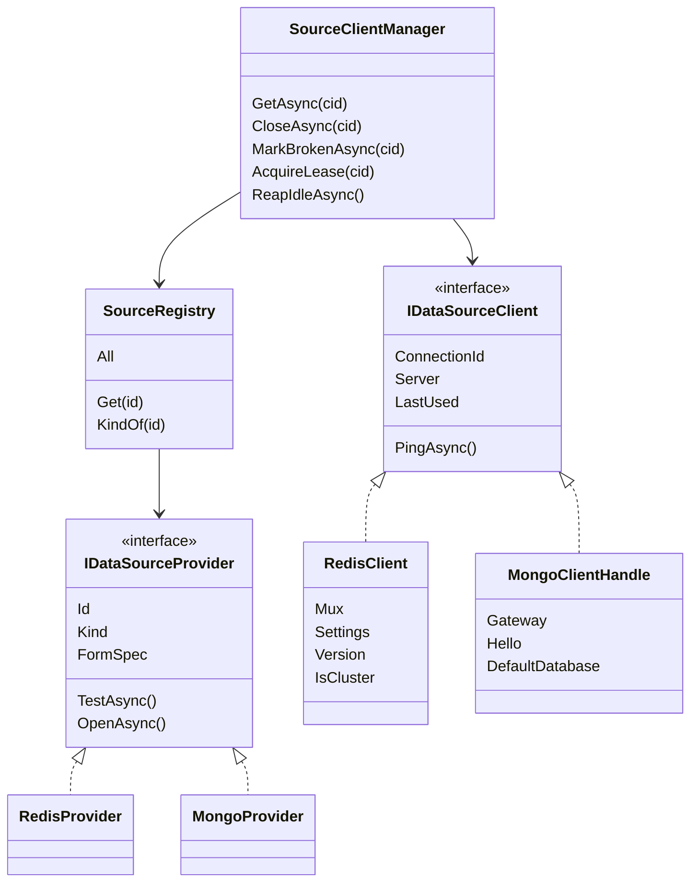
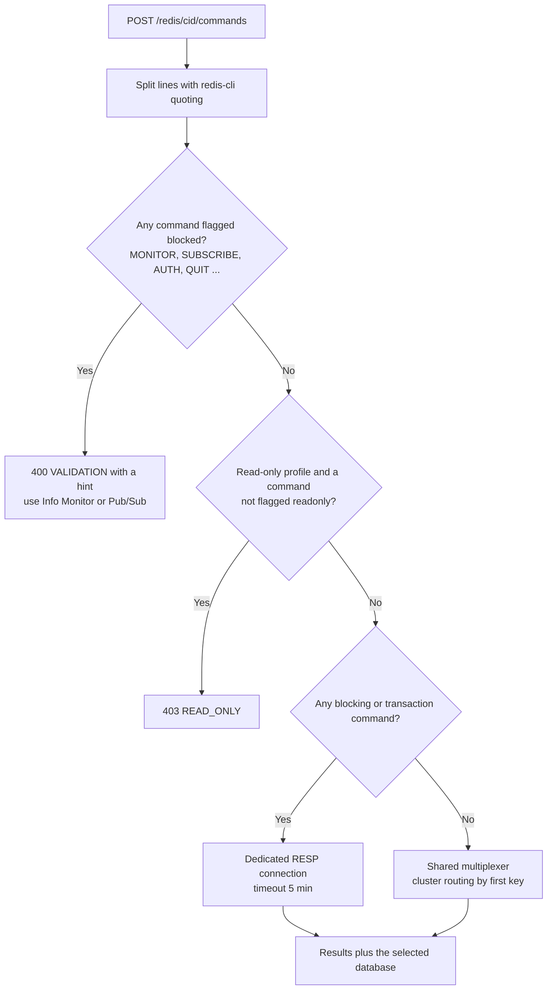
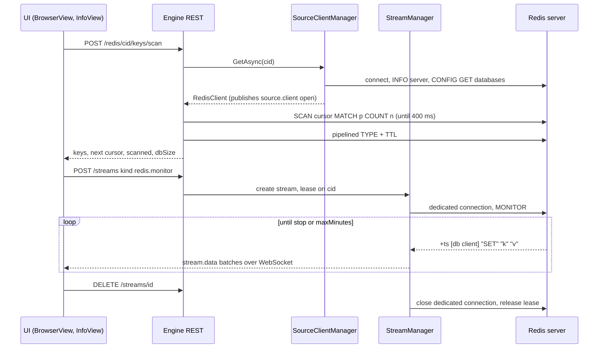
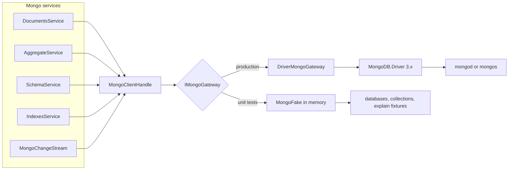
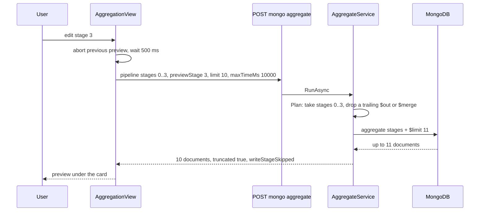

# 17. منابع I: Redis و MongoDB

<div dir="rtl">

> **سطح:** L2 حرفه‌ای ← L3 ارشد | **بخش:** II | **کد خوانده‌شده در:** `b638b7b` (مجموعه قابلیت‌های Rowlit 1.6.3؛ `version.json` در این درخت 1.7.0 را نشان می‌دهد)
> **زبان:** فارسی | [English](../../en/part2/17-sources-redis-mongo.md) | قبلی: [16. پایگاه‌های داده پیوندی و فدراسیون](./16-linked-databases-federation.md) | بعدی: [18. منابع II: Kafka و Elasticsearch](./18-sources-kafka-elasticsearch.md)
> برچسب‌های نمودارها به انگلیسی نگه داشته شده‌اند تا در GitHub درست نمایش داده شوند.
> **در یک جمله:** Redis و MongoDB با دسته‌های SQL کار نمی‌کنند؛ برای همین Rowlit از راه خانواده‌ی دومی از فراهم‌کننده‌ها با آن‌ها حرف می‌زند که برای هر اتصال یک کلاینت مشترک درایور نگه می‌دارد، و روی آن مرورگر کلید، میز کار فرمان، ویرایشگر سند، سازنده‌ی تجمیع و جریان‌های زنده می‌سازد.
> **یاد می‌گیرید:**
> - خانواده‌ی فراهم‌کننده‌های غیررابطه‌ای (`IDataSourceProvider`، `IDataSourceClient`، `SourceRegistry`) چیست و چرا کنار `IDbProvider` وجود دارد؛
> - `SourceClientManager` چطور برای هر اتصال یک کلاینت باز می‌کند، با اجاره (lease) زنده نگهش می‌دارد و وقتی بیکار ماند می‌بندد؛
> - مرورگر کلید Redis چطور میلیون‌ها کلید را بدون قفل کردن سرور پیمایش می‌کند و مقدارهای هر نوع چطور بایت‌به‌بایت دقیق خوانده و ویرایش می‌شوند؛
> - چرا Workbench بعضی فرمان‌ها را به یک اتصال اختصاصی می‌فرستد و MONITOR و pub/sub چطور به جریان موتور تبدیل می‌شوند؛
> - بسته‌ی MongoDB چطور درایور را پشت یک درز دروازه (gateway seam) پنهان می‌کند، Extended JSON و نحو mongosh را می‌فهمد و یک تجمیع را مرحله‌به‌مرحله پیش‌نمایش می‌دهد؛
> - محدودیت‌ها، نگاشت خطاها و آزمون‌های هر دو بسته.
> **پیش‌نیازها:** [03. معماری کلان](./03-big-picture-architecture.md)، [07. ماژول‌های موتور، DI و قابلیت‌های کلیددار](./07-engine-modules-and-di.md)، [06. پروتکل رویداد WebSocket](./06-websocket-protocol.md). پیش‌زمینه از بخش I: [I-16 خانواده‌های NoSQL](../part1/16-nosql-families.md) (بخش‌های 2.1 Redis و 2.2 MongoDB).

## 1. ایده (مبتدی)

پایگاه داده‌ی رابطه‌ای با متن کار می‌کند: یک دسته SQL می‌فرستید و سرور سطرها را برمی‌گرداند. سمت رابطه‌ای Rowlit حول همین ایده ساخته شده و هر تب ویرایشگر یک نشست (session) خودش را دارد ([فصل 08](./08-connections-sessions-execution.md)). Redis و MongoDB در این قالب نمی‌گنجند. Redis یک **[انباره‌ی کلید-مقدار (key-value store)](../glossary.md#key-value-store)** است: فرمان‌هایی مثل `GET user:1001` یا `HGETALL cart:7` می‌فرستید و هر کلید یک مقدار نوع‌دار دارد (رشته، hash، فهرست، مجموعه، مجموعه‌ی مرتب، stream، JSON). MongoDB یک **[انباره‌ی سند (document store)](../glossary.md#document-store)** است: هر مجموعه (collection) سندهایی شبیه JSON نگه می‌دارد و پرسش را با یک سند فیلتر (`{ status: "paid" }`) یا یک [خط لوله‌ی تجمیع (aggregation pipeline)](../glossary.md#aggregation-pipeline) می‌پرسید، نه با SQL. درایورهایشان هم شیوه‌ی استفاده‌ی دیگری می‌خواهند: یک `ConnectionMultiplexer` در Redis یا یک `MongoClient` در Mongo قرار است میان کل برنامه **مشترک** باشد و استخر اتصال و منطق اتصال دوباره‌ی خودش را دارد.

بنابراین Rowlit برای این سامانه‌ها خانواده‌ی دومی از فراهم‌کننده‌ها دارد. هر اتصال در موتور دقیقاً یک **[کلاینت منبع (source client)](../glossary.md#source-client)** بلندعمر می‌گیرد که در اولین استفاده باز و پس از ده دقیقه بیکاری بسته می‌شود. هر بسته روی آن صفحه‌هایی متناسب با مدل داده می‌سازد: برای Redis مرورگر کلید با درخت پوشه، ویرایشگرهای نوع‌دار مقدار، Workbench و CLI فرمان، Info، Slowlog، Pub/Sub و تحلیل حافظه (Analysis)؛ برای MongoDB یک فضای کاری مجموعه با زیرنماهای Documents، Aggregations، Schema، Indexes، Explain و Validation. داده‌ی زنده (`MONITOR` در Redis، پیام‌های pub/sub، change streamهای Mongo) به‌صورت **[جریان (stream)](../glossary.md#stream)**های موتور می‌رسد و کار طولانی (تحلیل حافظه، تحلیل اسکیما، حذف با الگو، درون‌ریزی و برون‌ریزی) به‌صورت **[کار (job)](../glossary.md#job)**های موتور اجرا می‌شود. این فصل این قطعه‌ها را از قراردادهای مشترک تا فرمان‌هایی که هر صفحه می‌فرستد دنبال می‌کند.

## 2. چطور کار می‌کند (حرفه‌ای)

### 2.1 خانواده‌ی غیررابطه‌ای

اولین تصمیم طرح، این جدایی را توضیح می‌دهد: `IDbProvider`/`IDbSession` منجمد می‌ماند و منابع غیررابطه‌ای یک `IDataSourceProvider` تازه در Core پیاده می‌کنند (`docs/PLAN-M2.md` تصمیم D1). قرارداد کوچک است (`engine/src/DbStudio.Core/Providers/IDataSourceProvider.cs:13-43`):

</div>

```csharp
// engine/src/DbStudio.Core/Providers/IDataSourceProvider.cs:13-43
public interface IDataSourceProvider
{
    string Id { get; }                       // "redis" | "mongodb" | "kafka" | ...
    string DisplayName { get; }
    SourceKind Kind { get; }
    ConnectionFormSpec FormSpec { get; }     // drives the generic connection dialog
    Task<TestConnectionResult> TestAsync(ConnectionProfile profile, string? password, CancellationToken ct);
    Task<IDataSourceClient> OpenAsync(ConnectionProfile profile, string? password, CancellationToken ct);
}
public interface IDataSourceClient : IAsyncDisposable
{
    string ConnectionId { get; }
    ServerInfo Server { get; }
    Task<bool> PingAsync(CancellationToken ct);
    DateTimeOffset LastUsed { get; set; }    // maintained by SourceClientManager; drives the idle reaper
}
```

<div dir="rtl">

**[نوع منبع (source kind)](../glossary.md#source-kind)** همان `enum SourceKind { Relational, KeyValue, Document, Stream, Search }` است (`engine/src/DbStudio.Core/Models/CoreModels.cs:21`). Redis نوع `KeyValue` و MongoDB نوع `Document` را گزارش می‌دهد؛ Kafka (`Stream`) و Elasticsearch (`Search`) در [فصل 18](./18-sources-kafka-elasticsearch.md) می‌آیند. `TestAsync` شکست‌های درایور را به‌صورت نتیجه برمی‌گرداند و پرتاب نمی‌کند، و `OpenAsync` فقط از سوی مدیر کلاینت صدا زده می‌شود که بازکردن‌ها را برای هر اتصال پشت سر هم ردیف می‌کند (`IDataSourceProvider.cs:23-31`).

**[رجیستری منبع (source registry)](../glossary.md#source-registry)** (`engine/src/DbStudio.Core/Services/SourceRegistry.cs`) *همه‌ی* شناسه‌های فراهم‌کننده را فهرست می‌کند. هر `IDbProvider` رابطه‌ای را در یک `RelationalSourceAdapter` از نوع `Relational` می‌پیچد، `IDataSourceProvider`های ثبت‌شده را اضافه می‌کند و اگر ماژولی بخواهد شناسه‌ی یک فراهم‌کننده‌ی رابطه‌ای را دوباره به کار ببرد، شناسه‌ی رابطه‌ای برنده می‌شود (`SourceRegistry.cs:24-33`). `GET /providers` از ترتیب نمایش ثابت آن استفاده می‌کند که در آن Redis و MongoDB پس از موتورهای رابطه‌ای و `linked` در آخر می‌آیند (`SourceRegistry.cs:18-19`). مسیرهای کد SQL همچنان از `ProviderRegistry` استفاده می‌کنند؛ آداپتور `OpenAsync` را رد می‌کند، چون اتصال‌های رابطه‌ای نشست تب دارند (`SourceRegistry.cs:70-80`).

**شکل ۱۷.۱ — قراردادهای منبع و دو کلاینتی که این فصل پوشش می‌دهد.**

</div>



<div dir="rtl">

**یک کلاینت برای هر پروفایل.** تصمیم D2 می‌گوید اشیای مشترک درایور (`ConnectionMultiplexer`، `MongoClient`، کلاینت مدیریتی Kafka) برای اشتراک طراحی شده‌اند؛ پس هر اتصال یک کلاینت می‌گیرد، نه یکی برای هر تب، و کلاینت‌های بیکار پس از `connections.sourceIdleSeconds` بسته می‌شوند (`docs/PLAN-M2.md` D2). `SourceClientManager` این را پیاده می‌کند (`engine/src/DbStudio.Core/Services/SourceClientManager.cs`):

- **باز کردن تنبل، فقط یک بار.** `GetAsync` کلاینت حافظه‌ی نهان را برمی‌گرداند و `LastUsed` را مُهر می‌زند. در غیر این صورت پروفایل را پیدا می‌کند، اتصال‌های رابطه‌ای را با `400 VALIDATION` رد می‌کند («از نشست استفاده می‌کند، نه کلاینت منبع»)، قلاب `BeforeConnect` را صدا می‌زند و سپس یک `SemaphoreSlim(1, 1)` مخصوص همان اتصال می‌گیرد تا دو درخواست هم‌زمان فقط یک کلاینت باز کنند (`SourceClientManager.cs:75-104`). این قلاب را `ResourceManager` تنظیم می‌کند تا سقف اتصال‌های باز را اعمال کند (`ResourceManager.cs:188`، نگاه کنید به [فصل 21](./21-logs-activity-resources.md)).
- **خطاها یک کد می‌شوند.** شکست درایور هنگام باز کردن ثبت می‌شود و به `503 SOURCE_UNAVAILABLE` همراه با شناسه‌ی اتصال و فراهم‌کننده تبدیل می‌شود؛ یک `EngineException` (مثلاً خطای اعتبارسنجی تنظیمات) دست‌نخورده عبور می‌کند (`SourceClientManager.cs:105-122`). از 1.7.0 پروفایل ابتدا از `ResolveForOpenAsync` می‌گذرد که تونل SSH همان‌جا برپا می‌شود (`SourceClientManager.cs:108`).
- **رویدادها.** هر باز شدن، بسته شدن و شکستن، رویداد `source.client` را منتشر می‌کند (`SourceClientChangedEvent`، `engine/src/DbStudio.Core/Services/Events.cs:102`؛ `SourceClientManager.cs:128` و `224`). استور رابط `ui/src/store/sourceClients.ts` با `open` فهرست را دوباره می‌گیرد و با `closed`/`broken` آن مدخل را حذف می‌کند (`sourceClients.ts:37-45`)؛ این استور فهرست «Clients» در پنل Connections، نقطه‌های فعالیت و شمارنده‌ی نوار وضعیت را تغذیه می‌کند (`sourceClients.ts:1-2`).
- **بستن و شکستن.** `CloseAsync` (قطع اتصال) و `MarkBrokenAsync` (درایور سرور را از دست داده) هر دو کلاینت را dispose می‌کنند، رویداد را منتشر می‌کنند و `ClientClosed` را برمی‌انگیزند (`SourceClientManager.cs:147-150` و `212-234`). `GetAsync` بعدی کلاینت تازه‌ای باز می‌کند.
- **اجاره‌ها و پاک‌کننده‌ی بیکار.** یک زمان‌سنج هر 30 ثانیه اجرا می‌شود (`SourceClientManager.cs:55-56`) و کلاینت‌هایی را که بیش از مهلت بیکاری استفاده نشده‌اند می‌بندد؛ پیش‌فرض 600 ثانیه است، در بازه‌ی 0 تا 86400 محدود می‌شود و 0 یعنی هرگز (`SourceClientManager.cs:25` و `171-177`). تا وقتی کسی یک **[اجاره (lease)](../glossary.md#lease)** روی کلاینت دارد، از آن می‌گذرد (`SourceClientManager.cs:196`). `StreamManager` برای هر جریان باز یک اجاره می‌گیرد (`StreamManager.cs:223`)؛ endpointهای Redis و Mongo برای هر کار و هر دسته‌ی Workbench یکی می‌گیرند (`RedisEndpoints.cs:48`، `107`، `147`؛ `MongoEndpoints.cs:276`). زیر فشار حافظه، `ResourceManager` مهلت را به 3 دقیقه (high) یا 1 دقیقه (critical) کوتاه می‌کند (`ResourceManager.cs:266`؛ `SourceClientManager.cs:182-191`). این همان **[پاک‌کننده‌ی بیکار (idle reaper)](../glossary.md#idle-reaper)** است.

سه مسیر REST مدیر را در دسترس می‌گذارند (`engine/src/DbStudio.Host/Endpoints/SourcesEndpoints.cs:16-28`): `GET /sources/clients` (فهرست)، `GET /sources/{cid}/client` (در صورت نیاز باز می‌کند و توصیف می‌کند) و `DELETE /sources/{cid}/client` (قطع اتصال، `204`).

**جریان‌ها و کارها.** نماهای زنده `IStreamFactory`/`IEngineStream` را پیاده می‌کنند و به‌صورت singleton کلیددار زیر یک نوع مثل `redis.monitor` ثبت می‌شوند (`StreamManager.cs:13-37`). `StreamManager` مالک صف محدود، دسته‌سازی در رویدادهای `stream.data`، سقف 8 جریان برای هر پنجره و سقف 64 جریان برای کل موتور است (`StreamManager.cs:155-157`) و وقتی کلاینت یک اتصال بسته شود، همه‌ی جریان‌های آن اتصال را با دلیل `source-closed` یا `source-broken` تمام می‌کند (`StreamManager.cs:456-460`). کارها پیشرفت را با `JobContext.Report` گزارش می‌دهند و با `job.done` تمام می‌شوند. هر دو مدیر در [فصل 06](./06-websocket-protocol.md) و [فصل 21](./21-logs-activity-resources.md) شرح داده شده‌اند؛ این فصل فقط پیاده‌سازی‌های Redis و Mongo را نشان می‌دهد.

### 2.2 Redis: برقراری اتصال

`RedisModule` ریشه‌ی ترکیب (composition root) بسته است و مثل هر [ماژول موتور (engine module)](../glossary.md#engine-module) با بازتاب (reflection) پیدا می‌شود ([فصل 07](./07-engine-modules-and-di.md)). فراهم‌کننده، پنج سرویس singleton (`KeyBrowser`، `ValueService`، `CommandService`، `InfoService`، `AnalysisService`)، دو کارخانه‌ی جریان کلیددار (`redis.monitor`، `redis.subscribe`) و مسیرهای `/redis/{cid}/…` را ثبت می‌کند (`engine/src/DbStudio.Sources.Redis/RedisModule.cs:17-29`).

`RedisProvider` (شناسه `redis`، نوع `KeyValue`) فرم اتصال را تعریف می‌کند: حالت standalone، cluster یا [Sentinel](../glossary.md#sentinel)؛ میزبان و درگاه، یا گره‌های cluster، یا sentinelها به‌همراه نام سرویس (پیش‌فرض `mymaster`)؛ کاربر و گذرواژه‌ی ACL؛ شماره‌ی پایگاه داده؛ TLS و «نادیده گرفتن بررسی گواهی»؛ جداکننده‌ی کلید (پیش‌فرض `:`)؛ SCAN count (پیش‌فرض 500)؛ مهلت اتصال (پیش‌فرض 5 ثانیه) (`RedisProvider.cs:23-40`). فیلدهای تونل SSH که در 1.7.0 اضافه شدند هشداری دارند که فقط حالت standalone را می‌توان از تونل عبور داد، چون Cluster و Sentinel نشانی گره‌هایی را می‌دهند که تونل به آن‌ها نمی‌رسد (`RedisProvider.cs:19`).

`RedisSettings.From` پروفایل را اعتبارسنجی می‌کند: حالت ناشناخته، میزبان خالی و درگاه خارج از بازه `400 VALIDATION` با نام فیلد است؛ `host:port` که در فیلد میزبان تایپ شده بر فیلد درگاه مقدم است؛ SCAN count به 10 تا 10000 و مهلت به 1 تا 120 ثانیه محدود می‌شود (`RedisSettings.cs:30-75`). سپس `BuildConfiguration` گزینه‌های StackExchange.Redis را پر می‌کند. این انتخاب‌ها برای یک کلاینت مشترک بلندعمر مهم‌اند (`RedisSettings.cs:120-153`):

| گزینه | مقدار | چرا (از روی کد) |
|---|---|---|
| `AbortOnConnectFail` | `false` | مالتی‌پلکسر در پس‌زمینه تلاش را ادامه می‌دهد؛ خود فراهم‌کننده شکست را آشکار می‌کند |
| `ReconnectRetryPolicy` | `ExponentialRetry(500, 10_000)` | «موتور بلندعمر و مشترک است: بی‌سروصدا در پس‌زمینه دوباره وصل شو» |
| `KeepAlive` | 30 | سوکت‌های بیکار را از پشت NAT باز نگه می‌دارد |
| `ClientName` | `Rowlit` | در `CLIENT LIST` دیده می‌شود |
| `AllowAdmin` | `true` | برای `INFO`، `CONFIG`، `SLOWLOG`، `CLIENT KILL` لازم است |
| `DefaultDatabase` | مقدار پروفایل، در cluster تهی | Redis Cluster فقط پایگاه داده‌ی 0 را دارد |

`RedisProvider.ConnectAsync` وصل می‌شود و سپس اطلاعات سرور را می‌خواند (`RedisProvider.cs:64-141`). چون `AbortOnConnectFail` خاموش است، یک میزبان مرده در غیر این صورت «وصل» به نظر می‌رسید و در اولین فرمان شکست می‌خورد؛ پس فراهم‌کننده با یک فرصت کوتاه ping می‌کند و پس از حدود یک مهلت، نه دو مهلت، پیام «Could not connect … within N s» می‌دهد (`RedisProvider.cs:80-96`). cluster را از نوع سرورها تشخیص می‌دهد، نسخه را از `INFO server` و تعداد پایگاه‌های داده را از `CONFIG GET databases` می‌خواند (16 وقتی `CONFIG` تغییرنام داده یا با ACL منع شده باشد، مثل سرویس‌های مدیریت‌شده) (`RedisProvider.cs:97-117`). یک بررسی ظریف ارزش دانستن دارد: StackExchange.Redis وقتی `AUTH` رد شود و کاربر `default` گذرواژه نخواهد، با همان کاربر `default` ادامه می‌دهد؛ پس یک کاربر ACL اشتباه مثل ورود موفق دیده می‌شد. برای همین فراهم‌کننده روی Redis 6 به بالا `ACL WHOAMI` می‌پرسد و اگر سرور نام کاربر دیگری را بدهد، با پیامی به سبک `WRONGPASS` شکست می‌خورد (`RedisProvider.cs:118-133`).

نتیجه یک `RedisClient` است (`engine/src/DbStudio.Sources.Redis/RedisClient.cs`): مالتی‌پلکسر، تنظیمات، نسخه (که `SCAN … TYPE` و `KEEPTTL` را از 6.0 و `UNLINK` و `MEMORY` را از 4.0 فعال می‌کند، `RedisClient.cs:40-41`)، `IsCluster` و تعداد پایگاه‌های داده. همچنین `EnsureWritable` را دارد (403 `READ_ONLY` روی پروفایل فقط‌خواندنی، `RedisClient.cs:56-59`)، `CheckDb` را (cluster فقط پایگاه داده‌ی 0 را می‌پذیرد، `RedisClient.cs:62-68`)، `Primaries()` و `ServerFor(key)` را که در cluster بر اساس [hash slot](../glossary.md#hash-slot) کلید مسیریابی می‌کند (`RedisClient.cs:73-113`)، و یک `MODULE LIST` نهان‌شده که می‌گوید **[ReJSON](../glossary.md#rejson)** بارگذاری شده یا نه (`RedisClient.cs:123-157`).

**RESP خام برای چیزهایی که مالتی‌پلکسر نمی‌تواند به اشتراک بگذارد.** مالتی‌پلکسر فرمان‌های همه‌ی صداکننده‌ها را روی یک لوله می‌فرستد. این کارآمد است، اما بعضی فرمان‌ها لوله را برای همه نگه می‌دارند: `MONITOR` هرگز تمام نمی‌شود، `MULTI`/`EXEC` و `WATCH` اتصال خودشان را می‌خواهند و فرمان‌های مسدودکننده (`BLPOP`، `XREAD BLOCK`) روی سرور منتظر می‌مانند. برای این‌ها `RawRedisConnection` یک **[اتصال اختصاصی (dedicated connection)](../glossary.md#dedicated-connection)** باز می‌کند: یک `TcpClient` ساده (در صورت نیاز پیچیده در `SslStream`)، قاب‌بندی [RESP](../glossary.md#resp)2 با بافر 64 کیلوبایتی، `AUTH` با کاربر و گذرواژه‌ی پروفایل، `CLIENT SETNAME Rowlit-dedicated` و `SELECT` پایگاه داده (`RawRedisConnection.cs:22-80`). `RedisClient.OpenDedicatedAsync` یکی از این‌ها را به سرور انتخاب‌شده باز می‌کند (`RedisClient.cs:116-120`).

**جدول فرمان‌ها.** `RedisCommandCatalog` فایل `redis-commands.json` را که درون اسمبلی جاسازی شده بارگذاری می‌کند؛ برای هر فرمان گروه، نحو، پیچیدگی، جای کلیدها و پرچم‌ها را دارد: `readonly`، `write`، `admin`، `blocking`، `transaction`، `blocked`، `dangerous`، `pubsub`، `module` (`RedisCommandCatalog.cs:7-58`). موتور از پرچم‌ها برای اعمال فقط‌خواندنی و مسیریابی اختصاصی استفاده می‌کند؛ رابط همان فایل را برای تکمیل، hover و راهنمای آرگومان دارد (`ui/src/redis/catalog.ts:1-3`)، و یک آزمون موتور یکسان بودن دو نسخه را بررسی می‌کند (`engine/tests/DbStudio.Sources.Redis.Tests/EndpointTests.cs:182-184`).

### 2.3 Redis: مرورگر کلید

یک پایگاه داده‌ی Redis می‌تواند صدها میلیون کلید داشته باشد و `KEYS *` سرور تک‌نخی را هنگام پیمایش همه‌ی آن‌ها قفل می‌کند. مرورگر به‌جای آن از **[SCAN](../glossary.md#scan)** استفاده می‌کند: فرمانی مبتنی بر مکان‌نما (cursor) که هر فراخوانی‌اش کار محدودی انجام می‌دهد (`O(COUNT)`). `KeyBrowser.ScanAsync` دو حد دیگر هم اضافه می‌کند (`engine/src/DbStudio.Sources.Redis/Services/KeyBrowser.cs:8-77`):

</div>

```csharp
// engine/src/DbStudio.Sources.Redis/Services/KeyBrowser.cs:16-19, 38-46
public static TimeSpan Budget { get; set; } = TimeSpan.FromMilliseconds(400);
public const int MaxIterations = 64;
public const int MaxMemoryKeys = 100;
// …
while (cursors.Count > 0 && found.Count < count && iterations < MaxIterations)
{
    var (node, cursor) = cursors[0];
    var args = new List<object> { cursor, "MATCH", pattern, "COUNT", count };
    if (serverTypeFilter) { args.Add("TYPE"); args.Add(Resp.ServerType(type!)); }
    // … one SCAN call, then: if (sw.Elapsed > Budget) break;
```

<div dir="rtl">

هر درخواست پس از 400 میلی‌ثانیه، پس از 64 فراخوانی SCAN یا وقتی یک صفحه کلید جمع شد متوقف می‌شود و مکان‌نما را برمی‌گرداند. رابط سپس «scanned X of ~Y» و دکمه‌ی **Scan more** را نشان می‌دهد (`ui/src/components/Redis/BrowserView.tsx:333-336`)، پس کاربر، نه موتور، تصمیم می‌گیرد پیمایش ادامه پیدا کند یا نه. فیلتر نوع از Redis 6 روی سرور اجرا می‌شود (`SCAN … TYPE`) و روی سرورهای قدیمی‌تر پس از `TYPE` اعمال می‌شود (`KeyBrowser.cs:30` و `70`). در cluster برای هر primary یک مکان‌نما هست که به شکل `host:port@cursor;…` رمزگذاری می‌شود و حلقه به‌صورت نوبتی (round-robin) جلو می‌رود تا یک گره بزرگ بقیه را گرسنه نگذارد (`KeyBrowser.cs:56-62` و `163-193`). SCAN ممکن است هنگام rehash یک کلید را دو بار برگرداند، پس کلیدها یکتا می‌شوند و کلیدهایی که میان SCAN و TTL منقضی شده‌اند (`TTL = -2`) کنار گذاشته می‌شوند (`KeyBrowser.cs:67-71`). `TYPE` و `TTL` یک صفحه به‌صورت یک دسته‌ی pipeline در تکه‌های 500تایی فرستاده می‌شوند (`KeyBrowser.cs:80-113`). نشان‌های حافظه از یک `POST /keys/memory` جداگانه با حداکثر 100 کلید و `MEMORY USAGE key SAMPLES 0` می‌آیند (`KeyBrowser.cs:124-131`).

**درخت پوشه** در رابط ساخته می‌شود. `buildKeyIndex` هر کلید را با جداکننده می‌شکند، پس `user:1001:profile` زیر پوشه‌های `user:` و `user:1001:` قرار می‌گیرد؛ تخت‌سازی فقط پوشه‌های بازشده را پیمایش می‌کند و همین مرورگری با 100 هزار کلید را روان نگه می‌دارد (`ui/src/redis/keyTree.ts:1-3` و `20-59`). عدد هر پوشه تعداد کلیدهای *پیمایش‌شده* زیر آن است، نه کل سرور، چون فقط نتیجه‌های SCAN معلوم‌اند: این‌ها **شمارش‌های جزئی (partial counts)** هستند و سرآیند هم با «scanned … of ~…» همین را می‌گوید. باز کردن یک پوشه می‌تواند پیمایش تازه‌ای با پیشوند آن به‌عنوان الگو آغاز کند، با نویسه‌های glob که escape شده‌اند (`keyTree.ts:73-76`).

**کلیدها و مقدارهای امن برای باینری.** کلیدها و مقدارهای Redis رشته‌ی بایت‌اند، نه متن. کلیدی که بایت‌هایش UTF-8 معتبر نیست با escapeهای `\xHH` نمایش داده می‌شود؛ وقتی چنین کلیدی با خوانش باینری‌اش وجود نداشته باشد، مرورگر متن لفظی را امتحان می‌کند، پس کلیدی که واقعاً نویسه‌های `\xff` را دارد هم پیدا می‌شود (`KeyBrowser.cs:85-98`). برای عضوهای hash، فهرست، مجموعه و مجموعه‌ی مرتب، `BinaryText` متن نمایشی را به‌همراه یک نگاشت جانبی از آن متن به بایت‌های واقعی در base64 می‌فرستد؛ درخواست ویرایشی که متن را با نگاشت برگرداند، دقیقاً همان بایت‌های اصلی را می‌نویسد (`engine/src/DbStudio.Sources.Redis/Services/BinaryText.cs:7-13`). خود کلید در مسیر URL جابه‌جا می‌شود؛ endpoint هدف خام درخواست را فقط یک بار رمزگشایی می‌کند تا `%2F` و `%25` دقیق بمانند (`RedisEndpoints.cs:172-175`).

### 2.4 Redis: مقدارها، فرمان‌ها، info و تحلیل

**مقدارهای نوع‌دار.** `ValueService.GetAsync` فرمان‌های `TYPE`، `TTL` و `OBJECT ENCODING` را pipeline می‌کند، اندازه‌ی حافظه را می‌خواند و بر اساس نوع توزیع می‌کند: رشته (حداکثر 1 مگابایت، باینری به‌صورت hex، تشخیص JSON)، hash (`HSCAN`)، فهرست (صفحه‌های `LRANGE`)، مجموعه (`SSCAN`)، مجموعه‌ی مرتب (`ZRANGE` بر اساس رتبه، `ZSCAN` هنگام فیلتر)، stream (صفحه‌های `XREVRANGE`، گروه‌ها، مصرف‌کننده‌ها، مدخل‌های معلق) و RedisJSON (`JSON.GET`، `JSON.SET`). صفحه‌ها به‌طور پیش‌فرض 200 عضو و صفحه‌های stream ‏100 عضو دارند (`engine/src/DbStudio.Sources.Redis/Services/ValueService.cs:12-58`). نوع ماژولی که Rowlit نمی‌تواند نمایش دهد `400 NOT_SUPPORTED` با پیام «از Workbench استفاده کنید» برمی‌گرداند (`ValueService.cs:57`). فرمان‌های RedisJSON از راه `db.Execute` می‌روند، نه از راه `NRedisStack` (`docs/PLAN-M2.md` D7).

هر تغییری اول `EnsureWritable` را صدا می‌زند (`ValueService.cs:302`، `330`، `343`، …). ویرایش‌ها همچنین در برابر تغییر کلید زیر دست ویرایشگر دفاع می‌کنند. ذخیره‌ی یک رشته بررسی می‌کند که کلید هنوز وجود دارد و هنوز رشته است، سپس از `SET … XX KEEPTTL` استفاده می‌کند تا خود `SET` از ساختن دوباره‌ی کلید حذف‌شده سر باز بزند و انقضایش را نگه دارد؛ پیش از Redis 6 مقدار `PTTL` را می‌خواند و با `PX` برمی‌گرداند (`ValueService.cs:300-326`). پنل جزئیات یک **[شمارش معکوس TTL (TTL countdown)](../glossary.md#ttl-countdown)** نشان می‌دهد که مرورگر از TTL لحظه‌ی بارگذاری حساب می‌کند و زیر 60 ثانیه رنگ هشدار می‌گیرد (`ui/src/components/Redis/KeyDetail.tsx:103-113`). «حذف با الگو» یک کار است: `SCAN MATCH` به‌علاوه‌ی `UNLINK` (یا `DEL` پیش از 4.0) در pipelineهای 500تایی، با پیشرفت پس از هر صفحه و امکان لغو میان صفحه‌ها (`ValueService.cs:583-592`؛ مسیر `RedisEndpoints.cs:39-52`).

**Workbench و CLI.** `POST /redis/{cid}/commands` خط‌های خام (که `RedisArgs` با قواعد نقل‌قول redis-cli می‌شکند) یا آرایه‌های از پیش شکسته‌ی آرگومان را می‌پذیرد، حداکثر 1000 فرمان (`engine/src/DbStudio.Sources.Redis/Services/CommandService.cs:19` و `26-50`). پیش از اجرای هر چیز، همه‌ی فرمان‌ها دسته‌بندی می‌شوند (`CommandService.cs:52-64`):

**شکل ۱۷.۲ — Workbench یک دسته فرمان Redis را چطور مسیریابی می‌کند.**

</div>



<div dir="rtl">

پیام‌های رد کاربر را به صفحه‌ی درست راهنمایی می‌کنند: MONITOR به *Info › Monitor*، خانواده‌ی subscribe به تب Pub/Sub، و `AUTH`، `HELLO`، `CLIENT SETNAME` به ویرایشگر اتصال، چون این‌ها «اتصال مشترک را تغییر می‌دهند» (`CommandService.cs:74-84`). `SELECT` برای هر درخواست جداگانه دنبال می‌شود، پس فرمان‌های بعدی همان دسته از پایگاه داده‌ی انتخاب‌شده استفاده می‌کنند و پاسخ آن را گزارش می‌دهد (`CommandService.cs:96-100` و `125-132`). یک فرمان مسدودکننده یا یک دسته‌ی اختصاصی به 5 دقیقه محدود است (`CommandService.cs:22`). تکمیل در ویرایشگر ابتدا نام فرمان‌ها، سپس زیرفرمان‌های ظرف‌هایی مثل `CONFIG GET`، سپس پس از آرگومانی که کلید می‌گیرد نام کلیدها از حافظه‌ی نهان پیمایش مرورگر، و در غیر این صورت کلیدواژه‌های نحوی مثل `NX`، `EX`، `WITHSCORES` را پیشنهاد می‌دهد (`ui/src/redis/complete.ts:1-2`).

**Info، کلاینت‌ها، config، slowlog.** `InfoService` داشبورد و صفحه‌های مدیریتی را سرویس می‌دهد: سرور، ماژول‌ها و keyspace جمع‌شده روی primaryها، `INFO` تجزیه‌شده، `CLIENT LIST`/`KILL`، `CONFIG GET`/`SET`، `SLOWLOG GET`/`RESET`، `PUBSUB CHANNELS`/`NUMSUB` و `PUBLISH`؛ نوشتن‌های میان آن‌ها با READ_ONLY محافظت می‌شوند (`engine/src/DbStudio.Sources.Redis/Services/InfoService.cs:7-11`). نمای Info هر 2 ثانیه نظرسنجی (poll) می‌کند، پس یک گره‌ی تنها تعداد کلاینت‌ها را از `INFO` پاسخ می‌دهد، نه از `CLIENT LIST` که سرور را قفل می‌کند (`InfoService.cs:38-40`). `InfoParser` متن `INFO` را به نگاشت بخش ← کلید ← مقدار تبدیل می‌کند (`InfoParser.cs:8-25`). **[Slowlog](../glossary.md#slowlog)** در این بسته یک خواندن ساده‌ی REST است (`RedisEndpoints.cs:118-122`)؛ نمای Logs منبع `slowlog` خودش را روی همان فرمان دارد (`engine/src/DbStudio.Logs/Providers/Redis/RedisLogSource.cs:8-13`). طرح، slowlog را در میان کارخانه‌های جریان آورده بود؛ کد آن را یک درخواست ساخته، نه یک جریان.

**تحلیل حافظه.** تب Analysis یک کار آغاز می‌کند (`POST /redis/{cid}/analysis`، `RedisEndpoints.cs:140-147`). `AnalysisService.RunAsync` تا `sampleLimit` کلید (پیش‌فرض 100000، حداکثر 5000000) را در صفحه‌های 1000تایی پیمایش می‌کند، `TYPE`، `TTL` و `MEMORY USAGE` را pipeline می‌کند و تجمیع می‌کند (`engine/src/DbStudio.Sources.Redis/Services/AnalysisService.cs:14-18` و `41-116`):

- فضاهای نام در دو سطح اول جداکننده (`user:` و `user:1001:` برای `user:1001:profile`) با تعداد کلید، حافظه، میانگین TTL و نوع‌ها (`AnalysisService.cs:122-133`)؛
- 100 کلید پرحافظه‌تر، نگه‌داشته در یک min-heap تا حافظه ثابت بماند (`AnalysisService.cs:94-95`)؛
- جمع‌ها برای هر نوع و سطل‌های TTL شامل `< 1 hour`، `< 1 day`، `< 1 week`، `< 1 month`، `> 1 month` (`AnalysisService.cs:20-23`).

keyspaceی با میلیون‌ها پیشوند متمایز سطح دوم، نگاشت فضای نام را بی‌حد بزرگ می‌کرد؛ پس وقتی از 4 × 2000 مدخل گذشت، نیمه‌ی کوچک‌تر سطح دوم حذف می‌شود (`AnalysisService.cs:85` و `135-140`). وقتی تحلیل به سقف نمونه رسیده باشد، نتیجه نمونه را جزئی علامت می‌زند (`scanned < total`) (`AnalysisService.cs:113`). این همان **[تحلیل حافظه (memory analysis)](../glossary.md#memory-analysis)** است.

### 2.5 Redis: ‏MONITOR و pub/sub به‌صورت جریان

دو کارخانه‌ی جریان کلیددار قابلیت‌های push در Redis را به جریان‌های موتور تبدیل می‌کنند.

**شکل ۱۷.۳ — باز کردن کلاینت Redis، مرور کلیدها و سپس جریان MONITOR.**

</div>



<div dir="rtl">

`redis.monitor` فرمان **[MONITOR](../glossary.md#monitor)** را روی یک اتصال اختصاصی به primary یا به گره‌ی انتخاب‌شده‌ی cluster اجرا می‌کند. MONITOR از توان عملیاتی سرور می‌کاهد، پس جریان پس از `maxMinutes` (پیش‌فرض 10، حداکثر 60) خودش را متوقف می‌کند و با دلیل `completed` تمام می‌شود (`engine/src/DbStudio.Sources.Redis/Services/Streams.cs:15-22` و `46-63`). هر خط مثل `1700000000.123456 [0 127.0.0.1:5000] "SET" "k" "v"` به `{ ts, db, client, args }` تجزیه می‌شود (`Streams.cs:66-89`). اگر رابط نتواند پابه‌پا بیاید، `StreamManager` قدیمی‌ترین اقلام صف را دور می‌اندازد و می‌شمارد؛ نما شمارنده‌ی حذف‌شده‌ها را نشان می‌دهد (`StreamManager.cs:54-57`؛ `ui/src/components/Redis/useRedisStream.ts:1-3`).

`redis.subscribe` در مجموع حداکثر 100 کانال و الگو می‌گیرد و از راه اتصال subscriber خود مالتی‌پلکسر مشترک می‌شود، که StackExchange.Redis آن را از لوله‌ی فرمان جدا نگه می‌دارد (`Streams.cs:92-131`). محموله‌هایی که متن معتبر نیستند به‌صورت hex با `binary: true` می‌روند (`Streams.cs:166-171`). وقتی کلاینت زیر جریان بسته شود (قطع اتصال، پاک‌کننده‌ی بیکار)، جریان خطا گزارش نمی‌کند: منتظر لغو `source-closed` می‌ماند که `StreamManager` درست پس از آن می‌فرستد (`Streams.cs:136-148`). در سمت رابط، `useRedisStream` اقلام را بافر می‌کند، 10000 قلم آخر را نگه می‌دارد و هرگز شناسه‌ی جریان زنده را در وضعیت تب ذخیره نمی‌کند، پس فضای کاری بازیابی‌شده در حالت توقف شروع می‌شود (`useRedisStream.ts:1-3` و `26`).

**خطاها.** `RedisErrors.Map` پاسخ‌های `NOPERM`، `NOAUTH` و `WRONGPASS` را به `403 PRIVILEGE` با نام مجوز ACL (`+get`، `+scan`…) تبدیل می‌کند، دیگر خطاهای سرور را به `400 PROVIDER_ERROR`، مهلت‌گذشتگی و شکست اتصال را به `503 SOURCE_UNAVAILABLE` و استفاده‌ی نادرست از فرمان را به `400 VALIDATION`؛ همچنین توصیه‌های پیکربندی StackExchange.Redis را از پیام‌ها می‌بُرد (`engine/src/DbStudio.Sources.Redis/RedisErrors.cs:6-31` و `58-61`). endpointهای Redis کلاینت را شکسته علامت نمی‌زنند: مالتی‌پلکسر خودش دوباره وصل می‌شود (`RedisSettings.cs:136-137`).

### 2.6 MongoDB: برقراری اتصال و درز دروازه

`MongoModule` فراهم‌کننده، ده سرویس (Explorer، Documents، Aggregate، Explain، Schema، Fields، Indexes، Validation، Profiling، ImportExport) و کارخانه‌ی جریان `mongo.changes` را ثبت می‌کند (`engine/src/DbStudio.Sources.Mongo/MongoModule.cs:14-36`). `AddServices` متد جداگانه‌ای است تا آزمون‌ها بتوانند سرویس‌ها را روی یک فراهم‌کننده‌ی جعلی ثبت کنند (`MongoModule.cs:22-23`).

`MongoProvider` (شناسه `mongodb`، نوع `Document`) یک رشته‌ی اتصال `mongodb://` یا `mongodb+srv://` می‌خواهد، به‌علاوه‌ی کاربر و گذرواژه‌ی اختیاری، پایگاه داده‌ی احراز هویت، سازوکار (SCRAM-SHA-256، SCRAM-SHA-1، X.509، و PLAIN برای LDAP)، پایگاه داده‌ی پیش‌فرض، TLS با فایل CA، ترجیح خواندن (read preference)، مهلت اتصال (پیش‌فرض 10 ثانیه) و نام برنامه (پیش‌فرض `Rowlit`) (`engine/src/DbStudio.Sources.Mongo/MongoProvider.cs:32-58`). فیلد کاربر فقط وقتی در URI ادغام می‌شود که URI خودش اعتبارنامه نداشته باشد (`MongoProvider.cs:36`). با تونل SSH فقط رشته‌ی `mongodb://` تک‌میزبانه کار می‌کند و `mongodb+srv://` آن‌جا پشتیبانی نمی‌شود (`MongoProvider.cs:30`). درایور رکوردهای SRV و TXT را هم‌گام (synchronous) resolve می‌کند؛ پس فراهم‌کننده تنظیمات را روی یک نخ کارگر می‌سازد و آن را به مهلت اتصال به‌علاوه‌ی یک ثانیه محدود می‌کند («Resolving the connection string took longer than … (DNS)») (`MongoProvider.cs:60-75`). دست‌دادن (handshake) فرمان‌های `hello` و `buildInfo` را روی `admin` اجرا می‌کند و توپولوژی را برچسب می‌زند: sharded cluster، replica set با *نام*، load balanced یا standalone (`MongoProvider.cs:123-147`). همه‌ی پیام‌های خطا از `MongoSettingsBuilder.Redact` می‌گذرند که رشته‌ی اتصال و هر بخش `user:password@` را با `***` جایگزین می‌کند (`MongoProvider.cs:173-188`؛ `MongoSettingsBuilder.cs:190-199`). خود گذرواژه فیلدی از نوع `password` است و در انباره‌ی اسرار نگه داشته می‌شود، هرگز در props پروفایل (`docs/PLAN-M2.md` D12؛ [فصل 19](./19-security-and-secrets.md)).

**درز دروازه.** همه‌ی سرویس‌های Mongo به `IMongoGateway` زنگ می‌زنند، نه به درایور. این واسط دقیقاً همان فراخوانی‌هایی را دارد که سرویس‌ها لازم دارند: `RunCommandAsync`، `ListDatabasesAsync`، `ListCollectionsAsync`، `FindAsync` و `FindStreamAsync`، شمارش‌ها، `AggregateAsync` و `AggregateStreamAsync`، درج، جایگزینی، upsert انبوه، حذف، فراخوانی‌های نمایه، DDL مجموعه و `WatchAsync` برای change streamها (`engine/src/DbStudio.Sources.Mongo/IMongoGateway.cs:30-91`). `DriverMongoGateway` آن را روی MongoDB.Driver 3.x با مجموعه‌های بی‌نوع `BsonDocument` پیاده می‌کند (`DriverMongoGateway.cs:7`)؛ `MongoFake` در پروژه‌ی آزمون آن را در حافظه پیاده می‌کند (`docs/PLAN-M2.md` D11). این یک **[درز دروازه (gateway seam)](../glossary.md#gateway-seam)** است: یک واسط در لبه‌ی بسته که اجازه می‌دهد پشتیبان واقعی و جعلی بدون دست زدن به کد سرویس جابه‌جا شوند.

**شکل ۱۷.۴ — درز دروازه‌ی Mongo: محیط عملیاتی و آزمون‌ها از همان سرویس‌ها استفاده می‌کنند.**

</div>



<div dir="rtl">

`MongoProvider` کارخانه‌ی دروازه را به‌عنوان آرگومان سازنده می‌گیرد؛ سازنده‌ی عمومی از کارخانه‌ی واقعی استفاده می‌کند و یک سازنده‌ی internal به آزمون‌ها اجازه می‌دهد handleها را روی نسخه‌ی جعلی باز کنند (`MongoProvider.cs:17-25`). `MongoClientHandle` حاصل، دروازه، پاسخ `hello` و پروفایل را نگه می‌دارد؛ کلاینت درایور را در اختیار بسته‌های دیگر می‌گذارد (منبع profiler در Logs، `MongoFetcher` در فدراسیون) و وقتی پشتش نسخه‌ی جعلی باشد null برمی‌گرداند (`engine/src/DbStudio.Sources.Mongo/MongoClientHandle.cs:10-42`). همچنین نوع هر مجموعه (`collection`، `view`، `timeseries`) را 30 ثانیه نگه می‌دارد، چون شمارش و بعضی فرمان‌ها روی viewها رفتار دیگری دارند (`MongoClientHandle.cs:66-83`).

**خطاها و کلاینت‌های شکسته.** `MongoErrors.Map` خطای `Unauthorized` (13) را به `403 PRIVILEGE` با کنش لازم، دیگر خطاهای سرور (از جمله `MaxTimeMSExpired` با کد 50) را به `422 PROVIDER_ERROR` با `providerCode` و `codeName`، شکست‌های احراز هویت و اتصال را به `503 SOURCE_UNAVAILABLE` و خطاهای تجزیه‌ی shell JSON را به `400 VALIDATION` با `{ field, offset, line, col }` نگاشت می‌کند تا نوار پرس‌وجو دقیقاً زیر همان نویسه خط بکشد (`engine/src/DbStudio.Sources.Mongo/MongoErrors.cs:7-58`). برخلاف Redis، یک شکست در سطح اتصال کلاینت را شکسته علامت می‌زند: یک فیلتر endpoint تابع `MarkBrokenAsync` را صدا می‌زند تا درخواست بعدی کلاینت تازه‌ای باز کند (`MongoEndpoints.cs:244-259`).

### 2.7 MongoDB: سندها، Extended JSON و نحو shell

هر مجموعه به‌صورت یک تب باز می‌شود (`mongo.documents`، با کلیدی از اتصال، پایگاه داده و مجموعه) که زیرنماهای Documents، Aggregations، Schema، Indexes، Explain و Validation را به سبک MongoDB Compass دارد (`ui/src/components/Mongo/open.ts:1-10`؛ `CollectionView.tsx:1-3`). اکسپلورر پایگاه‌های داده را با `listDatabases` فهرست می‌کند؛ وقتی کاربر اجازه‌ی فهرست کردن همه را نداشته باشد، با `authorizedDatabases: true` دوباره تلاش می‌کند و اگر آن هم رد شود، فقط پایگاه داده‌ی پیش‌فرض پروفایل را نشان می‌دهد (`engine/src/DbStudio.Sources.Mongo/Services/ExplorerService.cs:66-85`).

**دو گویش JSON.** سندها به‌صورت **[Extended JSON](../glossary.md#extended-json)** متعارف (canonical) به رابط می‌روند که همه‌ی نوع‌های [BSON](../glossary.md#bson) را نگه می‌دارد (`{"$oid": …}`، `{"$numberLong": …}`، `{"$date": …}`). خروجی find، aggregate و change stream رشته‌های بلندتر از 32768 نویسه و باینری‌های بزرگ‌تر از 8192 بایت را در هر جای درخت با نشانگر `{"$trunc": …, "len": n}` جایگزین می‌کند (`engine/src/DbStudio.Sources.Mongo/Ejson.cs:7-14`)؛ همان ایده‌ی مقدارهای سیمی رابطه‌ای در [فصل 13](./13-results-grid-and-data-editing.md). در جهت دیگر، کاربران نحو mongosh تایپ می‌کنند. `ShellJson` یک توکن‌ساز دست‌نویس و تجزیه‌گر نزولی بازگشتی (recursive descent) است که JSON به‌علاوه‌ی توضیحات، ویرگول انتهایی، نقل‌قول تکی، کلیدهای بی‌نقل‌قول، لفظ‌های regex، `NaN`/`Infinity`/`undefined`، کمک‌تابع‌های shell (`ObjectId("…")`، `ISODate("…")`، `NumberLong(…)`، `NumberDecimal("…")`، `BinData`، `UUID`، `Timestamp`) و پوشش‌های Extended JSON را می‌پذیرد و مستقیم به BSON تبدیل می‌کند؛ خطاهایش موقعیت دارند (`engine/src/DbStudio.Sources.Mongo/ShellJson.cs:16-22`). رابط برای رنگ‌آمیزی و تکمیل نسخه‌ی TypeScript خودش را دارد (`ui/src/mongo/shellJson.ts`، `ui/src/mongo/bson.ts`). `BsonKit` ترتیب مقایسه‌ی سرور (MinKey < null < عددها < رشته‌ها < شیء < آرایه …) و برابری پرس‌وجو را پیاده می‌کند که در آن `1 == 1.0 == NumberLong(1)` (`BsonKit.cs:50-72` و `132-133`).

**یافتن و شمارش.** `DocumentsService.ParseFind` فیلتر، projection، مرتب‌سازی و collation را تجزیه می‌کند (collation به `locale` نیاز دارد)، limit را در بازه‌ی 1 تا 1000 می‌پذیرد و `maxTimeMS` را، اگر درخواست چیز دیگری نگفته باشد، 30 ثانیه می‌گذارد (`engine/src/DbStudio.Sources.Mongo/Services/DocumentsService.cs:10` و `15-27`). `FindAsync` یافتن و شمارش را موازی اجرا می‌کند؛ اگر شمارش به هر دلیلی جز قطع اتصال شکست بخورد، پاسخ باز هم سندها را با یک شمارش غیردقیق برمی‌گرداند (`DocumentsService.cs:31-48`). روش شمارش برای هر مجموعه انتخاب می‌شود: مجموعه‌ی ساده‌ی بدون فیلتر از `estimatedDocumentCount` استفاده می‌کند، مجموعه‌ی فیلترشده از `countDocuments` با `maxTimeMS` دو ثانیه‌ای که به یک تخمین با علامت `exact: false` برمی‌گردد، و viewها و time seriesها همیشه از `countDocuments` استفاده می‌کنند (`DocumentsService.cs:12-13` و `51-54`).

**ویرایش.** درج، جایگزینی و حذف با READ_ONLY محافظت می‌شوند. جایگزینی فقط برای کل سند است و سندی را که [`_id`](../glossary.md#_id) آن با سند ویرایش‌شده هم در مقدار *و* هم در نوع BSON فرق کند رد می‌کند، چون «تغییر `_id` به درج + حذف نیاز دارد» (`DocumentsService.cs:101-123`). نماهای فهرست سند، صفحه‌ی JSON و جدول، `DocumentsView`، `JsonPage` و `DocumentTable` در `ui/src/components/Mongo/` هستند.

**تکمیل نوار پرس‌وجو.** `POST /mongo/{cid}/…/fields` از سندها نمونه می‌گیرد (پیش‌فرض 500، حداکثر 10000؛ بدون فیلتر با `$sample`، وگرنه با یک find محدود) و مسیرهای نقطه‌دار فیلدها را با نوع BSON و، برای فیلدهای شمارش‌پذیر، مقدارهای متمایز نمونه‌گیری‌شده برمی‌گرداند؛ نتیجه‌ها برای هر کلید نمونه 60 ثانیه نگه داشته می‌شوند (`engine/src/DbStudio.Sources.Mongo/Services/SchemaService.cs:9-16` و `141-170`). `ui/src/mongo/complete.ts` تشخیص می‌دهد مکان‌نما کجای shell JSON است (یک کلید یا یک مقدار، درون کدام عملگرها) و مسیرهای فیلد، عملگرهای پرس‌وجو، مرحله‌ها و انباشتگرهای (accumulator) تجمیع، مقدارهای نمونه و کمک‌تابع‌های مقدار را پیشنهاد می‌دهد (`complete.ts:1-3` و `12-25`).

### 2.8 MongoDB: سازنده‌ی تجمیع با پیش‌نمایش مرحله‌ها

زیرنمای Aggregations فهرستی از کارت‌های مرحله است. هر کارت یک انتخابگر مرحله، یک بدنه‌ی shell JSON با تکمیل و یک کلید فعال/غیرفعال دارد؛ هر کارت همچنین پیش‌نمایشی از 10 سند نشان می‌دهد که 500 میلی‌ثانیه debounce می‌شود و با ویرایش دوباره‌ی کاربر لغو می‌شود (`ui/src/components/Mongo/AggregationView.tsx:1-4` و `95-114`).

**شکل ۱۷.۵ — پیش‌نمایش یک مرحله از خط لوله‌ی تجمیع.**

</div>



<div dir="rtl">

`AggregateService.Plan` مرحله‌ها را تا `previewStage` نگه می‌دارد و یک `$out` یا `$merge` پایانی را حذف می‌کند، چون پیش‌نمایش هرگز نباید بنویسد (`engine/src/DbStudio.Sources.Mongo/Services/AggregateService.cs:6-8` و `15-32`). اجرای کاملی که به یک مرحله‌ی نوشتن ختم شود با READ_ONLY محافظت می‌شود، اجرا می‌شود و هیچ سندی برنمی‌گرداند (`AggregateService.cs:44-49`). در غیر این صورت سرویس `$skip` و `$limit limit+1` را اضافه می‌کند؛ سند اضافه بدون یک پرس‌وجوی شمارش دوم می‌گوید «باز هم هست» (`AggregateService.cs:50-53`). `maxTimeMS` برای اجراها به‌طور پیش‌فرض 60 ثانیه و برای پیش‌نمایش‌ها 10 ثانیه است (`AggregateService.cs:40`) و `MongoValidate.Pipeline` اجازه نمی‌دهد `$out`/`$merge` جایی جز مرحله‌ی آخر بیاید (`MongoValidate.cs:91-92`). **Export to code** پرس‌وجو یا خط لوله را به‌صورت mongosh، Node.js، C#، Python یا Java می‌نویسد و برای هر نوع BSON از سازنده‌ی خود همان درایور استفاده می‌کند (`ui/src/components/Mongo/exportCode.ts:1-6`).

### 2.9 MongoDB: اسکیما، نمایه‌ها، اعتبارسنجی، explain، change stream، درون‌ریزی و برون‌ریزی

- **[تحلیل اسکیما (schema analysis)](../glossary.md#schema-analysis).** کاری روی یک نمونه (پیش‌فرض 1000 سند، در بازه‌ی 1 تا 100000) که درخت فیلدها را با توزیع نوع‌ها، احتمال‌ها، نمونه‌ها و آمار min/max/distinct برمی‌گرداند؛ پیشرفت هر 100 سند گزارش می‌شود؛ مقدارهای متمایز تا 10000 دنبال می‌شوند و رشته‌ها در 100 نویسه بریده می‌شوند (`SchemaService.cs:18-38`، `81` و `132-136`). مجموعه بی‌اسکیماست، پس «اسکیما» همیشه توصیف یک نمونه است، هرگز یک تضمین.
- **نمایه‌ها (indexes).** فهرست با اندازه و میزان استفاده؛ ساختن، وقتی ساخت در 2 ثانیه تمام شود پاسخ فوری می‌دهد و در غیر این صورت به یک کار تبدیل می‌شود؛ و حذف (`engine/src/DbStudio.Sources.Mongo/Services/IndexesService.cs:10-14`). یک **[نمایه‌ی wildcard (wildcard index)](../glossary.md#wildcard-index)** (`{ "$**": 1 }`) می‌تواند `wildcardProjection` داشته باشد که فقط روی یک کلید `$**` تنها برای کل سند پذیرفته می‌شود (`IndexesService.cs:128-131`).
- **[قاعده‌های اعتبارسنجی (validation rules)](../glossary.md#validation-rule).** از گزینه‌های `listCollections` خوانده می‌شوند (`validator`، `validationLevel` با پیش‌فرض `strict`، `validationAction` با پیش‌فرض `error`) و با `collMod` نوشته می‌شوند؛ سطح باید `off`، `strict` یا `moderate` و کنش باید `error`، `warn` یا `errorAndLog` باشد (`engine/src/DbStudio.Sources.Mongo/Services/ValidationService.cs:6-38`). رابط می‌تواند از تحلیل اسکیما یک validator از نوع `$jsonSchema` بسازد (`ui/src/mongo/jsonSchema.ts`).
- **[Explain در Mongo](../glossary.md#explain-mongo).** `ExplainService` فرمان `explain` را روی یک find یا aggregate اجرا می‌کند و `ExplainNormalizer` شکل‌های مختلف سرور (کلاسیک، SBE با `winningPlan.queryPlan` در 7.x، aggregateهایی با مرحله‌ی اول `$cursor`، آرایه‌های `shards` در حالت sharded) را به همان درخت `PlanNode` تبدیل می‌کند که نمای طرح اجرای رابطه‌ای [فصل 15](./15-import-export-plans-er.md) به کار می‌برد، به‌علاوه‌ی هشدارهای «Collection scan: no index was used» و «Sort in memory» (`engine/src/DbStudio.Sources.Mongo/Services/ExplainService.cs:8-14` و `64-73`). مرحله‌های نوشتن با explain اجرا نمی‌شوند (`ExplainService.cs:14`).
- **Change streamها.** `mongo.changes` یک مجموعه، یا وقتی `coll` نباشد کل یک پایگاه داده، را با `fullDocument` برابر `default` یا `updateLookup` تماشا می‌کند (`engine/src/DbStudio.Sources.Mongo/Services/ChangeStreamService.cs:8-27`). مکان‌نمای درایور در هر دور حداکثر 1 ثانیه منتظر می‌ماند (`DriverMongoGateway.cs:179-194`). سرور standalone [change stream](../glossary.md#change-stream) ندارد؛ خطای 40573 جریان را با «Change streams need a replica set or a sharded cluster» تمام می‌کند (`ChangeStreamService.cs:38-41`؛ `MongoErrors.cs:15-16`).
- **درون‌ریزی و برون‌ریزی.** برون‌ریزی JSON (آرایه‌ی خوانا)، JSONL یا CSV با مسیرهای نقطه‌دار تخت‌شده می‌نویسد؛ درون‌ریزی JSON (آرایه یا سندهای پشت‌سرهم، تجزیه‌شده با `ShellJson`)، JSONL یا CSV با سرآیند اختیاری، استنتاج نوع روی 20 سطر اول، بازنویسی نوع هر ستون و نام‌های نقطه‌دار که زیرسند می‌سازند را می‌خواند؛ حداکثر 100 خطا نگه داشته می‌شود (`engine/src/DbStudio.Sources.Mongo/Services/ImportExportService.cs:23-30`). هر دو به‌صورت کارهایی اجرا می‌شوند که یک اجاره نگه می‌دارند (`MongoEndpoints.cs:273-289`).
- **Profiling.** سطح profiler یک پایگاه داده با `{ profile: -1 }` خوانده و با `{ profile, slowms, sampleRate }` نوشته می‌شود؛ نوشتن با READ_ONLY محافظت می‌شود (`engine/src/DbStudio.Sources.Mongo/Services/ProfilingService.cs:6-35`). نمای Logs خروجی profiler را می‌خواند ([فصل 21](./21-logs-activity-resources.md)).

## 3. نگاه عمیق (ارشد)

> **نگاه عمیق (L3): چرا یک کلاینت مشترک و نه یک نشست برای هر تب**
>
> سمت رابطه‌ای به هر تب یک اتصال فیزیکی می‌دهد، چون نشست SQL وضعیتی دارد که مال همان تب است: تراکنش باز، جدول‌های موقت، گزینه‌های `SET`، اسکیمای جاری. کلاینت‌های Redis و MongoDB این‌طور کار نمی‌کنند. یک `ConnectionMultiplexer` فرمان‌های همه‌ی صداکننده‌ها را روی یک سوکت برای هر سرور pipeline می‌کند و خودش دوباره وصل می‌شود؛ یک `MongoClient` مالک یک استخر و یک حلقه‌ی پایش سرور است. باز کردن یکی برای هر تب سوکت‌ها و heartbeatها را بی‌فایده چند برابر می‌کرد؛ برای همین D2 یک کلاینت برای هر پروفایل را برگزید (`docs/PLAN-M2.md` D2). بهایش این است که وضعیت هر درخواست باید صریح باشد: شماره‌ی پایگاه داده‌ی Redis با هر درخواست می‌آید (`?db=`) و `CheckDb` آن را بررسی می‌کند؛ `SELECT` در Workbench فقط برای یک دسته زنده است (`CommandService.cs:96-100`)؛ تراکنش‌ها و فرمان‌های مسدودکننده به اتصال اختصاصی‌ای رانده می‌شوند که فقط برای همان دسته وجود دارد. اجاره‌ها مشکل باقی‌مانده را حل می‌کنند: شیء مشترک مالک واحدی ندارد که بگوید «کارم تمام شد»؛ پاک‌کننده فقط وقتی می‌تواند کلاینتی را ببندد که هیچ‌کس اجاره‌ای روی آن نداشته باشد و هیچ‌کس در طول مهلت بیکاری از آن استفاده نکرده باشد.
>
> **چرا بودجه‌ی پیمایش زمان‌محور است.** `COUNT` برای Redis فقط یک اشاره است؛ یک پایگاه داده‌ی پراکنده (یک `MATCH` باریک روی میلیون‌ها کلید) ممکن است مدت زیادی در هر فراخوانی صفر کلید برگرداند. در این حالت حدی بر تعداد کلیدهای یافته‌شده هرگز فعال نمی‌شد و حدی فقط بر تعداد فراخوانی‌ها هم اجازه می‌داد یک درخواست روی شبکه‌ی کند طولانی شود. بودجه‌ی ساعت دیواری 400 میلی‌ثانیه به‌علاوه‌ی 64 فراخوانی هم بار سرور و هم تأخیر HTTP را محدود می‌کند، و برگرداندن مکان‌نما به رابط، «کل پایگاه داده را پیمایش کن» را به تصمیم کاربر تبدیل می‌کند (`KeyBrowser.cs:16-19` و `38-65`).
>
> **چرا درز Mongo یک واسط روی BSON است، نه روی API نوع‌دار درایور.** سرویس‌ها روی `BsonDocument` کار می‌کنند، چون داده‌ی کاربر نوع C# ندارد. قرار دادن درز در سطح «این فرمان / find / aggregate را با این آرگومان‌های BSON اجرا کن» نسخه‌ی جعلی را آن‌قدر کوچک نگه می‌دارد که واقع‌نما باشد: فیلترها، projectionها، مرتب‌سازی‌ها و خط لوله‌ها را با همان قواعد مقایسه‌ی `BsonKit` ارزیابی می‌کند، سندهای explain مربوط به MongoDB 7 را از fixtureها تولید می‌کند و change streamها را از نوشتن‌های خودش تغذیه می‌کند (`engine/tests/DbStudio.Sources.Mongo.Tests/Fake/MongoFake.cs`). در نتیجه هر سرویس روی هر ماشینی در آزمون‌های واحد اجرا می‌شود، و مجموعه‌ی Testcontainers روی `mongo:7` بررسی می‌کند که نسخه‌ی جعلی از سرور فاصله نگرفته باشد (`docs/PLAN-M2.md` D11).
>
> **دو نگهبان ویرایش که شبیه هم‌اند.** `SET … XX KEEPTTL` در Redis و «جایگزینی بر اساس `_id`، رد `_id` تغییریافته» در Mongo هر دو از ویرایشی محافظت می‌کنند که روی مقداری انجام شده که چند ثانیه پیش بارگذاری شده است. هیچ‌کدام همزمانی خوش‌بینانه‌ی کامل نیستند: نوشتن هم‌زمان روی همان کلید یا سند میان بارگذاری و ذخیره بازنویسی می‌شود. چیزی که جلویش را می‌گیرند بدتر است: ساختن بی‌صدای دوباره‌ی کلیدی حذف‌شده بدون TTL آن، نوشتن یک رشته روی کلیدی که hash شده، یا تبدیل یک ویرایش به درج سند دوم.

## 4. موارد مرزی و محدودیت‌ها

| موضوع | واقعیت | منبع |
|---|---|---|
| بستن کلاینت منبع بیکار | پیش‌فرض 600 ثانیه، 0 تا 86400، 0 یعنی هرگز؛ پاک‌کننده هر 30 ثانیه | `SourceClientManager.cs:25`، `55`، `171-177` |
| بستن بیکار زیر فشار حافظه | 3 دقیقه (high)، 1 دقیقه (critical) | `ResourceManager.cs:266` |
| جریان برای هر پنجره / کل موتور | 8 / 64 (`409 STREAM_LIMIT`) | `StreamManager.cs:156-157`، `314-320` |
| SCAN count در Redis | 10 تا 10000، پیش‌فرض 500 | `RedisSettings.cs:68`، `KeyBrowser.cs:26` |
| درخواست پیمایش Redis | توقف پس از 400 میلی‌ثانیه یا 64 فراخوانی | `KeyBrowser.cs:16-18` |
| نشان‌های حافظه‌ی Redis | حداکثر 100 کلید در هر درخواست | `KeyBrowser.cs:19` |
| مقدار رشته‌ای Redis | سقف 1 مگابایت | `ValueService.cs:19` |
| Workbench در Redis | 1000 فرمان در هر درخواست؛ دسته‌ی اختصاصی 5 دقیقه | `CommandService.cs:19-22` |
| MONITOR در Redis | پیش‌فرض 10 دقیقه، حداکثر 60 | `Streams.cs:21-22` |
| pub/sub در Redis | 100 کانال + الگو در هر جریان | `Streams.cs:98` |
| تحلیل Redis | نمونه‌ی پیش‌فرض 100000، حداکثر 5000000، صفحه‌های 1000تایی، 100 کلید برتر | `AnalysisService.cs:14-17` |
| Redis Cluster | فقط پایگاه داده‌ی 0؛ تونل SSH فقط در standalone | `RedisClient.cs:64`، `RedisProvider.cs:19` |
| خطاهای ACL در Redis | `403 PRIVILEGE` با نام `+command` | `RedisErrors.cs:22-31` |
| limit و maxTime یافتن در Mongo | 1 تا 1000 / پیش‌فرض 30 ثانیه | `DocumentsService.cs:10`، `26` |
| شمارش فیلترشده در Mongo | 2 ثانیه، سپس تخمین با `exact: false` | `DocumentsService.cs:12-13` |
| maxTime تجمیع در Mongo | اجرا 60 ثانیه، پیش‌نمایش 10 ثانیه؛ پیش‌نمایش 10 سند | `AggregateService.cs:40`، `AggregationView.tsx:2` |
| بریدن Extended JSON در Mongo | رشته‌های بیش از 32768 نویسه، باینری‌های بیش از 8192 بایت | `Ejson.cs:14` |
| نمونه‌ی اسکیما در Mongo | پیش‌فرض 1000، بازه‌ی 1 تا 100000 | `SchemaService.cs:24-25` |
| نمونه‌ی فیلد برای تکمیل در Mongo | پیش‌فرض 500، بازه‌ی 1 تا 10000، نگهداری 60 ثانیه | `SchemaService.cs:149`، `156` |
| ساخت نمایه در Mongo | اگر در 2 ثانیه تمام شود پاسخ فوری، وگرنه کار | `IndexesService.cs:13-14` |
| change stream در Mongo | به replica set یا sharded cluster نیاز دارد (40573) | `ChangeStreamService.cs:38-41` |
| تونل SSH در Mongo | فقط `mongodb://` تک‌میزبانه، بدون `+srv` | `MongoProvider.cs:30` |
| خطاهای Mongo | 13 → `403 PRIVILEGE`، خطاهای سرور → `422 PROVIDER_ERROR`، اتصال → `503` و علامت‌گذاری کلاینت به‌عنوان شکسته | `MongoErrors.cs:7-58`، `MongoEndpoints.cs:244-259` |

## 5. چطور آزموده می‌شود

- **چارچوب منبع.** `engine/tests/DbStudio.Core.Tests/M2/SourceFrameworkTests.cs` رجیستری، مدیر کلاینت (یک بار باز شدن زیر همزمانی، نگاشت خطا، اجاره‌ها، پاک‌کننده) و رویدادهای `source.client` را پوشش می‌دهد.
- **Redis بدون Docker.** `engine/tests/DbStudio.Sources.Redis.Tests/Fake/FakeRedisServer.cs` یک سرور RESP2 روی TCP حلقه‌ی محلی (loopback) است که StackExchange.Redis مثل سرور واقعی به آن وصل می‌شود؛ فرمان‌هایی را که بسته به کار می‌برد به‌علاوه‌ی `MULTI`/`EXEC`، `BLPOP`، `MONITOR`، pub/sub، `SLOWLOG`، `CLIENT LIST`/`KILL`، کاربران ACL با `NOPERM` و یک RedisJSON شبیه‌سازی‌شده پیاده می‌کند (`docs/PLAN-M2.md` D11). مجموعه‌ها: `ConnectionTests`، `KeyBrowserTests`، `ValueServiceTests`، `CommandServiceTests`، `RedisArgsTests`، `StreamTests`، `JobAndInfoTests`، `EndpointTests` (شامل دو نسخه‌ی `redis-commands.json`)، `RedisModuleTests`.
- **Redis زنده.** `LiveRedisTests.cs` وقتی محیط یکپارچه‌سازی فعال باشد روی `redis/redis-stack:7.4.0-v1` از `engine/tests/docker/compose.yml` اجرا می‌شود (`LiveRedisTests.cs:10`).
- **Mongo بدون Docker.** `engine/tests/DbStudio.Sources.Mongo.Tests/Fake/MongoFake.cs` (به‌علاوه‌ی `FakeQuery`، `FakePipeline`، `FakeExplain` و fixtureهای explain زیر `Fixtures/explain/`) پشتیبان `ServiceTests`، `FakeAndQueryTests`، `ShellJsonTests`، `SchemaIndexValidationTests`، `ImportExportTests`، `EndpointTests` و `MongoModuleTests` است.
- **Mongo زنده.** `MongoBackendTests.cs` با Testcontainers ‏`mongo:7` را به‌صورت replica set تک‌گره (`--replSet rs0`) راه می‌اندازد تا change streamها کار کنند (`MongoBackendTests.cs:11-15`).
- **رابط.** `ui/src/redis/__tests__/` (تجزیه‌ی آرگومان، نمایش باینری، تکمیل)، `ui/src/components/Redis/__tests__/` (مرورگر، نماها، یک گذر QA روی موتور ساختگی)، `ui/src/mongo/__tests__/` (BSON، shell JSON، تکمیل، JSON Schema) و `ui/src/components/Mongo/__tests__/` (سندها، اکسپلورر، فضای کاری، snapshotهای export to code).
- **QA دستی.** `docs/qa/redis-walkthrough.md`، `docs/qa/mongo-walkthrough.md` و دورهای `round-redis.md` و `round-mongodb.md`.

## فصل‌های مرتبط

- [06. پروتکل رویداد WebSocket](./06-websocket-protocol.md) - ‏`stream.data`، `stream.state`، `job.progress` و `source.client` روی سیم.
- [07. ماژول‌های موتور، DI و قابلیت‌های کلیددار](./07-engine-modules-and-di.md) - `RedisModule` و `MongoModule` چطور کشف می‌شوند و کارخانه‌های جریان کلیددار چطور ثبت می‌شوند.
- [15. درون‌ریزی، برون‌ریزی، طرح اجرا و ER](./15-import-export-plans-er.md) - نمای `PlanNode` که خروجی explain در Mongo را هم نشان می‌دهد.
- [16. پایگاه‌های داده پیوندی و فدراسیون](./16-linked-databases-federation.md) - `MongoFetcher` یک مجموعه را از راه همان کلاینت و اجاره می‌خواند.
- [18. منابع II: Kafka و Elasticsearch](./18-sources-kafka-elasticsearch.md) - دو بسته‌ی دیگر این خانواده.
- [19. مدل امنیتی و اسرار](./19-security-and-secrets.md) - فیلدهای گذرواژه، اعمال فقط‌خواندنی، پنهان‌سازی.
- [21. لاگ‌ها و فعالیت، منابع و حافظه](./21-logs-activity-resources.md) - مدیرهای جریان و کار، سیاست‌های منبع که کلاینت‌های بیکار را می‌بندند، منبع‌های لاگ slowlog در Redis و profiler در Mongo.
- بخش I: [I-16 خانواده‌های NoSQL](../part1/16-nosql-families.md) - نوع‌های داده، ماندگاری و cluster در Redis؛ BSON، replica set، نمایه‌ها و تجمیع در MongoDB.

## اصطلاحات واژه‌نامه که در این فصل آمده‌اند

[source client](../glossary.md#source-client)، [source client manager](../glossary.md#source-client-manager)، [source kind](../glossary.md#source-kind)، [source registry](../glossary.md#source-registry)، [lease](../glossary.md#lease)، [idle reaper](../glossary.md#idle-reaper)، [multiplexer (Redis)](../glossary.md#multiplexer)، [dedicated connection](../glossary.md#dedicated-connection)، [Redis command table](../glossary.md#redis-command-table)، [SCAN](../glossary.md#scan)، [partial count](../glossary.md#partial-count)، [key delimiter](../glossary.md#key-delimiter)، [binary-safe text](../glossary.md#binary-safe-text)، [ReJSON](../glossary.md#rejson)، [TTL countdown](../glossary.md#ttl-countdown)، [MONITOR](../glossary.md#monitor)، [slowlog](../glossary.md#slowlog)، [memory analysis](../glossary.md#memory-analysis)، [gateway seam](../glossary.md#gateway-seam)، [shell JSON](../glossary.md#shell-json)، [stage preview](../glossary.md#stage-preview)، [schema analysis](../glossary.md#schema-analysis)، [validation rule](../glossary.md#validation-rule)، [explain (Mongo)](../glossary.md#explain-mongo)، [wildcard index](../glossary.md#wildcard-index).

برگرفته از فصل‌های دیگر: [key-value store](../glossary.md#key-value-store)، [document store](../glossary.md#document-store)، [RESP](../glossary.md#resp)، [Sentinel](../glossary.md#sentinel)، [hash slot](../glossary.md#hash-slot)، [TTL](../glossary.md#ttl)، [pub/sub](../glossary.md#pub-sub)، [BSON](../glossary.md#bson)، [Extended JSON](../glossary.md#extended-json)، [`_id`](../glossary.md#_id)، [aggregation pipeline](../glossary.md#aggregation-pipeline)، [change stream](../glossary.md#change-stream)، [replica set](../glossary.md#replica-set)، [stream](../glossary.md#stream)، [job](../glossary.md#job)، [engine module](../glossary.md#engine-module).

## فایل‌ها

| مسیر | مسئولیت |
|---|---|
| `engine/src/DbStudio.Core/Providers/IDataSourceProvider.cs` | قراردادهای فراهم‌کننده و کلاینت غیررابطه‌ای، `IEngineModule` |
| `engine/src/DbStudio.Core/Services/SourceRegistry.cs` | همه‌ی شناسه‌های فراهم‌کننده، آداپتور رابطه‌ای، ترتیب نمایش |
| `engine/src/DbStudio.Core/Services/SourceClientManager.cs` | یک کلاینت برای هر اتصال، اجاره‌ها، پاک‌کننده‌ی بیکار، `source.client` |
| `engine/src/DbStudio.Host/Endpoints/SourcesEndpoints.cs` | ‏`/sources/clients` و `/sources/{cid}/client` |
| `engine/src/DbStudio.Sources.Redis/RedisProvider.cs`، `RedisSettings.cs`، `RedisClient.cs` | فرم، اعتبارسنجی، اتصال، اطلاعات سرور، کلاینت مشترک |
| `engine/src/DbStudio.Sources.Redis/RawRedisConnection.cs`، `RedisCommandCatalog.cs`، `RedisArgs.cs` | اتصال اختصاصی RESP، جدول فرمان‌ها، نقل‌قول به سبک redis-cli |
| `engine/src/DbStudio.Sources.Redis/Services/*` | مرورگر کلید، مقدارها، فرمان‌ها، info، تحلیل، جریان‌های MONITOR و pub/sub |
| `engine/src/DbStudio.Sources.Redis/Endpoints/RedisEndpoints.cs`، `RedisErrors.cs` | مسیرهای `/redis/{cid}/…`، نگاشت خطا |
| `engine/src/DbStudio.Sources.Mongo/MongoProvider.cs`، `MongoSettingsBuilder.cs`، `MongoClientHandle.cs` | فرم، URI و SRV، دست‌دادن، پنهان‌سازی، کلاینت مشترک |
| `engine/src/DbStudio.Sources.Mongo/IMongoGateway.cs`، `DriverMongoGateway.cs` | درز دروازه و پیاده‌سازی درایوری آن |
| `engine/src/DbStudio.Sources.Mongo/Ejson.cs`، `ShellJson.cs`، `BsonKit.cs`، `MongoValidate.cs`، `MongoErrors.cs` | Extended JSON در خروجی، نحو mongosh در ورودی، ترتیب BSON، اعتبارسنجی، خطاها |
| `engine/src/DbStudio.Sources.Mongo/Services/*` | اکسپلورر، سندها، تجمیع، explain، اسکیما و فیلدها، نمایه‌ها، اعتبارسنجی، profiling، change stream، درون‌ریزی و برون‌ریزی |
| `ui/src/store/sourceClients.ts` | فهرست رابط از کلاینت‌های منبع باز |
| `ui/src/components/Redis/*`، `ui/src/redis/*` | نماهای Redis، درخت کلید، نسخه‌ی جدول فرمان‌ها، تکمیل |
| `ui/src/components/Mongo/*`، `ui/src/mongo/*` | فضای کاری مجموعه، سازنده‌ی تجمیع، export to code، BSON و shell JSON، تکمیل |
| `engine/tests/DbStudio.Sources.Redis.Tests/*`، `engine/tests/DbStudio.Sources.Mongo.Tests/*` | نسخه‌های جعلی، مجموعه‌های واحد و زنده |

</div>
