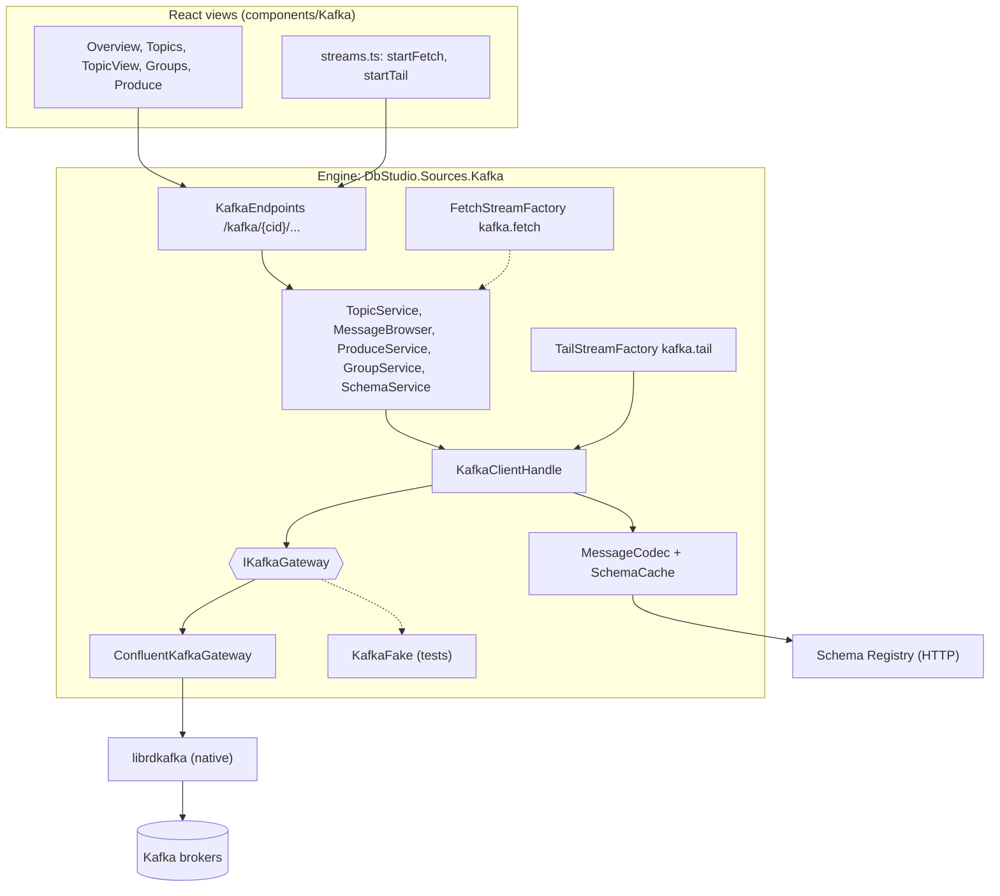
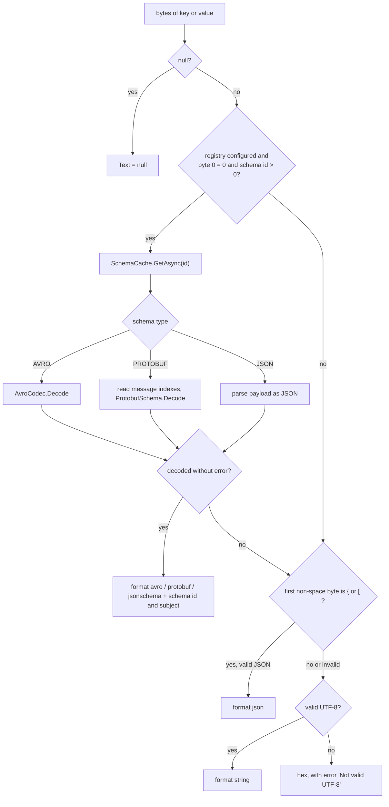
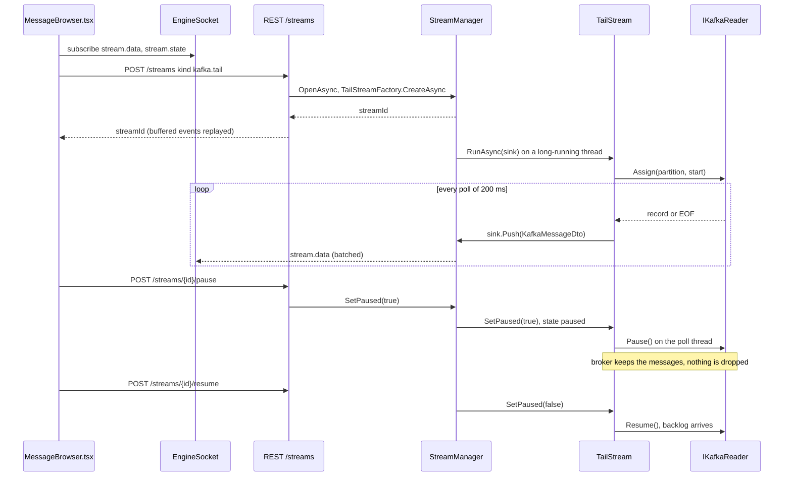
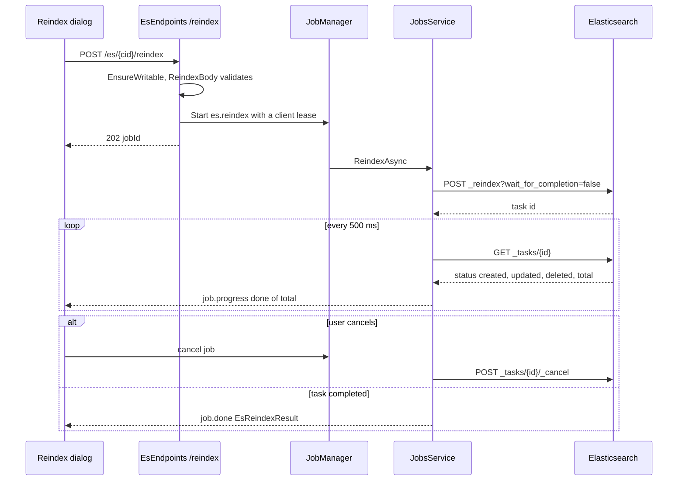

# 18. منبع‌ها ۲: Kafka و Elasticsearch

> **سطح:** L2 حرفه‌ای ← L3 ارشد | **بخش:** II | **کد خوانده‌شده در:** `b638b7b` (مجموعه قابلیت‌های Rowlit 1.6.3؛ `version.json` در این درخت 1.7.0 را نشان می‌دهد)
> **زبان:** فارسی | [English](../../en/part2/18-sources-kafka-elasticsearch.md) | قبلی: [17. منبع‌ها ۱: Redis و MongoDB](./17-sources-redis-mongo.md) | بعدی: [19. مدل امنیتی و رازها](./19-security-and-secrets.md)
> برچسب‌های نمودارها به انگلیسی نگه داشته شده‌اند تا در GitHub درست نمایش داده شوند.
> **در یک جمله:** Rowlit با Kafka از راه librdkafka شرکت Confluent و پشت یک رابط کوچک «دروازه» حرف می‌زند و با Elasticsearch/OpenSearch از راه یک کلاینت ساده‌ی HTTP، و هر دو را به درخت‌های قابل مرور، گریدهای پیام و سند، جریان‌های زنده و کارهای پس‌زمینه تبدیل می‌کند.
> **یاد می‌گیرید:**
> - اتصال Kafka چطور پیکربندی، باز و نگه‌داری می‌شود و چرا کتابخانه‌ی بومی librdkafka بسته‌بندی ویژه می‌خواهد؛
> - مرورگر پیام چطور آفست شروع را انتخاب می‌کند، Avro/Protobuf/JSON را از راه Schema Registry رمزگشایی می‌کند و دنبال‌کردن زنده چطور بی‌آنکه پیامی گم شود مکث می‌کند؛
> - ارسال پیام، عقب‌ماندگی گروه‌های مصرف‌کننده و بازنشانی آفست چطور کار می‌کنند و موتور روی اتصال فقط‌خواندنی چه چیزهایی را رد می‌کند؛
> - لایه‌ی انتقال Elasticsearch چطور بین نودها جابه‌جا می‌شود، خطاها را نگاشت می‌کند و ویرایش سند را با `seq_no` / `primary_term` محافظت می‌کند؛
> - جست‌وجو، کنسول Dev Tools، SQL با cursor، جریان taskها و کارهای reindex / import / export چطور ساخته شده‌اند.
> **پیش‌نیازها:** [17. منبع‌ها ۱: Redis و MongoDB](./17-sources-redis-mongo.md) (خانواده‌ی غیررابطه‌ای)، [06. پروتکل رویداد WebSocket](./06-websocket-protocol.md) (جریان‌ها و کارها روی سیم). پس‌زمینه از بخش I: [I-16 خانواده‌های NoSQL](../part1/16-nosql-families.md) (درون Kafka و Elasticsearch).

## 1. ایده (مبتدی)

Kafka و Elasticsearch پایگاه داده‌هایی نیستند که با SQL از آن‌ها پرس‌وجو کنید، اما آدم‌ها هر روز با یک IDE پایگاه داده درونشان را نگاه می‌کنند. **Apache Kafka** یک لاگ رویداد (event log) است: برنامه‌هایی به نام تولیدکننده پیام‌ها را به ته **[تاپیک‌ها (topic)](../glossary.md#topic)**ی نام‌دار اضافه می‌کنند، هر تاپیک به چند **[پارتیشن (partition)](../glossary.md#partition-kafka)** تقسیم شده و هر پیام در یک پارتیشن شماره‌ی جایی دارد که **[آفست (offset)](../glossary.md#offset)** نام دارد. برنامه‌هایی به نام مصرف‌کننده لاگ را می‌خوانند و یک **[گروه مصرف‌کننده (consumer group)](../glossary.md#consumer-group)** به خاطر می‌سپارد هر گروه تا کجا خوانده است. پس پرسش‌هایی که از یک خوشه‌ی (cluster) Kafka می‌پرسید از این جنس‌اند: «الان در این تاپیک چه هست؟»، «پیام‌های از ساعت ۱۰ به بعد را نشانم بده»، «سرویس صورت‌حساب چقدر عقب است؟» و «این پیام آزمایشی را بفرست».

**Elasticsearch** (و انشعابش **[OpenSearch](../glossary.md#opensearch)**) یک موتور جست‌وجوست. سندهای JSON را در *ایندکس*‌ها (index) نگه می‌دارد (ایندکس Elasticsearch به جدول نزدیک‌تر است تا به نمایه‌ی پایگاه داده‌های رابطه‌ای)، روی واژه‌هایشان یک **[نمایه‌ی وارونه (inverted index)](../glossary.md#inverted-index)** می‌سازد و به جست‌وجوهایی پاسخ می‌دهد که به زبانی JSON‌ی به نام **[query DSL](../glossary.md#query-dsl)** نوشته شده‌اند. پرسش‌ها این‌جا این‌ها هستند: «چه ایندکس‌هایی هست و هر کدام چقدر بزرگ است؟»، «سفارش‌هایی را پیدا کن که *تهران* در آن‌ها آمده»، «همین یک سند را ویرایش کن»، «این درخواست خام REST را اجرا کن» و «این ایندکس را در ایندکس تازه‌ای کپی کن».

Rowlit به هر دو نوع پرسش با همان سازوکاری پاسخ می‌دهد که برای Redis و MongoDB دارد (فصل [17](./17-sources-redis-mongo.md)): یک فراهم‌کننده (provider) که بلد است اتصال را بیازماید و باز کند، یک کلاینت بلندعمر برای هر اتصال که موتور نگه می‌دارد، نقطه‌های پایانی REST برای پرسش‌های کوتاه، **جریان‌**های (stream) WebSocket برای داده‌ی زنده و **کار**هایی (job) با گزارش پیشرفت برای عملیات طولانی. این فصل همین سازوکار را در بسته‌ی Kafka (`engine/src/DbStudio.Sources.Kafka`) و بسته‌ی Elasticsearch (`engine/src/DbStudio.Sources.Elasticsearch`) دنبال می‌کند و بعد به نماهای React می‌رسد که روی آن‌ها نشسته‌اند.

## 2. چطور کار می‌کند (حرفه‌ای)

### 2.1 دو بسته کجا وصل می‌شوند

هر دو بسته ماژول‌های معمولی موتورند. `KafkaModule` فراهم‌کننده، هفت سرویس singleton و دو کارخانه‌ی جریان کلیددار، `kafka.tail` و `kafka.fetch`، را ثبت می‌کند (`KafkaModule.cs:16-34`). `ElasticsearchModule` فراهم‌کننده‌ی خودش، هشت سرویس و یک کارخانه‌ی جریان، `es.tasks`، را ثبت می‌کند (`ElasticsearchModule.cs:17-35`). هیچ‌کدام از دیگری خبر ندارد؛ موتور هر دو را با reflection پیدا می‌کند (فصل [07](./07-engine-modules-and-di.md)). فراهم‌کننده‌ها `IDataSourceProvider` را پیاده می‌کنند: Kafka با `Id "kafka"` و `SourceKind.Stream` (`KafkaProvider.cs:24-26`) و Elasticsearch با `Id "elasticsearch"` و `SourceKind.Search` (`EsProvider.cs:20-22`). سپس `SourceClientManager` برای هر اتصال یک کلاینت نگه می‌دارد، کلاینت‌های بیکار را می‌بندد و رویدادهای `source.client` را منتشر می‌کند؛ این بخش مشترک یک بار در بخش 2.1 فصل [17](./17-sources-redis-mongo.md) توضیح داده شده و این‌جا تکرار نمی‌شود.

**شکل ۱۸.۱ — بسته‌ی Kafka: سرویس‌ها بالای یک درز (seam) راه‌انداز.**

شکل مهم‌ترین تصمیم طراحی بسته‌ی Kafka را نشان می‌دهد: **سرویس‌ها هیچ نوعی از Confluent را نمی‌بینند.** هر چه از راه‌انداز (driver) لازم دارند پشت `IKafkaGateway` است (`IKafkaGateway.cs:72-115`)، یک رابط ساده‌ی C# که از رکوردهایی مثل `KTopicMeta`، `KWatermarks`، `KRecord` و `KGroupDescription` ساخته شده (`IKafkaGateway.cs:7-57`). پیاده‌سازی واقعی `ConfluentKafkaGateway` است؛ پروژه‌ی آزمون `KafkaFake` را دارد، مدلی درون‌حافظه‌ای از بروکر با پارتیشن‌ها، watermarkها، برچسب‌های زمانی، گروه‌ها و تزریق خطا (`engine/tests/DbStudio.Sources.Kafka.Tests/KafkaFake.cs`). این همان **[درز دروازه (gateway seam)](../glossary.md#gateway-seam)** است که بسته‌ی Mongo هم به کار می‌برد (فصل [17](./17-sources-redis-mongo.md))؛ توضیح `IKafkaGateway.cs:3-5` دلیلش را می‌گوید: هر رفتاری با آزمون واحد قابل آزمودن است.

### 2.2 Kafka: تنظیمات، آزمون و باز کردن اتصال

فرم اتصال یک `ConnectionFormSpec` است (`KafkaProvider.cs:29-58`): سرورهای bootstrap، پروتکل امنیتی (`PLAINTEXT`، `SSL`، `SASL_PLAINTEXT`، `SASL_SSL`)، سازوکار SASL (`PLAIN`، `SCRAM-SHA-256`، `SCRAM-SHA-512`، `OAUTHBEARER`)، کاربر و گذرواژه، سه فایل گواهی و گذرواژه‌ی کلید، نشانی Schema Registry با کاربر و رازش، شناسه‌ی کلاینت (پیش‌فرض `Rowlit`)، مهلت درخواست (پیش‌فرض ۱۵٬۰۰۰ میلی‌ثانیه) و یک متن «تنظیمات اضافه‌ی librdkafka». فرم این توضیح را هم دارد که تونل SSH برای Kafka در دسترس نیست، چون بروکرها نشانی‌های خودشان را اعلام می‌کنند و یک درگاه فرواردشده به آن‌ها نمی‌رسد (`KafkaProvider.cs:27`).

`KafkaSettings.From` پروفایل را اعتبارسنجی می‌کند و با `400 VALIDATION` و نام فیلد پاسخ می‌دهد (`KafkaSettings.cs:38-87`):

- هر ورودی bootstrap باید `host:port` با درگاهی بین ۱ و ۶۵٬۵۳۵ باشد (`KafkaSettings.cs:43-48`)؛
- پروتکل‌های `SASL_*` کاربر می‌خواهند مگر آنکه سازوکار `OAUTHBEARER` باشد (`KafkaSettings.cs:58-59`)؛
- مهلت درخواست باید بین ۱٬۰۰۰ و ۳۰۰٬۰۰۰ میلی‌ثانیه باشد (`KafkaSettings.cs:62-63`)؛
- نشانی registry باید یک URL مطلق `http(s)` باشد (`KafkaSettings.cs:66-67`)؛
- تنظیمات اضافه جفت‌های `key=value` جداشده با `;` یا خط تازه‌اند و **کلیدی که `password` یا `secret` در آن باشد پذیرفته نمی‌شود**، چون رازها جایشان در فیلدهای گذرواژه است که انبار رازهای سیستم‌عامل نگهشان می‌دارد (`KafkaSettings.cs:90-105`). گذرواژه‌ی SASL، گذرواژه‌ی کلید و راز registry فیلدهای از نوع گذرواژه‌اند، پس `ConnectionStore` هرگز آن‌ها را در `connections.json` نمی‌نویسد (`KafkaProvider.cs:13-16`، فصل [19](./19-security-and-secrets.md)).

`ToClientConfig` تنظیمات را به دیکشنری librdkafka تبدیل می‌کند که کلاینت مدیریتی (admin)، مصرف‌کننده‌ها و تولیدکننده‌ها با هم به کار می‌برند (`KafkaSettings.cs:108-139`). سه ورودی آگاهانه گذاشته شده‌اند: `reconnect.backoff.max.ms = 5000` تا بروکر در دسترس‌نبودن زود دوباره امتحان شود و نه تا ابد (`KafkaSettings.cs:118`)، سقف ۳۰ ثانیه برای `socket.connection.setup.timeout.ms` (`KafkaSettings.cs:116`) و `allow.auto.create.topics = false` تا یک غلط تایپی یا تبی که روی تاپیک حذف‌شده باز مانده پاسخ «تاپیک ناشناخته» بگیرد، نه اینکه بی‌صدا تاپیک تازه بسازد (`KafkaSettings.cs:120-122`).

**آزمون** (`KafkaProvider.TestAsync`، `KafkaProvider.cs:64-103`) یک دروازه می‌سازد، `DescribeCluster` می‌پرسد، روی بروکرهای قدیمی یا وقتی کاربر اجازه‌ی توصیف خوشه را ندارد به فراداده‌ی ساده برمی‌گردد (`KafkaProvider.cs:136-141`)، نسخه‌ی بروکر را از `inter.broker.protocol.version` کنترلر ظرف ۵ ثانیه می‌خواند (`KafkaProvider.cs:161-180`) و Schema Registry را وارسی می‌کند. شکست registry آزمون را **شکست نمی‌دهد**؛ به‌صورت هشدار به متن سرور اضافه می‌شود (`KafkaProvider.cs:145-156`)، پس چیزی مثل `Kafka 3.8 (3 brokers, controller 1); warning: …` می‌بینید. وقتی خود کتابخانه‌ی بومی بار نشود، آزمون به‌جای خطای فراهم‌کننده `ENGINE_ERROR` با جزئیات `librdkafka-missing` برمی‌گرداند (`KafkaProvider.cs:92-97`)؛ آزمون دود (smoke) در CI از همین تفاوت استفاده می‌کند (بخش 2.10).

**باز کردن** (`KafkaProvider.cs:105-129`) `KafkaClientHandle` بلندعمر را می‌سازد: دروازه (یک کلاینت مدیریتی مشترک به‌علاوه‌ی تولیدکننده‌های نهان‌شده)، کلاینت registry، `MessageCodec` با حافظه نهان اسکیما و یک `KafkaLogBuffer` با ظرفیت ۲٬۰۰۰ ورودی که callbackهای لاگ و خطای librdkafka را جمع می‌کند (`KafkaClientHandle.cs:16-27`، `KafkaLogBuffer.cs:12`). Kafka از راه پروتکلش لاگ سرور ندارد، پس نمای Logs همین لاگ کلاینت را نشان می‌دهد (`KafkaLogBuffer.cs:7-11`، فصل [21](./21-logs-activity-resources.md)). اگر جست‌وجوی نسخه‌ی بروکر هنگام باز کردن به مهلت خورده باشد، `TryResolveVersionAsync` هنگام خواندن نمای کلی دوباره امتحان می‌کند، حداکثر یک بار در دقیقه (`KafkaClientHandle.cs:46-61`). `PingAsync` یک `DescribeCluster` با بودجه‌ی ۱۰ ثانیه است (`KafkaClientHandle.cs:72-85`).

هر مسیر نوشتن `EnsureWritable` را صدا می‌زند که روی اتصال فقط‌خواندنی `403 READ_ONLY` با نام عملیات پرتاب می‌کند (`KafkaClientHandle.cs:66-70`). نوشتن‌ها این‌ها هستند: ساختن تاپیک، تغییر پیکربندی‌ها، افزودن پارتیشن، حذف، پاک‌سازی (purge)، ارسال پیام، بازنشانی آفست و حذف گروه (`KafkaEndpoints.cs:27-32`).

### 2.3 Kafka: دروازه و خطاهایش

`ConfluentKafkaGateway` برای هر اتصال یک `IAdminClient`، برای هر کدک فشرده‌سازی یک تولیدکننده نگه می‌دارد و مصرف‌کننده‌های کوتاه‌عمر را هر وقت لازم شد می‌سازد (`ConfluentKafkaGateway.cs:6-30`). هر مصرف‌کننده‌ای که برای مرور یا دنبال‌کردن می‌سازد **خواننده‌ای است که هرگز به گروهی نمی‌پیوندد**: یک `group.id` تصادفی به شکل `dbstudio-<purpose>-<guid>`، commit خودکار و ذخیره‌ی آفست خاموش، رویدادهای پایان پارتیشن (EOF) روشن و سقف واکشی ۱۶ مگابایت (`ConfluentKafkaGateway.cs:132-146`). پارتیشن‌ها دستی به خواننده واگذار می‌شوند (`Assign`)، پس نگاه کردن به یک تاپیک هرگز آفست‌های commit‌شده‌ی گروهی واقعی را جابه‌جا نمی‌کند و هرگز rebalance راه نمی‌اندازد.

فراخوانی‌های مدیریتی از یک کمکی به نام `Run` می‌گذرند (`ConfluentKafkaGateway.cs:235-249`). این کمکی سه خطای هماهنگ‌کننده‌ی گروه را که بروکر هنگام جابه‌جایی یا بارگذاری هماهنگ‌کننده برمی‌گرداند (`NOT_COORDINATOR`، `COORDINATOR_NOT_AVAILABLE`، `COORDINATOR_LOAD_IN_PROGRESS`) تا `TransientAttempts = 6` بار با فاصله‌ی ۱۵۰ میلی‌ثانیه × شماره‌ی تلاش دوباره امتحان می‌کند (`ConfluentKafkaGateway.cs:232-260`). هر خطای دیگری به `KafkaGatewayException` با یک `KafkaErrorKind` ترجمه می‌شود (`ConfluentKafkaGateway.cs:279-299`) و برای این کار دقیق‌ترین خطای درون فهرست نتیجه‌های استثناهای Confluent انتخاب می‌شود (`EffectiveError`، `ConfluentKafkaGateway.cs:263-276`). سپس `KafkaErrors.ToEngine` این نوع را به پاکت خطای موتور نگاشت می‌کند (`KafkaErrors.cs:8-21`):

| نوع خطای دروازه | پاسخ REST |
|---|---|
| `Unreachable`، `Timeout`، `Authentication` | 503 `SOURCE_UNAVAILABLE` |
| `UnknownTopic`، `UnknownGroup` | 404 `NOT_FOUND` |
| `TopicExists` | 409 `VALIDATION` (فیلد `name`) |
| `GroupNotEmpty` | 409 `GROUP_ACTIVE` |
| `Authorization` | `PRIVILEGE` («Kafka ACL for this operation») |
| `InvalidRequest`، `PolicyViolation` | 400 `VALIDATION` |
| هر چیز دیگر | 422 `PROVIDER_ERROR` |

گروه نقطه‌های پایانی یک فیلتر هم دارد که هر استثنای دروازه‌ای را که از سرویسی بیرون زده بگیرد، پس هیچ پیام Confluent بی‌نگاشت به رابط نمی‌رسد (`KafkaEndpoints.cs:40-45`).

### 2.4 Kafka: خوشه، تاپیک‌ها و پیکربندی‌ها

`ClusterService.ClusterAsync` نتیجه‌ی `DescribeCluster` را با فراداده‌ی کامل ترکیب می‌کند و بروکرها، تاپیک‌ها، پارتیشن‌ها، پارتیشن‌های کم‌همانند (under-replicated، یعنی ISR کوچک‌تر از فهرست replicaها) و پارتیشن‌های آفلاین (بی‌رهبر) را می‌شمارد (`TopicService.cs:10-26`). تاپیک‌های داخلی از روی نام شناخته می‌شوند: `__*`، `_confluent*` و `_schemas` (`ConfluentKafkaGateway.cs:45`)؛ فهرست تاپیک‌ها آن‌ها را پنهان می‌کند مگر آنکه `includeInternal` روشن باشد (`TopicService.cs:55-58`).

فهرست تاپیک‌ها تعداد پیام‌ها را از جمع `high − low` واترمارک‌های هر پارتیشن تخمین می‌زند. **[واترمارک‌ها (watermark)](../glossary.md#watermark)** با دو فراخوانی `ListOffsets` خوانده می‌شوند (اولین و آخرین، `ConfluentKafkaGateway.cs:100-117`) و کل تخمین بودجه‌ی ۵ ثانیه دارد: اگر تمام شود، تعدادها فقط `null` می‌شوند و فهرست همچنان نمایش داده می‌شود (`TopicService.cs:41`، `59-67`). روی تاپیک فشرده‌شده یا تاپیکی که از آن حذف شده، این تخمین فقط کران بالاست و برای همین رابط آن را «تخمین» می‌نامد.

نام تاپیک با همان قاعده‌ی خود Kafka اعتبارسنجی می‌شود: `^[A-Za-z0-9._-]{1,249}$` و نه `.` یا `..` (`TopicService.cs:43-53`). ساختن تاپیک ۱ تا ۱۰٬۰۰۰ پارتیشن می‌پذیرد (`TopicService.cs:118`)؛ افزودن پارتیشن مجموع بزرگ‌تری می‌خواهد، چون پارتیشن را نمی‌شود کم کرد (`TopicService.cs:142-144`). **پاک‌سازی (purge)** با `DeleteRecords` همه‌ی رکوردهای پیش از high watermark فعلی هر پارتیشن انتخاب‌شده را حذف می‌کند و low watermarkهای تازه را برمی‌گرداند (`TopicService.cs:156-166`)؛ رابط پیش از آن از شما می‌خواهد نام تاپیک را تایپ کنید. ویرایش پیکربندی از `IncrementalAlterConfigs` با فهرست‌های جدای `set` و `delete` استفاده می‌کند و نامی را که در هر دو آمده رد می‌کند (`TopicService.cs:126-136`، `ConfluentKafkaGateway.cs:83-91`). مقدارهای حساس پیکربندی هرگز به رابط فرستاده نمی‌شوند: `KafkaConfigEntryDto.From` آن‌ها را null می‌کند (`KafkaModels.cs:20-21`).

### 2.5 Kafka: مرور پیام‌ها

باز کردن تب **Messages** یک تاپیک و فشردن **Fetch** یک مرور را آغاز می‌کند. درخواست (`KafkaFetchRequest`، `KafkaModels.cs:48-49`) می‌گوید کدام پارتیشن‌ها، از کجا شروع شود (`latest` با یک تعداد، `oldest`، یک `offset` یا یک `timestamp`)، چند پیام (پیش‌فرض ۲۰۰، حداکثر ۵٬۰۰۰)، کلید و مقدار چطور رمزگشایی شوند، یک متن جست‌وجوی اختیاری، بودجه‌ی بایت (پیش‌فرض ۱۰ مگابایت، از ۱ کیلوبایت تا ۶۴ مگابایت) و مهلت (پیش‌فرض ۸ ثانیه، از ۰٫۵ تا ۱۲۰ ثانیه) (`MessageBrowser.cs:8-52`).

`MessageBrowser.PlanAsync` نقطه‌ی شروع را برای هر پارتیشن به یک بازه‌ی `[Start, End)` تبدیل می‌کند که `End` در آن روی high watermark لحظه‌ی آغاز مرور ثابت می‌شود (`MessageBrowser.cs:55-90`):

| نوع شروع | اولین آفست هر پارتیشن |
|---|---|
| `latest` (تعداد N) | `max(low, high − N)` |
| `oldest` | `low` |
| `offset` | همان آفست، محدودشده به `[low, high]` |
| `timestamp` | نتیجه‌ی `OffsetsForTimes`، وگرنه `high`، محدودشده |

ثابت کردن `End` در آغاز مهم است: روی تاپیک پرترافیک وگرنه مرور هرگز تمام نمی‌شد، چون پیام تازه مدام می‌رسد. حلقه‌ی مصرف (`MessageBrowser.cs:103-201`) وقتی می‌ایستد که همه‌ی پارتیشن‌ها به انتهایشان رسیده باشند (با آفست یا رویداد EOF)، یا به سقف تعداد، بودجه‌ی بایت یا مهلت برسد، یا جریان بسته شود. دو جزئیات از خوشه‌های واقعی آمده‌اند. اول، نخستین poll مصرف‌کننده شامل وصل شدن به رهبرهای پارتیشن است که ممکن است چند ثانیه طول بکشد؛ برای همین ساعت مهلت از اولین رکورد یا EOF شروع می‌شود و تا آن موقع یک مهلت جداگانه‌ی ۱۰ ثانیه‌ای به نام `StartupGrace` اعمال می‌شود (`MessageBrowser.cs:66-67`، `123-145`). دوم، «آخرین N» روی چند پارتیشن نمی‌تواند از پیش بداند تازه‌ترین پیام‌های کل تاپیک کدام‌اند، پس همه‌ی پیام‌های منطبق بازه‌ها را جمع می‌کند و در پایان N تای تازه‌تر را بر اساس برچسب زمانی نگه می‌دارد (`MessageBrowser.cs:189-198`).

جست‌وجو روی متن **رمزگشایی‌شده** (`FullText`) انجام می‌شود، نه روی بایت‌های خام، پس جست‌وجوی نام یک مشتری آن را درون مقدار Avro هم پیدا می‌کند (`MessageBrowser.cs:163-167`). پیشرفت هر ۱۰۰ پیام پویش‌شده و هر ۵۰۰ پیام ردشده گزارش می‌شود (`MessageBrowser.cs:165`، `185`).

**چرا یک کار به‌علاوه‌ی یک جریان.** یک مرور ممکن است هزاران پیام برگرداند و رابط می‌خواهد اولین‌ها را فوراً نشان دهد. برای همین `POST /kafka/{cid}/topics/{topic}/messages` با `202 { jobId, streamId }` پاسخ می‌دهد (`KafkaEndpoints.cs:91-130`): پیام‌ها روی یک جریان `kafka.fetch` می‌آیند و پیشرفت و `KafkaFetchResult` نهایی (تعداد واکشی‌شده، پویش‌شده، پارتیشن‌های تمام‌شده، به مهلت خورده، بریده‌شده) به‌صورت `job.progress` / `job.done`. این دو با یک **[رله‌ی واکشی (fetch relay)](../glossary.md#fetch-relay)** به هم گره خورده‌اند: نقطه‌ی پایانی یک رله با نشانه‌ی تصادفی ثبت می‌کند، جریان را با همان نشانه به‌عنوان تنها پارامتر باز می‌کند و کار پیش از فرستادن منتظر sink جریان می‌ماند (`TailStream.cs:107-165`). `FetchStreamFactory` جریان `kafka.fetch`ی را که این‌طور باز نشده رد می‌کند (`TailStream.cs:155-165`). بستن جریان از راه `relay.Closed` کار را لغو می‌کند (`KafkaEndpoints.cs:112`، `120-123`) و کار پیش از اولین دسته ۱۵۰ میلی‌ثانیه صبر می‌کند تا رابط فرصت اشتراک داشته باشد (`KafkaEndpoints.cs:116-117`).

در سمت رابط، `startFetch` **پیش از** فرستادن درخواست مشترک چهار نوع رویداد می‌شود، تا ۵٬۰۰۰ رویداد با شناسه‌ی ناشناخته را بافر می‌کند و وقتی 202 شناسه‌ها را اعلام کرد آن‌ها را دوباره پخش می‌کند (`ui/src/components/Kafka/streams.ts:10-37`، `51-104`). یک مرور سریع ممکن است پیش از پردازش 202 تمام شود؛ همین بافر است که آن پیام‌ها را نگه می‌دارد. اگر رویداد پایان جریان پس از `job.done` از دست برود، یک زمان‌سنج ۳ ثانیه‌ای کار را تمام می‌کند (`streams.ts:80-81`).

«Load full» روی مقدار بریده‌شده `GET …/messages/{partition}/{offset}` را صدا می‌زند که دقیقاً یک رکورد را با خواننده‌ای تازه می‌خواند و اگر آن آفست فشرده (compact) یا حذف شده باشد 404 می‌دهد (`MessageBrowser.cs:203-233`).

### 2.6 Kafka: رمزگشایی با کدک‌ها و Schema Registry

پیام Kafka بایت است. برای نشان دادنش موتور یک **[کدک (codec)](../glossary.md#codec)** لازم دارد، قاعده‌ای که بایت را به متن تبدیل می‌کند و برعکس. `KafkaFormats` نُه رمزگشا (`string`، `json`، `hex`، `int32`، `int64`، `avro`، `protobuf`، `jsonschema`، `auto`) و شش رمزگذار برای ارسال دارد (`KafkaFormats`، `MessageCodec.cs:9-23`). رمزگشای مقدار به‌طور پیش‌فرض `auto` است و رمزگشای کلید `string` (`TailStream.cs:24-25`، `MessageBrowser.cs:50`).

**شکل ۱۸.۲ — رمزگشای `auto` چطور کدک را انتخاب می‌کند.**

قالب‌های مبتنی بر اسکیما از **[قالب سیمی Confluent (Confluent wire format)](../glossary.md#confluent-wire-format)** استفاده می‌کنند: بایت ۰ یک `0` جادویی است، بایت‌های ۱ تا ۴ شناسه‌ی اسکیما به ترتیب big-endian و بعد محتوا می‌آید؛ Protobuf فهرست کوتاهی از اندیس‌های پیام اضافه می‌کند که می‌گوید کدام نوع پیام فایل `.proto` به کار رفته است (`MessageCodec.cs:25-30`، `119-125`، `ProtobufCodec.cs:549-567`). کدک روی داده‌ی خراب هرگز استثنا پرتاب نمی‌کند: شکست رمزگشایی شکل hex را با یک متن `Error` برمی‌گرداند تا گرید نشان هشدار بگذارد (`MessageCodec.cs:54-57`، `107-110`). متنی که از سقف سیمی موتور بلندتر باشد به شکل `{$trunc,len}` بریده می‌شود مگر آنکه «کامل» خواسته شده باشد، و hex برای حداکثر ۱۶ کیلوبایت از بایت‌ها نمایش داده می‌شود (`MessageCodec.cs:28-29`، `34`، `156-162`).

`SchemaCache` اسکیماهای تجزیه‌شده را بر اساس شناسه نگه می‌دارد، چون اسکیمای registry برای یک شناسه‌ی معین هرگز عوض نمی‌شود (`SchemaCache.cs:10-35`). پیش از تجزیه، **ارجاع‌ها** (references) را عمق‌اول و هر کدام یک بار حل می‌کند (نوع‌های نام‌دار Avro، importهای Protobuf) (`SchemaCache.cs:52-53`، `69-79`). بارگذاری‌ای که شکست بخورد از حافظه نهان حذف می‌شود، پس از کار افتادن registry خودبه‌خود ترمیم می‌شود (`SchemaCache.cs:29-33`). کلاینت registry یک `HttpClient` نازک با احراز هویت Basic و نوع رسانه‌ی خاص registry است (`SchemaRegistryService.cs:35-55`). کدک Avro JSON ساده می‌نویسد، نه «رمزگذاری JSON» خود Avro را: unionها باز می‌شوند، bytes به base64 درمی‌آید و نوع‌های منطقی رشته‌ی ISO یا عدد می‌شوند (`AvroCodec.cs:11-15`). کدک Protobuf **بدون کلاس‌های تولیدشده** کار می‌کند: متن `.proto` را از registry با protobuf-net.Reflection تجزیه می‌کند و پیام دودویی را فیلد به فیلد به JSON به سبک proto3 تبدیل می‌کند (`ProtobufCodec.cs:11-16`). فایل پروژه گرهی بسته‌بندی را که این کار ایجاد می‌کند توضیح می‌دهد: Google.Protobuf و protobuf-net هر دو نوع‌های descriptor تعریف می‌کنند، پس Google.Protobuf فقط از راه یک extern alias ارجاع داده می‌شود (`DbStudio.Sources.Kafka.csproj:21-23`).

پوشه‌ی **Schema Registry** در اکسپلورر subjectها را فهرست می‌کند؛ برای ۲۰۰ subject اول آخرین نسخه و نوع را هم به‌صورت موازی (۸ تا هم‌زمان) و در بودجه‌ی ۵ ثانیه، با بیشترین تلاش ممکن، می‌گیرد (`SchemaRegistryService.cs:158-168`).

### 2.7 Kafka: دنبال‌کردن زنده و مکث

**[دنبال‌کردن زنده (tail)](../glossary.md#tail)** پیام‌های تازه را به محض رسیدن نشان می‌دهد. این یک جریان `kafka.tail` است که با `POST /streams` و پارامترهای `{ topic, partitions, from: 'latest' | 'offsetMap', offsets, keyFormat, valueFormat, filter }` باز می‌شود (`TailStream.cs:9-40`). با `latest` هر پارتیشن از high watermark خودش شروع می‌کند؛ با `offsetMap` از آفست داده‌شده که به واترمارک‌ها محدود شده است (`TailStream.cs:33-38`).

**شکل ۱۸.۳ — دنبال‌کردن زنده با مکث و ادامه.**

`TailStream` یک `IPausableEngineStream` است (`TailStream.cs:64-65`). این رابط به خاطر رفتار `StreamManager` با جریان در حال مکث اهمیت دارد: در جریان معمولی آیتم‌هایی که هنگام مکث فرستاده شوند **دور ریخته و شمرده می‌شوند**؛ اما به جریانی که `IPausableEngineStream` را پیاده کرده گفته می‌شود خودش مکث کند (`StreamManager.cs:40-55`، `243-254`، `515`). دنبال‌کردن Kafka خود مصرف‌کننده را متوقف می‌کند، پس بروکر پیام‌ها را نگه می‌دارد و پیام‌های عقب‌افتاده پس از ادامه می‌رسند (`TailStream.cs:9-13`). نکته‌ای در نخ‌ها (thread) هست: خواننده thread-safe نیست و باید از همان نخی که poll می‌کند متوقف شود (`IKafkaGateway.cs:117`). برای همین `SetPaused` فقط یک پرچم volatile را عوض می‌کند؛ حلقه‌ی poll تغییر را می‌بیند و خودش `Pause()` / `Resume()` را صدا می‌زند و در حالت مکث بین بررسی‌ها ۱۰۰ میلی‌ثانیه می‌خوابد (`TailStream.cs:71`، `76-104`). حلقه روی یک task از نوع `LongRunning` اجرا می‌شود، چون `Consume` در هر poll تا ۲۰۰ میلی‌ثانیه یک نخ را مسدود می‌کند (`TailStream.cs:73-74`، `95`).

`filter` در دنبال‌کردن، تطبیق زیررشته‌ی بی‌توجه به بزرگی و کوچکی حروف روی کلید یا مقدار رمزگشایی‌شده است (`TailStream.cs:100-101`). رابط هنگام دنبال‌کردن حداکثر `TAIL_CAP = 10 000` پیام نگه می‌دارد و قدیمی‌ترها را دور می‌ریزد (`MessageBrowser.tsx:27-28`). مالکیت جریان، دسته‌کردن در فریم‌های `stream.data` و پاک‌سازی جریان‌های یتیم کار `StreamManager` است (فصل [06](./06-websocket-protocol.md)).

### 2.8 Kafka: ارسال پیام

`POST …/topics/{topic}/produce` (`ProduceService.cs:20-60`) در هر درخواست تا ۱٬۰۰۰ پیام و ۱۶ مگابایت می‌پذیرد، هر کدام با کلید، مقدار، سرآیندها و یک پارتیشن اختیاری، به‌علاوه‌ی قالب کلید، قالب مقدار، فشرده‌سازی (`none`، `gzip`، `snappy`، `lz4`، `zstd`) و برای قالب‌های اسکیمایی یک subject و نسخه (عدد یا `latest`) برای کلید و مقدار به‌طور مستقل (`ProduceService.cs:16-18`، `62-81`). گزینه‌ی **Repeat N times** در رابط با جایگذاری `${i}` همین پیام‌ها را در کلاینت می‌سازد و سقفش همان ۱٬۰۰۰ است (`Produce.tsx:19-29`).

موتور نوع اسکیمای subject را با قالب انتخاب‌شده می‌سنجد (subject از نوع Avro نمی‌تواند `protobuf` رمزگذاری کند)، با `MessageCodec.Encode` رمزگذاری می‌کند (`MessageCodec.cs:193-239`) و دسته را از راه یک تولیدکننده‌ی نهان‌شده با `acks=all`، idempotence خاموش و مهلت پیام دست‌کم ۱۰ ثانیه می‌فرستد و ظرف ۱۰ ثانیه flush می‌کند (`ConfluentKafkaGateway.cs:148-167`، `202-220`). هر نتیجه پارتیشن، آفست، برچسب زمانی و **هشدارها** را برمی‌گرداند: رمزگذار Avro هر فیلد ورودی‌ای را که اسکیمای رکورد ندارد گزارش می‌کند، چون Avro فقط فیلدهای اسکیما را می‌نویسد و یک غلط تایپی مثل `amout` وگرنه بی‌صدا ناپدید می‌شد (`AvroCodec.cs:52-56`، `171-175`). نمای Produce این هشدارها را پس از ارسال موفق در یک بنر نشان می‌دهد (`Produce.tsx:90-112`).

### 2.9 Kafka: گروه‌های مصرف‌کننده، عقب‌ماندگی و بازنشانی آفست

`GroupService.ListAsync` گروه‌ها را فهرست می‌کند، آن‌ها را در دسته‌های ۵۰ تایی توصیف می‌کند و سپس **[عقب‌ماندگی (lag)](../glossary.md#consumer-lag)** هر گروه را به‌صورت جمع `high − committed` روی پارتیشن‌هایش حساب می‌کند (`GroupService.cs:17-74`). آفست‌های commit‌شده به‌صورت موازی و حداکثر ۸ درخواست هم‌زمان خوانده می‌شوند، سپس یک پرس‌وجوی واترمارک همه‌ی پارتیشن‌های درگیر را پوشش می‌دهد؛ کل این گذر بودجه‌ی ۱۰ ثانیه دارد و گروهی که عقب‌ماندگی‌اش به‌موقع حساب نشد `null` نشان می‌دهد، نه عددی غلط (`GroupService.cs:14`، `28-51`). جزئیات گروه اعضا را با واگذاری‌هایشان و برای هر پارتیشن مقدار commit‌شده، low، high و عقب‌ماندگی را فهرست می‌کند (`GroupService.cs:76-96`).

**[بازنشانی آفست (offset reset)](../glossary.md#offset-reset)** (`GroupService.cs:117-184`) آفست‌های commit‌شده‌ی یک گروه را به `earliest`، `latest`، یک `offset`، یک `timestamp` یا `shiftBy` (جابه‌جایی با یک عدد علامت‌دار از جای commit‌شده) می‌برد. هر مقصد به `[low, high]` پارتیشن محدود می‌شود (`GroupService.cs:186-194`). مقصدها یا پارتیشن‌های صریح‌اند، یا یک تاپیک کامل، یا همه‌ی پارتیشن‌هایی که گروه در آن‌ها commit دارد. دو قاعده‌ی ایمنی اعمال می‌شود:

1. **[اجرای آزمایشی (dry run)](../glossary.md#dry-run)** همیشه مجاز است، حتی روی اتصال فقط‌خواندنی؛ ردیف‌های «از/به» را برمی‌گرداند بی‌آنکه چیزی را عوض کند. پنجره‌ی Reset در رابط اول اجرای آزمایشی را انجام می‌دهد و جدول پیش‌نمایش را نشان می‌دهد (`GroupService.cs:142-146`، `ui/src/components/Kafka/dialogs.tsx:154-200`).
2. اعمال کردن هم اتصال قابل‌نوشتن می‌خواهد **و** هم گروهی که فعال نباشد. گروهی که عضو دارد، یا در وضعیت `Stable` / `PreparingRebalance` / `CompletingRebalance` است، با `409 GROUP_ACTIVE` و فهرست اعضایش پاسخ می‌گیرد (`GroupService.cs:15`، `111-115`). خود Kafka هم تغییر را برای گروه زنده رد می‌کرد؛ Rowlit پیش‌تر بررسی می‌کند تا پیام روشن باشد.

گروهی که هنوز وجود ندارد `Empty` در نظر گرفته می‌شود، چون Kafka وقتی برای گروهی آفست commit شود آن را می‌سازد (`GroupService.cs:196-204`). حذف گروه هم از همین قاعده‌ی گروه فعال پیروی می‌کند (`GroupService.cs:206-212`).

### 2.10 Kafka: کتابخانه‌ی بومی

Confluent.Kafka 2.6.1 پوسته‌ای .NET دور **[librdkafka](../glossary.md#librdkafka)**، یک کتابخانه‌ی C، است (`DbStudio.Sources.Kafka.csproj:17-20`). کد بومی درون یک موتور تک‌فایلی و خودکفا (self-contained) همان خطر بسته‌بندی‌ای است که تصمیم D8 در `docs/PLAN-M2.md` به آن می‌پردازد. کاری که کد امروز می‌کند (`KafkaNative.cs:6-56`):

- **win-x64**: موتور تک‌فایلی `librdkafka.dll` و وابستگی‌هایش (OpenSSL، libcurl، zlib، zstd، runtime ویژوال C++) را در `%TEMP%\.net\…` خوداستخراج می‌کند و جست‌وجوی کتابخانه‌ی بومی runtime آن‌ها را پیدا می‌کند (`KafkaNative.cs:7-9`).
- **macOS**: `librdkafka.dylib` کنار apphost فرستاده و با برنامه امضا می‌شود و **به‌طور صریح** از `AppContext.BaseDirectory` با `Library.Load` بار می‌شود (`KafkaNative.cs:9-11`، `22-45`). متن طرح گفته بود جست‌وجوی Confluent آن را در پوشه‌ی برنامه پیدا می‌کند؛ توضیح کد می‌گوید این جست‌وجو به مکان یک assembly وابسته است که در برنامه‌های تک‌فایلی خالی است، پس کد به آن تکیه نمی‌کند.
- سازنده‌ی `ConfluentKafkaGateway` پیش از ساختن هر کلاینتی `KafkaNative.EnsureLoaded()` را صدا می‌زند (`ConfluentKafkaGateway.cs:23`).

`GET /api/v1/kafka/library` نسخه‌ی librdkafka، زمینه‌های اشکال‌زدایی‌اش و مسیری را که از آن بار شده گزارش می‌کند؛ صدا زدنش بار کردن کتابخانه‌ی بومی را اجباری می‌کند (`KafkaEndpoints.cs:37-38`، `KafkaModels.cs:120-121`). گام CI یعنی `scripts/ci/kafka-native-smoke.mjs` یک موتور **منتشرشده** را اجرا می‌کند، این نقطه‌ی پایانی را صدا می‌زند و سپس اتصال Kafka به `127.0.0.1:1` را می‌آزماید که باید با خطای librdkafka شکست بخورد و هرگز با `librdkafka-missing` نه؛ روی macOS بررسی هم می‌کند که dylibها کنار apphost با معماری درست و فقط وابستگی‌های سیستمی نشسته‌اند (`kafka-native-smoke.mjs:2-21`). خود بسته‌بندی موضوع فصل [24](./24-build-ci-release-contributing.md) است.

### 2.11 Elasticsearch: تنظیمات و لایه‌ی انتقال

فرم اتصال Elasticsearch (`EsProvider.cs:27-48`) یک فیلد اجباری **URL** دارد که چند نشانی نود را با ویرگول جدا می‌پذیرد، یک انتخاب احراز هویت (`none`، `basic`، `apiKey`، `bearer` که هر کدام فقط فیلدهای خودش را نشان می‌دهد)، «Skip TLS verification»، یک فایل گواهی CA، مهلت اتصال (پیش‌فرض ۱۰ ثانیه) و گونه (`auto`، `elasticsearch`، `opensearch`). `EsSettings.ParseUrl` وقتی scheme داده نشده `http://` اضافه می‌کند و query، fragment یا کاربر و گذرواژه درون URL را رد می‌کند (`EsSettings.cs:70-83`). مهلت درخواست ۶۰ ثانیه است (`EsSettings.cs:19`). برخلاف Kafka، اتصال Elasticsearch می‌تواند با یک نشانی نود از تونل SSH بگذرد (`EsProvider.cs:23`).

زیر آن هیچ کتابخانه‌ی کلاینت رسمی‌ای نیست. توضیح روی `EsTransport` به تصمیم D4 از طرح batch 3 ارجاع می‌دهد: **`HttpClient` ساده به‌علاوه‌ی `System.Text.Json`** (`EsTransport.cs:35-40`). آن طرح batch در مخزن نیست؛ تا جایی که کد نشان می‌دهد، دلیلش این است که یک لایه‌ی انتقال کوچک یکسان به Elasticsearch 7/8 و OpenSearch 1/2 خدمت می‌کند (`EsProvider.cs:10-15`)، در حالی که کلاینت‌های رسمی به یک محصول و یک نسخه‌ی اصلی بسته‌اند.

**شکل ۱۸.۴ — لایه‌ی انتقال Elasticsearch و سرویس‌های بالای آن.**

```mermaid
flowchart LR
    subgraph Svc["Services (DbStudio.Sources.Elasticsearch)"]
        CL["ClusterService"]
        IX["IndexService"]
        SE["SearchService"]
        DO["DocumentService"]
        CO["ConsoleService"]
        SQ["SqlService"]
        TK["TaskService + TasksStream"]
        JB["JobsService"]
    end
    T["EsTransport.SendAsync"]
    J["JsonAsync / NdjsonAsync"]
    ERR["EsErrors.FromResponse"]
    A["auth header: Basic, ApiKey, Bearer"]
    U1["node URL 1"]
    U2["node URL 2"]
    CL --> J
    IX --> J
    SE --> J
    DO --> T
    CO --> T
    SQ --> J
    TK --> J
    JB --> J
    J --> T
    J -->|"non-2xx"| ERR
    T --> A
    T -->|"current node"| U1
    T -.->|"connection error: next URL"| U2
```

`EsTransport.SendAsync` (`EsTransport.cs:109-158`) یک درخواست را به نود فعلی می‌فرستد. با خطای اتصال، URL بعدی را امتحان می‌کند و نودی که پاسخ بدهد نود فعلی تازه می‌شود (`Volatile.Write(ref _current, index)`، `EsTransport.cs:138`)، پس درخواست‌ها **به آخرین نودی که کار کرده می‌چسبند**. دو نوع شکست آگاهانه دوباره فرستاده نمی‌شوند: **مهلت** (ممکن است درخواست روی سرور اجرا شده باشد و فرستادن دوباره‌ی یک نوشتن آن را دو بار اعمال کند) و **خطای TLS** (نود بعدی همان پیکربندی گواهی را دارد) (`EsTransport.cs:145-155`). هر دو به `503 SOURCE_UNAVAILABLE` با پیامی خوانا ختم می‌شوند؛ `Describe` حتی خطای «frame size» در .NET را که وقتی `https://` به سرور HTTP ساده برمی‌خورد می‌بینید تشخیص می‌دهد و `http://` را پیشنهاد می‌کند (`EsTransport.cs:184-198`). مسیرها با پیشوند `./` به هم وصل می‌شوند تا بخش اولی مثل `remote:logs-*` (جست‌وجوی میان‌خوشه‌ای) scheme یک URI خوانده نشود (`EsTransport.cs:128-129`). handler پراکسی را خاموش می‌کند، gzip را فعال می‌کند و با فایل CA زنجیره‌ای با ریشه‌ی سفارشی می‌سازد و همچنان روی ناهمخوانی نام میزبان شکست می‌خورد (`EsTransport.cs:76-107`).

`SendAsync` هر وضعیت HTTP را برمی‌گرداند؛ کمکی‌های JSON پاسخ‌های غیر 2xx را از راه `EsErrors.FromResponse` به خطای موتور تبدیل می‌کنند (`EsTransport.cs:200-226`). `EsErrors` بدنه‌ی خطای Elasticsearch (`type`، `reason`، `root_cause`، `caused_by` یا `{ message }` در OpenSearch) را می‌خواند و وضعیت را نگاشت می‌کند (`EsErrors.cs:16-30`): 404 ← `NOT_FOUND`، 409 ← 409 `PROVIDER_ERROR` (تعارض نسخه)، 401/403 ← `PRIVILEGE`، هر چیز دیگر ← 422 `PROVIDER_ERROR`؛ جزئیات خطا وضعیت، نوع خطای Elasticsearch و علت ریشه‌ای را نگه می‌دارد.

آزمون و باز کردن `GET /` و `_cluster/health` را می‌خوانند؛ گونه از پروفایل یا از `version.distribution` / tagline پاسخ `GET /` می‌آید (`EsProvider.cs:99-127`). متن سرور چیزی شبیه `Elasticsearch 8.15.3 (cluster docker-cluster, green, 1 node)` است. `EsClient` حاصل، لایه‌ی انتقال، گونه و نسخه را نگه می‌دارد، `IsOpenSearch` و `Major` را ارائه می‌کند و همان قاعده‌ی `EnsureWritable` Kafka را دارد (`EsClient.cs:7-52`).

### 2.12 Elasticsearch: ایندکس‌ها و سندها

`IndexService` به اکسپلورر و تب‌های ایندکس خدمت می‌کند: ایندکس‌ها (ایندکس‌های پنهان و سیستمی پشت یک کلید روشن/خاموش)، aliasها، data streamها، قالب‌ها (template)، جزئیات یک ایندکس با settings، mappingها، `_cat/shards` و `_stats`، فهرست فیلدها از `_mapping`، و ساختن / حذف / open / close / refresh / flush / forcemerge / clear cache و تغییر settings، mappingها و aliasها (`IndexService.cs:7-367`). یک نکته‌ی شمارشی ارزش دانستن دارد: `docs.count` در `_cat/indices` سندهای **Lucene** را می‌شمارد که در آن هر شیء nested یک سند جداست. برای نشان دادن عددهایی که کاربر انتظار دارد، سرویس یک `_msearch` از جست‌وجوهای size-0 روی حداکثر ۵۰۰ ایندکس اجرا می‌کند و شمارش‌ها را جایگزین می‌کند، با بیشترین تلاش ممکن (`IndexService.cs:31-34`)؛ نمای کلی خوشه به همین دلیل از `_count` استفاده می‌کند (`ClusterService.cs:14-16`).

پنل سندها نتیجه‌ها را به‌صورت گریدی نشان می‌دهد که ستون‌هایش `_source` تخت‌شده است (`ui/src/es/docs.ts`) و یک سند را برای ویرایش باز می‌کند. ویرایش از **[همروندی خوش‌بینانه (optimistic concurrency)](../glossary.md#seq-no-primary-term)** استفاده می‌کند: هر جست‌وجو `seq_no_primary_term` را درخواست می‌کند (`SearchService.cs:55`)، رابط `_seq_no` و `_primary_term` هر نتیجه را نگه می‌دارد و ذخیره آن‌ها را به‌صورت `if_seq_no` / `if_primary_term` پس می‌فرستد (`SearchService.cs:148-170`، `DocumentsPanel.tsx:134`). اگر کسی در این فاصله سند را عوض کرده باشد، Elasticsearch با 409 پاسخ می‌دهد، موتور آن را به `409 PROVIDER_ERROR` نگاشت می‌کند و پنل نوار تعارض را با **Reload** و **Overwrite** نشان می‌دهد؛ Overwrite دوباره بدون این محافظ ذخیره می‌کند (`DocumentsPanel.tsx:159`، `302-305`). نوشتن‌ها به‌طور پیش‌فرض `refresh=wait_for` دارند تا گرید در جست‌وجوی بعدی تغییر را ببیند (`SearchService.cs:191-197`). حذف هم همین محافظ را می‌فرستد (`SearchService.cs:172-189`).

### 2.13 Elasticsearch: جست‌وجو، کنسول و SQL

**جست‌وجو** (`SearchService.cs:8-57`) بدنه‌ی query DSL کاربر را تقریباً بی‌تغییر عبور می‌دهد. موتور `seq_no_primary_term` و شمارش دقیق (`track_total_hits: true`) را اضافه می‌کند مگر آنکه بدنه چیز دیگری گفته باشد، بازنویسی‌های `from` / `size` / `search_after` نوار صفحه‌بندی را اعمال می‌کند (یک `search_after`، `from` را حذف می‌کند) و `size` را در ۱۰٬۰۰۰ با پرچم `Capped` در پاسخ محدود می‌کند (`SearchService.cs:14`، `41-46`). پاسخ به hitها (امتیاز، seq_no، highlight، explanation، پرس‌وجوهای منطبق)، aggregationها، شمار shardها و profile نگاشت می‌شود (`SearchService.cs:59-118`). رابط aggregationهای سطلی را به‌صورت جدول با میله و aggregationهای metric را به‌صورت کاشی نشان می‌دهد (`ui/src/es/aggs.ts`).

تکمیل query DSL در ویرایشگر در `ui/src/es/dsl.ts` است: یک پویشگر سهل‌گیر پیدا می‌کند مکان‌نما در جایگاه کلید است یا مقدار و مسیر کلیدهای بالای آن چیست، یک دستور زبان کوچک آن مسیر را به یک زمینه نگاشت می‌کند (`query`، `aggs`، `sort`، `highlight`، `_source`، یک بند فیلد و…) و زمینه کلیدها، نام فیلدهای mapping و مقدارهای شمارشی برای پیشنهاد را فهرست می‌کند (`dsl.ts:1-3`، `136-152`، `278-290`). این کد TypeScript خالص است و `components/Elasticsearch/language.ts` آن را به Monaco وصل می‌کند.

**[کنسول Dev Tools](../glossary.md#dev-tools-console)** از Kibana تقلید می‌کند: درخواست‌ها خط‌های `METHOD /path` با یک بدنه‌ی اختیاری JSON یا NDJSON هستند (`ui/src/es/console.ts:1-2`) و Ctrl+Enter درخواست زیر مکان‌نما را اجرا می‌کند (`ConsoleView.tsx:1-4`). سمت موتور، `ConsoleService.RunAsync` یک درخواست خام با مهلت ۵ دقیقه می‌فرستد و پاسخ را در ۵ مگابایت می‌بُرد (`ConsoleService.cs:25-53`، `EsTransport.cs:44`). چون کنسول می‌تواند هر API را صدا بزند، ورودی‌اش پاک‌سازی می‌شود (`ConsoleService.cs:55-79`): فقط `GET`، `POST`، `PUT`، `DELETE`، `HEAD`؛ مسیر باید نسبی باشد (بدون scheme یا host)؛ بدون بخش‌های `.` یا `..`، شکست خط، tab، backslash یا `#`. نام‌های ایندکس date-math مثل `<logs-{now/d}>` یک `/` دارند که جزو نام است، پس به شکل `%2F` فرستاده می‌شود (`ConsoleService.cs:67-70`). بدنه‌های `_bulk` و `_msearch` به یک مقدار JSON در هر خط نرمال می‌شوند (`ConsoleService.cs:107-135`).

روی اتصال **فقط‌خواندنی**، کنسول `GET` و `HEAD` را اجازه می‌دهد و `POST` را فقط به فهرستی از APIهای خواندنی: از جمله `_search`، `_msearch`، `_count`، `_mget`، `_field_caps`، `_explain`، `_analyze`، `_validate`، `_sql`، `_eql`، `_async_search`، `_pit`، `_query` در ES|QL، `_knn_search` و افزونه‌های SQL/PPL در OpenSearch (`ConsoleService.cs:16-23`، `99-105`). API به‌صورت نخستین بخش مسیر که با `_` شروع می‌شود پیدا می‌شود (`ConsoleService.cs:86-97`).

**SQL** (`SqlService.cs:9-56`) از `_sql?format=json` در Elasticsearch یا `_plugins/_sql?format=jdbc` در OpenSearch استفاده می‌کند و هر دو شکل پاسخ (`columns`/`rows` در برابر `schema`/`datarows`) را به یک `EsSqlResponse` نرمال می‌کند (`SqlService.cs:24-40`). اندازه‌ی واکشی پیش‌فرض ۱٬۰۰۰ است و به ۱…۱۰٬۰۰۰ محدود می‌شود (`SqlService.cs:21`). نتیجه‌ی بزرگ با یک **[cursor](../glossary.md#cursor-es-sql)** می‌آید؛ «More rows» cursor را پس می‌فرستد و رابط وقتی نتیجه جایگزین یا کامل خوانده شد cursor را از راه `/sql/close` **می‌بندد** تا سرور زمینه‌اش را زودتر آزاد کند (`SqlService.cs:42-47`، `ui/src/components/Elasticsearch/SqlView.tsx:40`، `55`). «Translate to DSL» `_sql/translate` یا `_plugins/_sql/_explain` را صدا می‌زند (`SqlService.cs:49-56`).

### 2.14 Elasticsearch: taskها و کارها

Elasticsearch عملیات طولانی را به‌صورت **[task](../glossary.md#task-es)**های سمت سرور اجرا می‌کند. `TaskService` فهرست `_tasks?detailed` را می‌گیرد و یکی را با `_tasks/{id}/_cancel` لغو می‌کند (فقط روی اتصال قابل‌نوشتن) (`SqlService.cs:60-119`). نمای Tasks تا وقتی تب دیده می‌شود آن‌ها را از راه جریان `es.tasks` زنده نشان می‌دهد (`TasksView.tsx:1-2`، `60`). این جریان هر `intervalMs` (پیش‌فرض ۲٬۰۰۰، دست‌کم ۱٬۰۰۰، حداکثر ۶۰٬۰۰۰) poll می‌کند، فیلتر را پیش از شروع یک بار اعتبارسنجی می‌کند تا فیلتر بد `400` بگیرد و فقط پس از سه poll پیاپیِ بی‌پاسخ با خطا پایان می‌یابد (`TasksStream.cs:7-47`).

سه عملیات به‌صورت **کار**های موتور اجرا می‌شوند (`202 { jobId }` و سپس `job.progress` / `job.done`، فصل [06](./06-websocket-protocol.md)): reindex، import و export. هر کار یک **lease** روی کلاینت منبعِ اتصال نگه می‌دارد تا جمع‌کننده‌ی بیکارها نتواند کلاینت را تا اجرای کار ببندد (`EsEndpoints.cs:47-62`). رابط رویدادهای اخیر `job.done` را به خاطر می‌سپارد، چون کار سریع ممکن است پیش از رسیدن 202 تمام شود (`ui/src/components/Elasticsearch/jobs.ts:1-2`، `20-27`).

**شکل ۱۸.۵ — یک کار reindex.**

**[Reindex](../glossary.md#reindex)** (`JobsService.cs:27-100`) اول در نقطه‌ی پایانی اعتبارسنجی می‌شود تا درخواست بد پیش از شروع هر کاری `400` بگیرد (`EsEndpoints.cs:190-197`): مبدأ و مقصد باید فرق داشته باشند، `conflicts` یکی از `abort` یا `proceed` است، `slices` بین ۱ و ۶۴، پرس‌وجوی اختیاری باید یک شیء DSL باشد و اسکریپت اختیاری Painless است. سپس reindex با `wait_for_completion=false` آغاز می‌شود تا Elasticsearch آن را به‌صورت task اجرا کند و `_tasks/{id}` هر ۵۰۰ میلی‌ثانیه پرسیده می‌شود و created + updated + deleted + version conflicts در برابر total گزارش می‌شود (`JobsService.cs:23`، `48`، `57-88`). لغو کار، task سرور را هم با بیشترین تلاش و بودجه‌ی ۱۰ ثانیه‌ای خودش لغو می‌کند (`JobsService.cs:90-99`). بدون این گام، بستن پنجره خوشه را در حال کپی کردن سندها رها می‌کرد.

**Import** (`JobsService.cs:104-184`) NDJSON، JSON یا CSV را از یک مسیر یا متن بارگذاری‌شده می‌خواند و درخواست‌های **[`_bulk`](../glossary.md#bulk-api)** با `batchSize` سند (پیش‌فرض ۱٬۰۰۰، حداکثر ۵۰٬۰۰۰) و هرگز بیش از ۵ مگابایت می‌فرستد، با `refresh=false` در طول بارگذاری و یک `_refresh` در پایان. وقتی فیلد شناسه تعیین شده، سندی که در آن فیلد مقداری ندارد به‌عنوان شکست گزارش می‌شود و شناسه‌ی تولیدی نمی‌گیرد، چون وگرنه import دوباره آن را تکراری می‌کرد (`JobsService.cs:165-171`). حداکثر ۲۰ خط خطا نگه داشته می‌شود (`JobsService.cs:20`).

**Export** (`JobsService.cs:418-519`) با یک **[اسکرول (scroll)](../glossary.md#scroll-es)** از ۱٬۰۰۰ سند و زمان زنده‌ماندن ۲ دقیقه صفحه‌به‌صفحه می‌خواند، NDJSON، JSON یا CSV می‌نویسد (سرآیند CSV اجتماع همه‌ی فیلدهاست و پس از پایان اسکرول نوشته می‌شود) و در پایان شناسه‌های اسکرول را پاک می‌کند. وقتی مقصد یک مسیر فایل است، کار در یک فایل `.part` می‌نویسد و فقط پس از کامل شدن آن را روی مقصد جابه‌جا می‌کند، پس export ناموفق یا لغوشده هرگز فایل نیمه‌کاره‌ای به جا نمی‌گذارد و فایلی را که برای بازنویسی انتخاب کرده‌اید از بین نمی‌برد (`EsEndpoints.cs:205-226`).

## 3. کاوش عمیق (ارشد)

> **کاوش عمیق (L3): چرا مرور Kafka هرگز به یک گروه مصرف‌کننده دست نمی‌زند**
>
> راه بدیهی خواندن یک تاپیک، مشترک کردن یک مصرف‌کننده در یک گروه است. برای یک IDE این از سه جهت غلط بود: آفست commit می‌کرد (و چیزی را که سرویس واقعی بعداً می‌خواند عوض می‌کرد)، در آن گروه rebalance راه می‌انداخت و «آخرین ۲۰۰ پیام را نشانم بده» را به وضعیت گروه وابسته می‌کرد. خواننده‌های Rowlit طوری ساخته شده‌اند که از هر سه پرهیز کنند (`ConfluentKafkaGateway.cs:132-146`): یک `group.id` تصادفی و تازه که هرگز برای subscribe به کار نمی‌رود، `enable.auto.commit=false`، `enable.auto.offset.store=false` و `Assign` دستی با آفست‌های شروع صریح که از واترمارک‌ها حساب شده‌اند. شناسه‌ی گروه فقط به این خاطر وجود دارد که librdkafka برای مصرف‌کننده یکی می‌خواهد. همین استدلال توضیح می‌دهد چرا مرور، انتهای هر پارتیشن را روی high watermark لحظه‌ی آغاز ثابت می‌کند (`MessageBrowser.cs:55-56`): یک snapshot پاسخی متناهی و تکرارپذیر می‌دهد، و دنبال‌کردن زنده برای «چه چیزی بعداً می‌رسد» وجود دارد.
>
> **مکث جریان بدون از دست دادن داده.** قاعده‌ی کلی جریان‌ها در Rowlit «مکث = دور ریختن و شمردن» است که برای MONITOR یا دنبال‌کردن لاگ درست است، چون آن منبع‌ها نمی‌توانند داده را نگه دارند. Kafka فرق دارد: بروکر *خودش* بافر است. `IPausableEngineStream` به منبع اجازه می‌دهد بگوید «می‌توانم در منبع مکث کنم» و `TailStream` با آن واکشی‌های مصرف‌کننده را متوقف می‌کند. چون مصرف‌کننده‌های librdkafka thread-safe نیستند، درخواست مکث به‌صورت یک پرچم volatile از نخی به نخ دیگر می‌رود و نخ poll آن را اعمال می‌کند (`TailStream.cs:67-93`). این نمونه‌ی کوچکی از یک قاعده‌ی کلی است: وقتی شیء یک کتابخانه مال یک نخ است، به آن نخ *نیت* بفرستید، نه فراخوانی.
>
> **رله‌ی واکشی به‌عنوان نقطه‌ی قرار.** یک مرور هم به کار نیاز دارد (پیشرفت، نتیجه‌ی نهایی، لغو از رابط کارها) و هم به جریان (دسته‌های کوچک فراوان که با `streamId` مسیریابی می‌شوند). هیچ‌کدام از دو انتزاع موجود هر دو را انجام نمی‌دهد. رله یک نقطه‌ی قرار (rendezvous) است: نشانه‌ای یک‌بارمصرف که پیش از باز شدن جریان ثبت می‌شود، یک `TaskCompletionSource<IStreamSink>` که کار منتظرش می‌ماند و یک `CancellationTokenSource` که وقتی جریان زودتر بسته شود فعال می‌شود (`TailStream.cs:112-153`). نشانه باز کردن جریان از بیرون را ناممکن می‌کند و دو مسیر لغو یعنی بستن هر طرف، طرف دیگر را هم پایان می‌دهد.
>
> **چرا لایه‌ی انتقال Elasticsearch با مهلت دوباره نمی‌فرستد.** جابه‌جایی بین URLها فقط وقتی ایمن است که درخواست قطعاً به هیچ سروری نرسیده باشد. اتصال ردشده یا شکست DNS این را تضمین می‌کند؛ مهلت تضمین نمی‌کند. یک `_update_by_query` یا `PUT` سند که به مهلت خورده ممکن است هنوز در حال اجرا باشد و فرستادنش به نود بعدی ممکن است آن را دو بار اعمال کند. برای همین `EsTransport` فقط روی `HttpRequestException` غیر TLS جابه‌جا می‌شود و مهلت را به `503` با بودجه‌ی صرف‌شده در پیام تبدیل می‌کند (`EsTransport.cs:141-157`). کار reindex همین ایده را یک سطح بالاتر به کار می‌برد: هرگز منتظر یک فراخوانی طولانی HTTP نمی‌ماند، یک task آغاز می‌کند و آن را poll می‌کند، پس قطع اتصال فقط یک poll را از دست می‌دهد.
>
> **همروندی خوش‌بینانه از سر تا ته.** `if_seq_no` / `if_primary_term` در Elasticsearch یک compare-and-set روی شماره‌ی ترتیبی سند در primary term فعلی است (برای ایده‌ی کلی [I-10](../part1/10-concurrency-locking-mvcc.md) را ببینید). Rowlit آن را پیش‌فرض کرده، نه یک گزینه: بدنه‌ی جست‌وجو همیشه این جفت را می‌خواهد (`SearchService.cs:55`)، مدل hit آن را حمل می‌کند (`SearchService.cs:108-110`)، ذخیره و حذف آن را می‌فرستند (`SearchService.cs:155-159`، `178-182`) و «Overwrite» در رابط تنها مسیری است که نوشتن را بدون آن می‌فرستد (`DocumentsPanel.tsx:134`). 409 به وضعیت خودش نگاشت می‌شود، نه به 422 عمومی، تا رابط بتواند تشخیصش دهد.

## 4. موارد لبه‌ای و محدودیت‌ها

| موضوع | واقعیت | منبع |
|---|---|---|
| مهلت درخواست Kafka | پیش‌فرض ۱۵٬۰۰۰ میلی‌ثانیه، مجاز ۱٬۰۰۰ تا ۳۰۰٬۰۰۰ | `KafkaSettings.cs:62-63` |
| راز در تنظیمات «extra» | کلیدهای دارای `password` / `secret` رد می‌شوند | `KafkaSettings.cs:99-101` |
| ساخت خودکار تاپیک | همیشه خاموش (`allow.auto.create.topics=false`) | `KafkaSettings.cs:120-122` |
| خطاهای گذرای هماهنگ‌کننده | ۶ تلاش، فاصله‌ی ۱۵۰ میلی‌ثانیه × شماره‌ی تلاش | `ConfluentKafkaGateway.cs:233`، `249` |
| تخمین پیام در فهرست تاپیک‌ها | بودجه‌ی ۵ ثانیه، وگرنه `null` | `TopicService.cs:41` |
| پارتیشن در هر تاپیک | ۱ تا ۱۰٬۰۰۰؛ کم‌شدنی نیست | `TopicService.cs:118`، `142-144` |
| سقف تعداد / بایت / مهلت مرور | پیش‌فرض ۲۰۰، حداکثر ۵٬۰۰۰؛ پیش‌فرض ۱۰ مگابایت (۱ کیلوبایت تا ۶۴ مگابایت)؛ پیش‌فرض ۸ ثانیه (۰٫۵ تا ۱۲۰) + ۱۰ ثانیه مهلت راه‌اندازی | `MessageBrowser.cs:11-12`، `19-47`، `67` |
| hex نمایش‌داده‌شده برای هر مقدار | ۱۶ کیلوبایت بایت مگر «کامل» | `MessageCodec.cs:34` |
| ارسال پیام | ۱٬۰۰۰ پیام و ۱۶ مگابایت در هر درخواست؛ `acks=all` و flush ظرف ۱۰ ثانیه | `ProduceService.cs:16-17`، `ConfluentKafkaGateway.cs:163`، `209` |
| عقب‌ماندگی گروه | بودجه‌ی ۱۰ ثانیه، ۸ خواندن موازی آفست، توصیف در دسته‌های ۵۰ تایی | `GroupService.cs:14`، `23`، `31` |
| بازنشانی آفست / حذف گروه فعال | `409 GROUP_ACTIVE` با فهرست اعضا | `GroupService.cs:111-115` |
| جزئیات subjectهای اسکیما | ۲۰۰ subject اول، ۸ موازی، ۵ ثانیه | `SchemaRegistryService.cs:160-168` |
| دنبال‌کردن در رابط | ۱۰٬۰۰۰ پیام نگه داشته می‌شود | `MessageBrowser.tsx:28` |
| تونل SSH | برای Kafka در دسترس نیست؛ برای Elasticsearch با یک نشانی نود | `KafkaProvider.cs:27`، `EsProvider.cs:23` |
| مهلت درخواست / اتصال ES | ۶۰ ثانیه / ۱۰ ثانیه (اتصال ۱ تا ۶۰۰ ثانیه، وگرنه ۱۰) | `EsSettings.cs:18-19`، `45-46` |
| اندازه‌ی جست‌وجوی ES | سقف ۱۰٬۰۰۰ با پرچم `Capped` | `SearchService.cs:14`، `42-46` |
| کنسول | پاسخ ۵ مگابایت، مهلت ۵ دقیقه؛ متدهای GET/POST/PUT/DELETE/HEAD | `EsTransport.cs:44`، `ConsoleService.cs:14`، `50` |
| اندازه‌ی واکشی SQL در ES | پیش‌فرض ۱٬۰۰۰، از ۱ تا ۱۰٬۰۰۰ | `SqlService.cs:21` |
| جریان taskها | فاصله ۱ تا ۶۰ ثانیه، پیش‌فرض ۲ ثانیه؛ خطا پس از ۳ poll ناموفق | `TasksStream.cs:15-22`، `42` |
| import انبوه | دسته ۱ تا ۵۰٬۰۰۰ (پیش‌فرض ۱٬۰۰۰)، ۵ مگابایت در هر درخواست، ۲۰ خطای نگه‌داشته | `JobsService.cs:18-20`، `113-114` |
| Reindex | slices از ۱ تا ۶۴؛ poll هر ۵۰۰ میلی‌ثانیه؛ لغو با بودجه‌ی ۱۰ ثانیه | `JobsService.cs:23`، `51`، `94` |
| کدهای خطا | Kafka: `SOURCE_UNAVAILABLE`، `NOT_FOUND`، `VALIDATION`، `GROUP_ACTIVE`، `PRIVILEGE`، `PROVIDER_ERROR`، `READ_ONLY`؛ ES: `NOT_FOUND`، 409 `PROVIDER_ERROR`، `PRIVILEGE`، 422 `PROVIDER_ERROR`، `SOURCE_UNAVAILABLE`، `READ_ONLY` | `KafkaErrors.cs:8-21`، `EsErrors.cs:16-30` |

## 5. چطور آزموده می‌شود

- **موتور Kafka** (`engine/tests/DbStudio.Sources.Kafka.Tests`). تقریباً همه چیز از راه درز دروازه روی `KafkaFake` اجرا می‌شود: `SettingsAndTopicTests.cs` (اعتبارسنجی، تنظیمات اضافه، قاعده‌های تاپیک)، `MessageTests.cs` (آفست‌های شروع، آخرین N روی چند پارتیشن، جست‌وجو، سقف‌ها، مهلت‌ها، پیام کامل)، `CodecTests.cs` (قالب سیمی، Avro، Protobuf، JSON Schema، auto، هشدارهای رمزگذاری)، `GroupTests.cs` (عقب‌ماندگی، مقصدهای بازنشانی، اجرای آزمایشی، گروه‌های فعال)، `ProviderTests.cs` (آزمون/باز کردن، هشدار registry)، `EndpointTests.cs` روی یک میزبان درون‌فرایندی (`EndpointHost.cs`) و `KafkaModuleTests.cs`. `KafkaIntegrationTests.cs` از `DBSTUDIO_KAFKA_BOOTSTRAP` یا یک `apache/kafka:3.8.0` (KRaft) از Testcontainers استفاده می‌کند و وقتی `DBSTUDIO_IT=0` باشد یا Docker نباشد رد می‌شود (`KafkaIntegrationTests.cs:8-21`).
- **موتور Elasticsearch** (`engine/tests/DbStudio.Sources.Elasticsearch.Tests`). `FakeEs.cs` یک Elasticsearch کوچک درون‌حافظه‌ای پشت یک `HttpMessageHandler` است با سندها و همروندی `seq_no`، `_bulk`، اسکرول، `_reindex` به‌صورت task، `_tasks` و `_sql` برای هر دو گونه (`FakeEs.cs`)؛ `UnitTests.cs` و `EndpointTests.cs` روی آن اجرا می‌شوند. `LiveTests.cs` از `DBSTUDIO_ES_URL` / `DBSTUDIO_OS_URL` یا یک container (Elasticsearch 8.15.3؛ OpenSearch 2 فقط با `DBSTUDIO_ES_OPENSEARCH=1`) استفاده می‌کند که با seed داکر پر شده است.
- **رابط.** `components/Kafka/__tests__/kafka.unit.test.ts` و `kafka.views.test.tsx`؛ `components/Elasticsearch/__tests__/es.views.test.tsx` و `rawDoc.test.ts`؛ `ui/src/es/__tests__/es.logic.test.ts` برای تجزیه‌گر کنسول، تکمیل DSL، JSON و کمکی‌های aggregation. موتور ساختگی (mock) برای هر کدام یک خوشه‌ی درون‌حافظه‌ای دارد (`ui/src/es/mock/*` با اتصال `c_es`؛ Kafka با `c_kafka`).
- **آزمون دود بومی.** `scripts/ci/kafka-native-smoke.mjs` روی موتور منتشرشده (بخش 2.10).
- **QA.** `docs/qa/kafka-walkthrough.md` و `docs/qa/elasticsearch-walkthrough.md` همه‌ی صفحه‌ها را روی seedهای داکر (`seed-kafka.sh`، `seed-elasticsearch.sh`) گام به گام می‌آزمایند و `docs/qa/round-kafka.md` / `round-elasticsearch.md` دورهای QA را ثبت می‌کنند.

## فصل‌های مرتبط

- [17. منبع‌ها ۱: Redis و MongoDB](./17-sources-redis-mongo.md) - `IDataSourceProvider`، `SourceClientManager`، leaseها و درز دروازه‌ای که این فصل دوباره به کار می‌برد.
- [06. پروتکل رویداد WebSocket](./06-websocket-protocol.md) - `stream.data`، `stream.state`، `job.progress`، `job.done`.
- [21. لاگ و فعالیت، منابع و حافظه](./21-logs-activity-resources.md) - لاگ کلاینت Kafka در نمای Logs و کلاینت‌های منبع بیکار.
- [16. پایگاه داده‌های پیوندی و فدراسیون](./16-linked-databases-federation.md) - `ElasticFetcher` که یک ایندکس Elasticsearch را به پرس‌وجوی فدرال می‌خواند.
- [19. مدل امنیتی و رازها](./19-security-and-secrets.md) - گذرواژه‌ی SASL، کلیدهای API و توکن‌ها کجا ذخیره می‌شوند؛ اعمال فقط‌خواندنی.
- [24. ساخت، CI، انتشار و مشارکت](./24-build-ci-release-contributing.md) - انتشار کتابخانه‌های بومی و گام آزمون دود بومی.
- بخش I: [I-16 خانواده‌های NoSQL](../part1/16-nosql-families.md) - تاپیک، پارتیشن، آفست، گروه مصرف‌کننده، Schema Registry، نمایه‌ی وارونه، shard و `seq_no`؛ [I-10 همروندی](../part1/10-concurrency-locking-mvcc.md) - همروندی خوش‌بینانه.

## اصطلاحات واژه‌نامه که در این فصل آمده‌اند

[producer](../glossary.md#producer)، [offset reset](../glossary.md#offset-reset)، [dry run](../glossary.md#dry-run)، [watermark](../glossary.md#watermark)، [codec](../glossary.md#codec)، [Confluent wire format](../glossary.md#confluent-wire-format)، [librdkafka](../glossary.md#librdkafka)، [tail](../glossary.md#tail)، [pausable stream](../glossary.md#pausable-stream)، [fetch relay](../glossary.md#fetch-relay)، [OpenSearch](../glossary.md#opensearch)، [query DSL](../glossary.md#query-dsl)، [Dev Tools console](../glossary.md#dev-tools-console)، [search_after](../glossary.md#search-after)، [cursor (ES SQL)](../glossary.md#cursor-es-sql)، [task (Elasticsearch)](../glossary.md#task-es)، [reindex](../glossary.md#reindex)، [bulk API](../glossary.md#bulk-api)، [scroll](../glossary.md#scroll-es). به‌کاررفته از فصل‌های دیگر: [topic](../glossary.md#topic)، [partition (Kafka)](../glossary.md#partition-kafka)، [offset](../glossary.md#offset)، [consumer group](../glossary.md#consumer-group)، [consumer lag](../glossary.md#consumer-lag)، [broker](../glossary.md#broker)، [Schema Registry](../glossary.md#schema-registry)، [subject](../glossary.md#subject)، [Avro](../glossary.md#avro)، [Protobuf](../glossary.md#protobuf)، [mapping](../glossary.md#mapping)، [shard / replica](../glossary.md#shard-replica-elasticsearch)، [seq_no / primary_term](../glossary.md#seq-no-primary-term)، [inverted index](../glossary.md#inverted-index)، [gateway seam](../glossary.md#gateway-seam).

## فایل‌ها

| مسیر | مسئولیت |
|---|---|
| `engine/src/DbStudio.Sources.Kafka/KafkaModule.cs`، `KafkaProvider.cs`، `KafkaSettings.cs` | ریشه‌ی ترکیب، فرم، آزمون/باز کردن، اعتبارسنجی تنظیمات و پیکربندی librdkafka |
| `engine/src/DbStudio.Sources.Kafka/IKafkaGateway.cs`، `ConfluentKafkaGateway.cs` | درز راه‌انداز و پیاده‌سازی Confluent آن (admin، خواننده‌ها، تولیدکننده‌ها، تلاش دوباره، ترجمه‌ی خطا) |
| `engine/src/DbStudio.Sources.Kafka/KafkaClientHandle.cs`، `KafkaLogBuffer.cs`، `KafkaErrors.cs`، `KafkaNative.cs` | کلاینت هر اتصال، لاگ کلاینت، نگاشت خطا، بار کردن کتابخانه‌ی بومی |
| `engine/src/DbStudio.Sources.Kafka/Services/*` | تاپیک‌ها و خوشه، مرورگر پیام، جریان‌های tail و fetch، ارسال، گروه‌ها، Schema Registry |
| `engine/src/DbStudio.Sources.Kafka/Deserializers/*` | `MessageCodec`، `AvroCodec`، `ProtobufCodec`، `SchemaCache` |
| `engine/src/DbStudio.Sources.Kafka/Endpoints/KafkaEndpoints.cs` | `/kafka/{cid}/...` و `/kafka/library` |
| `engine/src/DbStudio.Sources.Elasticsearch/ElasticsearchModule.cs`، `EsProvider.cs`، `EsSettings.cs`، `EsClient.cs` | ریشه‌ی ترکیب، فرم، تشخیص گونه، تنظیمات، کلاینت هر اتصال |
| `engine/src/DbStudio.Sources.Elasticsearch/EsTransport.cs`، `EsErrors.cs`، `EsJson.cs`، `EsNames.cs`، `EsModels.cs` | انتقال HTTP با جابه‌جایی نود، نگاشت خطا، کمکی‌های JSON و نام، نوع‌های سیمی |
| `engine/src/DbStudio.Sources.Elasticsearch/Services/*` | خوشه، ایندکس‌ها، جست‌وجو و سندها، کنسول، SQL و taskها، جریان taskها، کارها |
| `engine/src/DbStudio.Sources.Elasticsearch/Endpoints/EsEndpoints.cs` | `/es/{cid}/...`، آغاز کار با lease کلاینت، export به فایل |
| `ui/src/components/Kafka/*` | نماهای Kafka، درخت اکسپلورر، پنجره‌ها، `streams.ts` (fetch و tail) |
| `ui/src/components/Elasticsearch/*`، `ui/src/es/*` | نماهای Elasticsearch، زبان‌های Monaco، منطق خالص (تجزیه‌گر کنسول، تکمیل DSL، aggregationها، گرید سند)، خوشه‌ی ساختگی |
| `ui/src/api/m3/es.ts`، `ui/src/api/types.es.ts` | پوشش‌های REST و نوع‌های سیمی Elasticsearch |
| `scripts/ci/kafka-native-smoke.mjs` | بررسی CI که librdkafka (و دیگر کتابخانه‌های بومی) در موتور منتشرشده بار می‌شوند |

