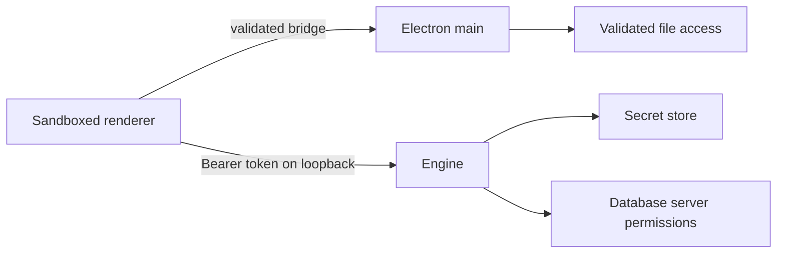

# 19. مدل امنیت و secretها

> **سطح:** L2→L3 | **بخش:** II | **کد بررسی‌شده در:** `94ae9c7`
> **در یک جمله:** Rowlit سطح حمله را با loopback، token، sandbox، اعتبارسنجی IPC، secret store و guardهای نوشتن کوچک می‌کند، اما مجوز سرور و امنیت سیستم‌عامل همچنان ضروری است.
> [English](../../en/part2/19-security-and-secrets.md)

## 1. ایده برای مبتدی

تهدید اصلی این است که دادهٔ اتصال، SQL یا محتوای نمایش‌داده‌شده بتواند از مرز renderer به سیستم‌عامل یا پایگاه داده آسیب بزند. engine روی loopback با bearer token تصادفی گوش می‌دهد. Electron renderer sandboxed است و فقط bridge محدود preload را می‌بیند. password در secret store سکو می‌ماند و وارد profile عادی نمی‌شود.

## 2. لایه‌های دفاع

Origin/CORS و CSP منبع درخواست و بارگذاری کد را محدود می‌کنند. handlerهای IPC نام فایل، اندازه، نوع و مسیر را validate می‌کنند. destructive guard و read-only هم در UI و هم در engine اعمال می‌شوند. federation SQL ورودی و extensionهای DuckDB را محدود می‌کند.

فایل export اتصال به‌طور پیش‌فرض password ندارد. اگر کاربر صریحاً secretها را انتخاب کند، کلید با PBKDF2-SHA256 و salt/iteration از passphrase مشتق و payload با AES-256-GCM رمز و authenticate می‌شود. passphrase ذخیره نمی‌شود و بازیابی ندارد. SSH password و key passphrase نیز همان سیاست را دارند.

workspace Security فهرست user/role/grant را می‌خواند. تغییر در PostgreSQL، MySQL/MariaDB و SQL Server ابتدا SQL ماسک‌شده را نشان می‌دهد و confirmation می‌خواهد؛ Oracle، ClickHouse و Snowflake فقط inspection هستند. password در history یا preview برنمی‌گردد.

## 3. بررسی عمیق

token loopback جلوی فرایند دارای دسترسی کامل همان حساب کاربری را تضمینی نمی‌گیرد؛ مرز اصلی همچنان OS account است. AES-GCM محرمانگی و اصالت ciphertext را می‌دهد، ولی passphrase ضعیف را قوی نمی‌کند. audit وابستگی آسیب‌پذیری شناخته‌شده را می‌یابد، نه منطق دسترسی یا supply-chain ناشناخته را.

## 4. چه چیزی محافظت نمی‌شود

- مدیر سیستم، malware همان حساب، keylogger یا سرور مخرب خارج از مدل محلی‌اند.
- read-only مجوز server را جایگزین نمی‌کند.
- export رمز‌شده بدون passphrase قابل بازیابی نیست.
- log و screenshot ممکن است دادهٔ query/result را افشا کند؛ دادهٔ حساس را عمداً کپی نکنید.

## 5. آزمون

آزمون‌های token/origin، IPC validation، read-only classifier، portability crypto، tunnel و federation lockdown اجرا می‌شوند. QA باید failure، فایل دستکاری‌شده و confirmation را نیز بررسی کند.

## فصل‌های مرتبط

[امنیت پایگاه داده](../../fa/part1/14-security.md)، [اتصال و اجرا](08-connections-sessions-execution.md)، [دسکتاپ](22-desktop-shell.md).

## واژه‌ها

[threat model](../glossary.md#threat-model)، [CSP](../glossary.md#csp)، [sandbox](../glossary.md#sandbox)، [secret store](../glossary.md#secret-store)، [PBKDF2](../glossary.md#pbkdf2)، [AES-GCM](../glossary.md#aes-gcm)، [read-only guard](../glossary.md#read-only-guard).

## فایل‌ها

| مسیر | مسئولیت |
|---|---|
| `engine/src/DbStudio.Core/Services/ConnectionStore.cs` | profile و secret |
| `engine/src/DbStudio.Core/Services/Portability/` | export رمز‌شده |
| `desktop/src/main/csp.ts`, `ipc.ts` | مرز renderer/main |
| `engine/src/DbStudio.Core/Security/` | inspection و تغییر امنیت سرور |

