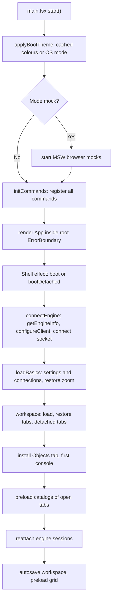
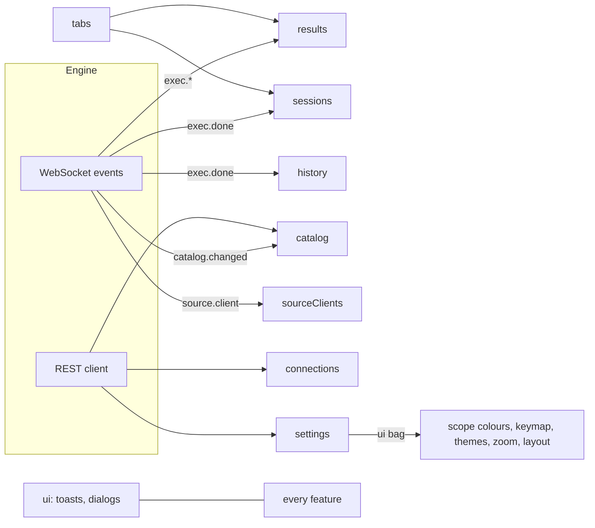
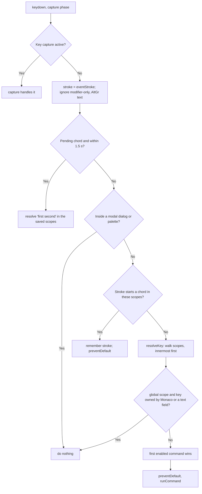
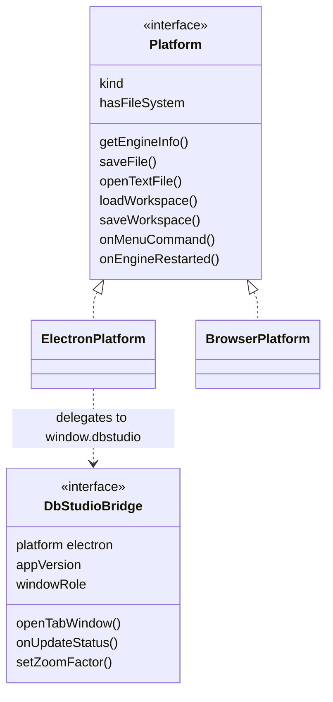

# 20. معماری رابط کاربری: React، Zustand، فرمان‌ها و پلتفرم

<div dir="rtl">

> **سطح:** L2 حرفه‌ای ← L3 ارشد | **بخش:** II | **کد خوانده‌شده در:** `a61f3d1` (Rowlit 1.6.3)
> **زبان:** فارسی | [English](../../en/part2/20-ui-architecture.md) | قبلی: [19. امنیت و رازها](./19-security-and-secrets.md) | بعدی: [21. لاگ‌ها، فعالیت، منابع و حافظه](./21-logs-activity-resources.md)
> برچسب‌های نمودارها به انگلیسی نگه داشته شده‌اند تا در GitHub درست نمایش داده شوند.
> **در یک جمله:** رابط یک برنامه‌ی React 18 است که state آن در استورهای کوچک Zustand زندگی می‌کند، هر کنش کاربر در آن یک فرمان ثبت‌شده است، میزبانش (Electron یا مرورگر ساده) پشت یک adapter پنهان است و بخش‌های سنگینش chunkهای تنبل زیر بودجه‌ی اندازه‌اند.
> **یاد می‌گیرید:**
> - بین `main.tsx` و اولین پنجره‌ی قابل‌استفاده چه می‌گذرد (توالی boot)؛
> - پوشه‌ها چطور به هم وابسته‌اند و چه استورهایی هست؛
> - تب‌ها، گروه‌های ویرایشگر و پنجره‌های جداشده چطور مدل می‌شوند؛
> - فشردن یک کلید چطور فرمان می‌شود: رجیستری، scopeها، chordها، keymap، presetها، منوها؛
> - platform adapter، chunkهای تنبل و دروازه‌ی اندازه‌ی bundle، مرزهای خطا، پوسته‌ها، تنظیمات، سیم‌کشی به‌روزرسانی.
> **پیش‌نیازها:** [03. معماری در یک نگاه](./03-big-picture-architecture.md)، [06. پروتکل WebSocket](./06-websocket-protocol.md)، [02. تور برنامه](./02-tour-of-the-app.md).

## 1. ایده (مبتدی)

برنامه‌ی دسکتاپ مجموعه‌ای از دکمه‌ها، منوها، میان‌برها و پنجره‌هاست که باید با هم هماهنگ باشند. اگر هر دکمه خودش بداند کارش را چطور انجام دهد، همان منطق در نوار ابزار، منو، منوی زمینه و میان‌بر تکرار می‌شود و آن‌ها از هم دور می‌شوند. Rowlit به‌جایش قاعده‌ای ساده دارد: **هر کنش یک فرمان است** با شناسه، عنوان و میان‌بر اختیاری. دکمه‌ها، منوها و کلیدها فقط می‌گویند «فرمان `format.document` را اجرا کن». فرمان‌ها آنچه لازم دارند را از **استورها** می‌خوانند: جعبه‌های کوچک نام‌دار state (`tabs`، `results`، `catalog`، `settings` ...). کامپوننت‌ها در بخش‌هایی از استور که رسم می‌کنند مشترک می‌شوند و React فقط همان‌ها را دوباره رندر می‌کند.

رابط باید در دو جا هم اجرا شود: درون Electron (با پنجره‌ی فایل، منوی بومی، به‌روزرسانی خودکار) و در مرورگر ساده هنگام توسعه. یک **platform adapter** یک رابط واحد به UI می‌دهد و تفاوت را پنهان می‌کند. و چون برنامه صفحه‌های بزرگ زیادی دارد (طراح، نمودار ER، ویزارد درون‌ریزی، خود Monaco) بیشتر آن‌ها **تنبل** بارگذاری می‌شوند، فقط هنگام اولین بازشدن، تا شروع سریع بماند؛ یک اسکریپت CI بودجه‌ی اندازه را اعمال می‌کند.

## 2. چطور کار می‌کند (حرفه‌ای)

### 2.1 توالی boot

**شکل ۲۰.۱ — از `main.tsx` تا workspace بازیابی‌شده.**

</div>



<div dir="rtl">

`ui/src/main.tsx` (۳۰ خط) پیش از رندر React سه کار می‌کند: `applyBootTheme()` آخرین حالت و رنگ‌های استفاده‌شده را از `localStorage` (کلید `dbstudio.theme`) می‌کشد تا چشمک پوسته‌ی اشتباه نباشد، `isMac()` کلاس `os-mac` اضافه می‌کند و، فقط در `--mode mock`، موتور ساختگی درون مرورگر راه می‌افتد (`startBrowserMocks`، MSW برای REST به‌علاوه‌ی WebSocket جعلی، `npm run dev:mock`). سپس `await initCommands()` و `createRoot(...).render(<StrictMode><ErrorBoundary variant="root"><App/></ErrorBoundary></StrictMode>)`.

`App` مسیر `#/playground` فقط‌توسعه (زمین‌بازی تنبل IntelliSense) دارد و در غیر این صورت `Shell` را رندر می‌کند (`App.tsx:68-122`). `Shell` یک بار `boot()` (یا `bootDetached()` برای پنجره‌ی جداشده) را صدا می‌زند؛ پرچم سطح ماژول `booted` جلوی اجرای دوباره‌ی effect در StrictMode را می‌گیرد. همچنین dispatcher کلید، keymap و کنترل‌گر منوی بومی را نصب می‌کند (`App.tsx:93-103`).

`boot()` (`app/boot.ts:224-269`) به ترتیب:

1. `wireQuitGuard()` - پاسخ به پرسش «چه چیزی از دست می‌رود؟» پوسته‌ی دسکتاپ ([2.8](#28-platform-adapter)).
2. `connectEngine()`: `getPlatform().getEngineInfo()` مقدار `{baseUrl, token}` را برمی‌گرداند (از پل preload در Electron، از `VITE_ENGINE_URL`/`VITE_ENGINE_TOKEN` در مرورگر)، `configureClient(info)`، `engineSocket.connect(info)` و `onEngineRestarted` همین را دوباره انجام می‌دهد، نشست‌ها را پاک می‌کند، streamهای زنده را پایان می‌دهد و toast نشان می‌دهد. اگر اطلاعات به دست نیاید بنر خطای موتور (با Retry) می‌آید و boot می‌ایستد.
3. `loadBasics()`: تنظیمات و اتصال‌ها به‌موازات، سپس `restoreZoom()`.
4. Workspace: `liveDetachedTabs()` (تب‌هایی که الان در پنجره‌های دیگر باز‌اند همان‌جا می‌مانند)، `platform.loadWorkspace()`، `useTabs.restore(...)`؛ تب‌های اتصال‌های حذف‌شده بسته (تب شیء) یا بی‌اتصال (کنسول) می‌شوند.
5. **تب Objects** دائمی نصب می‌شود (import تنبل)؛ اگر هیچ تبی باز نباشد و تب Objects هم نباشد، اولین کنسول روی اولین اتصال رابطه‌ای باز می‌شود.
6. `preloadTabCatalogs()` - برای هر اتصال و پایگاه داده‌ای که تب دارد یک `preloadCatalog` ([فصل 10](./10-catalog-and-metadata.md)).
7. `reattachSessions()` - `GET /sessions` و وصل کردن نشست‌های موتور به تب‌هایی که مالک‌شان بودند (تا تراکنش باز از reload جان به در ببرد)؛ بقیه یک بار به‌صورت «unused sessions» در toast اعلام می‌شوند.
8. پاکسازی هنگام pagehide، ذخیره‌ی خودکار workspace، `preloadDataGrid()`.

`wireSocket()` (idempotent) رویدادهای موتور را به استورها می‌رساند: `exec.*` به `results.ingest`، `exec.done` به `sessions.applyDone` و تاریخچه، `session.changed`، `catalog.changed` به `catalog.applyChanged`، `source.client`، خطاهای `engine.log` به toast، به‌علاوه‌ی سیم‌کشی منابع (`app/boot.ts:99-138`). خود کلاینت سوکت (backoff، فریم auth، handlerها) [فصل 06](./06-websocket-protocol.md) است.

### 2.2 پوشه‌ها و جهت وابستگی

</div>

```text
ui/src/
  api/         typed REST client, WebSocket client, wire types        (no React)
  store/       Zustand stores                                          (state + actions)
  app/         cross-store orchestration: boot, run, detach, resources (no components)
  commands/    registry, dispatcher, keymap, menu model                (framework-free)
  intel/ format/ codegen/ filter/ designer/(logic) snippets/ data/ lib/   pure domain modules
  editor/      Monaco glue
  components/  React components, one folder per feature
  platform/    host adapter; theme/ tokens, themes
  mocks/       MSW handlers and fake socket for dev and tests
```

<div dir="rtl">

جهت مورد نظر `api` ← `store` ← `app` ← `components` است، با ماژول‌های دامنه (`intel`، `format`، `commands`، `codegen`، `filter`، بخش منطقی `designer`) بدون React تا در محیط Node آزمون شوند (`vitest.intel.config.ts` مجموعه‌های `intel`، `editor`، `format`، `snippets` را با `environment: 'node'` اجرا می‌کند). این یک جهت است نه قاعده‌ی لینت اجباری: مثلاً `store/consoleSchema.ts` از `app/actions` import می‌کند و `app/boot.ts` از `components`. تخلف‌ها را بدهی بدانید نه دلیل اشتباه بودن قاعده.

### 2.3 استورها

مدیریت state با **Zustand 5** است (`ui/package.json`). استور `create((set, get) => ({...state, ...actions}))` است؛ کامپوننت‌ها با selector می‌خوانند (`useStore(s => s.part)`) و فقط وقتی آن انتخاب عوض شود دوباره رندر می‌شوند (با `useShallow` برای شیء و آرایه)؛ کد بیرون از React از `useStore.getState()` استفاده می‌کند. نه Redux هست، نه درخت provider با context برای داده.

| استور | چه نگه می‌دارد | چه کسی می‌نویسد |
|---|---|---|
| `connections` | پروفایل‌های اتصال، خطای بارگذاری | پنجره‌ی اتصال، boot |
| `catalog` | حافظه نهان هر اتصال/پایگاه داده، ETagها، علامت‌های بسته | اکسپلورر، `catalog.changed`، منابع ([فصل 10](./10-catalog-and-metadata.md)) |
| `sessions` | نشست‌های موتور بر اساس id و تب، وضعیت تراکنش | کد اجرا، `session.changed` |
| `tabs` | همه‌ی تب‌ها، تب فعال، گروه‌ها، چیدمان، جداشده‌ها | فرمان‌ها، اکسپلورر، boot |
| `editorGroups` | reducerهای خالص چیدمان شکافته | از `tabs` صدا زده می‌شود |
| `results` | اجراها، result setها، نماهای گرید | ingest وب‌سوکت ([فصل 13](./13-results-grid-and-data-editing.md)) |
| `edits` | ویرایش‌های معلق هر گرید | گرید |
| `filters` | فیلترهای ذخیره‌شده/اخیر، وضعیت فیلتر سرور | نوار فیلتر |
| `params` | وضعیت پنجره‌ی bind parameter | کد اجرا |
| `history` | فهرست تاریخچه‌ی پرس‌وجو | `exec.done`، پنل تاریخچه |
| `settings` | تنظیمات اعتبارسنجی‌شده‌ی موتور و کیسه‌ی آزاد `ui` | پنجره‌ی تنظیمات، بسیاری قابلیت‌ها |
| `ui` | پنجره‌ها، toastها، درخواست تأیید، dock، وضعیت WS، اعلان‌ها | همه‌جا |
| `resources` | سطح حافظه، شمارش‌ها برای نوار وضعیت | سیم‌کشی منابع ([فصل 21](./21-logs-activity-resources.md)) |
| `links` | پایگاه‌های داده‌ی پیوندی ([فصل 16](./16-linked-databases-federation.md)) | رابط پیوندها |
| `savedQueries`، `systemTypes`، `consoleSchema` | ← [فصل 10](./10-catalog-and-metadata.md) | |
| `sourceClients` | کلاینت‌های Redis/Mongo/Kafka که موتور نگه می‌دارد | رویدادهای `source.client` |
| `updates` | وضعیت به‌روزرسانی خودکار | `app/updates.ts` |

استورهای محلی ویژگی هم کنار کامپوننت‌هایشان هستند (`Explorer/explorerStore`، `Search/searchStore`، `designer/store`، `ErDiagram/store`، `Charts/chartMode`)، الگویی که کد عمداً نگه می‌دارد: استوری که ویژگی تنبل مالکش است همراه آن ویژگی بارگذاری می‌شود.

**شکل ۲۰.۲ — چه کسی کدام استور را تغذیه می‌کند.**

</div>



<div dir="rtl">

**استور تنظیمات** (`store/settings.ts`) یادداشتی می‌خواهد. موتور یک طرحواره‌ی ثابت را اعتبارسنجی می‌کند (`theme`، `editor`، `results`، `confirmDestructive`، `format`، `snippets`، `grid`، `connections`، `resources`) و یک **شیء آزاد `ui`** نگه می‌دارد که قابلیت‌ها برای کلیدهای خودشان بدون تغییر موتور به کار می‌برند: `scopeColors`، `keybindings`، `appThemeLight/Dark`، `editorTheme`، `zoom`، `autoCheckUpdates`، `objectsTab`، `openRoutinesInEditMode`، `localHistory`، `resultsLayout`، `codegen`. `update(patch)` خوش‌بینانه در استور ادغام می‌کند (`mergeSettings`: شیءها یک سطح عمیق، آرایه و اسکالر جایگزین می‌شوند) و یک **`PUT` با debounce** (۶۰۰ ms، patchهای ادغام‌شده) صف می‌کند (`settings.ts:98-128`). آرایه‌ها کامل جایگزین می‌شوند، به همین دلیل keymap به‌جای نقشه به‌صورت آرایه‌ای از ورودی‌ها ذخیره می‌شود (آرایه می‌تواند «بی‌میان‌بر» را بیان کند؛ موتور کلیدی را که مقدار patchش `null` است حذف می‌کند، `commands/keymap.ts:15-18`).

### 2.4 تب‌ها، گروه‌های ویرایشگر و پنجره‌های جداشده

`useTabs` (`store/tabs.ts`، حدود ۷۰۰ خط) `tabs: Tab[]` را نگه می‌دارد که `Tab` یکی از سه نوع است (`tabs.ts:67-115`): `console` (متن، savedText، اتصال، پایگاه داده، طرحواره، حالت تراکنش، `maxRows`، bindingهای اختیاری `edit` و `savedQuery`)، `object` (تب جدول/view) و تب عمومی `view`. `ViewTab` یک شناسه‌ی `view` ثبت‌شده با `registerTabView` (`components/layout/tabViews.ts`)، یک `state` قابل‌سریالایز، `key` اختیاری (باز کردن دوباره تب موجود را فعال می‌کند)، `dirty` و `pinned` (تب Objects دائمی) دارد. هر ویژگی صفحه‌هایش را این‌گونه اضافه می‌کند، به همین دلیل پوسته چیزی درباره‌ی تب Data یا نمودار ER نمی‌داند. `TabViewDef` می‌تواند `beforeClose`، `onClosed`، `detachable: false` (برای تب‌هایی که state زنده‌ی پنجره را نشان می‌دهند مثل نتایج یک کنسول) و `focusPrimary` اعلام کند.

**گروه‌های ویرایشگر** (`store/editorGroups.ts`) همان ویرایشگر شکافته است: تا `MAX_GROUPS = 3` گروه کنار هم یا روی هم، هر کدام با نوار تب و تب فعال خودش، به‌صورت درختی از گره‌های `group` و `split` با اندازه‌هایی که جمعشان ۱ است و حداقل سهم 0.12. ماژول خالص است؛ `normalizeGroups` پس از هر تغییر ناوردایی‌ها را برقرار می‌کند: هر تب دقیقاً در یک گروه، دست‌کم یک گروه، تب فعال سراسری همان تب فعال گروه focus‌دار است، تب‌های سنجاق‌شده اول در گروه اول. کشیدن تب روی یک ناحیه‌ی رها کردن (`left | right | up | down | center`) می‌شکافد یا جابه‌جا می‌کند. چیدمان در workspace به‌صورت فیلد اختیاری `groups` ذخیره می‌شود؛ workspace قدیمی بدون آن به‌صورت یک گروه بارگذاری می‌شود.

**ماندگاری workspace.** `useTabs.serialize()` مقدار `WorkspaceData { version: 1, tabs, activeId, seq, groups?, detached? }` را می‌سازد؛ boot آن را ۸۰۰ ms پس از هر تغییر `tabs`، `activeId`، `groups`، `layout` یا `detached` و هنگام `beforeunload` از راه `platform.saveWorkspace` ذخیره می‌کند (فایلی در پوشه‌ی داده برای Electron؛ جایگزین مرورگر در `platform/browser.ts`). متن ذخیره‌نشده‌ی کنسول بخشی از همین فایل است، به همین دلیل کنسول‌ها با راه‌اندازی مجدد کارشان را از دست نمی‌دهند.

**پنجره‌های جداشده** (دسکتاپ). «Open in new window» یا کشیدن تب بیرون، تب را به فرایند اصلی می‌سپارد (`app/detach.ts`، `platform/windows.ts`): هر پنجره‌ی Electron نسخه‌ی خودش از UI را اجرا می‌کند؛ تب به شکل workspace سریالایزشده‌اش سفر می‌کند (متن، اتصال، پایگاه داده، حالت تراکنش، state یک view)؛ نتایج **منتقل نمی‌شوند** و نشست موتور در پنجره‌ای که تب را ترک می‌کند آزاد می‌شود. پنجره‌ی جداشده با `bootDetached()` بالا می‌آید (فقط تب‌های سپرده‌شده، بدون ذخیره‌ی خودکار، بدون updater، اکسپلورر پنهان)، تب‌هایش را به main گزارش می‌دهد تا با خروج چیزی گم نشود، و می‌تواند آن‌ها را پس بدهد. `isDetachedWindow()` وقتی پل بگوید، یا URL شامل `#detached` باشد و پل وجود داشته باشد درست است (مرورگر ساده hash را نادیده می‌گیرد). بیشتر در [فصل 22](./22-desktop-shell.md).

**کار ذخیره‌نشده و quit guard.** `app/unsavedWork.ts` حساب می‌کند پنجره چه چیزی از دست می‌دهد (گریدهای دارای ویرایش معلق، تراکنش‌های باز)؛ `app/quitGuard.ts` به فرایند اصلی جواب می‌دهد و یک تأیید خطرناک که آن را نام می‌برد نشان می‌دهد («Discard and quit»). کنسول‌ها فهرست نمی‌شوند چون فایل workspace نگهشان می‌دارد.

### 2.5 سامانه‌ی فرمان

**رجیستری** (`commands/registry.ts`، مستقل از فریم‌ورک). `Command` شناسه (فضای نام‌دار: `designer.newTable`)، `title`، `category`، `shortcut` و `altShortcuts`، `scope`، `when(args)`، `run(args)`، `keyHandler: 'registry' | 'host'`، `palette`، `keywords`، `icon`، `danger` (منوها قرمز می‌کشند) دارد. `registerCommand` آن را ذخیره می‌کند و، در توسعه، اگر دو فرمان در یک scope یک stroke را داشته باشند خطایی در کنسول لاگ می‌کند. `aliasCommand` شناسه‌های قدیمی را زنده نگه می‌دارد. `runCommand(id, args)` `when` را می‌سنجد، اجرا می‌کند و promise ردشده را به خطای لاگ‌شده تبدیل می‌کند. منوهای زمینه هدفی نوع‌دار به‌عنوان `args` می‌دهند (`ObjectTarget`، `ContainerTarget`، `SavedQueryTarget`، `ConnectionTarget`، `TabTarget`، `SourceTarget`، `commands/types.ts`)؛ پالت و میان‌برها هیچ نمی‌دهند و فرمان به انتخاب اکسپلورر یا تب فعال برمی‌گردد.

**بارگذاری خودکار.** `commands/index.ts` از `import.meta.glob` ویت روی `../*/commands.ts`، `../*/*/commands.ts` و `../components/*/commands.ts` (به‌جز `app`، `intel`، `commands`) استفاده می‌کند و برای هر ماژول هر تابع بدون آرگومان صادرشده با نام `register`، `default` یا `register...Commands` را صدا می‌زند و هر آرایه‌ی صادرشده به نام `commands` یا `COMMANDS` را ثبت می‌کند. ماژول‌ها به‌موازات بارگذاری می‌شوند؛ ماژولی که شکست بخورد گزارش و رد می‌شود نه اینکه پوسته را خراب کند. این همه‌ی «افزونه»‌ی UI است: ویژگی یک پوشه با `commands.ts` است (همه در زمان ساخت کامپایل می‌شوند، چیزی از بیرون بارگذاری نمی‌شود).

**Dispatcher** (`commands/dispatcher.ts`). یک شنونده‌ی `keydown` در فاز capture. برای یک فشار کلید زنجیره‌ی scope را با بالا رفتن از عنصر focus‌دار می‌سازد: هر ویژگی `data-command-scope="..."` scopeهایی اضافه می‌کند (درونی‌ترین اول)، عنصر Monaco `editor` اضافه می‌کند و `global` همیشه آخر است (`scopesFor`، `dispatcher.ts:34-45`).

**شکل ۲۰.۳ — حل یک کلید.**

</div>



<div dir="rtl">

جزئیات: `EDITOR_OWNED_KEYS` (Ctrl+Enter، F5، Ctrl+F، Ctrl+Z، Ctrl+/ ...) تا وقتی Monaco focus دارد به آن سپرده می‌شوند و `TEXT_FIELD_KEYS` به inputها؛ فرمانی با `keyHandler: 'host'` فهرست می‌شود (پالت، شیت، بررسی تعارض) اما اینجا dispatch نمی‌شود چون کامپوننت خودش آن کلید را مدیریت می‌کند؛ chordها حداکثر دو ضربه و مهلت ۱٬۵۰۰ ms دارند (`CHORD_TIMEOUT`)؛ کلید درون پنجره‌ی مودال اینجا کاری نمی‌کند؛ `F5`/`Ctrl+R` در نسخه‌ی مرورگر هرگز صفحه را reload نمی‌کنند. یک پیچ دسکتاپی: شتاب‌دهنده‌ی منوی بومی ممکن است پیش از دیدن کلید توسط صفحه فعال شود (F4 در Windows)، پس `routeMenuCommand` حل scope را برای عنصر focus‌دار دوباره اجرا می‌کند و فرمان scope‌دار را بر فرمان خود منو ترجیح می‌دهد (F4 روی کارت ER ← `er.design`، در تب Data ← `dataTab.design`).

**Keymap** (`commands/keymap.ts`، `keymapPresets.ts`، `keymapSettings.ts`). فرمان پیش‌فرض‌هایی دارد؛ بازنویسی‌های کاربر `{ commandId: string[] | null }` است (آرایه میان‌برهای فرمان را جایگزین می‌کند، `null` یعنی بی‌میان‌بر)، در `settings.ui.keybindings` به‌صورت آرایه‌ای از ورودی‌های `{command, keys}` ذخیره می‌شود. میان‌برها مستقل از پلتفرم نوشته می‌شوند (`Mod+Shift+P`، `MacCtrl+Space`، chord به‌صورت `Mod+K Mod+S`)؛ `shortcutsOf(command)` همان چیزی است که همه‌چیز (dispatcher، منوها، tooltipها، پالت، ویرایشگر، شیت) به کار می‌برد. سقف‌ها: ۴ میان‌بر برای هر فرمان، ۲ ضربه برای هر chord؛ حروف ساده نمی‌توانند در scopeهای تایپ (`global`، `console`، `editor`) bind شوند. **presetها** (JetBrains / DataGrip، VS Code / Azure Data Studio، SSMS) فقط تفاوت با پیش‌فرض‌ها را فهرست می‌کنند؛ آزمونی (`keymapPresets.test.ts`) بررسی می‌کند هر id در preset فرمانی ثبت‌شده است و هیچ presetی تعارض هم‌scope نمی‌سازد، پس تغییر نام یک فرمان به‌جای حذف بی‌صدای bind، build را می‌شکند. keymap را می‌توان به‌صورت فایل `{format: "rowlit-keymap", version, keybindings}` برون‌ریزی/درون‌ریزی کرد. شیت میان‌برها (Ctrl+K Ctrl+S) همه‌ی bindingها را فهرست می‌کند، با ضبط یک کلید جست‌وجو می‌کند و ویرایششان می‌کند (`components/Shortcuts`). وقتی keymap عوض شود شتاب‌دهنده‌های منوی بومی از راه `platform.setMenuShortcuts` بازسازی می‌شوند.

**منوها.** `commands/menuModel.ts` داده‌ی خالص بدون import است: `MENUS` (File، Edit، View، ... به‌صورت `MenuDef`/`MenuEntry`) و `CONTEXT_MENUS` با کلیدهایی مثل `explorer.table`. فرایند اصلی Electron منوی بومی را از `MENUS` می‌سازد؛ رابط منوهای زمینه و نوار ابزار را از همان شناسه‌ها؛ آزمونی در `commands.test.ts` بررسی می‌کند هر شناسه‌ی منو فرمان ثبت‌شده با همان عنوان و میان‌بر است. آیتم‌های علامت‌خورده با `optional` به ویژگی‌های ثبت‌شده‌ی تنبل تعلق دارند و وقتی فرمانشان نباشد پنهان می‌شوند. `extendContextMenu(id, entries)` به فراهم‌کننده اجازه می‌دهد از `commands.ts` خودش گزینه‌ای به منوی پوسته اضافه کند (پیش از آخرین گروه مخرب)، معمولاً با `hideDisabled` و یک `when` روی فراهم‌کننده. `useCommands` رجیستری را با `useSyncExternalStore` به React می‌بندد تا دکمه‌های نوار ابزار وقتی تب‌ها، نشست‌ها، اجراها یا کاتالوگ عوض شود `when` را دوباره بسنجند (`useCommandContext`).

**پالت** (`CommandPalette`، Ctrl+Shift+P) دو حالت دارد: **commands** (هر فرمانی که `when` آن درست است، با امتیازدهی `paletteScore.ts`) و **objects** (go to object، Ctrl+P، از کاتالوگ‌های بارگذاری‌شده و پرس‌وجوهای ذخیره‌شده، `objectIndex.ts`).

### 2.6 chunkهای تنبل و بودجه‌ی bundle

هر صفحه‌ی بزرگ یک chunk از `lazy(() => import(...))` است: پنجره‌ی تنظیمات، نماهای Objects، گرید داده (`LazyDataGrid`)، نمودار ER، ویزارد درون‌ریزی، تاریخچه‌ی محلی، تولید کد، نمودارها، لاگ‌ها، workspaceهای منبع (Redis، Mongo، Kafka، Elasticsearch، ClickHouse، Cassandra، Snowflake)، سازنده‌ی پیوند، حتی ویرایشگرهای Monaco درون رابط منابع. ویوهای تب ثبت‌شده تا بارگذاری chunkشان نوار ابزار جانگهدار نشان می‌دهند (`ViewTabHost`). spec گویش‌های جز چهار گویش اول، ۱۱ تا از ۲۲ پوسته‌ی کد (`lazyCode`) و کتابخانه‌های snippet داخلی هم بنا به نیاز بارگذاری می‌شوند. حدود ۱۴۰ نقطه‌ی `import()` پویا بیرون از آزمون‌ها و mockها هست.

دروازه `.github/scripts/bundle-size.mjs` است که CI با `--budget-kb 1400 --initial-kb 120` اجرا می‌کند (`ci.yml:115`). اندازه‌ی **gzip‌شده** (zlib سطح ۹) هر `.js/.css/.html/.json/.svg/.wasm` در `ui/dist` را جمع می‌زند و با `.github/bundle-size-baseline.json` ثبت‌شده مقایسه می‌کند (پایه: `gzipBytes: 1426124` برای کل و `1487026` برای **بار اولیه**). بودجه یعنی *رشد مجاز نسبت به پایه*: کل می‌تواند ۱٬۴۰۰ KB و بار اولیه ۱۲۰ KB رشد کند. «بار اولیه» از `index.html` محاسبه می‌شود: chunk ورودی، پیوندهای `modulepreload` و importهای ایستا به‌صورت بازگشتی، با حذف chunkهای `import()`. سرآیند اسکریپت پایه‌گذاری دوباره روی درخت فعلی برای رد شدن از شکست را ممنوع می‌کند («that silently widens the budget»)؛ یادداشت فایل پایه می‌گوید از یک کامیت قدیمی‌تر اندازه‌گیری شده. ویژگی‌ای که باید هنگام شروع ارزان باشد، پس بخش مشتاق کوچکی (کلید نمودار، فایل فرمان‌ها) و بقیه‌ی تنبل می‌فرستد.

### 2.7 مرزهای خطا، اعلان‌ها، عنوان پنجره، بزرگنمایی

`ErrorBoundary` (`components/common/ErrorBoundary.tsx`) خطای رندر را به یک ناحیه محدود می‌کند تا Electron پنجره‌ی سفید نشان ندهد. گونه‌ها: `root` (کل پنجره، «Reload window»)، `tab` (کل workspace را پر می‌کند)، `panel`، `dialog` (با Close)، `inline`، `strip`. «Something went wrong in <area>» نشان می‌دهد، Try again، Copy details (نسخه‌ی برنامه، ناحیه، پیام، component stack، JS stack) و «Open engine log» (فرمان `logs.openEngineLog`) پیشنهاد می‌دهد و با تغییر `resetKey` ریست می‌شود. `App.tsx` نوار بالا، نوار وضعیت، منو، هر میزبان پنجره، هر بدنه‌ی تب و toastها را جدا می‌پوشاند تا پنجره‌ی خراب بقیه را پایین نکشد. `hidden` تا وقتی خراب است چیزی رندر نمی‌کند.

اعلان‌ها **toast** هستند (`toast(kind, text, detail, action)` از `store/ui.ts`)، با `kind` برابر info/success/warning/error و دکمه‌ی کنش اختیاری (مثلاً «Open engine log»)، به‌علاوه‌ی دیالوگ‌های `askConfirm` با سبک خطر، چک‌باکس تصدیق اختیاری و گزینه‌ی سوم. صفحه‌خوان‌ها ناحیه‌ی `aria-live` (`LiveRegion`) دارند که `useUi.announce` تغذیه‌اش می‌کند. عنوان پنجره `<tab title> - <connection> - Rowlit` است، و وقتی عنوان تب خودش اتصال را نام برده باشد اتصال حذف می‌شود (`app/windowTitle.ts`). بزرگنمایی ۰٫۶ تا ۲ در گام‌های ۱۰٪ است: `setZoomFactor` بومی Electron (که `devicePixelRatio` را مقیاس می‌کند و canvasها را تیز نگه می‌دارد) یا `zoom` در CSS در مرورگر، در `settings.ui.zoom` ذخیره می‌شود (`app/zoom.ts`).

### 2.8 Platform adapter

`ui/src/platform/types.ts` رابط `Platform` را تعریف می‌کند: `kind`، `getEngineInfo`، `hasFileSystem`، `showSaveDialog`، `showOpenDialog`، `saveFile`، `openTextFile` (با `maxBytes` تا فقط ابتدای فایل خوانده شود و مسیر برای موتور بماند)، `writeTextFile`، `openExternal`، `onMenuCommand`، `onEngineRestarted`، `loadWorkspace`، `saveWorkspace`، `setTitle` و دمی بلند از اعضای **اختیاری** برای قابلیت‌های فقط‌دسکتاپ: `setZoomFactor`، وضعیت/بررسی/نصب به‌روزرسانی، `setTitleBarTheme`، `showAppMenu`، `showNotification`، `setMenuShortcuts`، `getFilePath` (مسیر `File` رها‌شده)، `getAppMemory`، `openPath`/`revealInFolder`، `onUnsavedWorkQuery`/`onConfirmDiscard`. `getPlatform()` اگر `window.dbstudio` (که preload با `contextBridge` در معرض می‌گذارد) باشد adapter مربوط به Electron و در غیر این صورت adapter مرورگر را برمی‌گرداند (`platform/index.ts`).

قرارداد با preload نوع `DbStudioBridge` در `platform/bridge.ts` است. قاعده‌اش **تکامل افزایشی** است: اعضای تازه اختیاری‌اند (`?`) تا preload قدیمی که ندارد باز هم کار کند و رابط ویژگی را تشخیص دهد (`p.onUpdateStatus?.(...)`). `platform/windows.ts` همین کار را برای API پنجره‌ی جداشده می‌کند: `windowsApi()` اگر همه‌ی اعضای لازم نباشند `null` برمی‌گرداند. سمت preload و فرایند اصلی [فصل 22](./22-desktop-shell.md) است.

**شکل ۲۰.۴ — قرارداد پل (گزیده).**

</div>



<div dir="rtl">

### 2.9 پوسته‌ها (theming)

`theme/tokens.css` **تنها جایی است که رنگ‌ها نوشته می‌شوند** برای دو پوسته‌ی پایه (روشن و تیره)، به‌صورت custom propertyهای CSS (توکن‌های طراحی): `--bg-app`، `--bg-panel`، `--fg`، `--fg-muted`، `--accent`، `--border`، `--border-strong`، `--success`، ... پوسته با `data-theme` روی `<html>` عوض می‌شود؛ `settings.theme` برابر `system | light | dark` است و `system` زنده `prefers-color-scheme` را دنبال می‌کند (`useTheme.ts`). پوسته‌های دیگر **مجموعه‌های بازنویسی** بلوک پایه‌اند که به‌صورت custom property درون‌خطی اعمال می‌شوند (`theme/themes.ts`): **۷ پوسته‌ی برنامه** (Light، Paper، Solarized Light؛ Dark، Midnight، Nord، Violet) و **۲۲ پوسته‌ی کد** برای Monaco در سه گروه (Rowlit ۴، JetBrains ۵، Popular ۱۳) که ۱۱ تایشان ورودی `lazyCode` است و پالتشان در اولین استفاده می‌رسد (`themesExtra.ts`). یک جایگاه روشن و یک تیره انتخاب می‌شود (تا «Follow system» بین دو محبوب کاربر جابه‌جا شود) و پوسته‌ی کد می‌تواند `match` باشد (برگرفته از پوسته‌ی برنامه). این انتخاب‌ها در `settings.ui` هستند (`appThemeLight`، `appThemeDark`، `editorTheme`).

کیفیت با آزمون اعمال می‌شود نه قرارداد: `tokens.test.ts` لینت می‌کند که هیچ رنگ تحت‌اللفظی بیرون `src/theme/` نیست، `--fg-disabled` فقط روی کنترل‌های غیرفعال به کار رفته و یک **ماتریس تباین** اعلام‌شده (`contrastMatrix.ts`: هر جفت پیش‌زمینه/پس‌زمینه که UI می‌کشد باید برای متن به 4.5:1 و برای اجزای UI به 3:1 برسد، WCAG 1.4.3 و 1.4.11) را وارسی می‌کند؛ `themes.test.ts` همان ماتریس را روی همه‌ی پوسته‌ها اجرا می‌کند، از جمله نوار بالای شیشه‌ایِ شفاف که روی پس‌زمینه‌اش ترکیب می‌شود. در دسکتاپ `theme/titlebar.ts` روکش دکمه‌های Windows و حالت روشن/تیره‌ی بومی را از راه `platform.setTitleBarTheme` با پوسته‌ی برنامه هماهنگ نگه می‌دارد. گرید رنگ‌ها را از توکن‌های CSS با `cellColors.ts` می‌خواند و هنگام تغییر پوسته دوباره حل می‌کند (`resetCellColors`).

### 2.10 پنجره‌ی تنظیمات و سیم‌کشی به‌روزرسانی

پنجره‌ی Settings (`components/layout/settings`) یک پنجره‌ی تنبل با بخش‌های `general | appearance | editor | results | format | connections | snippets | updates` است (`settings/nav.ts`)، در هر نشست به خاطر سپرده می‌شود و می‌توان روی بخشی بازش کرد (`openSettings('updates')` از chip نوار وضعیت). کادر جست‌وجو تنظیمات را فیلتر می‌کند (`search.ts`).

به‌روزرسانی خودکار کار فرایند اصلی است (electron-updater روی GitHub Releases، [فصل 22](./22-desktop-shell.md))؛ رابط فقط بازتابش می‌کند. `useUpdateWiring` (`app/updates.ts`) به `onUpdateStatus` مشترک می‌شود، وضعیت را در `useUpdates` می‌گذارد، نسخه‌ی تازه را **یک بار برای هر نسخه** اعلام می‌کند (toast هنگام دانلود، اعلان سیستم‌عامل وقتی آماده است و پنجره در پس‌زمینه) و «Automatically check for updates» (`settings.ui.autoCheckUpdates`، روشن مگر خاموش شود) را به main گزارش می‌دهد: تا رابط گزارش نکند چیزی بررسی نمی‌شود. chip نوار وضعیت و Settings → Updates همان ماشین حالت را نشان می‌دهند؛ اعلان «ready» Restart now پیشنهاد می‌دهد (`updateNotice` در `store/updates.ts`)؛ در build امضای ad-hoc در macOS به‌روزرسانی فقط اعلام می‌شود، با پیوند به صفحه‌ی release. پنجره‌ی جداشده این سیم‌کشی را اجرا نمی‌کند.

## 3. کاوش عمیق (ارشد)

> **کاوش عمیق (L3): چرا فرمان، scope و `keyHandler: 'host'`**
>
> جایگزین رجیستری همان معمول است: هر کامپوننت `onKeyDown` را bind می‌کند. در سه جهت شکست می‌خورد که Rowlit تجربه کرده. اول، یک کنش در چهار جا ظاهر می‌شود (منو، نوار ابزار، منوی زمینه، کلید) و فعال/غیرفعال بودنشان از هم دور می‌شود. دوم، میان‌برها را نمی‌توان فهرست، دوباره bind یا برای تعارض بررسی کرد. سوم، focus بافت است: یک کلید (Ctrl+S) باید در کنسول فایل ذخیره کند، در گرید ویرایش‌ها را ثبت کند، در طراح طراحی را اعمال کند و پرس‌وجوی ذخیره‌شده را پس بنویسد. **زنجیره‌ی scope** از عنصر focus‌دار سومی را حل می‌کند: درونی‌ترین `data-command-scope` برنده است، پس Ctrl+S در طراح `designer.apply`، در پورتال ویرایشگر گرید `grid.submitFromEditor` و در کنسول `file.save` است (که خودش بر اساس state تب به `queries.save` یا `saveEditToDatabase` می‌رود).
>
> دو راه فرار هست چون دو ویجت کلیدهایشان را مالک‌اند: Monaco و glide-data-grid. Monaco Ctrl+F یا Ctrl+Z را درونی مدیریت می‌کند؛ جنگیدن با آن با handler فاز capture قابلیت‌ها را می‌شکند. پس رجیستری چنین فرمان‌هایی را فهرست می‌کند (برای شیت و بررسی تعارض) اما `keyHandler: 'host'` علامتشان می‌زند، و برای ویرایشگر `bindCommandActions` ([فصل 12](./12-editor-and-formatter.md)) keymap *فعلی* را در actionهای Monaco بازتاب می‌دهد. رجیستری تنها منبع حقیقت است؛ Monaco یک نماست.
>
> **چرا پل افزایشی است.** رندرر و preload با هم در نصب‌کننده می‌آیند، پس ناهمخوانی نسخه نباید وجود داشته باشد. در دو حالت وجود دارد: سرور توسعه با preload قدیمی‌تر نصب‌شده، و آزمون‌هایی که ماکت جایگزین می‌کنند. اختیاری کردن هر عضو تازه و تشخیص ویژگی هزینه‌اش یک `?.` در هر استفاده است و دسته‌ای از شکست‌های «پنجره‌ی سفید پس از به‌روزرسانی» را حذف می‌کند. همچنین build مرورگر را رایگان می‌دهد: اعضای غایب دقیقاً چیزی‌اند که مرورگر ندارد.
>
> **استور در برابر context.** استورهای Zustand singleton ماژول‌اند، پس هر کدی (فرمان‌ها، handlerهای رویداد موتور) بدون درخت React می‌تواند بخواند و بنویسد. بهایش اینکه آزمون‌ها باید ریستشان کنند و state مشترک بین پنجره‌ها مشترک نیست: هر پنجره‌ی Electron استورهای خودش را دارد. هر چه باید مشترک باشد از موتور (تنظیمات، تاریخچه، پرس‌وجوهای ذخیره‌شده، تاریخچه‌ی محلی) یا فرایند اصلی (workspace، تب‌های جداشده) می‌گذرد.

## 4. موارد لبه‌ای و محدودیت‌ها

| موضوع | واقعیت | منبع |
|---|---|---|
| حداکثر گروه ویرایشگر | ۳، حداقل سهم گروه 0.12 | `store/editorGroups.ts:13-15` |
| ذخیره‌ی خودکار workspace | ۸۰۰ ms پس از تغییر و هنگام `beforeunload` | `app/boot.ts:164-173` |
| debounce ذخیره‌ی تنظیمات | ۶۰۰ ms | `store/settings.ts:129` |
| مهلت chord | ۱٬۵۰۰ ms؛ حداکثر ۲ ضربه | `dispatcher.ts:31`، `keymap.ts:28-30` |
| میان‌بر برای هر فرمان | ۴ | `keymap.ts:28` |
| بازه‌ی بزرگنمایی | ۰٫۶ تا ۲، گام ۱۰٪ | `app/zoom.ts:8-9` |
| دروازه‌ی bundle | ۱٬۴۰۰ KB کل + ۱۲۰ KB بار اولیه (gzip) بالای پایه | `ci.yml:115`، `bundle-size.mjs` |
| پوسته‌ها | ۷ برنامه، ۲۲ کد (۱۱ تنبل) | `theme/themes.ts` |
| رویدادهای WS یتیم | ۳۰ s | `store/results.ts:118` |
| موتور در boot در دسترس نیست | بنر با Retry، boot می‌ایستد | `app/boot.ts:228-229`، `App.tsx` `EngineBanner` |
| نسخه‌ی مرورگر | صفحه‌ها نشست‌هایشان را هنگام `pagehide` با درخواست‌های `keepalive` آزاد می‌کنند | `app/boot.ts:73-91` |

## 5. چطور آزموده می‌شود

- `commands/commands.test.ts` (رجیستری، scopeها، chordها، شناسه‌ی منوها در برابر رجیستری با عنوان و میان‌بر)، `commandSmoke.test.ts`، `keymap.test.ts`، `keymapSettings.test.ts`، `keymapPresets.test.ts`، `Shortcuts/KeymapEditor.test.tsx`، `ShortcutSheet.test.tsx`.
- استورها: `store/*.test.ts` (catalog، sessions، editorGroups، edits، results، savedQueries ...). boot و سیم‌کشی: `app/sessions.test.ts`، `quitGuard.test.ts`، `unsavedWork.test.ts`، `windowTitle.test.ts`، `resources.test.tsx`.
- پوسته: `theme/tokens.test.ts`، `themes.test.ts`، `useTheme.test.tsx`، `designQa.test.ts`، `iconSizes.test.ts`.
- پوسته‌ی برنامه: `components/layout/shell.test.tsx`، `updates.test.tsx`، `consoleNavigation.test.tsx`. همه با vitest 5، jsdom، `@testing-library/react` و MSW اجرا می‌شوند؛ `npm run test:intel` آزمون‌های دامنه‌ی مستقل از فریم‌ورک را در Node اجرا می‌کند.
- CI: لینت (oxlint)، typecheck (`tsc -b`)، آزمون‌ها، دروازه‌ی اندازه‌ی bundle ([فصل 24](./24-build-ci-release-contributing.md)).

## فصل‌های مرتبط

- [03. معماری در یک نگاه](./03-big-picture-architecture.md) - سه فرایندی که رندرر این فصل در آن می‌نشیند.
- [06. پروتکل WebSocket](./06-websocket-protocol.md) - کلاینت پشت `engineSocket`.
- [10. کاتالوگ](./10-catalog-and-metadata.md)، [12. ویرایشگر](./12-editor-and-formatter.md)، [13. گرید](./13-results-grid-and-data-editing.md) - استورها و فرمان‌هایی که اینجا مثال شدند.
- [22. پوسته‌ی Electron](./22-desktop-shell.md) - preload، IPC، پنجره‌ها، به‌روزرسانی خودکار.
- [24. ساخت، CI، انتشار](./24-build-ci-release-contributing.md) - دروازه‌ی bundle در CI.

## اصطلاحات واژه‌نامه که در این فصل آمده‌اند

[React](../glossary.md#react)، [component](../glossary.md#component)، [hook](../glossary.md#hook)، [Zustand store](../glossary.md#zustand-store)، [selector](../glossary.md#selector)، [useShallow](../glossary.md#useshallow)، [useSyncExternalStore](../glossary.md#usesyncexternalstore)، [lazy loading / code splitting](../glossary.md#code-splitting)، [chunk](../glossary.md#chunk)، [bundle budget](../glossary.md#bundle-budget)، [error boundary](../glossary.md#error-boundary)، [command](../glossary.md#command)، [command registry](../glossary.md#command-registry)، [command scope](../glossary.md#command-scope)، [keymap](../glossary.md#keymap)، [chord](../glossary.md#chord)، [preset](../glossary.md#keymap-preset)، [menu model](../glossary.md#menu-model)، [platform adapter](../glossary.md#platform-adapter)، [bridge](../glossary.md#bridge)، [tab kind](../glossary.md#tab-kind)، [editor group](../glossary.md#editor-group)، [detached window](../glossary.md#detached-window)، [workspace file](../glossary.md#workspace-file)، [design token](../glossary.md#design-token)، [theme](../glossary.md#theme)، [contrast ratio](../glossary.md#contrast-ratio)، [settings bag](../glossary.md#settings-bag)، [toast](../glossary.md#toast)، [quit guard](../glossary.md#quit-guard)، [session restore](../glossary.md#session-restore).

## فایل‌ها

| مسیر | مسئولیت |
|---|---|
| `ui/src/main.tsx`، `App.tsx`، `app/boot.ts` | ورودی، پوسته، boot و سیم‌کشی رویدادها |
| `ui/src/store/*` | استورهای Zustand (← 2.3) |
| `ui/src/commands/*` | رجیستری، dispatcher، کلیدها، keymap، presetها، مدل منو، بارگذار خودکار |
| `ui/src/platform/*` | adapter، قرارداد پل، API پنجره‌ها |
| `ui/src/theme/*` | توکن‌ها، پوسته‌ها، ماتریس تباین، نوار عنوان |
| `ui/src/components/layout/*`، `components/common/ErrorBoundary.tsx` | کروم پوسته، تنظیمات، مرزهای خطا |
| `ui/src/app/*` | جداسازی، quit guard، به‌روزرسانی، بزرگنمایی، عنوان پنجره، منابع |
| `.github/scripts/bundle-size.mjs`، `.github/bundle-size-baseline.json` | دروازه‌ی bundle |

</div>
