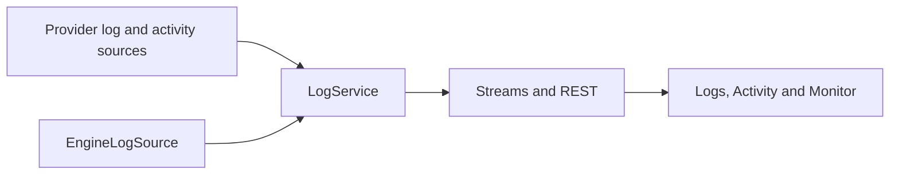

# 21. log، activity، منابع و حافظه

> **سطح:** L2→L3 | **بخش:** II | **کد بررسی‌شده در:** `94ae9c7`
> **در یک جمله:** یک زیرسامانه وضعیت سرور را می‌خواند و زیرسامانهٔ دیگر منابع خود Rowlit را با سیاست‌های قابل توضیح آزاد می‌کند.
> [English](../../en/part2/21-logs-activity-resources.md)

## 1. ایده

Logs رخدادهای سرور و engine را نشان می‌دهد؛ Activity نشست، query، lock و blocking chain را. Kill یک تغییر مخرب است و فقط پس از confirmation و با مجوز server اجرا می‌شود. Server Monitor snapshotهای metric، اندازهٔ database و queryهای طولانی را دوره‌ای می‌خواند و هنگام پنهان بودن tab polling را متوقف می‌کند.

## 2. سازوکار

`ILogSource` و `IActivitySource` بر اساس provider ثبت می‌شوند. `LogService` filter و export را هماهنگ می‌کند و stream factory رویدادهای tail/poll را روی WebSocket می‌فرستد. `ISqlRunnerFactory` تمام اتصال‌های SQL را از مسیر resolve اتصال، از جمله SSH، باز می‌کند.

`ResourceManager` به‌صورت دوره‌ای session، catalog، result و source client را با policy بررسی می‌کند. pressure از اطلاعات GC و گزارش windowها می‌آید. release دادهٔ قابل بازسازی را دور می‌ریزد؛ close اتصال واقعی را می‌بندد. تراکنش یا کار فعال blocker است و `RESOURCE_BUSY` می‌دهد. StatusBar و popover دلیل و مقدار آزادسازی را نشان می‌دهند.

## 3. بررسی عمیق

tail باید backpressure و dropped item را آشکار کند؛ رشد صف پنهان بدتر از از دست دادن اعلام‌شده است. Kill و close race دارند: نشست ممکن است پیش از confirmation تمام شود. LRU budget بر اساس هزینه و زمان استفاده تصمیم می‌گیرد و نباید state غیرقابل بازسازی را بی‌صدا حذف کند.

## 4. مرزها

- دسترسی log و system view به مجوز provider وابسته است.
- metricهای unavailable صفر نیستند و باید «ناموجود» نمایش داده شوند.
- بستن database با transaction باز رد می‌شود.
- memory report Electron برآورد فرایند است، نه حافظهٔ خود server.

## 5. آزمون

parser و queryهای provider unit test دارند؛ fake gatewayها sourceها را جدا می‌کنند؛ تست resource policy از TimeProvider استفاده می‌کند؛ walkthroughهای logs، activity و monitor مسیر واقعی را می‌سنجند.

## واژه‌ها

[log source](../glossary.md#log-source)، [activity source](../glossary.md#activity-source)، [tail](../glossary.md#tail)، [blocking chain](../glossary.md#blocking-chain)، [memory pressure](../glossary.md#memory-pressure)، [working set](../glossary.md#working-set)، [LRU budget](../glossary.md#lru-budget)، [blocker](../glossary.md#blocker).

## فایل‌ها

| مسیر | مسئولیت |
|---|---|
| `engine/src/DbStudio.Logs/` | source، parser، activity و monitor |
| `engine/src/DbStudio.Core/Services/ResourceManager.cs` | policy منابع |
| `ui/src/components/Logs/`, `Monitor/` | رابط وضعیت سرور |
| `ui/src/components/StatusBar/` | خلاصهٔ منابع |

