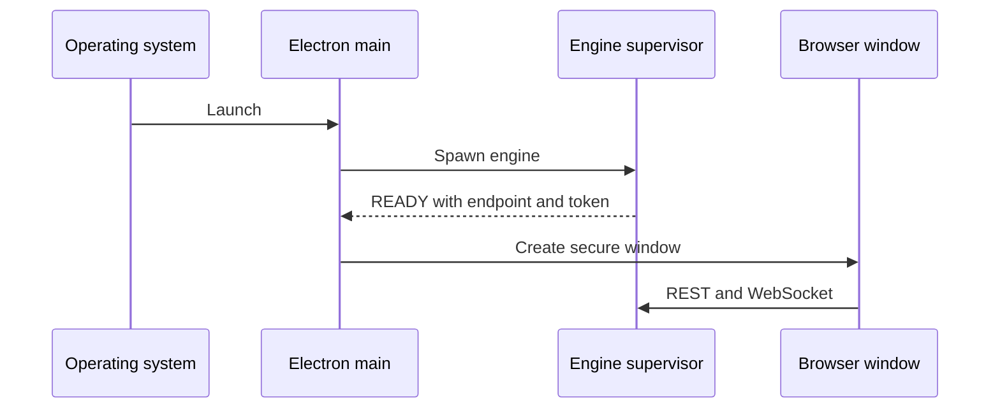

# 22. پوستهٔ Electron: چرخهٔ عمر، IPC، window و update

> **سطح:** L2→L3 | **بخش:** II | **کد بررسی‌شده در:** `94ae9c7`
> **در یک جمله:** پوسته موتور را راه می‌اندازد، windowهای امن می‌سازد، درخواست‌های native را اعتبارسنجی می‌کند و update را مدیریت می‌کند.
> [English](../../en/part2/22-desktop-shell.md)

## 1. ایده

main process به سیستم‌عامل دسترسی دارد؛ renderer رابط sandboxed است؛ preload یک `contextBridge` کوچک میان آن‌ها می‌سازد. single-instance lock از دو مالک هم‌زمان workspace جلوگیری می‌کند. EngineSupervisor sidecar را اجرا می‌کند و تا READY handshake صبر می‌کند.

## 2. چرخهٔ اجرا

main مسیر userData و مهاجرت data directory را تعیین می‌کند، scheme سفارشی `dbstudio://app` و CSP را ثبت می‌کند، engine را بالا می‌آورد، IPC و menu را می‌سازد و window اصلی را باز می‌کند. supervisor timeout، خروج ناگهانی، restart و process-tree kill را مدیریت می‌کند. quit guard پیش از خروج تراکنش و کار باز را از UI می‌پرسد.

IPC handler ورودی را با limit و allowlist بررسی می‌کند. workspace writeها از SerialQueue می‌گذرند. detached window registry مالک tab را جابه‌جا می‌کند. updater state machine حالت‌های available، downloading، ready، error و deferred install را دارد؛ Later نصب را به quit موکول می‌کند.

## 3. بررسی عمیق

custom scheme اجازه می‌دهد assetها با origin پایدار و CSP سخت سرو شوند. preload به‌جای expose کردن `ipcRenderer` خام، تابع‌های هدفمند و subscribe با unsubscribe برمی‌گرداند. updater باید signature و metadata را با سکوی نصب‌شده هماهنگ کند؛ availability با دانلود موفق یکسان نیست.

## 4. مرزها

- macOS پس از بستن آخرین window ممکن است برنامه را فعال نگه دارد.
- crash engine می‌تواند transaction server را از بین ببرد؛ UI باید state را stale بداند.
- مسیر packaged با repo متفاوت است.
- update store-managed، portable و signed mode رفتار یکسان ندارند.

## 5. آزمون

`desktop/test` supervisor را با fake engine، validatorهای IPC، platform، updater، quit، window و data-dir را با `node --test` می‌سنجد. Electron smoke یک window واقعی و engine بسته‌بندی‌شده را بررسی می‌کند.

## واژه‌ها

[Electron](../glossary.md#electron)، [main process](../glossary.md#main-process)، [renderer](../glossary.md#renderer)، [preload](../glossary.md#preload)، [contextBridge](../glossary.md#contextbridge)، [IPC](../glossary.md#ipc)، [custom scheme](../glossary.md#custom-scheme)، [supervisor](../glossary.md#supervisor)، [auto-update](../glossary.md#auto-update).

## فایل‌ها

| مسیر | مسئولیت |
|---|---|
| `desktop/src/main/main.ts` | startup و lifecycle |
| `desktop/src/main/engine.ts` | supervisor |
| `desktop/src/preload.ts` | bridge محدود |
| `desktop/src/main/ipc.ts` | handler و validation |
| `desktop/src/main/updater-core.ts` | state machine update |

