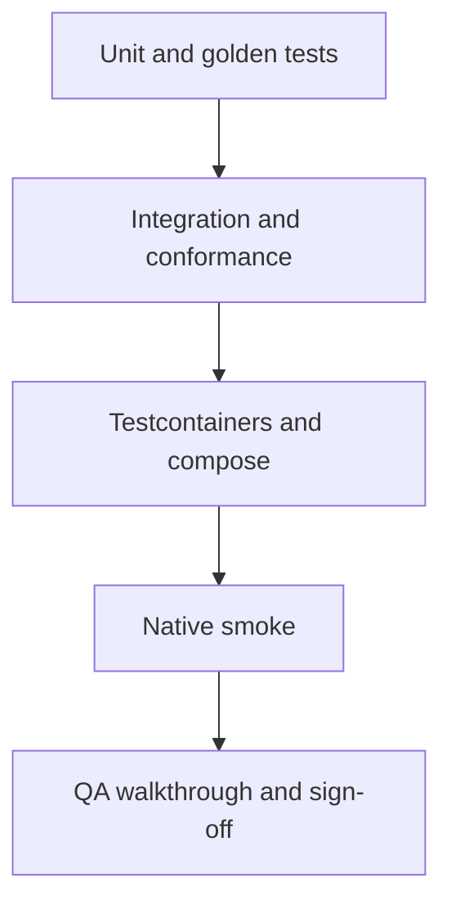

# 23. آزمون و تضمین کیفیت

> **سطح:** L2 | **بخش:** II | **کد بررسی‌شده در:** `94ae9c7`
> **در یک جمله:** Rowlit آزمون‌های سریع دامنه را با conformance، fake، container، smoke و walkthrough انسانی لایه‌بندی می‌کند.
> [English](../../en/part2/23-testing-and-qa.md)

## 1. ایده

[آزمون واحد](../glossary.md#unit-test) یک قانون کوچک را جدا می‌سنجد؛ integration چند جزء واقعی را کنار هم می‌گذارد؛ end-to-end از مرز کاربر عبور می‌کند. هیچ لایه‌ای جای دیگری را نمی‌گیرد. pyramid پروژه تعداد زیاد آزمون سریع و تعداد کمتر آزمون native/container دارد.

## 2. لایه‌های پروژه

پروژه‌های xUnit دامنه‌های Core، provider، import، logs، transfer و compare را جدا می‌کنند. `ProviderConformanceTests<T>` یک قرارداد مشترک را برای providerها اجرا می‌کند و fixture قابلیت‌های اختیاری و نام‌گذاری dialect را اعلام می‌کند. `[SkippableFact]` و `DBSTUDIO_IT` آزمون وابسته به server را کنترل می‌کنند. fakeهای Redis و gatewayهای Mongo/Kafka پروتکل را بدون سرویس بیرونی بازسازی می‌کنند.

Vitest در jsdom component/store/command را می‌سنجد؛ پیکربندی intel در محیط Node lexer، parser و formatter را سریع‌تر اجرا می‌کند. MSW، fakeSocket و mock pack مرز HTTP/WebSocket را کنترل می‌کنند. desktop با `node --test` و fake engine lifecycle بومی را می‌آزماید.

golden test خروجی compiler/formatter را با فایل مرجع مقایسه می‌کند و فقط پس از بازبینی معنایی به‌روز می‌شود. snapshot بصری بدون assertion هدفمند کافی نیست. test fixture مالک setup/cleanup مشترک است؛ mock انتظار تعامل را تعریف می‌کند، fake یک پیاده‌سازی سبک و stub پاسخ ثابت است.

## 3. بررسی عمیق

آزمون flaky معمولاً زمان، global state، port یا scheduler کنترل‌نشده دارد. TimeProvider، شناسهٔ تصادفی محدود، cancellation و cleanup قطعی علت را حذف می‌کند. test parallel باید داده و connection خود را داشته باشد. failure container را نباید با حذف assertion «حل» کرد.

## 4. مرزها

- Docker unavailable باید skip مستند باشد، نه pass جعلی.
- jsdom layout، focus و Electron واقعی را کامل مدل نمی‌کند.
- coverage درصدی کیفیت assertion را ثابت نمی‌کند.
- walkthrough تکرارپذیر است، اما automation نیست.

## 5. آزمون آزمون‌ها

CI discover شدن suite، فایل نتیجه، timeout و bundle gate را می‌سنجد. command smoke از ثبت ناقص فرمان جلوگیری می‌کند. design QA token/theme و accessibility پایه را بررسی می‌کند. roundهای `docs/qa` finding را با severity، status و test پیوند می‌دهند و `QA-REPORT.md` sign-off نهایی را ثبت می‌کند.

## واژه‌ها

[fixture](../glossary.md#fixture)، [conformance test](../glossary.md#conformance-test)، [Testcontainers](../glossary.md#testcontainers)، [fake](../glossary.md#fake)، [golden file](../glossary.md#golden-file)، [smoke test](../glossary.md#smoke-test)، [lint](../glossary.md#lint)، [QA walkthrough](../glossary.md#qa-walkthrough)، [severity](../glossary.md#severity)، [gate](../glossary.md#gate).

## فایل‌ها

| مسیر | مسئولیت |
|---|---|
| `engine/tests/` | xUnit، conformance و container |
| `ui/vitest.config.ts` | آزمون UI |
| `ui/vitest.intel.config.ts` | آزمون lexer/parser/formatter |
| `desktop/test/` | آزمون shell |
| `docs/qa/` | walkthrough و round |

