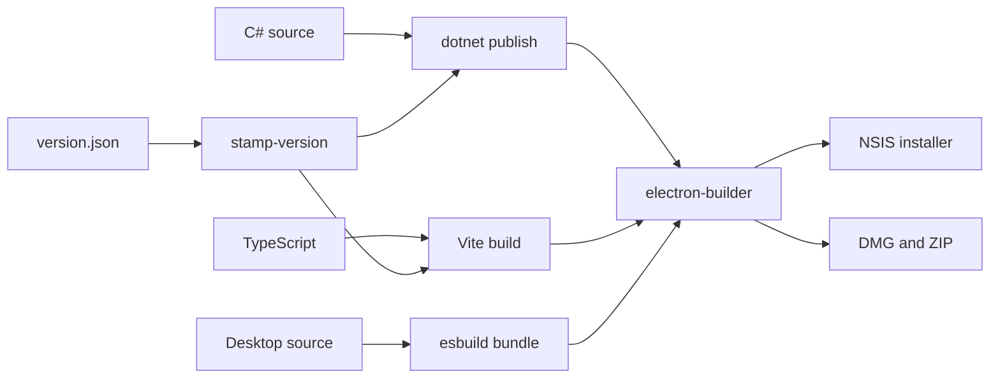
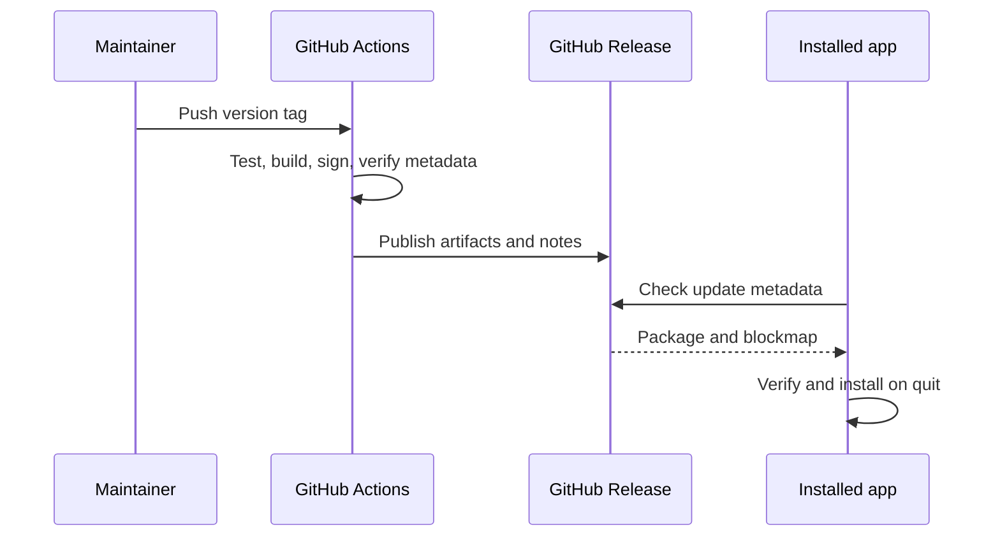

# 24. ساخت، CI، انتشار و مشارکت

> **سطح:** L2 | **بخش:** II | **کد بررسی‌شده در:** `94ae9c7`
> **در یک جمله:** زنجیرهٔ انتشار Rowlit یک درخت منبع نسخه‌دار را به موتور، رابط وب و بسته‌های دسکتاپ آزموده و امضاشده تبدیل می‌کند.
> **خواهید آموخت:** نسخه چگونه مهر می‌شود؛ ساخت Windows و macOS چه دارد؛ دروازه‌های CI چیست؛ به‌روزرسانی چگونه منتشر می‌شود؛ و یک فراهم‌کننده یا فرمان چگونه افزوده می‌شود.
> **پیش‌نیاز:** [معماری](03-big-picture-architecture.md)، [ماژول‌ها](07-engine-modules-and-di.md)، [پوستهٔ دسکتاپ](22-desktop-shell.md). [English](../../en/part2/24-build-ci-release-contributing.md)

## 1. ایده برای مبتدی

[ساخت](../glossary.md#build) منبع را به فایل اجرایی تبدیل می‌کند. انتشار علاوه بر ساخت، نسخهٔ پایدار، یادداشت انتشار، بسته‌بندی سکو، امضا و فرادادهٔ به‌روزرسانی می‌خواهد. Rowlit سه خروجی هماهنگ دارد: موتور .NET، رابط Vite و پوستهٔ Electron. فایل `version.json` منبع مشترک نسخه است.

## 2. سازوکار برای برنامه‌نویس

اسکریپت `scripts/stamp-version.ps1` نسخه را در پروژه‌ها هماهنگ می‌کند. `build.ps1` موتور مستقل Windows را publish می‌کند، رابط را با `VITE_APP_VERSION` می‌سازد، main/preload را bundle می‌کند و electron-builder را فرا می‌خواند. `build.sh` همین مسیر را برای معماری‌های macOS و بسته‌های DMG/ZIP انجام می‌دهد. trimming خاموش است، زیرا کشف ماژول و بخشی از درایورها از reflection استفاده می‌کنند.

فایل `desktop/electron-builder.yml` هویت برنامه، منابع اضافی، fuseهای Electron، NSIS و entitlementهای macOS را تعریف می‌کند. امضای ad-hoc برای توسعه با Developer ID و notarization انتشار یکسان نیست.

CI lint، typecheck، آزمون‌های .NET و Vitest و desktop، ممیزی وابستگی، بودجهٔ bundle و smoke بومی را اجرا می‌کند. artifactهای آزمون نگه داشته می‌شوند تا خطا پس از پایان runner قابل بررسی باشد. workflow انتشار تطابق tag با `version.json` را می‌سنجد، بسته‌ها و `latest*.yml` را تولید می‌کند و یادداشت‌های `docs/release-notes/` را منتشر می‌کند.

برای افزودن فراهم‌کننده باید پروژهٔ موتور، `IEngineModule`، `IDbProvider`، قابلیت‌های keyed، کاتالوگ و DDL و نگاشت خطا، آزمون‌های conformance، دادهٔ نمونه، مشخصات dialect رابط و walkthrough افزوده شود. فرمان جدید در `commands.ts` کوچک ثبت می‌شود و نمای سنگین پشت `lazy()` می‌ماند. رویداد WebSocket جدید هم payload موتور، نوع UI، رفتار reconnect و آزمون پروتکل می‌خواهد.

## 3. بررسی عمیق

self-contained یعنی runtime همراه خروجی است؛ single-file یعنی payload مدیریت‌شده در apphost بسته می‌شود. کتابخانهٔ بومی ممکن است همچنان کنار apphost یا هنگام اجرا استخراج شود. RID باید با هدف Electron و معماری ماشین هماهنگ باشد. baseline بودجهٔ bundle را فقط برای سبز شدن CI بالا نبرید؛ افزایش باید دلیل و chunk تنبل مشخص داشته باشد.

## 4. مرزها و حالت‌های خاص

- امضای Windows، Developer ID، notarization و stapling به اعتبارنامه و سرویس بیرونی وابسته‌اند.
- cross-publish جای آزمون روی سیستم‌عامل مقصد را نمی‌گیرد.
- درایور بومی و Electron باید معماری یکسان داشته باشند.
- یادداشت انتشار جای آزمون و راهنمای مهاجرت نیست.
- secret تولید هرگز نباید وارد YAML، log یا artifact شود.

## 5. چگونه آزموده می‌شود

CI تطابق نسخه، فرادادهٔ update، bundle دسکتاپ، ورودی installer، اندازهٔ bundle، ممیزی NuGet و startup بومی را می‌سنجد. smoke دستی هنوز برای Gatekeeper، SmartScreen و رفتار installer لازم است.

## فصل‌های مرتبط

[راه‌اندازی توسعه](04-development-setup.md)، [آزمون و QA](23-testing-and-qa.md)، [پوسته و update](22-desktop-shell.md)، [فراهم‌کننده‌ها](09-relational-providers.md).

## واژه‌های این فصل

[build](../glossary.md#build)، [publish](../glossary.md#publish)، [self-contained](../glossary.md#self-contained)، [single-file](../glossary.md#single-file)، [RID](../glossary.md#rid)، [NSIS](../glossary.md#nsis)، [DMG](../glossary.md#dmg)، [code signing](../glossary.md#code-signing)، [notarization](../glossary.md#notarization)، [CI](../glossary.md#ci)، [artifact](../glossary.md#artifact)، [bundle budget](../glossary.md#bundle-budget).

## فایل‌ها

| مسیر | مسئولیت |
|---|---|
| `version.json`, `scripts/stamp-version.ps1` | نسخه و مهر نسخه |
| `build.ps1`, `build.sh` | هماهنگی ساخت سکوها |
| `desktop/electron-builder.yml` | بسته‌بندی دسکتاپ |
| `.github/workflows/ci.yml` | دروازه‌های CI |
| `.github/workflows/release.yml` | انتشار tag |
| `docs/release-notes/` | یادداشت‌های کاربرمحور |

